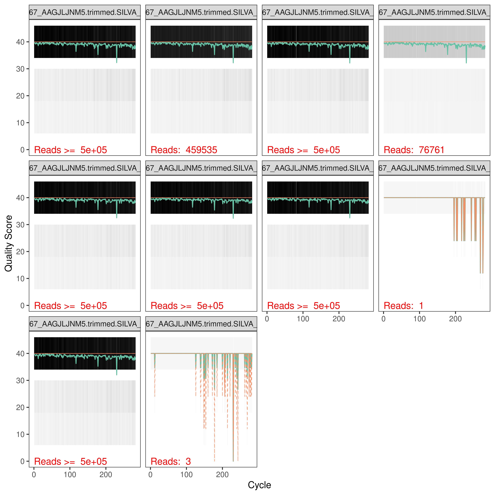
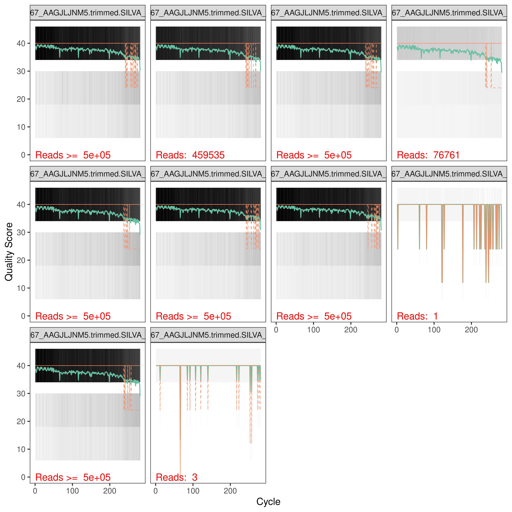
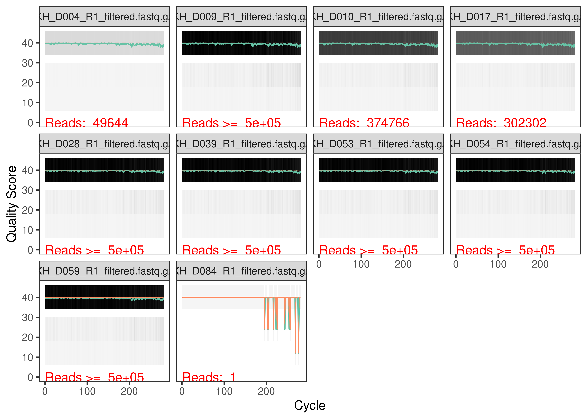
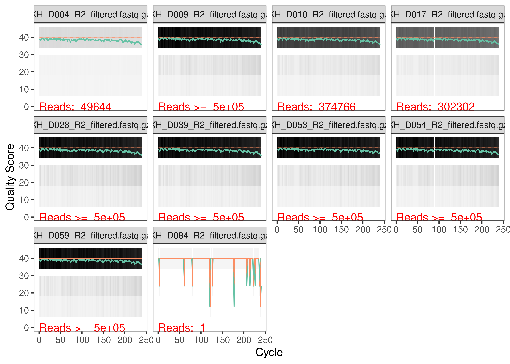
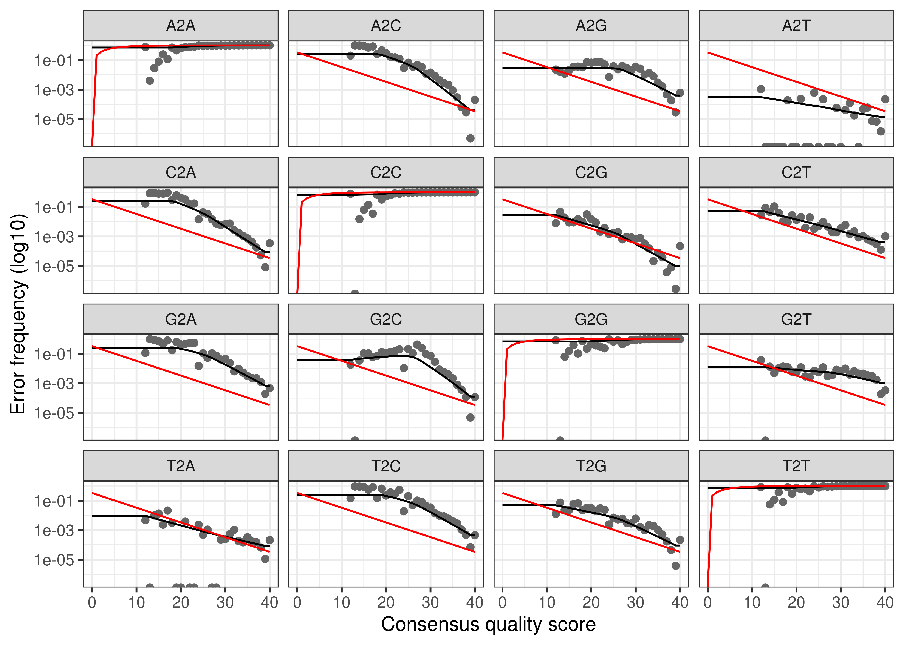
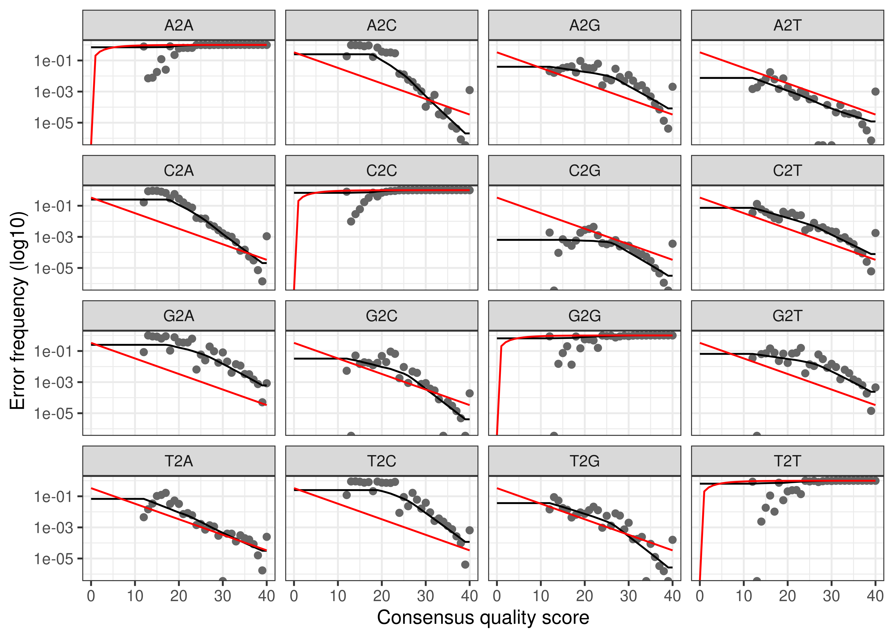
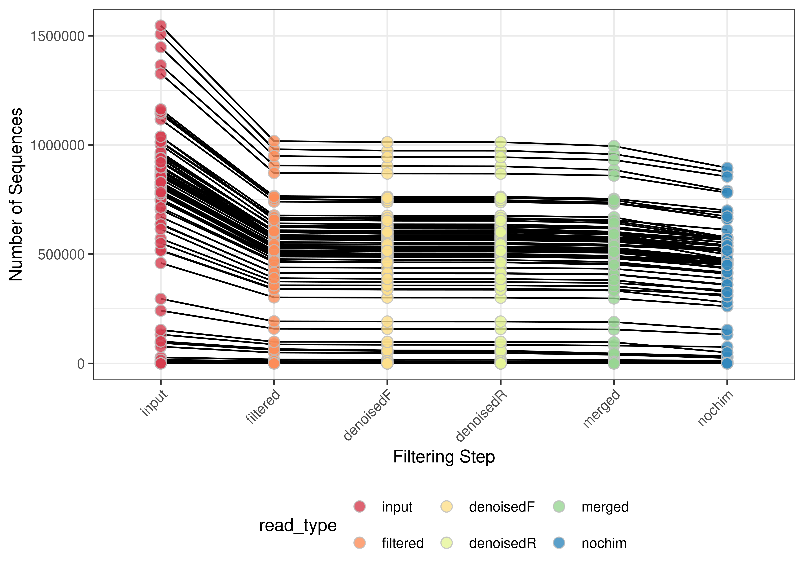
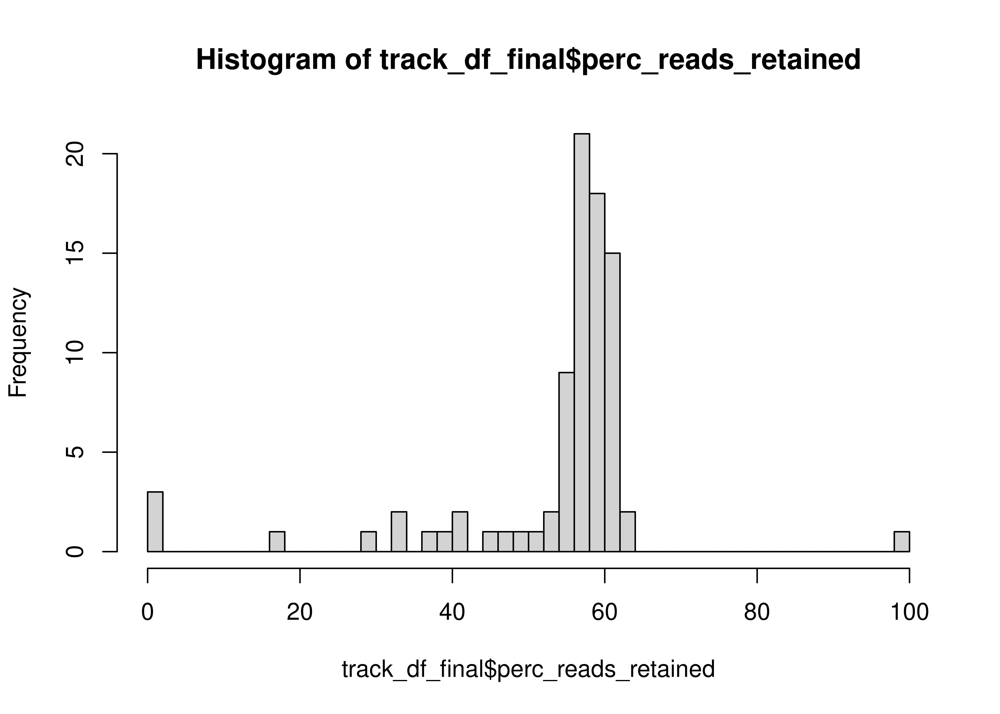
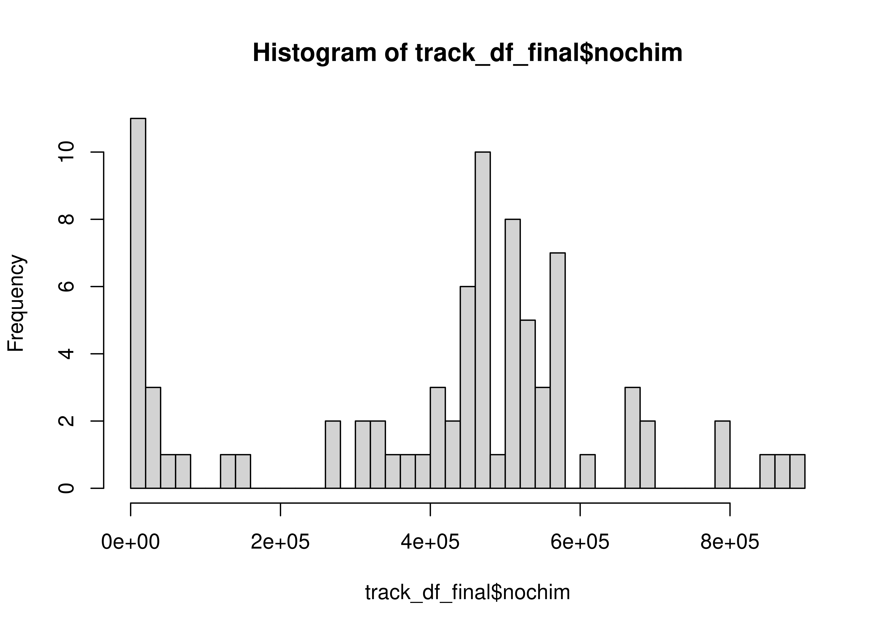

# Loading packages 

::: {.cell layout-align="center"}

```{.r .cell-code}
# Efficient loading of the packages 

pacman::p_load(patchwork, dada2, tidyverse, install = FALSE)

# Load in the colors and shapes
source("code/R/plotting_aesthetics.R")

# Handy function to get slack message when jobs are done

source("code/R/notify_me.R")
```
:::


# Set the path to the seq files 


::: {.cell layout-align="center"}

```{.r .cell-code}
# Find eukaryotic files

path <- "data/mcnichol-bbsplit/02-PROKs"

files <- list.files(path, ".fastq.gz")

head(files)
```

::: {.cell-output .cell-output-stdout}
```
[1] "Plate01_A01_KH_D001_10480167_AAGJLJNM5.trimmed.SILVA_132_PROK.cdhit95pc_1.fastq.gz"
[2] "Plate01_A01_KH_D001_10480167_AAGJLJNM5.trimmed.SILVA_132_PROK.cdhit95pc_2.fastq.gz"
[3] "Plate01_A02_KH_D009_10480167_AAGJLJNM5.trimmed.SILVA_132_PROK.cdhit95pc_1.fastq.gz"
[4] "Plate01_A02_KH_D009_10480167_AAGJLJNM5.trimmed.SILVA_132_PROK.cdhit95pc_2.fastq.gz"
[5] "Plate01_A03_KH_D017_10480167_AAGJLJNM5.trimmed.SILVA_132_PROK.cdhit95pc_1.fastq.gz"
[6] "Plate01_A03_KH_D017_10480167_AAGJLJNM5.trimmed.SILVA_132_PROK.cdhit95pc_2.fastq.gz"
```
:::

```{.r .cell-code}
length(files)
```

::: {.cell-output .cell-output-stdout}
```
[1] 170
```
:::
:::


We have 170 files, for which the key piece is the KH_D*** value, which corresponds to the DNA_ID in the Schmidt Lab Data Log. These reads have already had their primers trimmed off and been separated from eukaryotic reads from the same sample.

# Load in Forward and Reverse reads and assess the quality


::: {.cell layout-align="center"}

```{.r .cell-code}
# 1. Forward read variable 
forward_reads <- 
  list.files(path,
           pattern = "_1.fastq.gz",
           full.names = TRUE)

reverse_reads <- 
  list.files(path,
           pattern = "_2.fastq.gz",
           full.names = TRUE)

sample_names <- 
  data.frame(
            bname = basename(forward_reads)
            ) %>%
           separate_wider_delim(bname, delim = "_", names_sep = "_", too_few = "align_start") %>%
           transmute(sample_name = paste(bname_3, bname_4, sep = "_")) %>%
           pull()


filtered_filepaths_forward <- 
  file.path("data", "01b_Prokaryotic_Denoising", "filtered", paste0(sample_names, "_R1_filtered.fastq.gz"))

filtered_filepaths_reverse <- 
  file.path("data", "01b_Prokaryotic_Denoising", "filtered", paste0(sample_names, "_R2_filtered.fastq.gz"))

# Show the quality of each base on the reads
set.seed(314)
random_plots <- sample(1:85, size = 10)
# 
# forward_qual_plots <-
#       plotQualityProfile(forward_reads[random_plots])
# 
# reverse_qual_plots <-
#       plotQualityProfile(reverse_reads[random_plots])
# 
# 
# write_rds(forward_qual_plots,
#           file = "data/01b_Prokaryotic_Denoising/forward_qual_plots.rds",
#           compress = "gz")
# 
# write_rds(reverse_qual_plots,
#           file = "data/01b_Prokaryotic_Denoising/reverse_qual_plots.rds",
#           compress = "gz")

forward_qual_plots <- read_rds("data/01b_Prokaryotic_Denoising/forward_qual_plots.rds")
reverse_qual_plots <- read_rds("data/01b_Prokaryotic_Denoising/reverse_qual_plots.rds")

forward_qual_plots
```

::: {.cell-output-display}
{fig-align='center' width=2400}
:::

```{.r .cell-code}
reverse_qual_plots
```

::: {.cell-output-display}
{fig-align='center' width=2400}
:::
:::


# Filter and Trim

::: {.cell layout-align="center"}

```{.r .cell-code}
set.seed(314)

# filtered_outs <-
#   filterAndTrim(forward_reads,
#               filtered_filepaths_forward,
#               reverse_reads,
#               filtered_filepaths_reverse,
#                             truncLen = c(281,240),
#                             trimLeft = c(0,0),
#                             maxN = 0,
#                             maxEE = c(2,2),
#                             truncQ = 2,
#                             rm.phix = TRUE,
#                             compress = TRUE,
#                             multithread = 30
#                             )
# 
# 
# write_rds(filtered_outs,
#           file = "data/01b_Prokaryotic_Denoising/filtered_outs.rds",
#           compress = "gz")

filtered_outs <- read_rds("data/01b_Prokaryotic_Denoising/filtered_outs.rds")

filtered_outs %>%
  as.data.frame() %>%
  summarize(Median_Reads_In = median(reads.in),
            Median_Reads_Out = median(reads.out),
            Median_Reads_Removed = Median_Reads_In - Median_Reads_Out,
            Percent_Removed = Median_Reads_Removed / Median_Reads_In)
```

::: {.cell-output .cell-output-stdout}
```
  Median_Reads_In Median_Reads_Out Median_Reads_Removed Percent_Removed
1          803104           528257               274847       0.3422309
```
:::
:::


We drop a lot of reads from each sequencing run - this seems to be a very common fact of NextSeq sequencing, which is important to remember for future sequencing runs.


Did we lose any samples?


::: {.cell layout-align="center"}

```{.r .cell-code}
filtered_outs %>%
  as.data.frame() %>%
  filter(reads.out == 0) %>%
  rownames() %>%
  str_remove("R1.fastq.gz")
```

::: {.cell-output .cell-output-stdout}
```
[1] "Plate01_F12_Blank06_10480167_AAGJLJNM5.trimmed.SILVA_132_PROK.cdhit95pc_1.fastq.gz"
[2] "Plate01_H03_KH_D024_10480167_AAGJLJNM5.trimmed.SILVA_132_PROK.cdhit95pc_1.fastq.gz"
```
:::

```{.r .cell-code}
new_filtered_filepaths_forward <- 
  filtered_filepaths_forward[!str_detect(filtered_filepaths_forward, pattern = "Blank06_10480167|KH_D024")]

new_filtered_filepaths_reverse <- 
  filtered_filepaths_reverse[!str_detect(filtered_filepaths_reverse, pattern = "Blank06_10480167|KH_D024")]
```
:::

::: {.cell layout-align="center"}

```{.r .cell-code}
# filt_forward_qual_plots <-
#       plotQualityProfile(new_filtered_filepaths_forward[random_plots])
# 
# filt_reverse_qual_plots <-
#       plotQualityProfile(new_filtered_filepaths_reverse[random_plots])
# 
# 
# write_rds(filt_forward_qual_plots,
#           file = "data/01b_Prokaryotic_Denoising/filt_forward_qual_plots.rds",
#           compress = "gz")
# 
# write_rds(filt_reverse_qual_plots,
#           file = "data/01b_Prokaryotic_Denoising/filt_reverse_qual_plots.rds",
#           compress = "gz")

filt_forward_qual_plots <- read_rds("data/01b_Prokaryotic_Denoising/filt_forward_qual_plots.rds")
filt_reverse_qual_plots <- read_rds("data/01b_Prokaryotic_Denoising/filt_reverse_qual_plots.rds")

filt_forward_qual_plots
```

::: {.cell-output-display}
{fig-align='center' width=2100}
:::

```{.r .cell-code}
filt_reverse_qual_plots
```

::: {.cell-output-display}
{fig-align='center' width=2100}
:::
:::


# Generate an error model 

::: {.cell layout-align="center"}

```{.r .cell-code}
# Learn errors

source("code/R/loess_error.R")
# This function is from here: worth reading in its entirety
# https://github.com/benjjneb/dada2/issues/1307


# There has been active discussion the past few months that binned quality scores need to use many more bases than continuous quality scores to prevent spurious ASVs. 
# https://github.com/benjjneb/dada2/issues/1307
# As such, I'm bumping up my nbases all the way to 1e9, which seems crazy but hopefully only need to run once. I also remove all blanks from the error model.

# error_models_forward <-
#         learnErrors(new_filtered_filepaths_forward,
#                     multithread = 30,
#                     verbose = FALSE,
#                     errorEstimationFunction = loessErrfun_mod4,
#                     nbases = 1e9
#                     )
# notify_me(exists("error_models_forward"), "forward_finished")
# error_models_reverse <-
#         learnErrors(new_filtered_filepaths_reverse,
#                     multithread = 30,
#                     verbose = FALSE,
#                     errorEstimationFunction = loessErrfun_mod4,
#                     nbases = 1e9
#                     )
# notify_me(exists("error_models_reverse"), "reverse_finished")
# write_rds(error_models_forward, file = "data/01b_Prokaryotic_Denoising/error_models_forward.rds")
# write_rds(error_models_reverse, file = "data/01b_Prokaryotic_Denoising/error_models_reverse.rds")

error_models_forward <- read_rds("data/01b_Prokaryotic_Denoising/error_models_forward.rds")
error_models_reverse <- read_rds("data/01b_Prokaryotic_Denoising/error_models_reverse.rds")
# Plot the errors
# the estimated error rates (black line) are a good fit to the observed rates (points), and the error rates drop with increased quality as expected
plotErrors(error_models_forward,
           nominalQ = TRUE)
```

::: {.cell-output-display}
{fig-align='center' width=2100}
:::

```{.r .cell-code}
plotErrors(error_models_reverse,
           nominalQ = TRUE)
```

::: {.cell-output-display}
{fig-align='center' width=2100}
:::
:::


Predicted error hews fairly close to observed error, which is good.

# Inferring ASVs on the forward and reverse sequences 


::: {.cell layout-align="center"}

```{.r .cell-code}
# dada_forwards <-
#   dada(new_filtered_filepaths_forward,
#        err = error_models_forward,
#        multithread = 30)
# 
# notify_me(exists("dada_forwards"), message = "Forward done")
# 
# dada_reverses <-
#   dada(new_filtered_filepaths_reverse,
#        err = error_models_reverse,
#        multithread = 30)
# 
# notify_me(exists("dada_reverses"), message = "Reverse done")
# 
# write_rds(dada_forwards,
#           file = "data/01b_Prokaryotic_Denoising/dada_forwards.rds",
#           compress = "gz")
# 
# write_rds(dada_reverses,
#           file = "data/01b_Prokaryotic_Denoising/dada_reverses.rds",
#           compress = "gz")

dada_forwards <- read_rds("data/01b_Prokaryotic_Denoising/dada_forwards.rds")
dada_reverses <- read_rds("data/01b_Prokaryotic_Denoising/dada_reverses.rds")
```
:::


# Merge forward and reverse ASVs 


::: {.cell layout-align="center"}

```{.r .cell-code}
# merged_amplicons <-
#     mergePairs(dada_forwards,
#                new_filtered_filepaths_forward,
#                dada_reverses,
#                new_filtered_filepaths_reverse,
#                verbose = FALSE)
# notify_me(exists("merged_amplicons"), "We merged")
# write_rds(merged_amplicons,
#           file = "data/01b_Prokaryotic_Denoising/merged_amplicons.rds",
#           compress = "gz")

merged_amplicons <- read_rds("data/01b_Prokaryotic_Denoising/merged_amplicons.rds")
```
:::


# Generate a count table! 


::: {.cell layout-align="center"}

```{.r .cell-code}
seqtabs <- makeSequenceTable(merged_amplicons)


# Let's look at the sequence distributions for each run to confirm they're similar
seqtabs %>%
        getSequences %>%
        nchar %>%
        table %>%
        sort
```

::: {.cell-output .cell-output-stdout}
```
.
  282   283   284   287   288   296   302   309   314   316   317   326   330 
    1     1     1     1     1     1     1     1     1     1     1     1     1 
  332   336   342   345   347   350   351   397   401   402   403   405   412 
    1     1     1     1     1     1     1     1     1     1     1     1     1 
  413   425   428   429   432   433   438   447   457   470   477   489   298 
    1     1     1     1     1     1     1     1     1     1     1     1     2 
  299   306   318   320   327   329   340   349   354   389   391   404   407 
    2     2     2     2     2     2     2     2     2     2     2     2     2 
  424   439   442   452   487   499   300   311   313   352   356   358   390 
    2     2     2     2     2     2     3     3     3     3     3     3     3 
  396   409   416   476   490   498   335   392   395   399   414   437   301 
    3     3     3     3     3     3     4     4     4     4     4     4     5 
  303   310   353   355   387   393   410   294   360   448   383   388   398 
    5     5     5     5     5     5     5     6     6     6     7     7     7 
  386   394   479   357   281   385   384   361   382   362   363   380   381 
    8     8    10    11    12    13    15    17    25    35    44    60    70 
  364   379   365   377   367   369   366   376   378   368   371   375   373 
   76   131   132   250   386   451   531   552   596   962  1105  1477  2233 
  370   372   374 
 3495  4596 12324 
```
:::
:::


Okay so it looks like a majority of ASVs are length 253 and 254. 

# Check & Remove for Chimeras (Bimeras)


::: {.cell layout-align="center"}

```{.r .cell-code}
# Identify and remove chimeras
# seqtab_nochim <- removeBimeraDenovo(seqtabs,
#                                     multithread = 60)
# 
# write_rds(seqtab_nochim, file = "data/01b_Prokaryotic_Denoising/seqtab_nochim.rds")

seqtab_nochim <- read_rds("data/01b_Prokaryotic_Denoising/seqtab_nochim.rds")


asvs <- dim(seqtab_nochim)[2]

# What proportion of counts were removed? 
chim_check <- sum(seqtab_nochim)/sum(seqtabs)
frac_removed <- (1-chim_check)*100
```
:::


We removed 1.352967% of reads when filtering for chimaeras. 


# Size Selection

I also want to get rid of ASVs that are too big.


::: {.cell layout-align="center"}

```{.r .cell-code}
asv_keeps <- nchar(getSequences(seqtab_nochim)) %in% c(370:375) 


seqtab_nc_len <- seqtab_nochim[,asv_keeps]
```
:::


We removed all ASVs that weren't size 252 or 253.

# Track the sequences through the pipeline 


::: {.cell layout-align="center"}

```{.r .cell-code}
# create a little function to identify number seqs 
getN <- function(x) sum(getUniques(x))


dada_forward_reads <- 
  map_dbl(dada_forwards, getN) 

dada_reverse_reads <- 
    map_dbl(dada_reverses, getN) 

merged_reads <- 
    map_dbl(merged_amplicons, getN) 

sum_filter_df <- 
  filtered_outs %>%
  as.data.frame() %>%
  rownames_to_column(var = "sample_name") %>%
  separate_wider_delim(sample_name, delim = "_", names = c("A","B", "C", "D"), too_many = "drop") %>%
  mutate(sample_name = paste(C,D, sep = "_")) %>%
  group_by(sample_name) %>%
  summarize(input = sum(reads.in),
            filtered = sum(reads.out)) %>%
  filter(filtered > 0)

# Make the table to track the seqs 

new_sample_names <- new_filtered_filepaths_forward %>%
  basename %>%
  str_remove("_R1_filtered.fastq.gz")

stopifnot(new_sample_names == new_filtered_filepaths_reverse %>%
  basename %>%
  str_remove("_R2_filtered.fastq.gz"))

track_df <- data.frame(sample_name = new_sample_names) %>%
  left_join(sum_filter_df) %>%
  cbind(dada_forward_reads,
        dada_reverse_reads,
        merged_reads,
        rowSums(seqtab_nc_len))


head(track_df)
```

::: {.cell-output .cell-output-stdout}
```
                             sample_name  input filtered dada_forward_reads
KH_D001_R1_filtered.fastq.gz     KH_D001 241601   158738             158174
KH_D009_R1_filtered.fastq.gz     KH_D009 869027   573287             571578
KH_D017_R1_filtered.fastq.gz     KH_D017 459535   302302             301175
KH_D025_R1_filtered.fastq.gz     KH_D025 751735   493259             490103
KH_D032_R1_filtered.fastq.gz     KH_D032 753166   495997             490076
KH_D040_R1_filtered.fastq.gz     KH_D040 518358   342765             341346
                             dada_reverse_reads merged_reads
KH_D001_R1_filtered.fastq.gz             157756       155519
KH_D009_R1_filtered.fastq.gz             572130       566261
KH_D017_R1_filtered.fastq.gz             300956       297611
KH_D025_R1_filtered.fastq.gz             490271       484355
KH_D032_R1_filtered.fastq.gz             490094       480124
KH_D040_R1_filtered.fastq.gz             341240       337283
                             rowSums(seqtab_nc_len)
KH_D001_R1_filtered.fastq.gz                 131823
KH_D009_R1_filtered.fastq.gz                 513112
KH_D017_R1_filtered.fastq.gz                 261488
KH_D025_R1_filtered.fastq.gz                 454845
KH_D032_R1_filtered.fastq.gz                 439695
KH_D040_R1_filtered.fastq.gz                 314764
```
:::

```{.r .cell-code}
# Change column names 
colnames(track_df) <- c("DNA_ID" , "input", "filtered", "denoisedF", "denoisedR", "merged", "nochim")
rownames(track_df) <- track_df$DNA_ID

# Generate a plot to track the reads through our DADA2 pipeline
track_df %>%
  pivot_longer(input:nochim, names_to = "read_type", values_to = "num_reads") %>%
  #left_join(metadata, by = "sample_name") %>% 
  mutate(read_type = fct_relevel(read_type, 
                                 "input", "filtered", "denoisedF", "denoisedR", "merged", "nochim")) %>%
  ggplot(aes(x = read_type, y = num_reads, fill = read_type)) + 
  #facet_grid(~strata) + 
  geom_line(aes(group = DNA_ID)) + 
  geom_point(shape = 21, size = 3, alpha = 0.8, color = "grey") + 
  scale_fill_brewer(palette = "Spectral") + 
  theme_bw() + 
  labs(x = "Filtering Step", y = "Number of Sequences") +
  theme(legend.position = "bottom",
        axis.text.x = element_text(angle = 45, vjust = 1, hjust = 1))
```

::: {.cell-output-display}
{fig-align='center' width=2100}
:::

```{.r .cell-code}
# make track dataframe and edit names to match metadata
track_df_final <- track_df %>%
  mutate(perc_reads_retained = 100 * nochim / input)


hist(track_df_final$perc_reads_retained, breaks = 50)
```

::: {.cell-output-display}
{fig-align='center' width=2100}
:::

```{.r .cell-code}
hist(track_df_final$nochim, breaks = 50)
```

::: {.cell-output-display}
{fig-align='center' width=2100}
:::

```{.r .cell-code}
med_read_retained <- median(track_df_final$nochim)
med_perc_retained <- median(track_df_final$perc_reads_retained)

num_asvs <- ncol(seqtab_nc_len)
```
:::


Overall using the updated error model, we retained 4.74061\times 10^{5} reads and 57.8088694 % of reads. We inferred 18109 ASVs.


# Prepare the data for export! 
## 1. ASV Table 


::: {.cell layout-align="center"}

```{.r .cell-code}
############## Modify the ASV names and then save a fasta file! 
# Give headers more manageable names
# First pull the ASV sequences
asv_seqs <- colnames(seqtab_nc_len)

# make headers for our ASV seq fasta file, which will be our asv names
asv_headers <- vector(dim(seqtab_nc_len)[2], mode = "character")

# loop through vector and fill it in with ASV names 

for (i in 1:dim(seqtab_nc_len)[2]) {
  asv_headers[i] <- paste(">PROK", i, sep = "_")
}

# intitution check
head(asv_headers, 20)
```

::: {.cell-output .cell-output-stdout}
```
 [1] ">PROK_1"  ">PROK_2"  ">PROK_3"  ">PROK_4"  ">PROK_5"  ">PROK_6" 
 [7] ">PROK_7"  ">PROK_8"  ">PROK_9"  ">PROK_10" ">PROK_11" ">PROK_12"
[13] ">PROK_13" ">PROK_14" ">PROK_15" ">PROK_16" ">PROK_17" ">PROK_18"
[19] ">PROK_19" ">PROK_20"
```
:::

```{.r .cell-code}
##### Rename ASVs in table then write out our ASV fasta file! 

asv_tab <- t(seqtab_nc_len)

## Rename our asvs! 
row.names(asv_tab) <- sub(">", "", asv_headers)
#View(asv_tab)

# Write the count table to a file! 
write.table(asv_tab, "data/01b_Prokaryotic_Denoising/ASV_counts.tsv", sep = "\t", quote = FALSE, col.names = NA)

# Write out the fasta file for reference later on for what seq matches what ASV
asv_fasta <- c(rbind(asv_headers, asv_seqs))

# Save to a file!
write(asv_fasta, "data/01b_Prokaryotic_Denoising/ASVs.fasta")

# And save our seqtab_nc_len R Object for taxonomic assignment
row.names(seqtab_nc_len) <- new_sample_names

save(seqtab_nc_len, file = "data/01b_Prokaryotic_Denoising/seqtab_nc_len.RData")
# And save our meta_track R object
save(track_df_final, file = "data/01b_Prokaryotic_Denoising/track_df_final.RData")
```
:::

::: {.cell layout-align="center"}

```{.r .cell-code}
devtools::session_info()
```

::: {.cell-output .cell-output-stdout}
```
─ Session info ───────────────────────────────────────────────────────────────
 setting  value
 version  R version 4.3.3 (2024-02-29)
 os       Rocky Linux 9.4 (Blue Onyx)
 system   x86_64, linux-gnu
 ui       X11
 language (EN)
 collate  en_US.UTF-8
 ctype    en_US.UTF-8
 tz       America/New_York
 date     2025-04-15
 pandoc   3.1.1 @ /usr/lib/rstudio-server/bin/quarto/bin/tools/ (via rmarkdown)
 quarto   1.3.450 @ /usr/lib/rstudio-server/bin/quarto/bin/quarto

─ Packages ───────────────────────────────────────────────────────────────────
 ! package              * version   date (UTC) lib source
   abind                  1.4-8     2024-09-12 [1] RSPM (R 4.3.3)
   Biobase                2.62.0    2023-10-24 [1] Bioconductor
   BiocGenerics           0.48.1    2023-11-01 [1] Bioconductor
   BiocParallel           1.36.0    2023-10-24 [1] Bioconductor
   Biostrings             2.70.3    2024-03-13 [1] Bioconductor 3.18 (R 4.3.3)
   bitops                 1.0-9     2024-10-03 [1] RSPM (R 4.3.3)
   cachem                 1.1.0     2024-05-16 [1] RSPM (R 4.3.3)
   cli                    3.6.4     2025-02-13 [1] RSPM (R 4.3.3)
 P codetools              0.2-19    2023-02-01 [?] CRAN (R 4.3.3)
   colorspace             2.1-1     2024-07-26 [1] RSPM (R 4.3.3)
   crayon                 1.5.3     2024-06-20 [1] RSPM (R 4.3.3)
   dada2                * 1.30.0    2023-10-24 [1] Bioconductor
   DelayedArray           0.28.0    2023-10-24 [1] Bioconductor
   deldir                 2.0-4     2024-02-28 [1] RSPM (R 4.3.3)
 P devtools               2.4.5     2022-10-11 [?] CRAN (R 4.3.2)
   digest                 0.6.37    2024-08-19 [1] RSPM (R 4.3.3)
   dplyr                * 1.1.4     2023-11-17 [1] RSPM (R 4.3.3)
 P ellipsis               0.3.2     2021-04-29 [?] CRAN (R 4.3.2)
   evaluate               1.0.3     2025-01-10 [1] RSPM (R 4.3.3)
   farver                 2.1.2     2024-05-13 [1] RSPM (R 4.3.3)
   fastmap                1.2.0     2024-05-15 [1] RSPM (R 4.3.3)
   forcats              * 1.0.0     2023-01-29 [1] RSPM (R 4.3.3)
   fs                     1.6.5     2024-10-30 [1] RSPM (R 4.3.3)
   generics               0.1.3     2022-07-05 [1] RSPM (R 4.3.3)
   GenomeInfoDb           1.38.8    2024-03-15 [1] Bioconductor 3.18 (R 4.3.3)
   GenomeInfoDbData       1.2.11    2025-04-11 [1] Bioconductor
   GenomicAlignments      1.38.2    2024-01-16 [1] Bioconductor 3.18 (R 4.3.3)
   GenomicRanges          1.54.1    2023-10-29 [1] Bioconductor
   ggplot2              * 3.5.2     2025-04-09 [1] RSPM (R 4.3.3)
   glue                   1.8.0     2024-09-30 [1] RSPM (R 4.3.3)
   gtable                 0.3.6     2024-10-25 [1] RSPM (R 4.3.3)
   hms                    1.1.3     2023-03-21 [1] RSPM (R 4.3.3)
   htmltools              0.5.8.1   2024-04-04 [1] RSPM (R 4.3.3)
 P htmlwidgets            1.6.4     2023-12-06 [?] CRAN (R 4.3.2)
 P httpuv                 1.6.15    2024-03-26 [?] CRAN (R 4.3.2)
   hwriter                1.3.2.1   2022-04-08 [1] RSPM (R 4.3.3)
   interp                 1.1-6     2024-01-26 [1] RSPM (R 4.3.3)
   IRanges                2.36.0    2023-10-24 [1] Bioconductor
   jpeg                   0.1-11    2025-03-21 [1] RSPM (R 4.3.3)
   jsonlite               2.0.0     2025-03-27 [1] RSPM (R 4.3.3)
   knitr                  1.50      2025-03-16 [1] RSPM (R 4.3.3)
   labeling               0.4.3     2023-08-29 [1] RSPM (R 4.3.3)
 P later                  1.4.2     2025-04-08 [?] RSPM (R 4.3.3)
 P lattice                0.22-5    2023-10-24 [?] CRAN (R 4.3.3)
   latticeExtra           0.6-30    2022-07-04 [1] RSPM (R 4.3.3)
   lifecycle              1.0.4     2023-11-07 [1] RSPM (R 4.3.3)
   lubridate            * 1.9.4     2024-12-08 [1] RSPM (R 4.3.3)
   magrittr               2.0.3     2022-03-30 [1] RSPM (R 4.3.3)
 P Matrix                 1.6-5     2024-01-11 [?] CRAN (R 4.3.3)
   MatrixGenerics         1.14.0    2023-10-24 [1] Bioconductor
   matrixStats            1.5.0     2025-01-07 [1] RSPM (R 4.3.3)
   memoise                2.0.1     2021-11-26 [1] RSPM (R 4.3.3)
   mime                   0.13      2025-03-17 [1] RSPM (R 4.3.3)
 P miniUI                 0.1.1.1   2018-05-18 [?] CRAN (R 4.3.2)
   munsell                0.5.1     2024-04-01 [1] RSPM (R 4.3.3)
 P pacman                 0.5.1     2019-03-11 [?] CRAN (R 4.3.2)
   patchwork            * 1.3.0     2024-09-16 [1] RSPM (R 4.3.3)
   pillar                 1.10.2    2025-04-05 [1] RSPM (R 4.3.3)
 P pkgbuild               1.4.7     2025-03-24 [?] RSPM (R 4.3.3)
   pkgconfig              2.0.3     2019-09-22 [1] RSPM (R 4.3.3)
 P pkgload                1.4.0     2024-06-28 [?] CRAN (R 4.3.2)
   plyr                   1.8.9     2023-10-02 [1] RSPM (R 4.3.3)
   png                    0.1-8     2022-11-29 [1] RSPM (R 4.3.3)
 P profvis                0.4.0     2024-09-20 [?] CRAN (R 4.3.2)
 P promises               1.3.2     2024-11-28 [?] CRAN (R 4.3.2)
   purrr                * 1.0.4     2025-02-05 [1] RSPM (R 4.3.3)
   R6                     2.6.1     2025-02-15 [1] RSPM (R 4.3.3)
   RColorBrewer           1.1-3     2022-04-03 [1] RSPM (R 4.3.3)
   Rcpp                 * 1.0.14    2025-01-12 [1] RSPM (R 4.3.3)
   RcppParallel           5.1.10    2025-01-24 [1] RSPM (R 4.3.3)
   RCurl                  1.98-1.17 2025-03-22 [1] RSPM (R 4.3.3)
   readr                * 2.1.5     2024-01-10 [1] RSPM (R 4.3.3)
 P remotes                2.5.0     2024-03-17 [?] CRAN (R 4.3.2)
   renv                   1.0.3     2023-09-19 [1] CRAN (R 4.3.3)
   reshape2               1.4.4     2020-04-09 [1] RSPM (R 4.3.3)
   rlang                  1.1.5     2025-01-17 [1] RSPM (R 4.3.3)
   rmarkdown              2.29      2024-11-04 [1] RSPM (R 4.3.3)
   Rsamtools              2.18.0    2023-10-24 [1] Bioconductor
   rstudioapi             0.17.1    2024-10-22 [1] RSPM (R 4.3.3)
   S4Arrays               1.2.1     2024-03-04 [1] Bioconductor 3.18 (R 4.3.3)
   S4Vectors              0.40.2    2023-11-23 [1] Bioconductor 3.18 (R 4.3.3)
   scales                 1.3.0     2023-11-28 [1] RSPM (R 4.3.3)
 P sessioninfo            1.2.3     2025-02-05 [?] RSPM (R 4.3.3)
 P shiny                  1.10.0    2024-12-14 [?] CRAN (R 4.3.2)
   ShortRead              1.60.0    2023-10-24 [1] Bioconductor
   SparseArray            1.2.4     2024-02-11 [1] Bioconductor 3.18 (R 4.3.3)
   stringi                1.8.7     2025-03-27 [1] RSPM (R 4.3.3)
   stringr              * 1.5.1     2023-11-14 [1] RSPM (R 4.3.3)
   SummarizedExperiment   1.32.0    2023-10-24 [1] Bioconductor
   tibble               * 3.2.1     2023-03-20 [1] RSPM (R 4.3.3)
   tidyr                * 1.3.1     2024-01-24 [1] RSPM (R 4.3.3)
   tidyselect             1.2.1     2024-03-11 [1] RSPM (R 4.3.3)
   tidyverse            * 2.0.0     2023-02-22 [1] RSPM (R 4.3.3)
   timechange             0.3.0     2024-01-18 [1] RSPM (R 4.3.3)
   tzdb                   0.5.0     2025-03-15 [1] RSPM (R 4.3.3)
 P urlchecker             1.0.1     2021-11-30 [?] CRAN (R 4.3.2)
 P usethis                3.1.0     2024-11-26 [?] CRAN (R 4.3.2)
   vctrs                  0.6.5     2023-12-01 [1] RSPM (R 4.3.3)
   withr                  3.0.2     2024-10-28 [1] RSPM (R 4.3.3)
   xfun                   0.52      2025-04-02 [1] RSPM (R 4.3.3)
 P xtable                 1.8-4     2019-04-21 [?] CRAN (R 4.3.2)
   XVector                0.42.0    2023-10-24 [1] Bioconductor
   yaml                   2.3.10    2024-07-26 [1] RSPM (R 4.3.3)
   zlibbioc               1.48.2    2024-03-13 [1] Bioconductor 3.18 (R 4.3.3)

 [1] /local/workdir/arp277/AAM_ERI_2024/renv/library/R-4.3/x86_64-pc-linux-gnu
 [2] /home/arp277/.cache/R/renv/sandbox/R-4.3/x86_64-pc-linux-gnu/fd835031

 * ── Packages attached to the search path.
 P ── Loaded and on-disk path mismatch.

──────────────────────────────────────────────────────────────────────────────
```
:::
:::