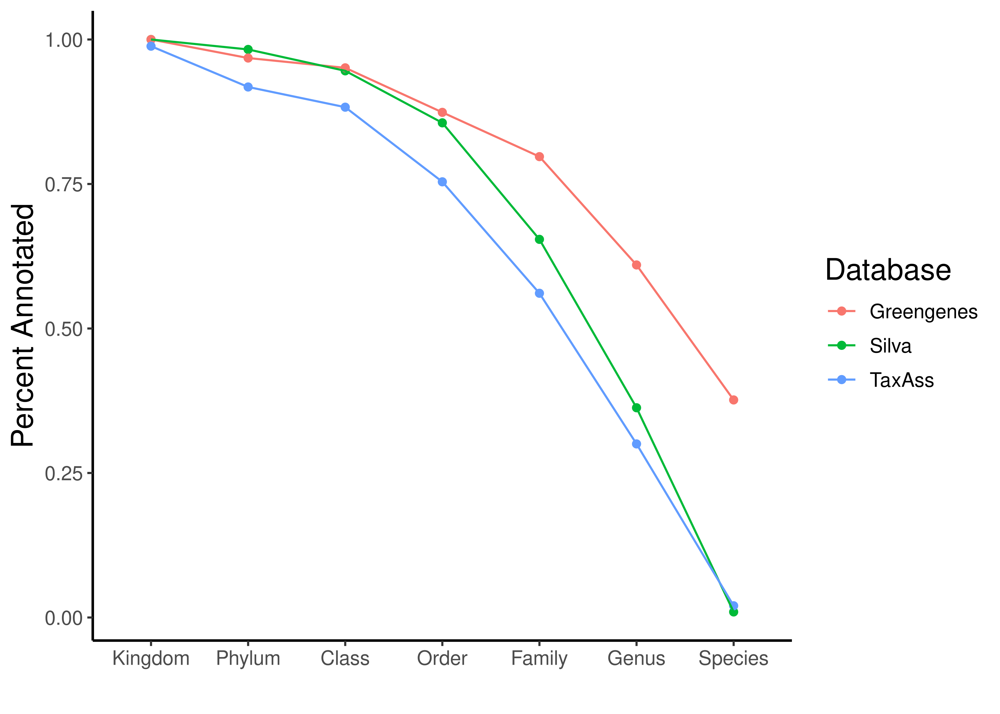

# Purpose

The purpose of this document is to take the feature count (otu) table we generated with dada2 and assign taxonomy to our ASVs.

# Load packages, source files, and R objects 


::: {.cell layout-align="center"}

```{.r .cell-code}
pacman::p_load(tidyverse, phyloseq, dada2, install = FALSE)

# Load in the colors and shapes
source("code/R/plotting_aesthetics.R")

source("code/R/notify_me.R")

# Load in our feature count table
load("data/01b_Prokaryotic_Denoising/seqtab_nc_len.RData")

# And load our meta_data
load("data/01b_Prokaryotic_Denoising/track_df_final.RData")
```
:::


# Assign Taxonomy with TaxAss


::: {.cell layout-align="center" engine.opts='-l'}

```{.bash .cell-code}

mkdir -p data/02b_Prokaryotic_Taxonomic_Classification/TaxAss_analysis

# First, clone Taxass into Taxass folder

# Grab ASVs from 01b_Prokaryotic_Denoising

cp data/01b_Prokaryotic_Denoising/ASVs.fasta data/02b_Prokaryotic_Taxonomic_Classification/TaxAss_analysis/

cd data/02b_Prokaryotic_Taxonomic_Classification/TaxAss_analysis # Move into Taxass data folder

git clone git@github.com:McMahonLab/TaxAss.git # Clone Taxass Github Repo

cd TaxAss # Move into git repo

cd FreshTrain-files # Move to database zip folders

unzip FreshTrain15Jun2020silva138.zip # Unzip newest version

cd FreshTrain15Jun2020silva138 # Move into it

# Move files into TaxAss_analysis directory
mv -f silva_nr_v138_taxass.fasta ../../../

mv -f silva_nr_v138_taxass.taxonomy ../../../

mv -f FreshTrain15Jun2020silva138.fasta ../../../

mv -f FreshTrain15Jun2020silva138.taxonomy ../../../

# Move back to root of TaxAss git repo
cd ../../

# Move into tax-scripts
cd tax-scripts

# Move everyting into TaxAss_analysis directory
mv -f * ../../

# Move to TaxAss_analysis directory
cd ../../

# Remove TaxAss git repo
rm -r -f TaxAss


# Put dependencies in path
export PATH=/programs/mothur:$PATH
export PATH=/programs/ncbi-blast-2.16.0+/bin:$PATH

cat $PATH

# Run taxass with 50 threads
./RunSteps_quickie.sh ASVs FreshTrain15Jun2020silva138 silva_nr_v138_taxass 98 80 80 50

# Make directory for taxonomy exports if it doesn't exist yet


# Move our final result file there
mv -f ASVs.98.80.80.taxonomy ..
mv -f FreshTrain15Jun2020silva138.taxonomy ..


# Remove everything else besides our ASVs.fasta file (so repo looks exactly like it did when we started)
ls | grep -xv "ASVs.fasta" | xargs rm

# Move back to project root
cd ../../../
```
:::


# Assign taxonomy using Dada/Silva

Here, we will use the silva database version 138! I will also try doing it with the Greengenes2 database


::: {.cell layout-align="center"}

```{.r .cell-code}
# This takes awhile
# taxa <- assignTaxonomy(seqtab_nc_len, "/workdir/in_class_data/taxonomy/silva_nr99_v138.1_train_set.fa.gz",
#                        multithread=30,
#                        tryRC = TRUE)
# 
# notify_me(exists("taxa"), "Finished first pass")
# 
# taxa <- addSpecies(taxa, "/workdir/in_class_data/taxonomy/silva_species_assignment_v138.1.fa.gz",
#                    tryRC = TRUE)
# 
# notify_me(exists("taxa"), "Added species")
# 
# write_rds(taxa, "data/02b_Prokaryotic_Taxonomic_Classification/taxa.rds")

# taxa_gg <- assignTaxonomy(seqtab_nc_len, "code/greengenes_dada_database/gg2_2024_09_toSpecies_trainset.fa.gz",
#                        multithread=30,
#                        tryRC = TRUE)
# 
# notify_me(exists("taxa_gg"), "Finished first pass")
# 
# write_rds(taxa_gg, "data/02b_Prokaryotic_Taxonomic_Classification/tax_gg.rds")

taxa <- read_rds("data/02b_Prokaryotic_Taxonomic_Classification/taxa.rds")
taxa_gg <- read_rds("data/02b_Prokaryotic_Taxonomic_Classification/tax_gg.rds")
# Inspect the taxonomy 
taxa_print <- taxa # Removing sequence rownames for display only
rownames(taxa_print) <- NULL
head(taxa_print, 20)
```

::: {.cell-output .cell-output-stdout}
```
      Kingdom    Phylum             Class                 Order               
 [1,] "Bacteria" "Actinobacteriota" "Actinobacteria"      "Frankiales"        
 [2,] "Bacteria" "Proteobacteria"   "Alphaproteobacteria" "SAR11 clade"       
 [3,] "Bacteria" "Actinobacteriota" "Actinobacteria"      "Frankiales"        
 [4,] "Bacteria" "Actinobacteriota" "Actinobacteria"      "Frankiales"        
 [5,] "Bacteria" "Actinobacteriota" "Actinobacteria"      "Frankiales"        
 [6,] "Bacteria" "Proteobacteria"   "Gammaproteobacteria" "Burkholderiales"   
 [7,] "Bacteria" "Actinobacteriota" "Actinobacteria"      "Frankiales"        
 [8,] "Bacteria" "Proteobacteria"   "Gammaproteobacteria" "Burkholderiales"   
 [9,] "Bacteria" "Actinobacteriota" "Acidimicrobiia"      "Microtrichales"    
[10,] "Bacteria" "Actinobacteriota" "Acidimicrobiia"      "Microtrichales"    
[11,] "Bacteria" "Proteobacteria"   "Gammaproteobacteria" "Burkholderiales"   
[12,] "Bacteria" "Proteobacteria"   "Gammaproteobacteria" "Burkholderiales"   
[13,] "Bacteria" "Cyanobacteria"    "Cyanobacteriia"      "Chloroplast"       
[14,] "Bacteria" "Bacteroidota"     "Bacteroidia"         "Chitinophagales"   
[15,] "Bacteria" "Actinobacteriota" "Actinobacteria"      "Frankiales"        
[16,] "Bacteria" "Bacteroidota"     "Bacteroidia"         "Sphingobacteriales"
[17,] "Bacteria" "Proteobacteria"   "Gammaproteobacteria" "Burkholderiales"   
[18,] "Bacteria" "Bacteroidota"     "Kapabacteria"        "Kapabacteriales"   
[19,] "Bacteria" "Chloroflexi"      "SL56 marine group"   NA                  
[20,] "Bacteria" "Actinobacteriota" "Actinobacteria"      "Frankiales"        
      Family                 Genus                       Species      
 [1,] "Sporichthyaceae"      "hgcI clade"                NA           
 [2,] "Clade III"            NA                          NA           
 [3,] "Sporichthyaceae"      "hgcI clade"                NA           
 [4,] "Sporichthyaceae"      "Candidatus Planktophila"   NA           
 [5,] "Sporichthyaceae"      NA                          NA           
 [6,] "Methylophilaceae"     "Candidatus Methylopumilus" NA           
 [7,] "Sporichthyaceae"      "hgcI clade"                NA           
 [8,] "Burkholderiaceae"     "Polynucleobacter"          "acidiphobus"
 [9,] "Ilumatobacteraceae"   "CL500-29 marine group"     NA           
[10,] "Ilumatobacteraceae"   "CL500-29 marine group"     NA           
[11,] "Comamonadaceae"       "Limnohabitans"             NA           
[12,] "Comamonadaceae"       "Rhodoferax"                NA           
[13,] NA                     NA                          NA           
[14,] "Chitinophagaceae"     "Sediminibacterium"         NA           
[15,] "Sporichthyaceae"      "hgcI clade"                NA           
[16,] "NS11-12 marine group" NA                          NA           
[17,] "Comamonadaceae"       NA                          NA           
[18,] NA                     NA                          NA           
[19,] NA                     NA                          NA           
[20,] "Sporichthyaceae"      "Candidatus Planktophila"   NA           
```
:::
:::


# Taxonomy Table 


::: {.cell layout-align="center"}

```{.r .cell-code}
##### Prepare tax table 
# Add the ASV sequences from the rownames to a column 
new_tax_tab <- taxa %>%
  as.data.frame() %>%
  rownames_to_column(var = "ASVseqs") 
head(new_tax_tab)
```

::: {.cell-output .cell-output-stdout}
```
                                                                                                                                                                                                                                                                                                                                                                                 ASVseqs
1 TACATAGGGTGCAAGCGTTGTCCGGAATTATTGGGCGTAAAGAGCTCGTAGGTCGTTTGTTACGTCGGATGTGAAAACCTGAGGCTCAACCTCAGGCCTGCATTCGATACGGGCAAACTAGAGTTTGGTAGGGGAGACTGGAATTCCTGGTGTAGCGGTGGAATGCGCAGATATCAGGAGGAACACCAATGGCGAAGGCAGGTCTCTGGGCCAATACTGACACTGAGGAGCGAAAGTCTGGGGAGCGAACAGGATTAGATACCCTGGTAGTCCAGACCGTAAACGGTGGGCACTAGTTGTGGGAACCTTCCACGGTTTCTGCGACGCAGCTAACGCATTAAGTGCCCCGCCTGGGGAGTACGATCGCAAGATTA
2     TACGAAGGGACCTAGCGTAGTTCGGAATTACTGGGCGTAAAGCGCGCGTAGGCCGTTGAGTTAGTTAATTGTGAAATCCCAAAGCTTAACTTTGGAACTGCAATTAAAACTGCTCGACTAGAGTTTGATAGAGGAAAGCGGAATACATAGTGTAGAGGTGAAATTCGTAGATATTATGTAGAACACCAGTTGCGAAGGCGGCTTTCTGGATCAACACTGACGCTGAGGCGCGAAAGTATGGGTAGCAAAGAGGATTAGATACCCTCGTAGTCCATACCATAAACGATGATTGCTAGATGTTGGAAATTTATTTTCAGTATCGCAGCTAACGCATTAAGCAATCCGCCTGGGGAGTACGACCGCAAGGTTA
3 TACATAGGGTGCAAGCGTTGTCCGGAATTATTGGGCGTAAAGAGCTCGTAGGTCGTTTGTCGCGTCGATTGTGAAAATCTGAGGCTCAACCTCAGACCTGCAGTCGATACGGGCAAACTAGAGTGTGGTAGGGGAGACTGGAATTCCTGGTGTAGCGGTGGAATGCGCAGATATCAGGAGGAACACCAATGGCGAAGGCAGGTCTCTGGGCCATAACTGACACTGAGGAGCGAAAGTGCGGGGAGCGAACAGGATTAGATACCCTGGTAGTCCGCACCGTAAACGGTGGGCACTAGTTGTGGGAACCTTCCACGGTTTCCGCGACGCAGCAAACGCATTAAGTGCCCCGCCTGGGGAGTACGATCGCAAGATTA
4 TACATAGGGTGCAAGCGTTGTCCGGAATTATTGGGCGTAAAGAGCTCGTAGGTGGTTCGTCACGTCGGATGTGAAAATCTGGGGCTTAACCCCAGACCTGCATTCGATACGGGCGAGCTAGAGTGTGGTAGGGGAGACTGGAATTCCTGGTGTAGCGGTGGAATGCGCAGATATCAGGAGGAACACCAATGGCGAAGGCAGGTCTCTGGGCCATTACTGACACTGAGGAGCGAAAGCGTGGGGAGCGAACAGGATTAGATACCCTGGTAGTCCACGCCGTAAACGGTGGGCACTAGTTGTGGGAACCTTCCACGGTTTCTGCGACGCAGCTAACGCATTAAGTGCCCCGCCTGGGGAGTACGATCGCAAGATTA
5 TACATAGGGTGCAAGCGTTGTCCGGAATTATTGGGCGTAAAGAGCTCGTAGGTGGTTCGTCACGTCGGATGTGAAACTCTGGGGCTTAACCCCAGACCTGCATTCGATACGGGCGAGCTTGAGTATGGTAGGGGAGTCTGGAATTCCTGGTGTAGCGGTGGAATGCGCAGATATCAGGAGGAACACCAATGGCGAAGGCAGGACTCTGGGCCATTACTGACACTGAGGAGCGAAAGCGTGGGGAGCGAACAGGATTAGATACCCTGGTAGTCCACGCCGTAAACGGTGGGCACTAGTTGTGGGGACCTTCCACGGTCTCTGCGACGCAGCTAACGCATTAAGTGCCCCGCCTGGGGAGTACGATCGCAAGATTA
6 TACGTAGGGTGCGAGCGTTAATCGGAATTACTGGGCGTAAAGCGTGCGCAGGCGGTTTTGTAAGTCGGATGTGAAATCCCCGGGCTCAACCTGGGAACTGCGTTCGAAACTGCAAGGCTAGAGTGTGTCAGAGGGGGGTAGAATTCCACGTGTAGCAGTGAAATGCGTAGAGATGTGGAGGAATACCAATGGCGAAGGCAGCCCCCTGGGATAACACTGACGCTCATGCACGAAAGCGTGGGGAGCAAACAGGATTAGATACCCTGGTAGTCCACGCCCTAAACGATGTCAACTAGTTGTTGGTAGAGTAAAATCTATGAGTAACGTAGCTAACGCGTGAAGTTGACCGCCTGGGGAGTACGGTCGCAAGATTA
   Kingdom           Phylum               Class           Order
1 Bacteria Actinobacteriota      Actinobacteria      Frankiales
2 Bacteria   Proteobacteria Alphaproteobacteria     SAR11 clade
3 Bacteria Actinobacteriota      Actinobacteria      Frankiales
4 Bacteria Actinobacteriota      Actinobacteria      Frankiales
5 Bacteria Actinobacteriota      Actinobacteria      Frankiales
6 Bacteria   Proteobacteria Gammaproteobacteria Burkholderiales
            Family                     Genus Species
1  Sporichthyaceae                hgcI clade    <NA>
2        Clade III                      <NA>    <NA>
3  Sporichthyaceae                hgcI clade    <NA>
4  Sporichthyaceae   Candidatus Planktophila    <NA>
5  Sporichthyaceae                      <NA>    <NA>
6 Methylophilaceae Candidatus Methylopumilus    <NA>
```
:::

```{.r .cell-code}
# intution check 
stopifnot(new_tax_tab$ASVseqs == colnames(seqtab_nc_len))

asv_headers <- vector(dim(seqtab_nc_len)[2], mode = "character")

# loop through vector and fill it in with ASV names 

for (i in 1:dim(seqtab_nc_len)[2]) {
  asv_headers[i] <- paste(">PROK", i, sep = "_")
}

# intitution check
head(asv_headers, 20)
```

::: {.cell-output .cell-output-stdout}
```
 [1] ">PROK_1"  ">PROK_2"  ">PROK_3"  ">PROK_4"  ">PROK_5"  ">PROK_6" 
 [7] ">PROK_7"  ">PROK_8"  ">PROK_9"  ">PROK_10" ">PROK_11" ">PROK_12"
[13] ">PROK_13" ">PROK_14" ">PROK_15" ">PROK_16" ">PROK_17" ">PROK_18"
[19] ">PROK_19" ">PROK_20"
```
:::

```{.r .cell-code}
##### Rename ASVs in table then write out our ASV fasta file! 
#View(seqtab_nochim)
asv_tab <- t(seqtab_nc_len)
#View(asv_tab)

## Rename our asvs! 
row.names(asv_tab) <- sub(">", "", asv_headers)

# Now let's add the ASV names 
rownames(new_tax_tab) <- rownames(asv_tab)
#View(new_tax_tab)

### Final prep of tax table. Add new column with ASV names 
asv_tax <- 
  new_tax_tab %>%
  # add rownames from count table for phyloseq handoff
  mutate(ASV = rownames(asv_tab)) %>%
  # Resort the columns with select
  dplyr::select(Kingdom, Phylum, Class, Order, Family, Genus, Species, ASV, ASVseqs)

# Intution check
stopifnot(asv_tax$ASV == rownames(asv_tax), rownames(asv_tax) == rownames(asv_tab))
```
:::

::: {.cell layout-align="center"}

```{.r .cell-code}
##### Prepare tax table 
# Add the ASV sequences from the rownames to a column 
new_tax_tab_gg <- taxa_gg %>%
  as.data.frame() %>%
  rownames_to_column(var = "ASVseqs") 

head(new_tax_tab_gg)
```

::: {.cell-output .cell-output-stdout}
```
                                                                                                                                                                                                                                                                                                                                                                                 ASVseqs
1 TACATAGGGTGCAAGCGTTGTCCGGAATTATTGGGCGTAAAGAGCTCGTAGGTCGTTTGTTACGTCGGATGTGAAAACCTGAGGCTCAACCTCAGGCCTGCATTCGATACGGGCAAACTAGAGTTTGGTAGGGGAGACTGGAATTCCTGGTGTAGCGGTGGAATGCGCAGATATCAGGAGGAACACCAATGGCGAAGGCAGGTCTCTGGGCCAATACTGACACTGAGGAGCGAAAGTCTGGGGAGCGAACAGGATTAGATACCCTGGTAGTCCAGACCGTAAACGGTGGGCACTAGTTGTGGGAACCTTCCACGGTTTCTGCGACGCAGCTAACGCATTAAGTGCCCCGCCTGGGGAGTACGATCGCAAGATTA
2     TACGAAGGGACCTAGCGTAGTTCGGAATTACTGGGCGTAAAGCGCGCGTAGGCCGTTGAGTTAGTTAATTGTGAAATCCCAAAGCTTAACTTTGGAACTGCAATTAAAACTGCTCGACTAGAGTTTGATAGAGGAAAGCGGAATACATAGTGTAGAGGTGAAATTCGTAGATATTATGTAGAACACCAGTTGCGAAGGCGGCTTTCTGGATCAACACTGACGCTGAGGCGCGAAAGTATGGGTAGCAAAGAGGATTAGATACCCTCGTAGTCCATACCATAAACGATGATTGCTAGATGTTGGAAATTTATTTTCAGTATCGCAGCTAACGCATTAAGCAATCCGCCTGGGGAGTACGACCGCAAGGTTA
3 TACATAGGGTGCAAGCGTTGTCCGGAATTATTGGGCGTAAAGAGCTCGTAGGTCGTTTGTCGCGTCGATTGTGAAAATCTGAGGCTCAACCTCAGACCTGCAGTCGATACGGGCAAACTAGAGTGTGGTAGGGGAGACTGGAATTCCTGGTGTAGCGGTGGAATGCGCAGATATCAGGAGGAACACCAATGGCGAAGGCAGGTCTCTGGGCCATAACTGACACTGAGGAGCGAAAGTGCGGGGAGCGAACAGGATTAGATACCCTGGTAGTCCGCACCGTAAACGGTGGGCACTAGTTGTGGGAACCTTCCACGGTTTCCGCGACGCAGCAAACGCATTAAGTGCCCCGCCTGGGGAGTACGATCGCAAGATTA
4 TACATAGGGTGCAAGCGTTGTCCGGAATTATTGGGCGTAAAGAGCTCGTAGGTGGTTCGTCACGTCGGATGTGAAAATCTGGGGCTTAACCCCAGACCTGCATTCGATACGGGCGAGCTAGAGTGTGGTAGGGGAGACTGGAATTCCTGGTGTAGCGGTGGAATGCGCAGATATCAGGAGGAACACCAATGGCGAAGGCAGGTCTCTGGGCCATTACTGACACTGAGGAGCGAAAGCGTGGGGAGCGAACAGGATTAGATACCCTGGTAGTCCACGCCGTAAACGGTGGGCACTAGTTGTGGGAACCTTCCACGGTTTCTGCGACGCAGCTAACGCATTAAGTGCCCCGCCTGGGGAGTACGATCGCAAGATTA
5 TACATAGGGTGCAAGCGTTGTCCGGAATTATTGGGCGTAAAGAGCTCGTAGGTGGTTCGTCACGTCGGATGTGAAACTCTGGGGCTTAACCCCAGACCTGCATTCGATACGGGCGAGCTTGAGTATGGTAGGGGAGTCTGGAATTCCTGGTGTAGCGGTGGAATGCGCAGATATCAGGAGGAACACCAATGGCGAAGGCAGGACTCTGGGCCATTACTGACACTGAGGAGCGAAAGCGTGGGGAGCGAACAGGATTAGATACCCTGGTAGTCCACGCCGTAAACGGTGGGCACTAGTTGTGGGGACCTTCCACGGTCTCTGCGACGCAGCTAACGCATTAAGTGCCCCGCCTGGGGAGTACGATCGCAAGATTA
6 TACGTAGGGTGCGAGCGTTAATCGGAATTACTGGGCGTAAAGCGTGCGCAGGCGGTTTTGTAAGTCGGATGTGAAATCCCCGGGCTCAACCTGGGAACTGCGTTCGAAACTGCAAGGCTAGAGTGTGTCAGAGGGGGGTAGAATTCCACGTGTAGCAGTGAAATGCGTAGAGATGTGGAGGAATACCAATGGCGAAGGCAGCCCCCTGGGATAACACTGACGCTCATGCACGAAAGCGTGGGGAGCAAACAGGATTAGATACCCTGGTAGTCCACGCCCTAAACGATGTCAACTAGTTGTTGGTAGAGTAAAATCTATGAGTAACGTAGCTAACGCGTGAAGTTGACCGCCTGGGGAGTACGGTCGCAAGATTA
      Kingdom            Phylum                  Class               Order
1 d__Bacteria p__Actinomycetota       c__Actinomycetes  o__Nanopelagicales
2 d__Bacteria p__Pseudomonadota c__Alphaproteobacteria o__Pelagibacterales
3 d__Bacteria p__Actinomycetota       c__Actinomycetes  o__Nanopelagicales
4 d__Bacteria p__Actinomycetota       c__Actinomycetes  o__Nanopelagicales
5 d__Bacteria p__Actinomycetota       c__Actinomycetes  o__Nanopelagicales
6 d__Bacteria p__Pseudomonadota c__Gammaproteobacteria  o__Burkholderiales
                Family                      Genus         Species
1  f__Nanopelagicaceae           g__Nanopelagicus       s__limnes
2 f__Pelagibacteraceae             g__Fonsibacter      s__ubiquis
3  f__Nanopelagicaceae           g__Nanopelagicus            <NA>
4  f__Nanopelagicaceae            g__Planktophila  s__sp001438925
5  f__Nanopelagicaceae            g__Planktophila  s__sp001438925
6  f__Methylophilaceae g__Methylopumilus_A_558053 s__planktonicus
```
:::

```{.r .cell-code}
### Final prep of tax table. Add new column with ASV names 
asv_tax_gg <- 
  new_tax_tab_gg %>%
  # add rownames from count table for phyloseq handoff
  mutate(ASV = rownames(asv_tab)) %>%
  # Resort the columns with select
  dplyr::select(Kingdom, Phylum, Class, Order, Family, Genus, Species, ASV, ASVseqs)

# Intution check
stopifnot(asv_tax$ASV == rownames(asv_tax), rownames(asv_tax) == rownames(asv_tab))
```
:::

::: {.cell layout-align="center"}

```{.r .cell-code}
taxass_taxa <- read_csv("data/02b_Prokaryotic_Taxonomic_Classification/ASVs.98.80.80.taxonomy") %>%
  mutate(across(everything(), ~ifelse(str_detect(.x, "unclassified."), NA, .x)), # Convert unclassified to NAs
         across(everything(), ~str_remove_all(.x, "\\(\\d+\\)"))) %>% # Remove the boostrap values after names
  rename_with(.cols = everything(), ~paste0(.x, "_taxass")) # Change column names

cat("Using newest silva, we failed to classify",sum(is.na(asv_tax)), "slots")
```

::: {.cell-output .cell-output-stdout}
```
Using newest silva, we failed to classify 39640 slots
```
:::

```{.r .cell-code}
cat("Using greengenes, we failed to classify",sum(is.na(asv_tax_gg)), "slots")
```

::: {.cell-output .cell-output-stdout}
```
Using greengenes, we failed to classify 25779 slots
```
:::

```{.r .cell-code}
cat("Using taxass, we failed to classify",sum(is.na(taxass_taxa)), "slots")
```

::: {.cell-output .cell-output-stdout}
```
Using taxass, we failed to classify 46642 slots
```
:::

```{.r .cell-code}
# Here, we figure out which ASVs were assigned from within Taxass
taxass_lineages <- read_tsv("data/02b_Prokaryotic_Taxonomic_Classification/FreshTrain15Jun2020silva138.taxonomy", col_names = FALSE) %>% # Read in the tax file from the TaxAss custom database
  separate(X2, sep = ";", into = c("kingdom_taxass","phylum_taxass","class_taxass","order_taxass","lineage_taxass","clade_taxass","tribe_taxass","x")) %>% #Do some name cleaning
  mutate(across(everything(), ~ifelse(str_detect(.x, "unnamed."), NA, .x))) %>% # Instead of unclassified, convert to NA (to match our later output)
  inner_join(taxass_taxa) %>% # Innerjoin with our taxonomy file - only ASVs that were classified with the Taxass custom database (assumed to be well curated) stay
  pull(seqID_taxass) # Find those ASV ids.

taxa_joined <- inner_join(asv_tax, taxass_taxa, by = c("ASV" = "seqID_taxass")) %>%
  mutate(from_taxass = ASV %in% taxass_lineages)
```
:::

::: {.cell layout-align="center"}

```{.r .cell-code}
silva_nas <- asv_tax %>%
  summarize(across(Kingdom:Species, \(x)sum(!is.na(x))/n()))

gg_nas <- asv_tax_gg %>%
  summarize(across(Kingdom:Species, \(x)sum(!is.na(x))/n()))

taxass_nas <- taxass_taxa %>%
  summarize(across(kingdom_taxass:tribe_taxass, \(x)sum(!is.na(x))/n()))


colnames(taxass_nas) <- colnames(gg_nas)

rbind(silva_nas, gg_nas, taxass_nas) %>%
  mutate(Database = c("Silva", "Greengenes", "TaxAss")) %>%
  pivot_longer(Kingdom:Species, names_to = "Level", values_to = "NAs") %>%
  mutate(Level = factor(Level, levels = colnames(gg_nas))) %>%
  ggplot(aes(x = Level, y = NAs, color = Database, group = Database)) + 
  geom_point() + 
  geom_line() + 
  labs(x = "", y = "Percent Annotated")
```

::: {.cell-output-display}
{fig-align='center' width=2100}
:::
:::


Wow...Greengenes has so much coverage. We're going to use Greengenes.


::: {.cell layout-align="center"}

```{.r .cell-code}
# taxa_decided <- taxa_joined %>%
#   transmute(ASV = ASV,
#             Kingdom = ifelse(from_taxass, kingdom_taxass, Kingdom),
#             Phylum = ifelse(from_taxass, phylum_taxass, Phylum),
#             Class = ifelse(from_taxass, class_taxass, Class),
#             Order = ifelse(from_taxass, order_taxass, Order),
#             Family = ifelse(from_taxass, lineage_taxass, Family),
#             Genus = ifelse(from_taxass, clade_taxass, Genus),
#             Species = ifelse(from_taxass, tribe_taxass, Species),
#             ASVseqs = ASVseqs)
# 
# cat("Prioritizing TaxAss and then the newest silva, we failed to classify",sum(is.na(taxa_decided)), "slots")
# 
# rownames(taxa_decided) <- taxa_decided$ASV
# 
# head(taxa_decided, 20)

taxa_decided <- asv_tax_gg %>%
  select(Kingdom:Species, ASV, ASVseqs)

rownames(taxa_decided) <- taxa_decided$ASV

head(taxa_decided, 20)
```

::: {.cell-output .cell-output-stdout}
```
            Kingdom             Phylum                    Class
PROK_1  d__Bacteria  p__Actinomycetota         c__Actinomycetes
PROK_2  d__Bacteria  p__Pseudomonadota   c__Alphaproteobacteria
PROK_3  d__Bacteria  p__Actinomycetota         c__Actinomycetes
PROK_4  d__Bacteria  p__Actinomycetota         c__Actinomycetes
PROK_5  d__Bacteria  p__Actinomycetota         c__Actinomycetes
PROK_6  d__Bacteria  p__Pseudomonadota   c__Gammaproteobacteria
PROK_7  d__Bacteria  p__Actinomycetota         c__Actinomycetes
PROK_8  d__Bacteria  p__Pseudomonadota   c__Gammaproteobacteria
PROK_9  d__Bacteria  p__Actinomycetota c__Acidimicrobiia_401430
PROK_10 d__Bacteria  p__Actinomycetota c__Acidimicrobiia_401430
PROK_11 d__Bacteria  p__Pseudomonadota   c__Gammaproteobacteria
PROK_12 d__Bacteria  p__Pseudomonadota   c__Gammaproteobacteria
PROK_13 d__Bacteria p__Cyanobacteriota           c__Chloroplast
PROK_14 d__Bacteria    p__Bacteroidota           c__Bacteroidia
PROK_15 d__Bacteria  p__Actinomycetota         c__Actinomycetes
PROK_16 d__Bacteria    p__Bacteroidota           c__Bacteroidia
PROK_17 d__Bacteria  p__Pseudomonadota   c__Gammaproteobacteria
PROK_18 d__Bacteria    p__Bacteroidota        c__Kapaibacteriia
PROK_19 d__Bacteria   p__Chloroflexota        c__Limnocylindria
PROK_20 d__Bacteria  p__Actinomycetota         c__Actinomycetes
                      Order                       Family
PROK_1   o__Nanopelagicales          f__Nanopelagicaceae
PROK_2  o__Pelagibacterales         f__Pelagibacteraceae
PROK_3   o__Nanopelagicales          f__Nanopelagicaceae
PROK_4   o__Nanopelagicales          f__Nanopelagicaceae
PROK_5   o__Nanopelagicales          f__Nanopelagicaceae
PROK_6   o__Burkholderiales          f__Methylophilaceae
PROK_7   o__Nanopelagicales          f__Nanopelagicaceae
PROK_8   o__Burkholderiales f__Burkholderiaceae_A_595421
PROK_9  o__Acidimicrobiales        f__Ilumatobacteraceae
PROK_10 o__Acidimicrobiales        f__Ilumatobacteraceae
PROK_11  o__Burkholderiales f__Burkholderiaceae_A_595421
PROK_12  o__Burkholderiales f__Burkholderiaceae_A_595421
PROK_13                <NA>                         <NA>
PROK_14  o__Chitinophagales          f__Chitinophagaceae
PROK_15                <NA>                         <NA>
PROK_16  o__NS11-12g_966746                   f__UBA9320
PROK_17  o__Burkholderiales f__Burkholderiaceae_A_595421
PROK_18 o__Kapaibacteriales                    f__UBA961
PROK_19 o__Limnocylindrales         f__Limnocylindraceae
PROK_20  o__Nanopelagicales          f__Nanopelagicaceae
                             Genus            Species     ASV
PROK_1            g__Nanopelagicus          s__limnes  PROK_1
PROK_2              g__Fonsibacter         s__ubiquis  PROK_2
PROK_3            g__Nanopelagicus               <NA>  PROK_3
PROK_4             g__Planktophila     s__sp001438925  PROK_4
PROK_5             g__Planktophila     s__sp001438925  PROK_5
PROK_6  g__Methylopumilus_A_558053    s__planktonicus  PROK_6
PROK_7            g__Nanopelagicus       s__hibericus  PROK_7
PROK_8         g__Polynucleobacter     s__acidiphobus  PROK_8
PROK_9                   g__BACL27     s__sp003569125  PROK_9
PROK_10                  g__BACL27     s__sp003569125 PROK_10
PROK_11         g__Limnohabitans_A     s__sp001412575 PROK_11
PROK_12            g__Rhodoferax_C s__saidenbachensis PROK_12
PROK_13                       <NA>               <NA> PROK_13
PROK_14       g__Sediminibacterium               <NA> PROK_14
PROK_15                       <NA>               <NA> PROK_15
PROK_16                       <NA>               <NA> PROK_16
PROK_17         g__Limnohabitans_A               <NA> PROK_17
PROK_18                  g__UBA961     s__sp009919265 PROK_18
PROK_19          g__Limnocylindrus     s__sp003670475 PROK_19
PROK_20            g__Planktophila     s__sp000372185 PROK_20
                                                                                                                                                                                                                                                                                                                                                                                        ASVseqs
PROK_1   TACATAGGGTGCAAGCGTTGTCCGGAATTATTGGGCGTAAAGAGCTCGTAGGTCGTTTGTTACGTCGGATGTGAAAACCTGAGGCTCAACCTCAGGCCTGCATTCGATACGGGCAAACTAGAGTTTGGTAGGGGAGACTGGAATTCCTGGTGTAGCGGTGGAATGCGCAGATATCAGGAGGAACACCAATGGCGAAGGCAGGTCTCTGGGCCAATACTGACACTGAGGAGCGAAAGTCTGGGGAGCGAACAGGATTAGATACCCTGGTAGTCCAGACCGTAAACGGTGGGCACTAGTTGTGGGAACCTTCCACGGTTTCTGCGACGCAGCTAACGCATTAAGTGCCCCGCCTGGGGAGTACGATCGCAAGATTA
PROK_2       TACGAAGGGACCTAGCGTAGTTCGGAATTACTGGGCGTAAAGCGCGCGTAGGCCGTTGAGTTAGTTAATTGTGAAATCCCAAAGCTTAACTTTGGAACTGCAATTAAAACTGCTCGACTAGAGTTTGATAGAGGAAAGCGGAATACATAGTGTAGAGGTGAAATTCGTAGATATTATGTAGAACACCAGTTGCGAAGGCGGCTTTCTGGATCAACACTGACGCTGAGGCGCGAAAGTATGGGTAGCAAAGAGGATTAGATACCCTCGTAGTCCATACCATAAACGATGATTGCTAGATGTTGGAAATTTATTTTCAGTATCGCAGCTAACGCATTAAGCAATCCGCCTGGGGAGTACGACCGCAAGGTTA
PROK_3   TACATAGGGTGCAAGCGTTGTCCGGAATTATTGGGCGTAAAGAGCTCGTAGGTCGTTTGTCGCGTCGATTGTGAAAATCTGAGGCTCAACCTCAGACCTGCAGTCGATACGGGCAAACTAGAGTGTGGTAGGGGAGACTGGAATTCCTGGTGTAGCGGTGGAATGCGCAGATATCAGGAGGAACACCAATGGCGAAGGCAGGTCTCTGGGCCATAACTGACACTGAGGAGCGAAAGTGCGGGGAGCGAACAGGATTAGATACCCTGGTAGTCCGCACCGTAAACGGTGGGCACTAGTTGTGGGAACCTTCCACGGTTTCCGCGACGCAGCAAACGCATTAAGTGCCCCGCCTGGGGAGTACGATCGCAAGATTA
PROK_4   TACATAGGGTGCAAGCGTTGTCCGGAATTATTGGGCGTAAAGAGCTCGTAGGTGGTTCGTCACGTCGGATGTGAAAATCTGGGGCTTAACCCCAGACCTGCATTCGATACGGGCGAGCTAGAGTGTGGTAGGGGAGACTGGAATTCCTGGTGTAGCGGTGGAATGCGCAGATATCAGGAGGAACACCAATGGCGAAGGCAGGTCTCTGGGCCATTACTGACACTGAGGAGCGAAAGCGTGGGGAGCGAACAGGATTAGATACCCTGGTAGTCCACGCCGTAAACGGTGGGCACTAGTTGTGGGAACCTTCCACGGTTTCTGCGACGCAGCTAACGCATTAAGTGCCCCGCCTGGGGAGTACGATCGCAAGATTA
PROK_5   TACATAGGGTGCAAGCGTTGTCCGGAATTATTGGGCGTAAAGAGCTCGTAGGTGGTTCGTCACGTCGGATGTGAAACTCTGGGGCTTAACCCCAGACCTGCATTCGATACGGGCGAGCTTGAGTATGGTAGGGGAGTCTGGAATTCCTGGTGTAGCGGTGGAATGCGCAGATATCAGGAGGAACACCAATGGCGAAGGCAGGACTCTGGGCCATTACTGACACTGAGGAGCGAAAGCGTGGGGAGCGAACAGGATTAGATACCCTGGTAGTCCACGCCGTAAACGGTGGGCACTAGTTGTGGGGACCTTCCACGGTCTCTGCGACGCAGCTAACGCATTAAGTGCCCCGCCTGGGGAGTACGATCGCAAGATTA
PROK_6   TACGTAGGGTGCGAGCGTTAATCGGAATTACTGGGCGTAAAGCGTGCGCAGGCGGTTTTGTAAGTCGGATGTGAAATCCCCGGGCTCAACCTGGGAACTGCGTTCGAAACTGCAAGGCTAGAGTGTGTCAGAGGGGGGTAGAATTCCACGTGTAGCAGTGAAATGCGTAGAGATGTGGAGGAATACCAATGGCGAAGGCAGCCCCCTGGGATAACACTGACGCTCATGCACGAAAGCGTGGGGAGCAAACAGGATTAGATACCCTGGTAGTCCACGCCCTAAACGATGTCAACTAGTTGTTGGTAGAGTAAAATCTATGAGTAACGTAGCTAACGCGTGAAGTTGACCGCCTGGGGAGTACGGTCGCAAGATTA
PROK_7   TACATAGGGTGCAAGCGTTGTCCGGAATTATTGGGCGTAAAGAGCTCGTAGGTCGTTTGCCACGTCGGATGTGAAAACCTGAGGCTCAACCTCAGGCCTGCATTCGATACGAGCAAACTAGAGTTTGGTAGGGGAGACTGGAATTCCTGGTGTAGCGGTGGAATGCGCAGATATCAGGAGGAACACCAACGGCGAAGGCAGGTCTCTGGGCCAATACTGACACTGAGGAGCGAAAGTCTGGGGAGCGAACAGGATTAGATACCCTGGTAGTCCAGACCGTAAACGGTGGGCACTAGTTGTGGGAACCTTCCACGGTTTCTGCGACGCAGCTAACGCATTAAGTGCCCCGCCTGGGGAGTACGATCGCAAGATTA
PROK_8     TACGTAGGGTGCGAGCGTTAATCGGAATTACTGGGCGTAAAGCGTGCGCAGGCGGTTATACAAGACAGGCGTGAAATCCCCGGGCTTAACCTGGGAATGGCGTCTGTGACTGTATAGCTAGAGTGTGTCAGAGGGGGGTGGAATTCCACGTGTAGCAGTGAAATGCGTAGATATGTGGAGGAACACCAATGGCGAAGGCAGCCCCCTGGGATAACACTGACGCTCATGCACGAAAGCGTGGGGAGCAAACAGGATTAGATACCCTGGTAGTCCACGCCCTAAACGATGCTGACTAGTTGTTGGGAATTTACATTCTCAGTAACGTAGCTAACGCGTGAAGTCAGCCGCCTGGGGAGTACGGTCGCAAGATTA
PROK_9  TACATAGGCTTCAAGCGTTGTCCGGATTTATTGGGCGTAAAGAGTTCGTAGGCGGTCGAGTAAGTCGGGTGTGAAAATTCTGGGCTCAACCCAGAAACGCCACCCGATACTGCTTAACTTGAGTTCGATAGGGGAGTGGGGAATTCCTAGTGTAGCGGTGAAATGCGCAGATATTAGGAGGAACACCGGTGGCGAAGGCGCCACTCTGGATCGATACTGACGCTGAGGAACGAAAGCATGGGTAGCAAACAGGATTAGATACCCTGGTAGTCCATGCCGTAAACGGTGGGCACTAGGTGTGGGATTCTATTAACGAATTCCGCGCCGTCGCTAACGCATTAAGTGCCCCGCCTGGGGAGTACGGTCGCAAGACTA
PROK_10 TACATAGGCTTCAAGCGTTGTCCGGATTTATTGGGCGTAAAGAGTTCGTAGGCGGTCGAGTAAGTCGGGTGTGAAAATTCTGGGCTCAACCCAGAGACGCCACCCGATACTGCTTAACTTGAGTTCGATAGGGGAGTGGGGAATTCCTAGTGTAGCGGTGAAATGCGCAGATATTAGGAGGAACACCGGTGGCGAAGGCGCCACTCTGGATCGACACTGACGCTGAGGAACGAAAGCATGGGTAGCAAACAGGATTAGATACCCTGGTAGTCCATGCGGTAAACGGTGGGCACTAGGTGTGGGTTTCTATTAACGAAATCCGCGCCGTCGCTAACGCATTAAGTGCCCCGCCTGGGGAGTACGGTCGCAAGACTA
PROK_11    TACGTAGGGTGCAAGCGTTAATCGGAATTACTGGGCGTAAAGCGTGCGCAGGCGGTTATATAAGTCAGATGTGAAATCCCCGGGCTCAACCTGGGAACTGCATTTGAGACTGTATAGCTAGAGTACGGTAGAGGGGGATGGAATTCCGCGTGTAGCAGTGAAATGCGTAGATATGCGGAGGAACACCGATGGCGAAGGCAATCCCCTGGACCTGTACTGACGCTCATGCACGAAAGCGTGGGGAGCAAACAGGATTAGATACCCTGGTAGTCCACGCCCTAAACGATGTCAACTGGTTGTTGGGTCTTAACTGACTCAGTAACGAAGCTAACGCGTGAAGTTGACCGCCTGGGGAGTACGGCCGCAAGGTTG
PROK_12    TACGTAGGGTGCGAGCGTTAATCGGAATTACTGGGCGTAAAGCGTGCGCAGGCGGTTATATAAGACAGATGTGAAATCCCCGGGCTCAACCTGGGACCTGCATTTGTGACTGTATAGCTAGAGTACGGTAGAGGGGGATGGAATTCCGCGTGTAGCAGTGAAATGCGTAGATATGCGGAGGAACACCGATGGCGAAGGCAATCCCCTGGACCTGTACTGACGCTCATGCACGAAAGCGTGGGGAGCAAACAGGATTAGATACCCTGGTAGTCCACGCCCTAAACGATGTCAACTGGTTGTTGGGTCTTCACTGACTCAGTAACGAAGCTAACGCGTGAAGTTGACCGCCTGGGGAGTACGGCCGCAAGGTTG
PROK_13  TACAGAGGATGCAAGCGTTATCCGGAATCACTGGGCATAAAGCGTCTGTAGGTGGTTTGGTAAGTCTGCTGTTAAAGACTGGGGCTCAACCCCAGAAAAGCAGTGGAAACTGCCAGACTTGAGTGTGGTAGAGGTAGAGGGAATTCCTAGTGTAGCGGTGAAATGCGTAGATATTAGGAAGAACACCAATGGCGAAGGCACTCTACTGGACCATAACTGACACTGAGAGACGACAGCTAGGGGAGCAAATGGGATTAGATACCCCAGTAGTCCTAGCCGTAAACGATGGATACTAGATGTTGCACGTATTAACCCGTGCAGTATCGTAGCTAAGGCGTTAAGTATCCCGCCTGGGAAGTACGCTCGCAAGAGTG
PROK_14      TACGGAGGGTGCAAGCGTTATCCGGATTCACTGGGTTTAAAGGGTGCGTAGGCGGGCAGGTAAGTCAGTGGTGAAATCCTGGAGCTCAACTCCAGAACTGCCATTGATACTATCTGTCTTGAATATTGTGGAGGTAAGCGGAATATGTCATGTAGCGGTGAAATGCTTAGATATGACATAGAACACCCATTGCGAAGGCAGCTTACTACGCATATATTGACGCTGAGGCACGAAAGCGTGGGGATCAAACAGGATTAGATACCCTGGTAGTCCACGCCCTAAACGATGGATACTCGACATACGCGATACACTGTGTGTGTCTGAGCGAAAGCATTAAGTATCCCACCTGGGAAGTACGTTCGCAAGAATG
PROK_15 TACATAGGGTGCAAGCGTTGTCCGGATTTATTGGGCGTAAAGAGTTCGTAGGCGGTTTTTCGCGTCGGATGTGAAAACTCAGGGCTCAACCCTGAGCCTGCATTCGATACGGGAAGACTCGAGGACGGCAGGGGAGACTGGAACTTCTGGTGTAGCGGTGGAATGCGCAGATATCAGAAAGAACACCAATGGCGAAGGCAGGTCTCTGGGCCGATCCTGACGCTGAGGAACGAAAGCGTGGGGAGCAAACAGGATTAGATACCCTGGTAGTCCACGCCGTAAACTATGGACGCTAGGTGTGGGGGACATTCCACGTTCTCTGCGCCGCAGCTAACGCATTAAGCGTCCCGCCTGGGGAGTACGACCGCAAGGTTA
PROK_16      GACGAAGGATCCAAGCGTTGTCCGGATTTACTGGGTTTAAAGGGTGCGTAGGCGGAAAATTAAGTCAGTGGTGAAAGCCCGCAGCTCAACTGTGGAACTGCCATTGAAACTGGTTTTCTTGAATATAGCTGAGGCAGATGGAATATAACATGTAGCGGTGAAATGCTTAGATATGTTATAGAACACCGATTGCGAAGGCAGTCTGCTAAACTATTATTGACGCTGAGGCACGAAAGCGTGGGGAGCGAACAGGATTAGATACCCTGGTAGTCCACGCCCTAAACGTTGATTACTCGCTGTTGGCGATATACTGTCAGTGGCTAAGCGAAAGCATTAAGTAATCCACCTGGGAAGTACGACCGCAAGGTTG
PROK_17    TACGTAGGGTGCGAGCGTTAATCGGAATTACTGGGCGTAAAGCGTGCGCAGGCGGTTATATAAGACAGATGTGAAATCCCCGGGCTCAACCTGGGAACTGCATTTGTGACTGTATAGCTAGAGTGCGGCAGAGGGGGATGGAATTCCGCGTGTAGCAGTGAAATGCGTAGATATGCGGAGGAACACCGATGGCGAAGGCAATCCCCTGGGCCTGCACTGACGCTCATGCACGAAAGCGTGGGGAGCAAACAGGATTAGATACCCTGGTAGTCCACGCCCTAAACGATGTCAACTGGTTGTTGGGTCTTCACTGACTCAGTAACGAAGCTAACGCGTGAAGTTGACCGCCTGGGGAGTACGGCCGCAAGGTTG
PROK_18    TACGTAGGATCCGAGCGTTGTCCGGAGTTACTGGGTGTAAAGGGTGCGTAGGCTGTTCTGTGCGTCAGAGGTGAAATCCACGGGCTTAACTCGTGGGGTGCCTTTGATACGGCAGGGCTTGAGTACGAGAGAGGTGCGTGGAATTCCTGGTGTAGCAGTGAAATGCGTAGATATCAGGAGGAACACCGGTGGCGAAGGCGGCGCACTGGCTCGTAACTGACGCTGAGGCACGAAAGCGTGGGGATCAAACAGGATTAGATACCCTGGTAGTCCACGCCTTAAACGATGCATGCTTGGTGTTGGTCTCGCAAGAGATCAGTGCCGTAGTTAACATGATAAGCATGCCACCTGGGGAGTACGATCGCAAGGTTG
PROK_19  TACGTAGGTGGCAAGCGTTGTCCGGATTTACTGGGCGTAAAGCGCGCGCAGGCGGTGAATGAAGTCGAAAGTGAAAGCCCCGGGCTCAACTCGGGAACTGCTTTCGAAACCAGTTCACTTGAAGGCGGAAGAGGGAAGTGGAATTCCGAGTGTAGTGGTGGAATGCGTAGATATTCGGAAGAACACCAGAGGCGAAGGCGACTTCCTGGTCCGATCTTGACGCTGAGGCGCGAAAGCTAGGGGAGCAAACGGGATTAGATACCCCGGTAGTCCTAGCTGTAAACGATGGATACTAGGTGTTGGAGGTTTTAACCCCTCCGGTGCCGCAGCTAACGCATTAAGTATCCCGCCTGGGGAGTACGGCCGCAAGGCTA
PROK_20  TACATAGGGTGCAAGCGTTGTCCGGAATTATTGGGCGTAAAGAGCTCGTAGGTGGTTTGATACGTCGGGTGTGAAATTCAGGGGCTCAACCCCTGACCTGCATTCGATACGGTCAAGCTAGAGTTTGGTAGGGGAGACTGGAATTCCTGGTGTAGCGGTGGAATGCGCAGATATCAGGAGGAACACCGATGGCGAAGGCAGGTCTCTGGGCCAATACTGACACTGAGGAGCGAAAGCGTGGGGAGCGAACAGGATTAGATACCCTGGTAGTCCACGCCGTAAACGGTGGGCGCTAGTTGTGCGAACCTTCCACGGTTTGTGCGACGCAGCTAACGCATTAAGCGCCCCGCCTGGGGAGTACGATCGCAAGATTA
```
:::
:::

::: {.cell layout-align="center"}

```{.r .cell-code}
# Write the table 
write.table(taxa_decided, "data/02b_Prokaryotic_Taxonomic_Classification/ASV_final_taxonomy.tsv", sep = "\t", quote = FALSE, col.names = NA)

## Handoff to phyloseq 

raw_prok_physeq <- phyloseq(otu_table(asv_tab, taxa_are_rows = TRUE),
                         tax_table(as.matrix(taxa_decided)))

raw_prok_physeq
```

::: {.cell-output .cell-output-stdout}
```
phyloseq-class experiment-level object
otu_table()   OTU Table:         [ 18109 taxa and 83 samples ]
tax_table()   Taxonomy Table:    [ 18109 taxa by 9 taxonomic ranks ]
```
:::
:::


## Assigning Plastid Taxonomy


::: {.cell layout-align="center"}

```{.r .cell-code}
# taxa_plastid <- assignTaxonomy(seqtab_nc_len, "code/mcnichol_split_scripts/pr2_database/pr2_version_5.1.0_SSU_dada2.fasta.gz",
#                        multithread=30,
#                        tryRC = TRUE,
#                        taxLevels = c("Domain","Supergroup","Division","Subdivision", "Class","Order","Family","Genus","Species"))
# 
# 
# write_rds(taxa_plastid, "data/02b_Prokaryotic_Taxonomic_Classification/taxa_plastid.rds")
taxa_plastid <- readRDS("data/02b_Prokaryotic_Taxonomic_Classification/taxa_plastid.rds")

taxa_just_plastid <- 
  taxa_plastid %>%
  data.frame() %>%
  filter(str_detect(Domain, "Eukaryota:plas"))

new_tax_tab_plas <- taxa_just_plastid %>%
  rownames_to_column(var = "ASVseqs") 

head(new_tax_tab_plas)
```

::: {.cell-output .cell-output-stdout}
```
                                                                                                                                                                                                                                                                                                                                                                                 ASVseqs
1 TACAGAGGATGCAAGCGTTATCCGGAATCACTGGGCATAAAGCGTCTGTAGGTGGTTTGGTAAGTCTGCTGTTAAAGACTGGGGCTCAACCCCAGAAAAGCAGTGGAAACTGCCAGACTTGAGTGTGGTAGAGGTAGAGGGAATTCCTAGTGTAGCGGTGAAATGCGTAGATATTAGGAAGAACACCAATGGCGAAGGCACTCTACTGGACCATAACTGACACTGAGAGACGACAGCTAGGGGAGCAAATGGGATTAGATACCCCAGTAGTCCTAGCCGTAAACGATGGATACTAGATGTTGCACGTATTAACCCGTGCAGTATCGTAGCTAAGGCGTTAAGTATCCCGCCTGGGAAGTACGCTCGCAAGAGTG
2 TACAGAGGCCCCAAGCGTTGTTCGGATTTACTGGGCGTAAAGGGTGTGTAGGGGGTCGTGTAAGTTTGACGTGAAATCCCGTTGCTCAACAACGGAACTGCGTCGAATACTGCTCGGCTGGAGGTTCGGAGATGAGGGCGGAATTCTCGGTGTAGCGGTGAAATGCGTAGATATCGAGAGGAACGCCGATGGCGAAAGCAGCCCTCAAGACGAAATCTGACCCTGAAACACGAAGGCCAGGGGAGCAAACGGGATTAGATACCCCGGTAGTCCTGGCAGTAAACGGTGCTCATTAGATGTAGGCGGATTCGACCCCGCCTGTGTCGAACCTAACGGATTAAATGAGCCGCCTGGGAAGTACGGTCGCAAGATTA
3 GACGGAGGATGCAAGTGTTATCCGGAATTACTGGGCGTAAAGCGTCTGTAGGTGGTTTAATAAGTCAACTGTTAAATCTTGAGGCTTAACTTCAAAACAGCAGTCGAAACTATTAGACTAGAGTATAGTAGGGGTAAAGGGAATTTCCAGTGGAGCGGTGAAATGCGTAGATATTGGAAAGAACACCGATGGCGAAAGCACTTTACTGGGCTATTACTAACACTCAGAGACGAAAGCTAGGGTAGCAAATGGGATTAGATACCCCAGTAGTCCTAGCTGTAAACAATGGATACTAGATGTTGAACAGATCGACCTGTGCAGTATTAAAGCTAACGCGTTAAGTATCCCGCCTGGGAAGTATGCTCGCAAGAGTG
4 GACGGAGGATGCAAGTGTTATCCGGAATCACTGGGCGTAAAGCGTCTGTAGGTGGTTTAATAAGTCAACTGTTAAATCTTGAGGCTCAACCTCAAAATCGCAGTCGAAACTATTAGACTAGAGTATAGTAGGGGTAAAGGGAATTTCCAGTGGAGCGGTGAAATGCGTAGAGATTGGAAAGAACACCGATGGCGAAAGCACTTTACTAGGCTATTACTGACACTCAGAGACGAAAGCTAGGGTAGCAAATGGGATTAGATACCCCAGTAGTCCTAGCTGTAAACTATGGATACTAGATGTTGAACAGATCGACCTGTGCAGTATCAAAGCTAACGCGTTAAGTATCCCGCCTGGGAAGTATGCTCGCAAGGGTG
5 TACAGAGGATGCAAGCGTTATCCGGAATCACTGGGCATAAAGCGTCTGTAGGTTGCTTGCCAAGTCTGCTGTTAAAGATCAGGGCCTAACCCTGGGAAAGCAGTGGAAACTAGTAGGCTTGAGTGTGGTAGAGGTAGAGGGAATTCCTGGTGTAGCGGTGAAATGCGTAGATATTAGGAAGAACACCAATGGCGAAAGCACTCTACTGGGCCATAACTGACACTGAGAGACGACAGCTAGGGGAGCAAATGGGATTAGATACCCCAGTAGTCCTAGCCGTAAACGATGGATACTAGGTGTTGCACGTATTAACCCGTGCAGTATCGTAGCTAAGGCGTTAAGTATCCCGCCTGGGAAGTACGCTCGCAAGAGTG
6 GACGGAGGATGCAAGTGTTATCCGGAATCACTGGGCGTAAAGCGTCTGTAGGTGGTTTAATAAGTCAACTGTTAAATCTTGAGGCTCAACTTCAAAATCGCAGTCGAAACTATTAGACTAGAGTATAGTAGAGGTAAAGGGAATTTCCAGTGGAGCGGTGAAATGCGTAGATATTGGAAAGAACACCGATGGCGAAAGCACTTTACTGGGCTATTACTAACACTCAGAGACGAAAGCTAGGGTAGCAAATGGGATTAGATACCCCAGTAGTCCTAGCCGTAAACTATGGATACTAGATGTTGAACAGATCGACCTGTGCAGTATCAAAGCTAACGCGTTAAGTATCCCGCCTGGGAAGTATGCTCGCAAGAGTG
          Domain          Supergroup           Division        Subdivision
1 Eukaryota:plas      Cryptista:plas   Cryptophyta:plas Cryptophyta_X:plas
2 Eukaryota:plas Archaeplastida:plas   Chlorophyta:plas Chlorophyta_X:plas
3 Eukaryota:plas           TSAR:plas Stramenopiles:plas       Gyrista:plas
4 Eukaryota:plas           TSAR:plas Stramenopiles:plas       Gyrista:plas
5 Eukaryota:plas      Cryptista:plas   Cryptophyta:plas Cryptophyta_X:plas
6 Eukaryota:plas           TSAR:plas Stramenopiles:plas       Gyrista:plas
                     Class                 Order                 Family
1       Cryptophyceae:plas  Cryptomonadales:plas Cryptomonadales_X:plas
2      Chlorophyta_XX:plas  Chlorophyta_XXX:plas  Chlorophyta_XXXX:plas
3 Coscinodiscophyceae:plas   Aulacoseirales:plas   Aulacoseiraceae:plas
4   Bacillariophyceae:plas  Rhabdonematales:plas    Tabellariaceae:plas
5       Cryptophyceae:plas  Cryptomonadales:plas Cryptomonadales_X:plas
6        Mediophyceae:plas Thalassiosirales:plas Thalassiosiraceae:plas
                   Genus                    Species
1         Teleaulax:plas         Teleaulax_sp.:plas
2 Chlorophyta_XXXXX:plas Chlorophyta_XXXXX_sp.:plas
3       Aulacoseira:plas Aulacoseira_granulata:plas
4           Diatoma:plas        Diatoma_tenuis:plas
5       Cryptomonas:plas   Cryptomonas_curvata:plas
6     Thalassiosira:plas     Thalassiosira_sp.:plas
```
:::

```{.r .cell-code}
dim(seqtab_nc_len)
```

::: {.cell-output .cell-output-stdout}
```
[1]    83 18109
```
:::

```{.r .cell-code}
plastid_seqtab_nc_len <- seqtab_nc_len[,new_tax_tab_plas$ASVseqs]

dim(plastid_seqtab_nc_len)
```

::: {.cell-output .cell-output-stdout}
```
[1]  83 599
```
:::

```{.r .cell-code}
asv_headers_plas <- vector(dim(plastid_seqtab_nc_len)[2], mode = "character")

# loop through vector and fill it in with ASV names 

for (i in 1:dim(plastid_seqtab_nc_len)[2]) {
  asv_headers_plas[i] <- paste(">PLAS", i, sep = "_")
}

# intitution check
head(asv_headers_plas, 20)
```

::: {.cell-output .cell-output-stdout}
```
 [1] ">PLAS_1"  ">PLAS_2"  ">PLAS_3"  ">PLAS_4"  ">PLAS_5"  ">PLAS_6" 
 [7] ">PLAS_7"  ">PLAS_8"  ">PLAS_9"  ">PLAS_10" ">PLAS_11" ">PLAS_12"
[13] ">PLAS_13" ">PLAS_14" ">PLAS_15" ">PLAS_16" ">PLAS_17" ">PLAS_18"
[19] ">PLAS_19" ">PLAS_20"
```
:::

```{.r .cell-code}
##### Rename ASVs in table then write out our ASV fasta file! 

asv_tab_plas <- t(plastid_seqtab_nc_len)
#View(asv_tab)

## Rename our asvs! 
row.names(asv_tab_plas) <- sub(">", "", asv_headers_plas)

# Now let's add the ASV names 
rownames(new_tax_tab_plas) <- rownames(asv_tab_plas)
#View(new_tax_tab)

### Final prep of tax table. Add new column with ASV names 
asv_tax_plas <- 
  new_tax_tab_plas %>%
  # add rownames from count table for phyloseq handoff
  mutate(ASV = rownames(asv_tab_plas)) %>%
  # Resort the columns with select
  dplyr::select(Domain:Species, ASV, ASVseqs)

# Intution check
stopifnot(asv_tax_plas$ASV == rownames(asv_tax_plas), rownames(asv_tax_plas) == rownames(asv_tab_plas))


raw_plas_physeq <- phyloseq(otu_table(asv_tab_plas, taxa_are_rows = TRUE),
                         tax_table(as.matrix(asv_tax_plas)))

raw_plas_physeq
```

::: {.cell-output .cell-output-stdout}
```
phyloseq-class experiment-level object
otu_table()   OTU Table:         [ 599 taxa and 83 samples ]
tax_table()   Taxonomy Table:    [ 599 taxa by 11 taxonomic ranks ]
```
:::
:::


# Remove plastids from Prokaryotic Phyloseq


::: {.cell layout-align="center"}

```{.r .cell-code}
raw_prok_physeq %>%
  subset_taxa(ASVseqs %in% asv_tax_plas$ASVseqs) %>%
  tax_table() %>%
  head(40)
```

::: {.cell-output .cell-output-stdout}
```
Taxonomy Table:     [40 taxa by 9 taxonomic ranks]:
         Kingdom       Phylum                 Class                
PROK_13  "d__Bacteria" "p__Cyanobacteriota"   "c__Chloroplast"     
PROK_45  "d__Bacteria" "p__Verrucomicrobiota" "c__Verrucomicrobiae"
PROK_75  "d__Bacteria" "p__Cyanobacteriota"   "c__Cyanobacteriia"  
PROK_77  "d__Bacteria" "p__Cyanobacteriota"   "c__Cyanobacteriia"  
PROK_80  "d__Bacteria" "p__Cyanobacteriota"   "c__Chloroplast"     
PROK_81  "d__Bacteria" "p__Cyanobacteriota"   "c__Cyanobacteriia"  
PROK_101 "d__Bacteria" "p__Cyanobacteriota"   "c__Chloroplast"     
PROK_102 "d__Bacteria" "p__Cyanobacteriota"   "c__Cyanobacteriia"  
PROK_108 "d__Bacteria" "p__Cyanobacteriota"   "c__Cyanobacteriia"  
PROK_116 "d__Bacteria" "p__Cyanobacteriota"   "c__Chloroplast"     
PROK_134 "d__Bacteria" "p__Cyanobacteriota"   "c__Cyanobacteriia"  
PROK_136 "d__Bacteria" "p__Cyanobacteriota"   "c__Cyanobacteriia"  
PROK_144 "d__Bacteria" "p__Cyanobacteriota"   "c__Chloroplast"     
PROK_147 "d__Bacteria" "p__Cyanobacteriota"   "c__Cyanobacteriia"  
PROK_148 "d__Bacteria" "p__Cyanobacteriota"   "c__Chloroplast"     
PROK_154 "d__Bacteria" "p__Cyanobacteriota"   "c__Chloroplast"     
PROK_167 "d__Bacteria" "p__Cyanobacteriota"   "c__Chloroplast"     
PROK_168 "d__Bacteria" "p__Verrucomicrobiota" "c__Verrucomicrobiae"
PROK_175 "d__Bacteria" "p__Cyanobacteriota"   "c__Chloroplast"     
PROK_178 "d__Bacteria" "p__Cyanobacteriota"   "c__Chloroplast"     
PROK_196 "d__Bacteria" "p__Cyanobacteriota"   "c__Cyanobacteriia"  
PROK_227 "d__Bacteria" "p__Cyanobacteriota"   "c__Cyanobacteriia"  
PROK_237 "d__Bacteria" "p__Cyanobacteriota"   "c__Chloroplast"     
PROK_240 "d__Bacteria" "p__Cyanobacteriota"   "c__Chloroplast"     
PROK_242 "d__Bacteria" "p__Cyanobacteriota"   "c__Cyanobacteriia"  
PROK_244 "d__Bacteria" "p__Cyanobacteriota"   "c__Chloroplast"     
PROK_251 "d__Bacteria" "p__Cyanobacteriota"   "c__Chloroplast"     
PROK_264 "d__Bacteria" "p__Cyanobacteriota"   "c__Chloroplast"     
PROK_269 "d__Bacteria" "p__Cyanobacteriota"   "c__Chloroplast"     
PROK_279 "d__Bacteria" "p__Cyanobacteriota"   "c__Cyanobacteriia"  
PROK_286 "d__Bacteria" "p__Cyanobacteriota"   "c__Cyanobacteriia"  
PROK_288 "d__Bacteria" "p__Cyanobacteriota"   "c__Chloroplast"     
PROK_293 "d__Bacteria" "p__Cyanobacteriota"   "c__Cyanobacteriia"  
PROK_305 "d__Bacteria" "p__Cyanobacteriota"   "c__Chloroplast"     
PROK_326 "d__Bacteria" "p__Cyanobacteriota"   "c__Cyanobacteriia"  
PROK_330 "d__Bacteria" "p__Cyanobacteriota"   "c__Cyanobacteriia"  
PROK_331 "d__Bacteria" "p__Cyanobacteriota"   "c__Cyanobacteriia"  
PROK_336 "d__Bacteria" "p__Cyanobacteriota"   "c__Cyanobacteriia"  
PROK_337 "d__Bacteria" "p__Cyanobacteriota"   "c__Chloroplast"     
PROK_342 "d__Bacteria" "p__Cyanobacteriota"   "c__Cyanobacteriia"  
         Order                    Family                  Genus       
PROK_13  NA                       NA                      NA          
PROK_45  "o__Methylacidiphilales" "f__UBA3015"            "g__UBA3015"
PROK_75  "o__Cyanobacteriales"    "f__Coleofasciculaceae" "g__Caldora"
PROK_77  "o__Cyanobacteriales"    "f__Coleofasciculaceae" "g__Caldora"
PROK_80  NA                       NA                      NA          
PROK_81  "o__Cyanobacteriales"    "f__Coleofasciculaceae" "g__Caldora"
PROK_101 NA                       NA                      NA          
PROK_102 "o__Cyanobacteriales"    "f__Coleofasciculaceae" "g__Caldora"
PROK_108 "o__Cyanobacteriales"    "f__Coleofasciculaceae" "g__Caldora"
PROK_116 NA                       NA                      NA          
PROK_134 "o__Cyanobacteriales"    "f__Coleofasciculaceae" "g__Caldora"
PROK_136 "o__Cyanobacteriales"    "f__Coleofasciculaceae" "g__Caldora"
PROK_144 NA                       NA                      NA          
PROK_147 "o__Cyanobacteriales"    "f__Coleofasciculaceae" "g__Caldora"
PROK_148 NA                       NA                      NA          
PROK_154 NA                       NA                      NA          
PROK_167 NA                       NA                      NA          
PROK_168 "o__Methylacidiphilales" "f__UBA3015"            "g__UBA3015"
PROK_175 NA                       NA                      NA          
PROK_178 NA                       NA                      NA          
PROK_196 "o__Cyanobacteriales"    "f__Coleofasciculaceae" "g__Caldora"
PROK_227 "o__Cyanobacteriales"    "f__Coleofasciculaceae" "g__Caldora"
PROK_237 NA                       NA                      NA          
PROK_240 NA                       NA                      NA          
PROK_242 "o__Cyanobacteriales"    "f__Coleofasciculaceae" "g__Caldora"
PROK_244 NA                       NA                      NA          
PROK_251 NA                       NA                      NA          
PROK_264 NA                       NA                      NA          
PROK_269 NA                       NA                      NA          
PROK_279 "o__Cyanobacteriales"    "f__Coleofasciculaceae" "g__Caldora"
PROK_286 "o__Cyanobacteriales"    "f__Coleofasciculaceae" "g__Caldora"
PROK_288 NA                       NA                      NA          
PROK_293 "o__Cyanobacteriales"    "f__Coleofasciculaceae" "g__Caldora"
PROK_305 NA                       NA                      NA          
PROK_326 "o__Cyanobacteriales"    "f__Coleofasciculaceae" "g__Caldora"
PROK_330 "o__Cyanobacteriales"    "f__Coleofasciculaceae" "g__Caldora"
PROK_331 "o__Cyanobacteriales"    "f__Coleofasciculaceae" "g__Caldora"
PROK_336 "o__Cyanobacteriales"    "f__Coleofasciculaceae" "g__Caldora"
PROK_337 NA                       NA                      NA          
PROK_342 "o__Cyanobacteriales"    "f__Coleofasciculaceae" "g__Caldora"
         Species          ASV       
PROK_13  NA               "PROK_13" 
PROK_45  "s__sp001438005" "PROK_45" 
PROK_75  "s__sp010672925" "PROK_75" 
PROK_77  "s__sp010672925" "PROK_77" 
PROK_80  NA               "PROK_80" 
PROK_81  "s__sp010672925" "PROK_81" 
PROK_101 NA               "PROK_101"
PROK_102 "s__sp010672925" "PROK_102"
PROK_108 "s__sp010672925" "PROK_108"
PROK_116 NA               "PROK_116"
PROK_134 "s__sp010672925" "PROK_134"
PROK_136 "s__sp010672925" "PROK_136"
PROK_144 NA               "PROK_144"
PROK_147 "s__sp010672925" "PROK_147"
PROK_148 NA               "PROK_148"
PROK_154 NA               "PROK_154"
PROK_167 NA               "PROK_167"
PROK_168 "s__sp001438005" "PROK_168"
PROK_175 NA               "PROK_175"
PROK_178 NA               "PROK_178"
PROK_196 "s__sp010672925" "PROK_196"
PROK_227 "s__sp010672925" "PROK_227"
PROK_237 NA               "PROK_237"
PROK_240 NA               "PROK_240"
PROK_242 "s__sp010672925" "PROK_242"
PROK_244 NA               "PROK_244"
PROK_251 NA               "PROK_251"
PROK_264 NA               "PROK_264"
PROK_269 NA               "PROK_269"
PROK_279 "s__sp010672925" "PROK_279"
PROK_286 "s__sp010672925" "PROK_286"
PROK_288 NA               "PROK_288"
PROK_293 "s__sp010672925" "PROK_293"
PROK_305 NA               "PROK_305"
PROK_326 "s__sp010672925" "PROK_326"
PROK_330 "s__sp010672925" "PROK_330"
PROK_331 "s__sp010672925" "PROK_331"
PROK_336 "s__sp010672925" "PROK_336"
PROK_337 NA               "PROK_337"
PROK_342 "s__sp010672925" "PROK_342"
         ASVseqs                                                                                                                                                                                                                                                                                                                                                                                  
PROK_13  "TACAGAGGATGCAAGCGTTATCCGGAATCACTGGGCATAAAGCGTCTGTAGGTGGTTTGGTAAGTCTGCTGTTAAAGACTGGGGCTCAACCCCAGAAAAGCAGTGGAAACTGCCAGACTTGAGTGTGGTAGAGGTAGAGGGAATTCCTAGTGTAGCGGTGAAATGCGTAGATATTAGGAAGAACACCAATGGCGAAGGCACTCTACTGGACCATAACTGACACTGAGAGACGACAGCTAGGGGAGCAAATGGGATTAGATACCCCAGTAGTCCTAGCCGTAAACGATGGATACTAGATGTTGCACGTATTAACCCGTGCAGTATCGTAGCTAAGGCGTTAAGTATCCCGCCTGGGAAGTACGCTCGCAAGAGTG" 
PROK_45  "TACAGAGGCCCCAAGCGTTGTTCGGATTTACTGGGCGTAAAGGGTGTGTAGGGGGTCGTGTAAGTTTGACGTGAAATCCCGTTGCTCAACAACGGAACTGCGTCGAATACTGCTCGGCTGGAGGTTCGGAGATGAGGGCGGAATTCTCGGTGTAGCGGTGAAATGCGTAGATATCGAGAGGAACGCCGATGGCGAAAGCAGCCCTCAAGACGAAATCTGACCCTGAAACACGAAGGCCAGGGGAGCAAACGGGATTAGATACCCCGGTAGTCCTGGCAGTAAACGGTGCTCATTAGATGTAGGCGGATTCGACCCCGCCTGTGTCGAACCTAACGGATTAAATGAGCCGCCTGGGAAGTACGGTCGCAAGATTA" 
PROK_75  "GACGGAGGATGCAAGTGTTATCCGGAATTACTGGGCGTAAAGCGTCTGTAGGTGGTTTAATAAGTCAACTGTTAAATCTTGAGGCTTAACTTCAAAACAGCAGTCGAAACTATTAGACTAGAGTATAGTAGGGGTAAAGGGAATTTCCAGTGGAGCGGTGAAATGCGTAGATATTGGAAAGAACACCGATGGCGAAAGCACTTTACTGGGCTATTACTAACACTCAGAGACGAAAGCTAGGGTAGCAAATGGGATTAGATACCCCAGTAGTCCTAGCTGTAAACAATGGATACTAGATGTTGAACAGATCGACCTGTGCAGTATTAAAGCTAACGCGTTAAGTATCCCGCCTGGGAAGTATGCTCGCAAGAGTG" 
PROK_77  "GACGGAGGATGCAAGTGTTATCCGGAATCACTGGGCGTAAAGCGTCTGTAGGTGGTTTAATAAGTCAACTGTTAAATCTTGAGGCTCAACCTCAAAATCGCAGTCGAAACTATTAGACTAGAGTATAGTAGGGGTAAAGGGAATTTCCAGTGGAGCGGTGAAATGCGTAGAGATTGGAAAGAACACCGATGGCGAAAGCACTTTACTAGGCTATTACTGACACTCAGAGACGAAAGCTAGGGTAGCAAATGGGATTAGATACCCCAGTAGTCCTAGCTGTAAACTATGGATACTAGATGTTGAACAGATCGACCTGTGCAGTATCAAAGCTAACGCGTTAAGTATCCCGCCTGGGAAGTATGCTCGCAAGGGTG" 
PROK_80  "TACAGAGGATGCAAGCGTTATCCGGAATCACTGGGCATAAAGCGTCTGTAGGTTGCTTGCCAAGTCTGCTGTTAAAGATCAGGGCCTAACCCTGGGAAAGCAGTGGAAACTAGTAGGCTTGAGTGTGGTAGAGGTAGAGGGAATTCCTGGTGTAGCGGTGAAATGCGTAGATATTAGGAAGAACACCAATGGCGAAAGCACTCTACTGGGCCATAACTGACACTGAGAGACGACAGCTAGGGGAGCAAATGGGATTAGATACCCCAGTAGTCCTAGCCGTAAACGATGGATACTAGGTGTTGCACGTATTAACCCGTGCAGTATCGTAGCTAAGGCGTTAAGTATCCCGCCTGGGAAGTACGCTCGCAAGAGTG" 
PROK_81  "GACGGAGGATGCAAGTGTTATCCGGAATCACTGGGCGTAAAGCGTCTGTAGGTGGTTTAATAAGTCAACTGTTAAATCTTGAGGCTCAACTTCAAAATCGCAGTCGAAACTATTAGACTAGAGTATAGTAGAGGTAAAGGGAATTTCCAGTGGAGCGGTGAAATGCGTAGATATTGGAAAGAACACCGATGGCGAAAGCACTTTACTGGGCTATTACTAACACTCAGAGACGAAAGCTAGGGTAGCAAATGGGATTAGATACCCCAGTAGTCCTAGCCGTAAACTATGGATACTAGATGTTGAACAGATCGACCTGTGCAGTATCAAAGCTAACGCGTTAAGTATCCCGCCTGGGAAGTATGCTCGCAAGAGTG" 
PROK_101 "TACAGAGGATGCAAGCGTTATCCGGAATCACTGGGCATAAAGCGTCTGTAGGTTGTTTAGTAAGTCTGCTGTTAAAGACTGGGGCTTAACCCCAGAAAAGCAGTGGAAACTGCTAGACTCGAGTGTGGTAGAGGTAGAGGGAATTCCTAGTGTAGCGGTGAAATGCGTAGATATTAGGAAGAACACCAATGGCGAAGGCACTCTACTGGGCCATAACTGACACTGAGAGACGACAGCTAGGGGAGCAAACGGGATTAGATACCCCGGTAGTCCTAGCCGTAAACGATGGATACTAGATGTTGCACGTATTAACCCGTGCAGTATCGTAGCTAAGGCGTTAAGTATCCCGCCTGGGAAGTACGCTCGCAAGAGTG" 
PROK_102 "GACGGAGGATGCAAGTGTTATCCGGAATCACTGGGCGTAAAGCGTCTGTAGGTGGTTTAATAAGTCAACTGTTAAATCTTGAGGCTCAACTTCAAAACCGCAGTCGAAACTATTAGACTAGAGTATAGTAGAGGTAAAGGGAATTTCCAGTGGAGCGGTGAAATGCGTAGATATTGGAAAGAACACCGATGGCGAAAGCACTTTACTGGGCTATTACTAACACTCAGAGACGAAAGCTAGGGTAGCAAATGGGATTAGATACCCCAGTAGTCCTAGCCGTAAACTATGGATACTAGATGTTGAACAGATCGACCTGTGCAGTATCAAAGCTAACGCGTTAAGTATCCCGCCTGGGAAGTATGCTCGCAAGAGTG" 
PROK_108 "GACGGAGGATGCAAGTGTTATCCGGAATTACTGGGCGTAAAGCGTCTGCAGGTGGTTTCTTAAGTCCACTGTTAAACCTTGAGGCTCAACCTCAATTCAGCATTGGAAACTGGGAAACTTGAGTATAGTAGGGGTAGAGGGAATTTCCAGTGGAGCGGTGAAATGCGTAGATATTGGAAAGAACACCGATGGCGAAGGCACTCTACTGGGCTATTACTGACACTCAGAGACGAAAGCTAGGGGAGCAAATGGGATTAGATACCCCAGTAGTCCTAGCCGTAAACGATGGATACTCGATGTTGGGCGTATCGACCCGTCCAGTGTCTTAGCTAACGCGTTAAGTATCCCGCCTGGGGAGTACGCTCGCAAGAGTG" 
PROK_116 "TACAGAGGATGCAAGCGTTATCCGGAATCACTGGGCATAAAGCGTCTGTAGGTTGTTTAGTAAGTCTGCTGTTAAATACTAGGGCTTAACCCTAGGCCAGCAGTGGAAACTGCTAGACTTGAGTGTGGTAGAGGTAGAGGGAATTCCTGGTGTAGCGGTGAAATGCGTAGATATTAGGAAGAACACCAATGGCGAAAGCACTCTACTGGGCCATAACTGACACTAAGAGACGACAGCTAGGGGAGCAAATGGGATTAGATACCCCAGTAGTCCTAGCCGTAAACGATGGATACTAGATGTTGCACGTATTAACCCGTGCAGTATCGTAGCTAAGGCGTTAAGTATCCCGCCTGGGAAGTACGCTCGCAAGAGTG" 
PROK_134 "GACGGAGGATGCAAGTGTTATCCGGAATCACTGGGCGTAAAGCGTCTGTAGGTGGTTTAATAAGTCAACTGTTAAATCTTGAGGCTCAACTTCAAAATCGCAGTCGAAACTATTAGACTAGAGTATAGTAGGGGTAAAGGGAATTTCCAGTGGAGCGGTGAAATGCGTAGATATTGGAAAGAACACCGATGGCGAAAGCACTTTACTGGGCTATTACTAACACTCAGAGACGAAAGCTAGGGTAGCAAATGGGATTAGATACCCCAGTAGTCCTAGCCGTAAACTATGGATACTAGATGTTGAACAGATCGACCTGTGCAGTATCAAAGCTAACGCGTTAAGTATCCCGCCTGGGAAGTATGCTCGCAAGAGTG" 
PROK_136 "GACGGAGGATGCAAGTGTTATCCGGAATCACTGGGCGTAAAGCGTCTGTAGGTGGTTTAATAAGTCAACTGTTAAATCTTGAGGCTCAACTTCAAAATCGCAGTCGAAACTTTTAGACTAGAGTATAGTAGGGGTAAAGGGAATTTCCAGTGGAGCGGTGAAATGCGTAGATATTGGAAAGAACACCGATGGCGAAAGCACTTTACTGGGCTATTACTAACACTCAGAGACGAAAGCTAGGGTAGCAAATGGGATTAGATACCCCAGTAGTCCTAGCCGTAAACTATGGATACTAGATGTTGAGCAGATCGACCTGTGCAGTATCAAAGCTAACGCGTTAAGTATCCCGCCTGGGAAGTATGCTCGCAAGAGTG" 
PROK_144 "TACAGAGGATGCAAGCGTTATCCGGAATCACTGGGCATAAAGCGTCTGTAGGTTGCCTACCAAGTCTGCTGTTAAAGATCAGGGCCTAACCCTGGGAAAGCAGTGGAAACTAGTAGGCTTGAGTGTGGTAGAGGTAGAGGGAATTCCTGGTGTAGCGGTGAAATGCGTAGATATTAGGAAGAACACCAATGGCGAAAGCACTCTACTGGGCCACAACTGACACTGAGAGACGACAGCTAGGGGAGCAAATGGGATTAGATACCCCAGTAGTCCTAGCCGTAAACGATGGATACTAGGTGTTGCACGTATTAACCCGTGCAGTATCGTAGCTAAGGCGTTAAGTATCCCGCCTGGGAAGTACGCTCGCAAGAGTG" 
PROK_147 "GACAGAGGATGCAAGTGTTATCCGGAATTACTGGGCGTAAAGCGTCTGTAGGTTGTTCAACAAGTCAACTGTTAAATCTTGAAGCTCAACTTCAAAATCGCAGTCGAAACTGTTAAACTAGAGTATAGTAGAGGTAAAGGGAATTTCCAGTGGAGCGGTGAAATGCGTAGATATTGGGAAGAACACCGATGGCGAAAGCACTTTACTGGGCTATTACTGACACTCAGAGACGACAGCTAGGGTAGCAAATGGGATTAGATACCCCAGTAGTCCTAGCCGTAAACTATGGATACTAGATGTTGAACAGATCGACCTGTGCAGTATTAAAGCTAACGCGTTAAGTATCCCGCCTGGGAAGTATGCTCGCAAGAGTG" 
PROK_148 "TACAGGGGATGCAAGTGTTATCCGGAATCATTGGGCGTAAAGCGTCTGCAGGTTGATATTTAAGTCTTTTGTTAAATCTCCGGGCTTAACCTAGAATCTGCAAAAGAAACTATATATCTTGAGTATGGTAGAGGTAAAGGGAATTTCCAGTGGAGCGGTGAAATGCGTAGATATTGGAAAGAACACCAACAGCGAAGGCACTTTACTGGGCCAGTACTGACACTCAGAGACGAAAGCTAGGGGAGCAAACGGGATTAGATACCCCGGTAGTCCTAGCTGTAAACGATGGATACTAGATGTTGCGTACTTTTTAAGTATGCAGTGTCGTAGCTAACGCGTTAAGTATCCCGCCTGGGAAGTATGCTCGCAAGAGTG"
PROK_154 "TACAGGGGATGCAAGCGTTATCCGGAATTATTGGGCGTAAAGCGTCCTGAGGTGGCTTACCCAGTCGACTGTGAAAGCTCAAGGCTCAACCTTGAAACGGCAGTCGAAACTTGTAAGCTTGAGTACGGTAGAGGCAGAGGGAATTCCCGGAGGAGAGGTGAAATTCGTAGATATCGGGAGGAAGGCCAAAGGCGAAAGCACTCTGCTGGGCCGATTACTGACACTGACAGACGAAAGCTAGGGGAGCGAAAGGGATTAGATACCCCTGTAGTCCTAGCCGTAAACGATGGATACTAAGTGTTGCGCGACTCAACTCGTGCAGTGCTGCAGCTAACGCGGTAAGTATCCCGCCTGGGGAGTATGCTCGCAAGAGTG"
PROK_167 "TACAGAGGATGCAAGCGTTATCCGGAATCACTGGGCATAAAGCGTCTGTAGGTTGCTTGTCAAGTCTGCTGTTAAAGATCAGGGCCTAACCCTGGAAAAGCAGTGGAAACTAATAGGCTTGAGTGTGGTAGAGGTAGAGGGAATTCCTGGTGTAGCGGTGAAATGCGTAGATATTAGGAAGAACACCAATGGCGAAAGCACTCTACTGGGCCATAACTGACACTGAGAGACGACAGCTAGGGGAGCAAATGGGATTAGATACCCCAGTAGTCCTAGCCGTAAACGATGGATACTAGGTGTTGCACGTATTAACCCGTGCAGTATCGTAGCTAAGGCGTTAAGTATCCCGCCTGGGAAGTACGCTCGCAAGAGTG" 
PROK_168 "TACAGAGGCCCCAAGCGTTGTTCGGATTTACTGGGCGTAAAGGGTGTGTAGGGGGTTGGGTAAGTTTGACGTGAAATCCCGTTGCTCAACAACGGAACTGCGTCGAATACTGCTCAGCTGGAGGTTCGGAGATGAGGGCGGAATTCTCGGTGTAGCGGTGAAATGCGTAGATATCGAGAGGAACGCCGATGGCGAAAGCAGCCCTCAAGACGAAATCTGACCCTGAAACACGAAGGCCAGGGGAGCAAACGGGATTAGATACCCCGGTAGTCCTGGCAGTAAACGGTGCTCATTAGATGTAGGCGGATTCGACCCCGCCTGTGTCGAACCTAACGGATTAAATGAGCCGCCTGGGAAGTACGGTCGCAAGATTA" 
PROK_175 "TACAGAGGATGCAAGCGTTATCCGGAATCACTGGGCATAAAGCGTCTGTAGGTTGCCTACCAAGTCTGCTGTTAAAGATCAGGGCCTAACCCTGGGAAAGCAGTGGAAACTAGTAGGCTTGAGTGTGGTAGAGGTAGAGGGAATTCCTGGTGTAGCGGTGAAATGCGTAGATATTAGGAAGAACACCAATGGCGAAAGCACTCTACTGGGCCATAACTGACACTGAGAGACGACAGCTAGGGGAGCAAATGGGATTAGATACCCCAGTAGTCCTAGCCGTAAACGATGGATACTAGGTGTTGCACGTATTAACCCGTGCAGTATCGTAGCTAAGGCGTTAAGTATCCCGCCTGGGAAGTACGCTCGCAAGAGTG" 
PROK_178 "TACAGAGGATGCAAGCGTTATCCGGAATCACTGGGCATAAAGCGTCTGTAGGTGGTTTGGTAAGTCTGCTGTTAAAGACTGGGGCTCAACCCCAGAAAAGCAGTGGAAACTGCCAGACTTGAGTGTGGTAGAGGTAGAGGGAATTCCTAGTGTAGCGGTGAAATGCGTAGATATTAGGAAGAACACCAATGGCGAAGGCACTCTGCTGGACCATAACTGACACTGAGAGACGACAGCTAGGGGAGCAAATGGGATTAGATACCCCAGTAGTCCTAGCCGTAAACGATGGATACTAGATGTTGCACGTATTAACCCGTGCAGTATCGTAGCTAAGGCGTTAAGTATCCCGCCTGGGAAGTACGCTCGCAAGAGTG" 
PROK_196 "GACGGAGGATGCAAGTGTTATCCGGAATCACTGGGCGTAAAGCGTCTGTAGGTGGCTCGACAAGTCAACTGTTAAATCTTGAAGCTCAACTTCAAAATCGCAGTCGAAACTATCGGACTAGAGTATAGTAGAGGTAAAGGGAATTTCCAGTGGAGCGGTGAAATGCGTAGAGATTGGAAAGAACACCGATGGCGAAGGCACTTTACTGGGCTATTACTGACACTCAGAGACGAAAGCTAGGGTAGCAAATGGGATTAGATACCCCAGTAGTCCTAGCCGTAAACAATGGATACTAGGTGTTGAACAGATCGACCTGTGCAGTACCAAAGCTAACGCGTTAAGTATCCCGCCTGGGAAGTATGCACGCAAGTGTG" 
PROK_227 "GACGGAGGATGCAAGTGTTATCCGGAATCACTGGGCGTAAAGCGTCTGTAGGTGGCTCGACAAGTCAACTGTTAAATCTTGAAGCTCAACTTCGAAATCGCAGTCGAAACTATCGAACTAGAGTATAGTAGAGGTAAAGGGAATTTCCAGTGGAGCGGTGAAATGCGTAGAGATTGGAAAGAACACCGATGGCGAAGGCACTTTACTGGGCTATTACTGACACTCAGAGACGAAAGCTAGGGTAGCAAATGGGATTAGATACCCCAGTAGTCCTAGCCGTAAACAATGGATACTAGGTGTTGAACAGATCGACCTGTGCAGTACCAAAGCTAACGCGTTAAGTATCCCGCCTGGGAAGTATGCACGCAAGTGTG" 
PROK_237 "TACAGGGGATGCAAGTGTTATCCGGAATTATTGGGCGTAAAGCGTCTGCAGGTGGATTTATAAGTCTTTTGTTAAATCTTTGAGCTTAACTCAAAATCGGCAAAAGAAACTATTTATCTTGAGTATGGTAGAGGTAAAGGGAATTTCCAGTGGAGCGGTGAAATGCGTAGATATTGGAAAGAACACCAACAGCGAAGGCACTTTACTGGGCCATTACTGACACTCAGAGACGAAAGCTAGGGGAGCAAACGGGATTAGATACCCCGGTAGTCCTAGCCGTAAACGATGGATACTAGATGTTGTGTACTTTAGGTATGCAGTGTCGTAGCTAACGCGTTAAGTATCCCGCCTGGGAAGTATGCTCGCAAGAGTG"  
PROK_240 "TACAGAGGATGCAAGCGTTATCCGGAATCACTGGGCATAAAGCGTCTGTAGGTTGCTTGCCAAGTCTGCTGTTAAAGACTAGGGCCTAACCCTGGGAAAGCAGTGGAAACTAGCAGGCTTGAGTGTGGTAGAGGTAGAGGGAATTCCTGGTGTAGCGGTGAAATGCGTAGATATTAGGAAGAACACCAATGGCGAAAGCACTCTGCTGGGCCACAACTGACACTGAGAGACGACAGCTAGGGGAGCAAATGGGATTAGATACCCCAGTAGTCCTAGCCGTAAACGATGGATACTAGGTGTTGCACGTATTAACCCGTGCAGTATCGTAGCTAAGGCGTTAAGTATCCCGCCTGGGAAGTACGCTCGCAAGAGTG" 
PROK_242 "GACGGAGGATGCAAGTGTTATCCGGAATCACTGGGCGTAAAGCGTCTGTAGGTGGTTTAATAAGTCAACTGTTAAATCTTGAGGCTTAACCTCAAAATCGCAGTCGAAACTATTAGACTAGAGTATAGTAGGGGTAAAGGGAATTTCCAGTGGAGCGGTGAAATGCGTAGATATTGGAAAGAACACCGATGGCGAAGGCACTTTACTGGGCTATTACTGACACTCAGAGACGAAAGCTAGGGTAGCAAATGGGATTAGATACCCCAGTAGTCCTAGCTGTAAACCATGGATACTAGATGTTGAACAGATCGACCTGCGCAGTATCAAAGCTAACGCGTTAAGTATCCCGCCTGGGAAGTATGCTCGCAAGGGTG" 
PROK_244 "TACAGGGGATGCAAGTGTTATCCGGATTTATTGGGCGTAAAGCGTCTGCAGGTTGATATTTAAGTCTTTTGTTAAACCTTCGGGCTTAACCTGAATTCTGCAAAAGAAACTATTTATCTTGAGTATGGTAGAGGTAAAGGGAATTTCCAGTGGAGCGGTGAAATGCGTAGAGATTGGAAAGAACACCAACAGCGAAGGCACTTTACTGGGCCATTACTGACACTGAGAGACGAAAGCTAGGGGAGCAAACGGGATTAGATACCCCGGTAGTCCTAGCTGTAAACGATGGATACTAGATGTTGTGCATTTTTTGAATGTGCAGTGTCGTAGCTAACGCGTTAAGTATCCCGCCTGGGAAGTATGCTCGCAAGAGTG"
PROK_251 "TACAGGGGATGCAAGTGTTATCCGGAATTATTGGGCGTAAAGCGTCTGCAGGTTGATATTTAAGTCTTTTGTTAAATCTTTGGGCTTAACCCAAAAACTGCAAAGGAAACTATTTATCTTGAGTATGGTAGAGGTAAAGGGAATTTCCAGTGGAGCGGTGAAATGCGTAGATATTGGAAAGAACACCAACAGCGAAGGCACTTTACTGGGCCAGTACTGACACTCAGAGACGAAAGCTAGGGGAGCAAACGGGATTAGATACCCCGGTAGTCCTAGCTGTAAACGATGGATACTAGATGTTGTGTGCTCTTTGAGCATGCAGTGTCGTAGCTAACGCGTTAAGTATCCCGCCTGGGAAGTATGCTCGCAAGAGTG"
PROK_264 "TACAGGGGATGCAAGTGTTATCCGGAATTATTGGGCGTAAAGCGTCTGCAGGTTGATATTTAAGTCTTTTGTTAAATCTTTGGGCTTAACCCAAAAACTGCAAAAGAAACTATTTATCTTGAGTATGGTAGAGGTAAAGGGAATTTCCAGTGGAGCGGTGAAATGCGTAGATATTGGAAAGAACACCAACAGCGAAGGCACTTTACTGGGCCAGTACTGACACTCAGAGACGAAAGCTAGGGGAGCAAACGGGATTAGATACCCCGGTAGTCCTAGCTGTAAACGATGGATACTAGATGTTGTGTGCTTTCGGGCATGCAGTGTCGTAGCTAACGCGTTAAGTATCCCGCCTGGGAAGTATGCTCGCAAGAGTG" 
PROK_269 "TACAGGGGATGCAAGTGTTATCCGGAATTATTGGGCGTAAAGCGTCTGCAGGTGGATTTATAAGTCTTTTGTTAAATCTTTGAGCTTAACTCAAAATCTGCAAAAGAAACTATATATCTTGAGTATAGTAGAGGTAAAGGGAATTTCCAGTGGAGCGGTGAAATGCGTAGATATTGGAAAGAACACCAACAGCGAAGGCACTTTACTGGGCTATTACTGACACTCAGAGACGAAAGCTAGGGGAGCAAACGGGATTAGATACCCCGGTAGTCCTAGCCGTAAACGATGGATACTAGATGTTATATACTTTTTAAGTATGTAGTGTCGTAGCTAACGCGTTAAGTATCCCGCCTGGGAAGTATGCTCGCAAGAGTG"
PROK_279 "GACGGAGGATGCAAGTGTTATCCGGAATCACTGGGCGTAAAGCGTCTGTAGGTGGTTTAATAAGTCAACTGTTAAATCTTGAGGCTCAACTTCAAAATCGCAGTCGAAACTATTAGACTAGAGTATAGTAGAGGTAAAGGGAATTTCCAGTGGAGCGGTGAAATGCGTAGATATTGGAAAGAACACCGATGGCGAAAGCACTTTACTGGGCTATTACTAACACTCAGAGACGAAAGCTAGGGTAGCAAATGGGATTAGATACCCCAGTAGTCCTAGCCGTAAACAATGGATACTAGATGTTGAACAGATCGACCTGTGCAGTATCAAAGCTAACGCGTTAAGTATCCCGCCTGGGAAGTATGCTCGCAAGAGTG" 
PROK_286 "GACGGAGGATGCAAGTGTTATCCGGAATTACTGGGCGTAAAGCGTCTGCAGGTGGTTTCTTAAGTCCAATGTTAAACCTTGAGGCTCAACCTCAATTCAGCATTGGAAACTGGGAAACTTGAGTATAGTAGGGGTAGAGGGAATTTCCAGTGGAGCGGTGAAATGCGTAGATATTGGAAAGAACACCGATGGCGAAGGCACTCTACTGGGCTATTACTGACACTCAGAGACGAAAGCTAGGGGAGCAAATGGGATTAGATACCCCAGTAGTCCTAGCCGTAAACGATGGATACTCGATGTTGGGCGTATCGACCCGTCCAGTGTCTTAGCTAACGCGTTAAGTATCCCGCCTGGGGAGTACGCTCGCAAGAGTG" 
PROK_288 "TACAGAGGATGCAAGCGTTATCCGGAATCACTGGGCATAAAGCGTCTGTAGGTTGCTTGTCAAGTCTGCTGTTAAAGATCAGGGCCTAACCCTGGAAAAGCAGTGGAAACTAACAGGCTTGAGTGTGGTAGAGGTAGAGGGAATTCCTGGTGTAGCGGTGAAATGCGTAGATATTAGGAAGAACACCAATGGCGAAAGCACTCTACTGGGCCATAACTGACACTGAGAGACGACAGCTAGGGGAGCAAATGGGATTAGATACCCCAGTAGTCCTAGCCGTAAACGATGGATACTAGGTGTTGCACGTATTAACCCGTGCAGTATCGTAGCTAAGGCGTTAAGTATCCCGCCTGGGAAGTACGCTCGCAAGAGTG" 
PROK_293 "GACAGAGGATGCAAGCGTTATCCGGAATGATTGGGCGTAAAGCGTCTGTAGGTGGCTTAAAAAGTCTCCTGTCAAAGATCAGGGCTTAACCCTGGGCCGGCAGGAGAAACTCTTAGGCTAGAGTTTGGTAGGGGCAGAGGGAATTCCCGGTGGAGCGGTGAAATGCGTAGAGATCGGGAGGAACACCAAAGGCGAAAGCACTCTGCTGGGCCATAACTGACACTGAGAGACGAAAGCGAGGGGAGCAAAAGGGATTAGATACCCCTGTAGTCCTCGCCGTAAACGATGGATACTAGATGTTGGATAGGTTAAATCATTCAGTATCGTAGCTAACGCGTGAAGTATCCCGCCTGGGGAGTATGCTCGCAAGAGTG" 
PROK_305 "TACAGAGGATGCAAGCGTTATCCGGAATCACTGGGCATAAAGCGTCTGTAGGTTGCTTAGCAAGTCTGCTGTTAAAGATCAGGGCCTAACCCTGGGGAAGCAGTGGAAACTATTAAGCTTGAGTGTGGTAGAGGTAGAGGGAATTCCTGGTGTAGCGGTGAAATGCGTAGATATTAGGAAGAACACCAATGGCGAAAGCACTCTACTGGGCCACAACTGACACTAAGAGACGACAGCTAGGGGAGCAAATGGGATTAGATACCCCAGTAGTCCTAGCCGTAAACGATGGATACTAGGTGTTGCACGTATTAACCCGTGCAGTATCGTAGCTAAGGCGTTAAGTATCCCGCCTGGGAAGTACGCTCGCAAGAGTG" 
PROK_326 "GACGGAGGATGCAAGTGTTATCCGGAATCACTGGGCGTAAAGCGTCTGCAGGTGGTTTTTTAAGTCTACTGTTAAAACTTGAGGCTTAACCTCAAAGCAGCAGTGGAAACTAGAAGACTAGGGTATAGTAGGGGTAGAGGGAATTTCCAGTGGAGCGGTGAAATGCGTAGATATTGGAAAGAACACCGATGGCGAAGGCACTCTACTGGGCTATTACTGACACTCAGAGACGAAAGCTAGGGGAGCAAATGGGATTAGATACCCCAGTAGTCCTAGCCGTAAACGATGGATACTCGATGTTGGACGTATCGACCCGTTCAGTATCTTAGCTAACGCGTTAAGTATCCCGCCTGGGGAGTACGCTCGCAAGAGTG" 
PROK_330 "GACGGAGGATGCAAGTGTTATCCGGAATCACTGGGCGTAAAGCGTCTGTAGGTGGTTTAATAAGTCAACTGTTAAATCTTGGGGCTCAACCTCAAAATCGCAGTCGAAACTATTAGACTAGAGTATAGTAGGGGTAAAGGGAATTTCCAGTGGAGCGGTGAAATGCGTAGAGATTGGAAAGAACACCGATGGCGAAGGCACTTTACTGGGCTATAACTGACACTCAGAGACGAAAGCTAGGGTAGCAAATGGGATTAGATACCCCAGTAGTCCTAGCCGTAAACAATGGATACTAGATGTTGAACAGATCGACCTGTGCAGTATTAAAGCTAACGCGTTAAGTATCCCGCCTGGGAAGTATGCTCGCAAGAGTG" 
PROK_331 "GACGGAGGATGCAAGTGTTATCCGGAATCACTGGGCGTAAAGCGTCTGTAGGTGGCTTAATAAGTCAACTGTTAAATCTTGAGGCTCAACTTCAAAATCGCAGTCGAAACTATTAGACTAGAGTATAGTAGAGGTAAAGGGAATTTCCAGTGGAGCGGTGAAATGCGTAGATATTGGAAAGAACACCGATGGCGAAAGCACTTTACTGGGCTATTACTAACACTCAGAGACGAAAGCTAGGGTAGCAAATGGGATTAGATACCCCAGTAGTCCTAGCCGTAAACTATGGATACTAGATGTTGAACAGATCGACCTGTGCAGTATCAAAGCTAACGCGTTAAGTATCCCGCCTGGGAAGTATGCTCGCAAGAGTG" 
PROK_336 "GACGGGGGATGCAAGTGTTATCCGGAATTACTGGGCGTAAAGCGTCTGCAGGTGGTTTTGTAAGTCTGCTGTTAAATCTTGAGGCTCAACCTCAAATCTGCAGTAGAAACTATAAGACTTGAGTATAGTAGGGGTAGAGGGAATTTCCAGTGGAGCGGTGAAATGCGTAGATATTGGAAAGAACACCGATGGCGAAGGCACTCTACTGGGCTATTACTGACACTCAGAGACGAAAGCTAGGGGAGCAAATGGGATTAGATACCCCAGTAGTCCTAGCCGTAAACGATGGATACTCGATGTTGGACGTATCGACCCGTTCAGTATCTTAGCTAACGCGTTAAGTATCCCGCCTGGGGAGTACGCTCGCAAGAGTG" 
PROK_337 "TACAGAGGATGCAAGCGTTATCCGGAATCACTGGGCATAAAGCGTCTGTAGGTTGCTTAGCAAGTCTGCTGTTAAAGATCAGGGCCTAACCCTGGGAAAGCAGTGGAAACTATTAAGCTTGAGTATGGTAGAGGTAGAGGGAATTCCTGGTGTAGCGGTGAAATGCGTAGATATTAGGAAGAACACCAATGGCGAAAGCACTCTACTGGGCCACAACTGACACTAAGAGACGACAGCTAGGGGAGCAAATGGGATTAGATACCCCAGTAGTCCTAGCCGTAAACGATGGATACTAGGTGTTGCACGTATTAACCCGTGCAGTATCGTAGCTAAGGCGTTAAGTATCCCGCCTGGGAAGTACGCTCGCAAGAGTG" 
PROK_342 "GACGGAGGATGCAAGTGTTATCCGGAATCACTGGGCGTAAAGCGTCTGTAGGTGGCCTAATAAGTCAACTGTTAAATCTTGAGGCTCAACTTCAAAATCGCAGTCGAAACTATTAGACTAGAGTATAGTAGAGGTAAAGGGAATTTCCAGTGGAGCGGTGAAATGCGTAGATATTGGAAAGAACACCGATGGCGAAAGCACTTTACTGGGCTATTACTAACACTCAGAGACGAAAGCTAGGGTAGCAAATGGGATTAGATACCCCAGTAGTCCTAGCCGTAAACAATGGATACTAGATGTTGAACAGATCGACCTGTGCAGTATCAAAGCTAACGCGTTAAGTATCCCGCCTGGGAAGTATGCTCGCAAGAGTG" 
```
:::

```{.r .cell-code}
raw_prok_physeq_noplas <-
  raw_prok_physeq %>%
  subset_taxa(!ASVseqs %in% asv_tax_plas$ASVseqs)

raw_prok_physeq_noplas
```

::: {.cell-output .cell-output-stdout}
```
phyloseq-class experiment-level object
otu_table()   OTU Table:         [ 17510 taxa and 83 samples ]
tax_table()   Taxonomy Table:    [ 17510 taxa by 9 taxonomic ranks ]
```
:::
:::


I feel good that there's mostly congruence between the PR2 database assigning something as a plastid and the silva database. Strange that some Verruco methylacidiphilales get grouped in, but I'm going to prioritize the PR2 recognition. 

# Saving


::: {.cell layout-align="center"}

```{.r .cell-code}
save(raw_prok_physeq_noplas, file = "data/02b_Prokaryotic_Taxonomic_Classification/raw_prok_physeq_noplas.RData")

save(raw_plas_physeq, file = "data/02b_Prokaryotic_Taxonomic_Classification/raw_prok_plas_physeq.RData")
```
:::

::: {.cell layout-align="center"}

```{.r .cell-code}
# Reproducibility
devtools::session_info()
```

::: {.cell-output .cell-output-stdout}
```
─ Session info ───────────────────────────────────────────────────────────────
 setting  value
 version  R version 4.3.3 (2024-02-29)
 os       Rocky Linux 9.4 (Blue Onyx)
 system   x86_64, linux-gnu
 ui       X11
 language (EN)
 collate  en_US.UTF-8
 ctype    en_US.UTF-8
 tz       America/New_York
 date     2025-05-21
 pandoc   3.1.1 @ /usr/lib/rstudio-server/bin/quarto/bin/tools/ (via rmarkdown)
 quarto   1.3.450 @ /usr/lib/rstudio-server/bin/quarto/bin/quarto

─ Packages ───────────────────────────────────────────────────────────────────
 ! package              * version    date (UTC) lib source
   abind                  1.4-8      2024-09-12 [1] RSPM (R 4.3.3)
   ade4                   1.7-23     2025-02-14 [1] RSPM (R 4.3.3)
   ape                    5.8-1      2024-12-16 [1] RSPM (R 4.3.3)
   Biobase                2.62.0     2023-10-24 [1] Bioconductor
   BiocGenerics           0.48.1     2023-11-01 [1] Bioconductor
   BiocParallel           1.36.0     2023-10-24 [1] Bioconductor
   biomformat             1.30.0     2023-10-24 [1] Bioconductor
   Biostrings             2.70.3     2024-03-13 [1] Bioconductor 3.18 (R 4.3.3)
   bit                    4.6.0      2025-03-06 [1] RSPM (R 4.3.3)
   bit64                  4.6.0-1    2025-01-16 [1] RSPM (R 4.3.3)
   bitops                 1.0-9      2024-10-03 [1] RSPM (R 4.3.3)
   cachem                 1.1.0      2024-05-16 [1] RSPM (R 4.3.3)
 P cli                    3.6.3      2024-06-21 [?] CRAN (R 4.3.2)
 P cluster                2.1.6      2023-12-01 [?] CRAN (R 4.3.3)
 P codetools              0.2-19     2023-02-01 [?] CRAN (R 4.3.3)
   colorspace             2.1-1      2024-07-26 [1] RSPM (R 4.3.3)
   crayon                 1.5.3      2024-06-20 [1] RSPM (R 4.3.3)
   dada2                * 1.30.0     2023-10-24 [1] Bioconductor
 P data.table             1.16.2     2024-10-10 [?] RSPM (R 4.3.3)
   DelayedArray           0.28.0     2023-10-24 [1] Bioconductor
   deldir                 2.0-4      2024-02-28 [1] RSPM (R 4.3.3)
 P devtools               2.4.5      2022-10-11 [?] CRAN (R 4.3.2)
   digest                 0.6.37     2024-08-19 [1] RSPM (R 4.3.3)
   dplyr                * 1.1.4      2023-11-17 [1] RSPM (R 4.3.3)
 P ellipsis               0.3.2      2021-04-29 [?] CRAN (R 4.3.2)
 P evaluate               1.0.1      2024-10-10 [?] RSPM (R 4.3.3)
   farver                 2.1.2      2024-05-13 [1] RSPM (R 4.3.3)
   fastmap                1.2.0      2024-05-15 [1] RSPM (R 4.3.3)
   forcats              * 1.0.0      2023-01-29 [1] RSPM (R 4.3.3)
   foreach                1.5.2      2022-02-02 [1] RSPM (R 4.3.3)
   fs                     1.6.5      2024-10-30 [1] RSPM (R 4.3.3)
   generics               0.1.3      2022-07-05 [1] RSPM (R 4.3.3)
   GenomeInfoDb           1.38.8     2024-03-15 [1] Bioconductor 3.18 (R 4.3.3)
   GenomeInfoDbData       1.2.11     2025-04-11 [1] Bioconductor
   GenomicAlignments      1.38.2     2024-01-16 [1] Bioconductor 3.18 (R 4.3.3)
   GenomicRanges          1.54.1     2023-10-29 [1] Bioconductor
   ggplot2              * 3.5.2      2025-04-09 [1] RSPM (R 4.3.3)
   glue                   1.8.0      2024-09-30 [1] RSPM (R 4.3.3)
   gtable                 0.3.6      2024-10-25 [1] RSPM (R 4.3.3)
   hms                    1.1.3      2023-03-21 [1] RSPM (R 4.3.3)
   htmltools              0.5.8.1    2024-04-04 [1] RSPM (R 4.3.3)
 P htmlwidgets            1.6.4      2023-12-06 [?] CRAN (R 4.3.2)
 P httpuv                 1.6.15     2024-03-26 [?] CRAN (R 4.3.2)
   hwriter                1.3.2.1    2022-04-08 [1] RSPM (R 4.3.3)
   igraph                 2.1.4      2025-01-23 [1] RSPM (R 4.3.3)
   interp                 1.1-6      2024-01-26 [1] RSPM (R 4.3.3)
   IRanges                2.36.0     2023-10-24 [1] Bioconductor
   iterators              1.0.14     2022-02-05 [1] RSPM (R 4.3.3)
   jpeg                   0.1-11     2025-03-21 [1] RSPM (R 4.3.3)
   jsonlite               2.0.0      2025-03-27 [1] RSPM (R 4.3.3)
 P knitr                  1.49       2024-11-08 [?] CRAN (R 4.3.2)
   labeling               0.4.3      2023-08-29 [1] RSPM (R 4.3.3)
 P later                  1.3.2      2023-12-06 [?] CRAN (R 4.3.2)
 P lattice                0.22-5     2023-10-24 [?] CRAN (R 4.3.3)
   latticeExtra           0.6-30     2022-07-04 [1] RSPM (R 4.3.3)
   lifecycle              1.0.4      2023-11-07 [1] RSPM (R 4.3.3)
   lubridate            * 1.9.4      2024-12-08 [1] RSPM (R 4.3.3)
   magrittr               2.0.3      2022-03-30 [1] RSPM (R 4.3.3)
 P MASS                   7.3-60.0.1 2024-01-13 [?] CRAN (R 4.3.3)
 P Matrix                 1.6-5      2024-01-11 [?] CRAN (R 4.3.3)
   MatrixGenerics         1.14.0     2023-10-24 [1] Bioconductor
   matrixStats            1.5.0      2025-01-07 [1] RSPM (R 4.3.3)
   memoise                2.0.1      2021-11-26 [1] RSPM (R 4.3.3)
 P mgcv                   1.9-1      2023-12-21 [?] CRAN (R 4.3.3)
 P mime                   0.12       2021-09-28 [?] CRAN (R 4.3.2)
 P miniUI                 0.1.1.1    2018-05-18 [?] CRAN (R 4.3.2)
   multtest               2.58.0     2023-10-24 [1] Bioconductor
   munsell                0.5.1      2024-04-01 [1] RSPM (R 4.3.3)
 P nlme                   3.1-164    2023-11-27 [?] CRAN (R 4.3.3)
 P pacman                 0.5.1      2019-03-11 [?] CRAN (R 4.3.2)
   permute                0.9-7      2022-01-27 [1] RSPM (R 4.3.3)
   phyloseq             * 1.46.0     2023-10-24 [1] Bioconductor
   pillar                 1.10.2     2025-04-05 [1] RSPM (R 4.3.3)
 P pkgbuild               1.4.7      2025-03-24 [?] RSPM (R 4.3.3)
   pkgconfig              2.0.3      2019-09-22 [1] RSPM (R 4.3.3)
 P pkgload                1.4.0      2024-06-28 [?] CRAN (R 4.3.2)
   plyr                   1.8.9      2023-10-02 [1] RSPM (R 4.3.3)
   png                    0.1-8      2022-11-29 [1] RSPM (R 4.3.3)
 P profvis                0.4.0      2024-09-20 [?] CRAN (R 4.3.2)
 P promises               1.3.0      2024-04-05 [?] CRAN (R 4.3.2)
 P purrr                * 1.0.2      2023-08-10 [?] CRAN (R 4.3.2)
 P R6                     2.5.1      2021-08-19 [?] CRAN (R 4.3.2)
   RColorBrewer           1.1-3      2022-04-03 [1] RSPM (R 4.3.3)
 P Rcpp                 * 1.0.13-1   2024-11-02 [?] RSPM (R 4.3.3)
   RcppParallel           5.1.10     2025-01-24 [1] RSPM (R 4.3.3)
   RCurl                  1.98-1.17  2025-03-22 [1] RSPM (R 4.3.3)
   readr                * 2.1.5      2024-01-10 [1] RSPM (R 4.3.3)
 P remotes                2.5.0      2024-03-17 [?] CRAN (R 4.3.2)
   renv                   1.0.3      2023-09-19 [1] CRAN (R 4.3.3)
   reshape2               1.4.4      2020-04-09 [1] RSPM (R 4.3.3)
   rhdf5                  2.46.1     2023-11-29 [1] Bioconductor 3.18 (R 4.3.3)
   rhdf5filters           1.14.1     2023-11-06 [1] Bioconductor
   Rhdf5lib               1.24.2     2024-02-07 [1] Bioconductor 3.18 (R 4.3.3)
 P rlang                  1.1.4      2024-06-04 [?] CRAN (R 4.3.2)
   rmarkdown              2.29       2024-11-04 [1] RSPM (R 4.3.3)
   Rsamtools              2.18.0     2023-10-24 [1] Bioconductor
   rstudioapi             0.17.1     2024-10-22 [1] RSPM (R 4.3.3)
   S4Arrays               1.2.1      2024-03-04 [1] Bioconductor 3.18 (R 4.3.3)
   S4Vectors              0.40.2     2023-11-23 [1] Bioconductor 3.18 (R 4.3.3)
   scales                 1.3.0      2023-11-28 [1] RSPM (R 4.3.3)
 P sessioninfo            1.2.3      2025-02-05 [?] RSPM (R 4.3.3)
 P shiny                  1.9.1      2024-08-01 [?] CRAN (R 4.3.2)
   ShortRead              1.60.0     2023-10-24 [1] Bioconductor
   SparseArray            1.2.4      2024-02-11 [1] Bioconductor 3.18 (R 4.3.3)
   stringi                1.8.7      2025-03-27 [1] RSPM (R 4.3.3)
   stringr              * 1.5.1      2023-11-14 [1] RSPM (R 4.3.3)
   SummarizedExperiment   1.32.0     2023-10-24 [1] Bioconductor
 P survival               3.5-8      2024-02-14 [?] CRAN (R 4.3.3)
   tibble               * 3.2.1      2023-03-20 [1] RSPM (R 4.3.3)
   tidyr                * 1.3.1      2024-01-24 [1] RSPM (R 4.3.3)
   tidyselect             1.2.1      2024-03-11 [1] RSPM (R 4.3.3)
   tidyverse            * 2.0.0      2023-02-22 [1] RSPM (R 4.3.3)
   timechange             0.3.0      2024-01-18 [1] RSPM (R 4.3.3)
   tzdb                   0.5.0      2025-03-15 [1] RSPM (R 4.3.3)
 P urlchecker             1.0.1      2021-11-30 [?] CRAN (R 4.3.2)
 P usethis                3.1.0      2024-11-26 [?] CRAN (R 4.3.2)
   vctrs                  0.6.5      2023-12-01 [1] RSPM (R 4.3.3)
   vegan                  2.6-10     2025-01-29 [1] RSPM (R 4.3.3)
   vroom                  1.6.5      2023-12-05 [1] RSPM (R 4.3.3)
   withr                  3.0.2      2024-10-28 [1] RSPM (R 4.3.3)
 P xfun                   0.49       2024-10-31 [?] RSPM (R 4.3.3)
 P xtable                 1.8-4      2019-04-21 [?] CRAN (R 4.3.2)
   XVector                0.42.0     2023-10-24 [1] Bioconductor
   yaml                   2.3.10     2024-07-26 [1] RSPM (R 4.3.3)
   zlibbioc               1.48.2     2024-03-13 [1] Bioconductor 3.18 (R 4.3.3)

 [1] /local/workdir/arp277/AAM_ERI_2024/renv/library/R-4.3/x86_64-pc-linux-gnu
 [2] /home/arp277/.cache/R/renv/sandbox/R-4.3/x86_64-pc-linux-gnu/fd835031

 * ── Packages attached to the search path.
 P ── Loaded and on-disk path mismatch.

──────────────────────────────────────────────────────────────────────────────
```
:::
:::