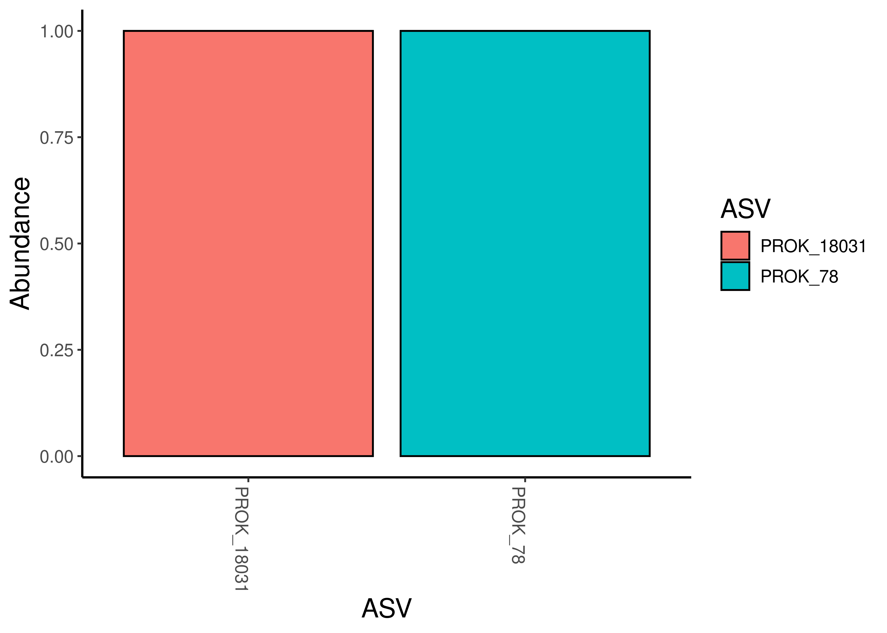
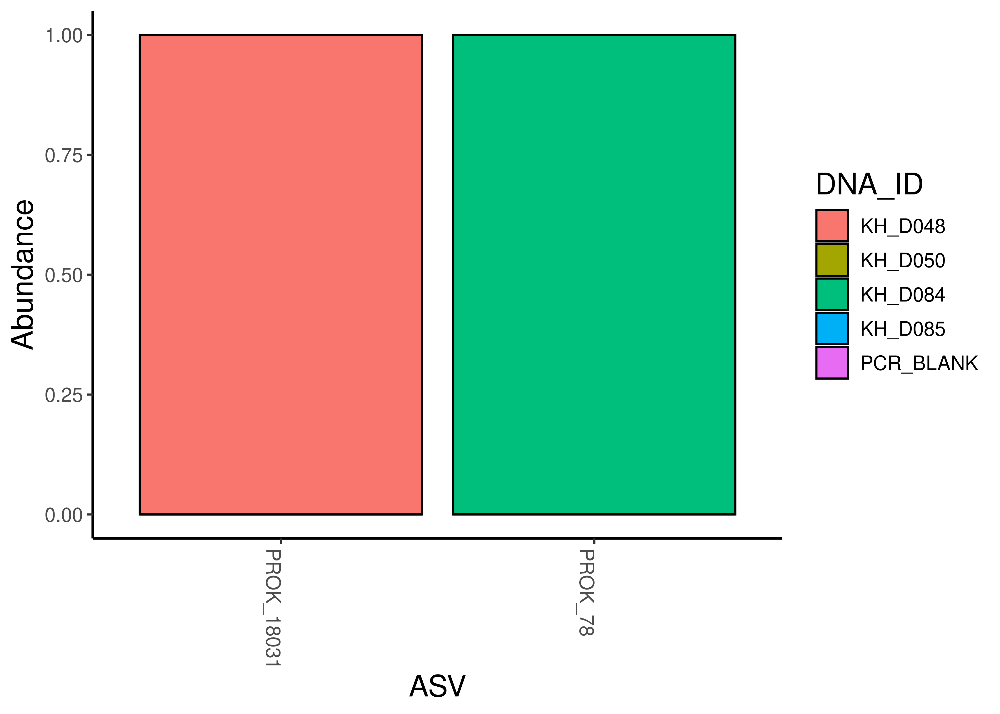
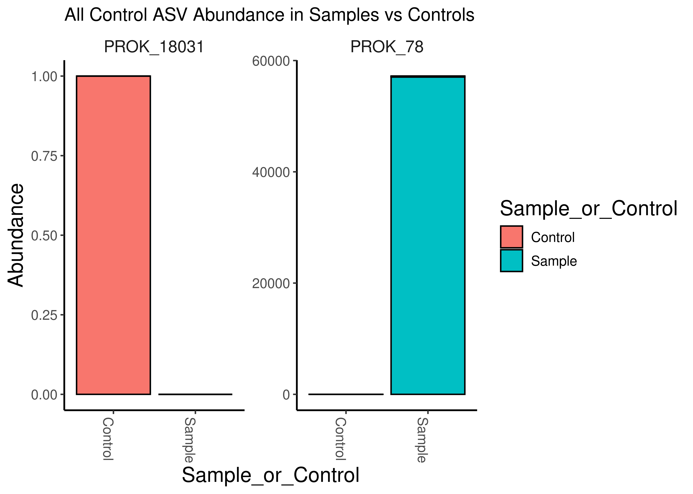
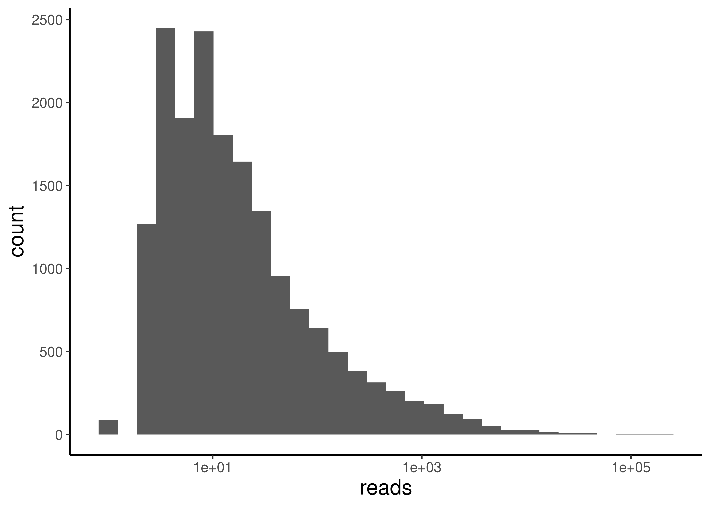
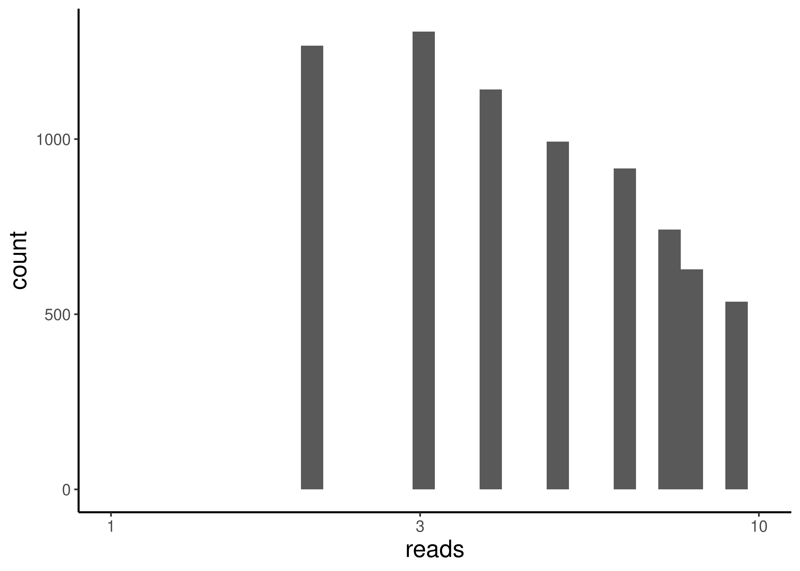
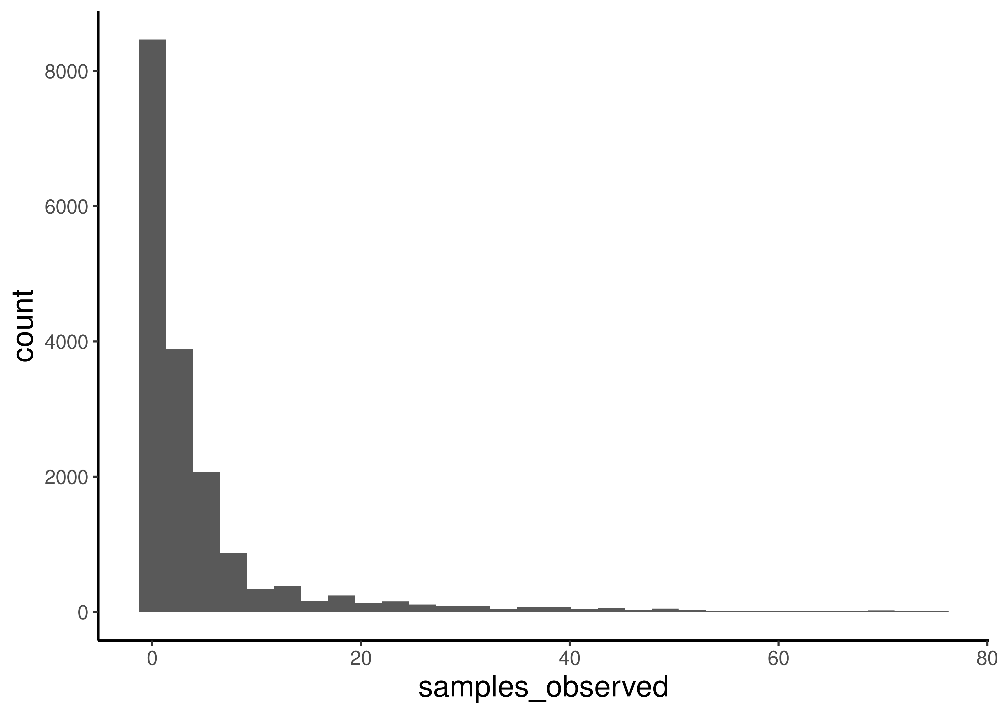
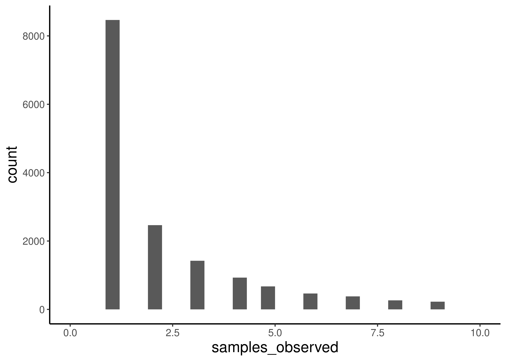
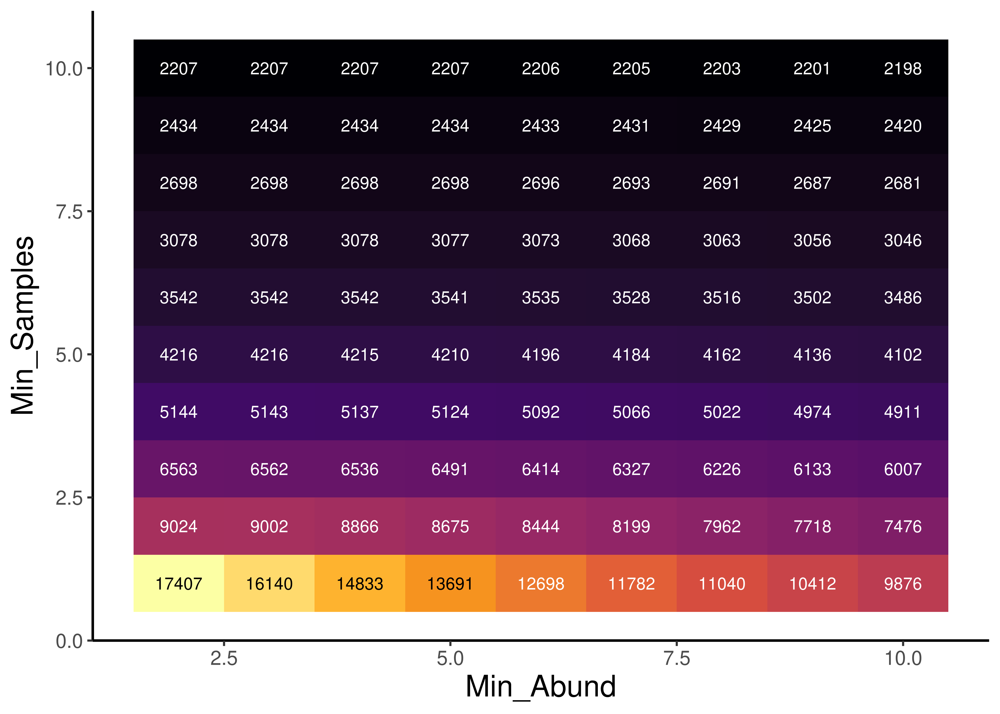
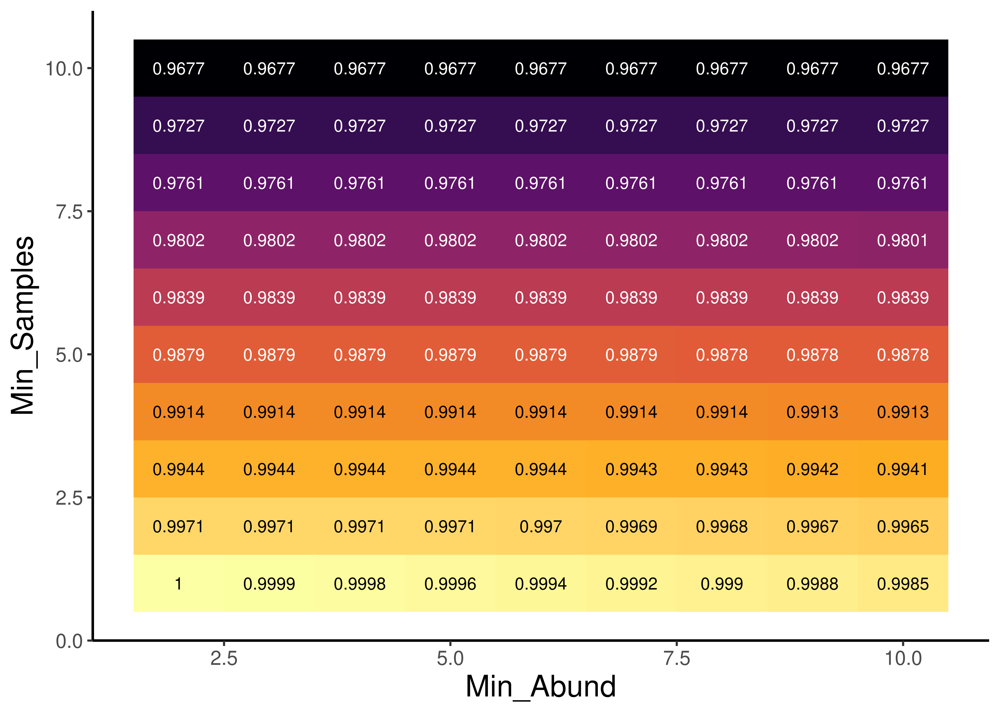
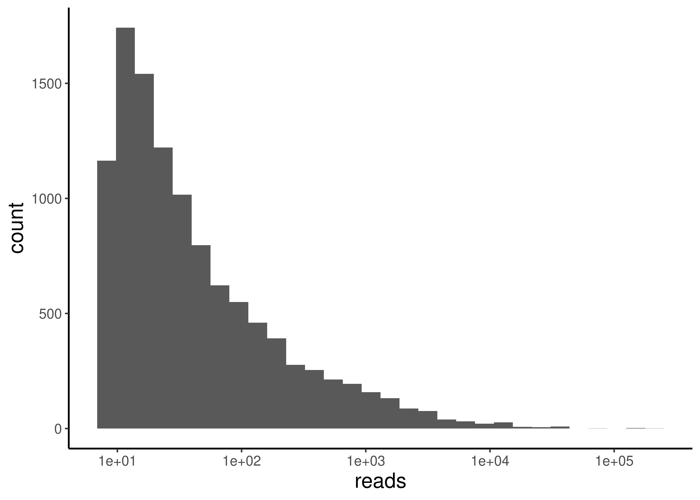

# Goals of our Pre-Processing File

We will work here in this document to remove any unnecessary ASVs, including assessing contamination from our blanks, and error rates from our mock community.

## Load Packages and Functions


::: {.cell layout-align="center"}

```{.r .cell-code}
# Load Packages
pacman::p_load(phyloseq, Biostrings, dada2, microViz, tidyverse, install = FALSE)

source("code/R/plotting_aesthetics.R")
```
:::


## Load the data!


::: {.cell layout-align="center"}

```{.r .cell-code}
# Load in the raw_phyloseq data from DADA2_workflow.Rmd
load("data/02b_Prokaryotic_Taxonomic_Classification/raw_prok_physeq_noplas.RData")
load("data/02b_Prokaryotic_Taxonomic_Classification/raw_prok_plas_physeq.RData")

raw_prok_physeq_noplas
```

::: {.cell-output .cell-output-stdout}
```
phyloseq-class experiment-level object
otu_table()   OTU Table:         [ 17510 taxa and 83 samples ]
tax_table()   Taxonomy Table:    [ 17510 taxa by 9 taxonomic ranks ]
```
:::

```{.r .cell-code}
raw_plas_physeq
```

::: {.cell-output .cell-output-stdout}
```
phyloseq-class experiment-level object
otu_table()   OTU Table:         [ 599 taxa and 83 samples ]
tax_table()   Taxonomy Table:    [ 599 taxa by 11 taxonomic ranks ]
```
:::

```{.r .cell-code}
load("data/01b_Prokaryotic_Denoising/track_df_final.RData")
```
:::


# Add metadata to physeq


::: {.cell layout-align="center"}

```{.r .cell-code}
sample_data(raw_prok_physeq_noplas) <- track_df_final
sample_data(raw_plas_physeq) <- track_df_final
```
:::


# Remove unnecessary taxa

We will need to remove the ASVs that are mitochondria or chloroplast


::: {.cell layout-align="center"}

```{.r .cell-code}
# Make a new phyloseq object without the mitochondria, chloroplast or mock community

noMitoChloro_physeq <- 
  raw_prok_physeq_noplas %>%
  # Remove the mitochondria ASVs.  #NOTE THERE WAS A TYPO HERE IN CLASS! 
  subset_taxa(Family != "Mitochondria" | is.na(Family)) %>%
  # Remove the chloroplast ASVs 
  subset_taxa( Order !="Chloroplast" | is.na(Order)) %>%
  # # remove the mock community and its ASVs 
  # prune_samples(!sample_names(.) %in% c("Zymo_Mock"), .) %>%
  # Now we will remove any ASVs of count 0
  prune_taxa(taxa_sums(.) > 0, .)

# Let's take a look 
noMitoChloro_physeq
```

::: {.cell-output .cell-output-stdout}
```
phyloseq-class experiment-level object
otu_table()   OTU Table:         [ 17510 taxa and 83 samples ]
sample_data() Sample Data:       [ 83 samples by 8 sample variables ]
tax_table()   Taxonomy Table:    [ 17510 taxa by 9 taxonomic ranks ]
```
:::

```{.r .cell-code}
# How many taxa have we removed so far? 
num_ASVs_rm <- ntaxa(raw_prok_physeq_noplas) - ntaxa(noMitoChloro_physeq)
cat("We removed ", num_ASVs_rm, " ASVs")
```

::: {.cell-output .cell-output-stdout}
```
We removed  0  ASVs
```
:::

```{.r .cell-code}
# Proportion of original data maintained
prop_ASV_rm <- 100* ntaxa(noMitoChloro_physeq)/ntaxa(raw_prok_physeq_noplas)
cat("We retained ", prop_ASV_rm, "% of taxa")
```

::: {.cell-output .cell-output-stdout}
```
We retained  100 % of taxa
```
:::
:::


## Remove Control samples 

Next, we will need to remove ASVs that seem to be contamination based on our controls


::: {.cell layout-align="center"}

```{.r .cell-code}
#3. Control samples.  
# Create a vector with the control samples 

control_samples <- c("KH_D024", "KH_D048", "KH_D049", "KH_D050", "KH_D084", "KH_D085", "KH_D085", "PCR_BLANK")

# Which taxa are in the control samples? 
control_physeq <- 
  noMitoChloro_physeq %>%
  # Identify control samples
  subset_samples(., (DNA_ID %in% control_samples)) %>%
  # make sure to remove the ASVs that were not in the controls 
  prune_taxa(taxa_sums(.) > 0, .)

# Check out the phyloseq object 
control_physeq
```

::: {.cell-output .cell-output-stdout}
```
phyloseq-class experiment-level object
otu_table()   OTU Table:         [ 2 taxa and 5 samples ]
sample_data() Sample Data:       [ 5 samples by 8 sample variables ]
tax_table()   Taxonomy Table:    [ 2 taxa by 9 taxonomic ranks ]
```
:::

```{.r .cell-code}
# vector of control ASVs
control_ASVs <- 
  data.frame(control_physeq@tax_table)$ASV

# Plot the abundance of control ASVs across the 4 samples 
control_physeq %>%
  plot_bar(., "ASV", fill = "ASV")
```

::: {.cell-output-display}
{fig-align='center' width=100%}
:::

```{.r .cell-code}
# Plot the abundance of control ASVs across the 4 samples 
control_physeq %>%
  plot_bar(., "ASV", fill = "DNA_ID")
```

::: {.cell-output-display}
{fig-align='center' width=100%}
:::

```{.r .cell-code}
 # Make a phyloseq object with only the control ASVs in it 
 controlASVs_physeq <- 
   noMitoChloro_physeq %>%
   subset_taxa(., ASV %in% control_ASVs)
 
 # Check it out
 controlASVs_physeq
```

::: {.cell-output .cell-output-stdout}
```
phyloseq-class experiment-level object
otu_table()   OTU Table:         [ 2 taxa and 83 samples ]
sample_data() Sample Data:       [ 83 samples by 8 sample variables ]
tax_table()   Taxonomy Table:    [ 2 taxa by 9 taxonomic ranks ]
```
:::

```{.r .cell-code}
 # Let's take a look at the plot 
  controlASVs_physeq %>%
   ps_mutate(Sample_or_Control = ifelse(DNA_ID%in%control_samples, "Control","Sample")) %>%
   plot_bar(., "Sample_or_Control", fill="Sample_or_Control")+ 
  facet_wrap(~ASV, scales = "free") + 
   labs(title = "All Control ASV Abundance in Samples vs Controls") 
```

::: {.cell-output-display}
{fig-align='center' width=100%}
:::

```{.r .cell-code}
sample_sums(controlASVs_physeq)
```

::: {.cell-output .cell-output-stdout}
```
  KH_D001   KH_D009   KH_D017   KH_D025   KH_D032   KH_D040   KH_D048   KH_D056 
        0         0         9         0         0         0         1         0 
  KH_D063   KH_D071   KH_D079   KH_D002   KH_D010   KH_D018   KH_D026   KH_D033 
       11         0         0         0         0        20         0         0 
  KH_D041   KH_D057   KH_D064   KH_D072   KH_D080   KH_D003   KH_D011   KH_D019 
        0         0        10         0         0        11         0         7 
  KH_D027   KH_D034   KH_D042   KH_D050   KH_D058   KH_D065   KH_D081   KH_D004 
        0         0         0         0         0         0         0         0 
  KH_D012   KH_D020   KH_D028   KH_D035   KH_D043   KH_D051   KH_D059   KH_D066 
       16        14         0         0         0         0         0         0 
  KH_D074   KH_D082   KH_D005   KH_D013   KH_D021   KH_D029   KH_D036   KH_D044 
        0         0         0         0        11        11         0         8 
  KH_D052   KH_D060   KH_D067   KH_D075   KH_D083   KH_D006   KH_D014   KH_D022 
        0         8        10         0         0         0         0         0 
  KH_D030   KH_D037   KH_D045   KH_D053   KH_D061   KH_D076   KH_D084   KH_D007 
        0         0         0         0         7         0         1         7 
  KH_D015   KH_D023   KH_D031   KH_D038   KH_D046   KH_D054   KH_D062   KH_D069 
        0         0         0         0         0         0         5         0 
  KH_D077   KH_D085   KH_D008   KH_D016 PCR_BLANK   KH_D039   KH_D047   KH_D055 
        0         0         0         0         0         0         0         0 
ZYMO_MOCK   KH_D070   KH_D078 
    57038         7         0 
```
:::

```{.r .cell-code}
controlASVs_physeq %>% tax_table() 
```

::: {.cell-output .cell-output-stdout}
```
Taxonomy Table:     [2 taxa by 9 taxonomic ranks]:
           Kingdom       Phylum              Class                   
PROK_78    "d__Bacteria" "p__Pseudomonadota" "c__Gammaproteobacteria"
PROK_18031 "d__Bacteria" "p__Pseudomonadota" "c__Gammaproteobacteria"
           Order                        Family                          
PROK_78    "o__Enterobacterales_737866" "f__Enterobacteriaceae_A_725029"
PROK_18031 "o__Steroidobacterales"      "f__Steroidobacteraceae"        
           Genus            Species       ASV         
PROK_78    "g__Escherichia" "s__marmotae" "PROK_78"   
PROK_18031 NA               NA            "PROK_18031"
           ASVseqs                                                                                                                                                                                                                                                                                                                                                                                
PROK_78    "TACGGAGGGTGCAAGCGTTAATCGGAATTACTGGGCGTAAAGCGCACGCAGGCGGTTTGTTAAGTCAGATGTGAAATCCCCGGGCTCAACCTGGGAACTGCATCTGATACTGGCAAGCTTGAGTCTCGTAGAGGGGGGTAGAATTCCAGGTGTAGCGGTGAAATGCGTAGAGATCTGGAGGAATACCGGTGGCGAAGGCGGCCCCCTGGACGAAGACTGACGCTCAGGTGCGAAAGCGTGGGGAGCAAACAGGATTAGATACCCTGGTAGTCCACGCCGTAAACGATGTCGACTTGGAGGTTGTGCCCTTGAGGCGTGGCTTCCGGAGCTAACGCGTTAAGTCGACCGCCTGGGGAGTACGGCCGCAAGGTTA"
PROK_18031 "TACAGAGGGTGCAAGCGTTAATCGGAATTACTGGGCGTAAAGCGTGCGTAGACGGTTACATAAGTCGGGTGTGAAAGCCCCGGGCTCAACCTGGGAATTGCATTCGAGACTGCGTAGCTAGGGTGCGGAAGAGGGAAGCGGAATTTCCGGTGTAGCGGTGAAATGCGTAGATATCGGAAGGAACACCAGTGGCGAAAGCGGCTTCCTGGTCCAGCACCGACGTTCAGGCACGAAAGCGTGGGGAGCAAACAGGATTAGATACCCTGGTAGTCCACGCCATAAACGATGAGAACTAGACGTTGAAGGGGTAAGCCCTCCAGTGTCGTAGCTAACGCGCTAAGTTCTCCGCCTGGGGAGTACGGCCGCAAGGTTG"
```
:::

```{.r .cell-code}
asvs_to_remove <- c("PROK_18031", "PROK_78")
```
:::


We should definitely remove both of these ASVs. one of them is represented by literally one read, inside a control. The other is pretty much exclusively represented by the Mock community. I'm going to wait to remove this one. because it will probably be important for assessing error, but it will get removed at the end. 

# Evaluating Accuracy

I compare which ASVs I observe in our mock sequencing compared to which ASVs should be present. 


::: {.cell layout-align="center"}

```{.r .cell-code}
all_mocks <- readDNAStringSet("data/03b_Prokaryotic_Errors_and_Contamination/mock_fastas/all_mock_ssrRNAs.fasta") # Read in the ssrRNA and whole genome (for yeasts) sequences provided by Zymo
primers <- readDNAStringSet("data/03b_Prokaryotic_Errors_and_Contamination/mock_fastas/primers.fasta") # These are the primers we used

# For murky reasons (and a big pain in my butt), the matchProbePair function from
# biostrings (which would let me anticipate the amplicon sequences produced by primers)
# does not allow degeneracy, even though the underlying matchPattern function that it uses does
# Anyways I source a script which defines a good matchProbePair function that does allow degeneracy. 

source("code/R/good_matchProbePair.R") 

amps <- map(all_mocks, function(dna)matchProbePair(primers[[1]], primers[[2]], dna, fixed=FALSE)%>%
              DNAStringSet()) # Predict amplicon sequences (with primers) for our mocks
amps
```

::: {.cell-output .cell-output-stdout}
```
$Staphylococcus_aureus_16S_1
DNAStringSet object of length 1:
    width seq
[1]   413 GTGCCAGCAGCCGCGGTAATACGTAGGTGGCAAG...GACCGCAAGGTTGAAACTCAAAGGAATTGACGG

$Staphylococcus_aureus_16S_2
DNAStringSet object of length 1:
    width seq
[1]   413 GTGCCAGCAGCCGCGGTAATACGTAGGTGGCAAG...GACCGCAAGGTTGAAACTCAAAGGAATTGACGG

$Staphylococcus_aureus_16S_3
DNAStringSet object of length 1:
    width seq
[1]   413 GTGCCAGCAGCCGCGGTAATACGTAGGTGGCAAG...GACCGCAAGGTTGAAACTCAAAGGAATTGACGG

$Staphylococcus_aureus_16S_4
DNAStringSet object of length 1:
    width seq
[1]   413 GTGCCAGCAGCCGCGGTAATACGTAGGTGGCAAG...GACCGCAAGGTTGAAACTCAAAGGAATTGACGG

$Staphylococcus_aureus_16S_5
DNAStringSet object of length 1:
    width seq
[1]   413 GTGCCAGCAGCCGCGGTAATACGTAGGTGGCAAG...GACCGCAAGGTTGAAACTCAAAGGAATTGACGG

$Staphylococcus_aureus_16S_6
DNAStringSet object of length 1:
    width seq
[1]   413 GTGCCAGCAGCCGCGGTAATACGTAGGTGGCAAG...GACCGCAAGGTTGAAACTCAAAGGAATTGACGG

$Salmonella_enterica_16S_1
DNAStringSet object of length 1:
    width seq
[1]   412 GTGCCAGCAGCCGCGGTAATACGGAGGGTGCAAG...GGCCGCAAGGTTAAAACTCAAATGAATTGACGG

$Salmonella_enterica_16S_2
DNAStringSet object of length 1:
    width seq
[1]   412 GTGCCAGCAGCCGCGGTAATACGGAGGGTGCAAG...GGCCGCAAGGTTAAAACTCAAATGAATTGACGG

$Salmonella_enterica_16S_3
DNAStringSet object of length 1:
    width seq
[1]   412 GTGCCAGCAGCCGCGGTAATACGGAGGGTGCAAG...GGCCGCAAGGTTAAAACTCAAATGAATTGACGG

$Salmonella_enterica_16S_4
DNAStringSet object of length 1:
    width seq
[1]   412 GTGCCAGCAGCCGCGGTAATACGGAGGGTGCAAG...GGCCGCAAGGTTAAAACTCAAATGAATTGACGG

$Salmonella_enterica_16S_5
DNAStringSet object of length 1:
    width seq
[1]   412 GTGCCAGCAGCCGCGGTAATACGGAGGGTGCAAG...GGCCGCAAGGTTAAAACTCAAATGAATTGACGG

$Salmonella_enterica_16S_5
DNAStringSet object of length 1:
    width seq
[1]   412 GTGCCAGCAGCCGCGGTAATACGGAGGGTGCAAG...GGCCGCAAGGTTAAAACTCAAATGAATTGACGG

$Salmonella_enterica_16S_6
DNAStringSet object of length 1:
    width seq
[1]   412 GTGCCAGCAGCCGCGGTAATACGGAGGGTGCAAG...GGCCGCAAGGTTAAAACTCAAATGAATTGACGG

$Saccharomyces_cerevisiae_mitochondria_ssrRNA
DNAStringSet object of length 0

$Saccharomyces_cerevisiae_18S_170924
DNAStringSet object of length 1:
    width seq
[1]   589 GTGCCAGCAGCCGCGGTAATTCCAGCTCCAATAG...GGTCGCAAGGCTGAAACTTAAAGGAATTGACGG

$Pseudomonas_aeruginosa_16S_1
DNAStringSet object of length 1:
    width seq
[1]   412 GTGCCAGCAGCCGCGGTAATACGAAGGGTGCAAG...GGCCGCAAGGTTAAAACTCAAATGAATTGACGG

$Pseudomonas_aeruginosa_16S_2
DNAStringSet object of length 1:
    width seq
[1]   412 GTGCCAGCAGCCGCGGTAATACGAAGGGTGCAAG...GGCCGCAAGGTTAAAACTCAAATGAATTGACGG

$Pseudomonas_aeruginosa_16S_3
DNAStringSet object of length 1:
    width seq
[1]   412 GTGCCAGCAGCCGCGGTAATACGAAGGGTGCAAG...GGCCGCAAGGTTAAAACTCAAATGAATTGACGG

$Pseudomonas_aeruginosa_16S_4
DNAStringSet object of length 1:
    width seq
[1]   412 GTGCCAGCAGCCGCGGTAATACGAAGGGTGCAAG...GGCCGCAAGGTTAAAACTCAAATGAATTGACGG

$Listeria_monocytogenes_16S_1
DNAStringSet object of length 1:
    width seq
[1]   413 GTGCCAGCAGCCGCGGTAATACGTAGGTGGCAAG...GACCGCAAGGTTGAAACTCAAAGGAATTGACGG

$Listeria_monocytogenes_16S_2
DNAStringSet object of length 1:
    width seq
[1]   413 GTGCCAGCAGCCGCGGTAATACGTAGGTGGCAAG...GACCGCAAGGTTGAAACTCAAAGGAATTGACGG

$Listeria_monocytogenes_16S_3
DNAStringSet object of length 1:
    width seq
[1]   413 GTGCCAGCAGCCGCGGTAATACGTAGGTGGCAAG...GACCGCAAGGTTGAAACTCAAAGGAATTGACGG

$Listeria_monocytogenes_16S_4
DNAStringSet object of length 1:
    width seq
[1]   413 GTGCCAGCAGCCGCGGTAATACGTAGGTGGCAAG...GACCGCAAGGTTGAAACTCAAAGGAATTGACGG

$Listeria_monocytogenes_16S_5
DNAStringSet object of length 1:
    width seq
[1]   413 GTGCCAGCAGCCGCGGTAATACGTAGGTGGCAAG...GACCGCAAGGTTGAAACTCAAAGGAATTGACGG

$Listeria_monocytogenes_16S_6
DNAStringSet object of length 1:
    width seq
[1]   413 GTGCCAGCAGCCGCGGTAATACGTAGGTGGCAAG...GACCGCAAGGTTGAAACTCAAAGGAATTGACGG

$Lactobacillus_fermentum_16S_1
DNAStringSet object of length 1:
    width seq
[1]   413 GTGCCAGCAGCCGCGGTAATACGTAGGTGGCAAG...GACCGCAAGGTTGAAACTCAAAGGAATTGACGG

$Lactobacillus_fermentum_16S_2
DNAStringSet object of length 1:
    width seq
[1]   413 GTGCCAGCAGCCGCGGTAATACGTAGGTGGCAAG...GACCGCAAGGTTGAAACTCAAAGGAATTGACGG

$Lactobacillus_fermentum_16S_3
DNAStringSet object of length 1:
    width seq
[1]   413 GTGCCAGCAGCCGCGGTAATACGTAGGTGGCAAG...GACCGCAAGGTTGAAACTCAAAGGAATTGACGG

$Lactobacillus_fermentum_16S_4
DNAStringSet object of length 1:
    width seq
[1]   413 GTGCCAGCAGCCGCGGTAATACGTAGGTGGCAAG...GACCGCAAGGTTGAAACTCAAAGGAATTGACGG

$Lactobacillus_fermentum_16S_5
DNAStringSet object of length 1:
    width seq
[1]   413 GTGCCAGCAGCCGCGGTAATACGTAGGTGGCAAG...GACCGCAAGGTTGAAACTCAAAGGAATTGACGG

$Escherichia_coli_16S_1
DNAStringSet object of length 1:
    width seq
[1]   412 GTGCCAGCAGCCGCGGTAATACGGAGGGTGCAAG...GGCCGCAAGGTTAAAACTCAAATGAATTGACGG

$Escherichia_coli_16S_2
DNAStringSet object of length 1:
    width seq
[1]   412 GTGCCAGCAGCCGCGGTAATACGGAGGGTGCAAG...GGCCGCAAGGTTAAAACTCAAATGAATTGACGG

$Escherichia_coli_16S_3
DNAStringSet object of length 1:
    width seq
[1]   412 GTGCCAGCAGCCGCGGTAATACGGAGGGTGCAAG...GGCCGCAAGGTTAAAACTCAAATGAATTGACGG

$Escherichia_coli_16S_4
DNAStringSet object of length 1:
    width seq
[1]   412 GTGCCAGCAGCCGCGGTAATACGGAGGGTGCAAG...GGCCGCAAGGTTAAAACTCAAATGAATTGACGG

$Escherichia_coli_16S_5
DNAStringSet object of length 1:
    width seq
[1]   412 GTGCCAGCAGCCGCGGTAATACGGAGGGTGCAAG...GGCCGCAAGGTTAAAACTCAAATGAATTGACGG

$Escherichia_coli_16S_7
DNAStringSet object of length 1:
    width seq
[1]   412 GTGCCAGCAGCCGCGGTAATACGGAGGGTGCAAG...GGCCGCAAGGTTAAAACTCAAATGAATTGACGG

$Escherichia_coli_16S_8
DNAStringSet object of length 1:
    width seq
[1]   412 GTGCCAGCAGCCGCGGTAATACGGAGGGTGCAAG...GGCCGCAAGGTTAAAACTCAAATGAATTGACGG

$Enterococcus_faecalis_16S_1
DNAStringSet object of length 1:
    width seq
[1]   413 GTGCCAGCAGCCGCGGTAATACGTAGGTGGCAAG...GACCGCAAGGTTGAAACTCAAAGGAATTGACGG

$Enterococcus_faecalis_16S_2
DNAStringSet object of length 1:
    width seq
[1]   413 GTGCCAGCAGCCGCGGTAATACGTAGGTGGCAAG...GACCGCAAGGTTGAAACTCAAAGGAATTGACGG

$Enterococcus_faecalis_16S_3
DNAStringSet object of length 1:
    width seq
[1]   413 GTGCCAGCAGCCGCGGTAATACGTAGGTGGCAAG...GACCGCAAGGTTGAAACTCAAAGGAATTGACGG

$Enterococcus_faecalis_16S_4
DNAStringSet object of length 1:
    width seq
[1]   413 GTGCCAGCAGCCGCGGTAATACGTAGGTGGCAAG...GACCGCAAGGTTGAAACTCAAAGGAATTGACGG

$Cryptococcus_neoformans_Mitochondria_ssrRNA
DNAStringSet object of length 0

$Cryptococcus_neoformans_18S_170924
DNAStringSet object of length 1:
    width seq
[1]   589 GTGCCAGCAGCCGCGGTAATTCCAGCTCCAGTAG...GGTCGCAAGGCTGAAACTTAAAGGAATTGACGG

$Bacillus_subtilis_16S_1
DNAStringSet object of length 1:
    width seq
[1]   413 GTGCCAGCAGCCGCGGTAATACGTAGGTGGCAAG...GGTCGCAAGACTGAAACTCAAAGGAATTGACGG

$Bacillus_subtilis_16S_2
DNAStringSet object of length 1:
    width seq
[1]   413 GTGCCAGCAGCCGCGGTAATACGTAGGTGGCAAG...GGTCGCAAGACTGAAACTCAAAGGAATTGACGG

$Bacillus_subtilis_16S_3
DNAStringSet object of length 1:
    width seq
[1]   413 GTGCCAGCAGCCGCGGTAATACGTAGGTGGCAAG...GGTCGCAAGACTGAAACTCAAAGGAATTGACGG

$Bacillus_subtilis_16S_4
DNAStringSet object of length 1:
    width seq
[1]   413 GTGCCAGCAGCCGCGGTAATACGTAGGTGGCAAG...GGTCGCAAGACTGAAACTCAAAGGAATTGACGG

$Bacillus_subtilis_16S_5
DNAStringSet object of length 1:
    width seq
[1]   413 GTGCCAGCAGCCGCGGTAATACGTAGGTGGCAAG...GGTCGCAAGACTGAAACTCAAAGGAATTGACGG

$Bacillus_subtilis_16S_6
DNAStringSet object of length 1:
    width seq
[1]   413 GTGCCAGCAGCCGCGGTAATACGTAGGTGGCAAG...GGTCGCAAGACTGAAACTCAAAGGAATTGACGG

$Bacillus_subtilis_16S_7
DNAStringSet object of length 1:
    width seq
[1]   413 GTGCCAGCAGCCGCGGTAATACGTAGGTGGCAAG...GGTCGCAAGACTGAAACTCAAAGGAATTGACGG

$Bacillus_subtilis_16S_8
DNAStringSet object of length 1:
    width seq
[1]   413 GTGCCAGCAGCCGCGGTAATACGTAGGTGGCAAG...GGTCGCAAGACTGAAACTCAAAGGAATTGACGG

$Bacillus_subtilis_16S_9
DNAStringSet object of length 1:
    width seq
[1]   413 GTGCCAGCAGCCGCGGTAATACGTAGGTGGCAAG...GGTCGCAAGACTGAAACTCAAAGGAATTGACGG

$Bacillus_subtilis_16S_10
DNAStringSet object of length 1:
    width seq
[1]   413 GTGCCAGCAGCCGCGGTAATACGTAGGTGGCAAG...GGTCGCAAGACTGAAACTCAAAGGAATTGACGG

$ptg000001l
DNAStringSet object of length 0

$ptg000002l
DNAStringSet object of length 0

$ptg000003l
DNAStringSet object of length 1:
    width seq
[1]   589 CCGTCAATTCCTTTAAGTTTCAGCCTTGCGACCA...TATTGGAGCTGGAATTACCGCGGCTGCTGGCAC

$ptg000004l
DNAStringSet object of length 0

$ptg000005l
DNAStringSet object of length 0

$ptg000006l
DNAStringSet object of length 0

$ptg000007l
DNAStringSet object of length 0

$ptg000008l
DNAStringSet object of length 0

$ptg000009l
DNAStringSet object of length 0

$ptg000010l
DNAStringSet object of length 0

$ptg000011l
DNAStringSet object of length 0

$ptg000012l
DNAStringSet object of length 3:
    width seq
[1]   589 CCGTCAATTCCTTTAAGTTTCAGCCTTGCGACCA...TATTGGAGCTGGAATTACCGCGGCTGCTGGCAC
[2]   589 CCGTCAATTCCTTTAAGTTTCAGCCTTGCGACCA...TATTGGAGCTGGAATTACCGCGGCTGCTGGCAC
[3]   589 CCGTCAATTCCTTTAAGTTTCAGCCTTGCGACCA...TATTGGAGCTGGAATTACCGCGGCTGCTGGCAC

$ptg000013l
DNAStringSet object of length 8:
    width seq
[1]   589 CCGTCAATTCCTTTAAGTTTCAGCCTTGCGACCA...TATTGGAGCTGGAATTACCGCGGCTGCTGGCAC
[2]   589 CCGTCAATTCCTTTAAGTTTCAGCCTTGCGACCA...TATTGGAGCTGGAATTACCGCGGCTGCTGGCAC
[3]   589 CCGTCAATTCCTTTAAGTTTCAGCCTTGCGACCA...TATTGGAGCTGGAATTACCGCGGCTGCTGGCAC
[4]   589 CCGTCAATTCCTTTAAGTTTCAGCCTTGCGACCA...TATTGGAGCTGGAATTACCGCGGCTGCTGGCAC
[5]   589 CCGTCAATTCCTTTAAGTTTCAGCCTTGCGACCA...TATTGGAGCTGGAATTACCGCGGCTGCTGGCAC
[6]   589 CCGTCAATTCCTTTAAGTTTCAGCCTTGCGACCA...TATTGGAGCTGGAATTACCGCGGCTGCTGGCAC
[7]   589 CCGTCAATTCCTTTAAGTTTCAGCCTTGCGACCA...TATTGGAGCTGGAATTACCGCGGCTGCTGGCAC
[8]   589 CCGTCAATTCCTTTAAGTTTCAGCCTTGCGACCA...TATTGGAGCTGGAATTACCGCGGCTGCTGGCAC

$ptg000014l
DNAStringSet object of length 0

$ptg000015l
DNAStringSet object of length 0

$ptg000016l
DNAStringSet object of length 0

$ptg000017l
DNAStringSet object of length 0

$ptg000018l
DNAStringSet object of length 0

$ptg000019l
DNAStringSet object of length 0

$ptg000020l
DNAStringSet object of length 0

$ptg000021l
DNAStringSet object of length 0

$ptg000022l
DNAStringSet object of length 4:
    width seq
[1]   589 GTGCCAGCAGCCGCGGTAATTCCAGCTCCAATAG...GGTCGCAAGGCTGAAACTTAAAGGAATTGACGG
[2]   589 GTGCCAGCAGCCGCGGTAATTCCAGCTCCAATAG...GGTCGCAAGGCTGAAACTTAAAGGAATTGACGG
[3]   589 GTGCCAGCAGCCGCGGTAATTCCAGCTCCAATAG...GGTCGCAAGGCTGAAACTTAAAGGAATTGACGG
[4]   589 GTGCCAGCAGCCGCGGTAATTCCAGCTCCAATAG...GGTCGCAAGGCTGAAACTTAAAGGAATTGACGG

$ptg000023l
DNAStringSet object of length 0

$ptg000024l
DNAStringSet object of length 0

$ptg000025l
DNAStringSet object of length 0

$ptg000026l
DNAStringSet object of length 0

$ptg000027c
DNAStringSet object of length 1:
    width seq
[1]   589 GTGCCAGCAGCCGCGGTAATTCCAGCTCCAATAG...GGTCGCAAGGCTGAAACTTAAAGGAATTGACGG

$ptg000028l
DNAStringSet object of length 0

$ptg000029l
DNAStringSet object of length 0

$ptg000030l
DNAStringSet object of length 0

$ptg000031c
DNAStringSet object of length 0

$ptg000032l
DNAStringSet object of length 2:
    width seq
[1]   589 GTGCCAGCAGCCGCGGTAATTCCAGCTCCAATAG...GGTCGCAAGGCTGAAACTTAAAGGAATTGACGG
[2]   589 GTGCCAGCAGCCGCGGTAATTCCAGCTCCAATAG...GGTCGCAAGGCTGAAACTTAAAGGAATTGACGG

$ptg000033l
DNAStringSet object of length 2:
    width seq
[1]   586 GTGCCAGCAGCCGCGGTAATTCCAGCTCCAATAG...GGTCGCAAGGCTGAAACTTAAAGGAATTGACGG
[2]   589 GTGCCAGCAGCCGCGGTAATTCCAGCTCCAATAG...GGTCGCAAGGCTGAAACTTAAAGGAATTGACGG

$ptg000034l
DNAStringSet object of length 0

$ptg000035l
DNAStringSet object of length 1:
    width seq
[1]   589 GTGCCAGCAGCCGCGGTAATTCCAGCTCCAATAG...GGTCGCAAGGCTGAAACTTAAAGGAATTGACGG

$ptg000036l
DNAStringSet object of length 1:
    width seq
[1]   588 CCGTCAATTCCTTTAAGTTTCAGCCTTGCGACCA...TATTGGAGCTGGAATTACCGCGGCTGCTGGCAC

$ptg000037l
DNAStringSet object of length 6:
    width seq
[1]   589 CCGTCAATTCCTTTAAGTTTCAGCCTTGCGACCA...TATTGGAGCTGGAATTACCGCGGCTGCTGGCAC
[2]   589 CCGTCAATTCCTTTAAGTTTCAGCCTTGCGACCA...TATTGGAGCTGGAATTACCGCGGCTGCTGGCAC
[3]   589 CCGTCAATTCCTTTAAGTTTCAGCCTTGCGACCA...TATTGGAGCTGGAATTACCGCGGCTGCTGGCAC
[4]   589 CCGTCAATTCCTTTAAGTTTCAGCCTTGCGACCA...TATTGGAGCTGGAATTACCGCGGCTGCTGGCAC
[5]   589 CCGTCAATTCCTTTAAGTTTCAGCCTTGCGACCA...TATTGGAGCTGGAATTACCGCGGCTGCTGGCAC
[6]   589 CCGTCAATTCCTTTAAGTTTCAGCCTTGCGACCA...TATTGGAGCTGGAATTACCGCGGCTGCTGGCAC

$ptg000038l
DNAStringSet object of length 1:
    width seq
[1]   590 CCGTCAATTCCTTTAAGTTTCAGCCTTGCGACCA...TATTGGAGCTGGAATTACCGCGGCTGCTGGCAC

$ptg000039l
DNAStringSet object of length 1:
    width seq
[1]   589 GTGCCAGCAGCCGCGGTAATTCCAGCTCCAATAG...GGTCGCAAGGCTGAAACTTAAAGGAATTGACGG

$ptg000040l
DNAStringSet object of length 2:
    width seq
[1]   589 CCGTCAATTCCTTTAAGTTTCAGCCTTGCGACCA...TATTGGAGCTGGAATTACCGCGGCTGCTGGCAC
[2]   589 CCGTCAATTCCTTTAAGTTTCAGCCTTGCGACCA...TATTGGAGCTGGAATTACCGCGGCTGCTGGCAC

$ptg000041l
DNAStringSet object of length 0

$ptg000042l
DNAStringSet object of length 3:
    width seq
[1]   589 GTGCCAGCAGCCGCGGTAATTCCAGCTCCAATAG...GGTCGCAAGGCTGAAACTTAAAGGAATTGACGG
[2]   589 GTGCCAGCAGCCGCGGTAATTCCAGCTCCAATAG...GGTCGCAAGGCTGAAACTTAAAGGAATTGACGG
[3]   589 GTGCCAGCAGCCGCGGTAATTCCAGCTCCAATAG...GGTCGCAAGGCTGAAACTTAAAGGAATTGACGG

$ptg000043l
DNAStringSet object of length 1:
    width seq
[1]   590 CCGTCAATTCCTTTAAGTTTCAGCCTTGCGACCA...TATTGGAGCTGGAATTACCGCGGCTGCTGGCAC

$ptg000044l
DNAStringSet object of length 1:
    width seq
[1]   589 GTGCCAGCAGCCGCGGTAATTCCAGCTCCAATAG...GGTCGCAAGGCTGAAACTTAAAGGAATTGACGG

$ptg000045l
DNAStringSet object of length 1:
    width seq
[1]   589 GTGCCAGCAGCCGCGGTAATTCCAGCTCCAATAG...GGTCGCAAGGCTGAAACTTAAAGGAATTGACGG

$ptg000046l
DNAStringSet object of length 1:
    width seq
[1]   589 CCGTCAATTCCTTTAAGTTTCAGCCTTGCGACCA...TATTGGAGCTGGAATTACCGCGGCTGCTGGCAC

$ptg000047l
DNAStringSet object of length 2:
    width seq
[1]   589 CCGTCAATTCCTTTAAGTTTCAGCCTTGCGACCA...TATTGGAGCTGGAATTACCGCGGCTGCTGGCAC
[2]   589 CCGTCAATTCCTTTAAGTTTCAGCCTTGCGACCA...TATTGGAGCTGGAATTACCGCGGCTGCTGGCAC

$ptg000048l
DNAStringSet object of length 0

$ptg000049l
DNAStringSet object of length 4:
    width seq
[1]   589 GTGCCAGCAGCCGCGGTAATTCCAGCTCCAATAG...GGTCGCAAGGCTGAAACTTAAAGGAATTGACGG
[2]   589 GTGCCAGCAGCCGCGGTAATTCCAGCTCCAATAG...GGTCGCAAGGCTGAAACTTAAAGGAATTGACGG
[3]   588 GTGCCAGCAGCCGCGGTAATTCCAGCTCCAATAG...GGTCGCAAGGCTGAAACTTAAAGGAATTGACGG
[4]   587 GTGCCAGCAGCCGCGGTAATTCAGCTCCAATAGC...GGTCGCAAGGCTGAAACTTAAAGGAATTGACGG

$ptg000050l
DNAStringSet object of length 3:
    width seq
[1]   589 CCGTCAATTCCTTTAAGTTTCAGCCTTGCGACCA...TATTGGAGCTGGAATTACCGCGGCTGCTGGCAC
[2]   589 CCGTCAATTCCTTTAAGTTTCAGCCTTGCGACCA...TATTGGAGCTGGAATTACCGCGGCTGCTGGCAC
[3]   589 CCGTCAATTCCTTTAAGTTTCAGCCTTGCGACCA...TATTGGAGCTGGAATTACCGCGGCTGCTGGCAC

$ptg000051l
DNAStringSet object of length 1:
    width seq
[1]   589 CCGTCAATTCCTTTAAGTTTCAGCCTTGCGACCA...TATTGGAGCTGGAATTACCGCGGCTGCTGGCAC

$ptg000052l
DNAStringSet object of length 2:
    width seq
[1]   587 CCGTCAATTCCTTTAAGTTTCAGCCTTGCGACCA...TATTGGAGCTGGAATTACCGCGGCTGCTGGCAC
[2]   589 CCGTCAATTCCTTTAAGTTTCAGCCTTGCGACCA...TATTGGAGCTGGAATTACCGCGGCTGCTGGCAC

$ptg000053l
DNAStringSet object of length 0

$ptg000054l
DNAStringSet object of length 1:
    width seq
[1]   589 GTGCCAGCAGCCGCGGTAATTCCAGCTCCAATAG...GGTCGCAAGGCTGAAACTTAAAGGAATTGACGG

$ptg000055l
DNAStringSet object of length 1:
    width seq
[1]   589 GTGCCAGCAGCCGCGGTAATTCCAGCTCCAATAG...GGTCGCAAGGCTGAAACTTAAAGGAATTGACGG

$ptg000056l
DNAStringSet object of length 0

$ptg000057l
DNAStringSet object of length 2:
    width seq
[1]   589 CCGTCAATTCCTTTAAGTTTCAGCCTTGCGACCA...TATTGGAGCTGGAATTACCGCGGCTGCTGGCAC
[2]   586 CCGTCAATTCCTTTAAGTTTCAGCCTTGCGACCA...TATTGGAGCTGGAATTACCGCGGCTGCTGGCAC

$ptg000058l
DNAStringSet object of length 2:
    width seq
[1]   589 GTGCCAGCAGCCGCGGTAATTCCAGCTCCAATAG...GGTCGCAAGGCTGAAACTTAAAGGAATTGACGG
[2]   589 GTGCCAGCAGCCGCGGTAATTCCAGCTCCAATAG...GGTCGCAAGGCTGAAACTTAAAGGAATTGACGG

$ptg000059l
DNAStringSet object of length 1:
    width seq
[1]   589 CCGTCAATTCCTTTAAGTTTCAGCCTTGCGACCA...TATTGGAGCTGGAATTACCGCGGCTGCTGGCAC

$ptg000060l
DNAStringSet object of length 2:
    width seq
[1]   589 CCGTCAATTCCTTTAAGTTTCAGCCTTGCGACCA...TATTGGAGCTGGAATTACCGCGGCTGCTGGCAC
[2]   589 CCGTCAATTCCTTTAAGTTTCAGCCTTGCGACCA...TATTGGAGCTGGAATTACCGCGGCTGCTGGCAC

$ptg000061l
DNAStringSet object of length 2:
    width seq
[1]   589 CCGTCAATTCCTTTAAGTTTCAGCCTTGCGACCA...TATTGGAGCTGGAATTACCGCGGCTGCTGGCAC
[2]   589 CCGTCAATTCCTTTAAGTTTCAGCCTTGCGACCA...TATTGGAGCTGGAATTACCGCGGCTGCTGGCAC

$ptg000062l
DNAStringSet object of length 1:
    width seq
[1]   589 GTGCCAGCAGCCGCGGTAATTCCAGCTCCAATAG...GGTCGCAAGGCTGAAACTTAAAGGAATTGACGG

$ptg000063l
DNAStringSet object of length 2:
    width seq
[1]   589 GTGCCAGCAGCCGCGGTAATTCCAGCTCCAATAG...GGTCGCAAGGCTGAAACTTAAAGGAATTGACGG
[2]   592 GTGCCAGCAGCCGCGGTAATTCCAGCTCCAATAG...GGTCGCAAGGCTGAAACTTAAAGGAATTGACGG

$ptg000001l
DNAStringSet object of length 0

$ptg000002l
DNAStringSet object of length 0

$ptg000003l
DNAStringSet object of length 0

$ptg000004l
DNAStringSet object of length 0

$ptg000005l
DNAStringSet object of length 0

$ptg000006l
DNAStringSet object of length 0

$ptg000007l
DNAStringSet object of length 0

$ptg000008l
DNAStringSet object of length 0

$ptg000009l
DNAStringSet object of length 0

$ptg000010l
DNAStringSet object of length 0

$ptg000011l
DNAStringSet object of length 0

$ptg000012l
DNAStringSet object of length 0

$ptg000013l
DNAStringSet object of length 0

$ptg000014l
DNAStringSet object of length 0

$ptg000015l
DNAStringSet object of length 0

$ptg000016l
DNAStringSet object of length 0

$ptg000017l
DNAStringSet object of length 0

$ptg000018l
DNAStringSet object of length 0

$ptg000019l
DNAStringSet object of length 0

$ptg000020l
DNAStringSet object of length 1:
    width seq
[1]   589 CCGTCAATTCCTTTAAGTTTCAGCCTTGCGACCA...TACTGGAGCTGGAATTACCGCGGCTGCTGGCAC

$ptg000021l
DNAStringSet object of length 0

$ptg000022l
DNAStringSet object of length 5:
    width seq
[1]   589 GTGCCAGCAGCCGCGGTAATTCCAGCTCCAGTAG...GGTCGCAAGGCTGAAACTTAAAGGAATTGACGG
[2]   589 GTGCCAGCAGCCGCGGTAATTCCAGCTCCAGTAG...GGTCGCAAGGCTGAAACTTAAAGGAATTGACGG
[3]   589 GTGCCAGCAGCCGCGGTAATTCCAGCTCCAGTAG...GGTCGCAAGGCTGAAACTTAAAGGAATTGACGG
[4]   589 GTGCCAGCAGCCGCGGTAATTCCAGCTCCAGTAG...GGTCGCAAGGCTGAAACTTAAAGGAATTGACGG
[5]   607 GTGCCAGCAGCCGCGGTAATTCCAGCTCCAGTAG...GGTCGCAAGGCTGAAACTTAAAGGAATTGACGG

$ptg000023l
DNAStringSet object of length 0

$ptg000024l
DNAStringSet object of length 0

$ptg000025l
DNAStringSet object of length 0

$ptg000026c
DNAStringSet object of length 0

$ptg000027l
DNAStringSet object of length 3:
    width seq
[1]   589 GTGCCAGCAGCCGCGGTAATTCCAGCTCCAGTAG...GGTCGCAAGGCTGAAACTTAAAGGAATTGACGG
[2]   589 GTGCCAGCAGCCGCGGTAATTCCAGCTCCAGTAG...GGTCGCAAGGCTGAAACTTAAAGGAATTGACGG
[3]   589 GTGCCAGCAGCCGCGGTAATTCCAGCTCCAGTAG...GGTCGCAAGGCTGAAACTTAAAGGAATTGACGG

$ptg000028l
DNAStringSet object of length 2:
    width seq
[1]   589 CCGTCAATTCCTTTAAGTTTCAGCCTTGCGACCA...TACTGGAGCTGGAATTACCGCGGCTGCTGGCAC
[2]   589 CCGTCAATTCCTTTAAGTTTCAGCCTTGCGACCA...TACTGGAGCTGGAATTACCGCGGCTGCTGGCAC

$ptg000029l
DNAStringSet object of length 2:
    width seq
[1]   589 CCGTCAATTCCTTTAAGTTTCAGCCTTGCGACCA...TACTGGAGCTGGAATTACCGCGGCTGCTGGCAC
[2]   589 CCGTCAATTCCTTTAAGTTTCAGCCTTGCGACCA...TACTGGAGCTGGAATTACCGCGGCTGCTGGCAC

$ptg000030l
DNAStringSet object of length 2:
    width seq
[1]   589 GTGCCAGCAGCCGCGGTAATTCCAGCTCCAGTAG...GGTCGCAAGGCTGAAACTTAAAGGAATTGACGG
[2]   589 GTGCCAGCAGCCGCGGTAATTCCAGCTCCAGTAG...GGTCGCAAGGCTGAAACTTAAAGGAATTGACGG

$ptg000031l
DNAStringSet object of length 3:
    width seq
[1]   589 CCGTCAATTCCTTTAAGTTTCAGCCTTGCGACCA...TACTGGAGCTGGAATTACCGCGGCTGCTGGCAC
[2]   588 CCGTCAATTCCTTTAAGTTTCAGCCTTGCGACCA...TACTGGAGCTGGAATTACCGCGGCTGCTGGCAC
[3]   591 CCGTCAATTCCTTTAAGTTTCAGCCTTGCGACCA...TACTGGAGCTGGAATTACCGCGGCTGCTGGCAC

$ptg000032l
DNAStringSet object of length 2:
    width seq
[1]   589 GTGCCAGCAGCCGCGGTAATTCCAGCTCCAGTAG...GGTCGCAAGGCTGAAACTTAAAGGAATTGACGG
[2]   589 GTGCCAGCAGCCGCGGTAATTCCAGCTCCAGTAG...GGTCGCAAGGCTGAAACTTAAAGGAATTGACGG

$ptg000033l
DNAStringSet object of length 2:
    width seq
[1]   589 CCGTCAATTCCTTTAAGTTTCAGCCTTGCGACCA...TACTGGAGCTGGAATTACCGCGGCTGCTGGCAC
[2]   589 CCGTCAATTCCTTTAAGTTTCAGCCTTGCGACCA...TACTGGAGCTGGAATTACCGCGGCTGCTGGCAC

$ptg000034l
DNAStringSet object of length 3:
    width seq
[1]   589 GTGCCAGCAGCCGCGGTAATTCCAGCTCCAGTAG...GGTCGCAAGGCTGAAACTTAAAGGAATTGACGG
[2]   589 GTGCCAGCAGCCGCGGTAATTCCAGCTCCAGTAG...GGTCGCAAGGCTGAAACTTAAAGGAATTGACGG
[3]   589 GTGCCAGCAGCCGCGGTAATTCCAGCTCCAGTAG...GGTCGCAAGGCTGAAACTTAAAGGAATTGACGG

$ptg000035l
DNAStringSet object of length 0

$ptg000036l
DNAStringSet object of length 1:
    width seq
[1]   589 CCGTCAATTCCTTTAAGTTTCAGCCTTGCGACCA...TACTGGAGCTGGAATTACCGCGGCTGCTGGCAC

$ptg000037l
DNAStringSet object of length 2:
    width seq
[1]   589 GTGCCAGCAGCCGCGGTAATTCCAGCTCCAGTAG...GGTCGCAAGGCTGAAACTTAAAGGAATTGACGG
[2]   589 GTGCCAGCAGCCGCGGTAATTCCAGCTCCAGTAG...GGTCGCAAGGCTGAAACTTAAAGGAATTGACGG

$ptg000038l
DNAStringSet object of length 7:
    width seq
[1]   589 CCGTCAATTCCTTTAAGTTTCAGCCTTGCGACCA...TACTGGAGCTGGAATTACCGCGGCTGCTGGCAC
[2]   589 CCGTCAATTCCTTTAAGTTTCAGCCTTGCGACCA...TACTGGAGCTGGAATTACCGCGGCTGCTGGCAC
[3]   589 CCGTCAATTCCTTTAAGTTTCAGCCTTGCGACCA...TACTGGAGCTGGAATTACCGCGGCTGCTGGCAC
[4]   589 CCGTCAATTCCTTTAAGTTTCAGCCTTGCGACCA...TACTGGAGCTGGAATTACCGCGGCTGCTGGCAC
[5]   589 CCGTCAATTCCTTTAAGTTTCAGCCTTGCGACCA...TACTGGAGCTGGAATTACCGCGGCTGCTGGCAC
[6]   589 CCGTCAATTCCTTTAAGTTTCAGCCTTGCGACCA...TACTGGAGCTGGAATTACCGCGGCTGCTGGCAC
[7]   589 CCGTCAATTCCTTTAAGTTTCAGCCTTGCGACCA...TACTGGAGCTGGAATTACCGCGGCTGCTGGCAC

$ptg000039l
DNAStringSet object of length 0

$ptg000040c
DNAStringSet object of length 0

$ptg000041l
DNAStringSet object of length 2:
    width seq
[1]   589 GTGCCAGCAGCCGCGGTAATTCCAGCTCCAGTAG...GGTCGCAAGGCTGAAACTTAAAGGAATTGACGG
[2]   589 GTGCCAGCAGCCGCGGTAATTCCAGCTCCAGTAG...GGTCGCAAGGCTGAAACTTAAAGGAATTGACGG

$ptg000042l
DNAStringSet object of length 0

$ptg000043l
DNAStringSet object of length 2:
    width seq
[1]   589 CCGTCAATTCCTTTAAGTTTCAGCCTTGCGACCA...TACTGGAGCTGGAATTACCGCGGCTGCTGGCAC
[2]   589 CCGTCAATTCCTTTAAGTTTCAGCCTTGCGACCA...TACTGGAGCTGGAATTACCGCGGCTGCTGGCAC

$ptg000044l
DNAStringSet object of length 3:
    width seq
[1]   588 CCGTCAATTCCTTTAAGTTTCAGCCTTGCGACCA...TACTGGAGCTGGAATTACCGCGGCTGCTGGCAC
[2]   589 CCGTCAATTCCTTTAAGTTTCAGCCTTGCGACCA...TACTGGAGCTGGAATTACCGCGGCTGCTGGCAC
[3]   589 CCGTCAATTCCTTTAAGTTTCAGCCTTGCGACCA...TACTGGAGCTGGAATTACCGCGGCTGCTGGCAC

$ptg000045l
DNAStringSet object of length 2:
    width seq
[1]   589 CCGTCAATTCCTTTAAGTTTCAGCCTTGCGACCA...TACTGGAGCTGGAATTACCGCGGCTGCTGGCAC
[2]   589 CCGTCAATTCCTTTAAGTTTCAGCCTTGCGACCA...TACTGGAGCTGGAATTACCGCGGCTGCTGGCAC
```
:::

```{.r .cell-code}
unique_seqs <-DNAStringSetList(amps)%>%
  unlist() %>% 
  unique() 

# Let's also make sure that some aren't in the reverse complement orientation
c(reverseComplement(unique_seqs), unique_seqs) %>%
  writeXStringSet("data/03b_Prokaryotic_Errors_and_Contamination/mock_fastas/mock_amplicons.fasta") # Write this to a fasta
```
:::

::: {.cell layout-align="center"}

```{.r .cell-code}
# Check the mock commmunity 
mock_physeq <- noMitoChloro_physeq %>%
  subset_samples(.,(DNA_ID=="ZYMO_MOCK")) %>%
  prune_taxa(taxa_sums(.) > 0, .)

tax_table(mock_physeq)[,1:8] # Look at what taxa are there
```

::: {.cell-output .cell-output-stdout}
```
Taxonomy Table:     [17 taxa by 8 taxonomic ranks]:
           Kingdom       Phylum              Class                   
PROK_35    "d__Bacteria" "p__Bacillota_I"    "c__Bacilli_A"          
PROK_55    "d__Bacteria" "p__Bacillota_I"    "c__Bacilli_A"          
PROK_61    "d__Bacteria" "p__Bacillota_I"    "c__Bacilli_A"          
PROK_65    "d__Bacteria" "p__Bacillota_I"    "c__Bacilli_A"          
PROK_78    "d__Bacteria" "p__Pseudomonadota" "c__Gammaproteobacteria"
PROK_87    "d__Bacteria" "p__Bacillota_I"    "c__Bacilli_A"          
PROK_91    "d__Bacteria" "p__Pseudomonadota" "c__Gammaproteobacteria"
PROK_160   "d__Bacteria" "p__Pseudomonadota" "c__Gammaproteobacteria"
PROK_428   "d__Bacteria" "p__Pseudomonadota" "c__Gammaproteobacteria"
PROK_1841  "d__Bacteria" "p__Bacillota_I"    "c__Bacilli_A"          
PROK_2180  "d__Bacteria" "p__Bacillota_I"    "c__Bacilli_A"          
PROK_2188  "d__Bacteria" "p__Bacillota_I"    "c__Bacilli_A"          
PROK_2255  "d__Bacteria" "p__Bacillota_I"    "c__Bacilli_A"          
PROK_2550  "d__Bacteria" "p__Bacillota_I"    "c__Bacilli_A"          
PROK_5321  "d__Bacteria" "p__Bacillota_I"    "c__Bacilli_A"          
PROK_7702  "d__Bacteria" "p__Bacillota_I"    "c__Bacilli_A"          
PROK_16741 "d__Bacteria" "p__Bacillota_I"    "c__Bacilli_A"          
           Order                         Family                          
PROK_35    "o__Bacillales_B_306089"      "f__Bacillaceae_H_294103"       
PROK_55    "o__Lactobacillales"          "f__Lactobacillaceae"           
PROK_61    "o__Lactobacillales"          "f__Listeriaceae"               
PROK_65    "o__Staphylococcales"         "f__Staphylococcaceae"          
PROK_78    "o__Enterobacterales_737866"  "f__Enterobacteriaceae_A_725029"
PROK_87    "o__Lactobacillales"          "f__Enterococcaceae"            
PROK_91    "o__Enterobacterales_737866"  "f__Enterobacteriaceae_A_725029"
PROK_160   "o__Pseudomonadales_A_650611" "f__Pseudomonadaceae"           
PROK_428   "o__Enterobacterales_737866"  "f__Enterobacteriaceae_A_725029"
PROK_1841  "o__Bacillales_B_306089"      "f__Bacillaceae_H_294103"       
PROK_2180  "o__Lactobacillales"          "f__Listeriaceae"               
PROK_2188  "o__Lactobacillales"          "f__Lactobacillaceae"           
PROK_2255  "o__Staphylococcales"         "f__Staphylococcaceae"          
PROK_2550  "o__Lactobacillales"          "f__Enterococcaceae"            
PROK_5321  "o__Bacillales_B_306089"      "f__Bacillaceae_H_294103"       
PROK_7702  "o__Paenibacillales"          "f__Paenibacillaceae_367444"    
PROK_16741 "o__Staphylococcales"         "f__Staphylococcaceae"          
           Genus                       Species           ASV         
PROK_35    "g__Bacillus_P_294101"      "s__halotolerans" "PROK_35"   
PROK_55    "g__Limosilactobacillus"    "s__fermentum"    "PROK_55"   
PROK_61    "g__Listeria_A"             "s__marthii"      "PROK_61"   
PROK_65    "g__Staphylococcus"         "s__epidermidis"  "PROK_65"   
PROK_78    "g__Escherichia"            "s__marmotae"     "PROK_78"   
PROK_87    "g__Enterococcus_H_360604"  "s__faecalis"     "PROK_87"   
PROK_91    "g__Salmonella"             "s__bongori"      "PROK_91"   
PROK_160   "g__Pseudomonas_B_650326"   NA                "PROK_160"  
PROK_428   "g__Salmonella"             "s__bongori"      "PROK_428"  
PROK_1841  "g__Bacillus_P_294101"      "s__halotolerans" "PROK_1841" 
PROK_2180  "g__Listeria_A"             NA                "PROK_2180" 
PROK_2188  "g__Limosilactobacillus"    "s__fermentum"    "PROK_2188" 
PROK_2255  "g__Staphylococcus"         NA                "PROK_2255" 
PROK_2550  NA                          NA                "PROK_2550" 
PROK_5321  "g__Bacillus_P_294101"      NA                "PROK_5321" 
PROK_7702  "g__Paenibacillus_J_366884" "s__cookii"       "PROK_7702" 
PROK_16741 "g__Staphylococcus"         NA                "PROK_16741"
```
:::

```{.r .cell-code}
otu_matrix <- otu_table(mock_physeq) %>% as.matrix() # Will use this matrix later

cat("DADA2 inferred", ntaxa(mock_physeq), "ASVs present in the Mock Community.")
```

::: {.cell-output .cell-output-stdout}
```
DADA2 inferred 17 ASVs present in the Mock Community.
```
:::

```{.r .cell-code}
# Who are they in the mock community? 

mock_seqs <- tax_table(mock_physeq) %>%
  as.data.frame() %>%
  select(ASV, ASVseqs)


#### Compare our ASVs from the mock community to the reference fasta!
mock_reference <- getSequences("data/03b_Prokaryotic_Errors_and_Contamination/mock_fastas/mock_amplicons.fasta")

matches <- mock_seqs %>%
  rowwise() %>%
  mutate(Match = any(str_detect(mock_reference, ASVseqs))) # Check each asv to the mock references

match_asv <- matches %>%
  filter(Match) %>%
  pull(ASV) # Pull out asvs that did match reference

nonmatch_asv <- matches %>%
  filter(!Match) %>%
  pull(ASV) # Pull out asvs that didn't match reference

total_mock_reads <- sum(otu_matrix)
matched_reads <- sum(otu_matrix[match_asv])
err_reads <- sum(otu_matrix[nonmatch_asv])

top_err_reads <- max(otu_matrix[nonmatch_asv])


cat("DADA2 inferred ", length(nonmatch_asv), "erroneous ASVs out of the mock community")
```

::: {.cell-output .cell-output-stdout}
```
DADA2 inferred  8 erroneous ASVs out of the mock community
```
:::

```{.r .cell-code}
err_rate <- err_reads/total_mock_reads

cat("Erroneous matches represented ", 100* err_rate, "% of total reads in the mock")
```

::: {.cell-output .cell-output-stdout}
```
Erroneous matches represented  0.4884978 % of total reads in the mock
```
:::

```{.r .cell-code}
max_nonmatch <- top_err_reads / total_mock_reads

otu_matrix[match_asv]
```

::: {.cell-output .cell-output-stdout}
```
OTU Table:          [9 taxa and 1 samples]
                     taxa are rows
         ZYMO_MOCK
PROK_35     105676
PROK_55      77526
PROK_61      73623
PROK_65      71675
PROK_78      57038
PROK_87      49864
PROK_91      47033
PROK_160     24250
PROK_428      7477
```
:::

```{.r .cell-code}
otu_matrix[nonmatch_asv]
```

::: {.cell-output .cell-output-stdout}
```
OTU Table:          [8 taxa and 1 samples]
                     taxa are rows
           ZYMO_MOCK
PROK_1841        675
PROK_2180        482
PROK_2188        479
PROK_2255        448
PROK_2550        345
PROK_5321         65
PROK_7702         27
PROK_16741         3
```
:::
:::


There were 8 erroneous ASVs inferred, with no taxonomy assigned below Bacteria. They also don't look anything like the other mock sequences. Our error rate was pretty good at 0.4884978%. The largest number of reads for an erroneous ASV was 675 reads, which corresponded to a relative abundance of 0.1306403%. This makes me a little uneasy that some rare ASVs shouldn't be trusted. MiSeq data from Lake Ontario (which admittedly may be less diverse than the more variable/productive Lake Erie) had ~8,000 ASVs, so some of these erroneous ASVs could be from our deeper sequencing depth and binned quality scores. That said, deeper sequencing depth should allow us to find more ASVs overall, so it's reasonable that we will have more ASVs in this dataset. Overall, we're going to enter into a grey area in terms of how many ASVs we want to maintain. 

So we're gonna test some combinations of prevalence and abundance that will give us a little more confidence if we do want to work with some rare taxa.

# Remove ASVs too rare to be trustworthy

First, let's get rid of our control samples, mock, and contamination ASVs


::: {.cell layout-align="center"}

```{.r .cell-code}
no_control_mock_physeq <- 
  noMitoChloro_physeq %>%
  subset_taxa(!ASV %in% asvs_to_remove) %>%
  subset_samples(.,(DNA_ID!="ZYMO_MOCK")) %>%
  subset_samples(.,!DNA_ID %in% control_samples) %>%
  prune_taxa(taxa_sums(.) > 0, .) 

max_abund <- no_control_mock_physeq %>%
  otu_table() %>%
  as.matrix() %>%
  apply(1,max) 

ggplot(data.frame(reads = max_abund), aes(x = reads)) + 
  geom_histogram() + 
  scale_x_log10()
```

::: {.cell-output-display}
{fig-align='center' width=2100}
:::

```{.r .cell-code}
ggplot(data.frame(reads = max_abund), aes(x = reads)) + 
  geom_histogram() + 
  scale_x_log10(limits = c(1,10))
```

::: {.cell-output-display}
{fig-align='center' width=2100}
:::
:::


This is actually a far less skewed distribution than we saw on previous NextSeq data from the ponds - taxa are comparably less rare/fewer doublets.


::: {.cell layout-align="center"}

```{.r .cell-code}
otu_matrix <- otu_table(no_control_mock_physeq) %>%
  as.matrix()

rowSums( otu_matrix > 0) %>%
  data.frame(samples_observed = .) %>%
  ggplot(aes(x = samples_observed)) + 
  geom_histogram()
```

::: {.cell-output-display}
{fig-align='center' width=2100}
:::

```{.r .cell-code}
prev_vector <- rowSums( otu_matrix > 0)

prev_vector %>%
  data.frame(samples_observed = .) %>%
  ggplot(aes(x = samples_observed)) + 
  geom_histogram() + 
  scale_x_continuous(limits = c(0,10))
```

::: {.cell-output-display}
{fig-align='center' width=2100}
:::
:::


WOW - that said, a majority of ASVs are only observed in a single sample.


::: {.cell layout-align="center"}

```{.r .cell-code}
stopifnot(all(names(max_abund) == names(prev_vector)))

expand.grid(c(2:10), c(1:10)) %>%
  rename(Min_Abund = Var1, Min_Samples = Var2) %>%
  rowwise()%>%
  mutate(ASVs = sum(max_abund >= Min_Abund & prev_vector >= Min_Samples)) %>%
  ggplot(aes(x = Min_Abund, y = Min_Samples,
             label = ASVs, fill = ASVs)) + 
  geom_tile() + 
  geom_text(size = 3, aes(color = ASVs > 13000), show.legend = FALSE)  +
  scale_fill_viridis_c(option = "inferno") + 
  scale_color_manual(values = c("white","black")) + 
  theme(legend.position = "none")
```

::: {.cell-output-display}
{fig-align='center' width=2100}
:::

```{.r .cell-code}
stopifnot(all(names(taxa_sums(no_control_mock_physeq))==names(max_abund)))

expand.grid(c(2:10), c(1:10)) %>%
  rename(Min_Abund = Var1, Min_Samples = Var2) %>%
  rowwise()%>%
  mutate(ASVs = sum(taxa_sums(no_control_mock_physeq)[max_abund >= Min_Abund & prev_vector >= Min_Samples])/sum(taxa_sums(no_control_mock_physeq)),
         ASVs = round(ASVs, 4)) %>%
  ggplot(aes(x = Min_Abund, y = Min_Samples,
             label = ASVs, fill = ASVs)) + 
  geom_tile() + 
  geom_text(size = 3, aes(color = ASVs > .99), show.legend = FALSE)  +
  scale_fill_viridis_c(option = "inferno") + 
  scale_color_manual(values = c("white","black")) + 
  theme(legend.position = "none")
```

::: {.cell-output-display}
{fig-align='center' width=2100}
:::
:::


Okay, what are we thinking here. I'm a little conflicted because previously, rare taxa were really important in our Lake Ontario story - we found that certain upwelling zones were highly enriched in rare taxa, which feels important. If I cut by prevalence, we lose our ability to see those "unique" samples. Perhaps it's more reasonable to cut by a minimum abundance (must have observed it at least 5 times) but allow it to have only been observed in a single sample. With the ponds, since we were sampling so often and they were so close to each other, it felt reasonable that an ASV should be shared between them - here, since Lake Erie is so large, the opportunity for ASVs to be present in a single sample feels logical. So with that in mind, I'm going to set a minimum max abundance filter of 8 (so that we retain 0.999% of total reads) and drop our ASV count to 10,774 ASVs.


::: {.cell layout-align="center"}

```{.r .cell-code}
nonrare_taxa <- taxa_names(no_control_mock_physeq)[max_abund >= 8]

preprocessed_prok_physeq <- no_control_mock_physeq %>%
  subset_taxa(ASV %in% nonrare_taxa) %>%
  prune_taxa(taxa_sums(.) > 0, .) %>%
  prune_samples(sample_sums(.) > 0, .)

preprocessed_prok_physeq_nomin <- no_control_mock_physeq %>%
  prune_taxa(taxa_sums(.) > 0, .) %>%
  prune_samples(sample_sums(.) > 0, .)

preprocessed_prok_physeq %>%
  otu_table() %>%
  as.matrix() %>%
  apply(1,max) %>%
  data.frame(reads = .) %>%
  ggplot(aes(x = reads)) + 
  geom_histogram() + 
  scale_x_log10()
```

::: {.cell-output-display}
{fig-align='center' width=2100}
:::
:::


# Save preprocessed phyloseq!

::: {.cell layout-align="center"}

```{.r .cell-code}
save(preprocessed_prok_physeq, file = "data/03b_Prokaryotic_Errors_and_Contamination/preprocessed_prok_physeq.RData")
save(preprocessed_prok_physeq_nomin, file = "data/03b_Prokaryotic_Errors_and_Contamination/preprocessed_prok_physeq_nomin.RData")
```
:::


# Looking at plastid physeq


::: {.cell layout-align="center"}

```{.r .cell-code}
raw_plas_physeq %>%
  subset_samples(., (DNA_ID %in% c(control_samples, "ZYMO_MOCK"))) %>%
  taxa_sums() %>% 
  sum()
```

::: {.cell-output .cell-output-stdout}
```
[1] 0
```
:::
:::


Our plastid physeq didn't have any reads in the control samples or the mock community, so we can remove these. I'm not going to test about error rate or set a prevalence/abundance cut-off here either. 


::: {.cell layout-align="center"}

```{.r .cell-code}
preprocessed_plas_physeq <- 
  raw_plas_physeq %>%
  prune_samples(sample_sums(.) > 0, .) %>%
  prune_taxa(taxa_sums(.) > 0, .)

save(preprocessed_plas_physeq, file = "data/03b_Prokaryotic_Errors_and_Contamination/preprocessed_plas_physeq.RData")
```
:::


# Session Information 

::: {.cell layout-align="center"}

```{.r .cell-code}
# Reproducibility
devtools::session_info()
```

::: {.cell-output .cell-output-stdout}
```
─ Session info ───────────────────────────────────────────────────────────────
 setting  value
 version  R version 4.3.3 (2024-02-29)
 os       Rocky Linux 9.4 (Blue Onyx)
 system   x86_64, linux-gnu
 ui       X11
 language (EN)
 collate  en_US.UTF-8
 ctype    en_US.UTF-8
 tz       America/New_York
 date     2025-05-21
 pandoc   3.1.1 @ /usr/lib/rstudio-server/bin/quarto/bin/tools/ (via rmarkdown)
 quarto   1.3.450 @ /usr/lib/rstudio-server/bin/quarto/bin/quarto

─ Packages ───────────────────────────────────────────────────────────────────
 ! package              * version    date (UTC) lib source
   abind                  1.4-8      2024-09-12 [1] RSPM (R 4.3.3)
   ade4                   1.7-23     2025-02-14 [1] RSPM (R 4.3.3)
   ape                    5.8-1      2024-12-16 [1] RSPM (R 4.3.3)
   Biobase                2.62.0     2023-10-24 [1] Bioconductor
   BiocGenerics         * 0.48.1     2023-11-01 [1] Bioconductor
   BiocParallel           1.36.0     2023-10-24 [1] Bioconductor
   biomformat             1.30.0     2023-10-24 [1] Bioconductor
   Biostrings           * 2.70.3     2024-03-13 [1] Bioconductor 3.18 (R 4.3.3)
   bitops                 1.0-9      2024-10-03 [1] RSPM (R 4.3.3)
   cachem                 1.1.0      2024-05-16 [1] RSPM (R 4.3.3)
 P cli                    3.6.3      2024-06-21 [?] CRAN (R 4.3.2)
 P cluster                2.1.6      2023-12-01 [?] CRAN (R 4.3.3)
 P codetools              0.2-19     2023-02-01 [?] CRAN (R 4.3.3)
   colorspace             2.1-1      2024-07-26 [1] RSPM (R 4.3.3)
   crayon                 1.5.3      2024-06-20 [1] RSPM (R 4.3.3)
   dada2                * 1.30.0     2023-10-24 [1] Bioconductor
 P data.table             1.16.2     2024-10-10 [?] RSPM (R 4.3.3)
   DelayedArray           0.28.0     2023-10-24 [1] Bioconductor
   deldir                 2.0-4      2024-02-28 [1] RSPM (R 4.3.3)
 P devtools               2.4.5      2022-10-11 [?] CRAN (R 4.3.2)
   digest                 0.6.37     2024-08-19 [1] RSPM (R 4.3.3)
   dplyr                * 1.1.4      2023-11-17 [1] RSPM (R 4.3.3)
 P ellipsis               0.3.2      2021-04-29 [?] CRAN (R 4.3.2)
 P evaluate               1.0.1      2024-10-10 [?] RSPM (R 4.3.3)
   farver                 2.1.2      2024-05-13 [1] RSPM (R 4.3.3)
   fastmap                1.2.0      2024-05-15 [1] RSPM (R 4.3.3)
   forcats              * 1.0.0      2023-01-29 [1] RSPM (R 4.3.3)
   foreach                1.5.2      2022-02-02 [1] RSPM (R 4.3.3)
   fs                     1.6.5      2024-10-30 [1] RSPM (R 4.3.3)
   generics               0.1.3      2022-07-05 [1] RSPM (R 4.3.3)
   GenomeInfoDb         * 1.38.8     2024-03-15 [1] Bioconductor 3.18 (R 4.3.3)
   GenomeInfoDbData       1.2.11     2025-04-11 [1] Bioconductor
   GenomicAlignments      1.38.2     2024-01-16 [1] Bioconductor 3.18 (R 4.3.3)
   GenomicRanges          1.54.1     2023-10-29 [1] Bioconductor
   ggplot2              * 3.5.2      2025-04-09 [1] RSPM (R 4.3.3)
   glue                   1.8.0      2024-09-30 [1] RSPM (R 4.3.3)
   gtable                 0.3.6      2024-10-25 [1] RSPM (R 4.3.3)
   hms                    1.1.3      2023-03-21 [1] RSPM (R 4.3.3)
   htmltools              0.5.8.1    2024-04-04 [1] RSPM (R 4.3.3)
 P htmlwidgets            1.6.4      2023-12-06 [?] CRAN (R 4.3.2)
 P httpuv                 1.6.15     2024-03-26 [?] CRAN (R 4.3.2)
   hwriter                1.3.2.1    2022-04-08 [1] RSPM (R 4.3.3)
   igraph                 2.1.4      2025-01-23 [1] RSPM (R 4.3.3)
   interp                 1.1-6      2024-01-26 [1] RSPM (R 4.3.3)
   IRanges              * 2.36.0     2023-10-24 [1] Bioconductor
   iterators              1.0.14     2022-02-05 [1] RSPM (R 4.3.3)
   jpeg                   0.1-11     2025-03-21 [1] RSPM (R 4.3.3)
   jsonlite               2.0.0      2025-03-27 [1] RSPM (R 4.3.3)
 P knitr                  1.49       2024-11-08 [?] CRAN (R 4.3.2)
   labeling               0.4.3      2023-08-29 [1] RSPM (R 4.3.3)
 P later                  1.3.2      2023-12-06 [?] CRAN (R 4.3.2)
 P lattice                0.22-5     2023-10-24 [?] CRAN (R 4.3.3)
   latticeExtra           0.6-30     2022-07-04 [1] RSPM (R 4.3.3)
   lifecycle              1.0.4      2023-11-07 [1] RSPM (R 4.3.3)
   lubridate            * 1.9.4      2024-12-08 [1] RSPM (R 4.3.3)
   magrittr               2.0.3      2022-03-30 [1] RSPM (R 4.3.3)
 P MASS                   7.3-60.0.1 2024-01-13 [?] CRAN (R 4.3.3)
 P Matrix                 1.6-5      2024-01-11 [?] CRAN (R 4.3.3)
   MatrixGenerics         1.14.0     2023-10-24 [1] Bioconductor
   matrixStats            1.5.0      2025-01-07 [1] RSPM (R 4.3.3)
   memoise                2.0.1      2021-11-26 [1] RSPM (R 4.3.3)
 P mgcv                   1.9-1      2023-12-21 [?] CRAN (R 4.3.3)
   microViz             * 0.12.7     2025-04-16 [1] https://david-barnett.r-universe.dev (R 4.3.3)
 P mime                   0.12       2021-09-28 [?] CRAN (R 4.3.2)
 P miniUI                 0.1.1.1    2018-05-18 [?] CRAN (R 4.3.2)
   multtest               2.58.0     2023-10-24 [1] Bioconductor
   munsell                0.5.1      2024-04-01 [1] RSPM (R 4.3.3)
 P nlme                   3.1-164    2023-11-27 [?] CRAN (R 4.3.3)
 P pacman                 0.5.1      2019-03-11 [?] CRAN (R 4.3.2)
   permute                0.9-7      2022-01-27 [1] RSPM (R 4.3.3)
   phyloseq             * 1.46.0     2023-10-24 [1] Bioconductor
   pillar                 1.10.2     2025-04-05 [1] RSPM (R 4.3.3)
 P pkgbuild               1.4.7      2025-03-24 [?] RSPM (R 4.3.3)
   pkgconfig              2.0.3      2019-09-22 [1] RSPM (R 4.3.3)
 P pkgload                1.4.0      2024-06-28 [?] CRAN (R 4.3.2)
   plyr                   1.8.9      2023-10-02 [1] RSPM (R 4.3.3)
   png                    0.1-8      2022-11-29 [1] RSPM (R 4.3.3)
 P profvis                0.4.0      2024-09-20 [?] CRAN (R 4.3.2)
 P promises               1.3.0      2024-04-05 [?] CRAN (R 4.3.2)
 P purrr                * 1.0.2      2023-08-10 [?] CRAN (R 4.3.2)
 P R6                     2.5.1      2021-08-19 [?] CRAN (R 4.3.2)
   RColorBrewer           1.1-3      2022-04-03 [1] RSPM (R 4.3.3)
 P Rcpp                 * 1.0.13-1   2024-11-02 [?] RSPM (R 4.3.3)
   RcppParallel           5.1.10     2025-01-24 [1] RSPM (R 4.3.3)
   RCurl                  1.98-1.17  2025-03-22 [1] RSPM (R 4.3.3)
   readr                * 2.1.5      2024-01-10 [1] RSPM (R 4.3.3)
 P remotes                2.5.0      2024-03-17 [?] CRAN (R 4.3.2)
   renv                   1.0.3      2023-09-19 [1] CRAN (R 4.3.3)
   reshape2               1.4.4      2020-04-09 [1] RSPM (R 4.3.3)
   rhdf5                  2.46.1     2023-11-29 [1] Bioconductor 3.18 (R 4.3.3)
   rhdf5filters           1.14.1     2023-11-06 [1] Bioconductor
   Rhdf5lib               1.24.2     2024-02-07 [1] Bioconductor 3.18 (R 4.3.3)
 P rlang                  1.1.4      2024-06-04 [?] CRAN (R 4.3.2)
   rmarkdown              2.29       2024-11-04 [1] RSPM (R 4.3.3)
   Rsamtools              2.18.0     2023-10-24 [1] Bioconductor
   rstudioapi             0.17.1     2024-10-22 [1] RSPM (R 4.3.3)
   S4Arrays               1.2.1      2024-03-04 [1] Bioconductor 3.18 (R 4.3.3)
   S4Vectors            * 0.40.2     2023-11-23 [1] Bioconductor 3.18 (R 4.3.3)
   scales                 1.3.0      2023-11-28 [1] RSPM (R 4.3.3)
 P sessioninfo            1.2.3      2025-02-05 [?] RSPM (R 4.3.3)
 P shiny                  1.9.1      2024-08-01 [?] CRAN (R 4.3.2)
   ShortRead              1.60.0     2023-10-24 [1] Bioconductor
   SparseArray            1.2.4      2024-02-11 [1] Bioconductor 3.18 (R 4.3.3)
   stringi                1.8.7      2025-03-27 [1] RSPM (R 4.3.3)
   stringr              * 1.5.1      2023-11-14 [1] RSPM (R 4.3.3)
   SummarizedExperiment   1.32.0     2023-10-24 [1] Bioconductor
 P survival               3.5-8      2024-02-14 [?] CRAN (R 4.3.3)
   tibble               * 3.2.1      2023-03-20 [1] RSPM (R 4.3.3)
   tidyr                * 1.3.1      2024-01-24 [1] RSPM (R 4.3.3)
   tidyselect             1.2.1      2024-03-11 [1] RSPM (R 4.3.3)
   tidyverse            * 2.0.0      2023-02-22 [1] RSPM (R 4.3.3)
   timechange             0.3.0      2024-01-18 [1] RSPM (R 4.3.3)
   tzdb                   0.5.0      2025-03-15 [1] RSPM (R 4.3.3)
 P urlchecker             1.0.1      2021-11-30 [?] CRAN (R 4.3.2)
 P usethis                3.1.0      2024-11-26 [?] CRAN (R 4.3.2)
   vctrs                  0.6.5      2023-12-01 [1] RSPM (R 4.3.3)
   vegan                  2.6-10     2025-01-29 [1] RSPM (R 4.3.3)
   viridisLite            0.4.2      2023-05-02 [1] RSPM (R 4.3.3)
   withr                  3.0.2      2024-10-28 [1] RSPM (R 4.3.3)
 P xfun                   0.49       2024-10-31 [?] RSPM (R 4.3.3)
 P xtable                 1.8-4      2019-04-21 [?] CRAN (R 4.3.2)
   XVector              * 0.42.0     2023-10-24 [1] Bioconductor
   yaml                   2.3.10     2024-07-26 [1] RSPM (R 4.3.3)
   zlibbioc               1.48.2     2024-03-13 [1] Bioconductor 3.18 (R 4.3.3)

 [1] /local/workdir/arp277/AAM_ERI_2024/renv/library/R-4.3/x86_64-pc-linux-gnu
 [2] /home/arp277/.cache/R/renv/sandbox/R-4.3/x86_64-pc-linux-gnu/fd835031

 * ── Packages attached to the search path.
 P ── Loaded and on-disk path mismatch.

──────────────────────────────────────────────────────────────────────────────
```
:::
:::
