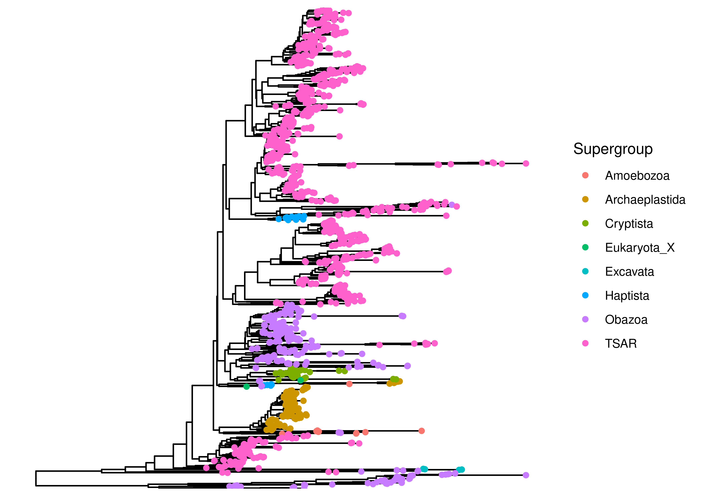
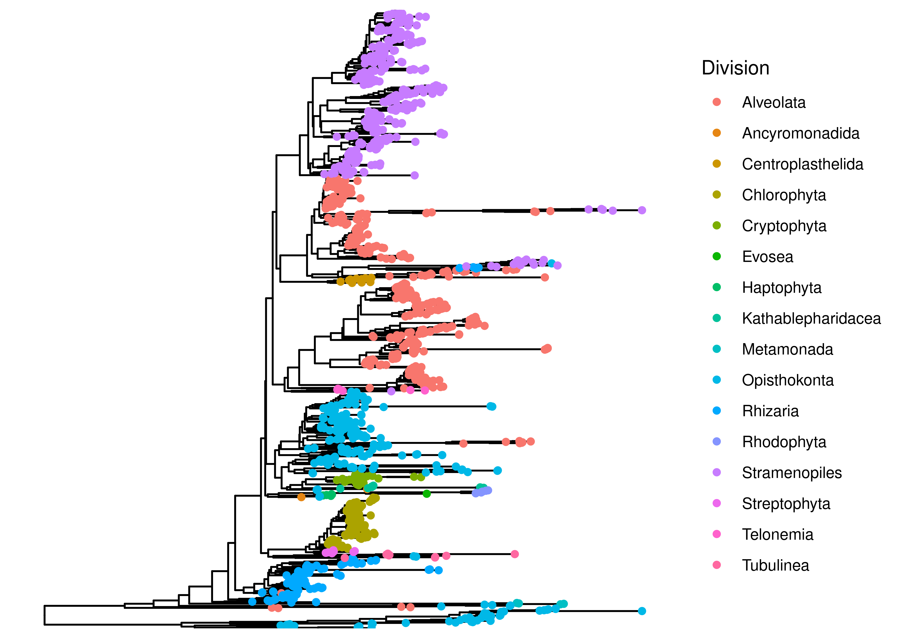
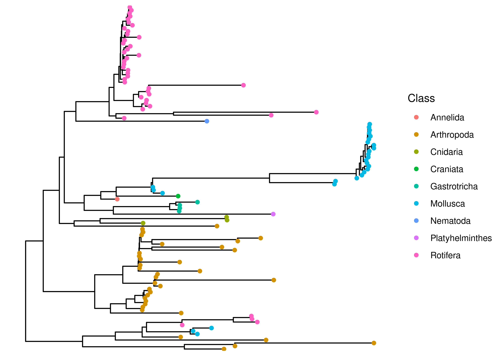

# Purpose of this document

Here, I build a phylogenetic tree, for later use in phylogenetically weighted richness and distance measures. 

The goal of this document is to create a phylogenetic tree from the processed data and add it to the phyloseq object.

# Load Packages and Functions

::: {.cell layout-align="center"}

```{.r .cell-code}
# Load Packages
pacman::p_load(phyloseq, ggtree, patchwork, tidytree, phytools, tidyverse, install = FALSE)

# load colors and shapes
source("code/R/plotting_aesthetics.R")
```
:::


# Load data


::: {.cell layout-align="center"}

```{.r .cell-code}
# Load in the raw_phyloseq data from DADA2_workflow.Rmd
load("data/03a_Eukaryotic_Errors_and_Contamination/preprocessed_euk_physeq.RData")

preprocessed_euk_physeq
```

::: {.cell-output .cell-output-stdout}
```
phyloseq-class experiment-level object
otu_table()   OTU Table:         [ 1455 taxa and 73 samples ]
sample_data() Sample Data:       [ 73 samples by 6 sample variables ]
tax_table()   Taxonomy Table:    [ 1455 taxa by 11 taxonomic ranks ]
```
:::
:::


# Write ASV Fasta file

::: {.cell layout-align="center"}

```{.r .cell-code}
# first pull taxonomic table from phyloseq object
# contains ASV and sequences
tax_table <- preprocessed_euk_physeq@tax_table %>% as.data.frame() %>% 
  select(ASV, ASVseqs)

# add > symbol to ASV names for file formatting
tax_table$ASV <- paste0(">",tax_table$ASV)

# bind ASVs and sequences together in one long character
seqs_fasta <- c(rbind(tax_table$ASV, tax_table$ASVseqs))

# write seqs_fasta out as a fasta file
write(seqs_fasta, file = "data/04a_Eukaryotic_TreeBuilding/preprocessed_euk_asvs.fasta")
```
:::


# MAFFT for Alignment

This step aligns the ASV fasta from phyloseq_preprocessing and outputs an aligned fasta file. Note that you should be running this from the project's home directory!


::: {.cell layout-align="center" engine.opts='-l'}

```{.bash .cell-code}

# Run MAFFT on file
# I am using auto options for now (instead of specifying arguments)
# MAFFT automatically recognizes that it is a nucleotide alignment

# Set seed (not sure if relevant but not taking chances)
RANDOM=314

/programs/mafft/bin/mafft --auto --quiet data/04a_Eukaryotic_TreeBuilding/preprocessed_euk_asvs.fasta > data/04a_Eukaryotic_TreeBuilding/aligned_euk_asvs.fasta 

```
:::


# FastTree

This section of code takes the aligned fasta file and runs it through Fast Tree to output an unrooted tree. It also takes awhile. The end of the logfile will tell you relevant information on who the tree was built. 


::: {.cell layout-align="center" engine.opts='-l'}

```{.bash .cell-code}
#add to path
export PATH=/programs/FastTree-2.1.11:$PATH

# run command
# -nt indicates it is a nucleotide alignment 
# -gtr sets the model to a generalized time-reversible model 
# -fastest speeds up the process and reduces memory usage (recommended for >50,000 sequences) - check if gtr is neighbor-joining
# takes aligned_seqs fasta file as input and outputs unrooted.tree
# saves log file as fasttree.log (includes intermediate trees, settings, and model details)
# Again, setting seed, not sure that it's necessary
RANDOM=314
FastTree -gtr -nt -fastest -quiet -log data/04a_Eukaryotic_TreeBuilding/fasttree.log data/04a_Eukaryotic_TreeBuilding/aligned_euk_asvs.fasta  > data/04a_Eukaryotic_TreeBuilding/unrooted_euk.tree

```
:::


# Plot with ggtree

First load tree and add to phyloseq object


::: {.cell layout-align="center"}

```{.r .cell-code}
# read tree file
tree <- read.tree("data/04a_Eukaryotic_TreeBuilding/unrooted_euk.tree")
```
:::


# Looking at our tree


::: {.cell layout-align="center"}

```{.r .cell-code}
midroot_tree <- phytools::midpoint_root(tree)

is.rooted(midroot_tree)
```

::: {.cell-output .cell-output-stdout}
```
[1] TRUE
```
:::

```{.r .cell-code}
tree_physeq <- merge_phyloseq(preprocessed_euk_physeq, midroot_tree)

tax_table(tree_physeq) %>% colnames()
```

::: {.cell-output .cell-output-stdout}
```
 [1] "Domain"      "Supergroup"  "Division"    "Subdivision" "Class"      
 [6] "Order"       "Family"      "Genus"       "Species"     "ASV"        
[11] "ASVseqs"    
```
:::

```{.r .cell-code}
ggtree(tree_physeq) + 
  geom_tippoint(aes(color = Supergroup))
```

::: {.cell-output-display}
{fig-align='center' width=2100}
:::

```{.r .cell-code}
ggtree(tree_physeq) + 
  geom_tippoint(aes(color = Division))
```

::: {.cell-output-display}
{fig-align='center' width=2100}
:::
:::


Okay, our taxonomic classifications and tree building is mostly similar, though obviously there is some phylogenetic jumping around. Tbh I don't know enough about eukaryotic taxonomy to assess the whether this tree looks reasonable...Are those long branches normal? Idk. At this point, I'm going to opt for not removing any branches, because I don't see a consistent and fair way to do it. 

# Saving eukaryotic tree


::: {.cell layout-align="center"}

```{.r .cell-code}
tree_euk_physeq <- tree_physeq

save(tree_euk_physeq, file = "data/04a_Eukaryotic_TreeBuilding/tree_euk_physeq.RData")
```
:::


# Examining Metazoa (really don't know if this is reasonable)


# Load data


::: {.cell layout-align="center"}

```{.r .cell-code}
# Load in the raw_phyloseq data from DADA2_workflow.Rmd
load("data/03a_Eukaryotic_Errors_and_Contamination/preprocessed_meta_physeq.RData")

preprocessed_meta_physeq
```

::: {.cell-output .cell-output-stdout}
```
phyloseq-class experiment-level object
otu_table()   OTU Table:         [ 115 taxa and 70 samples ]
sample_data() Sample Data:       [ 70 samples by 6 sample variables ]
tax_table()   Taxonomy Table:    [ 115 taxa by 11 taxonomic ranks ]
```
:::
:::


# Write ASV Fasta file

::: {.cell layout-align="center"}

```{.r .cell-code}
# first pull taxonomic table from phyloseq object
# contains ASV and sequences
tax_table <- preprocessed_meta_physeq@tax_table %>% as.data.frame() %>% 
  select(ASV, ASVseqs)

# add > symbol to ASV names for file formatting
tax_table$ASV <- paste0(">",tax_table$ASV)

# bind ASVs and sequences together in one long character
seqs_fasta <- c(rbind(tax_table$ASV, tax_table$ASVseqs))

# write seqs_fasta out as a fasta file
write(seqs_fasta, file = "data/04a_Eukaryotic_TreeBuilding/preprocessed_meta_asvs.fasta")
```
:::


# MAFFT for Alignment

This step aligns the ASV fasta from phyloseq_preprocessing and outputs an aligned fasta file. Note that you should be running this from the project's home directory!


::: {.cell layout-align="center" engine.opts='-l'}

```{.bash .cell-code}

# Run MAFFT on file
# I am using auto options for now (instead of specifying arguments)
# MAFFT automatically recognizes that it is a nucleotide alignment

# Set seed (not sure if relevant but not taking chances)
RANDOM=314

/programs/mafft/bin/mafft --auto --quiet data/04a_Eukaryotic_TreeBuilding/preprocessed_meta_asvs.fasta > data/04a_Eukaryotic_TreeBuilding/aligned_meta_asvs.fasta 

```
:::


# FastTree

This section of code takes the aligned fasta file and runs it through Fast Tree to output an unrooted tree. It also takes awhile. The end of the logfile will tell you relevant information on who the tree was built. 


::: {.cell layout-align="center" engine.opts='-l'}

```{.bash .cell-code}
#add to path
export PATH=/programs/FastTree-2.1.11:$PATH

# run command
# -nt indicates it is a nucleotide alignment 
# -gtr sets the model to a generalized time-reversible model 
# -fastest speeds up the process and reduces memory usage (recommended for >50,000 sequences) - check if gtr is neighbor-joining
# takes aligned_seqs fasta file as input and outputs unrooted.tree
# saves log file as fasttree.log (includes intermediate trees, settings, and model details)
# Again, setting seed, not sure that it's necessary
RANDOM=314
FastTree -gtr -nt -fastest -quiet -log data/04a_Eukaryotic_TreeBuilding/fasttree_meta.log data/04a_Eukaryotic_TreeBuilding/aligned_meta_asvs.fasta  > data/04a_Eukaryotic_TreeBuilding/unrooted_meta.tree

```
:::


# Plot with ggtree

First load tree and add to phyloseq object


::: {.cell layout-align="center"}

```{.r .cell-code}
# read tree file
tree_meta <- read.tree("data/04a_Eukaryotic_TreeBuilding/unrooted_meta.tree")
```
:::


# Looking at our tree


::: {.cell layout-align="center"}

```{.r .cell-code}
midroot_tree_meta <- phytools::midpoint_root(tree_meta)

is.rooted(midroot_tree_meta)
```

::: {.cell-output .cell-output-stdout}
```
[1] TRUE
```
:::

```{.r .cell-code}
tree_meta_physeq <- merge_phyloseq(preprocessed_meta_physeq, midroot_tree_meta)

ggtree(tree_meta_physeq) + 
  geom_tippoint(aes(color = Class))
```

::: {.cell-output-display}
{fig-align='center' width=2100}
:::
:::


# Saving metazoan tree


::: {.cell layout-align="center"}

```{.r .cell-code}
save(tree_meta_physeq, file = "data/04a_Eukaryotic_TreeBuilding/tree_meta_physeq.RData")
```
:::


# Session Information 

::: {.cell layout-align="center"}

```{.r .cell-code}
# Reproducibility
devtools::session_info()
```

::: {.cell-output .cell-output-stdout}
```
─ Session info ───────────────────────────────────────────────────────────────
 setting  value
 version  R version 4.3.3 (2024-02-29)
 os       Rocky Linux 9.4 (Blue Onyx)
 system   x86_64, linux-gnu
 ui       X11
 language (EN)
 collate  en_US.UTF-8
 ctype    en_US.UTF-8
 tz       America/New_York
 date     2025-04-17
 pandoc   3.1.1 @ /usr/lib/rstudio-server/bin/quarto/bin/tools/ (via rmarkdown)
 quarto   1.3.450 @ /usr/lib/rstudio-server/bin/quarto/bin/quarto

─ Packages ───────────────────────────────────────────────────────────────────
 ! package           * version    date (UTC) lib source
   ade4                1.7-23     2025-02-14 [1] RSPM (R 4.3.3)
   ape               * 5.8-1      2024-12-16 [1] RSPM (R 4.3.3)
 P aplot               0.2.5      2025-02-27 [?] RSPM (R 4.3.3)
   Biobase             2.62.0     2023-10-24 [1] Bioconductor
   BiocGenerics        0.48.1     2023-11-01 [1] Bioconductor
   biomformat          1.30.0     2023-10-24 [1] Bioconductor
   Biostrings          2.70.3     2024-03-13 [1] Bioconductor 3.18 (R 4.3.3)
   bitops              1.0-9      2024-10-03 [1] RSPM (R 4.3.3)
   cachem              1.1.0      2024-05-16 [1] RSPM (R 4.3.3)
 P cli                 3.6.3      2024-06-21 [?] CRAN (R 4.3.2)
 P cluster             2.1.6      2023-12-01 [?] CRAN (R 4.3.3)
 P clusterGeneration   1.3.8      2023-08-16 [?] CRAN (R 4.3.2)
 P coda                0.19-4.1   2024-01-31 [?] CRAN (R 4.3.2)
 P codetools           0.2-19     2023-02-01 [?] CRAN (R 4.3.3)
   colorspace          2.1-1      2024-07-26 [1] RSPM (R 4.3.3)
 P combinat            0.0-8      2012-10-29 [?] CRAN (R 4.3.2)
   crayon              1.5.3      2024-06-20 [1] RSPM (R 4.3.3)
   data.table          1.17.0     2025-02-22 [1] RSPM (R 4.3.3)
 P DEoptim             2.2-8      2022-11-11 [?] CRAN (R 4.3.2)
 P devtools            2.4.5      2022-10-11 [?] CRAN (R 4.3.2)
   digest              0.6.37     2024-08-19 [1] RSPM (R 4.3.3)
   doParallel          1.0.17     2022-02-07 [1] RSPM (R 4.3.3)
   dplyr             * 1.1.4      2023-11-17 [1] RSPM (R 4.3.3)
 P ellipsis            0.3.2      2021-04-29 [?] CRAN (R 4.3.2)
   evaluate            1.0.3      2025-01-10 [1] RSPM (R 4.3.3)
 P expm                1.0-0      2024-08-19 [?] CRAN (R 4.3.2)
   farver              2.1.2      2024-05-13 [1] RSPM (R 4.3.3)
   fastmap             1.2.0      2024-05-15 [1] RSPM (R 4.3.3)
 P fastmatch           1.1-6      2024-12-23 [?] CRAN (R 4.3.2)
   forcats           * 1.0.0      2023-01-29 [1] RSPM (R 4.3.3)
   foreach             1.5.2      2022-02-02 [1] RSPM (R 4.3.3)
   fs                  1.6.5      2024-10-30 [1] RSPM (R 4.3.3)
   generics            0.1.3      2022-07-05 [1] RSPM (R 4.3.3)
   GenomeInfoDb        1.38.8     2024-03-15 [1] Bioconductor 3.18 (R 4.3.3)
   GenomeInfoDbData    1.2.11     2025-04-11 [1] Bioconductor
 P ggfun               0.1.8      2024-12-03 [?] CRAN (R 4.3.2)
   ggplot2           * 3.5.2      2025-04-09 [1] RSPM (R 4.3.3)
 P ggplotify           0.1.2      2023-08-09 [?] CRAN (R 4.3.2)
 P ggtree            * 3.10.1     2024-02-25 [?] Bioconduc~
   glue                1.8.0      2024-09-30 [1] RSPM (R 4.3.3)
 P gridGraphics        0.5-1      2020-12-13 [?] CRAN (R 4.3.2)
   gtable              0.3.6      2024-10-25 [1] RSPM (R 4.3.3)
   hms                 1.1.3      2023-03-21 [1] RSPM (R 4.3.3)
   htmltools           0.5.8.1    2024-04-04 [1] RSPM (R 4.3.3)
 P htmlwidgets         1.6.4      2023-12-06 [?] CRAN (R 4.3.2)
 P httpuv              1.6.15     2024-03-26 [?] CRAN (R 4.3.2)
   igraph              2.1.4      2025-01-23 [1] RSPM (R 4.3.3)
   IRanges             2.36.0     2023-10-24 [1] Bioconductor
   iterators           1.0.14     2022-02-05 [1] RSPM (R 4.3.3)
   jsonlite            2.0.0      2025-03-27 [1] RSPM (R 4.3.3)
   knitr               1.50       2025-03-16 [1] RSPM (R 4.3.3)
   labeling            0.4.3      2023-08-29 [1] RSPM (R 4.3.3)
 P later               1.4.2      2025-04-08 [?] RSPM (R 4.3.3)
 P lattice             0.22-5     2023-10-24 [?] CRAN (R 4.3.3)
 P lazyeval            0.2.2      2019-03-15 [?] CRAN (R 4.3.2)
   lifecycle           1.0.4      2023-11-07 [1] RSPM (R 4.3.3)
   lubridate         * 1.9.4      2024-12-08 [1] RSPM (R 4.3.3)
   magrittr            2.0.3      2022-03-30 [1] RSPM (R 4.3.3)
 P maps              * 3.4.2.1    2024-11-10 [?] CRAN (R 4.3.2)
 P MASS                7.3-60.0.1 2024-01-13 [?] CRAN (R 4.3.3)
 P Matrix              1.6-5      2024-01-11 [?] CRAN (R 4.3.3)
   memoise             2.0.1      2021-11-26 [1] RSPM (R 4.3.3)
 P mgcv                1.9-1      2023-12-21 [?] CRAN (R 4.3.3)
   mime                0.13       2025-03-17 [1] RSPM (R 4.3.3)
 P miniUI              0.1.1.1    2018-05-18 [?] CRAN (R 4.3.2)
 P mnormt              2.1.1      2022-09-26 [?] CRAN (R 4.3.2)
   multtest            2.58.0     2023-10-24 [1] Bioconductor
   munsell             0.5.1      2024-04-01 [1] RSPM (R 4.3.3)
 P nlme                3.1-164    2023-11-27 [?] CRAN (R 4.3.3)
 P numDeriv            2016.8-1.1 2019-06-06 [?] CRAN (R 4.3.2)
 P optimParallel       1.0-2      2021-02-11 [?] CRAN (R 4.3.2)
 P pacman              0.5.1      2019-03-11 [?] CRAN (R 4.3.2)
   patchwork         * 1.3.0      2024-09-16 [1] RSPM (R 4.3.3)
   permute             0.9-7      2022-01-27 [1] RSPM (R 4.3.3)
 P phangorn            2.12.1     2024-09-17 [?] CRAN (R 4.3.2)
   phyloseq          * 1.46.0     2023-10-24 [1] Bioconductor
 P phytools          * 2.4-4      2025-01-08 [?] CRAN (R 4.3.2)
   pillar              1.10.2     2025-04-05 [1] RSPM (R 4.3.3)
 P pkgbuild            1.4.7      2025-03-24 [?] RSPM (R 4.3.3)
   pkgconfig           2.0.3      2019-09-22 [1] RSPM (R 4.3.3)
 P pkgload             1.4.0      2024-06-28 [?] CRAN (R 4.3.2)
   plyr                1.8.9      2023-10-02 [1] RSPM (R 4.3.3)
 P profvis             0.4.0      2024-09-20 [?] CRAN (R 4.3.2)
 P promises            1.3.2      2024-11-28 [?] CRAN (R 4.3.2)
 P purrr             * 1.0.2      2023-08-10 [?] CRAN (R 4.3.2)
 P quadprog            1.5-8      2019-11-20 [?] CRAN (R 4.3.2)
 P R6                  2.5.1      2021-08-19 [?] CRAN (R 4.3.2)
 P Rcpp                1.0.13-1   2024-11-02 [?] RSPM (R 4.3.3)
   RCurl               1.98-1.17  2025-03-22 [1] RSPM (R 4.3.3)
   readr             * 2.1.5      2024-01-10 [1] RSPM (R 4.3.3)
 P remotes             2.5.0      2024-03-17 [?] CRAN (R 4.3.2)
   renv                1.0.3      2023-09-19 [1] CRAN (R 4.3.3)
   reshape2            1.4.4      2020-04-09 [1] RSPM (R 4.3.3)
   rhdf5               2.46.1     2023-11-29 [1] Bioconductor 3.18 (R 4.3.3)
   rhdf5filters        1.14.1     2023-11-06 [1] Bioconductor
   Rhdf5lib            1.24.2     2024-02-07 [1] Bioconductor 3.18 (R 4.3.3)
 P rlang               1.1.4      2024-06-04 [?] CRAN (R 4.3.2)
   rmarkdown           2.29       2024-11-04 [1] RSPM (R 4.3.3)
   rstudioapi          0.17.1     2024-10-22 [1] RSPM (R 4.3.3)
   S4Vectors           0.40.2     2023-11-23 [1] Bioconductor 3.18 (R 4.3.3)
   scales              1.3.0      2023-11-28 [1] RSPM (R 4.3.3)
 P scatterplot3d       0.3-44     2023-05-05 [?] CRAN (R 4.3.2)
 P sessioninfo         1.2.3      2025-02-05 [?] RSPM (R 4.3.3)
 P shiny               1.10.0     2024-12-14 [?] CRAN (R 4.3.2)
   stringi             1.8.7      2025-03-27 [1] RSPM (R 4.3.3)
   stringr           * 1.5.1      2023-11-14 [1] RSPM (R 4.3.3)
 P survival            3.5-8      2024-02-14 [?] CRAN (R 4.3.3)
   tibble            * 3.2.1      2023-03-20 [1] RSPM (R 4.3.3)
   tidyr             * 1.3.1      2024-01-24 [1] RSPM (R 4.3.3)
   tidyselect          1.2.1      2024-03-11 [1] RSPM (R 4.3.3)
 P tidytree          * 0.4.6      2023-12-12 [?] CRAN (R 4.3.2)
   tidyverse         * 2.0.0      2023-02-22 [1] RSPM (R 4.3.3)
   timechange          0.3.0      2024-01-18 [1] RSPM (R 4.3.3)
 P treeio              1.33.0     2025-04-17 [?] Github (GuangchuangYu/treeio@f5a6dec)
   tzdb                0.5.0      2025-03-15 [1] RSPM (R 4.3.3)
 P urlchecker          1.0.1      2021-11-30 [?] CRAN (R 4.3.2)
 P usethis             3.1.0      2024-11-26 [?] CRAN (R 4.3.2)
   vctrs               0.6.5      2023-12-01 [1] RSPM (R 4.3.3)
   vegan               2.6-10     2025-01-29 [1] RSPM (R 4.3.3)
   withr               3.0.2      2024-10-28 [1] RSPM (R 4.3.3)
   xfun                0.52       2025-04-02 [1] RSPM (R 4.3.3)
 P xtable              1.8-4      2019-04-21 [?] CRAN (R 4.3.2)
   XVector             0.42.0     2023-10-24 [1] Bioconductor
   yaml                2.3.10     2024-07-26 [1] RSPM (R 4.3.3)
 P yulab.utils         0.2.0      2025-01-29 [?] RSPM (R 4.3.3)
   zlibbioc            1.48.2     2024-03-13 [1] Bioconductor 3.18 (R 4.3.3)

 [1] /local/workdir/arp277/AAM_ERI_2024/renv/library/R-4.3/x86_64-pc-linux-gnu
 [2] /home/arp277/.cache/R/renv/sandbox/R-4.3/x86_64-pc-linux-gnu/fd835031

 * ── Packages attached to the search path.
 P ── Loaded and on-disk path mismatch.

──────────────────────────────────────────────────────────────────────────────
```
:::
:::
