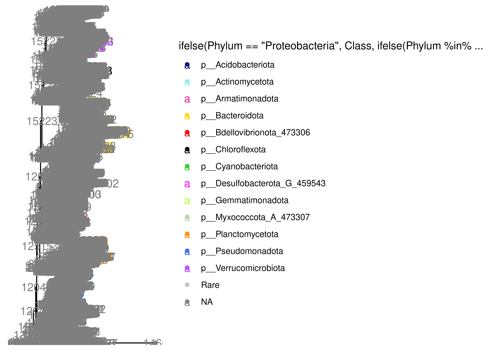
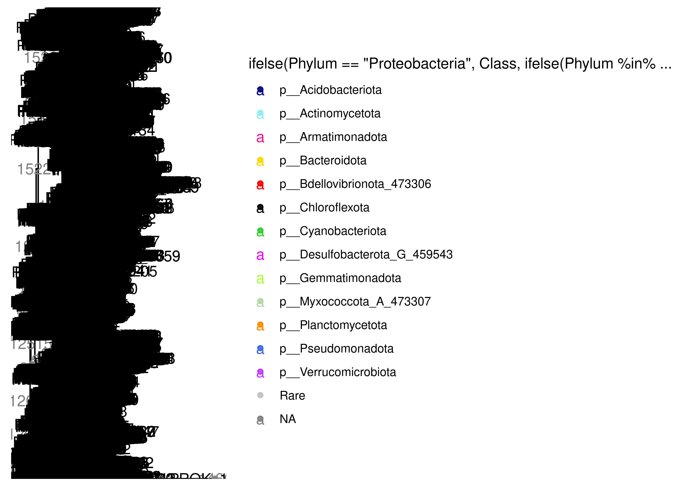
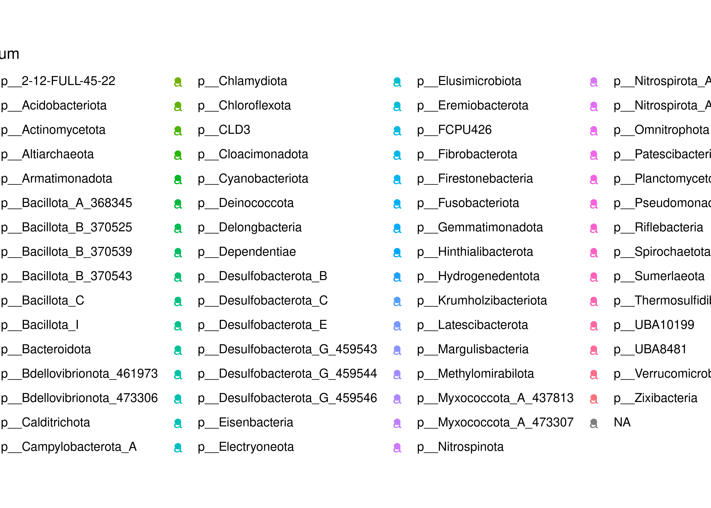
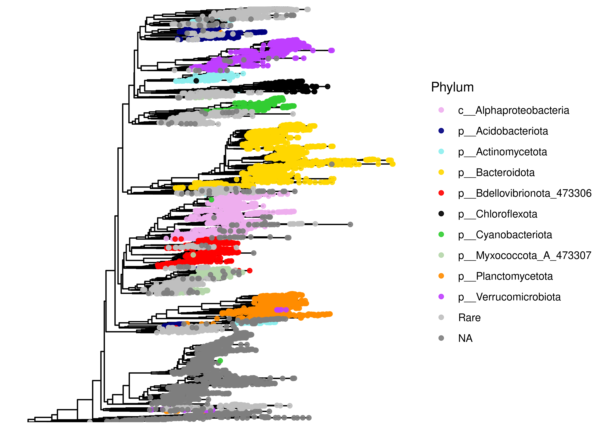
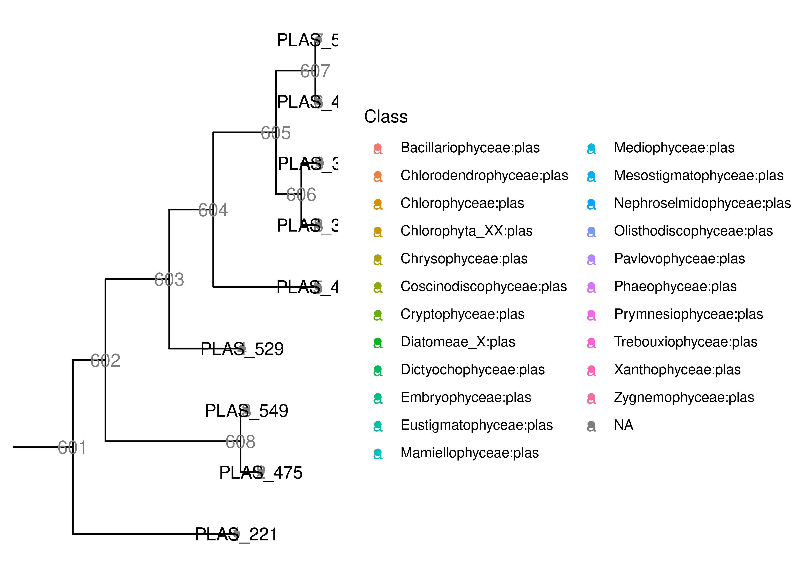
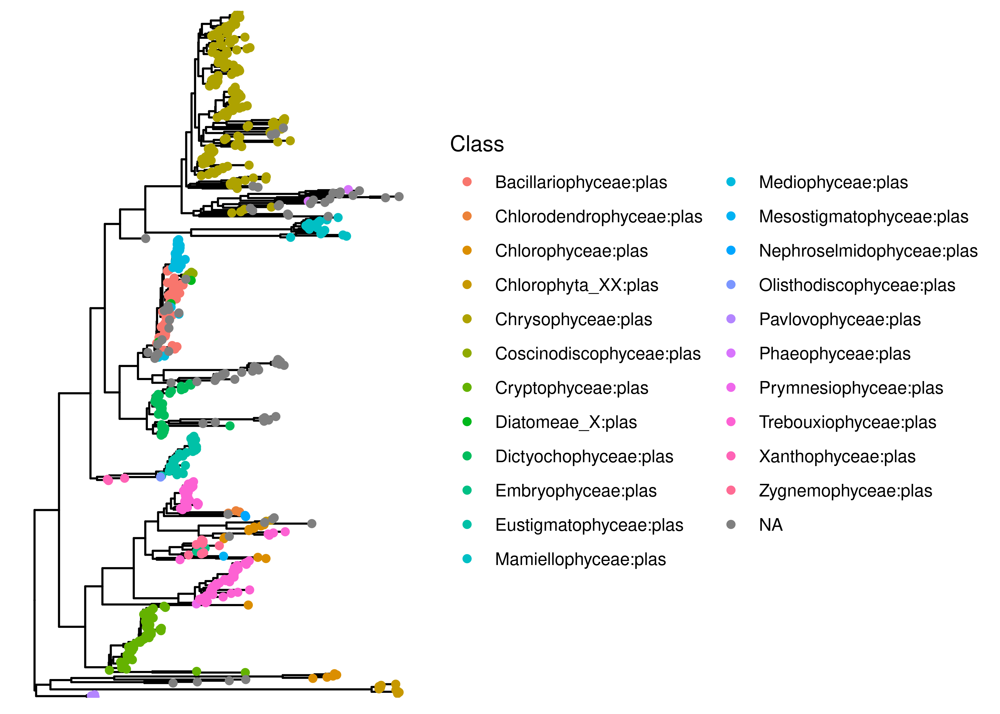

# Purpose of this document

Here, I build a phylogenetic tree, for later use in phylogenetically weighted richness and distance measures. 

The goal of this document is to create a phylogenetic tree from the processed data and add it to the phyloseq object.

# Load Packages and Functions

::: {.cell layout-align="center"}

```{.r .cell-code}
# Load Packages
pacman::p_load(phyloseq, ggtree, patchwork, tidytree, phytools, tidyverse, install = FALSE)

# load colors and shapes
source("code/R/plotting_aesthetics.R")
```
:::


# Load data


::: {.cell layout-align="center"}

```{.r .cell-code}
# Load in the raw_phyloseq data from DADA2_workflow.Rmd
load("data/03b_Prokaryotic_Errors_and_Contamination/preprocessed_prok_physeq.RData")

preprocessed_prok_physeq
```

::: {.cell-output .cell-output-stdout}
```
phyloseq-class experiment-level object
otu_table()   OTU Table:         [ 11040 taxa and 77 samples ]
sample_data() Sample Data:       [ 77 samples by 8 sample variables ]
tax_table()   Taxonomy Table:    [ 11040 taxa by 9 taxonomic ranks ]
```
:::
:::


# Write ASV Fasta file


::: {.cell layout-align="center"}

```{.r .cell-code}
# first pull taxonomic table from phyloseq object
# contains ASV and sequences
tax_table <- preprocessed_prok_physeq@tax_table %>% as.data.frame() %>% 
  select(ASV, ASVseqs)

# add > symbol to ASV names for file formatting
tax_table$ASV <- paste0(">",tax_table$ASV)

# bind ASVs and sequences together in one long character
seqs_fasta <- c(rbind(tax_table$ASV, tax_table$ASVseqs))

# write seqs_fasta out as a fasta file
write(seqs_fasta, file = "data/04b_Prokaryotic_TreeBuilding/preprocessed_prok_asvs.fasta")
```
:::


# MAFFT for Alignment

This step aligns the ASV fasta from phyloseq_preprocessing and outputs an aligned fasta file. Note that you should be running this from the project's home directory!


::: {.cell layout-align="center" engine.opts='-l'}

```{.bash .cell-code}

# Run MAFFT on file
# I am using auto options for now (instead of specifying arguments)
# MAFFT automatically recognizes that it is a nucleotide alignment

# Set seed (not sure if relevant but not taking chances)
RANDOM=314

/programs/mafft/bin/mafft --auto --quiet data/04b_Prokaryotic_TreeBuilding/preprocessed_prok_asvs.fasta > data/04b_Prokaryotic_TreeBuilding/aligned_prok_asvs.fasta 

```
:::


# FastTree

This section of code takes the aligned fasta file and runs it through Fast Tree to output an unrooted tree. It also takes awhile. The end of the logfile will tell you relevant information on who the tree was built. 


::: {.cell layout-align="center" engine.opts='-l'}

```{.bash .cell-code}
#add to path
export PATH=/programs/FastTree-2.1.11:$PATH

# run command
# -nt indicates it is a nucleotide alignment 
# -gtr sets the model to a generalized time-reversible model 
# -fastest speeds up the process and reduces memory usage (recommended for >50,000 sequences) - check if gtr is neighbor-joining
# takes aligned_seqs fasta file as input and outputs unrooted.tree
# saves log file as fasttree.log (includes intermediate trees, settings, and model details)
# Again, setting seed, not sure that it's necessary
RANDOM=314
FastTree -gtr -nt -fastest -quiet -log data/04b_Prokaryotic_TreeBuilding/fasttree.log data/04b_Prokaryotic_TreeBuilding/aligned_prok_asvs.fasta  > data/04b_Prokaryotic_TreeBuilding/unrooted_prok.tree

```
:::


# Plot with ggtree

First load tree and add to phyloseq object


::: {.cell layout-align="center"}

```{.r .cell-code}
# read tree file
tree <- read.tree("data/04b_Prokaryotic_TreeBuilding/unrooted_prok.tree")
```
:::


# Looking at our tree - can't root at archaea


::: {.cell layout-align="center"}

```{.r .cell-code}
tax_table(preprocessed_prok_physeq) %>%
  as.data.frame() %>%
  count(Kingdom)
```

::: {.cell-output .cell-output-stdout}
```
      Kingdom     n
1  d__Archaea     1
2 d__Bacteria 11039
```
:::
:::


WOAH - only one Archaea! That's really surprising actually. Did we cut them all with our abundance filtering?


::: {.cell layout-align="center"}

```{.r .cell-code}
load("data/02b_Prokaryotic_Taxonomic_Classification/raw_prok_physeq_noplas.RData")

tax_table(raw_prok_physeq_noplas) %>%
  as.data.frame() %>%
  count(Kingdom)
```

::: {.cell-output .cell-output-stdout}
```
      Kingdom     n
1  d__Archaea     5
2 d__Bacteria 17505
```
:::

```{.r .cell-code}
tax_table(raw_prok_physeq_noplas) %>%
  as.data.frame() %>%
  count(Phylum)
```

::: {.cell-output .cell-output-stdout}
```
                         Phylum    n
1            p__2-12-FULL-45-22    7
2            p__Acidobacteriota  496
3             p__Actinomycetota  562
4              p__Altiarchaeota    2
5             p__Armatimonadota   68
6              p__Atribacterota    2
7              p__Auribacterota    1
8         p__Bacillota_A_368345  286
9         p__Bacillota_B_370518    1
10        p__Bacillota_B_370525    1
11        p__Bacillota_B_370539    7
12        p__Bacillota_B_370541    2
13        p__Bacillota_B_370543    3
14               p__Bacillota_C   31
15               p__Bacillota_E    1
16               p__Bacillota_F    1
17               p__Bacillota_G    3
18               p__Bacillota_I   76
19              p__Bacteroidota 2342
20   p__Bdellovibrionota_461973  116
21   p__Bdellovibrionota_473306 1175
22                      p__CLD3    9
23                    p__CSP1-3    2
24             p__Caldisericota    1
25             p__Calditrichota    3
26        p__Campylobacterota_A   30
27               p__Chlamydiota   81
28             p__Chloroflexota  640
29            p__Cloacimonadota    8
30           p__Cyanobacteriota  432
31              p__Deinococcota   14
32            p__Delongbacteria   21
33              p__Dependentiae  229
34        p__Desulfobacterota_B   67
35        p__Desulfobacterota_C   31
36        p__Desulfobacterota_D    1
37        p__Desulfobacterota_E   10
38 p__Desulfobacterota_G_459543  190
39 p__Desulfobacterota_G_459544   94
40 p__Desulfobacterota_G_459546   79
41           p__Edwardsbacteria    2
42             p__Eisenbacteria   43
43             p__Electryoneota    3
44           p__Elusimicrobiota  177
45           p__Eremiobacterota    8
46                   p__FCPU426   15
47            p__Fibrobacterota  121
48         p__Firestonebacteria    8
49            p__Fusobacteriota   16
50           p__Gemmatimonadota  121
51        p__Hinthialibacterota    2
52          p__Hydrogenedentota   23
53                      p__KSB1    1
54       p__Krumholzibacteriota   13
55          p__Latescibacterota   11
56          p__Margulisbacteria   89
57         p__Methylomirabilota   12
58             p__Moduliflexota    1
59      p__Myxococcota_A_437813   12
60      p__Myxococcota_A_473307  534
61             p__Nanoarchaeota    3
62              p__Nitrospinota    8
63     p__Nitrospirota_A_437815  107
64     p__Nitrospirota_A_437855    2
65              p__Omnitrophota  427
66           p__Patescibacteria  783
67           p__Planctomycetota 1287
68            p__Pseudomonadota 4530
69            p__Ratteibacteria    1
70             p__Riflebacteria   27
71                  p__SZUA-182    1
72                   p__SZUA-79    3
73             p__Spirochaetota  214
74               p__Sumerlaeota   14
75    p__Thermosulfidibacterota    6
76                  p__UBA10199   18
77                   p__UBA6262    1
78                   p__UBA8481    7
79         p__Verrucomicrobiota 1131
80              p__Zixibacteria   23
81                         <NA>  580
```
:::

```{.r .cell-code}
raw_prok_physeq_noplas %>%
  psmelt() %>%
  filter(Kingdom == "Archaea", Abundance > 0) 
```

::: {.cell-output .cell-output-stdout}
```
 [1] OTU       Sample    Abundance Kingdom   Phylum    Class     Order    
 [8] Family    Genus     Species   ASV       ASVseqs  
<0 rows> (or 0-length row.names)
```
:::
:::


Damn...only three ASVs. That really is quite wild. Good to know. In silico predictions showed that these primers should be almost as good for Archaea as the V4 EMP primers, but this really seems to show that isn't the case (unless Archaea are just extremely rare? I doubt that they're this rare though). But then again, the Paver paper only really observed Archaea in the deep bottom waters, which Erie (mostly) lacks. So maybe this is real. And the few Archaeal ASVs that we did pick up were only in bottom samples from the central basin...really cool!

That said, we need to decide where to root a tree (typically, we would root at the archaea). Since we have only one Archael ASV, maybe it will still make a nice outgroupIn this case, perhaps we'll try midpoint rooting as well. 


::: {.cell layout-align="center"}

```{.r .cell-code}
first_tree_physeq <- merge_phyloseq(preprocessed_prok_physeq, tree)

rich_phyla <- first_tree_physeq %>% 
  psmelt() %>%
  count(Phylum) %>%
  slice_max(order_by = n, n = 12) %>%
  pull(Phylum)

first_tree_physeq %>%
  subset_taxa(Kingdom == "d__Archaea") %>%
  taxa_sums()
```

::: {.cell-output .cell-output-stdout}
```
PROK_9864 
       14 
```
:::

```{.r .cell-code}
arch_tree <- ape::root(tree, outgroup = "PROK_9864", resolve.root = TRUE)

is.rooted(arch_tree)
```

::: {.cell-output .cell-output-stdout}
```
[1] TRUE
```
:::

```{.r .cell-code}
rooted_physeq <- merge_phyloseq(preprocessed_prok_physeq, arch_tree)

first_tree <- ggtree(rooted_physeq) + 
  geom_tippoint(aes(color = ifelse(Phylum == "Proteobacteria", Class, 
                                   ifelse(Phylum %in% rich_phyla, Phylum, "Rare"))), alpha = 0.9) + 
  scale_color_manual(values = phylum_colors) + 
  geom_text(aes(label = node, color = Phylum), size = 4)

first_tree
```

::: {.cell-output-display}
{fig-align='center' width=2100}
:::

```{.r .cell-code}
viewClade(first_tree, 12265) + 
  geom_text(aes(label = ASV))
```

::: {.cell-output-display}
{fig-align='center' width=2100}
:::

```{.r .cell-code}
asvs_to_drop <- c("PROK_7342","PROK_3020","PROK_2937", "PROK_11720")

rooted_physeq %>%
  subset_taxa(ASV %in% asvs_to_drop) %>%
  tax_table()
```

::: {.cell-output .cell-output-stdout}
```
Taxonomy Table:     [4 taxa by 9 taxonomic ranks]:
           Kingdom       Phylum               Class Order Family Genus Species
PROK_11720 "d__Bacteria" "p__Patescibacteria" NA    NA    NA     NA    NA     
PROK_2937  "d__Bacteria" NA                   NA    NA    NA     NA    NA     
PROK_3020  "d__Bacteria" "p__Patescibacteria" NA    NA    NA     NA    NA     
PROK_7342  "d__Bacteria" "p__Patescibacteria" NA    NA    NA     NA    NA     
           ASV         
PROK_11720 "PROK_11720"
PROK_2937  "PROK_2937" 
PROK_3020  "PROK_3020" 
PROK_7342  "PROK_7342" 
           ASVseqs                                                                                                                                                                                                                                                                                                                                                                                
PROK_11720 "TACGAGAGGAGCAAGTGTTCTACGGTCCCACTGGGCGTACAGGCTCCTTCAGCGGAGTTCAGAAAGCTTTTTCGATTCTTAATCCTGTACCGATTGAACAGAAAAAGAACTTGAACTCGTGAGGTGAGGTGAGGAGGGCGGTATTCCGAGTCTAGCGTTGCCATGCGGTGACTCTCGGAGGACGGCCATCTGGGGCAGCCAGCCCTCCAACCTCTCCTGACGCTTCGGGAGGAAAGCGTGGGGAGCGATCGAGATTAGAGACCTCGGTAGTCCACGCCCTGATCTATGGGAAGCGGCTTTCTTTGTGCAAGGCACAATAAAGATTGCCAAGCTAACGCAACTTCCTCGCCTGAGAAGTACGATCGCAAGGTTG"
PROK_2937  "TACGGGAGGGGCGAGTGTTGTTCGGAATGATTGGGCGTAAAGGGGGCGTAGGTTGTTGAAGAAGTTGATATTGAAACATTTGTGTTCATCAGAAAAAAAGGTATCAAAACTGCTCAACTAGGGTCGTATCGGGGGAAGTAGAATTGTTGGTGGAGCAGTTGTAAGCATTGATCTCAATAGGAATACCGGACCTGAAGAGAGCTTCCTAGATACGTACCGACACTGAGGCCCGAAAGCGTGGATAGTCAAGGGGATTAGATACCCCCGTAGCCCACGCCAGAAACGATGCTGACCATTTCCTCGGATAATTTCTGGGGGAGCCAAGTTAACGCTTTAAGTCAGCCGCCTGGGGAGTACGGCCGCAAGGTTA"   
PROK_3020  "TACGGGAGGGGCAAGTGTTGTTCGGTTTGATTGGGCGTAAAGGGAGTGTAGGTGGACTTTTAGGTTGTTTTTGAAAGGCTTGTGTTTATCAGAAGCAATAAAAACAAAACCGATAGTCTTGGGTCATAAAGAGGGAAGTAGAATTATTGGTGGAGCAGTCACACGCTTTGATCTCAATAGGAATACCAAAGCTGAAGAGAGCTTCCTGGTTATGTACCGACACTGAGTCTCGAAAGCATGGATAGTCAAGGGGATTAGATAACCCCGTAGCCCATGCCCGTAACGATGCTAACCATTTCTTTGGCATTTGGCTGAGGAAACCAAGTAAACGCTTTAAGTTAGCCGCCTGGGAAGTACGATCGCAAGGTTG"   
PROK_7342  "TACGGGAGGGGCAAGTGTTGTTCGGTTTGATTGGGCGTAAAGGGAGTGTAGGCGGACTTTTAGGTTGTTTTTGAAAGGCTTGTGTTTATCAGAAGCAGTAAAAACAAAACCGATAGTCTTGGGTCATAGAGAGGGAAGTAGAATTATTGGTGGAGCAGTCACACGCTTTGATCTCAATAGGAATACCGAAGCTGAAGAGAGCTTCCTGGTTATGTACCGACGCTGAGTCTCGAAAGCATGGATAGTCAAGGGGATTAGATAACCCCGTAGCCCATGCCCGTAACGATGCTAACTATTTCTTTGGCATTTGGCTGAGGAAACCAAGTAAACGCTTTAAGTTAGCCGCCTGGGAAGTACGATCGCAAGGTTG"   
```
:::

```{.r .cell-code}
trim1_physeq <- 
  rooted_physeq %>%
  subset_taxa(!ASV %in% asvs_to_drop)

second_tree <- ggtree(trim1_physeq) + 
  geom_tippoint(aes(color = Phylum))+
  geom_text(aes(label = node, color = Phylum), size = 4)

second_tree
```

::: {.cell-output-display}
{fig-align='center' width=2100}
:::

```{.r .cell-code}
# Looking much better!

rich_phyla <- trim1_physeq %>% 
  psmelt() %>%
  count(Phylum) %>%
  slice_max(order_by = n, n = 12) %>%
  pull(Phylum)

ggtree(trim1_physeq) + 
  geom_tippoint(aes(color = ifelse(Phylum == "p__Pseudomonadota", Class, 
                                   ifelse(Phylum %in% rich_phyla, Phylum, "Rare"))), alpha = 0.9) + 
  scale_color_manual(values = phylum_colors) + 
  labs(color = "Phylum")
```

::: {.cell-output-display}
{fig-align='center' width=2100}
:::
:::


# Saving prokaryotic tree


::: {.cell layout-align="center"}

```{.r .cell-code}
tree_prok_physeq <- trim1_physeq

save(tree_prok_physeq, file = "data/04b_Prokaryotic_TreeBuilding/tree_prok_physeq.RData")
```
:::


# Examining plastids (really don't know if this is reasonable)


# Load data


::: {.cell layout-align="center"}

```{.r .cell-code}
load("data/03b_Prokaryotic_Errors_and_Contamination/preprocessed_plas_physeq.RData")

preprocessed_plas_physeq
```

::: {.cell-output .cell-output-stdout}
```
phyloseq-class experiment-level object
otu_table()   OTU Table:         [ 599 taxa and 75 samples ]
sample_data() Sample Data:       [ 75 samples by 8 sample variables ]
tax_table()   Taxonomy Table:    [ 599 taxa by 11 taxonomic ranks ]
```
:::
:::


# Write ASV Fasta file

::: {.cell layout-align="center"}

```{.r .cell-code}
# first pull taxonomic table from phyloseq object
# contains ASV and sequences
tax_table <- preprocessed_plas_physeq@tax_table %>% as.data.frame() %>% 
  select(ASV, ASVseqs)

# add > symbol to ASV names for file formatting
tax_table$ASV <- paste0(">",tax_table$ASV)

# bind ASVs and sequences together in one long character
seqs_fasta <- c(rbind(tax_table$ASV, tax_table$ASVseqs))

# write seqs_fasta out as a fasta file
write(seqs_fasta, file = "data/04b_Prokaryotic_TreeBuilding/preprocessed_plas_asvs.fasta")
```
:::


# MAFFT for Alignment

This step aligns the ASV fasta from phyloseq_preprocessing and outputs an aligned fasta file. Note that you should be running this from the project's home directory!


::: {.cell layout-align="center" engine.opts='-l'}

```{.bash .cell-code}

# Run MAFFT on file
# I am using auto options for now (instead of specifying arguments)
# MAFFT automatically recognizes that it is a nucleotide alignment

# Set seed (not sure if relevant but not taking chances)
RANDOM=314

/programs/mafft/bin/mafft --auto --quiet data/04b_Prokaryotic_TreeBuilding/preprocessed_plas_asvs.fasta > data/04b_Prokaryotic_TreeBuilding/aligned_plas_asvs.fasta 

```
:::


# FastTree

This section of code takes the aligned fasta file and runs it through Fast Tree to output an unrooted tree. It also takes awhile. The end of the logfile will tell you relevant information on who the tree was built. 


::: {.cell layout-align="center" engine.opts='-l'}

```{.bash .cell-code}
#add to path
export PATH=/programs/FastTree-2.1.11:$PATH

# run command
# -nt indicates it is a nucleotide alignment 
# -gtr sets the model to a generalized time-reversible model 
# -fastest speeds up the process and reduces memory usage (recommended for >50,000 sequences) - check if gtr is neighbor-joining
# takes aligned_seqs fasta file as input and outputs unrooted.tree
# saves log file as fasttree.log (includes intermediate trees, settings, and model details)
# Again, setting seed, not sure that it's necessary
RANDOM=314
FastTree -gtr -nt -fastest -quiet -log data/04b_Prokaryotic_TreeBuilding/fasttree_plas.log data/04b_Prokaryotic_TreeBuilding/aligned_plas_asvs.fasta  > data/04b_Prokaryotic_TreeBuilding/unrooted_plas.tree

```
:::


# Plot with ggtree

First load tree and add to phyloseq object


::: {.cell layout-align="center"}

```{.r .cell-code}
# read tree file
tree_plas <- read.tree("data/04b_Prokaryotic_TreeBuilding/unrooted_plas.tree")
```
:::


# Looking at our tree


::: {.cell layout-align="center"}

```{.r .cell-code}
midroot_tree_plas <- phytools::midpoint_root(tree_plas)

is.rooted(midroot_tree_plas)
```

::: {.cell-output .cell-output-stdout}
```
[1] TRUE
```
:::

```{.r .cell-code}
tree1_plas_physeq <- merge_phyloseq(preprocessed_plas_physeq, midroot_tree_plas)

plas_tree <- ggtree(tree1_plas_physeq) + 
  geom_tippoint(aes(color = Class)) +
  geom_text(aes(label = node, color = Class), size = 4)

viewClade(plas_tree, 601) + 
  geom_text(aes(label = ASV))
```

::: {.cell-output-display}
{fig-align='center' width=2100}
:::

```{.r .cell-code}
bad_tips <- paste0("PLAS_", c(575, 452, 314, 395, 465, 529, 549, 475, 221))

tree1_plas_physeq %>%
  subset_taxa(ASV %in% bad_tips) %>%
  tax_table()
```

::: {.cell-output .cell-output-stdout}
```
Taxonomy Table:     [9 taxa by 11 taxonomic ranks]:
         Domain           Supergroup Division Subdivision Class Order Family
PLAS_221 "Eukaryota:plas" NA         NA       NA          NA    NA    NA    
PLAS_475 "Eukaryota:plas" NA         NA       NA          NA    NA    NA    
PLAS_549 "Eukaryota:plas" NA         NA       NA          NA    NA    NA    
PLAS_529 "Eukaryota:plas" NA         NA       NA          NA    NA    NA    
PLAS_465 "Eukaryota:plas" NA         NA       NA          NA    NA    NA    
PLAS_452 "Eukaryota:plas" NA         NA       NA          NA    NA    NA    
PLAS_575 "Eukaryota:plas" NA         NA       NA          NA    NA    NA    
PLAS_395 "Eukaryota:plas" NA         NA       NA          NA    NA    NA    
PLAS_314 "Eukaryota:plas" NA         NA       NA          NA    NA    NA    
         Genus Species ASV       
PLAS_221 NA    NA      "PLAS_221"
PLAS_475 NA    NA      "PLAS_475"
PLAS_549 NA    NA      "PLAS_549"
PLAS_529 NA    NA      "PLAS_529"
PLAS_465 NA    NA      "PLAS_465"
PLAS_452 NA    NA      "PLAS_452"
PLAS_575 NA    NA      "PLAS_575"
PLAS_395 NA    NA      "PLAS_395"
PLAS_314 NA    NA      "PLAS_314"
         ASVseqs                                                                                                                                                                                                                                                                                                                                                                                 
PLAS_221 "TACGGGAGGGGCAAGCGTTATCCGAAATTACTGGGCGTAAAGCGTCTGTAGATTGTAATATAAGTTATATGTTAAAATTTAAAGCTTAACTTTAAAAAAATATACAATACTGTTTTACTTGAGTTTTATACGGAAGAGTAGAATTTCATGTTAAGGAGTAAATTCCAAGAATACATGAAGGAATATCATTAGCGAAGGCGACTCTTTAGTACAAACTGACATTGAGGGACGAAAGTGTAGGGAGCAAACAGGATTAGATACCCTGGTAGTCTACACTGTAAATTCTGAGTGCTGTAATTTAGAAAATAAATTCTGGATTTTTTAAGCTAACGCCATAAGCATTCCGCCTGAGGAGTACGATTGCAAAATTG"   
PLAS_475 "TACGAGAGGAGCGAGCATTATTCGAAATGATTAGGCGTAAAGGGTTTGTAGGTTGTTTTTTAAGTTGAAAAAAAAAAATTAAAGCTTAACTTTATTTATTTTTTCAAAACTGATAAACTAGAGTATAAATAGAGGATAATAGAATTCTTATTGTAAGGATAAAATCTTTTAATAATAAGAGGAATTTTCAAGGCGAAGGCAATTATCTGGGTATATACTGACATTGAGAAACGAAAGCTTGGGGAGCGAACGGGATTAGATACCCCGGTAGTCCATGCTGTAAACGATGAGTGCTCATATTTAGAGAAATTTAGATATTTTAAGAAGCTAACGCATTAAGCACTCCGCCTGAAGAGTATAATCGCAAGATTG"  
PLAS_549 "TACGAGAGGAGCGAGCATTATTCGAAATGATTAGGCGTAAAGGGTTTGTAGATTGTTTTTTAAGTTGAAAAAAAAAAATTAAAGCTTAACTTTATAAATTTTTTCAAAACTAATAAACTAAGAGTATAAATAAAGGATAATAGAATTTTTATTGTAAGGATAAAATCTTTTAATAATAAGAGGAATTTCAAGAGCGAAGGCAATTATCTAGGTATATACTGACATTGAGGAACGAAAGCTTGGGGAGCGAACGGGATTAGATACCCCGGTAGTCCATGCTGTAAAATATGAGTGCTCCTATTTAGATAAATTTGGATAGTTTAAGAAGCTAACGCGTTAAGCACTCCGCCTGAAGAGTATAATCGCAAGATTG" 
PLAS_529 "TACGAAGGGGGCTAGCGTTATCCGGAATGATTGGGCGTAAAGGGTTCGTAGAATGTTAAAAACTTTTTTAAGTTAAAGATTAGAAAAAAATTTTAAAACGGCTTTTAATAAATTTTAACTTGAGTGTAAGAGAGGATAACAGAATTTCATGCATAGGAGTAAAATCCTTTTATTTATGAAGGAATGCCAAACGCAAAAGCGGTTATCTGGATTATTACTGACATTGAGGAACGAAAGCTTAGGGAGCGAACAGGATTAGATACCCTGGTAGTCTGGGCTGTCAAAGATGATTGTTAATAATAGGGGAATTACTCCTGTTATAAAGCTAACGCGTTAAACACTCCGCCTGGGGAGTACGATTGCAAAATTG"    
PLAS_465 "TACGAAGGGGGCGAGCGTTATTCGGAATGATTGGGCGTAAAGAGTTTGTAGGTTGTCTTTGTTGCTTTTAGTTAAAAATTAAATTTATTGTTTAATACTGCTATTTTAACATATAAGACTTGAGTTTGAGAGATGATAGCAGAATTCTAACGTTAGGGGTAATATCCAATTATTCGTAGAGGAATGCCTTTGGTAAAAACGGCTATCGATTCCAAAACTGACACTGAGAAACTAAAGCGTAGGGAGCAAACAGAATTAGATACTCTGGTAGTCTACGCTGTCAAAGATGAGTATTAATATTAGGTTCAATTTGCCTGGTATACAGCTAACGCGTTAAATACTCCGCCTGGGAAGTACGGTTGCAAAACTG"    
PLAS_452 "GACGAGGGGGGTAAGCGTTATCCAGAATAATTGGGCGTAAAGAGTTTGTAGATGGTTAAAGACGCTATTTGTGAAAGCTTAAATGGAAATTTAAAATGGCAAATATAACTCTTTAAACTTGAGTATAAAAGAAGTTAATAGAATTTTATATATAGGGTTAATATCCTTCGACATATAAAGGAATGCCAGCATGGTGAAAACAATTAACTATTTTATTTACTGACATTGAGAAACGAAAGCGTAGGGAGCAAACAGAATTAGATACTCTGGTAGTCTACGCCGTCAAATCTGAATGTTAATGCTAGGTTGATTAATCTAGCAAAAAAGCTAACGCGTTAAACATTCCGCCTGGGAAGTACGATCGCAAGATTA"  
PLAS_575 "GACGAGGGGGGTAAGCGTTATCCAGAATAATTGGGCGTAAAGAGTTTGTAGGTGGTTAAAGACGCTATTTGTGAAAGCTTAAATGGAAATTTAAAATGGCAAATATAACTCTTTAAACTTGAGTATAAAAGAAGTTAATAGAATTTTATATATAGGGTTAATATCCGTCGACATATAAAGGAATGCCGGCATGGTGAAAACAATTAACTATTTTATTTACTGACATTGAGAAACGAAAGCGTAGGGAGCAAACAGAATTAGATACTCTGGTAGTCTACGCCGTCAAATCTGAATGTTAATGCTAGGTTAAATAATCTAGCAAAAAAGCTAACGCGTTAAACATTCCGCCTGGGAAGTACGATCGCAAGATTA"  
PLAS_395 "GACGAGGGGGGCGAGCGTTATCCGGAATGATTGGGCGTAAAGAGTTTGTAGGTTGTGAAAGTTGTTATTTGTGAAAGTTTAAATGTGAGTTTAAAAGGGCAACTAAAACACTTTTTACTTGAGTCTAGAAGAAGCTAATAGAATTTTAAATGTAGGGTTAACATCCGGCGACATTTAAAGGAATGCCAGCAAGGCGAAGGCAATTAGCTATCCTAGTTTACTGACACTGAGAAACGAAAGCGTAGGGAGCAAACAGAATTAGATACTCTGGTAGTCTACGCTGTCAAATCTGAATGCTAATGCTTGGTTTTAATAATCTGGTGAAACAGTTAACACGTTAAGCATTCTGCCTGGGGAGTATGATCGCAAGATTG"
PLAS_314 "GACGAGGGGGGCGAGCGTTATCCGGAATGATTGGGCGTAAAGAGTTTGTAGGTTGTAAAAGTTGTTAGTTGTGAAAGTTTAAATGTAAGTTTAAAAGGGCAACTAAAACACTTTTGCTAGAGTCTAAATGAAGTTAATATAATTTTAAATGTAGGGTTAACATCCTTCGACATTTAAAGGAATGCCAGTAAGGCGAAAGCAATTAACTAACTTAGTATACTGACACTGAGAAACGAAAGCGTAGGGAGCAAACAGAATTAGATACTCTGGTAGTCTACGCCGTCACATCTGAATGCTATTACTTGGTTTTTAAGAATCTGGTGAAACAGCTAACGCGTTAAGCATTCCGCCTGGGGAGTATGATCGCAAGATTG"
```
:::

```{.r .cell-code}
trim1_plas_physeq <- 
  tree1_plas_physeq %>%
  subset_taxa(!ASV %in% bad_tips)

new_plas_tree <- phytools::midpoint_root(phy_tree(trim1_plas_physeq))

trim1_plas_physeq@phy_tree <- NULL

tree_plas_physeq <- merge_phyloseq(trim1_plas_physeq, new_plas_tree)

ggtree(tree_plas_physeq) + 
  geom_tippoint(aes(color = Class))
```

::: {.cell-output-display}
{fig-align='center' width=2100}
:::

```{.r .cell-code}
# I'll take it
```
:::


# Saving plastid tree


::: {.cell layout-align="center"}

```{.r .cell-code}
save(tree_plas_physeq, file = "data/04b_Prokaryotic_TreeBuilding/tree_plas_physeq.RData")
```
:::


# Session Information 

::: {.cell layout-align="center"}

```{.r .cell-code}
# Reproducibility
devtools::session_info()
```

::: {.cell-output .cell-output-stdout}
```
─ Session info ───────────────────────────────────────────────────────────────
 setting  value
 version  R version 4.3.3 (2024-02-29)
 os       Rocky Linux 9.4 (Blue Onyx)
 system   x86_64, linux-gnu
 ui       X11
 language (EN)
 collate  en_US.UTF-8
 ctype    en_US.UTF-8
 tz       America/New_York
 date     2025-05-21
 pandoc   3.1.1 @ /usr/lib/rstudio-server/bin/quarto/bin/tools/ (via rmarkdown)
 quarto   1.3.450 @ /usr/lib/rstudio-server/bin/quarto/bin/quarto

─ Packages ───────────────────────────────────────────────────────────────────
 ! package           * version    date (UTC) lib source
   ade4                1.7-23     2025-02-14 [1] RSPM (R 4.3.3)
   ape               * 5.8-1      2024-12-16 [1] RSPM (R 4.3.3)
 P aplot               0.2.5      2025-02-27 [?] RSPM (R 4.3.3)
   Biobase             2.62.0     2023-10-24 [1] Bioconductor
   BiocGenerics        0.48.1     2023-11-01 [1] Bioconductor
   biomformat          1.30.0     2023-10-24 [1] Bioconductor
   Biostrings          2.70.3     2024-03-13 [1] Bioconductor 3.18 (R 4.3.3)
   bitops              1.0-9      2024-10-03 [1] RSPM (R 4.3.3)
   cachem              1.1.0      2024-05-16 [1] RSPM (R 4.3.3)
 P cli                 3.6.3      2024-06-21 [?] CRAN (R 4.3.2)
 P cluster             2.1.6      2023-12-01 [?] CRAN (R 4.3.3)
 P clusterGeneration   1.3.8      2023-08-16 [?] CRAN (R 4.3.2)
 P coda                0.19-4.1   2024-01-31 [?] CRAN (R 4.3.2)
 P codetools           0.2-19     2023-02-01 [?] CRAN (R 4.3.3)
   colorspace          2.1-1      2024-07-26 [1] RSPM (R 4.3.3)
 P combinat            0.0-8      2012-10-29 [?] CRAN (R 4.3.2)
   crayon              1.5.3      2024-06-20 [1] RSPM (R 4.3.3)
 P data.table          1.16.2     2024-10-10 [?] RSPM (R 4.3.3)
 P DEoptim             2.2-8      2022-11-11 [?] CRAN (R 4.3.2)
 P devtools            2.4.5      2022-10-11 [?] CRAN (R 4.3.2)
   digest              0.6.37     2024-08-19 [1] RSPM (R 4.3.3)
   doParallel          1.0.17     2022-02-07 [1] RSPM (R 4.3.3)
   dplyr             * 1.1.4      2023-11-17 [1] RSPM (R 4.3.3)
 P ellipsis            0.3.2      2021-04-29 [?] CRAN (R 4.3.2)
 P evaluate            1.0.1      2024-10-10 [?] RSPM (R 4.3.3)
 P expm                1.0-0      2024-08-19 [?] CRAN (R 4.3.2)
   farver              2.1.2      2024-05-13 [1] RSPM (R 4.3.3)
   fastmap             1.2.0      2024-05-15 [1] RSPM (R 4.3.3)
 P fastmatch           1.1-6      2024-12-23 [?] CRAN (R 4.3.2)
   forcats           * 1.0.0      2023-01-29 [1] RSPM (R 4.3.3)
   foreach             1.5.2      2022-02-02 [1] RSPM (R 4.3.3)
   fs                  1.6.5      2024-10-30 [1] RSPM (R 4.3.3)
   generics            0.1.3      2022-07-05 [1] RSPM (R 4.3.3)
   GenomeInfoDb        1.38.8     2024-03-15 [1] Bioconductor 3.18 (R 4.3.3)
   GenomeInfoDbData    1.2.11     2025-04-11 [1] Bioconductor
 P ggfun               0.1.8      2024-12-03 [?] CRAN (R 4.3.2)
   ggplot2           * 3.5.2      2025-04-09 [1] RSPM (R 4.3.3)
 P ggplotify           0.1.2      2023-08-09 [?] CRAN (R 4.3.2)
 P ggtree            * 3.10.1     2024-02-25 [?] Bioconduc~
   glue                1.8.0      2024-09-30 [1] RSPM (R 4.3.3)
 P gridGraphics        0.5-1      2020-12-13 [?] CRAN (R 4.3.2)
   gtable              0.3.6      2024-10-25 [1] RSPM (R 4.3.3)
   hms                 1.1.3      2023-03-21 [1] RSPM (R 4.3.3)
   htmltools           0.5.8.1    2024-04-04 [1] RSPM (R 4.3.3)
 P htmlwidgets         1.6.4      2023-12-06 [?] CRAN (R 4.3.2)
 P httpuv              1.6.15     2024-03-26 [?] CRAN (R 4.3.2)
   igraph              2.1.4      2025-01-23 [1] RSPM (R 4.3.3)
   IRanges             2.36.0     2023-10-24 [1] Bioconductor
   iterators           1.0.14     2022-02-05 [1] RSPM (R 4.3.3)
   jsonlite            2.0.0      2025-03-27 [1] RSPM (R 4.3.3)
 P knitr               1.49       2024-11-08 [?] CRAN (R 4.3.2)
   labeling            0.4.3      2023-08-29 [1] RSPM (R 4.3.3)
 P later               1.3.2      2023-12-06 [?] CRAN (R 4.3.2)
 P lattice             0.22-5     2023-10-24 [?] CRAN (R 4.3.3)
 P lazyeval            0.2.2      2019-03-15 [?] CRAN (R 4.3.2)
   lifecycle           1.0.4      2023-11-07 [1] RSPM (R 4.3.3)
   lubridate         * 1.9.4      2024-12-08 [1] RSPM (R 4.3.3)
   magrittr            2.0.3      2022-03-30 [1] RSPM (R 4.3.3)
 P maps              * 3.4.2.1    2024-11-10 [?] CRAN (R 4.3.2)
 P MASS                7.3-60.0.1 2024-01-13 [?] CRAN (R 4.3.3)
 P Matrix              1.6-5      2024-01-11 [?] CRAN (R 4.3.3)
   memoise             2.0.1      2021-11-26 [1] RSPM (R 4.3.3)
 P mgcv                1.9-1      2023-12-21 [?] CRAN (R 4.3.3)
 P mime                0.12       2021-09-28 [?] CRAN (R 4.3.2)
 P miniUI              0.1.1.1    2018-05-18 [?] CRAN (R 4.3.2)
 P mnormt              2.1.1      2022-09-26 [?] CRAN (R 4.3.2)
   multtest            2.58.0     2023-10-24 [1] Bioconductor
   munsell             0.5.1      2024-04-01 [1] RSPM (R 4.3.3)
 P nlme                3.1-164    2023-11-27 [?] CRAN (R 4.3.3)
 P numDeriv            2016.8-1.1 2019-06-06 [?] CRAN (R 4.3.2)
 P optimParallel       1.0-2      2021-02-11 [?] CRAN (R 4.3.2)
 P pacman              0.5.1      2019-03-11 [?] CRAN (R 4.3.2)
   patchwork         * 1.3.0      2024-09-16 [1] RSPM (R 4.3.3)
   permute             0.9-7      2022-01-27 [1] RSPM (R 4.3.3)
 P phangorn            2.12.1     2024-09-17 [?] CRAN (R 4.3.2)
   phyloseq          * 1.46.0     2023-10-24 [1] Bioconductor
 P phytools          * 2.4-4      2025-01-08 [?] CRAN (R 4.3.2)
   pillar              1.10.2     2025-04-05 [1] RSPM (R 4.3.3)
 P pkgbuild            1.4.7      2025-03-24 [?] RSPM (R 4.3.3)
   pkgconfig           2.0.3      2019-09-22 [1] RSPM (R 4.3.3)
 P pkgload             1.4.0      2024-06-28 [?] CRAN (R 4.3.2)
   plyr                1.8.9      2023-10-02 [1] RSPM (R 4.3.3)
 P profvis             0.4.0      2024-09-20 [?] CRAN (R 4.3.2)
 P promises            1.3.0      2024-04-05 [?] CRAN (R 4.3.2)
 P purrr             * 1.0.2      2023-08-10 [?] CRAN (R 4.3.2)
 P quadprog            1.5-8      2019-11-20 [?] CRAN (R 4.3.2)
 P R6                  2.5.1      2021-08-19 [?] CRAN (R 4.3.2)
 P Rcpp                1.0.13-1   2024-11-02 [?] RSPM (R 4.3.3)
   RCurl               1.98-1.17  2025-03-22 [1] RSPM (R 4.3.3)
   readr             * 2.1.5      2024-01-10 [1] RSPM (R 4.3.3)
 P remotes             2.5.0      2024-03-17 [?] CRAN (R 4.3.2)
   renv                1.0.3      2023-09-19 [1] CRAN (R 4.3.3)
   reshape2            1.4.4      2020-04-09 [1] RSPM (R 4.3.3)
   rhdf5               2.46.1     2023-11-29 [1] Bioconductor 3.18 (R 4.3.3)
   rhdf5filters        1.14.1     2023-11-06 [1] Bioconductor
   Rhdf5lib            1.24.2     2024-02-07 [1] Bioconductor 3.18 (R 4.3.3)
 P rlang               1.1.4      2024-06-04 [?] CRAN (R 4.3.2)
   rmarkdown           2.29       2024-11-04 [1] RSPM (R 4.3.3)
   rstudioapi          0.17.1     2024-10-22 [1] RSPM (R 4.3.3)
   S4Vectors           0.40.2     2023-11-23 [1] Bioconductor 3.18 (R 4.3.3)
   scales              1.3.0      2023-11-28 [1] RSPM (R 4.3.3)
 P scatterplot3d       0.3-44     2023-05-05 [?] CRAN (R 4.3.2)
 P sessioninfo         1.2.3      2025-02-05 [?] RSPM (R 4.3.3)
 P shiny               1.9.1      2024-08-01 [?] CRAN (R 4.3.2)
   stringi             1.8.7      2025-03-27 [1] RSPM (R 4.3.3)
   stringr           * 1.5.1      2023-11-14 [1] RSPM (R 4.3.3)
 P survival            3.5-8      2024-02-14 [?] CRAN (R 4.3.3)
   tibble            * 3.2.1      2023-03-20 [1] RSPM (R 4.3.3)
   tidyr             * 1.3.1      2024-01-24 [1] RSPM (R 4.3.3)
   tidyselect          1.2.1      2024-03-11 [1] RSPM (R 4.3.3)
 P tidytree          * 0.4.6      2023-12-12 [?] CRAN (R 4.3.2)
   tidyverse         * 2.0.0      2023-02-22 [1] RSPM (R 4.3.3)
   timechange          0.3.0      2024-01-18 [1] RSPM (R 4.3.3)
 P treeio              1.33.0     2025-04-17 [?] Github (GuangchuangYu/treeio@f5a6dec)
   tzdb                0.5.0      2025-03-15 [1] RSPM (R 4.3.3)
 P urlchecker          1.0.1      2021-11-30 [?] CRAN (R 4.3.2)
 P usethis             3.1.0      2024-11-26 [?] CRAN (R 4.3.2)
   vctrs               0.6.5      2023-12-01 [1] RSPM (R 4.3.3)
   vegan               2.6-10     2025-01-29 [1] RSPM (R 4.3.3)
   withr               3.0.2      2024-10-28 [1] RSPM (R 4.3.3)
 P xfun                0.49       2024-10-31 [?] RSPM (R 4.3.3)
 P xtable              1.8-4      2019-04-21 [?] CRAN (R 4.3.2)
   XVector             0.42.0     2023-10-24 [1] Bioconductor
   yaml                2.3.10     2024-07-26 [1] RSPM (R 4.3.3)
 P yulab.utils         0.2.0      2025-01-29 [?] RSPM (R 4.3.3)
   zlibbioc            1.48.2     2024-03-13 [1] Bioconductor 3.18 (R 4.3.3)

 [1] /local/workdir/arp277/AAM_ERI_2024/renv/library/R-4.3/x86_64-pc-linux-gnu
 [2] /home/arp277/.cache/R/renv/sandbox/R-4.3/x86_64-pc-linux-gnu/fd835031

 * ── Packages attached to the search path.
 P ── Loaded and on-disk path mismatch.

──────────────────────────────────────────────────────────────────────────────
```
:::
:::
