# Purpose of this document


# Load Packages and Functions


::: {.cell layout-align="center"}

```{.r .cell-code}
# Load Packages
pacman::p_load(phyloseq, fun.gus, tidyverse, install = FALSE)

# load colors and shapes
source("code/R/plotting_aesthetics.R")

load("data/04b_Prokaryotic_TreeBuilding/tree_prok_physeq.RData")
```
:::


# Loading Schmidt Metadata


::: {.cell layout-align="center"}

```{.r .cell-code}
load_schmidt_metadata(path_to_data_dir = "../SCHMIDT_LAB_DATA_LOG/",
                      name_vector = c("Station_Log", "Deployment_Log", "Freezer_Log", "FP_Process_Details", "FC_Process_Details", "DNA_Log"),
                      project = "AAM",
                      as_list = FALSE)
```

::: {.cell-output .cell-output-stdout}
```
[1] "Done!"
```
:::
:::

::: {.cell layout-align="center"}

```{.r .cell-code}
sample_info_raw <- Freezer_Log %>%
  dplyr::filter(Location_ID == "ERI") %>%
  select(Sample_ID, Station_ID, Deployment_ID, Date_Collected, Notes) %>%
  left_join(Deployment_Log, by = "Deployment_ID") %>% 
  select(Sample_ID, Station_ID = Station_ID.x, Date_Collected, Deployment_Depth_m, Integrated_Depths_m, Temp_at_Deployment, Notes.x, Notes.y) %>%
  mutate(Depth = ifelse(!is.na(Deployment_Depth_m), Deployment_Depth_m, 
                        ifelse(!is.na(Integrated_Depths_m), 5, NA)),
         Notes = paste(Notes.x, Notes.y)) %>%
  select(-Deployment_Depth_m, -Integrated_Depths_m, -Notes.x, -Notes.y) %>% 
  left_join(Station_Log, by = c("Station_ID", "Date_Collected" = "Date")) %>%
  mutate(Notes = paste(Notes.x, Notes.y)) %>%
  rowwise() %>%
  mutate(Notes = list(c(Notes))) %>%
  ungroup() %>%
  select(Sample_ID, Station_ID, Date = Date_Collected, Depth, Station_Name, Water_Surface_Temp_C, Latitude, Longitude, Notes) %>%
  mutate(Month = case_when(str_detect(Date, "202405") ~ "May",
                           str_detect(Date, "202408") ~ "August",
                           str_detect(Date, "202409") ~ "September"),
         Depth_Class = ifelse(Depth == 5, "S", "B"),
         Rep_ID = paste(Month, Station_ID, Depth_Class, sep = "_")) %>%
  left_join(read_tsv("data/05_Metadata_Curation/basin_info.tsv"))

head(sample_info_raw)
```

::: {.cell-output .cell-output-stdout}
```
# A tibble: 6 × 13
  Sample_ID   Station_ID   Date Depth Station_Name Water_Surface_Temp_C Latitude
  <chr>       <chr>       <dbl> <dbl> <chr>                       <dbl>    <dbl>
1 AAM_ERI_20… 15         2.02e7     5 ER15M                        15.2     42.5
2 AAM_ERI_20… 15         2.02e7     5 ER15M                        15.2     42.5
3 AAM_ERI_20… 15         2.02e7     5 ER15M                        15.2     42.5
4 AAM_ERI_20… 15         2.02e7     5 ER15M                        15.2     42.5
5 AAM_ERI_20… 15         2.02e7     5 ER15M                        15.2     42.5
6 AAM_ERI_20… 15         2.02e7     5 ER15M                        15.2     42.5
# ℹ 6 more variables: Longitude <chr>, Notes <list>, Month <chr>,
#   Depth_Class <chr>, Rep_ID <chr>, Basin <chr>
```
:::
:::


# Joining sample data to physeq


::: {.cell layout-align="center"}

```{.r .cell-code}
new_metadata <- 
  sample_data(tree_prok_physeq) %>%
  data.frame() %>% 
  left_join(DNA_Log) %>%
  select(Sample_ID, DNA_ID:perc_reads_retained, Notes) %>%
  left_join(sample_info_raw, by = "Sample_ID") %>% 
  mutate(Notes = paste(Notes.x, Notes.y)) %>% 
  select(-Notes.x, -Notes.y)
```
:::


# Bringing in toxins

# Load metadata
We will load in our particulate toxin metadata. Greg Boyer's lab sent us the .xlsx as well as a .pdf summary of the toxin report (the .xlsx just has more detail but same values). I took the .xlsx report and cleaned up the data so that it would be easier to parse through R.

::: {.cell layout-align="center"}

```{.r .cell-code}
# read in cleaned csv file
toxin_metadata <- readr::read_csv("data/05_Metadata_Curation/toxins/toxins_cleaned.csv")
```
:::


# Process metadata
Lets format our metadata to be cleaner

::: {.cell layout-align="center"}

```{.r .cell-code}
clean_toxins <- toxin_metadata %>%
  mutate(
    Month = case_when(
                grepl("202408", Sample_ID) ~ "August",
                grepl("202409", Sample_ID) ~ "September",
                TRUE ~ "Unknown"
                      ),
  Station_ID = word(Sample_ID, 4, sep = "_"), 
  Depth_Class = "S", 
  Toxins_Measured = "Yes",
  Microcystin_Total = ifelse(is.na(Microcystin_Total), 0, Microcystin_Total),
  Anatoxin_Total = ifelse(is.na(Anatoxin_Total), 0, Anatoxin_Total)) %>%
  filter(Filter_Type == "GFF") %>%
  select(Microcystin_Total, Anatoxin_Total, Toxins_Measured, Month, Station_ID, Depth_Class)

sample_info <- 
  sample_info_raw %>%
  left_join(clean_toxins, by = c("Month", "Depth_Class", "Station_ID"))


meta_w_toxins <- new_metadata %>%
  left_join(clean_toxins, by = c("Month", "Depth_Class", "Station_ID"))
```
:::


# Reading in Water Quality


::: {.cell layout-align="center"}

```{.r .cell-code}
raw_wq <- openxlsx::read.xlsx("data/05_Metadata_Curation/2024_CSMI_WaterQuality.xlsx", sheet = "Water Quality Data")

clean_wq <- raw_wq %>%
  janitor:::clean_names() %>%
  filter(ship != "R/V Lake Explorer II") %>%
  select(site, date, depth_category, depth_collected_m:po_n_ug_n_l) %>%
  mutate(adj_depth_category = ifelse(as.numeric(depth_collected_m)< 10, "EPI", depth_category),
         adj_depth_category = ifelse(is.na(adj_depth_category), depth_category, adj_depth_category)) %>%
  filter(adj_depth_category %in% c("EPI","B-")) %>%
  mutate(Station_ID = str_replace(site, "G", "6"),
         Station_ID = str_remove_all(Station_ID, "[^0-9]"),
         Station_ID = str_replace(Station_ID, "609", "G09")) %>% 
  mutate(date = openxlsx::convertToDate(date),
         Month = month(date, label = TRUE, abbr = FALSE)) %>%
  mutate(Depth_Class = ifelse(adj_depth_category == "EPI", "S", "B")) %>%
  mutate(across(depth_collected_m:po_n_ug_n_l, .fn = as.numeric)) %>%
  group_by(Month, Depth_Class, Station_ID) %>%
  summarize(across(depth_collected_m:po_n_ug_n_l, .fn = \(x)mean(x, na.rm = TRUE))) %>%
  select(Station_ID, Month, Depth_Class, nh4_ug_n_l:po_n_ug_n_l)
```
:::


# Okay let's work with August (MESSY)


::: {.cell layout-align="center"}

```{.r .cell-code}
august_raw <- read_csv("data/05_Metadata_Curation/August_WaterQuality.csv") %>%
  janitor::clean_names()


aug_1 <- 
august_raw %>%
mutate(Depth_Class= case_when(depth_code == "Surface" ~ "S",
                                  sample_depth_m < 10 ~ "S",
                                  depth_code == "Bottom Minus" ~ "B",
                              TRUE ~ "DISCARD")) %>%
  filter(Depth_Class != "DISCARD",
         qc_type == "routine field sample") %>% 
  select(month, station_id, sample_depth_m, depth_code, Depth_Class, starts_with("analyte"), starts_with("value")) %>%
  mutate(av1 = paste(analyte_1, value_1, sep = ";;;"),
         av2 = paste(analyte_2, value_2, sep = ";;;"),
         av3 = paste(analyte_3, value_3, sep = ";;;"),
         av4 = paste(analyte_4, value_4, sep = ";;;"),
         av5 = paste(analyte_5, value_5, sep = ";;;"),
         av6 = paste(analyte_6, value_6, sep = ";;;"),
         av7 = paste(analyte_7, value_7, sep = ";;;"),
         av8 = paste(analyte_8, value_8, sep = ";;;"),
         av9 = paste(analyte_9, value_9, sep = ";;;"),
         av10 = paste(analyte_10, value_10, sep = ";;;"),
         av11 = paste(analyte_11, value_11, sep = ";;;"),
         av12 = paste(analyte_12, value_12, sep = ";;;"),
         av13 = paste(analyte_13, value_13, sep = ";;;"),
         av14 = paste(analyte_14, value_14, sep = ";;;"),
         av15 = paste(analyte_15, value_15, sep = ";;;"),
         av16 = paste(analyte_16, value_16, sep = ";;;"),
         av17 = paste(analyte_17, value_17, sep = ";;;")
         ) %>% 
  select(month, station_id, sample_depth_m, depth_code, Depth_Class, starts_with("av")) %>%
  pivot_longer(av1:av17) %>%
  separate_wider_delim(value, delim = ";;;", names= c("Analyte", "Value")) %>%
  select(-name) %>% 
  mutate(Value = ifelse(Value == "<0.5", 0.25, as.numeric(Value))) %>% # For orthophosphate < 0.5, set at 0.25 like for CSMI
  filter(Analyte != "NA") %>% 
  group_by(month, station_id, sample_depth_m, depth_code, Depth_Class, Analyte) %>%
  summarize(Value = mean(Value, na.rm = TRUE)) %>%
  ungroup() %>%
  pivot_wider(names_from = Analyte, values_from = Value, id_cols = c(month, station_id, sample_depth_m, depth_code, Depth_Class)) %>% 
  janitor::clean_names() %>% 
  group_by(month, station_id, depth_class) %>%
  summarize(across(alkalinity_total_as_ca_co3:p_h, \(x)mean(x,na.rm = TRUE))) %>%
  mutate(Station_ID = str_replace(station_id, "G", "6"),
         Station_ID = str_remove_all(Station_ID, "[^0-9]"),
         Station_ID = str_replace(Station_ID, "609", "G09")) %>%
  select(Month = month, Station_ID, Depth_Class = depth_class, 
         n_ox_ug_n_l = nitrogen_total_oxidized, 
         srp_ug_p_l = phosphorus_orthophosphorus_as_p,
         tn_ug_n_l = nitrogen_total,
         tp_ug_p_l = phosphorus_total_as_p,
         k_mg_l = potassium,
         na_mg_l = sodium,
         ca_mg_l = calcium,
         mg_mg_l = magnesium,
         cl_mg_l = chloride,
         chl_a_ug_l = chlorophyll_a, 
         si_mg_si_o2_l = silica_dissolved_as_si,
         pH = p_h)

# For these shallow nearshore stations, most data was collected for the "integrated, summer" type, rather than the surface. 


aug_1 %>%
  filter(is.na(n_ox_ug_n_l))
```

::: {.cell-output .cell-output-stdout}
```
# A tibble: 11 × 16
# Groups:   Month, station_id [11]
   station_id Month  Station_ID Depth_Class n_ox_ug_n_l srp_ug_p_l tn_ug_n_l
   <chr>      <chr>  <chr>      <chr>             <dbl>      <dbl>     <dbl>
 1 ER932n     August 932        S                   NaN        NaN       NaN
 2 ER936n     August 936        S                   NaN        NaN       NaN
 3 ER937n     August 937        S                   NaN        NaN       NaN
 4 ER951n     August 951        S                   NaN        NaN       NaN
 5 ER958n     August 958        S                   NaN        NaN       NaN
 6 ER959n     August 959        S                   NaN        NaN       NaN
 7 ER964n     August 964        S                   NaN        NaN       NaN
 8 ER966n     August 966        S                   NaN        NaN       NaN
 9 ERG09n     August G09        S                   NaN        NaN       NaN
10 ERI28n     August 28         S                   NaN        NaN       NaN
11 ERN22n     August 22         S                   NaN        NaN       NaN
# ℹ 9 more variables: tp_ug_p_l <dbl>, k_mg_l <dbl>, na_mg_l <dbl>,
#   ca_mg_l <dbl>, mg_mg_l <dbl>, cl_mg_l <dbl>, chl_a_ug_l <dbl>,
#   si_mg_si_o2_l <dbl>, pH <dbl>
```
:::

```{.r .cell-code}
int_stations <- aug_1 %>%
  filter(is.na(n_ox_ug_n_l)) %>%
  pull(station_id)

aug_2 <- 
august_raw %>%
mutate(Depth_Class= case_when(depth_code == "Surface" ~ "S",
                                  sample_depth_m < 10 ~ "S",
                                station_id %in% int_stations & depth_code == "Integrated, Summer" ~ "S",
                                  depth_code == "Bottom Minus" ~ "B",
                              TRUE ~ "DISCARD")) %>%
  filter(Depth_Class != "DISCARD",
         qc_type == "routine field sample") %>% 
  select(month, station_id, sample_depth_m, depth_code, Depth_Class, starts_with("analyte"), starts_with("value")) %>%
  mutate(av1 = paste(analyte_1, value_1, sep = ";;;"),
         av2 = paste(analyte_2, value_2, sep = ";;;"),
         av3 = paste(analyte_3, value_3, sep = ";;;"),
         av4 = paste(analyte_4, value_4, sep = ";;;"),
         av5 = paste(analyte_5, value_5, sep = ";;;"),
         av6 = paste(analyte_6, value_6, sep = ";;;"),
         av7 = paste(analyte_7, value_7, sep = ";;;"),
         av8 = paste(analyte_8, value_8, sep = ";;;"),
         av9 = paste(analyte_9, value_9, sep = ";;;"),
         av10 = paste(analyte_10, value_10, sep = ";;;"),
         av11 = paste(analyte_11, value_11, sep = ";;;"),
         av12 = paste(analyte_12, value_12, sep = ";;;"),
         av13 = paste(analyte_13, value_13, sep = ";;;"),
         av14 = paste(analyte_14, value_14, sep = ";;;"),
         av15 = paste(analyte_15, value_15, sep = ";;;"),
         av16 = paste(analyte_16, value_16, sep = ";;;"),
         av17 = paste(analyte_17, value_17, sep = ";;;")
         ) %>% 
  select(month, station_id, sample_depth_m, depth_code, Depth_Class, starts_with("av")) %>%
  pivot_longer(av1:av17) %>%
  separate_wider_delim(value, delim = ";;;", names= c("Analyte", "Value")) %>%
  select(-name) %>% 
  mutate(Value = ifelse(Value == "<0.5", 0.25, as.numeric(Value))) %>% # For orthophosphate < 0.5, set at 0.25 like for CSMI
  filter(Analyte != "NA") %>% 
  group_by(month, station_id, sample_depth_m, depth_code, Depth_Class, Analyte) %>%
  summarize(Value = mean(Value, na.rm = TRUE)) %>%
  ungroup() %>%
  pivot_wider(names_from = Analyte, values_from = Value, id_cols = c(month, station_id, sample_depth_m, depth_code, Depth_Class)) %>% 
  janitor::clean_names() %>% 
  group_by(month, station_id, depth_class) %>%
  summarize(across(alkalinity_total_as_ca_co3:p_h, \(x)mean(x,na.rm = TRUE))) %>%
  ungroup() %>%
  mutate(Station_ID = str_replace(station_id, "G", "6"),
         Station_ID = str_remove_all(Station_ID, "[^0-9]"),
         Station_ID = str_replace(Station_ID, "609", "G09")) %>%
  select(Month = month, Station_ID, Depth_Class = depth_class, 
         n_ox_ug_n_l = nitrogen_total_oxidized, 
         srp_ug_p_l = phosphorus_orthophosphorus_as_p,
         tn_ug_n_l = nitrogen_total,
         tp_ug_p_l = phosphorus_total_as_p,
         k_mg_l = potassium,
         na_mg_l = sodium,
         ca_mg_l = calcium,
         mg_mg_l = magnesium,
         cl_mg_l = chloride,
         chl_a_ug_l = chlorophyll_a, 
         si_mg_si_o2_l = silica_dissolved_as_si,
         pH = p_h)

aug_2 %>%
  filter(is.na(n_ox_ug_n_l))
```

::: {.cell-output .cell-output-stdout}
```
# A tibble: 0 × 15
# ℹ 15 variables: Month <chr>, Station_ID <chr>, Depth_Class <chr>,
#   n_ox_ug_n_l <dbl>, srp_ug_p_l <dbl>, tn_ug_n_l <dbl>, tp_ug_p_l <dbl>,
#   k_mg_l <dbl>, na_mg_l <dbl>, ca_mg_l <dbl>, mg_mg_l <dbl>, cl_mg_l <dbl>,
#   chl_a_ug_l <dbl>, si_mg_si_o2_l <dbl>, pH <dbl>
```
:::

```{.r .cell-code}
# Better!
```
:::


# Join Water Qualities together


::: {.cell layout-align="center"}

```{.r .cell-code}
all_months <- bind_rows(clean_wq, aug_2)

all_months %>%
  pivot_longer(nh4_ug_n_l:pH, names_to = "Analyte", values_to = "Value") %>%
  ggplot(aes(x = Month, y = Value)) + 
  geom_boxplot() + 
  geom_point() + 
  facet_wrap(~Analyte, scales = "free_y")
```

::: {.cell-output-display}
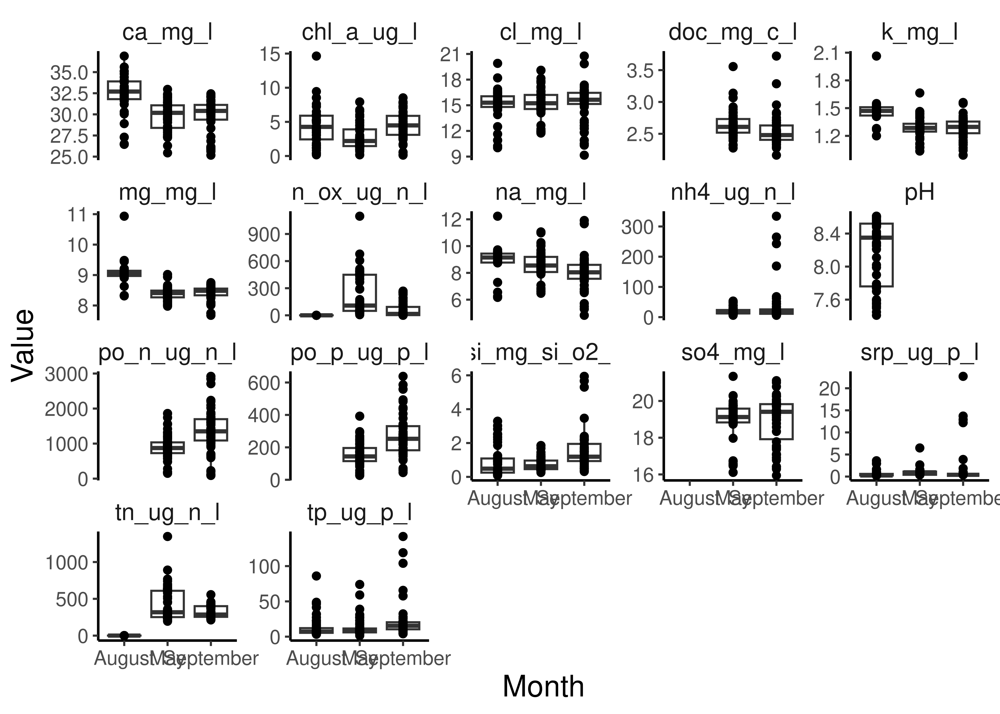{fig-align='center' width=2100}
:::

```{.r .cell-code}
# Our nitrogens are in different units

all_months2 <- 
  all_months %>%
  mutate(n_ox_ug_n_l = ifelse(Month == "August", n_ox_ug_n_l * 1000, n_ox_ug_n_l),
         tn_ug_n_l = ifelse(Month == "August", tn_ug_n_l * 1000, tn_ug_n_l),
         np_ratio = (tn_ug_n_l / 14) / (tp_ug_p_l/31))

all_months2 %>%
  pivot_longer(nh4_ug_n_l:np_ratio, names_to = "Analyte", values_to = "Value") %>%
  ggplot(aes(x = Month, y = Value)) + 
  geom_boxplot() + 
  geom_point() + 
  facet_wrap(~Analyte, scales = "free_y")
```

::: {.cell-output-display}
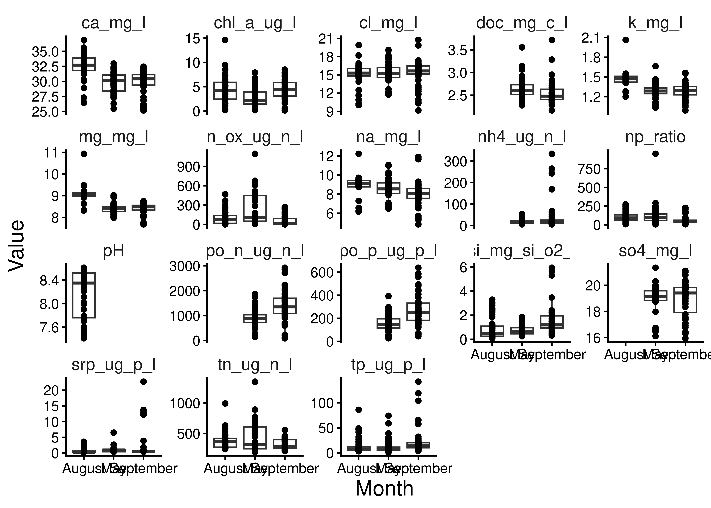{fig-align='center' width=2100}
:::

```{.r .cell-code}
missings <- anti_join(meta_w_toxins, all_months2) %>%
  select(Station_ID, Month, Missing_DC = Depth_Class)

missings
```

::: {.cell-output .cell-output-stdout}
```
  Station_ID     Month Missing_DC
1       EB06 September          S
2       EB06 September          B
```
:::

```{.r .cell-code}
# GOOD
```
:::


GOOD!

# Join Water Quality and CTD


::: {.cell layout-align="center"}

```{.r .cell-code}
ctd_data <- read_csv("data/05_Metadata_Curation/all_ctd_summary.csv")

clean_ctd_for_join <- ctd_data %>%
  select(Station_ID, Month, starts_with("bottom"), starts_with("intsurf")) %>%
  pivot_longer(!c(Station_ID, Month)) %>%
  separate_wider_delim(name, delim = "_", names = c("Depth_Class","CTD_Parameter")) %>%
  mutate(Depth_Class = ifelse(Depth_Class == "bottom", "B", "S")) %>%
  pivot_wider(names_from = CTD_Parameter, values_from = value, names_prefix = "ctd_")

station_lats <- readxl::read_xlsx("data/external_data/20240404_Scofield_Erie2024_CSMI_StationList.xlsx") %>%
  select(Station_ID = Our_Station_ID, Latitude = lattDD_target, Longitude = LonDD_target)

clean_ctd_for_join$Station_ID[!clean_ctd_for_join$Station_ID %in% station_lats$Station_ID]
```

::: {.cell-output .cell-output-stdout}
```
character(0)
```
:::

```{.r .cell-code}
summarized_ctd_latlon <- 
  clean_ctd_for_join %>%
  left_join(station_lats) 

ctd_and_wq <- summarized_ctd_latlon %>%
  full_join(all_months2)
```
:::

::: {.cell layout-align="center"}

```{.r .cell-code}
pacman::p_load(sf, terra, install = FALSE)

# Define some shapes and objects

raw_erie <- read_sf("data/spatial_imports/hydro_p_LakeErie/hydro_p_LakeErie.shp") %>%
  st_transform(crs = "EPSG:4326")

erie_outline <- raw_erie %>%
  st_union()

meta_sf <- ctd_and_wq %>% 
  dplyr::filter(!is.na(Longitude)) %>% 
  st_as_sf(coords = c("Longitude","Latitude"), crs = "EPSG:4326") %>%
  mutate(Month = factor(Month, levels = c("May","August","September") ))
```
:::

::: {.cell layout-align="center"}

```{.r .cell-code}
bottom_sf <- meta_sf %>%
  dplyr::filter(Depth_Class == "B")

shift_bottom_sf <- bottom_sf

st_geometry(shift_bottom_sf) <- st_geometry(bottom_sf) + c(.06,-.03)

shift_bottom_sf <- st_set_crs(shift_bottom_sf, st_crs(bottom_sf))

meta_sf %>%
  mutate(Month = factor(Month, levels = c("May","August","September"))) %>%
  ggplot() + 
  geom_sf(data = erie_outline, fill = NA) + 
  geom_sf(data = shift_bottom_sf, aes(color = ctd_temperature), size = 5, alpha = 1) + 
  geom_sf(aes(color = ctd_temperature), size = 5, alpha = 1) + 
  scale_color_distiller(palette = "Spectral", na.value = "white") + 
  labs(color = "Integrated\nTemperature (C)") + 
  facet_wrap(~Month) + 
  theme(axis.line = element_blank(),
        axis.text = element_blank(),
        axis.ticks = element_blank(),
        strip.text = element_blank()
        )
```

::: {.cell-output-display}
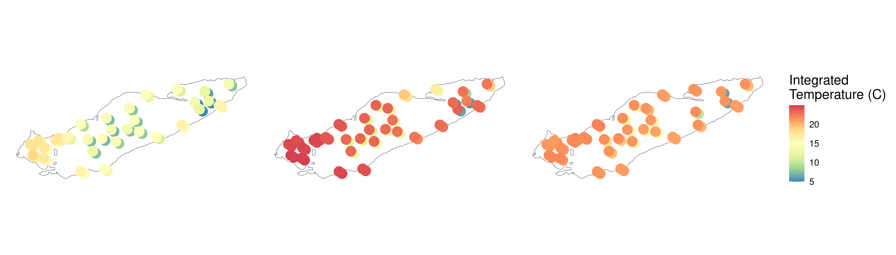{fig-align='center' width=4200}
:::

```{.r .cell-code}
meta_sf %>%
  mutate(Month = factor(Month, levels = c("May","August","September"))) %>%
  ggplot() + 
  geom_sf(data = erie_outline, fill = NA) + 
  geom_sf(data = shift_bottom_sf, aes(color = ctd_oxygen), size = 5, alpha = 1) + 
  geom_sf(aes(color = ctd_oxygen), size = 5, alpha = 1) + 
  scale_color_distiller(palette = "Spectral", na.value = "white") + 
  labs(color = "Dissolved\nOxygen") + 
  facet_wrap(~Month) + 
  theme(axis.line = element_blank(),
        axis.text = element_blank(),
        axis.ticks = element_blank(),
        strip.text = element_blank()
        )
```

::: {.cell-output-display}
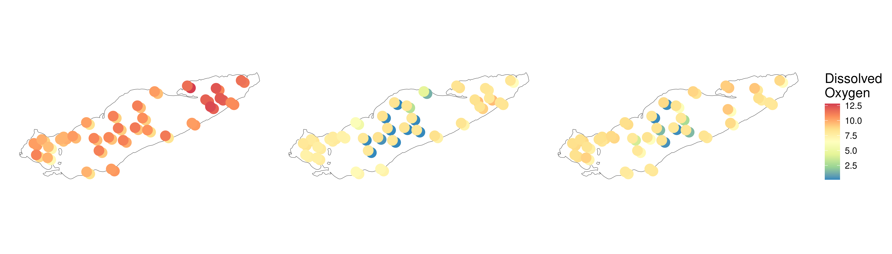{fig-align='center' width=4200}
:::

```{.r .cell-code}
meta_sf %>%
  mutate(Month = factor(Month, levels = c("May","August","September"))) %>%
  filter(Month == "August") %>%
  ggplot() + 
  geom_sf(data = erie_outline, fill = NA) + 
  geom_sf(data = filter(shift_bottom_sf, Month == "August"), aes(color = ctd_oxygen), size = 5, alpha = 1) + 
  geom_sf(aes(color = ctd_oxygen), size = 5, alpha = 1) + 
  scale_color_distiller(palette = "Spectral", na.value = "white") + 
  labs(color = "Dissolved\nOxygen") + 
  facet_wrap(~Month) + 
  theme(axis.line = element_blank(),
        axis.text = element_blank(),
        axis.ticks = element_blank(),
        strip.text = element_blank()
        )
```

::: {.cell-output-display}
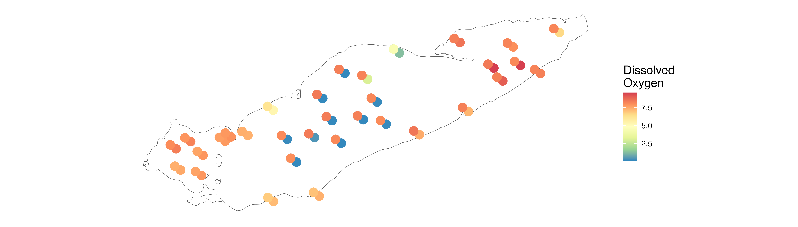{fig-align='center' width=4200}
:::

```{.r .cell-code}
ggsave("test.png", width = 7, height = 7, dpi = 300)

meta_sf %>%
  mutate(Month = factor(Month, levels = c("May","August","September"))) %>%
  filter(Month == "August") %>%
  ggplot() + 
  geom_sf(data = erie_outline, fill = NA) + 
  geom_sf(data = filter(shift_bottom_sf, Month == "August"), aes(color = srp_ug_p_l), size = 5, alpha = 1) + 
  geom_sf(aes(color = srp_ug_p_l), size = 5, alpha = 1) + 
  scale_color_distiller(palette = "Spectral", na.value = "white") + 
  labs(color = "SRP (ug P/L)") + 
  facet_wrap(~Month) + 
  theme(axis.line = element_blank(),
        axis.text = element_blank(),
        axis.ticks = element_blank(),
        strip.text = element_blank()
        )
```

::: {.cell-output-display}
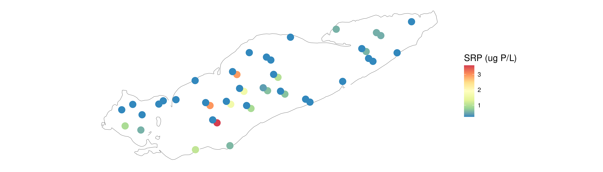{fig-align='center' width=4200}
:::

```{.r .cell-code}
ggsave("test.png", width = 7, height = 7, dpi = 300)

meta_sf %>%
  mutate(Month = factor(Month, levels = c("May","August","September"))) %>%
  ggplot() + 
  geom_sf(data = erie_outline, fill = NA) + 
  geom_sf(data = shift_bottom_sf, aes(color = tn_ug_n_l), size = 5, alpha = 1) + 
  geom_sf(aes(color = tn_ug_n_l), size = 5, alpha = 1) + 
  scale_color_distiller(palette = "Spectral", na.value = "white", transform = "log10") + 
  labs(color = "TN (ug N/L)") + 
  facet_wrap(~Month) + 
  theme(axis.line = element_blank(),
        axis.text = element_blank(),
        axis.ticks = element_blank(),
        strip.text = element_blank()
        )
```

::: {.cell-output-display}
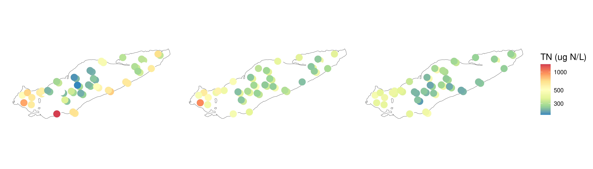{fig-align='center' width=4200}
:::

```{.r .cell-code}
meta_sf %>%
  mutate(Month = factor(Month, levels = c("May","August","September"))) %>%
  ggplot() + 
  geom_sf(data = erie_outline, fill = NA) + 
  geom_sf(data = shift_bottom_sf, aes(color = tp_ug_p_l), size = 5, alpha = 1) + 
  geom_sf(aes(color = tp_ug_p_l), size = 5, alpha = 1) + 
  scale_color_distiller(palette = "Spectral", na.value = "white", transform = "log10") + 
  labs(color = "TP (ug P/L)") + 
  facet_wrap(~Month) + 
  theme(axis.line = element_blank(),
        axis.text = element_blank(),
        axis.ticks = element_blank(),
        strip.text = element_blank()
        )
```

::: {.cell-output-display}
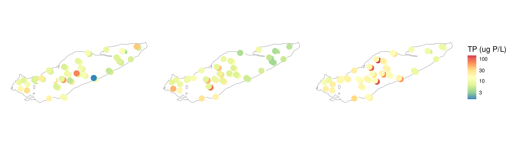{fig-align='center' width=4200}
:::

```{.r .cell-code}
meta_sf %>%
  mutate(Month = factor(Month, levels = c("May","August","September"))) %>%
  ggplot() + 
  geom_sf(data = erie_outline, fill = NA) + 
  geom_sf(data = shift_bottom_sf, aes(color = np_ratio), size = 5, alpha = 1) + 
  geom_sf(aes(color = np_ratio), size = 5, alpha = 1) + 
  scale_color_distiller(palette = "Spectral", na.value = "white", transform = "log10") + 
  labs(color = "N:P (Molar)") + 
  facet_wrap(~Month) + 
  theme(axis.line = element_blank(),
        axis.text = element_blank(),
        axis.ticks = element_blank(),
        strip.text = element_blank()
        )
```

::: {.cell-output-display}
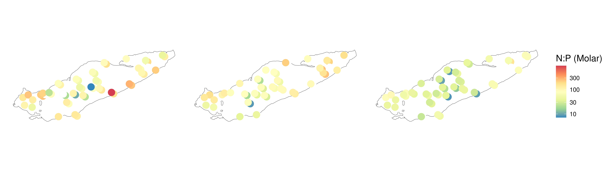{fig-align='center' width=4200}
:::

```{.r .cell-code}
meta_sf %>%
  mutate(Month = factor(Month, levels = c("May","August","September"))) %>%
  ggplot() + 
  geom_sf(data = erie_outline, fill = NA) + 
  geom_sf(data = shift_bottom_sf, aes(color = srp_ug_p_l), size = 5, alpha = 1) + 
  geom_sf(aes(color = srp_ug_p_l), size = 5, alpha = 1) + 
  scale_color_distiller(palette = "Spectral", na.value = "white", transform = "log10") + 
  labs(color = "SRP (ug P/L)") + 
  facet_wrap(~Month) + 
  theme(axis.line = element_blank(),
        axis.text = element_blank(),
        axis.ticks = element_blank(),
        strip.text = element_blank()
        )
```

::: {.cell-output-display}
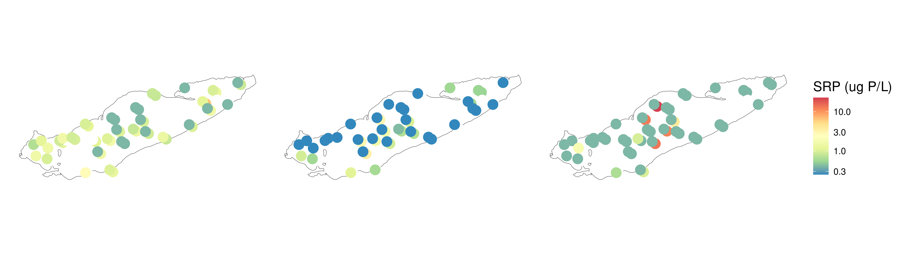{fig-align='center' width=4200}
:::

```{.r .cell-code}
meta_sf %>%
  mutate(Month = factor(Month, levels = c("May","August","September"))) %>%
  ggplot() + 
  geom_sf(data = erie_outline, fill = NA) + 
  geom_sf(data = shift_bottom_sf, aes(color = ctd_beamAttenuation), size = 5, alpha = 1) + 
  geom_sf(aes(color = ctd_beamAttenuation), size = 5, alpha = 1) + 
  scale_color_distiller(palette = "Spectral", na.value = "white", transform = "log10") + 
  labs(color = "Beam Attenuation") + 
  facet_wrap(~Month) + 
  theme(axis.line = element_blank(),
        axis.text = element_blank(),
        axis.ticks = element_blank(),
        strip.text = element_blank()
        )
```

::: {.cell-output-display}
{fig-align='center' width=4200}
:::

```{.r .cell-code}
meta_sf %>%
  mutate(Month = factor(Month, levels = c("May","August","September"))) %>%
  ggplot() + 
  geom_sf(data = erie_outline, fill = NA) + 
  geom_sf(data = shift_bottom_sf, aes(color = ctd_beamAttenuation), size = 5, alpha = 1) + 
  geom_sf(aes(color = ctd_beamAttenuation), size = 5, alpha = 1) + 
  scale_color_distiller(palette = "Spectral", na.value = "white", transform = "log10", limits = c(NA,10)) + 
  labs(color = "Beam Attenuation\n(remove bloom)") + 
  facet_wrap(~Month) + 
  theme(axis.line = element_blank(),
        axis.text = element_blank(),
        axis.ticks = element_blank(),
        strip.text = element_blank()
        )
```

::: {.cell-output-display}
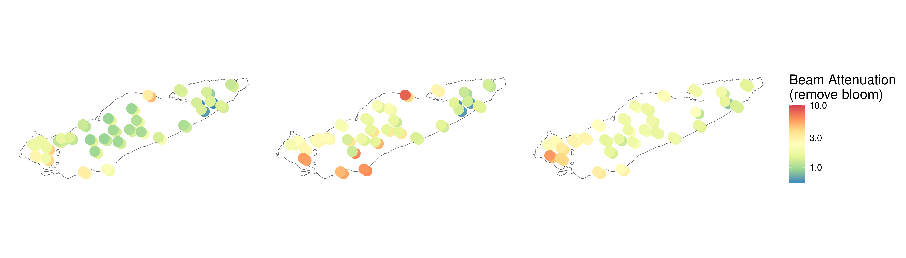{fig-align='center' width=4200}
:::

```{.r .cell-code}
meta_sf %>%
  mutate(Month = factor(Month, levels = c("May","August","September"))) %>%
  ggplot() + 
  geom_sf(data = erie_outline, fill = NA) + 
  geom_sf(data = shift_bottom_sf, aes(color = ctd_upoly), size = 5, alpha = 1) + 
  geom_sf(aes(color = ctd_upoly), size = 5, alpha = 1) + 
  scale_color_distiller(palette = "Spectral", na.value = "white", transform = "log10") + 
  labs(color = "UPoly") + 
  facet_wrap(~Month) + 
  theme(axis.line = element_blank(),
        axis.text = element_blank(),
        axis.ticks = element_blank(),
        strip.text = element_blank()
        )
```

::: {.cell-output-display}
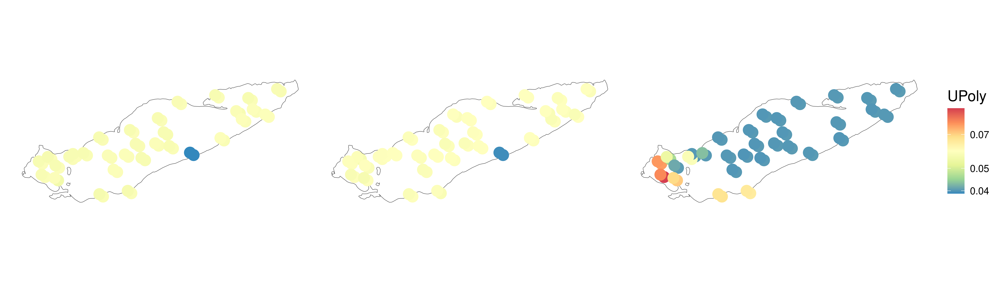{fig-align='center' width=4200}
:::
:::


Simplified for paper


::: {.cell layout-align="center"}

```{.r .cell-code}
bottom_sf <- meta_sf %>%
  dplyr::filter(Depth_Class == "B", Month != "May")

shift_bottom_sf <- bottom_sf

st_geometry(shift_bottom_sf) <- st_geometry(bottom_sf) + c(.06,-.03)

shift_bottom_sf <- st_set_crs(shift_bottom_sf, st_crs(bottom_sf))

meta_sf %>%
  filter(Month != "May") %>%
  mutate(Month = factor(Month, levels = c("May","August","September"))) %>%
  ggplot() + 
  geom_sf(data = erie_outline, fill = NA) + 
  geom_sf(data = shift_bottom_sf, aes(color = tn_ug_n_l), size = 5, alpha = 1) + 
  geom_sf(aes(color = tn_ug_n_l), size = 5, alpha = 1) + 
  scale_color_distiller(palette = "Spectral", na.value = "white", transform = "log10") + 
  labs(color = "TN (ug N/L)") + 
  facet_wrap(~Month) + 
  theme(axis.line = element_blank(),
        axis.text = element_blank(),
        axis.ticks = element_blank(),
        strip.text = element_blank()
        )
```

::: {.cell-output-display}
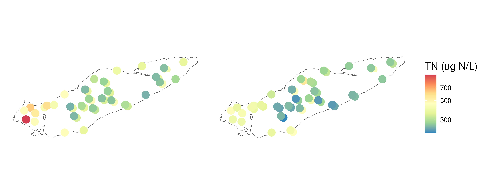{fig-align='center' width=3000}
:::

```{.r .cell-code}
meta_sf %>%
  filter(Month != "May") %>%
  mutate(Month = factor(Month, levels = c("May","August","September"))) %>%
  ggplot() + 
  geom_sf(data = erie_outline, fill = NA) + 
  geom_sf(data = shift_bottom_sf, aes(color = tp_ug_p_l), size = 5, alpha = 1) + 
  geom_sf(aes(color = tp_ug_p_l), size = 5, alpha = 1) + 
  scale_color_distiller(palette = "Spectral", na.value = "white", transform = "log10") + 
  labs(color = "TP (ug P/L)") + 
  facet_wrap(~Month) + 
  theme(axis.line = element_blank(),
        axis.text = element_blank(),
        axis.ticks = element_blank(),
        strip.text = element_blank()
        )
```

::: {.cell-output-display}
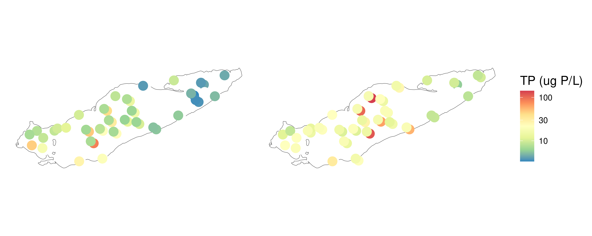{fig-align='center' width=3000}
:::

```{.r .cell-code}
meta_sf %>%
  filter(Month != "May") %>%
  mutate(Month = factor(Month, levels = c("May","August","September"))) %>%
  ggplot() + 
  geom_sf(data = erie_outline, fill = NA) + 
  geom_sf(data = shift_bottom_sf, aes(color = np_ratio), size = 5, alpha = 1) + 
  geom_sf(aes(color = np_ratio), size = 5, alpha = 1) + 
  scale_color_distiller(palette = "Spectral", na.value = "white", transform = "log10") + 
  labs(color = "N:P (Molar)") + 
  facet_wrap(~Month) + 
  theme(axis.line = element_blank(),
        axis.text = element_blank(),
        axis.ticks = element_blank(),
        strip.text = element_blank()
        )
```

::: {.cell-output-display}
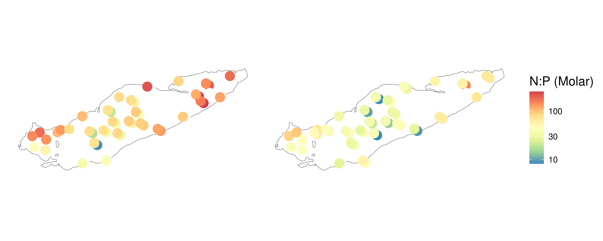{fig-align='center' width=3000}
:::

```{.r .cell-code}
meta_sf %>%
  filter(Month != "May") %>%
  mutate(Month = factor(Month, levels = c("May","August","September"))) %>%
  ggplot() + 
  geom_sf(data = erie_outline, fill = NA) + 
  geom_sf(data = shift_bottom_sf, aes(color = srp_ug_p_l), size = 5, alpha = 1) + 
  geom_sf(aes(color = srp_ug_p_l), size = 5, alpha = 1) + 
  scale_color_distiller(palette = "Spectral", na.value = "white", transform = "log10") + 
  labs(color = "SRP (ug P/L)") + 
  facet_wrap(~Month) + 
  theme(axis.line = element_blank(),
        axis.text = element_blank(),
        axis.ticks = element_blank(),
        strip.text = element_blank()
        )
```

::: {.cell-output-display}
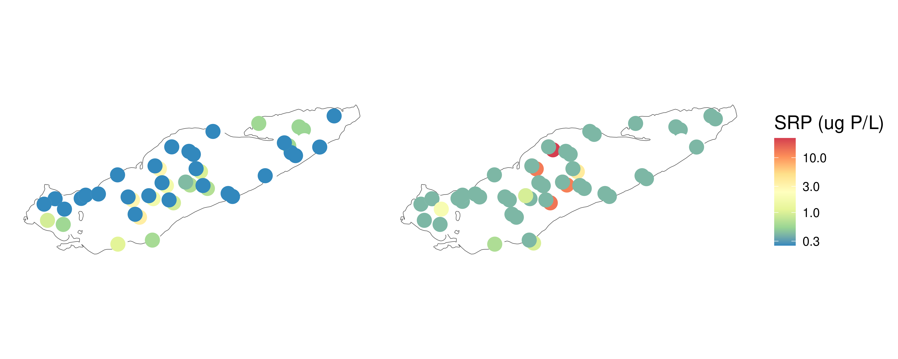{fig-align='center' width=3000}
:::
:::

::: {.cell layout-align="center"}

```{.r .cell-code}
meta_sf %>%
  filter(Month != "May", Depth_Class == "S") %>%
  mutate(Month = factor(Month, levels = c("May","August","September"))) %>%
  ggplot() + 
  geom_sf(data = erie_outline, fill = NA) + 
  geom_sf(aes(color = ctd_temperature), size = 5, alpha = 1) + 
  scale_color_distiller(palette = "Spectral", na.value = "white") + 
  labs(color = "Surface\nTemp. (°C)") + 
  facet_wrap(~Month) + 
  theme(axis.line = element_blank(),
        axis.text = element_blank(),
        axis.ticks = element_blank(),
        strip.text = element_blank()
        )
```

::: {.cell-output-display}
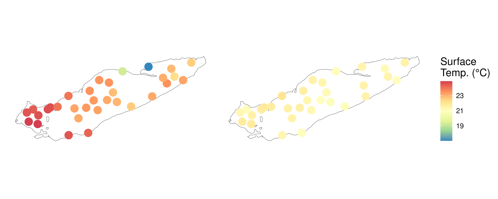{fig-align='center' width=3000}
:::

```{.r .cell-code}
meta_sf %>%
  filter(Month != "May", Depth_Class == "B") %>%
  mutate(Month = factor(Month, levels = c("May","August","September"))) %>%
  ggplot() + 
  geom_sf(data = erie_outline, fill = NA) + 
  geom_sf(aes(color = ctd_temperature), size = 5, alpha = 1) + 
  scale_color_distiller(palette = "Spectral", na.value = "white") + 
  labs(color = "Bottom\nTemp. (°C)") + 
  facet_wrap(~Month) + 
  theme(axis.line = element_blank(),
        axis.text = element_blank(),
        axis.ticks = element_blank(),
        strip.text = element_blank()
        )
```

::: {.cell-output-display}
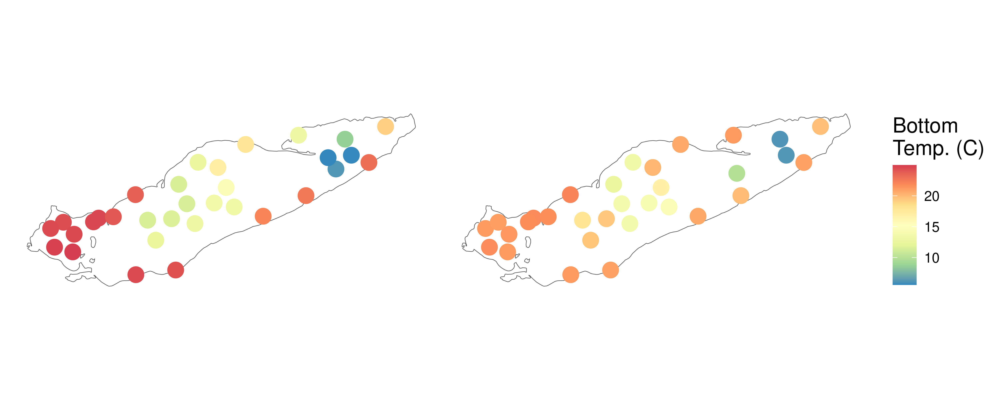{fig-align='center' width=3000}
:::

```{.r .cell-code}
meta_sf %>%
  filter(Month != "May", Depth_Class == "S") %>%
  mutate(Month = factor(Month, levels = c("May","August","September"))) %>%
  ggplot() + 
  geom_sf(data = erie_outline, fill = NA) + 
  geom_sf(aes(color = ctd_oxygen), size = 5, alpha = 1) + 
  scale_color_distiller(palette = "Spectral", na.value = "white") + 
  labs(color = "Surface\nOxygen (mg/L)") + 
  facet_wrap(~Month) + 
  theme(axis.line = element_blank(),
        axis.text = element_blank(),
        axis.ticks = element_blank(),
        strip.text = element_blank()
        )
```

::: {.cell-output-display}
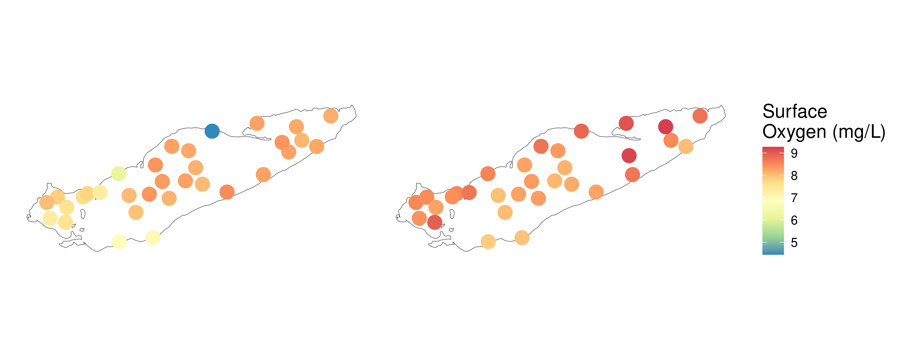{fig-align='center' width=3000}
:::

```{.r .cell-code}
meta_sf %>%
  filter(Month != "May", Depth_Class == "B") %>%
  mutate(Month = factor(Month, levels = c("May","August","September"))) %>%
  ggplot() + 
  geom_sf(data = erie_outline, fill = NA) + 
  geom_sf(aes(color = ctd_oxygen), size = 5, alpha = 1) + 
  scale_color_distiller(palette = "Spectral", na.value = "white") + 
  labs(color = "Bottom\nOxygen (mg/L)") + 
  facet_wrap(~Month) + 
  theme(axis.line = element_blank(),
        axis.text = element_blank(),
        axis.ticks = element_blank(),
        strip.text = element_blank()
        )
```

::: {.cell-output-display}
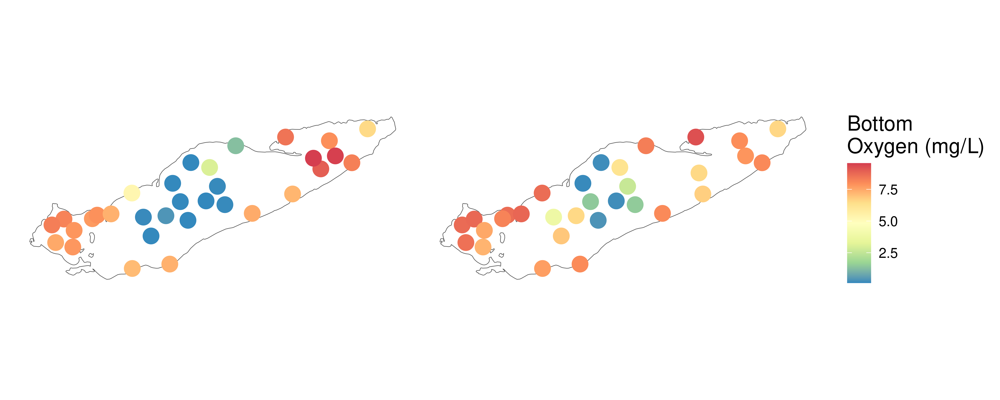{fig-align='center' width=3000}
:::

```{.r .cell-code}
meta_sf %>%
  filter(Month != "May", Depth_Class == "S") %>%
  mutate(Month = factor(Month, levels = c("May","August","September"))) %>%
  ggplot() + 
  geom_sf(data = erie_outline, fill = NA) + 
  geom_sf(aes(color = ctd_beamAttenuation), size = 5, alpha = 1) + 
  scale_color_distiller(palette = "Spectral", na.value = "white") + 
  labs(color = "Surface\nBeam Attenuation (1/m)") + 
  facet_wrap(~Month) + 
  theme(axis.line = element_blank(),
        axis.text = element_blank(),
        axis.ticks = element_blank(),
        strip.text = element_blank()
        )
```

::: {.cell-output-display}
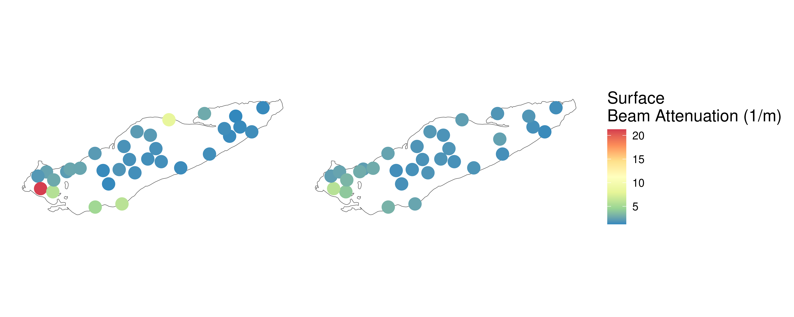{fig-align='center' width=3000}
:::

```{.r .cell-code}
meta_sf %>%
  filter(Month != "May", Depth_Class == "B") %>%
  mutate(Month = factor(Month, levels = c("May","August","September"))) %>%
  ggplot() + 
  geom_sf(data = erie_outline, fill = NA) + 
  geom_sf(aes(color = ctd_beamAttenuation), size = 5, alpha = 1) + 
  scale_color_distiller(palette = "Spectral", na.value = "white") + 
  labs(color = "Bottom\nBeam Attenuation (1/m)") + 
  facet_wrap(~Month) + 
  theme(axis.line = element_blank(),
        axis.text = element_blank(),
        axis.ticks = element_blank(),
        strip.text = element_blank()
        )
```

::: {.cell-output-display}
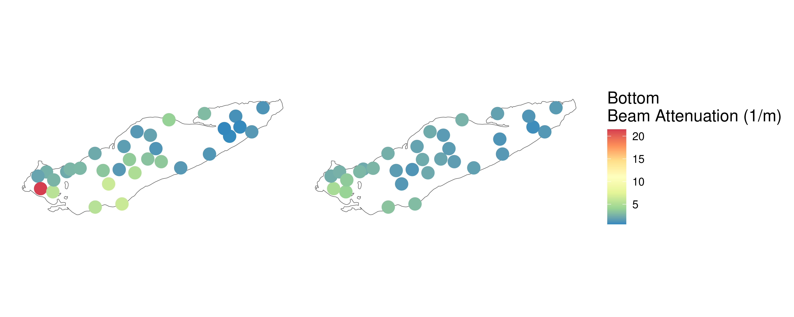{fig-align='center' width=3000}
:::
:::


# Join in Sample Data


::: {.cell layout-align="center"}

```{.r .cell-code}
ctd_and_wq_for_join <- 
  ctd_and_wq %>%
  select(-Longitude, -Latitude)

meta_w_wq <- meta_w_toxins %>%
  left_join(ctd_and_wq_for_join)

meta_w_wq %>%
  filter(Station_ID == "78")
```

::: {.cell-output .cell-output-stdout}
```
                    Sample_ID  DNA_ID   input filtered denoisedF denoisedR
1 AAM_ERI_20240915_78_FP_BT_1 KH_D071   93840    61805     57284     55226
2 AAM_ERI_20240813_78_FP_ET_1 KH_D037 1145100   765659    762773    762981
3 AAM_ERI_20240521_78_FP_ET_1 KH_D007  550656   357591    356857    356729
4 AAM_ERI_20240813_78_FP_BT_1 KH_D038  938495   600428    593209    593015
5 AAM_ERI_20240521_78_FP_BT_1 KH_D008  614870   390000    387134    386364
6 AAM_ERI_20240915_78_FP_ET_1 KH_D070  783280   517745    515328    515245
  merged nochim perc_reads_retained Station_ID     Date Depth Station_Name
1  45009  34016            36.24893         78 20240915  22.0       ER 78M
2 753747 699986            61.12881         78 20240813   5.0       ER 78M
3 353638 307139            55.77693         78 20240521   5.0        ER78M
4 579421 535557            57.06551         78 20240813  22.0       ER 78M
5 381415 326794            53.14847         78 20240521  21.7        ER78M
6 510733 451522            57.64503         78 20240915   5.0       ER 78M
  Water_Surface_Temp_C Latitude  Longitude     Month Depth_Class         Rep_ID
1                20.90 42.11722 -81.250383 September           B September_78_B
2                23.08 42.11645 -81.249717    August           S    August_78_S
3                15.00 42.11655   -81.2503       May           S       May_78_S
4                23.08 42.11645 -81.249717    August           B    August_78_B
5                15.00 42.11655   -81.2503       May           B       May_78_B
6                20.90 42.11722 -81.250383 September           S September_78_S
  Basin
1     C
2     C
3     C
4     C
5     C
6     C
                                                                                                                                                                                                   Notes
1                                                                                                                                 Spin column from 178030015_2. NA Very sulfurous smell! MULTIPLE DEPTHS
2 NA NA Integrated sample; discrete depths separated by semi-colon; Matching depths for surface sample with GLNPO for nutrients Coleman Lab sampling Surface, mid and B-; DCL just above the thermocline
3                                                                                                                                    NA NA Integrated sample; discrete depths separated by semi-colon NA
4                                                                                                                      NA NA NA Coleman Lab sampling Surface, mid and B-; DCL just above the thermocline
5                                                                                                                                                                                            NA NA NA NA
6                                                                             did vortex step before incubating PW1 at 65C NA Integrated sample; discrete depths separated by semi-colon MULTIPLE DEPTHS
  Microcystin_Total Anatoxin_Total Toxins_Measured ctd_temperature
1                NA             NA            <NA>       14.150963
2                 0              0             Yes       23.120711
3                NA             NA            <NA>       13.566500
4                NA             NA            <NA>       13.575475
5                NA             NA            <NA>        7.475257
6                 0              0             Yes       20.990534
  ctd_conductivity    ctd_par ctd_beamAttenuation ctd_beamTransmission
1         223.9782   10.71724            1.977470             61.00246
2         252.2818  186.51968            1.530098             68.21574
3         204.7184 9815.59744            1.024739             77.40062
4         218.6453   10.71326            3.282179             44.01963
5         175.4897  281.64516            1.343582             71.49041
6         242.8891   10.87000            1.759356             64.43701
  ctd_fluorescence   ctd_spar  ctd_upoly ctd_oxygen ctd_specificConductance
1        0.6554006    0.00000 0.04026893  0.2378152                286.0195
2        1.6199505   24.81052 0.05785300  8.2744150                262.1036
3        0.1809466 1774.98339 0.05817088 11.2720580                265.3730
4        0.4682123   30.02995 0.05883646  0.1312877                283.3754
5        0.4896167 1770.87131 0.05770694  9.3459052                270.1906
6        1.7339410    0.00000 0.04008772  8.0531369                264.0353
  ctd_salinity nh4_ug_n_l n_ox_ug_n_l srp_ug_p_l tn_ug_n_l tp_ug_p_l k_mg_l
1      1829727      169.0        2.70    12.2000  421.0000     65.60  1.313
2      1453729         NA        3.90     0.4135  259.0000      6.20  1.410
3      1507033       13.1       29.50     0.8170  239.2561     74.00  1.254
4      1784991         NA      121.00     0.6670  341.0000     12.10  1.510
5      1540070       20.3       51.70     1.3900  258.2424      6.92  1.276
6      1487272       12.1        2.03     0.4000  276.0000     17.10  1.352
  na_mg_l ca_mg_l mg_mg_l cl_mg_l so4_mg_l doc_mg_c_l si_mg_si_o2_l chl_a_ug_l
1   8.424   31.52   8.454 14.8165  17.3706   2.709000     3.4666370      3.920
2   8.750   32.10   8.950 14.7500       NA         NA     0.2660000      5.779
3   8.510   29.36   8.442 15.5112  19.0836   2.552721     0.4196956      0.880
4   9.090   35.10   9.110 15.4000       NA         NA     3.0240000      1.168
5   8.518   31.08   8.494 15.2174  19.1253   2.501499     1.2198893      2.560
6   7.928   30.28   8.474 15.5145  19.4818   2.440000     1.2838684      7.840
  po_p_ug_p_l po_n_ug_n_l    pH  np_ratio
1       342.0        1420    NA 14.210584
2          NA          NA 8.545 92.500000
3       222.0         654    NA  7.159206
4          NA          NA 7.500 62.402597
5        87.3         485    NA 82.633318
6       295.0        1700    NA 35.739348
```
:::
:::

::: {.cell layout-align="center"}

```{.r .cell-code}
meta_physeq <- tree_prok_physeq

meta_physeq@sam_data <- NULL

row.names(meta_w_wq) <- meta_w_wq$DNA_ID

meta_physeq <- merge_phyloseq(meta_physeq, sample_data(meta_w_wq))
```
:::

::: {.cell layout-align="center"}

```{.r .cell-code}
save(sample_info, file = "data/05_Metadata_Curation/sample_info.RData")

save(meta_physeq, file = "data/05_Metadata_Curation/meta_physeq.RData")
```
:::

::: {.cell layout-align="center"}

```{.r .cell-code}
# Reproducibility
devtools::session_info()
```

::: {.cell-output .cell-output-stdout}
```
─ Session info ───────────────────────────────────────────────────────────────
 setting  value
 version  R version 4.3.3 (2024-02-29)
 os       Rocky Linux 9.8 (Blue Onyx)
 system   x86_64, linux-gnu
 ui       X11
 language (EN)
 collate  en_US.UTF-8
 ctype    en_US.UTF-8
 tz       America/New_York
 date     2026-10-16
 pandoc   3.1.1 @ /usr/lib/rstudio-server/bin/quarto/bin/tools/ (via rmarkdown)

─ Packages ───────────────────────────────────────────────────────────────────
 package          * version    date (UTC) lib source
 abind              1.4-8      2024-09-12 [2] CRAN (R 4.3.3)
 ade4               1.7-24     2026-03-21 [1] CRAN (R 4.3.3)
 ape                5.8-1      2024-12-16 [1] CRAN (R 4.3.3)
 Biobase            2.62.0     2023-10-24 [2] Bioconductor
 BiocGenerics       0.48.1     2023-11-01 [2] Bioconductor
 biomformat         1.30.0     2023-10-24 [1] Bioconductor
 Biostrings         2.70.3     2024-03-13 [1] Bioconductor 3.18 (R 4.3.2)
 bit                4.5.0      2024-09-20 [2] CRAN (R 4.3.3)
 bit64              4.5.2      2024-09-22 [2] CRAN (R 4.3.3)
 bitops             1.0-9      2024-10-03 [2] CRAN (R 4.3.3)
 cachem             1.1.0      2024-05-16 [2] CRAN (R 4.3.3)
 cellranger         1.1.0      2016-07-27 [1] CRAN (R 4.3.2)
 class              7.3-22     2023-05-03 [2] CRAN (R 4.3.3)
 classInt           0.4-11     2025-01-08 [2] CRAN (R 4.3.3)
 cli                3.6.6      2026-04-09 [1] CRAN (R 4.3.3)
 cluster            2.1.6      2023-12-01 [2] CRAN (R 4.3.3)
 codetools          0.2-19     2023-02-01 [2] CRAN (R 4.3.3)
 crayon             1.5.3      2024-06-20 [2] CRAN (R 4.3.3)
 data.table         1.18.6.1   2026-08-24 [1] CRAN (R 4.3.3)
 DBI                1.2.3      2024-06-02 [2] CRAN (R 4.3.3)
 devtools           2.4.5      2022-10-11 [2] CRAN (R 4.3.3)
 digest             0.6.37     2024-08-19 [2] CRAN (R 4.3.3)
 dplyr            * 1.2.1      2026-04-03 [1] CRAN (R 4.3.3)
 e1071              1.7-17     2025-12-18 [2] CRAN (R 4.3.3)
 ellipsis           0.3.2      2021-04-29 [2] CRAN (R 4.3.3)
 evaluate           1.0.1      2024-10-10 [2] CRAN (R 4.3.3)
 extraDistr         1.10.0.5   2026-07-13 [1] CRAN (R 4.3.3)
 farver             2.1.2      2024-05-13 [2] CRAN (R 4.3.3)
 fastmap            1.2.0      2024-05-15 [2] CRAN (R 4.3.3)
 forcats          * 1.0.1      2025-09-25 [1] CRAN (R 4.3.3)
 foreach            1.5.2      2022-02-02 [1] CRAN (R 4.3.3)
 fs                 1.6.5      2024-10-30 [2] CRAN (R 4.3.3)
 fun.gus          * 0.5.1      2026-10-07 [1] Github (MarschmiLab/fun.gus@ad8bd98)
 furrr              0.4.0      2026-03-31 [1] CRAN (R 4.3.3)
 future             1.76.0     2026-09-24 [1] CRAN (R 4.3.3)
 generics           0.1.4      2025-05-09 [1] CRAN (R 4.3.3)
 GenomeInfoDb       1.38.8     2024-03-15 [2] Bioconductor 3.18 (R 4.3.3)
 GenomeInfoDbData   1.2.11     2024-11-25 [2] Bioconductor
 ggplot2          * 3.5.2      2025-04-09 [1] CRAN (R 4.3.3)
 globals            0.19.1     2026-03-13 [1] CRAN (R 4.3.3)
 glue               1.8.1      2026-04-17 [1] CRAN (R 4.3.3)
 gtable             0.3.6      2024-10-25 [2] CRAN (R 4.3.3)
 hillR              0.5.2      2023-08-19 [1] CRAN (R 4.3.3)
 hms                1.1.4      2025-10-17 [1] CRAN (R 4.3.3)
 htmltools          0.5.8.1    2024-04-04 [2] CRAN (R 4.3.3)
 htmlwidgets        1.6.4      2023-12-06 [2] CRAN (R 4.3.3)
 httpuv             1.6.15     2024-03-26 [2] CRAN (R 4.3.3)
 igraph             2.1.1      2024-10-19 [2] CRAN (R 4.3.3)
 IRanges            2.36.0     2023-10-24 [2] Bioconductor
 iterators          1.0.14     2022-02-05 [1] CRAN (R 4.3.3)
 janitor            2.2.1      2024-12-22 [1] CRAN (R 4.3.3)
 jsonlite           1.8.9      2024-09-20 [2] CRAN (R 4.3.3)
 KernSmooth         2.23-22    2023-07-10 [2] CRAN (R 4.3.3)
 knitr              1.52       2026-09-06 [1] CRAN (R 4.3.3)
 labeling           0.4.3      2023-08-29 [2] CRAN (R 4.3.3)
 later              1.3.2      2023-12-06 [2] CRAN (R 4.3.3)
 lattice            0.22-5     2023-10-24 [2] CRAN (R 4.3.3)
 lifecycle          1.0.5      2026-01-08 [1] CRAN (R 4.3.3)
 listenv            0.9.1      2024-01-29 [2] CRAN (R 4.3.3)
 lubridate        * 1.9.5      2026-02-04 [1] CRAN (R 4.3.3)
 magrittr           2.0.5      2026-04-04 [1] CRAN (R 4.3.3)
 MASS               7.3-60.0.1 2024-01-13 [2] CRAN (R 4.3.3)
 Matrix             1.6-5      2024-01-11 [2] CRAN (R 4.3.3)
 memoise            2.0.1      2021-11-26 [2] CRAN (R 4.3.3)
 mgcv               1.9-1      2023-12-21 [2] CRAN (R 4.3.3)
 mime               0.12       2021-09-28 [2] CRAN (R 4.3.3)
 miniUI             0.1.1.1    2018-05-18 [2] CRAN (R 4.3.3)
 multtest           2.58.0     2023-10-24 [1] Bioconductor
 NatParksPalettes   0.2.0      2022-10-09 [1] CRAN (R 4.3.3)
 nlme               3.1-164    2023-11-27 [2] CRAN (R 4.3.3)
 openxlsx           4.2.9      2026-09-02 [1] CRAN (R 4.3.3)
 otel               0.2.0      2025-08-29 [1] CRAN (R 4.3.3)
 pacman             0.5.1      2019-03-11 [1] CRAN (R 4.3.2)
 parallelly         1.48.0     2026-06-29 [1] CRAN (R 4.3.3)
 permute            0.9-10     2026-02-06 [1] CRAN (R 4.3.3)
 phyloseq         * 1.46.0     2023-10-24 [1] Bioconductor
 pillar             1.11.1     2025-09-17 [1] CRAN (R 4.3.3)
 pkgbuild           1.4.5      2024-10-28 [2] CRAN (R 4.3.3)
 pkgconfig          2.0.3      2019-09-22 [2] CRAN (R 4.3.3)
 pkgload            1.4.0      2024-06-28 [2] CRAN (R 4.3.3)
 plyr               1.8.9      2023-10-02 [2] CRAN (R 4.3.3)
 profvis            0.4.0      2024-09-20 [2] CRAN (R 4.3.3)
 promises           1.3.0      2024-04-05 [2] CRAN (R 4.3.3)
 proxy              0.4-29     2025-12-29 [2] CRAN (R 4.3.3)
 purrr            * 1.2.2      2026-04-10 [1] CRAN (R 4.3.3)
 R6                 2.6.1      2025-02-15 [1] CRAN (R 4.3.3)
 ragg               1.3.3      2024-09-11 [2] CRAN (R 4.3.3)
 RColorBrewer       1.1-3      2022-04-03 [2] CRAN (R 4.3.3)
 Rcpp               1.1.2      2026-07-05 [1] CRAN (R 4.3.3)
 RCurl              1.98-1.16  2024-07-11 [2] CRAN (R 4.3.3)
 readr            * 2.2.0      2026-02-19 [1] CRAN (R 4.3.3)
 readxl             1.5.0.1    2026-09-16 [1] CRAN (R 4.3.3)
 remotes            2.5.0      2024-03-17 [2] CRAN (R 4.3.3)
 reshape2           1.4.4      2020-04-09 [2] CRAN (R 4.3.3)
 rhdf5              2.46.1     2023-11-29 [1] Bioconductor 3.18 (R 4.3.2)
 rhdf5filters       1.14.1     2023-11-06 [1] Bioconductor
 Rhdf5lib           1.24.2     2024-02-07 [1] Bioconductor 3.18 (R 4.3.2)
 rlang              1.3.0      2026-07-05 [1] CRAN (R 4.3.3)
 rmarkdown          2.32       2026-09-01 [1] CRAN (R 4.3.3)
 rstudioapi         0.17.1     2024-10-22 [2] CRAN (R 4.3.3)
 s2                 1.1.11     2026-06-01 [2] CRAN (R 4.3.3)
 S4Vectors          0.40.2     2023-11-23 [2] Bioconductor 3.18 (R 4.3.3)
 scales             1.4.0      2025-04-24 [1] CRAN (R 4.3.3)
 sessioninfo        1.2.2      2021-12-06 [2] CRAN (R 4.3.3)
 sf               * 1.1-3      2026-09-11 [1] CRAN (R 4.3.3)
 shiny              1.9.1      2024-08-01 [2] CRAN (R 4.3.3)
 snakecase          0.11.1     2023-08-27 [1] CRAN (R 4.3.3)
 stringi            1.8.4      2024-05-06 [2] CRAN (R 4.3.3)
 stringr          * 1.5.1      2023-11-14 [2] CRAN (R 4.3.3)
 survival           3.5-8      2024-02-14 [2] CRAN (R 4.3.3)
 systemfonts        1.3.2      2026-03-05 [1] CRAN (R 4.3.3)
 terra            * 1.9-50     2026-09-08 [1] CRAN (R 4.3.3)
 textshaping        0.4.0      2024-05-24 [2] CRAN (R 4.3.3)
 tibble           * 3.3.1      2026-01-11 [1] CRAN (R 4.3.3)
 tidyr            * 1.3.2      2025-12-19 [1] CRAN (R 4.3.3)
 tidyselect         1.2.1      2024-03-11 [1] CRAN (R 4.3.2)
 tidyverse        * 2.0.0      2023-02-22 [1] CRAN (R 4.3.2)
 timechange         0.4.0      2026-01-29 [1] CRAN (R 4.3.3)
 tzdb               0.5.0      2025-03-15 [1] CRAN (R 4.3.3)
 units              1.0-1      2026-03-11 [2] CRAN (R 4.3.3)
 urlchecker         1.0.1      2021-11-30 [2] CRAN (R 4.3.3)
 usethis            3.2.2      2026-09-10 [1] CRAN (R 4.3.3)
 utf8               1.2.6      2025-06-08 [1] CRAN (R 4.3.3)
 vctrs              0.7.3      2026-04-11 [1] CRAN (R 4.3.3)
 vegan              2.7-6      2026-08-31 [1] CRAN (R 4.3.3)
 vroom              1.7.1      2026-03-31 [1] CRAN (R 4.3.3)
 withr              3.0.3      2026-06-19 [1] CRAN (R 4.3.3)
 wk                 0.9.5      2025-12-18 [2] CRAN (R 4.3.3)
 xfun               0.61       2026-09-16 [1] CRAN (R 4.3.3)
 xtable             1.8-4      2019-04-21 [2] CRAN (R 4.3.3)
 XVector            0.42.0     2023-10-24 [2] Bioconductor
 yaml               2.3.10     2024-07-26 [2] CRAN (R 4.3.3)
 zip                2.3.1      2024-01-27 [2] CRAN (R 4.3.3)
 zlibbioc           1.48.2     2024-03-13 [2] Bioconductor 3.18 (R 4.3.3)

 [1] /home/arp277/R/x86_64-pc-linux-gnu-library/4.3
 [2] /programs/R-4.3.3/lib64/R/library

──────────────────────────────────────────────────────────────────────────────
```
:::
:::
