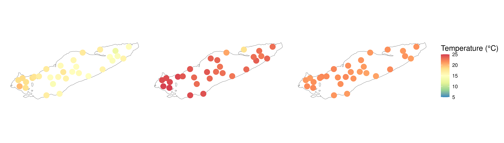
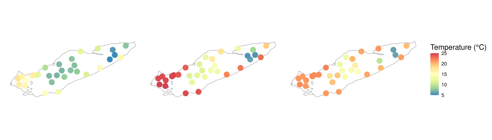
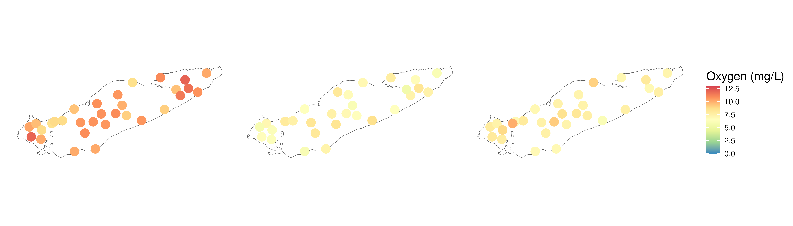
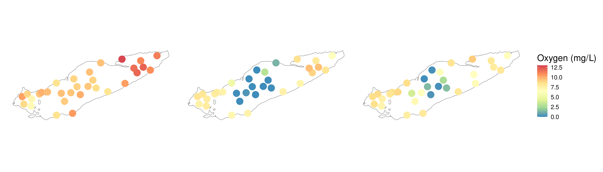
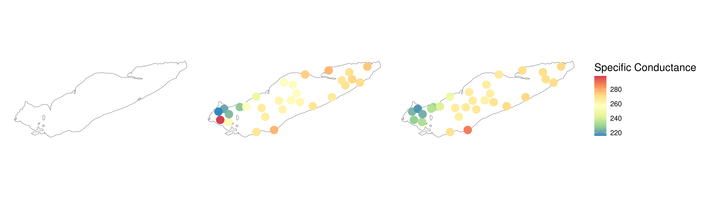

# Purpose of this document


# Load Packages and Functions


::: {.cell layout-align="center"}

```{.r .cell-code}
# Load Packages
pacman::p_load(tidyverse, oce, install = FALSE)

# load colors and shapes
source("code/R/plotting_aesthetics.R")
```
:::


This is like my least favorite job lol. 

# Find files


::: {.cell layout-align="center"}

```{.r .cell-code}
may_ctd <- list.files("data/05_Metadata_Curation/ctd_casts/May/", full.names = TRUE)

august_ctd <- list.files("data/05_Metadata_Curation/ctd_casts/August", full.names = TRUE)

september_ctd <- list.files("data/05_Metadata_Curation/ctd_casts/September", full.names = TRUE)
```
:::


Mkay so here's the deal. during the equilibration phase, sometimes the difference between the two conductivity sensors exceeds -99, at which point a whole host of parsing problems occurs. It's incredibly annoying. The best solution is to remove that phase manually within the files themselves, which I've done for the files we have on the server. However, if you download raw files from GLNPO, be prepared that the below code will fail to parse, because of issues in the data files themselves. 


::: {.cell layout-align="center"}

```{.r .cell-code}
clean_casts <- function(ctd_file){
  ctd_file %>%
    read.ctd() %>%
    ctdTrim(method = "downcast", parameters = list(pmin = 1.5)) %>%
    ctdDecimate(p = 0.1, na.rm = TRUE)
}


clean_may_casts <- map(may_ctd, clean_casts)

clean_august_casts <- map(august_ctd, clean_casts)

clean_september_casts <- map(september_ctd, clean_casts)
```
:::


# Working on names


::: {.cell layout-align="center"}

```{.r .cell-code}
clean_may_names <- may_ctd %>%
  basename %>%
  str_remove(".cnv") %>%
  str_remove(".*_") %>%
  str_replace("G", "6") %>% # This is to deal with the G09 - we'll get back to it 
  str_remove_all("[^0-9]") %>%
  str_replace("609", "G09")


clean_august_names <- 
  august_ctd %>%
  basename %>%
  str_remove(".cnv") %>%
  str_remove(".*_") %>%
  str_replace("G", "6") %>% # This is to deal with the G09 - we'll get back to it 
  str_remove_all("[^0-9]") %>%
  str_replace("609", "G09")

clean_september_names <- september_ctd %>%
  basename %>%
  str_remove(".cnv") %>%
  str_remove(".*_") %>%
  str_replace("G", "6") %>% # This is to deal with the G09 - we'll get back to it 
  str_remove_all("[^0-9]") %>%
  str_replace("609", "G09") 
```
:::

::: {.cell layout-align="center"}

```{.r .cell-code}
summarize_and_extract <- function(cast){
  set_up <- cast@data %>% 
  as.data.frame() %>%
  filter(!is.na(depth)) %>%
  select(-pressure, -oxygenRaw, -scan) %>%
  relocate(depth)
  
  surface <- set_up %>%
  filter(depth < 2) %>%
  summarize(across(temperature:salinity, .names = "surf_{.col}", \(x)mean(x,na.rm = TRUE)))
  
  bottom <- set_up %>%
  slice_max(n = 3, order_by = depth) %>%
  summarize(across(temperature:salinity, .names = "bottom_{.col}", \(x)mean(x,na.rm = TRUE)))
  
  integrated_surface <- set_up %>%
  filter(depth < 10) %>%
  summarize(across(temperature:salinity, .names = "intsurf_{.col}", \(x)mean(x,na.rm = TRUE)))
  
  cbind(surface, bottom, integrated_surface)
}

summarize_and_extract_as <- function(cast){
  set_up <- cast@data %>% 
  as.data.frame() %>%
  filter(!is.na(depth)) %>%
  select(-pressure, -oxygenRaw, -scan, -temperature2, -conductivity2, -oxygenRaw2, -oxygen2, -conductivityDifference) %>%
  relocate(depth)
  
  surface <- set_up %>%
  filter(depth < 2) %>%
  summarize(across(temperature:salinity, .names = "surf_{.col}", \(x)mean(x,na.rm = TRUE)))
  
  bottom <- set_up %>%
  slice_max(n = 3, order_by = depth) %>%
  summarize(across(temperature:salinity, .names = "bottom_{.col}", \(x)mean(x,na.rm = TRUE)))
  
  integrated_surface <- set_up %>%
  filter(depth < 10) %>%
  summarize(across(temperature:salinity, .names = "intsurf_{.col}", \(x)mean(x,na.rm = TRUE)))
  
  cbind(surface, bottom, integrated_surface)
}

may_ctd_df <- map(clean_may_casts, summarize_and_extract) %>%
  bind_rows() %>%
  mutate(Station_ID = clean_may_names,
         Month = "May")

august_ctd_df <- map(clean_august_casts, summarize_and_extract_as) %>%
  bind_rows() %>%
  mutate(Station_ID = clean_august_names,
         Month = "August")

september_ctd_df <- map(clean_september_casts, summarize_and_extract_as) %>%
  bind_rows() %>%
  mutate(Station_ID = clean_september_names,
         Month = "September")

all_ctd_summary <- 
  may_ctd_df %>%
  rbind(august_ctd_df) %>%
  rbind(september_ctd_df) %>%
  mutate(Station_ID = ifelse(Station_ID == "09", "9", Station_ID))
```
:::


# Okay, now bringing in some additional metadata


::: {.cell layout-align="center"}

```{.r .cell-code}
station_lats <- readxl::read_xlsx("data/external_data/20240404_Scofield_Erie2024_CSMI_StationList.xlsx") %>%
  select(Station_ID = Our_Station_ID, Latitude = lattDD_target, Longitude = LonDD_target)

all_ctd_summary$Station_ID[!all_ctd_summary$Station_ID %in% station_lats$Station_ID]
```

::: {.cell-output .cell-output-stdout}
```
character(0)
```
:::

```{.r .cell-code}
summarized_ctd_latlon <- 
  all_ctd_summary %>%
  left_join(station_lats) 
```
:::


# Mapping


::: {.cell layout-align="center"}

```{.r .cell-code}
pacman::p_load(sf, tmap, install = FALSE)

# Define some shapes and objects

raw_erie <- read_sf("data/spatial_imports/hydro_p_LakeErie/hydro_p_LakeErie.shp") %>%
  st_transform(crs = "EPSG:4326")

erie_outline <- raw_erie %>%
  st_union()

ctd_sf <- summarized_ctd_latlon %>%
  filter(!is.na(Longitude)) %>% 
  st_as_sf(coords = c("Longitude","Latitude"), crs = "EPSG:4326") %>%
   mutate(Month = factor(Month, levels = c("May","August","September")))
```
:::

::: {.cell layout-align="center"}

```{.r .cell-code}
range(c(ctd_sf$surf_temperature, ctd_sf$bottom_temperature), na.rm = TRUE)
```

::: {.cell-output .cell-output-stdout}
```
[1]  4.974969 24.968925
```
:::

```{.r .cell-code}
ctd_sf %>%
  ggplot() + 
  geom_sf(data = erie_outline, fill = NA) + 
  geom_sf(data = ctd_sf, aes(color = surf_temperature), size = 5, alpha = 1) + 
  scale_color_distiller(palette = "Spectral", na.value = "white", 
                        limits = c(5, 25)) + 
  labs(color = "Temperature (°C)") + 
  facet_wrap(~Month) + 
  theme(axis.line = element_blank(),
        axis.text = element_blank(),
        axis.ticks = element_blank(),
        strip.text = element_blank())
```

::: {.cell-output-display}
{fig-align='center' width=4200}
:::

```{.r .cell-code}
ctd_sf %>%
  ggplot() + 
  geom_sf(data = erie_outline, fill = NA) + 
  geom_sf(data = ctd_sf, aes(color = bottom_temperature), size = 5, alpha = 1) + 
  scale_color_distiller(palette = "Spectral", na.value = "white", 
                        limits = c(5, 25)) + 
  labs(color = "Temperature (°C)") + 
  facet_wrap(~Month) + 
  theme(axis.line = element_blank(),
        axis.text = element_blank(),
        axis.ticks = element_blank(),
        strip.text = element_blank())
```

::: {.cell-output-display}
{fig-align='center' width=4200}
:::

```{.r .cell-code}
range(c(ctd_sf$surf_oxygen, ctd_sf$bottom_oxygen), na.rm = TRUE)
```

::: {.cell-output .cell-output-stdout}
```
[1]  0.1239907 12.8159969
```
:::

```{.r .cell-code}
ctd_sf %>%
  ggplot() + 
  geom_sf(data = erie_outline, fill = NA) + 
  geom_sf(data = ctd_sf, aes(color = surf_oxygen), size = 5, alpha = 1) + 
  scale_color_distiller(palette = "Spectral", na.value = "white", 
                        limits = c(0, 13)) + 
  labs(color = "Oxygen (mg/L)") + 
  facet_wrap(~Month) + 
  theme(axis.line = element_blank(),
        axis.text = element_blank(),
        axis.ticks = element_blank(),
        strip.text = element_blank())
```

::: {.cell-output-display}
{fig-align='center' width=4200}
:::

```{.r .cell-code}
ctd_sf %>%
  ggplot() + 
  geom_sf(data = erie_outline, fill = NA) + 
  geom_sf(data = ctd_sf, aes(color = bottom_oxygen), size = 5, alpha = 1) + 
  scale_color_distiller(palette = "Spectral", na.value = "white", 
                        limits = c(0, 13)) + 
  labs(color = "Oxygen (mg/L)") + 
  facet_wrap(~Month) + 
  theme(axis.line = element_blank(),
        axis.text = element_blank(),
        axis.ticks = element_blank(),
        strip.text = element_blank())
```

::: {.cell-output-display}
{fig-align='center' width=4200}
:::

```{.r .cell-code}
ggsave("test.png", width = 14, height = 4)


ctd_sf %>%
  ggplot() + 
  geom_sf(data = erie_outline, fill = NA) + 
  geom_sf(data = filter(ctd_sf, Month != "May"), aes(color = surf_specificConductance), size = 5, alpha = 1) + 
  scale_color_distiller(palette = "Spectral", na.value = "white") + 
  labs(color = "Specific Conductance") + 
  facet_wrap(~Month) + 
  theme(axis.line = element_blank(),
        axis.text = element_blank(),
        axis.ticks = element_blank(),
        strip.text = element_blank())
```

::: {.cell-output-display}
{fig-align='center' width=4200}
:::
:::