# Purpose of this document


# Load Packages and Functions

::: {.cell layout-align="center"}

```{.r .cell-code}
# Load Packages

# BiocManager::install("phyloseq", force = TRUE)
# install.packages("ggpubr")
# # Installing flow.gus can be a pain!!! Here is what worked for me:
# remotes::install_github('RGLab/cytoinstaller', force=TRUE)
# devtools::install_github("RGLab/RProtoBufLib")
# devtools::install_github("RGLab/cytolib")
# devtools::install_github("RGLab/flowCore")
# devtools::install_github("RGLab/ggcyto")
# devtools::install_github("MarschmiLab/flow.gus")
pacman::p_load(ggpubr, phyloseq, flow.gus, flowCore, ggcyto, tidyverse,  install = FALSE)
# load colors and shapes
source("code/R/plotting_aesthetics.R")

load("data/05_Metadata_Curation/sample_info.RData") # This include data for all stations, even ones where we lost sequencing data
load("data/05_Metadata_Curation/meta_physeq.RData")
```
:::


# Find fcs files


::: {.cell layout-align="center"}

```{.r .cell-code}
# These are csv files which list which sample is in which well of each plate
wellmap_files <- list.files("data/06_Flow_Cytometry/wellmaps/", full.names = TRUE)

wellmaps <- map(wellmap_files, read_csv)

# These are symlinked from identically named dirs in lab_data/flow_cytometry
# They contain raw .fcs files for pigment and cell count wells
flow_dirs <- c("data/06_Flow_Cytometry/20250514_AAM_ERI_Plate1",
               "data/06_Flow_Cytometry/20250515_AAM_ERI_Plate2",
               "data/06_Flow_Cytometry/20250516_AAM_ERI_Plate3",
               "data/06_Flow_Cytometry/20250520_AAM_ERI_Plate4",
               "data/06_Flow_Cytometry/20250520_AAM_ERI_Plate5",
               "data/06_Flow_Cytometry/20250521_AAM_ERI_Plate6",
               "data/06_Flow_Cytometry/20250521_AAM_ERI_Plate7",
               "data/06_Flow_Cytometry/20250522_AAM_ERI_Plate8",
               "data/06_Flow_Cytometry/20250523_AAM_ERI_Plate9")

names(flow_dirs) <- basename(flow_dirs)

flow_files <- map(flow_dirs, list.files, pattern = ".fcs", full.names = TRUE)
```
:::


Now, let's split into two lists, one for pigment analysis, and the other for cell counts


::: {.cell layout-align="center"}

```{.r .cell-code}
split_files <- function(file_vec, pattern){
  file_vec[str_detect(file_vec, pattern)]
}

cell_files <- map(flow_files, split_files, pattern = "Cell_Counts")

pigment_files <- map(flow_files, split_files, pattern = "Pigment_Analysis")
```
:::


# Analyzing cell counts


::: {.cell layout-align="center"}

```{.r .cell-code}
cell_sets <- map(cell_files, read.flowSet)
```
:::


## Defining a SYBR-gate

Here I define two different gates. One is just a rectangle gate which includes every single event above a certain SYBR threshold. The other is a polygon gate, which excludes a cloud of low-sybr, very high SSC events that we only see in certain samples


::: {.cell layout-align="center"}

```{.r .cell-code}
sybr_gate <- rectangleGate(filterId = "cell_gate", "BL1-H" = c(3000, 1.5e6), "SSC-H" = c(1, 1.5e6))
```
:::


## Calculating Cell Counts


::: {.cell layout-align="center"}

```{.r .cell-code}
glut_dilution <- 1001/1000

sybr_dilution <- 153/150

manual_dilution <- 10

volume_sampled <- 50
```
:::


Note: count_gated_events comes from flow.gus. 


::: {.cell layout-align="center"}

```{.r .cell-code}
cell_counts_inclusive <- map(cell_sets, count_gated_events, sybr_gate)

# This function helps remove extra info from the filename
# Will likely need to edit depending on how your files are named!
# It also joins in the well assignments using our wellmaps. 
# Some messing about with whether wells are A01 vs. A1 is done too for that joining
cleaning_counts <- function(count_df, wm){
  count_df %>%
  mutate(Well = str_extract(sample, "....fcs|...fcs"),
         Well = str_remove(Well, ".fcs"),
         Well = str_remove(Well, "_"),
         Well = ifelse(nchar(Well) == 2, paste0(substr(Well, 1, 1), "0", substr(Well, 2, 2)), Well)
         ) %>%
  left_join(wm)
}

inclusive_df <- 
  map2(cell_counts_inclusive, wellmaps, cleaning_counts) %>%
  bind_rows() %>%
  mutate(gate = "inclusive")


cell_counts_full <- bind_rows(inclusive_df) %>%
  mutate(cells_per_ml = (gated / volume_sampled) * sybr_dilution * glut_dilution * manual_dilution * 1000)
```
:::


One looks really low - who is that?


::: {.cell layout-align="center"}

```{.r .cell-code}
cell_counts_full %>%
  arrange(cells_per_ml) %>%
  head(10)
```

::: {.cell-output .cell-output-stdout}
```
   initial gated   percent
1     2486  1344 0.5406275
2     2687  1420 0.5284704
3     2602  1430 0.5495772
4     2981  1582 0.5306944
5     3085  1598 0.5179903
6     3410  1626 0.4768328
7    24737  7349 0.2970853
8    22968  7640 0.3326367
9    25144  8158 0.3244512
10   29686  8287 0.2791552
                                                   sample Well
1  20250521_AAM_ERI_Plate7_Experiment_Cell_Counts_H10.fcs  H10
2  20250521_AAM_ERI_Plate7_Experiment_Cell_Counts_E11.fcs  E11
3  20250521_AAM_ERI_Plate7_Experiment_Cell_Counts_H11.fcs  H11
4  20250521_AAM_ERI_Plate7_Experiment_Cell_Counts_E10.fcs  E10
5   20250523_AAM_ERI_Plate9_Experiment_Cell_Counts_G1.fcs  G01
6   20250523_AAM_ERI_Plate9_Experiment_Cell_Counts_G2.fcs  G02
7   20250516_AAM_ERI_Plate3_Experiment_Cell_Counts_E7.fcs  E07
8   20250515_AAM_ERI_Plate2_Experiment_Cell_Counts_E1.fcs  E01
9   20250520_AAM_ERI_Plate4_Experiment_Cell_Counts_G4.fcs  G04
10  20250516_AAM_ERI_Plate3_Experiment_Cell_Counts_E8.fcs  E08
                      Sample_ID Target ...8      gate cells_per_ml
1  AAM_ERI_20240915_937_FC_EW_1  Cells   NA inclusive     274450.2
2  AAM_ERI_20240915_937_FC_EW_2  Cells   NA inclusive     289969.7
3  AAM_ERI_20240915_937_FC_EW_1  Cells   NA inclusive     292011.7
4  AAM_ERI_20240915_937_FC_EW_2  Cells   NA inclusive     323050.7
5  AAM_ERI_20240915_937_FC_EW_1  Cells   NA inclusive     326318.0
6  AAM_ERI_20240915_937_FC_EW_1  Cells   NA inclusive     332035.7
7   AAM_ERI_20240915_15_FC_BW_1  Cells   NA inclusive    1500695.2
8   AAM_ERI_20240916_10_FC_BW_1  Cells   NA inclusive    1560118.6
9   AAM_ERI_20240916_09_FC_BW_1  Cells   NA inclusive    1665896.2
10  AAM_ERI_20240915_15_FC_BW_1  Cells   NA inclusive    1692238.5
```
:::
:::


# Analyzing pigments


::: {.cell layout-align="center"}

```{.r .cell-code}
pigment_sets <- map(pigment_files, read.flowSet)
```
:::


## Defining pigment gates

There's a lot of directions to go here, and I'm just tentatively starting. Here, I define four main gates, which you can see in the random plotting later on:


::: {.cell layout-align="center"}

```{.r .cell-code}
chl_big <- rectangleGate(filterId = "is_big", "BL3-H" = c(500, 1e7), "FSC-H" = c(1e5, 1e7))
chl_small <- rectangleGate(filterId = "is_small", "BL3-H" = c(500, 1e7), "FSC-H" = c(100, 1e5))
```
:::

::: {.cell layout-align="center"}

```{.r .cell-code}
manual_dilution_pig <- 2

volume_sampled_pig <- 150
```
:::


Now, we count events in each of those pigment gates. Their edges are exclusive but directly next to each other, so every event should only be counted once for each gate. 


::: {.cell layout-align="center"}

```{.r .cell-code}
pig_counts_chl_big <- map(pigment_sets, count_gated_events, chl_big)
pig_counts_chl_small <- map(pigment_sets, count_gated_events, chl_small)

pig_count_list <- list(
  "pig_counts_chl_big" = pig_counts_chl_big,
  "pig_counts_chl_small" = pig_counts_chl_small)

cleaning_counts_pig <- function(count_df, wm, gate_name){
  count_df %>%
  mutate(Well = str_extract(sample, "....fcs|...fcs"),
         Well = str_remove(Well, ".fcs"),
         Well = str_remove(Well, "_"),
         Well = ifelse(nchar(Well) == 2, paste0(substr(Well, 1, 1), "0", substr(Well, 2, 2)), Well),
         Gate = gate_name
         ) %>%
  left_join(wm)
}

pigment_counts <- 
  map2(pig_count_list,
     names(pig_count_list),
    \(x,y){
      gname <- y
      map2(x, wellmaps, cleaning_counts_pig, gate_name = gname) %>%
        bind_rows()
    }) %>%
  bind_rows() %>% 
  select(pigment_count = gated, Sample_ID, Gate) %>%
  mutate(pig_cells_per_ml = (pigment_count/volume_sampled_pig) * glut_dilution * manual_dilution_pig * 1000) %>%
  group_by(Sample_ID, Gate) %>%
  summarize(avg_pig_per_ml = mean(pig_cells_per_ml)) %>%
  ungroup() 
```
:::


## RSG Data


::: {.cell layout-align="center"}

```{.r .cell-code}
# These are csv files which list which sample is in which well of each plate
rsg_wellmap_files <- list.files("data/06_Flow_Cytometry/rsg_wellmaps/", full.names = TRUE)

rsg_wellmaps <- map(rsg_wellmap_files, read_csv)

# These are symlinked from identically named dirs in lab_data/flow_cytometry
# They contain raw .fcs files for pigment and cell count wells
rsg_flow_dirs <- c(
               "data/06_Flow_Cytometry/20251217_AAM_ERI_RSG_Plate1",
               "data/06_Flow_Cytometry/20251218_AAM_ERI_RSG_Plate2",
               "data/06_Flow_Cytometry/20251218_AAM_ERI_RSG_Plate3",
               "data/06_Flow_Cytometry/20251219_AAM_ERI_RSG_Plate4",
               "data/06_Flow_Cytometry/20251219_AAM_ERI_RSG_Plate5")

names(rsg_flow_dirs) <- basename(rsg_flow_dirs)

rsg_flow_files <- map(rsg_flow_dirs, list.files, pattern = ".fcs", full.names = TRUE)
```
:::


# Analyzing cell counts


::: {.cell layout-align="center"}

```{.r .cell-code}
rsg_sets <- map(rsg_flow_files, read.flowSet)
```
:::


## Defining gates


::: {.cell layout-align="center"}

```{.r .cell-code}
sybr_gate <- rectangleGate(filterId = "cell_gate", "BL1-H" = c(3000, 1.5e6))

rsg_gate <- rectangleGate(filterId = "rsg_gate", "BL1-H" = c(825,1.5e6))

chl_rsg_gate <- rectangleGate(filterId = "rsg_chl", "BL3-H" = c(500, 1e7), "BL1-H" = c(825,1.5e6))

het_rsg_gate <- rectangleGate(filterId = "rsg_het", "BL3-H" = c(1, 499),  "BL1-H" = c(825,1.5e6))
```
:::


## Calculating Cell Counts


::: {.cell layout-align="center"}

```{.r .cell-code}
storage_dilution <- 1100/1000

glut_dilution <- 1001/1000

sybr_dilution <- 204/200

manual_dilution <- 10

volume_sampled <- 50
```
:::


Note: count_gated_events comes from flow.gus. 


::: {.cell layout-align="center"}

```{.r .cell-code}
cell_counts_sybr <- map(rsg_sets, count_gated_events, sybr_gate)
cell_counts_rsg <- map(rsg_sets, count_gated_events, rsg_gate)
cell_counts_chl_rsg <- map(rsg_sets, count_gated_events, chl_rsg_gate)
cell_counts_het_rsg <- map(rsg_sets, count_gated_events, het_rsg_gate)


# This function helps remove extra info from the filename
# Will likely need to edit depending on how your files are named!
# It also joins in the well assignments using our wellmaps. 
# Some messing about with whether wells are A01 vs. A1 is done too for that joining
cleaning_counts <- function(count_df, wm){
  count_df %>%
  mutate(Well = str_extract(sample, "....fcs|...fcs"),
         Well = str_remove(Well, ".fcs"),
         Well = str_remove(Well, "_"),
         Well = ifelse(nchar(Well) == 2, paste0(substr(Well, 1, 1), "0", substr(Well, 2, 2)), Well)
         ) %>%
  left_join(wm)
}

cell_df <- 
  map2(cell_counts_sybr, rsg_wellmaps, cleaning_counts) %>%
  bind_rows() %>%
  dplyr::filter(Staining == "SYBR") %>%
  select(Sample_ID, cell_count = gated) %>%
  group_by(Sample_ID) %>%
  summarize(cell_count = mean(cell_count))

chl_df <- 
  map2(cell_counts_chl_rsg, rsg_wellmaps, cleaning_counts) %>%
  bind_rows() %>%
  dplyr::filter(Staining == "SYBR") %>%
  select(Sample_ID, chl_cell_count = gated) %>%
  group_by(Sample_ID) %>%
  summarize(chl_cell_count = mean(chl_cell_count))

rsg_df <- 
  map2(cell_counts_rsg, rsg_wellmaps, cleaning_counts) %>%
  bind_rows() %>%
  mutate(gate = "rsg_counts") %>%
  dplyr::filter(Staining == "RSG") %>%
  select(Sample_ID, rsg_count = gated) %>%
  group_by(Sample_ID) %>%
  summarize(rsg_count = mean(rsg_count))

chl_rsg_df <- 
  map2(cell_counts_chl_rsg, rsg_wellmaps, cleaning_counts) %>%
  bind_rows() %>%
  mutate(gate = "chl_rsg_counts") %>%
  dplyr::filter(Staining == "RSG") %>%
  select(Sample_ID, chl_rsg_count = gated) %>%
  group_by(Sample_ID) %>%
  summarize(chl_rsg_count = mean(chl_rsg_count))

het_rsg_df <- 
  map2(cell_counts_het_rsg, rsg_wellmaps, cleaning_counts) %>%
  bind_rows() %>%
  mutate(gate = "het_rsg_counts") %>%
  dplyr::filter(Staining == "RSG") %>%
  select(Sample_ID, het_rsg_count = gated) %>%
  group_by(Sample_ID) %>%
  summarize(het_rsg_count = mean(het_rsg_count))
```
:::


### Calculating mean intensity


::: {.cell layout-align="center"}

```{.r .cell-code}
rsg_gatesets <- map(rsg_sets, GatingSet)

map(rsg_gatesets, gs_pop_add, gate = rsg_gate)
```

::: {.cell-output .cell-output-stdout}
```
$`20251217_AAM_ERI_RSG_Plate1`
[1] 2

$`20251218_AAM_ERI_RSG_Plate2`
[1] 2

$`20251218_AAM_ERI_RSG_Plate3`
[1] 2

$`20251219_AAM_ERI_RSG_Plate4`
[1] 2

$`20251219_AAM_ERI_RSG_Plate5`
[1] 2
```
:::

```{.r .cell-code}
map(rsg_gatesets, recompute)
```

::: {.cell-output .cell-output-stdout}
```
$`20251217_AAM_ERI_RSG_Plate1`
NULL

$`20251218_AAM_ERI_RSG_Plate2`
NULL

$`20251218_AAM_ERI_RSG_Plate3`
NULL

$`20251219_AAM_ERI_RSG_Plate4`
NULL

$`20251219_AAM_ERI_RSG_Plate5`
NULL
```
:::

```{.r .cell-code}
rsg_res_raw <- map(rsg_gatesets, gs_pop_get_stats, type = pop.MFI, node = "rsg_gate")

rsg_cleaner <- map(rsg_res_raw, \(x){
  x %>% 
    data.frame() %>%
    select(sample, rsg_intensity = SYBR.H)
  }
  )

rsg_intensity_data <- 
  map2(rsg_cleaner, rsg_wellmaps, cleaning_counts) %>%
  bind_rows() %>%
  dplyr::filter(Staining == "RSG") %>%
  group_by(Sample_ID) %>%
  summarize(rsg_mfi = mean(rsg_intensity))
  

rsg_final <- cell_df %>%
  inner_join(rsg_df) %>%
  inner_join(chl_df) %>%
  inner_join(chl_rsg_df) %>%
  inner_join(het_rsg_df) %>%
  inner_join(rsg_intensity_data) %>%
  mutate(rsg_total_per_ml = (cell_count / volume_sampled) * storage_dilution * sybr_dilution * glut_dilution * manual_dilution * 1000,
         rsg_chl_per_ml = (chl_cell_count / volume_sampled) * storage_dilution * sybr_dilution * glut_dilution * manual_dilution * 1000,
         rsg_pos_per_ml = (rsg_count / volume_sampled) * storage_dilution * glut_dilution * manual_dilution * 1000,
         rsg_perc_pos = rsg_pos_per_ml / rsg_total_per_ml,
         het_rsg_per_ml = (het_rsg_count / volume_sampled) * storage_dilution * glut_dilution * manual_dilution * 1000,
         het_rsg_perc_pos = het_rsg_per_ml / (rsg_total_per_ml - rsg_chl_per_ml)
         ) %>%
  select(Sample_ID, rsg_total_per_ml, rsg_pos_per_ml, rsg_perc_pos, het_rsg_per_ml, het_rsg_perc_pos, rsg_mfi)  %>%
  mutate(Sample_ID = str_remove(Sample_ID, "_RSG"))

head(rsg_final)
```

::: {.cell-output .cell-output-stdout}
```
# A tibble: 6 × 7
  Sample_ID          rsg_total_per_ml rsg_pos_per_ml rsg_perc_pos het_rsg_per_ml
  <chr>                         <dbl>          <dbl>        <dbl>          <dbl>
1 AAM_ERI_20240913_…         7029733.       3124481.       0.444        2950948 
2 AAM_ERI_20240913_…         5845625.       2846013.       0.487        2697144.
3 AAM_ERI_20240913_…         5137385.       2779507.       0.541        2574152.
4 AAM_ERI_20240913_…         5074041.        122663.       0.0242         70801.
5 AAM_ERI_20240913_…         1825186.       1280579.       0.702        1234553.
6 AAM_ERI_20240913_…         1696027.       1237967.       0.730        1193923.
# ℹ 2 more variables: het_rsg_perc_pos <dbl>, rsg_mfi <dbl>
```
:::
:::


## Quick QC


::: {.cell layout-align="center"}

```{.r .cell-code}
rsg_final %>%
  separate_wider_delim(Sample_ID, delim = "_", names = c("x","y","z", "Station", "w", "Depth", "Replicate")) %>%
  ggplot(aes(x = Depth, y = rsg_mfi, group = paste(Station, Replicate))) + 
  geom_point() + 
  geom_line()
```

::: {.cell-output-display}
{fig-align='center' width=2100}
:::

```{.r .cell-code}
rsg_final %>%
  separate_wider_delim(Sample_ID, delim = "_", names = c("x","y","z", "Station", "w", "Depth", "Replicate")) %>%
  ggplot(aes(x = Replicate, y = rsg_pos_per_ml, group = paste(Station, Depth))) + 
  geom_point() + 
  geom_line()
```

::: {.cell-output-display}
{fig-align='center' width=2100}
:::

```{.r .cell-code}
rsg_final %>%
  ggplot(aes(x = rsg_pos_per_ml - het_rsg_per_ml)) + 
  geom_histogram()
```

::: {.cell-output-display}
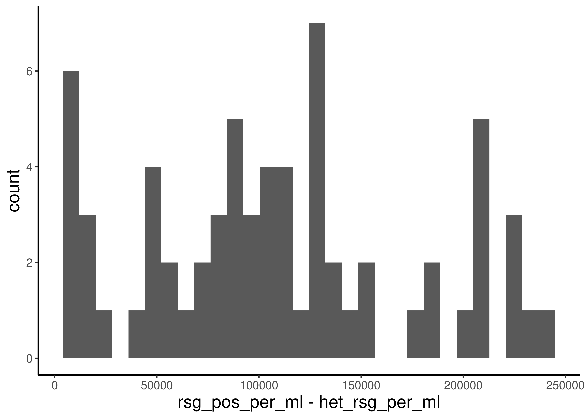{fig-align='center' width=2100}
:::

```{.r .cell-code}
# Good
```
:::


We'd like to see no big changes between replicates. Overall this is true, except for one sample - what's going on there?


::: {.cell layout-align="center"}

```{.r .cell-code}
rsg_final %>%
  separate_wider_delim(Sample_ID, delim = "_", names = c("x","y","z", "Station", "w", "Depth", "Replicate")) %>%
  ggplot(aes(x = Replicate, y = rsg_pos_per_ml, label = paste(Station, Depth))) + 
  geom_text()
```

::: {.cell-output-display}
{fig-align='center' width=2100}
:::

```{.r .cell-code}
rsg_final %>%
  separate_wider_delim(Sample_ID, delim = "_", names = c("x","y","z", "Station", "w", "Depth", "Replicate")) %>%
  ggplot(aes(x = Replicate, y = rsg_total_per_ml, label = paste(Station, Depth))) + 
  geom_text()
```

::: {.cell-output-display}
{fig-align='center' width=2100}
:::
:::


Huh, it belongs to 59 E -> a major bloom sample in the western basin. It's total cell count is normal, but its RSG staining is just very very low. I've very suspicious of that big drop off in replicate two, as it places it way below the other samples in the eastern basin. I'm guessing there was a pipetting error in the staining of that sample. I'm going to discard that measurement. 


::: {.cell layout-align="center"}

```{.r .cell-code}
rsg_final %>%
  dplyr::filter(Sample_ID == "AAM_ERI_20240913_59_FC_EW_2")
```

::: {.cell-output .cell-output-stdout}
```
# A tibble: 1 × 7
  Sample_ID          rsg_total_per_ml rsg_pos_per_ml rsg_perc_pos het_rsg_per_ml
  <chr>                         <dbl>          <dbl>        <dbl>          <dbl>
1 AAM_ERI_20240913_…         5074041.        122663.       0.0242         70801.
# ℹ 2 more variables: het_rsg_perc_pos <dbl>, rsg_mfi <dbl>
```
:::

```{.r .cell-code}
rsg_final <- rsg_final %>%
  dplyr::filter(Sample_ID != "AAM_ERI_20240913_59_FC_EW_2")
```
:::


## Joining pigments and cell counts and rsg


::: {.cell layout-align="center"}

```{.r .cell-code}
cells_for_join <- 
  cell_counts_full %>%
  dplyr::filter(gate == "inclusive") %>%
  group_by(Sample_ID) %>%
  summarize(avg_cells_per_ml = mean(cells_per_ml)) %>%
  ungroup() %>%
  select(Sample_ID, avg_cells_per_ml)

pig_final <- 
  pigment_counts %>% 
  left_join(cells_for_join) %>% 
  left_join(rsg_final) %>% 
  mutate(perc_pig = avg_pig_per_ml / avg_cells_per_ml)
```
:::


# Plotting results


::: {.cell layout-align="center"}

```{.r .cell-code}
pig_final %>% 
  ggplot(aes(y = Gate, x = avg_pig_per_ml)) + 
  ggbeeswarm::geom_beeswarm() + 
  scale_x_log10()
```

::: {.cell-output-display}
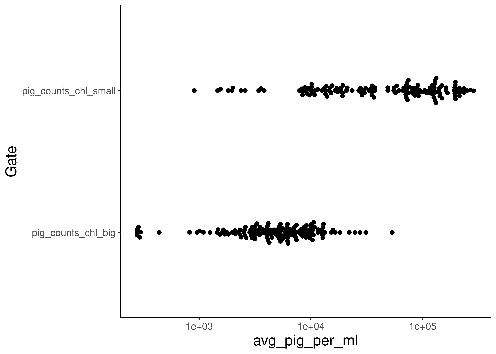{fig-align='center' width=2100}
:::
:::


# Incorporating flow data into our physeq

Now, we want to bring our flow data into our physeq. 


::: {.cell layout-align="center"}

```{.r .cell-code}
wide_pig <- pig_final %>%
  select(-perc_pig) %>%
  pivot_wider(names_from = "Gate", values_from = c("avg_pig_per_ml"))


pig_for_join <- wide_pig %>%
  separate_wider_delim(Sample_ID, delim = "_", names = c("a","b","Date", "Station_ID","c","Depth","e")) %>%
  mutate(Month = case_when(str_detect(Date, "202405") ~ "May",
                           str_detect(Date, "202408") ~ "August",
                           str_detect(Date, "202409") ~ "September"),
         Depth_Class = ifelse(Depth == "EW", "S","B"),
         Rep_ID = paste(Month, Station_ID, Depth_Class, sep = "_"),
         total_chl_counts = pig_counts_chl_big + pig_counts_chl_small) %>%
  select(Rep_ID, avg_cells_per_ml:pig_counts_chl_small, total_chl_counts) %>%
  group_by(Rep_ID)%>%
  summarize(across(c(avg_cells_per_ml:pig_counts_chl_small, total_chl_counts), \(x)mean(x, na.rm = TRUE)))

meta_w_flow <- sample_data(meta_physeq) %>%
  data.frame() %>%
  left_join(pig_for_join, by = "Rep_ID")

row.names(meta_w_flow) <- meta_w_flow$DNA_ID

flow_physeq <- meta_physeq

flow_physeq@sam_data <- NULL

flow_physeq@sam_data <- sample_data(meta_w_flow)

head(sample_data(flow_physeq))
```

::: {.cell-output .cell-output-stdout}
```
                           Sample_ID  DNA_ID  input filtered denoisedF
KH_D001  AAM_ERI_20240522_15_FP_ET_1 KH_D001 241601   158738    158174
KH_D009  AAM_ERI_20240521_43_FP_ET_1 KH_D009 869027   573287    571578
KH_D017 AAM_ERI_20240522_936_FP_ET_1 KH_D017 459535   302302    301175
KH_D025  AAM_ERI_20240814_15_FP_ET_1 KH_D025 751735   493259    490103
KH_D032  AAM_ERI_20240810_59_FP_ET_1 KH_D032 753166   495997    490076
KH_D040  AAM_ERI_20240813_95_FP_ET_1 KH_D040 518358   342765    341346
        denoisedR merged nochim perc_reads_retained Station_ID     Date Depth
KH_D001    157756 155519 131823            54.56227         15 20240522     5
KH_D009    572130 566261 513112            59.04443         43 20240521     5
KH_D017    300956 297611 261488            56.90274        936 20240522     5
KH_D025    490271 484355 454845            60.50603         15 20240813     5
KH_D032    490094 480124 439695            58.37956         59 20240810     5
KH_D040    341240 337283 314764            60.72328         95 20240813     5
        Station_Name Water_Surface_Temp_C Latitude  Longitude  Month
KH_D001        ER15M                15.15 42.50150  -79.89365    May
KH_D009         ER43                14.00 41.79217 -81.946667    May
KH_D017    ECSER936n                16.50 42.47545 -79.406633    May
KH_D025       ER 15M                23.43 42.51670    -79.893 August
KH_D032        ER 59                24.87 41.72723 -83.150467 August
KH_D040   ECS ER 95B                22.45 42.00025   -80.6666 August
        Depth_Class      Rep_ID Basin
KH_D001           S    May_15_S     E
KH_D009           S    May_43_S     C
KH_D017           S   May_936_S     E
KH_D025           S August_15_S     E
KH_D032           S August_59_S     W
KH_D040           S August_95_S     C
                                                                                                                                                                                                                        Notes
KH_D001                                                                                                                                                   NA NA Integrated sample; discrete depths separated by semi-colon NA
KH_D009                                                                                                                                                   NA NA Integrated sample; discrete depths separated by semi-colon NA
KH_D017                                                                                                                                                   NA NA Integrated sample; discrete depths separated by semi-colon NA
KH_D025 did vortex step before incubating PW1 at 65C Dates coerced to be consistent with station log - not within names but within the "Date_COllected" columns Integrated sample; discrete depths separated by semi-colon NA
KH_D032                                    Microcystis observed on filter. Spin column from 178030015_2. NA Integrated sample; discrete depths separated by semi-colon Station pretty turbid! Visible cyanobacterial colonies
KH_D040                                                                        Microcystis observed on filter. Did vortex step before incubating PW1 at 65C. NA Integrated sample; discrete depths separated by semi-colon NA
        Microcystin_Total Anatoxin_Total Toxins_Measured ctd_temperature
KH_D001                NA             NA            <NA>        13.69299
KH_D009                NA             NA            <NA>        12.95048
KH_D017                NA             NA            <NA>        16.18748
KH_D025              0.00              0             Yes        23.08416
KH_D032              0.29              0             Yes        24.88106
KH_D040              0.00              0             Yes        22.59540
        ctd_conductivity    ctd_par ctd_beamAttenuation ctd_beamTransmission
KH_D001         208.3658  542.69814           1.3261095           71.7911182
KH_D009         199.3142 7436.02379           0.9637224           78.5902434
KH_D017         226.9756 9392.35090           1.4161247           70.3501944
KH_D025         259.5704   11.69799           1.4586229           69.4491679
KH_D032         299.5597   10.71339          21.2761746            0.5192135
KH_D040         255.5142 5552.73318           1.3819374           70.8042061
        ctd_fluorescence   ctd_spar  ctd_upoly ctd_oxygen
KH_D001        0.5861290   56.35908 0.05770618  11.960735
KH_D009        0.2963258 1773.08637 0.05826155  11.074245
KH_D017        0.3674701  614.70432 0.05827895  10.746235
KH_D025        1.4322630    0.00000 0.05921820   8.389546
KH_D032        1.7856339    0.00000 0.05712378   7.343813
KH_D040        1.5351549 2093.70849 0.03929049   8.469209
        ctd_specificConductance ctd_salinity nh4_ug_n_l n_ox_ug_n_l srp_ug_p_l
KH_D001                269.2239      1564068       13.5        92.3  1.1300000
KH_D009                262.5640      1464744       15.3       175.0  0.4000000
KH_D017                275.5135      1664741       10.1       450.0  0.4000000
KH_D025                269.8815      1567115         NA        24.5  0.2500000
KH_D032                300.2373      2050998         NA       467.0  0.9303333
KH_D040                268.3940      1546603         NA        14.2  0.2500000
        tn_ug_n_l tp_ug_p_l   k_mg_l  na_mg_l  ca_mg_l  mg_mg_l cl_mg_l
KH_D001  295.0000      6.31 1.310000  8.83200 30.18000  8.53000 15.9045
KH_D009  359.0000      6.16 1.307000  8.92800 27.26000  8.21600 15.3740
KH_D017  623.9368      6.00 1.448000 10.98800 30.20000  8.54000 19.0686
KH_D025  252.0000      4.80 1.470000  9.54000 32.70000  9.03000 16.0500
KH_D032  991.3333     46.75 2.063333 12.23333 33.16667 10.93333 19.9000
KH_D040  294.0000      5.40      NaN      NaN      NaN      NaN 15.6000
        so4_mg_l doc_mg_c_l si_mg_si_o2_l chl_a_ug_l po_p_ug_p_l po_n_ug_n_l
KH_D001  19.4430   2.688664     0.4146043    2.76000         242        1200
KH_D009  19.0292   2.663076     0.7022667    1.43000         248         991
KH_D017  20.2942   2.834628     0.4163014    1.52000         193        1130
KH_D025       NA         NA     0.1215000    3.99800          NA          NA
KH_D032       NA         NA     1.2513333   14.63633          NA          NA
KH_D040       NA         NA     0.3940000    4.90700          NA          NA
              pH  np_ratio avg_cells_per_ml rsg_total_per_ml rsg_pos_per_ml
KH_D001       NA 103.52049          3875639              NaN            NaN
KH_D009       NA 129.04685          6116420              NaN            NaN
KH_D017       NA 230.26240          3626153              NaN            NaN
KH_D025 8.535000 116.25000          4223245              NaN            NaN
KH_D032 8.506667  46.95391         17326454              NaN            NaN
KH_D040 8.350000 120.55556          5654715              NaN            NaN
        rsg_perc_pos het_rsg_per_ml het_rsg_perc_pos rsg_mfi pig_counts_chl_big
KH_D001          NaN            NaN              NaN     NaN           3403.400
KH_D009          NaN            NaN              NaN     NaN           1174.507
KH_D017          NaN            NaN              NaN     NaN           3566.897
KH_D025          NaN            NaN              NaN     NaN           6026.020
KH_D032          NaN            NaN              NaN     NaN          53403.350
KH_D040          NaN            NaN              NaN     NaN           7874.533
        pig_counts_chl_small total_chl_counts
KH_D001              8628.62         12032.02
KH_D009             14958.28         16132.78
KH_D017             16723.37         20290.27
KH_D025            141921.78        147947.80
KH_D032            127887.76        181291.11
KH_D040            128668.54        136543.07
```
:::
:::


## Plotting with our flow_physeq


::: {.cell layout-align="center"}

```{.r .cell-code}
meta_w_flow %>%
  filter(DNA_ID != "KH_D076", Depth_Class == "S") %>%
  mutate(Month = factor(Month, levels = c("May","August","September"))) %>%
  ggplot(aes(x = Month, y = avg_cells_per_ml/1e6)) + 
  geom_boxplot() + 
  stat_compare_means(method = "wilcox", comparisons = list(c(1,2), c(2,3), c(1,3)), label = "p.signif") +
  ggbeeswarm::geom_beeswarm() +
  labs(x = "", y = "Cells/ml (millions)")
```

::: {.cell-output-display}
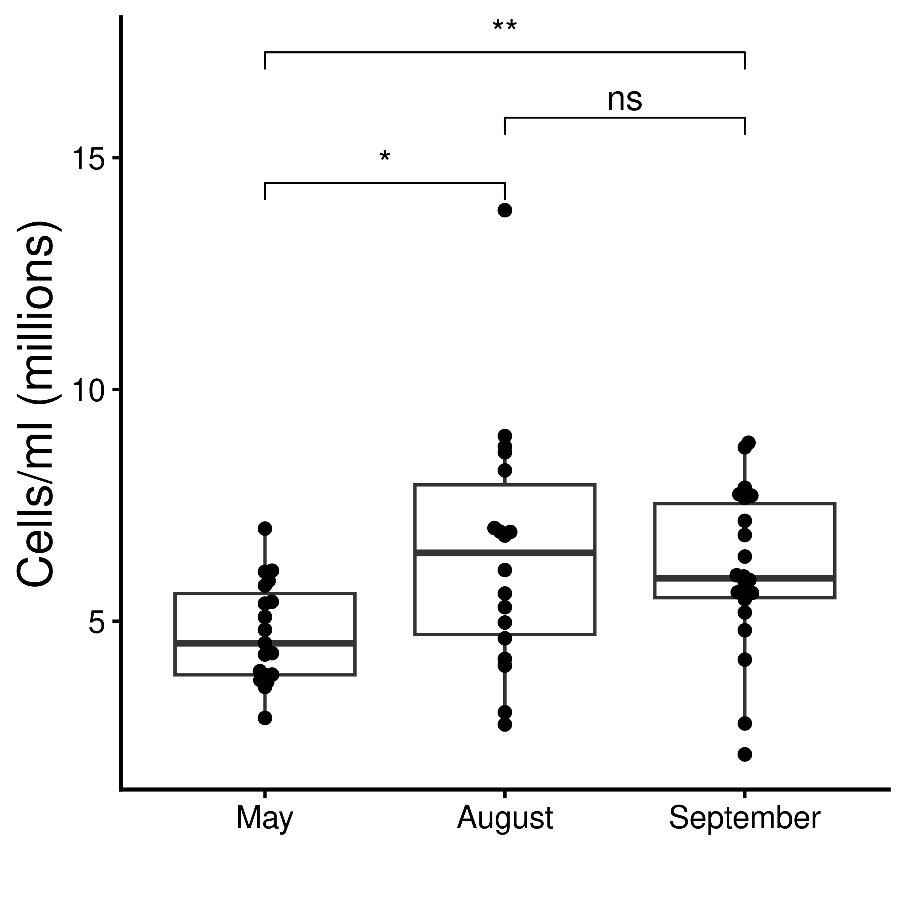{fig-align='center' width=1200}
:::

```{.r .cell-code}
meta_w_flow %>%
  filter(DNA_ID != "KH_D076", Depth_Class == "S") %>%
  mutate(Month = factor(Month, levels = c("May","August","September"))) %>%
  ggplot(aes(x = Month, y = total_chl_counts/1e6)) + 
  geom_boxplot() + 
  stat_compare_means(method = "wilcox", comparisons = list(c(1,2), c(2,3), c(1,3)), label = "p.signif") +
  ggbeeswarm::geom_beeswarm() +
  labs(x = "", y = "Chl+ Cells/ml (millions)")
```

::: {.cell-output-display}
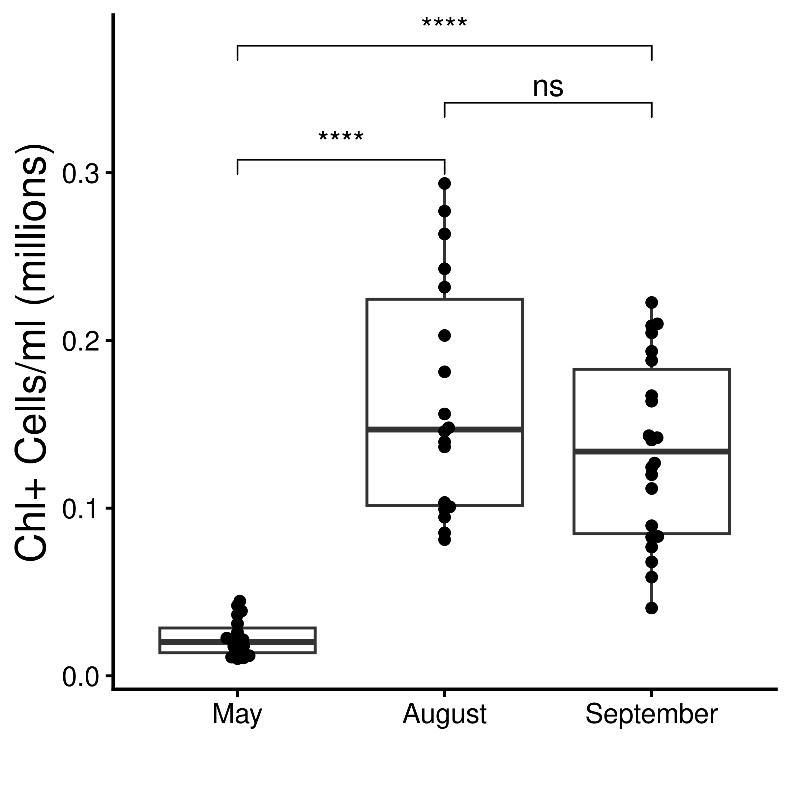{fig-align='center' width=1200}
:::

```{.r .cell-code}
meta_w_flow %>%
  filter(DNA_ID != "KH_D076", Depth_Class == "S") %>%
  mutate(Month = factor(Month, levels = c("May","August","September"))) %>%
  ggplot(aes(x = Month, y = pig_counts_chl_big/1e6)) + 
  geom_boxplot() + 
  stat_compare_means(method = "wilcox", comparisons = list(c(1,2), c(2,3), c(1,3)), label = "p.signif") +
  ggbeeswarm::geom_beeswarm() +
  labs(x = "", y = "Large Chl+Cells/ml (millions)")
```

::: {.cell-output-display}
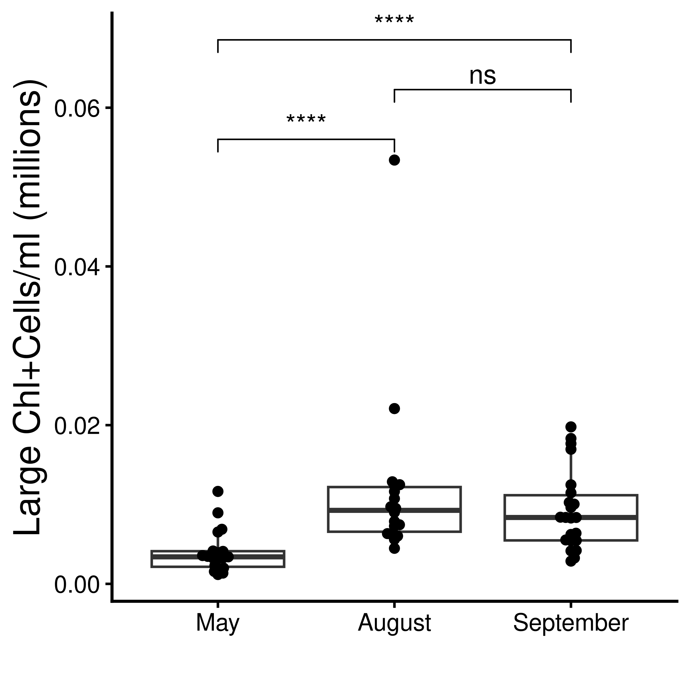{fig-align='center' width=1200}
:::
:::

::: {.cell layout-align="center"}

```{.r .cell-code}
meta_w_flow %>%
  filter(DNA_ID != "KH_D076", Depth_Class == "B") %>%
  mutate(Month = factor(Month, levels = c("May","August","September"))) %>%
  filter(Month!="May") %>%
  ggplot(aes(x = Basin, y = avg_cells_per_ml)) + 
  geom_boxplot() + 
  stat_compare_means(method = "wilcox", comparisons = list(c(1,2)), label = "p.signif") +
  scale_y_continuous(labels = scales::unit_format(unit = "M", scale = 1e-6), expand = expansion(mult = c(0,0.1))) + 
  ggbeeswarm::geom_beeswarm() +
  facet_wrap(~Month, scales = "free") + 
  theme(strip.text = element_blank(),
        axis.title = element_blank()) 
```

::: {.cell-output-display}
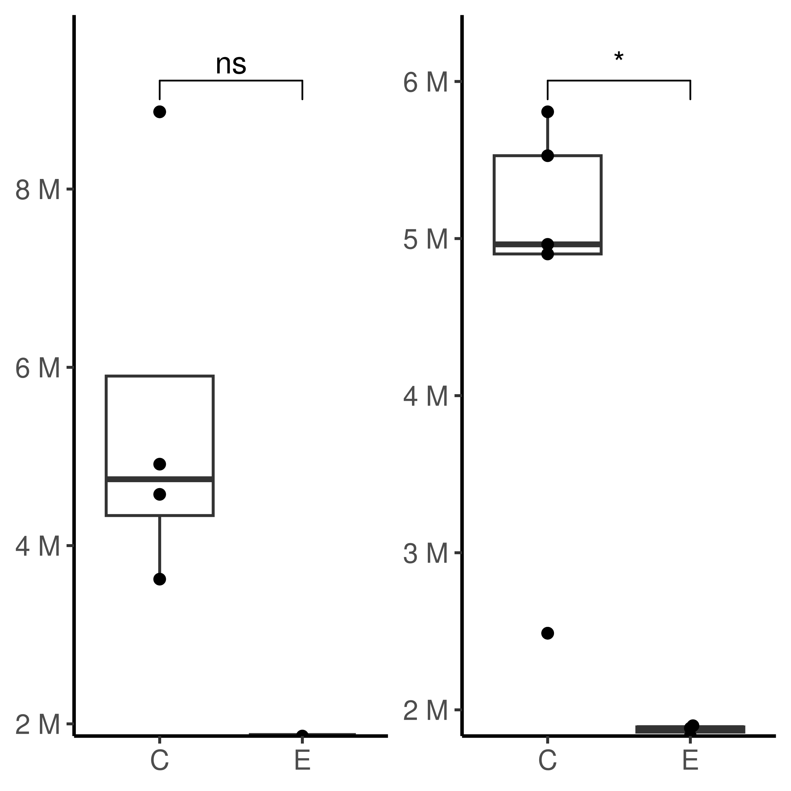{fig-align='center' width=2400}
:::

```{.r .cell-code}
meta_w_flow %>%
  filter(DNA_ID != "KH_D076", Depth_Class == "B") %>%
  mutate(Month = factor(Month, levels = c("May","August","September"))) %>%
   filter(Month!="May") %>%
  ggplot(aes(x = Basin, y = total_chl_counts)) + 
  geom_boxplot() + 
  stat_compare_means(method = "wilcox", comparisons = list(c(1,2)), label = "p.signif") +
  scale_y_continuous(labels = scales::unit_format(unit = "K", scale = 1e-3), expand = expansion(mult = c(0,0.1))) + 
  ggbeeswarm::geom_beeswarm() +
  facet_wrap(~Month, scales = "free") + 
  theme(strip.text = element_blank(),
        axis.title = element_blank()) 
```

::: {.cell-output-display}
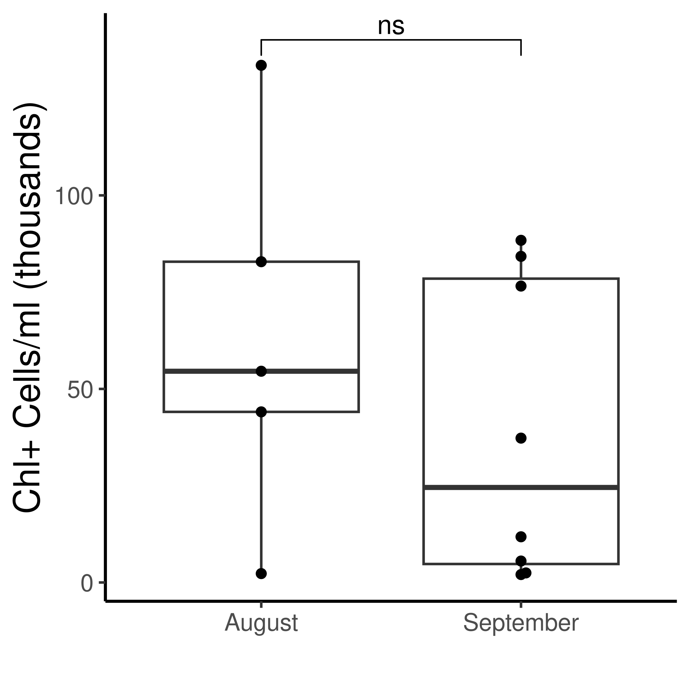{fig-align='center' width=2400}
:::

```{.r .cell-code}
meta_w_flow %>%
  filter(DNA_ID != "KH_D076", Depth_Class == "B") %>%
  mutate(Month = factor(Month, levels = c("May","August","September"))) %>%
   filter(Month!="May") %>%
  ggplot(aes(x = Basin, y = pig_counts_chl_big)) + 
  geom_boxplot() + 
  stat_compare_means(method = "wilcox", comparisons = list(c(1,2)), label = "p.signif") +
  scale_y_continuous(labels = scales::unit_format(unit = "K", scale = 1e-3), expand = expansion(mult = c(0,0.1))) + 
  ggbeeswarm::geom_beeswarm() +
  facet_wrap(~Month, scales = "free") + 
  theme(strip.text = element_blank(),
        axis.title = element_blank()) 
```

::: {.cell-output-display}
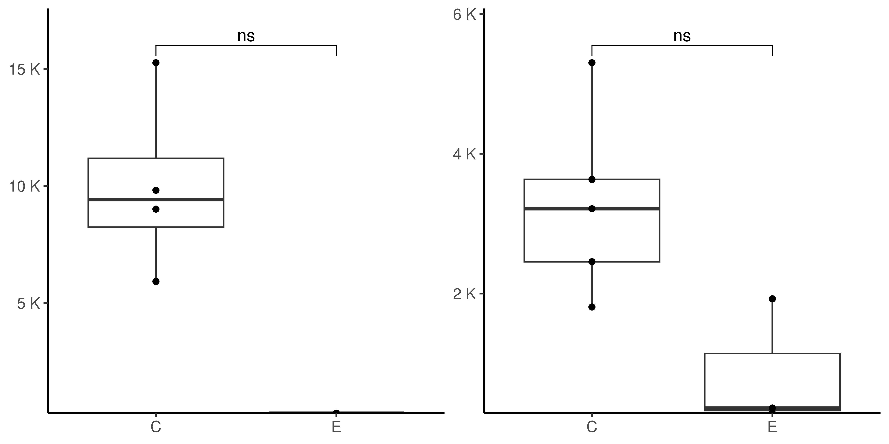{fig-align='center' width=2400}
:::
:::

::: {.cell layout-align="center"}

```{.r .cell-code}
meta_w_flow %>%
  filter(DNA_ID != "KH_D076", Depth_Class == "B") %>%
  mutate(Month = factor(Month, levels = c("May","August","September"))) %>%
  ggplot(aes(x = Month, y = avg_cells_per_ml/1e6)) + 
  geom_boxplot() + 
  stat_compare_means(method = "wilcox", comparisons = list(c(1,2), c(2,3), c(1,3)), label = "p.signif") +
  ggbeeswarm::geom_beeswarm() +
  labs(x = "", y = "Cells/ml (millions)")
```

::: {.cell-output-display}
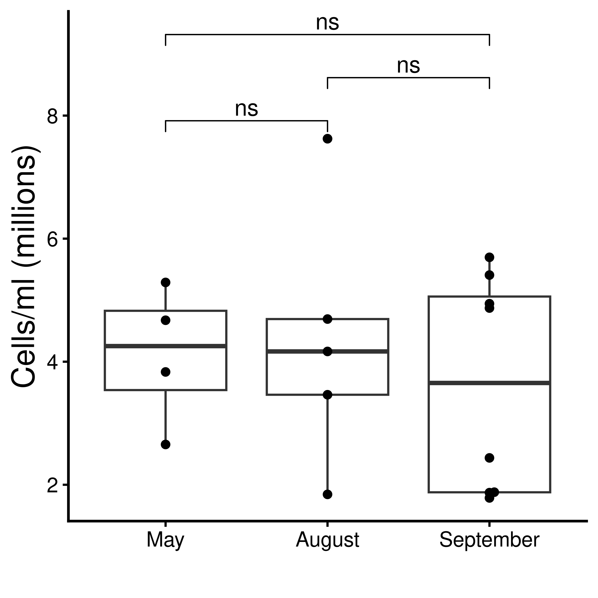{fig-align='center' width=1200}
:::

```{.r .cell-code}
meta_w_flow %>%
  filter(DNA_ID != "KH_D076", Depth_Class == "B") %>%
  mutate(Month = factor(Month, levels = c("May","August","September"))) %>%
  ggplot(aes(x = Month, y = total_chl_counts/1e6)) + 
  geom_boxplot() + 
  stat_compare_means(method = "wilcox", comparisons = list(c(1,2), c(2,3), c(1,3)), label = "p.signif") +
  ggbeeswarm::geom_beeswarm() +
  labs(x = "", y = "Chl+ Cells/ml (millions)")
```

::: {.cell-output-display}
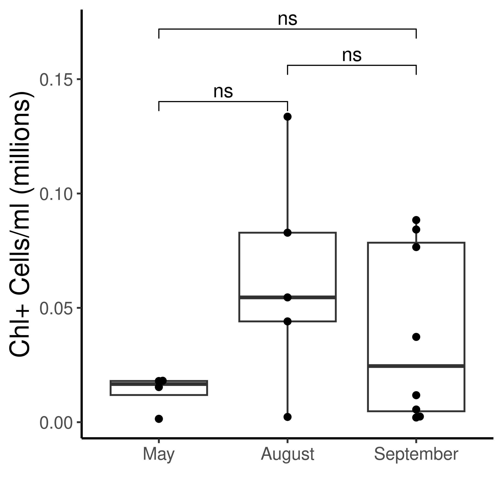{fig-align='center' width=1200}
:::

```{.r .cell-code}
meta_w_flow %>%
  filter(DNA_ID != "KH_D076", Depth_Class == "B") %>%
  mutate(Month = factor(Month, levels = c("May","August","September"))) %>%
  ggplot(aes(x = Month, y = pig_counts_chl_big/1e6)) + 
  geom_boxplot() + 
  stat_compare_means(method = "wilcox", comparisons = list(c(1,2), c(2,3), c(1,3)), label = "p.signif") +
  ggbeeswarm::geom_beeswarm() +
  labs(x = "", y = "Large Chl+Cells/ml (millions)")
```

::: {.cell-output-display}
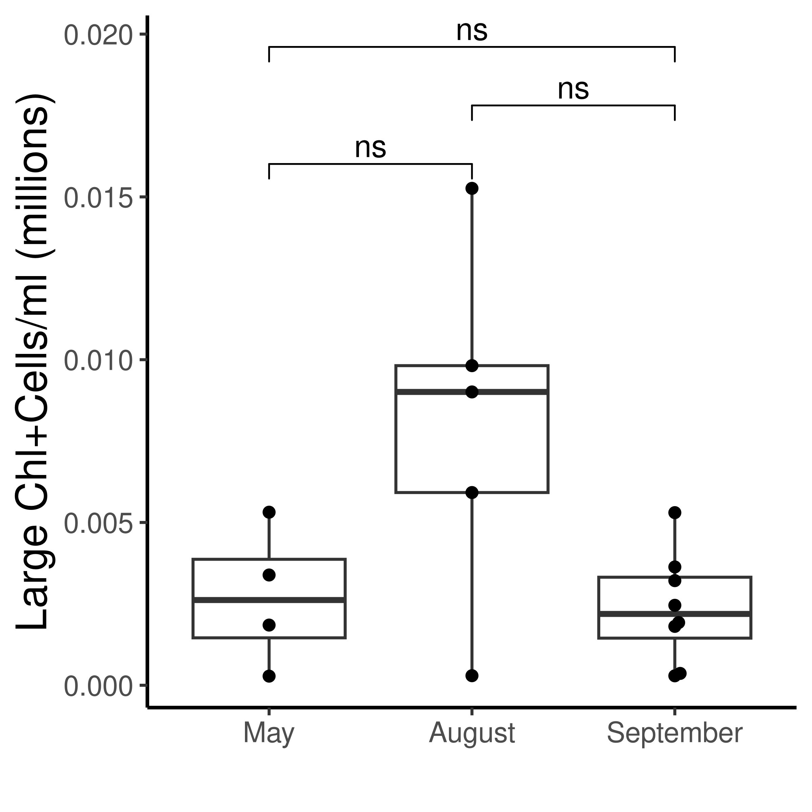{fig-align='center' width=1200}
:::
:::

::: {.cell layout-align="center"}

```{.r .cell-code}
meta_w_flow %>%
  filter(DNA_ID != "KH_D076", Depth_Class == "S", Month != "May") %>%
  mutate(Month = factor(Month, levels = c("August","September")),
         Basin = factor(Basin, levels = c("W","C","E"))) %>%
  ggplot(aes(x = Basin, y = avg_cells_per_ml)) + 
    stat_summary(geom = "errorbar", fun.min = mean, fun.max = mean, width = 0.5, linewidth = 1)+ 
  stat_summary(geom = "errorbar", fun.min = \(x)mean(x)-sd(x), fun.max = \(x)mean(x) + sd(x), width = 0.3, linewidth = .25)+ 
  scale_y_continuous(labels = scales::unit_format(unit = "M", scale = 1e-6), expand = expansion(mult = c(0,0.1))) + 
  stat_compare_means(method = "wilcox", comparisons = list(c(1,2), c(2,3), c(1,3)), label = "p.signif") +
  ggbeeswarm::geom_beeswarm() +
  labs(x = "Basin") + 
  facet_wrap(~Month, scales = "free") + 
  theme(strip.text = element_blank(),
        axis.title = element_blank()) 
```

::: {.cell-output-display}
{fig-align='center' width=1200}
:::

```{.r .cell-code}
meta_w_flow %>%
  filter(DNA_ID != "KH_D076", Depth_Class == "S", Month != "May") %>%
  mutate(Month = factor(Month, levels = c("August","September")),
         Basin = factor(Basin, levels = c("W","C","E"))) %>%
  ggplot(aes(x = Basin, y = total_chl_counts)) + 
  stat_summary(geom = "errorbar", fun.min = mean, fun.max = mean, width = 0.5, linewidth = 1)+ 
  stat_summary(geom = "errorbar", fun.min = \(x)mean(x)-sd(x), fun.max = \(x)mean(x) + sd(x), width = 0.3, linewidth = .25)+ 
  scale_y_continuous(labels = scales::unit_format(unit = "M", scale = 1e-6), expand = expansion(mult = c(0,0.1))) + 
  stat_compare_means(method = "wilcox", comparisons = list(c(1,2), c(2,3), c(1,3)), label = "p.signif") +
  ggbeeswarm::geom_beeswarm() +
  labs(x = "Basin") + 
  facet_wrap(~Month, scales = "free") + 
  theme(strip.text = element_blank(),
        axis.title = element_blank()) 
```

::: {.cell-output-display}
{fig-align='center' width=1200}
:::

```{.r .cell-code}
meta_w_flow %>%
  filter(DNA_ID != "KH_D076", Depth_Class == "S", Month != "May") %>%
  mutate(Month = factor(Month, levels = c("August","September")),
         Basin = factor(Basin, levels = c("W","C","E"))) %>%
  ggplot(aes(x = Basin, y = pig_counts_chl_big)) + 
    stat_summary(geom = "errorbar", fun.min = mean, fun.max = mean, width = 0.5, linewidth = 1)+ 
  stat_summary(geom = "errorbar", fun.min = \(x)mean(x)-sd(x), fun.max = \(x)mean(x) + sd(x), width = 0.3, linewidth = .25)+ 
  scale_y_continuous(labels = scales::unit_format(unit = "K", scale = 1e-3), expand = expansion(mult = c(0,0.1))) + 
  stat_compare_means(method = "wilcox", comparisons = list(c(1,2), c(2,3), c(1,3)), label = "p.signif") +
  ggbeeswarm::geom_beeswarm() +
  labs(x = "Basin") + 
  facet_wrap(~Month, scales = "free") + 
  theme(strip.text = element_blank(),
        axis.title = element_blank()) 
```

::: {.cell-output-display}
{fig-align='center' width=1200}
:::

```{.r .cell-code}
ggsave("test.png", width = 4, height = 2)

save(meta_w_flow, file = "data/06_Flow_Cytometry/meta_w_flow.RData")
```
:::


# Mapping Cell Counts

#ONLY DO THIS ON LOCAL


::: {.cell layout-align="center"}

```{.r .cell-code}
pacman::p_load(sf, terra, install = FALSE)

# Define some shapes and objects

raw_erie <- read_sf("data/spatial_imports/hydro_p_LakeErie/hydro_p_LakeErie.shp") %>%
  st_transform(crs = "EPSG:4326")

erie_outline <- raw_erie %>%
  st_union()

flow_sf <- meta_w_flow %>% dplyr::filter(!is.na(Longitude)) %>% 
  st_as_sf(coords = c("Longitude","Latitude"), crs = "EPSG:4326") %>%
  dplyr::filter(DNA_ID != "KH_D076") %>%
  mutate(Month = factor(Month, levels = c("May","August","September") ))
```
:::

::: {.cell layout-align="center" fig.widh='10'}

```{.r .cell-code}
flow_sf %>%
  dplyr::filter(Depth_Class == "S", Month != "May") %>%
  ggplot() + 
  geom_sf(data = erie_outline, fill = NA) + 
  geom_sf(aes(color = avg_cells_per_ml), size = 5, alpha = 1) + 
  scale_color_distiller(palette = "Spectral", na.value = "white", labels = scales::unit_format(unit = "M", scale = 1e-6)) + 
  labs(color = "Cells/ml") + 
  facet_wrap(~Month) + 
  theme(axis.line = element_blank(),
        axis.text = element_blank(),
        axis.ticks = element_blank(),
        strip.text = element_blank())
```

::: {.cell-output-display}
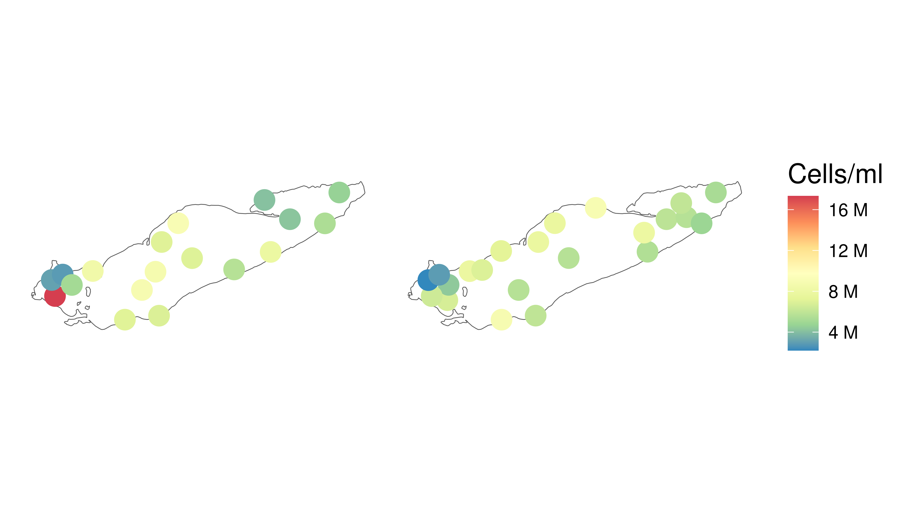{fig-align='center' width=2100}
:::

```{.r .cell-code}
flow_sf %>%
  dplyr::filter(Depth_Class == "S", Month != "May") %>%
  ggplot() + 
  geom_sf(data = erie_outline, fill = NA) + 
  geom_sf(aes(color = total_chl_counts), size = 5, alpha = 1) + 
  scale_color_distiller(palette = "PRGn", na.value = "white", direction = 1, labels = scales::unit_format(unit = "M", scale = 1e-6)) + 
  labs(color = "Chl+ Cells/ml") + 
  facet_wrap(~Month) + 
  theme(axis.line = element_blank(),
        axis.text = element_blank(),
        axis.ticks = element_blank(),
        strip.text = element_blank())
```

::: {.cell-output-display}
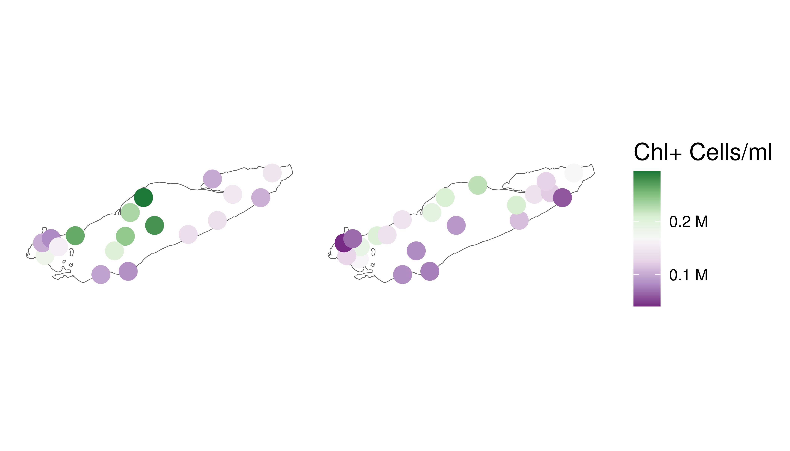{fig-align='center' width=2100}
:::

```{.r .cell-code}
flow_sf %>%
  dplyr::filter(Depth_Class == "S", Month != "May") %>%
  ggplot() + 
  geom_sf(data = erie_outline, fill = NA) + 
  geom_sf(aes(color = pig_counts_chl_big), size = 5, alpha = 1) + 
  scale_color_distiller(palette = "Greens", na.value = "white", direction = 1, labels = scales::unit_format(unit = "K", scale = 1e-3)) + 
  labs(color = "Large\nChl+ Cells/ml") + 
  facet_wrap(~Month) + 
  theme(axis.line = element_blank(),
        axis.text = element_blank(),
        axis.ticks = element_blank(),
        strip.text = element_blank())
```

::: {.cell-output-display}
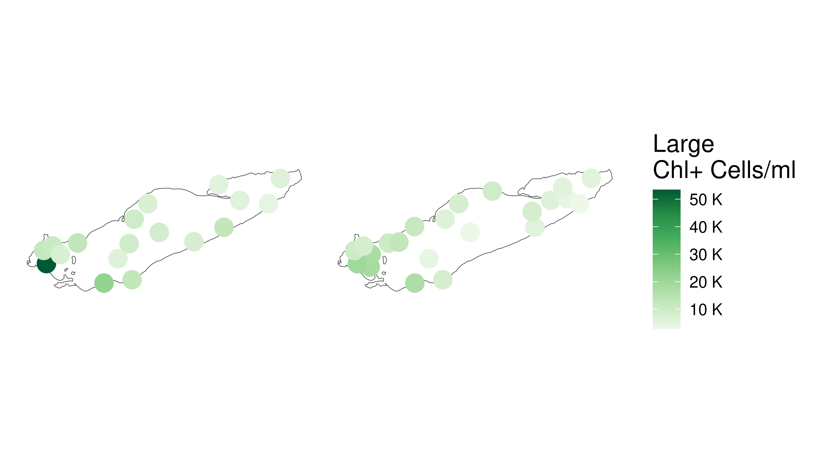{fig-align='center' width=2100}
:::

```{.r .cell-code}
flow_sf %>%
  dplyr::filter(Depth_Class == "S", Month != "May") %>%
  ggplot() + 
  geom_sf(data = erie_outline, fill = NA) + 
  geom_sf(aes(color = rsg_pos_per_ml), size = 5, alpha = 1) + 
  scale_color_distiller(palette = "Spectral", na.value = "white", labels = scales::unit_format(unit = "M", scale = 1e-6)) + 
  labs(color = "RSG+\ncells/ml") + 
  facet_wrap(~Month) + 
  theme(axis.line = element_blank(),
        axis.text = element_blank(),
        axis.ticks = element_blank(),
        strip.text = element_blank())
```

::: {.cell-output-display}
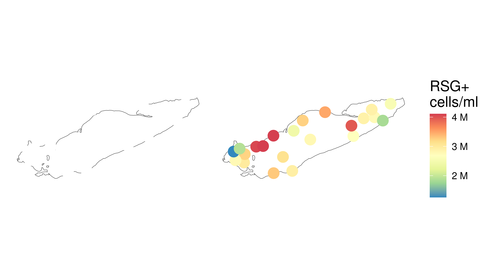{fig-align='center' width=2100}
:::

```{.r .cell-code}
flow_sf %>%
  dplyr::filter(Depth_Class == "S", Month != "May") %>%
  ggplot() + 
  geom_sf(data = erie_outline, fill = NA) + 
  geom_sf(aes(color = rsg_perc_pos), size = 5, alpha = 1) + 
  scale_color_distiller(palette = "Spectral", na.value = "white") + 
  labs(color = "% RSG+") + 
  facet_wrap(~Month) + 
  theme(axis.line = element_blank(),
        axis.text = element_blank(),
        axis.ticks = element_blank(),
        strip.text = element_blank())
```

::: {.cell-output-display}
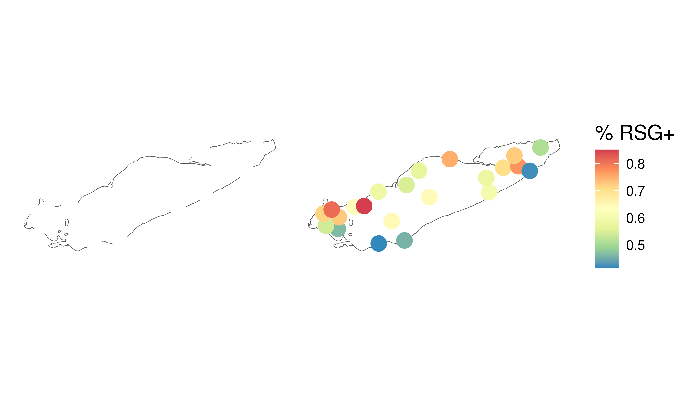{fig-align='center' width=2100}
:::
:::

::: {.cell layout-align="center" figure.width='6' figure.height='4'}

```{.r .cell-code}
flow_sf %>%
  dplyr::filter(Depth_Class == "S", Month == "September") %>%
  ggplot() + 
  geom_sf(data = erie_outline, fill = NA) + 
  geom_sf(aes(color = het_rsg_per_ml), size = 5, alpha = 1) + 
  scale_color_distiller(palette = "Spectral", na.value = "white", labels = scales::unit_format(unit = "M", scale = 1e-6)) + 
  labs(color = "Heterotrophic\nRSG+ cells/ml") + 
  facet_wrap(~Month) + 
  theme(axis.line = element_blank(),
        axis.text = element_blank(),
        axis.ticks = element_blank(),
        strip.text = element_blank())
```

::: {.cell-output-display}
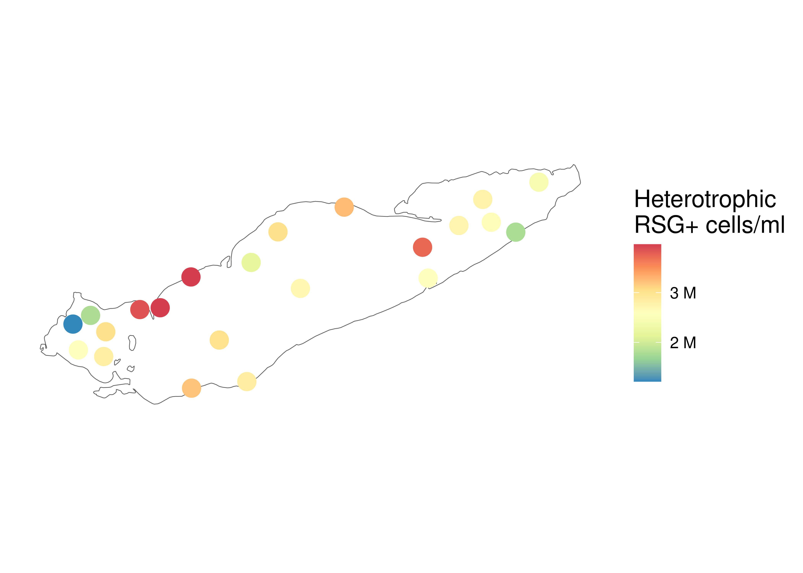{fig-align='center' width=2100}
:::

```{.r .cell-code}
flow_sf %>%
  dplyr::filter(Depth_Class == "S", Month == "September") %>%
  ggplot() + 
  geom_sf(data = erie_outline, fill = NA) + 
  geom_sf(aes(color = rsg_pos_per_ml - het_rsg_per_ml), size = 5, alpha = 1) + 
  scale_color_distiller(palette = "Spectral", na.value = "white", labels = scales::unit_format(unit = "M", scale = 1e-6)) + 
  labs(color = "Cyanobacterial\nRSG+ cells/ml") + 
  facet_wrap(~Month) + 
  theme(axis.line = element_blank(),
        axis.text = element_blank(),
        axis.ticks = element_blank(),
        strip.text = element_blank())
```

::: {.cell-output-display}
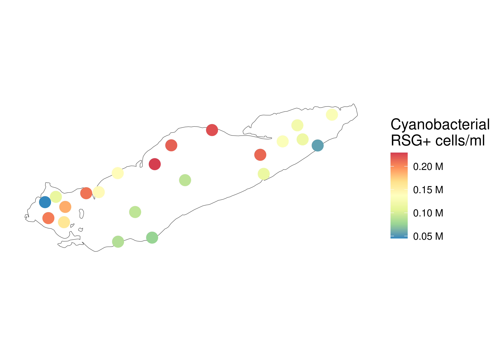{fig-align='center' width=2100}
:::

```{.r .cell-code}
flow_sf %>%
  dplyr::filter(Depth_Class == "S", Month == "September") %>%
  ggplot() + 
  geom_sf(data = erie_outline, fill = NA) + 
  geom_sf(aes(color = het_rsg_perc_pos), size = 5, alpha = 1) + 
  scale_color_distiller(palette = "Spectral", na.value = "white") + 
  labs(color = "Heterotrophic\n% RSG+") + 
  facet_wrap(~Month) + 
  theme(axis.line = element_blank(),
        axis.text = element_blank(),
        axis.ticks = element_blank(),
        strip.text = element_blank())
```

::: {.cell-output-display}
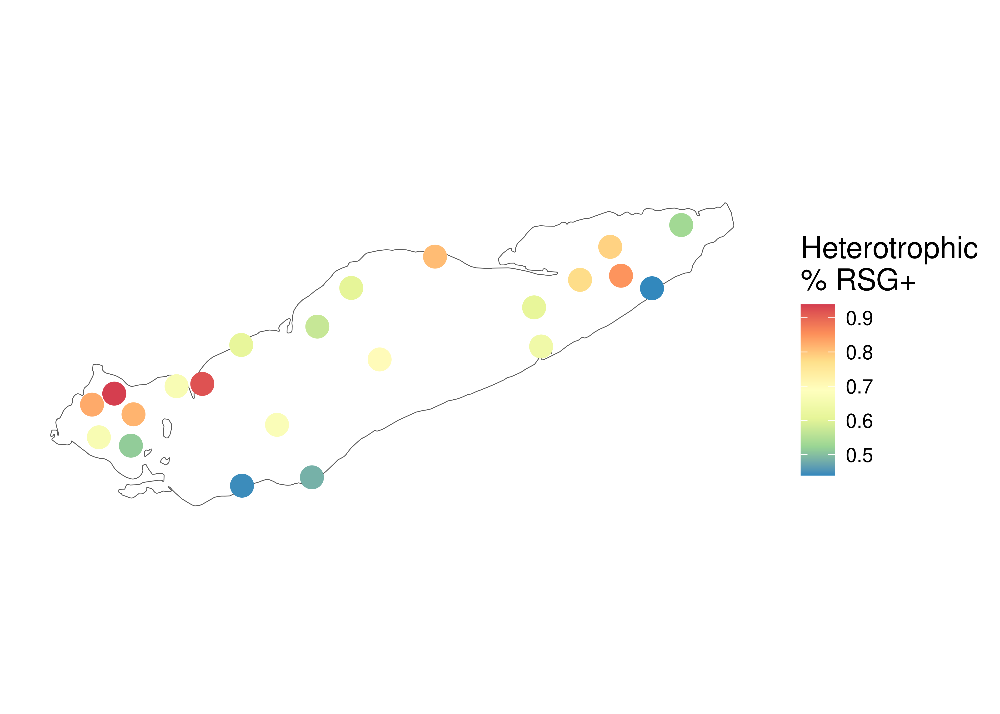{fig-align='center' width=2100}
:::

```{.r .cell-code}
flow_sf %>%
  dplyr::filter(Depth_Class == "S", Month == "September") %>%
  ggplot() + 
  geom_sf(data = erie_outline, fill = NA) + 
  geom_sf(aes(color = (rsg_pos_per_ml - het_rsg_per_ml) / (rsg_total_per_ml - (het_rsg_per_ml/het_rsg_perc_pos))), size = 5, alpha = 1) + 
  scale_color_distiller(palette = "Spectral", na.value = "white") + 
  labs(color = "Cyanobacterial\n% RSG+") + 
  facet_wrap(~Month) + 
  theme(axis.line = element_blank(),
        axis.text = element_blank(),
        axis.ticks = element_blank(),
        strip.text = element_blank())
```

::: {.cell-output-display}
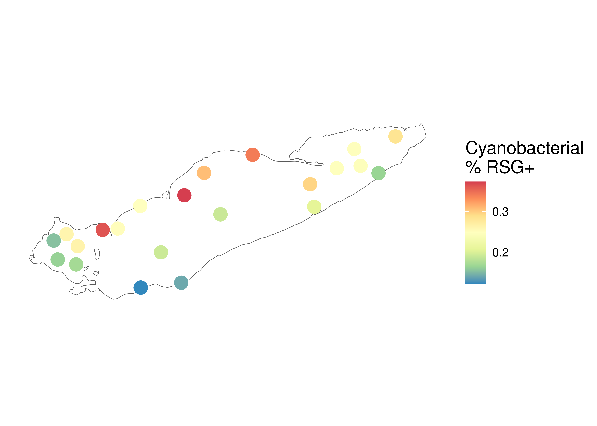{fig-align='center' width=2100}
:::
:::

::: {.cell layout-align="center" fig.widh='10'}

```{.r .cell-code}
flow_sf %>%
  dplyr::filter(Depth_Class == "B", Month != "May") %>%
  ggplot() + 
  geom_sf(data = erie_outline, fill = NA) + 
  geom_sf(aes(color = avg_cells_per_ml), size = 5, alpha = 1) + 
  scale_color_distiller(palette = "Spectral", na.value = "white", labels = scales::unit_format(unit = "M", scale = 1e-6)) + 
  labs(color = "Cells/ml") + 
  facet_wrap(~Month) + 
  theme(axis.line = element_blank(),
        axis.text = element_blank(),
        axis.ticks = element_blank(),
        strip.text = element_blank())
```

::: {.cell-output-display}
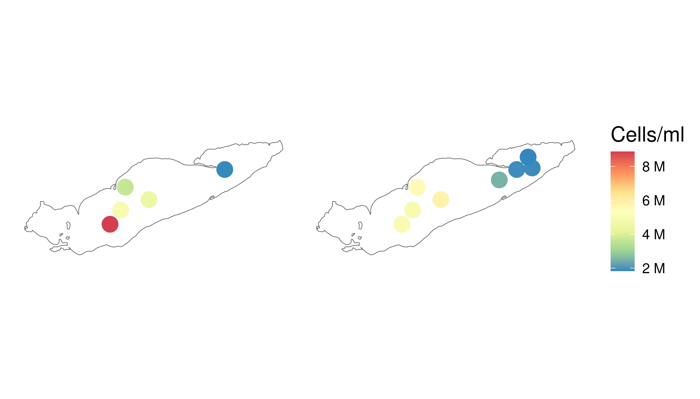{fig-align='center' width=2100}
:::

```{.r .cell-code}
flow_sf %>%
  dplyr::filter(Depth_Class == "B", Month != "May") %>%
  ggplot() + 
  geom_sf(data = erie_outline, fill = NA) + 
  geom_sf(aes(color = total_chl_counts), size = 5, alpha = 1) + 
  scale_color_distiller(palette = "PRGn", na.value = "white", direction = 1, labels = scales::unit_format(unit = "K", scale = 1e-3)) + 
  labs(color = "Chl+ Cells/ml") + 
  facet_wrap(~Month) + 
  theme(axis.line = element_blank(),
        axis.text = element_blank(),
        axis.ticks = element_blank(),
        strip.text = element_blank())
```

::: {.cell-output-display}
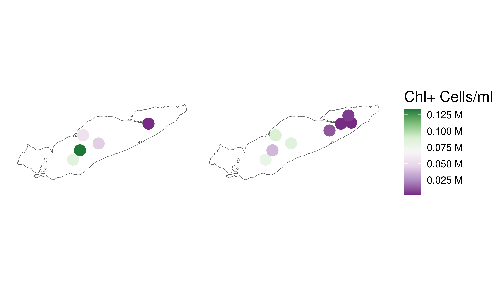{fig-align='center' width=2100}
:::

```{.r .cell-code}
flow_sf %>%
  dplyr::filter(Depth_Class == "B", Month != "May") %>%
  ggplot() + 
  geom_sf(data = erie_outline, fill = NA) + 
  geom_sf(aes(color = pig_counts_chl_big), size = 5, alpha = 1) + 
  scale_color_distiller(palette = "Greens", na.value = "white", direction = 1, labels = scales::unit_format(unit = "K", scale = 1e-3)) + 
  labs(color = "Large\nChl+ Cells/ml") + 
  facet_wrap(~Month) + 
  theme(axis.line = element_blank(),
        axis.text = element_blank(),
        axis.ticks = element_blank(),
        strip.text = element_blank())
```

::: {.cell-output-display}
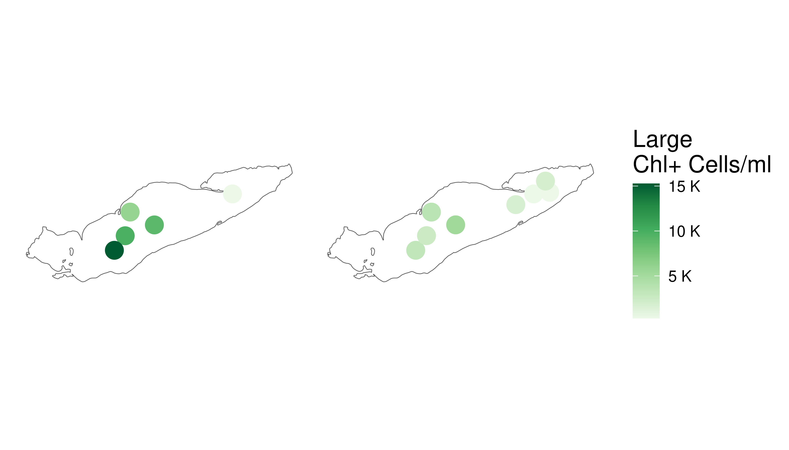{fig-align='center' width=2100}
:::

```{.r .cell-code}
flow_sf %>%
  dplyr::filter(Depth_Class == "B", Month != "May") %>%
  ggplot() + 
  geom_sf(data = erie_outline, fill = NA) + 
  geom_sf(aes(color = rsg_pos_per_ml), size = 5, alpha = 1) + 
  scale_color_distiller(palette = "Spectral", na.value = "white", labels = scales::unit_format(unit = "M", scale = 1e-6)) + 
  labs(color = "RSG+\ncells/ml") + 
  facet_wrap(~Month) + 
  theme(axis.line = element_blank(),
        axis.text = element_blank(),
        axis.ticks = element_blank(),
        strip.text = element_blank())
```

::: {.cell-output-display}
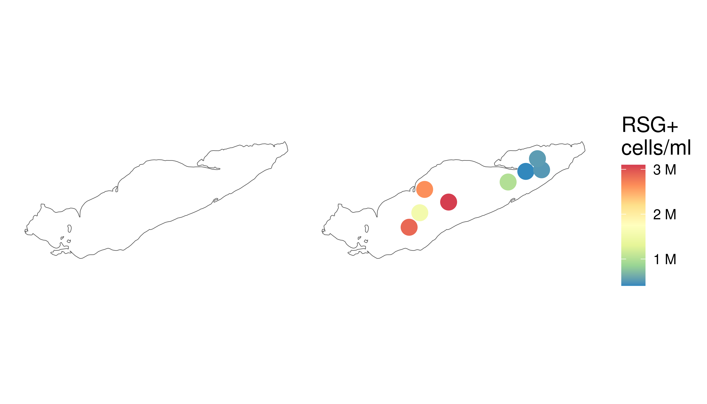{fig-align='center' width=2100}
:::

```{.r .cell-code}
flow_sf %>%
  dplyr::filter(Depth_Class == "B", Month != "May") %>%
  ggplot() + 
  geom_sf(data = erie_outline, fill = NA) + 
  geom_sf(aes(color = rsg_perc_pos), size = 5, alpha = 1) + 
  scale_color_distiller(palette = "Spectral", na.value = "white") + 
  labs(color = "% RSG+") + 
  facet_wrap(~Month) + 
  theme(axis.line = element_blank(),
        axis.text = element_blank(),
        axis.ticks = element_blank(),
        strip.text = element_blank())
```

::: {.cell-output-display}
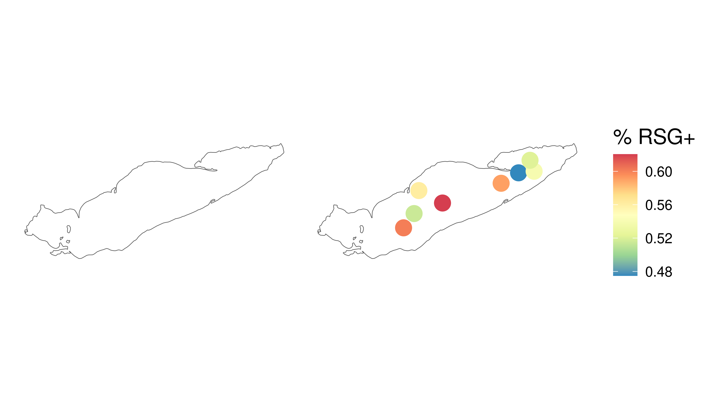{fig-align='center' width=2100}
:::
:::

::: {.cell layout-align="center"}

```{.r .cell-code}
bottom_sf <- flow_sf %>%
  dplyr::filter(Depth_Class == "B")

shift_bottom_sf <- bottom_sf

st_geometry(shift_bottom_sf) <- st_geometry(bottom_sf) + c(.06,-.03)

shift_bottom_sf <- st_set_crs(shift_bottom_sf, st_crs(bottom_sf))

flow_sf %>%
  dplyr::filter(Depth_Class == "S", Month != "May") %>%
  ggplot() + 
  geom_sf(data = erie_outline, fill = NA) + 
  geom_sf(data = filter(shift_bottom_sf, Month != "May"), aes(color = avg_cells_per_ml), size = 5, alpha = 1) + 
  geom_sf(aes(color = avg_cells_per_ml), size = 5, alpha = 1) + 
  scale_color_distiller(palette = "Spectral", na.value = "white", labels = scales::unit_format(unit = "M", scale = 1e-6)) + 
  labs(color = "Cells/ml") + 
  facet_wrap(~Month) + 
  theme(axis.line = element_blank(),
        axis.text = element_blank(),
        axis.ticks = element_blank(),
        strip.text = element_blank())
```

::: {.cell-output-display}
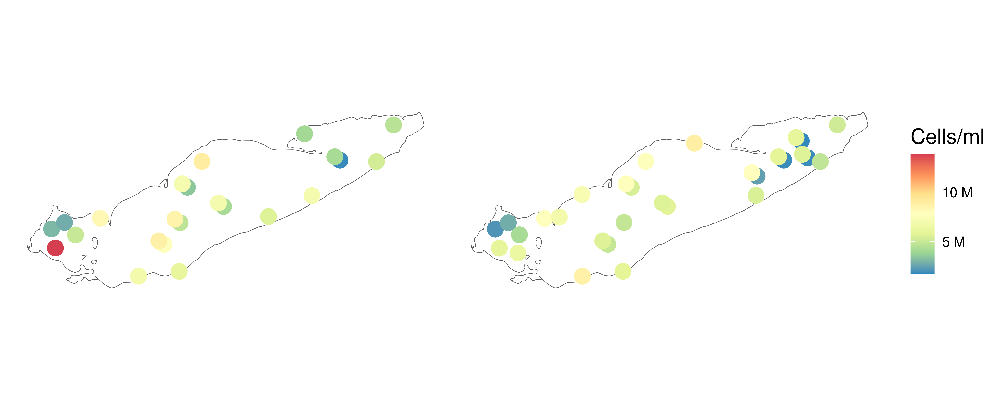{fig-align='center' width=3000}
:::

```{.r .cell-code}
flow_sf %>%
  dplyr::filter(Depth_Class == "S", Month != "May") %>%
  ggplot() + 
  geom_sf(data = erie_outline, fill = NA) + 
  geom_sf(data = filter(shift_bottom_sf, Month != "May"), aes(color = total_chl_counts), size = 5, alpha = 1) + 
  geom_sf(aes(color = total_chl_counts), size = 5, alpha = 1) + 
  scale_color_distiller(palette = "PRGn", na.value = "white", direction = 1, labels = scales::unit_format(unit = "M", scale = 1e-6)) + 
  labs(color = "Chl+ Cells/ml") + 
  facet_wrap(~Month) + 
  theme(axis.line = element_blank(),
        axis.text = element_blank(),
        axis.ticks = element_blank(),
        strip.text = element_blank())
```

::: {.cell-output-display}
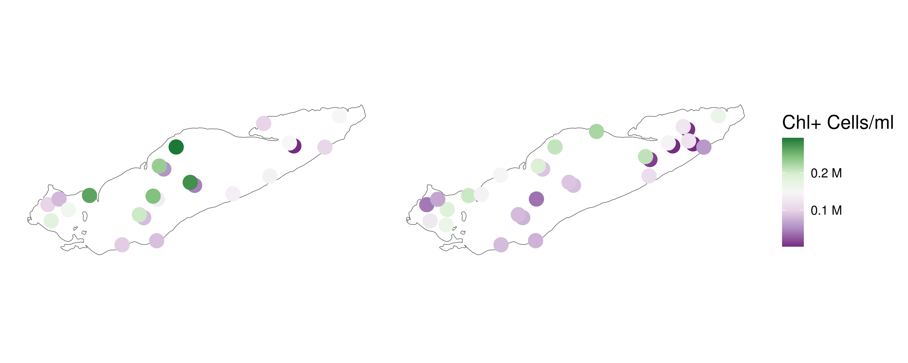{fig-align='center' width=3000}
:::

```{.r .cell-code}
flow_sf %>%
  dplyr::filter(Depth_Class == "S", Month != "May") %>%
  ggplot() + 
  geom_sf(data = erie_outline, fill = NA) + 
  geom_sf(data = filter(shift_bottom_sf, Month != "May"), aes(color = pig_counts_chl_big), size = 5, alpha = 1) + 
  geom_sf(aes(color = pig_counts_chl_big), size = 5, alpha = 1) + 
  scale_color_distiller(palette = "Greens", na.value = "white", direction = 1, labels = scales::unit_format(unit = "K", scale = 1e-3)) + 
  labs(color = "Large\nChl+ Cells/ml") + 
  facet_wrap(~Month) + 
  theme(axis.line = element_blank(),
        axis.text = element_blank(),
        axis.ticks = element_blank(),
        strip.text = element_blank())
```

::: {.cell-output-display}
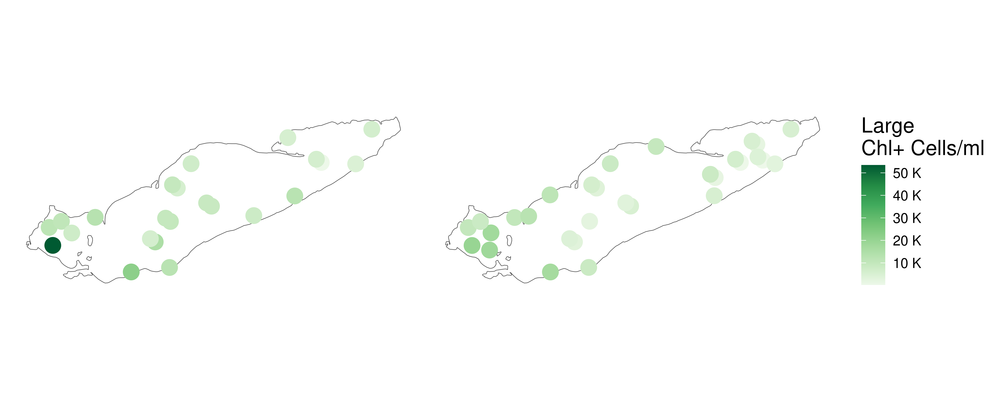{fig-align='center' width=3000}
:::

```{.r .cell-code}
flow_sf %>%
  dplyr::filter(Depth_Class == "S", Month != "May") %>%
  ggplot() + 
  geom_sf(data = erie_outline, fill = NA) + 
  geom_sf(data = filter(shift_bottom_sf, Month != "May"), aes(color = rsg_pos_per_ml), size = 5, alpha = 1) + 
  geom_sf(aes(color = rsg_pos_per_ml), size = 5, alpha = 1) + 
  scale_color_distiller(palette = "Spectral", na.value = "white", labels = scales::unit_format(unit = "M", scale = 1e-6)) + 
  labs(color = "RSG+\ncells/ml") + 
  facet_wrap(~Month) + 
  theme(axis.line = element_blank(),
        axis.text = element_blank(),
        axis.ticks = element_blank(),
        strip.text = element_blank())
```

::: {.cell-output-display}
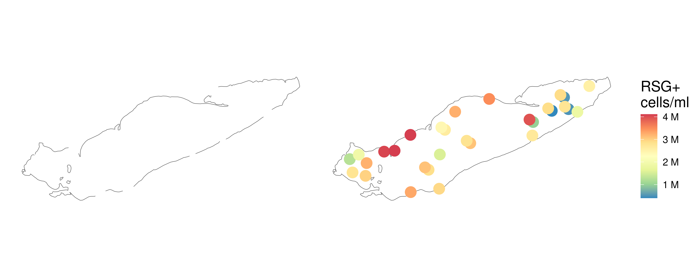{fig-align='center' width=3000}
:::

```{.r .cell-code}
flow_sf %>%
  dplyr::filter(Depth_Class == "S", Month != "May") %>%
  ggplot() + 
  geom_sf(data = erie_outline, fill = NA) + 
  geom_sf(data = filter(shift_bottom_sf, Month != "May"), aes(color = rsg_perc_pos), size = 5, alpha = 1) + 
  geom_sf(aes(color = rsg_perc_pos), size = 5, alpha = 1) + 
  scale_color_distiller(palette = "Spectral", na.value = "white") + 
  labs(color = "% RSG+") + 
  facet_wrap(~Month) + 
  theme(axis.line = element_blank(),
        axis.text = element_blank(),
        axis.ticks = element_blank(),
        strip.text = element_blank())
```

::: {.cell-output-display}
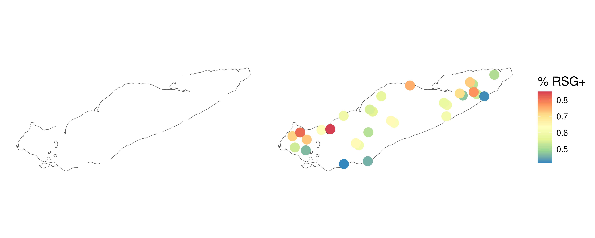{fig-align='center' width=3000}
:::

```{.r .cell-code}
flow_sf %>%
  dplyr::filter(Depth_Class == "S", Month != "May") %>%
  ggplot() + 
  geom_sf(data = erie_outline, fill = NA) + 
  geom_sf(aes(color = tp_ug_p_l), size = 5, alpha = 1) + 
  scale_color_distiller(palette = "Spectral", na.value = "white") + 
  labs(color = "TP (ug P/L)") + 
  facet_wrap(~Month) + 
  theme(axis.line = element_blank(),
        axis.text = element_blank(),
        axis.ticks = element_blank(),
        strip.text = element_blank())
```

::: {.cell-output-display}
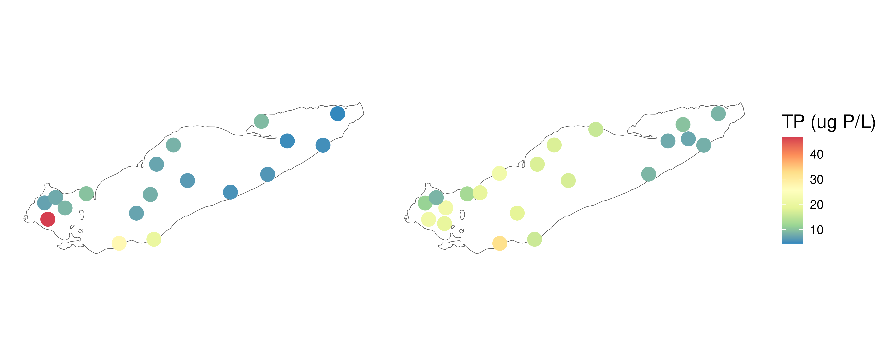{fig-align='center' width=3000}
:::

```{.r .cell-code}
ggsave("test.png", width = 10, height = 4)

flow_sf %>%
  dplyr::filter(Depth_Class == "S", Month != "May") %>%
  ggplot() + 
  geom_sf(data = erie_outline, fill = NA) + 
  geom_sf(aes(color = tn_ug_n_l), size = 5, alpha = 1) + 
  scale_color_distiller(palette = "Spectral", na.value = "white") + 
  labs(color = "TN (ug N/L)") + 
  facet_wrap(~Month) + 
  theme(axis.line = element_blank(),
        axis.text = element_blank(),
        axis.ticks = element_blank(),
        strip.text = element_blank())
```

::: {.cell-output-display}
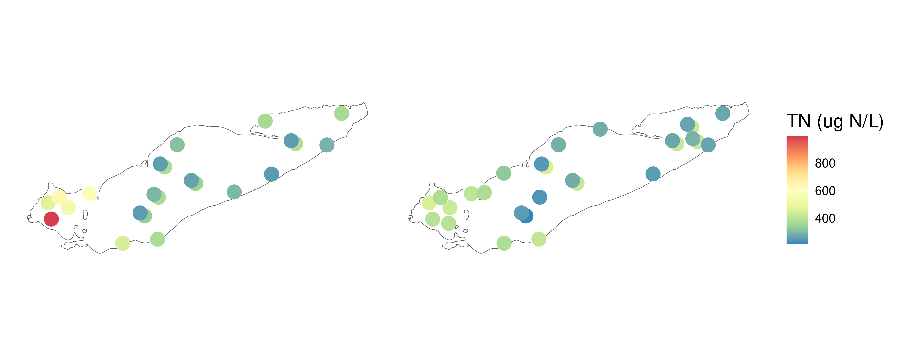{fig-align='center' width=3000}
:::

```{.r .cell-code}
flow_sf %>%
  dplyr::filter(Depth_Class == "S", Month != "May") %>%
  ggplot() + 
  geom_sf(data = erie_outline, fill = NA) + 
  geom_sf(data = filter(shift_bottom_sf, Month != "May"), aes(color = pH), size = 5, alpha = 1) + 
  geom_sf(aes(color = pH), size = 5, alpha = 1) + 
  scale_color_distiller(palette = "Spectral", na.value = "white") + 
  labs(color = "pH") + 
  facet_wrap(~Month) + 
  theme(axis.line = element_blank(),
        axis.text = element_blank(),
        axis.ticks = element_blank(),
        strip.text = element_blank())
```

::: {.cell-output-display}
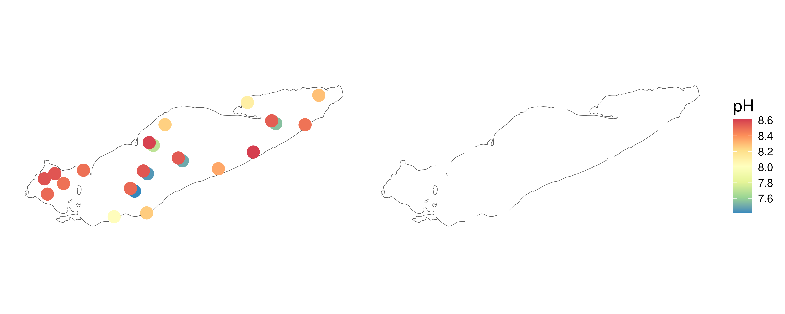{fig-align='center' width=3000}
:::
:::

::: {.cell layout-align="center"}

```{.r .cell-code}
bottom_sf <- flow_sf %>%
  dplyr::filter(Depth_Class == "B", Month == "May")

shift_bottom_sf <- bottom_sf

st_geometry(shift_bottom_sf) <- st_geometry(bottom_sf) + c(.06,-.03)

shift_bottom_sf <- st_set_crs(shift_bottom_sf, st_crs(bottom_sf))

flow_sf %>%
  dplyr::filter(Depth_Class == "S", Month == "May") %>%
  ggplot() + 
  geom_sf(data = erie_outline, fill = NA) + 
  geom_sf(data = shift_bottom_sf, aes(color = avg_cells_per_ml/1e6), size = 5, alpha = 1) + 
  geom_sf(aes(color = avg_cells_per_ml/1e6), size = 5, alpha = 1) + 
  scale_color_distiller(palette = "Spectral", na.value = "white") + 
  labs(color = "Cells/ml\n(millions)") + 
  theme(axis.line = element_blank(),
        axis.text = element_blank(),
        axis.ticks = element_blank(),
        strip.text = element_blank())
```

::: {.cell-output-display}
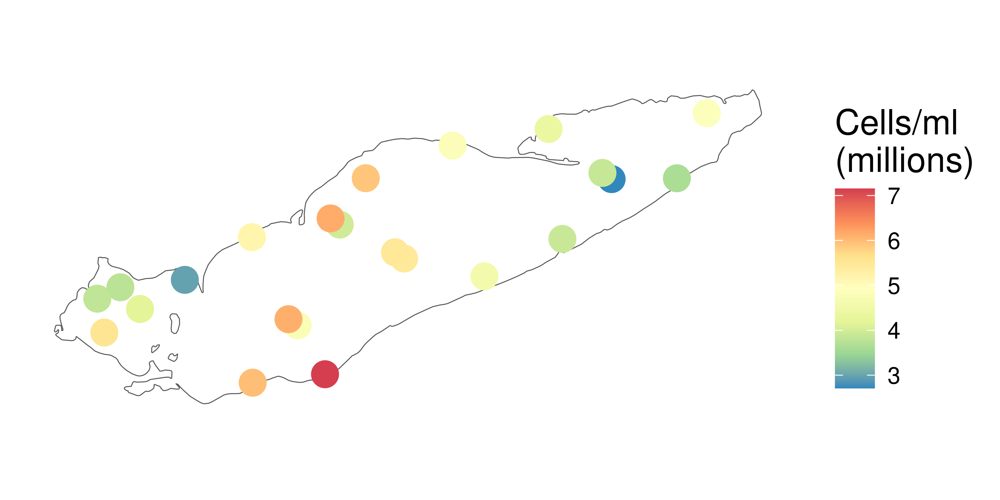{fig-align='center' width=1800}
:::

```{.r .cell-code}
flow_sf %>%
  dplyr::filter(Depth_Class == "S", Month == "May") %>%
  ggplot() + 
  geom_sf(data = erie_outline, fill = NA) + 
  geom_sf(data = shift_bottom_sf, aes(color = total_chl_counts/1e6), size = 5, alpha = 1) + 
  geom_sf(aes(color = total_chl_counts/1e6), size = 5, alpha = 1) + 
  scale_color_distiller(palette = "PRGn", na.value = "white", direction = 1) + 
  labs(color = "Chl+ Cells/ml\n(millions)") + 
  theme(axis.line = element_blank(),
        axis.text = element_blank(),
        axis.ticks = element_blank(),
        strip.text = element_blank())
```

::: {.cell-output-display}
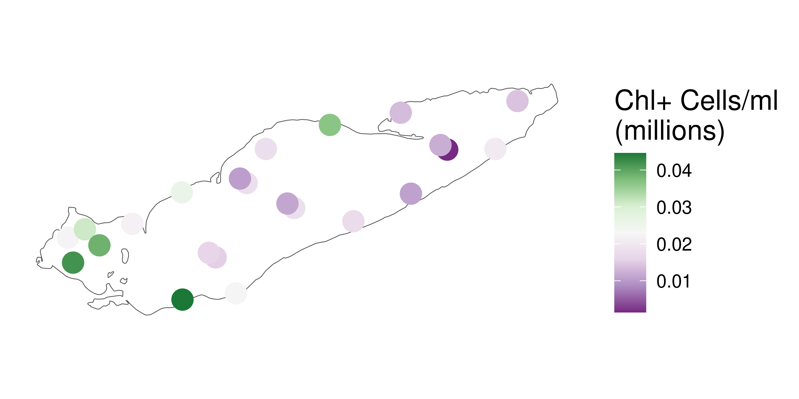{fig-align='center' width=1800}
:::

```{.r .cell-code}
flow_sf %>%
  dplyr::filter(Depth_Class == "S", Month == "May") %>%
  ggplot() + 
  geom_sf(data = erie_outline, fill = NA) + 
  geom_sf(data = shift_bottom_sf, aes(color = pig_counts_chl_big/1e6), size = 5, alpha = 1) + 
  geom_sf(aes(color = pig_counts_chl_big/1e6), size = 5, alpha = 1) + 
  scale_color_distiller(palette = "Greens", na.value = "white", direction = 1) + 
  labs(color = "Large\nChl+ Cells/ml\n(millions)") + 
  theme(axis.line = element_blank(),
        axis.text = element_blank(),
        axis.ticks = element_blank(),
        strip.text = element_blank())
```

::: {.cell-output-display}
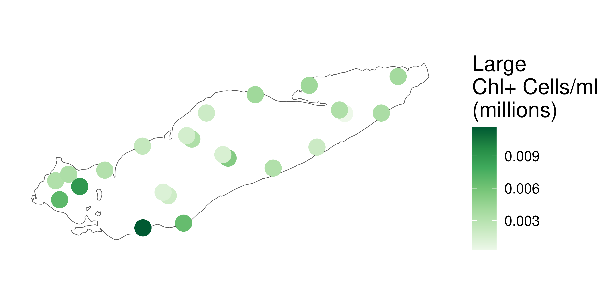{fig-align='center' width=1800}
:::
:::

::: {.cell layout-align="center"}

```{.r .cell-code}
flow_sf %>%
  dplyr::filter(Depth_Class == "S", Month != "May") %>%
  ggplot() + 
  geom_sf(data = erie_outline, fill = NA) + 
  geom_sf(aes(fill = Anatoxin_Total), size = 5, alpha = 1, color = "black", shape = 21, stroke = .2) + 
  scale_fill_gradient(low = "white", high = "firebrick2", breaks = c(0,0.02,0.04)) + 
  facet_wrap(~Month) + 
  labs(color = "Anatoxins\n(μg/L)") + 
  theme(axis.line = element_blank(),
        axis.text = element_blank(),
        axis.ticks = element_blank(),
        strip.text = element_blank())
```

::: {.cell-output-display}
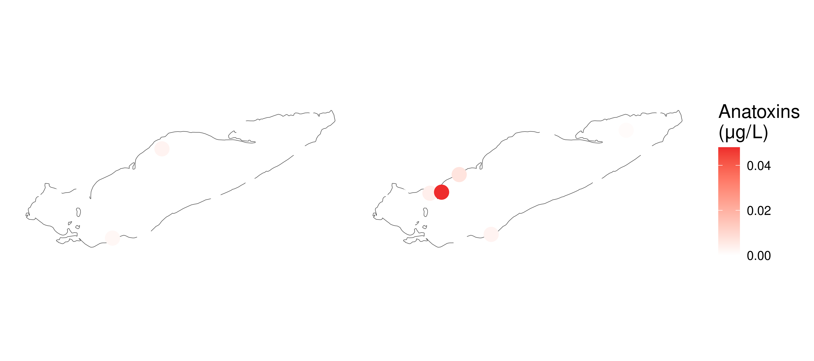{fig-align='center' width=2700}
:::

```{.r .cell-code}
flow_sf %>%
  dplyr::filter(Depth_Class == "S", Month != "May") %>%
  ggplot() + 
  geom_sf(data = erie_outline, fill = NA) + 
  geom_sf(aes(fill = Microcystin_Total), size = 5, alpha = 1, color = "black", shape = 21, stroke = .2) + 
  scale_fill_gradient(low = "white", high = "forestgreen") + 
  facet_wrap(~Month) + 
  labs(color = "Microcystins\n(μg/L)") + 
  theme(axis.line = element_blank(),
        axis.text = element_blank(),
        axis.ticks = element_blank(),
        strip.text = element_blank())
```

::: {.cell-output-display}
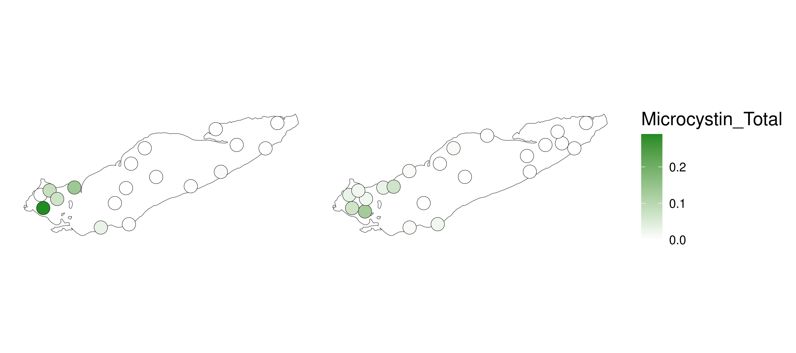{fig-align='center' width=2700}
:::
:::

::: {.cell layout-align="center"}

```{.r .cell-code}
flow_sf %>%
  dplyr::filter(Depth_Class == "S", Month == "May") %>%
  ggplot() + 
  geom_sf(data = erie_outline, fill = NA) + 
  geom_sf(data = shift_bottom_sf, aes(color = avg_cells_per_ml/1e6), size = 5, alpha = 1) + 
  geom_sf(aes(color = avg_cells_per_ml/1e6), size = 5, alpha = 1) + 
  scale_color_distiller(palette = "Spectral", na.value = "white") + 
  labs(color = "Cells/ml\n(millions)") + 
  theme(axis.line = element_blank(),
        axis.text = element_blank(),
        axis.ticks = element_blank(),
        strip.text = element_blank())
```

::: {.cell-output-display}
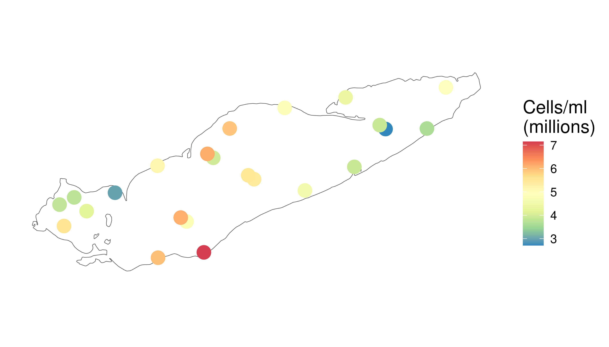{fig-align='center' width=2100}
:::

```{.r .cell-code}
flow_sf %>%
  dplyr::filter(Depth_Class == "S", Month == "September") %>%
  ggplot() + 
  geom_sf(data = erie_outline, fill = NA) + 
  geom_sf(data = shift_bottom_sf, aes(color = rsg_pos_per_ml/1e6), size = 5, alpha = 1) + 
  geom_sf(aes(color = rsg_pos_per_ml/1e6), size = 5, alpha = 1) + 
  scale_color_distiller(palette = "Spectral", na.value = "white") + 
  labs(color = "RSG+ Cells/ml\n(millions)") + 
  theme(axis.line = element_blank(),
        axis.text = element_blank(),
        axis.ticks = element_blank(),
        strip.text = element_blank())
```

::: {.cell-output-display}
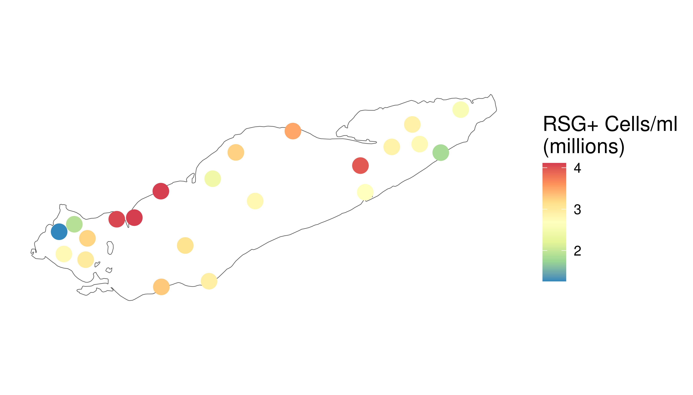{fig-align='center' width=2100}
:::

```{.r .cell-code}
flow_sf %>%
  dplyr::filter(Depth_Class == "S", Month == "September") %>%
  ggplot() + 
  geom_sf(data = erie_outline, fill = NA) + 
  geom_sf(data = shift_bottom_sf, aes(color = rsg_perc_pos), size = 5, alpha = 1) + 
  geom_sf(aes(color = rsg_perc_pos), size = 5, alpha = 1) + 
  scale_color_distiller(palette = "Spectral", na.value = "white") + 
  labs(color = "% RSG+ Cells") + 
  theme(axis.line = element_blank(),
        axis.text = element_blank(),
        axis.ticks = element_blank(),
        strip.text = element_blank())
```

::: {.cell-output-display}
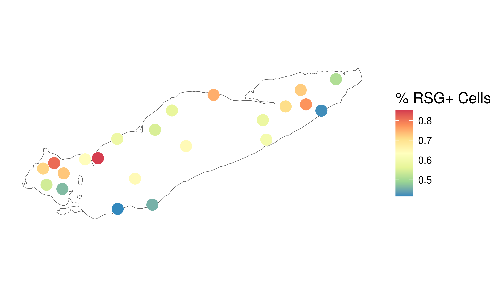{fig-align='center' width=2100}
:::

```{.r .cell-code}
flow_sf %>%
  dplyr::filter(Depth_Class == "S", Month == "September") %>%
  ggplot() + 
  geom_sf(data = erie_outline, fill = NA) + 
  geom_sf(data = shift_bottom_sf, aes(color = rsg_pos_per_ml/1e6), size = 5, alpha = 1) + 
  geom_sf(aes(color = rsg_pos_per_ml/1e6), size = 5, alpha = 1) + 
  scale_color_distiller(palette = "Spectral", na.value = "white") + 
  labs(color = "RSG+ Cells/ml\n(millions)") + 
  theme(axis.line = element_blank(),
        axis.text = element_blank(),
        axis.ticks = element_blank(),
        strip.text = element_blank())
```

::: {.cell-output-display}
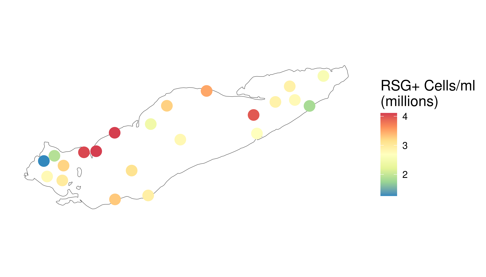{fig-align='center' width=2100}
:::
:::

::: {.cell layout-align="center"}

```{.r .cell-code}
meta_w_flow %>%
  filter(DNA_ID != "KH_D076", Depth_Class == "S", Month == "September") %>%
  mutate(Month = factor(Month, levels = c("September")),
         Basin = factor(Basin, levels = c("W","C","E"))) %>%
  ggplot(aes(x = Basin, y = rsg_pos_per_ml)) + 
    stat_summary(geom = "errorbar", fun.min = mean, fun.max = mean, width = 0.5, linewidth = 1)+ 
  stat_summary(geom = "errorbar", fun.min = \(x)mean(x)-sd(x), fun.max = \(x)mean(x) + sd(x), width = 0.3, linewidth = .25)+ 
  scale_y_continuous(labels = scales::unit_format(unit = "M", scale = 1e-6), expand = expansion(mult = c(0,0.1))) + 
  stat_compare_means(method = "wilcox", comparisons = list(c(1,2), c(2,3), c(1,3)), label = "p.signif") +
  ggbeeswarm::geom_beeswarm() +
  labs(x = "Basin") + 
  facet_wrap(~Month, scales = "free") + 
  theme(strip.text = element_blank(),
        axis.title = element_blank()) 
```

::: {.cell-output-display}
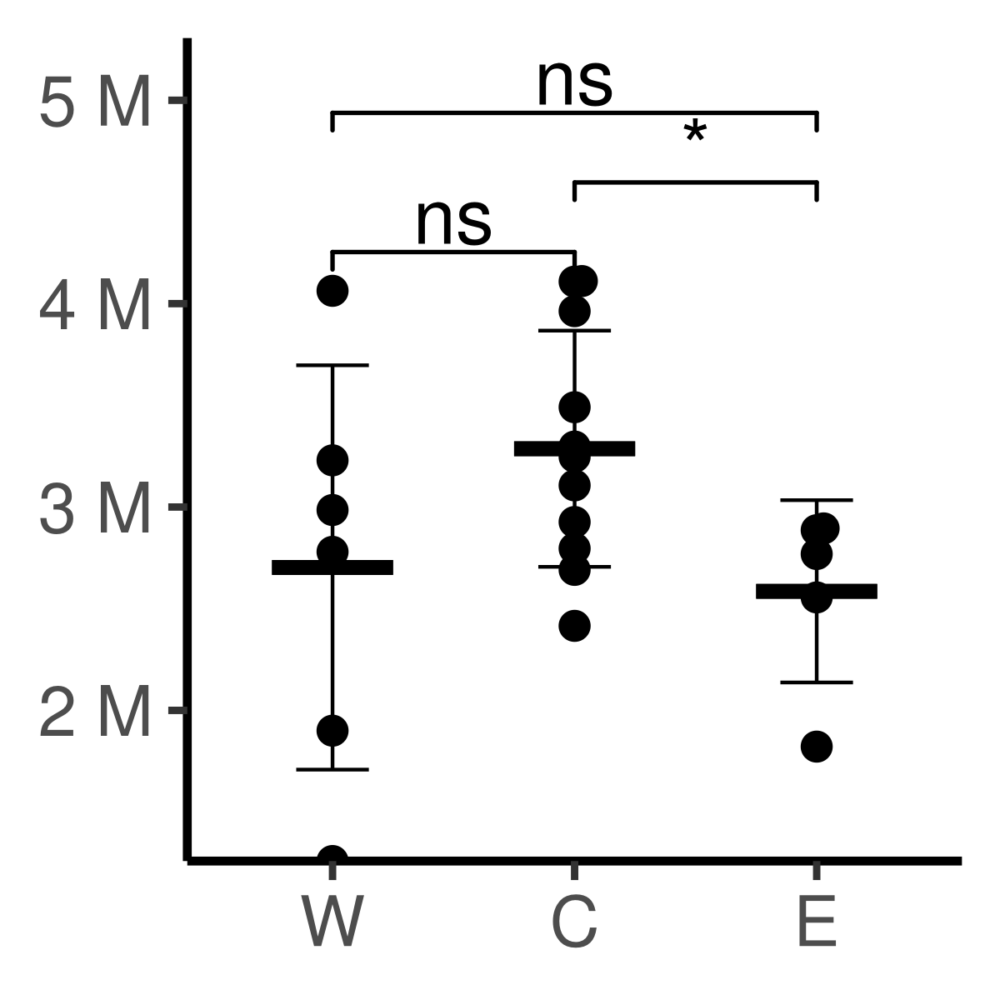{fig-align='center' width=600}
:::

```{.r .cell-code}
meta_w_flow %>%
  filter(DNA_ID != "KH_D076", Depth_Class == "S", Month == "September") %>%
  mutate(Month = factor(Month, levels = c("September")),
         Basin = factor(Basin, levels = c("W","C","E"))) %>%
  ggplot(aes(x = Basin, y = rsg_perc_pos)) + 
    stat_summary(geom = "errorbar", fun.min = mean, fun.max = mean, width = 0.5, linewidth = 1)+ 
  stat_summary(geom = "errorbar", fun.min = \(x)mean(x)-sd(x), fun.max = \(x)mean(x) + sd(x), width = 0.3, linewidth = .25)+
  scale_y_continuous(expand = expansion(mult = c(0,0.1))) + 
  stat_compare_means(method = "wilcox", comparisons = list(c(1,2), c(2,3), c(1,3)), label = "p.signif") +
  ggbeeswarm::geom_beeswarm() +
  labs(x = "Basin") + 
  facet_wrap(~Month, scales = "free") + 
  theme(strip.text = element_blank(),
        axis.title = element_blank()) 
```

::: {.cell-output-display}
{fig-align='center' width=600}
:::
:::

::: {.cell layout-align="center"}

```{.r .cell-code}
meta_w_flow %>%
  filter(DNA_ID != "KH_D076", Depth_Class == "B", Month == "September") %>%
  mutate(Month = factor(Month, levels = c("September")),
         Basin = factor(Basin, levels = c("W","C","E"))) %>%
  ggplot(aes(x = Basin, y = rsg_pos_per_ml)) + 
    stat_summary(geom = "errorbar", fun.min = mean, fun.max = mean, width = 0.5, linewidth = 1)+ 
  stat_summary(geom = "errorbar", fun.min = \(x)mean(x)-sd(x), fun.max = \(x)mean(x) + sd(x), width = 0.3, linewidth = .25)+ 
  scale_y_continuous(labels = scales::unit_format(unit = "M", scale = 1e-6), expand = expansion(mult = c(0,0.1))) + 
  stat_compare_means(method = "wilcox", comparisons = list(c(1,2), c(2,3), c(1,3)), label = "p.signif") +
  ggbeeswarm::geom_beeswarm() +
  labs(x = "Basin") + 
  facet_wrap(~Month, scales = "free") + 
  theme(strip.text = element_blank(),
        axis.title = element_blank()) 
```

::: {.cell-output-display}
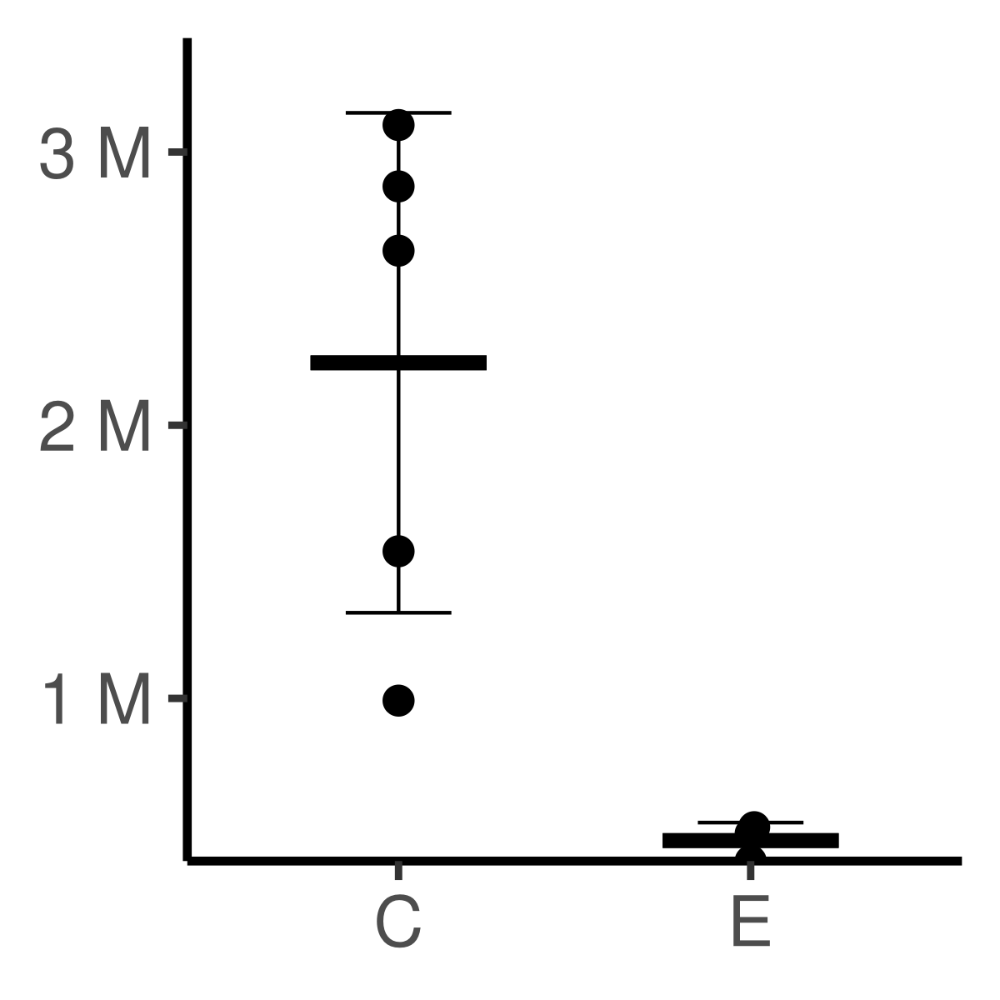{fig-align='center' width=600}
:::

```{.r .cell-code}
meta_w_flow %>%
  filter(DNA_ID != "KH_D076", Depth_Class == "B", Month == "September") %>%
  mutate(Month = factor(Month, levels = c("September")),
         Basin = factor(Basin, levels = c("W","C","E"))) %>%
  ggplot(aes(x = Basin, y = rsg_perc_pos)) + 
    stat_summary(geom = "errorbar", fun.min = mean, fun.max = mean, width = 0.5, linewidth = 1)+ 
  stat_summary(geom = "errorbar", fun.min = \(x)mean(x)-sd(x), fun.max = \(x)mean(x) + sd(x), width = 0.3, linewidth = .25)+
  scale_y_continuous(expand = expansion(mult = c(0,0.1))) + 
  stat_compare_means(method = "wilcox", comparisons = list(c(1,2), c(2,3), c(1,3)), label = "p.signif") +
  ggbeeswarm::geom_beeswarm() +
  labs(x = "Basin") + 
  facet_wrap(~Month, scales = "free") + 
  theme(strip.text = element_blank(),
        axis.title = element_blank()) 
```

::: {.cell-output-display}
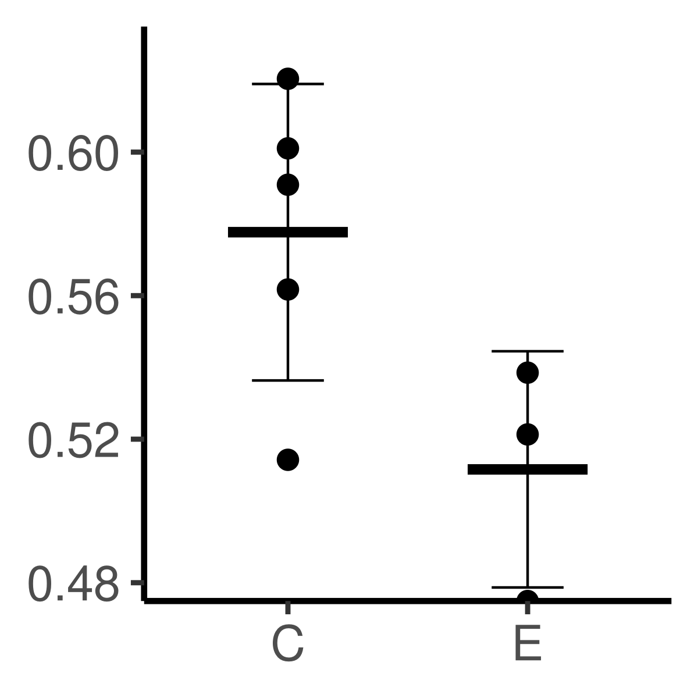{fig-align='center' width=600}
:::
:::

::: {.cell layout-align="center"}

```{.r .cell-code}
meta_w_flow %>%
  ggplot(aes(x = total_chl_counts, y = avg_cells_per_ml - total_chl_counts)) + 
  geom_point() + 
  scale_y_log10() + 
  scale_x_log10() + 
  ggpubr::stat_cor(method = "spearman")
```

::: {.cell-output-display}
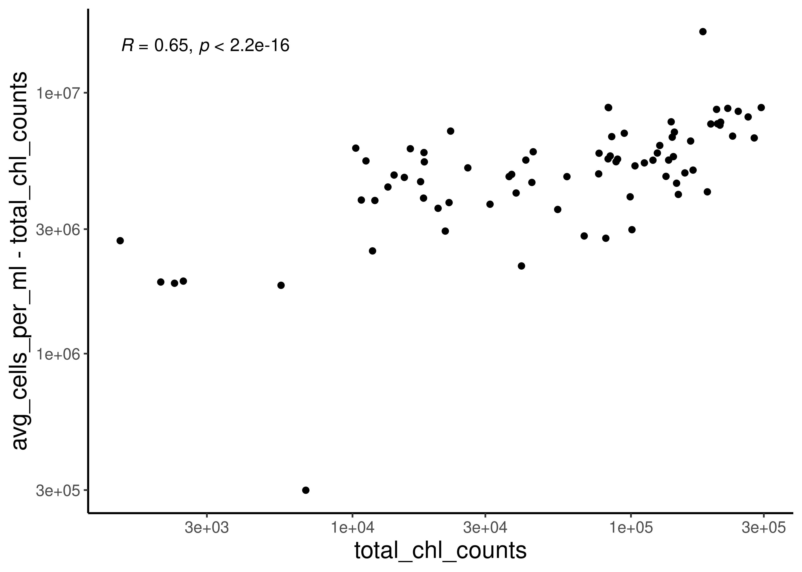{fig-align='center' width=2100}
:::

```{.r .cell-code}
meta_w_flow %>%
  ggplot(aes(x = total_chl_counts, y = avg_cells_per_ml - total_chl_counts)) + 
  geom_point() + 
  scale_y_log10() + 
  scale_x_log10() + 
  ggpubr::stat_cor(method = "spearman")
```

::: {.cell-output-display}
{fig-align='center' width=2100}
:::
:::

::: {.cell layout-align="center"}

```{.r .cell-code}
save(flow_physeq, file ="data/06_Flow_Cytometry/flow_physeq.RData")
```
:::


# Session Information 

::: {.cell layout-align="center"}

```{.r .cell-code}
# Reproducibility
devtools::session_info()
```

::: {.cell-output .cell-output-stdout}
```
─ Session info ───────────────────────────────────────────────────────────────
 setting  value
 version  R version 4.3.3 (2024-02-29)
 os       Rocky Linux 9.8 (Blue Onyx)
 system   x86_64, linux-gnu
 ui       X11
 language (EN)
 collate  en_US.UTF-8
 ctype    en_US.UTF-8
 tz       America/New_York
 date     2026-10-16
 pandoc   3.1.1 @ /usr/lib/rstudio-server/bin/quarto/bin/tools/ (via rmarkdown)

─ Packages ───────────────────────────────────────────────────────────────────
 package          * version    date (UTC) lib source
 abind              1.4-8      2024-09-12 [2] CRAN (R 4.3.3)
 ade4               1.7-24     2026-03-21 [1] CRAN (R 4.3.3)
 ape                5.8-1      2024-12-16 [1] CRAN (R 4.3.3)
 backports          1.5.1      2026-04-03 [1] CRAN (R 4.3.3)
 beeswarm           0.4.0      2021-06-01 [1] CRAN (R 4.3.3)
 BH               * 1.90.0-1   2025-12-14 [1] CRAN (R 4.3.3)
 Biobase            2.62.0     2023-10-24 [2] Bioconductor
 BiocGenerics       0.48.1     2023-11-01 [2] Bioconductor
 biomformat         1.30.0     2023-10-24 [1] Bioconductor
 Biostrings         2.70.3     2024-03-13 [1] Bioconductor 3.18 (R 4.3.2)
 bit                4.5.0      2024-09-20 [2] CRAN (R 4.3.3)
 bit64              4.5.2      2024-09-22 [2] CRAN (R 4.3.3)
 bitops             1.0-9      2024-10-03 [2] CRAN (R 4.3.3)
 broom              1.0.13     2026-05-14 [1] CRAN (R 4.3.3)
 cachem             1.1.0      2024-05-16 [2] CRAN (R 4.3.3)
 car                3.1-5      2026-02-03 [1] CRAN (R 4.3.3)
 carData            3.0-6      2026-01-30 [1] CRAN (R 4.3.3)
 class              7.3-22     2023-05-03 [2] CRAN (R 4.3.3)
 classInt           0.4-11     2025-01-08 [2] CRAN (R 4.3.3)
 cli                3.6.6      2026-04-09 [1] CRAN (R 4.3.3)
 cluster            2.1.6      2023-12-01 [2] CRAN (R 4.3.3)
 codetools          0.2-19     2023-02-01 [2] CRAN (R 4.3.3)
 crayon             1.5.3      2024-06-20 [2] CRAN (R 4.3.3)
 cytolib            2.14.1     2024-01-18 [1] Bioconductor 3.18 (R 4.3.3)
 data.table         1.18.6.1   2026-08-24 [1] CRAN (R 4.3.3)
 DBI                1.2.3      2024-06-02 [2] CRAN (R 4.3.3)
 devtools           2.4.5      2022-10-11 [2] CRAN (R 4.3.3)
 digest             0.6.37     2024-08-19 [2] CRAN (R 4.3.3)
 dplyr            * 1.2.1      2026-04-03 [1] CRAN (R 4.3.3)
 e1071              1.7-17     2025-12-18 [2] CRAN (R 4.3.3)
 ellipsis           0.3.2      2021-04-29 [2] CRAN (R 4.3.3)
 evaluate           1.0.1      2024-10-10 [2] CRAN (R 4.3.3)
 farver             2.1.2      2024-05-13 [2] CRAN (R 4.3.3)
 fastmap            1.2.0      2024-05-15 [2] CRAN (R 4.3.3)
 flow.gus         * 0.1.2      2026-10-07 [1] Github (MarschmiLab/flow.gus@7a84aee)
 flowCore         * 2.14.2     2024-03-18 [1] Bioconductor 3.18 (R 4.3.3)
 flowWorkspace    * 4.14.3     2024-03-18 [1] Bioconductor 3.18 (R 4.3.3)
 forcats          * 1.0.1      2025-09-25 [1] CRAN (R 4.3.3)
 foreach            1.5.2      2022-02-02 [1] CRAN (R 4.3.3)
 Formula            1.2-6      2026-08-03 [1] CRAN (R 4.3.3)
 fs                 1.6.5      2024-10-30 [2] CRAN (R 4.3.3)
 generics           0.1.4      2025-05-09 [1] CRAN (R 4.3.3)
 GenomeInfoDb       1.38.8     2024-03-15 [2] Bioconductor 3.18 (R 4.3.3)
 GenomeInfoDbData   1.2.11     2024-11-25 [2] Bioconductor
 ggbeeswarm         0.7.3      2025-11-29 [1] CRAN (R 4.3.3)
 ggcyto           * 1.30.2     2024-03-03 [1] Bioconductor 3.18 (R 4.3.3)
 ggplot2          * 3.5.2      2025-04-09 [1] CRAN (R 4.3.3)
 ggpubr           * 1.0.0      2026-07-06 [1] CRAN (R 4.3.3)
 ggsignif           0.6.4      2022-10-13 [1] CRAN (R 4.3.3)
 glue               1.8.1      2026-04-17 [1] CRAN (R 4.3.3)
 graph              1.80.0     2023-10-24 [2] Bioconductor
 gridExtra          2.3.1      2026-06-25 [1] CRAN (R 4.3.3)
 gtable             0.3.6      2024-10-25 [2] CRAN (R 4.3.3)
 hexbin             1.28.6     2026-07-28 [1] CRAN (R 4.3.3)
 hms                1.1.4      2025-10-17 [1] CRAN (R 4.3.3)
 htmltools          0.5.8.1    2024-04-04 [2] CRAN (R 4.3.3)
 htmlwidgets        1.6.4      2023-12-06 [2] CRAN (R 4.3.3)
 httpuv             1.6.15     2024-03-26 [2] CRAN (R 4.3.3)
 igraph             2.1.1      2024-10-19 [2] CRAN (R 4.3.3)
 IRanges            2.36.0     2023-10-24 [2] Bioconductor
 iterators          1.0.14     2022-02-05 [1] CRAN (R 4.3.3)
 jsonlite           1.8.9      2024-09-20 [2] CRAN (R 4.3.3)
 KernSmooth         2.23-22    2023-07-10 [2] CRAN (R 4.3.3)
 knitr              1.52       2026-09-06 [1] CRAN (R 4.3.3)
 labeling           0.4.3      2023-08-29 [2] CRAN (R 4.3.3)
 later              1.3.2      2023-12-06 [2] CRAN (R 4.3.3)
 lattice            0.22-5     2023-10-24 [2] CRAN (R 4.3.3)
 lifecycle          1.0.5      2026-01-08 [1] CRAN (R 4.3.3)
 lubridate        * 1.9.5      2026-02-04 [1] CRAN (R 4.3.3)
 magrittr           2.0.5      2026-04-04 [1] CRAN (R 4.3.3)
 MASS               7.3-60.0.1 2024-01-13 [2] CRAN (R 4.3.3)
 Matrix             1.6-5      2024-01-11 [2] CRAN (R 4.3.3)
 matrixStats        1.5.0      2025-01-07 [1] CRAN (R 4.3.3)
 memoise            2.0.1      2021-11-26 [2] CRAN (R 4.3.3)
 mgcv               1.9-1      2023-12-21 [2] CRAN (R 4.3.3)
 mime               0.12       2021-09-28 [2] CRAN (R 4.3.3)
 miniUI             0.1.1.1    2018-05-18 [2] CRAN (R 4.3.3)
 multtest           2.58.0     2023-10-24 [1] Bioconductor
 NatParksPalettes   0.2.0      2022-10-09 [1] CRAN (R 4.3.3)
 ncdfFlow         * 2.48.0     2023-10-24 [1] Bioconductor
 nlme               3.1-164    2023-11-27 [2] CRAN (R 4.3.3)
 otel               0.2.0      2025-08-29 [1] CRAN (R 4.3.3)
 pacman             0.5.1      2019-03-11 [1] CRAN (R 4.3.2)
 permute            0.9-10     2026-02-06 [1] CRAN (R 4.3.3)
 phyloseq         * 1.46.0     2023-10-24 [1] Bioconductor
 pillar             1.11.1     2025-09-17 [1] CRAN (R 4.3.3)
 pkgbuild           1.4.5      2024-10-28 [2] CRAN (R 4.3.3)
 pkgconfig          2.0.3      2019-09-22 [2] CRAN (R 4.3.3)
 pkgload            1.4.0      2024-06-28 [2] CRAN (R 4.3.3)
 plyr               1.8.9      2023-10-02 [2] CRAN (R 4.3.3)
 profvis            0.4.0      2024-09-20 [2] CRAN (R 4.3.3)
 promises           1.3.0      2024-04-05 [2] CRAN (R 4.3.3)
 proxy              0.4-29     2025-12-29 [2] CRAN (R 4.3.3)
 purrr            * 1.2.2      2026-04-10 [1] CRAN (R 4.3.3)
 R6                 2.6.1      2025-02-15 [1] CRAN (R 4.3.3)
 ragg               1.3.3      2024-09-11 [2] CRAN (R 4.3.3)
 RColorBrewer       1.1-3      2022-04-03 [2] CRAN (R 4.3.3)
 Rcpp               1.1.2      2026-07-05 [1] CRAN (R 4.3.3)
 RCurl              1.98-1.16  2024-07-11 [2] CRAN (R 4.3.3)
 readr            * 2.2.0      2026-02-19 [1] CRAN (R 4.3.3)
 remotes            2.5.0      2024-03-17 [2] CRAN (R 4.3.3)
 reshape2           1.4.4      2020-04-09 [2] CRAN (R 4.3.3)
 Rgraphviz          2.46.0     2023-10-24 [1] Bioconductor
 rhdf5              2.46.1     2023-11-29 [1] Bioconductor 3.18 (R 4.3.2)
 rhdf5filters       1.14.1     2023-11-06 [1] Bioconductor
 Rhdf5lib           1.24.2     2024-02-07 [1] Bioconductor 3.18 (R 4.3.2)
 rlang              1.3.0      2026-07-05 [1] CRAN (R 4.3.3)
 rmarkdown          2.32       2026-09-01 [1] CRAN (R 4.3.3)
 RProtoBufLib       2.14.1     2024-03-18 [1] Bioconductor 3.18 (R 4.3.3)
 rstatix            1.1.0      2026-07-23 [1] CRAN (R 4.3.3)
 rstudioapi         0.17.1     2024-10-22 [2] CRAN (R 4.3.3)
 s2                 1.1.11     2026-06-01 [2] CRAN (R 4.3.3)
 S4Vectors          0.40.2     2023-11-23 [2] Bioconductor 3.18 (R 4.3.3)
 S7                 0.2.2      2026-04-22 [1] CRAN (R 4.3.3)
 scales             1.4.0      2025-04-24 [1] CRAN (R 4.3.3)
 sessioninfo        1.2.2      2021-12-06 [2] CRAN (R 4.3.3)
 sf               * 1.1-3      2026-09-11 [1] CRAN (R 4.3.3)
 shiny              1.9.1      2024-08-01 [2] CRAN (R 4.3.3)
 stringi            1.8.4      2024-05-06 [2] CRAN (R 4.3.3)
 stringr          * 1.5.1      2023-11-14 [2] CRAN (R 4.3.3)
 survival           3.5-8      2024-02-14 [2] CRAN (R 4.3.3)
 systemfonts        1.3.2      2026-03-05 [1] CRAN (R 4.3.3)
 terra            * 1.9-50     2026-09-08 [1] CRAN (R 4.3.3)
 textshaping        0.4.0      2024-05-24 [2] CRAN (R 4.3.3)
 tibble           * 3.3.1      2026-01-11 [1] CRAN (R 4.3.3)
 tidyr            * 1.3.2      2025-12-19 [1] CRAN (R 4.3.3)
 tidyselect         1.2.1      2024-03-11 [1] CRAN (R 4.3.2)
 tidyverse        * 2.0.0      2023-02-22 [1] CRAN (R 4.3.2)
 timechange         0.4.0      2026-01-29 [1] CRAN (R 4.3.3)
 tzdb               0.5.0      2025-03-15 [1] CRAN (R 4.3.3)
 units              1.0-1      2026-03-11 [2] CRAN (R 4.3.3)
 urlchecker         1.0.1      2021-11-30 [2] CRAN (R 4.3.3)
 usethis            3.2.2      2026-09-10 [1] CRAN (R 4.3.3)
 utf8               1.2.6      2025-06-08 [1] CRAN (R 4.3.3)
 vctrs              0.7.3      2026-04-11 [1] CRAN (R 4.3.3)
 vegan              2.7-6      2026-08-31 [1] CRAN (R 4.3.3)
 vipor              0.4.7      2023-12-18 [1] CRAN (R 4.3.3)
 vroom              1.7.1      2026-03-31 [1] CRAN (R 4.3.3)
 withr              3.0.3      2026-06-19 [1] CRAN (R 4.3.3)
 wk                 0.9.5      2025-12-18 [2] CRAN (R 4.3.3)
 xfun               0.61       2026-09-16 [1] CRAN (R 4.3.3)
 XML                3.99-0.25  2026-09-27 [1] CRAN (R 4.3.3)
 xtable             1.8-4      2019-04-21 [2] CRAN (R 4.3.3)
 XVector            0.42.0     2023-10-24 [2] Bioconductor
 yaml               2.3.10     2024-07-26 [2] CRAN (R 4.3.3)
 zlibbioc           1.48.2     2024-03-13 [2] Bioconductor 3.18 (R 4.3.3)

 [1] /home/arp277/R/x86_64-pc-linux-gnu-library/4.3
 [2] /programs/R-4.3.3/lib64/R/library

──────────────────────────────────────────────────────────────────────────────
```
:::
:::
