# Load packages 

::: {.cell layout-align="center"}

```{.r .cell-code}
pacman::p_load(phyloseq, tidyverse, ggpubr, microViz, fun.gus, ggbeeswarm, patchwork, install = FALSE)

source("code/R/plotting_aesthetics.R")

load("data/06_Flow_Cytometry/euk_flow_physeq.RData")
```
:::


# Check Rarefaction

This function comes from fun.gus!


::: {.cell layout-align="center"}

```{.r .cell-code}
set.seed(314)
rarefaction_data <- fast_rarefaction_curves(euk_flow_physeq, iterations = 50, steps = 40)
```
:::


# Plotting Rarefaction Curves


::: {.cell layout-align="center"}

```{.r .cell-code}
rarefaction_data %>%
  pivot_longer(hill0:hill2, names_to = "Order", values_to = "Value") %>%
  ggplot(aes(x = depth, y = Value, color = sample_id)) + 
  stat_summary(geom = "line", fun = mean) + 
  facet_wrap(~Order, scales = "free_y") + 
  theme(legend.position = "none")
```

::: {.cell-output-display}
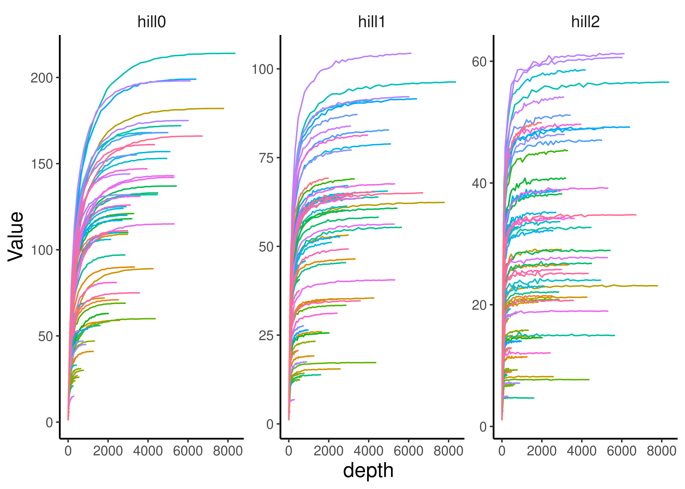{fig-align='center' width=2100}
:::

```{.r .cell-code}
rarefaction_data %>%
  ggplot(aes(x = depth, y = hill0, color = sample_id)) + 
  stat_summary(geom = "line", fun = mean) + 
  theme(legend.position = "none") + 
  coord_cartesian(ylim = c(0,100), xlim = c(0, 2000))
```

::: {.cell-output-display}
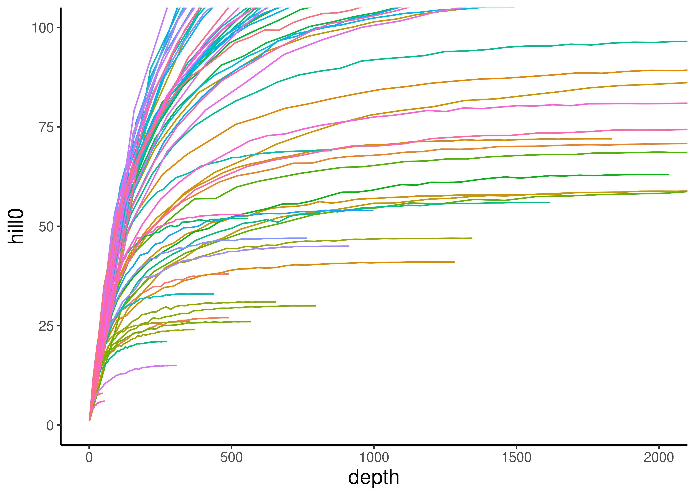{fig-align='center' width=2100}
:::
:::


They all "appear" to flatten, but we can be real with ourselves that we probably want at least 10000 reads. 


::: {.cell layout-align="center"}

```{.r .cell-code}
summarized_rarefaction <- 
  rarefaction_data %>%
  group_by(sample_id) %>%
  filter(depth == max(depth)) %>%
  pivot_longer(hill0:hill2, names_to = "Order", values_to = "Value") %>%
  ungroup() %>%
  group_by(sample_id, Order) %>%
  summarize(depth = mean(depth),
            value = mean(Value)) 

summarized_rarefaction %>%
  ggplot(aes(x = depth, y = value)) + 
  geom_point() + 
  facet_wrap(~Order, scales = "free_y") + 
  stat_cor() +
  geom_vline(xintercept = 500)
```

::: {.cell-output-display}
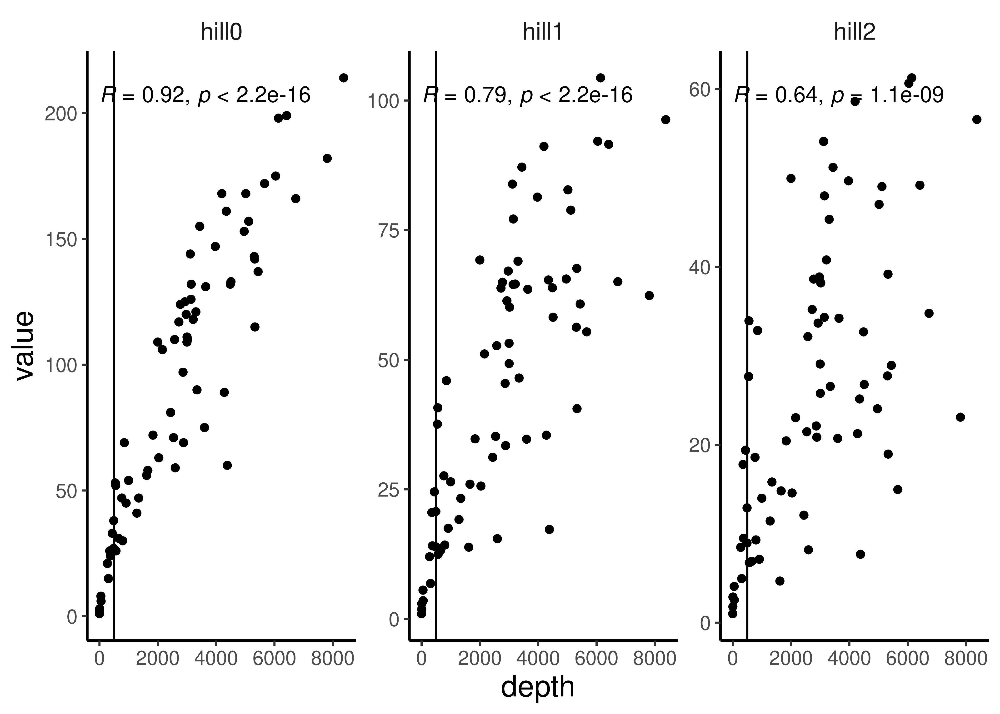{fig-align='center' width=2100}
:::
:::


Jeez! What would you do here? It's highly correlated, across the entire range of depth. I think our best bet it so pick a reasonable depth cutoff for this range of richness, and then just accept it. I'm going with 500 (reviewers pls advise).


::: {.cell layout-align="center"}

```{.r .cell-code}
sort(sample_sums(euk_flow_physeq)) %>% head(14)
```

::: {.cell-output .cell-output-stdout}
```
KH_D014 KH_D066 KH_D079 KH_D004 KH_D002 KH_D071 KH_D031 KH_D061 KH_D015 KH_D016 
      1       1       6       7      49      55     274     307     353     371 
KH_D038 KH_D003 KH_D001 KH_D074 
    439     490     491     544 
```
:::

```{.r .cell-code}
# Who are these?

euk_flow_physeq %>%
  prune_samples(sample_sums(.) < 500, .) %>%
  sample_data() %>%
  data.frame() 
```

::: {.cell-output .cell-output-stdout}
```
                           Sample_ID  DNA_ID  input filtered denoisedF
KH_D001  AAM_ERI_20240522_15_FP_ET_1 KH_D001 241601   158738    158174
KH_D002  AAM_ERI_20240522_15_FP_BT_1 KH_D002 132159    87000     85503
KH_D003  AAM_ERI_20240522_22_FP_ET_1 KH_D003 923203   586958    584580
KH_D004  AAM_ERI_20240523_28_FP_ET_1 KH_D004  76761    49644     48146
KH_D014  AAM_ERI_20240520_91_FP_ET_1 KH_D014  16226    10493      9569
KH_D015  AAM_ERI_20240523_95_FP_ET_1 KH_D015 635660   414471    413149
KH_D016 AAM_ERI_20240522_932_FP_ET_1 KH_D016 295775   192424    191575
KH_D031  AAM_ERI_20240812_43_FP_BT_1 KH_D031 813924   537282    528632
KH_D038  AAM_ERI_20240813_78_FP_BT_1 KH_D038 938495   600428    593209
KH_D061  AAM_ERI_20240914_38_FP_BT_1 KH_D061 778932   507578    502812
KH_D066  AAM_ERI_20240913_60_FP_ET_1 KH_D066 100755    65831     59630
KH_D071  AAM_ERI_20240915_78_FP_BT_1 KH_D071  93840    61805     57284
KH_D079 AAM_ERI_20240914_959_FP_ET_1 KH_D079  27310    18180     17183
        denoisedR merged nochim perc_reads_retained Station_ID     Date Depth
KH_D001    157756 155519 131823            54.56227         15 20240522   5.0
KH_D002     84762  81715  75706            57.28403         15 20240522  61.7
KH_D003    583932 577232 499039            54.05518         22 20240522   5.0
KH_D004     47598  39692  25026            32.60249         28 20240523   5.0
KH_D014      9310   7749   6567            40.47208         91 20240520   5.0
KH_D015    412953 407988 361508            56.87128         95 20240523   5.0
KH_D016    191514 189487 153449            51.88031        932 20240522   5.0
KH_D031    528995 514884 474061            58.24389         43 20240812  20.8
KH_D038    593015 579421 535557            57.06551         78 20240813  22.0
KH_D061    501708 492313 463947            59.56194         38 20240914  20.8
KH_D066     58624  45377  30100            29.87445         60 20240913   5.0
KH_D071     55226  45009  34016            36.24893         78 20240915  22.0
KH_D079     16989  15239  12179            44.59539        959 20240914   5.0
        Station_Name Water_Surface_Temp_C Latitude Longitude     Month
KH_D001        ER15M                15.15 42.50150 -79.89365       May
KH_D002        ER15M                15.15 42.50150 -79.89365       May
KH_D003    ECSERN22n                17.50 42.63395 -80.87372       May
KH_D004    ECSERI28n                16.20 42.18142 -80.15545       May
KH_D014        ER91M                18.27 41.84158 -82.91743       May
KH_D015        ER95b                15.30 42.00010 -80.66532       May
KH_D016    ECSER932n                16.10 42.79123 -79.21092       May
KH_D031        ER 43                23.05 41.78883 -81.94487    August
KH_D038       ER 78M                23.08 42.11645 -81.24972    August
KH_D061        ER 38                21.50 42.28197 -81.67187 September
KH_D066        ER 60                21.30 41.89052 -83.19653 September
KH_D071       ER 78M                20.90 42.11722 -81.25038 September
KH_D079  ECS ER 959n                22.00 42.18992 -82.18667 September
        Depth_Class          Rep_ID Basin
KH_D001           S        May_15_S     E
KH_D002           B        May_15_B     E
KH_D003           S        May_22_S     C
KH_D004           S        May_28_S     C
KH_D014           S        May_91_S     W
KH_D015           S        May_95_S     C
KH_D016           S       May_932_S     E
KH_D031           B     August_43_B     C
KH_D038           B     August_78_B     C
KH_D061           B  September_38_B     C
KH_D066           S  September_60_S     W
KH_D071           B  September_78_B     C
KH_D079           S September_959_S     C
                                                                                                                                                 Notes
KH_D001                                                                            NA NA Integrated sample; discrete depths separated by semi-colon NA
KH_D002                                                                                                                                    NA NA NA NA
KH_D003                                                                            NA NA Integrated sample; discrete depths separated by semi-colon NA
KH_D004                                                                            NA NA Integrated sample; discrete depths separated by semi-colon NA
KH_D014                                  did vortex step before incubating PW1 at 65C NA Integrated sample; discrete depths separated by semi-colon NA
KH_D015                                                                            NA NA Integrated sample; discrete depths separated by semi-colon NA
KH_D016                                  did vortex step before incubating PW1 at 65C NA Integrated sample; discrete depths separated by semi-colon NA
KH_D031                                                                                                 Spin column from 178030015_2. NA DCL at 19m NA
KH_D038                                                              NA NA NA Coleman Lab sampling Surface, mid and B-; DCL just above the thermocline
KH_D061                                                                                   NA NA BOTTOM; Within the hypoxic hypolimnion MULTIPLE DEPTHS
KH_D066 Microcystis observed on filter. Did vortex step before incubating PW1 at 65C. NA Integrated sample; discrete depths separated by semi-colon NA
KH_D071                                                                         Spin column from 178030015_2. NA Very sulfurous smell! MULTIPLE DEPTHS
KH_D079                                                                            NA NA Integrated sample; discrete depths separated by semi-colon NA
        Microcystin_Total Anatoxin_Total Toxins_Measured avg_cells_per_ml
KH_D001                NA             NA            <NA>          3836636
KH_D002                NA             NA            <NA>          2654856
KH_D003                NA             NA            <NA>          4280014
KH_D004                NA             NA            <NA>          3846591
KH_D014                NA             NA            <NA>          3920972
KH_D015                NA             NA            <NA>          4524854
KH_D016                NA             NA            <NA>          4813803
KH_D031                NA             NA            <NA>          7624058
KH_D038                NA             NA            <NA>          4166783
KH_D061                NA             NA            <NA>          5408190
KH_D066              0.03          0.000             Yes          2124998
KH_D071                NA             NA            <NA>          5696577
KH_D079              0.01          0.007             Yes          7164395
        rsg_total_per_ml rsg_pos_per_ml rsg_perc_pos  rsg_mfi
KH_D001              NaN            NaN          NaN      NaN
KH_D002              NaN            NaN          NaN      NaN
KH_D003              NaN            NaN          NaN      NaN
KH_D004              NaN            NaN          NaN      NaN
KH_D014              NaN            NaN          NaN      NaN
KH_D015              NaN            NaN          NaN      NaN
KH_D016              NaN            NaN          NaN      NaN
KH_D031              NaN            NaN          NaN      NaN
KH_D038              NaN            NaN          NaN      NaN
KH_D061          4772538        2638896    0.5617228 3180.500
KH_D066          1760606        1259273    0.7157689 2107.750
KH_D071          5012493        3098826    0.6204316 2722.000
KH_D079          7040178        4108259    0.5856151 1634.125
        pig_counts_chl_big pig_counts_chl_small pig_counts_high_chl_high_pe
KH_D001           3403.400             8628.620                    3630.293
KH_D002            280.280             1184.517                     430.430
KH_D003           4094.090            32412.380                   15348.667
KH_D004           1995.327             8762.087                    3453.450
KH_D014           8952.277            29736.373                   20460.440
KH_D015           3279.943            14280.933                   10340.330
KH_D016           3937.267            10166.823                    3500.163
KH_D031          15261.913            67600.867                   62702.640
KH_D038           9009.000            35061.693                   28742.047
KH_D061           3633.630            84754.670                   64968.237
KH_D066          10050.040            30390.360                   20694.007
KH_D071           5301.963            78942.197                   63119.723
KH_D079          11474.797           131731.600                   90984.227
        pig_counts_high_chl_no_pe pig_counts_low_chl_no_pe
KH_D001                 5785.7800                 4537.867
KH_D002                  276.9433                 1514.847
KH_D003                16753.4033                 8081.407
KH_D004                 5665.6600                 2772.770
KH_D014                13353.3400                11211.200
KH_D015                 5301.9633                 5712.373
KH_D016                 7754.4133                 4881.543
KH_D031                 2509.1733                47333.953
KH_D038                 1601.6000                24184.160
KH_D061                 3927.2567                31341.310
KH_D066                 4748.0767                22899.543
KH_D071                 5035.0300                26252.893
KH_D079                10116.7733                58058.000
        pig_counts_no_chl_low_pe total_chl_counts
KH_D001                3573.5700        12032.020
KH_D002                 463.7967         1464.797
KH_D003                3550.2133        36506.470
KH_D004                1868.5333        10757.413
KH_D014               13723.7100        38688.650
KH_D015               73780.3733        17560.877
KH_D016                7664.3233        14104.090
KH_D031              173126.2867        82862.780
KH_D038               16336.3200        44070.693
KH_D061               30490.4600        88388.300
KH_D066               14744.7300        40440.400
KH_D071               25445.4200        84244.160
KH_D079                7524.1833       143206.397
```
:::

```{.r .cell-code}
floor_physeq <- 
  euk_flow_physeq %>%
  prune_samples(sample_sums(.) > 500, .)

rar_limit <- min(sample_sums(floor_physeq))

even_rarefaction_results <- 
  rarefaction_alpha_calculations(floor_physeq, 
                               rarefy_depth = rar_limit,
                               iterations = 100,
                               method = "taxonomic",
                               seed = 031491,
                               threads = 8)
```

::: {.cell-output .cell-output-stdout}
```
[1] "Calculating taxonomic diversity approaches on floor_physeq"
```
:::

```{.r .cell-code}
for_join <- 
  summarized_rarefaction %>%
  select(Sample = sample_id, Measure = Order, non_rare = value) %>%
  mutate(Measure = case_when(Measure == "hill0" ~ "Richness",
                             Measure == "hill1" ~ "Shannon",
                             Measure == "hill2" ~ "Simpson"))

even_rarefaction_results %>%
  left_join(for_join) %>%
  ggplot(aes(x = non_rare, y = qD)) + 
  geom_point() + 
  geom_smooth(method = "lm", se = FALSE, color = "orange" ) + 
  facet_wrap(~Measure, scales = "free") + 
  geom_abline(intercept = 0, slope = 1) + 
  labs(x = "Non-Rarefied Values", y = "Rarefied to Even Depth") + 
  stat_regline_equation(formula = y ~ x + 0, color = "orange")
```

::: {.cell-output-display}
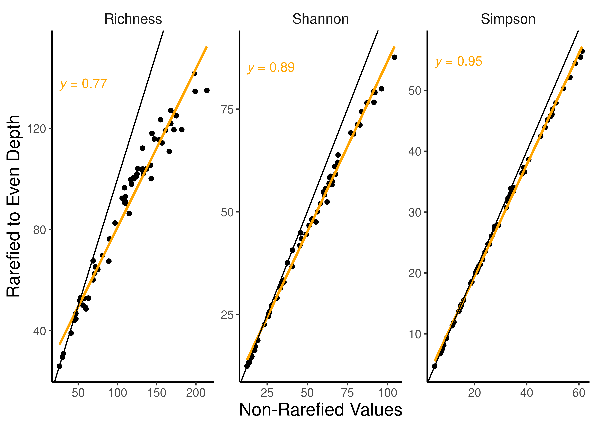{fig-align='center' width=2100}
:::
:::


Okay, so here we are comparing the values we get for alpha diversity, either by rarefying all samples to an even depth (y axis) or just using observed values without rarefaction (x-axis). For Hill numbers > 0 (Shannon and Simpson) the values are essentially equal. However, we do have lower observed Richness when we rarefy to an even depth, especially at higher "observed richnesses". 

# Examining Richness


::: {.cell layout-align="center"}

```{.r .cell-code}
sample_df <- sample_data(floor_physeq) %>%
  data.frame()

sample_and_div <-
  even_rarefaction_results %>%
  rename(DNA_ID = Sample) %>%
  left_join(sample_df)
```
:::

::: {.cell layout-align="center"}

```{.r .cell-code}
sample_and_div %>%
  mutate(Month = factor(Month, levels = c("May","August","September"))) %>%
  ggplot(aes(x = Month, y = qD)) + 
  geom_boxplot() + 
  geom_point() + 
  facet_wrap(~Measure, scales = "free")
```

::: {.cell-output-display}
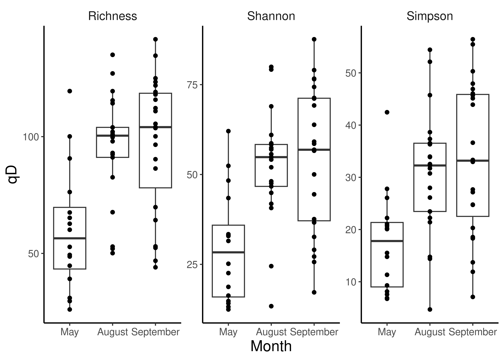{fig-align='center' width=2100}
:::

```{.r .cell-code}
sample_and_div %>%
  filter(Measure == "Richness") %>%
  mutate(Month = factor(Month, levels = c("May","August","September")),
         Basin = factor(Basin, levels = c("W","C","E"))) %>%
  ggplot(aes(x = Basin, y = qD)) + 
  geom_boxplot() + 
  geom_point() + 
  facet_wrap(~Month, scales = "free")
```

::: {.cell-output-display}
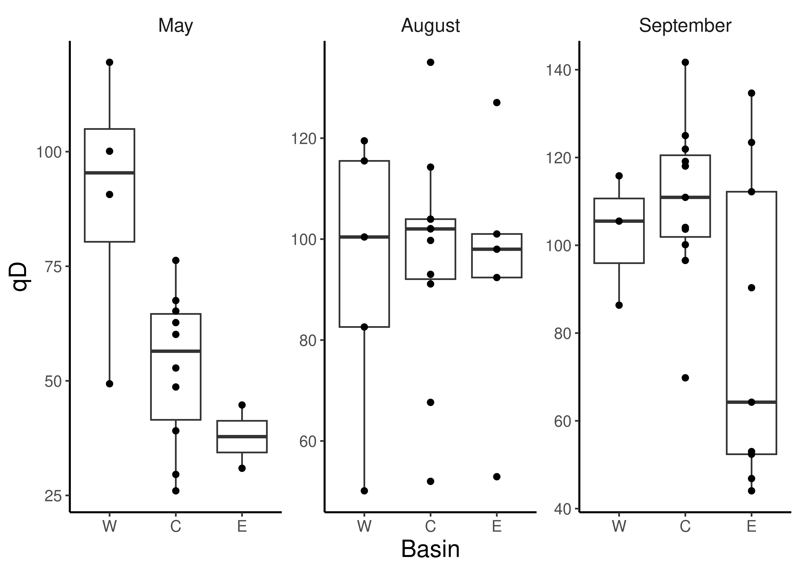{fig-align='center' width=2100}
:::

```{.r .cell-code}
sample_and_div %>%
  filter(Measure == "Richness") %>%
  mutate(Month = factor(Month, levels = c("May","August","September")),
         Basin = factor(Basin, levels = c("W","C","E"))) %>%
  ggplot(aes(x = Depth_Class, y = qD)) + 
  geom_boxplot() + 
  geom_point() + 
  facet_wrap(~Month, scales = "free")
```

::: {.cell-output-display}
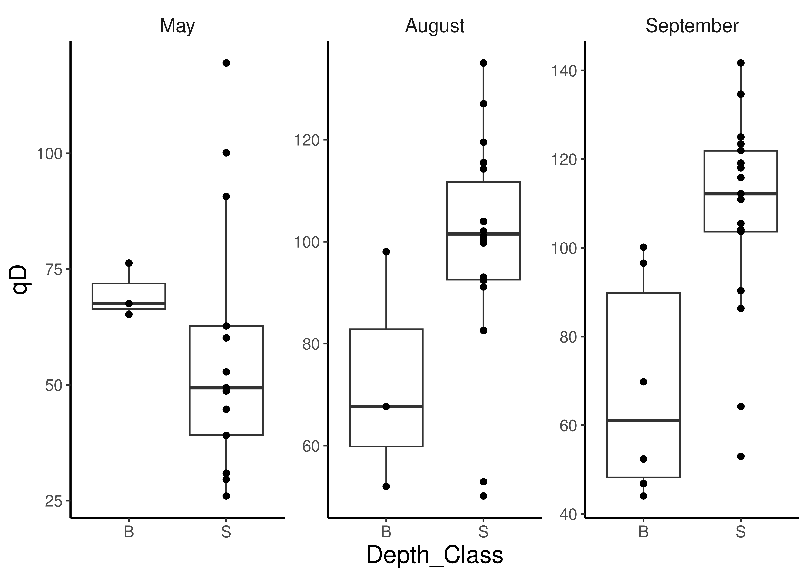{fig-align='center' width=2100}
:::

```{.r .cell-code}
sample_and_div %>%
  filter(Measure == "Richness") %>%
  mutate(Month = factor(Month, levels = c("May","August","September")),
         Basin = factor(Basin, levels = c("W","C","E"))) %>%
  ggplot(aes(x = Depth_Class, y = qD)) + 
  geom_boxplot() + 
  geom_point() + 
  facet_wrap(~Month)
```

::: {.cell-output-display}
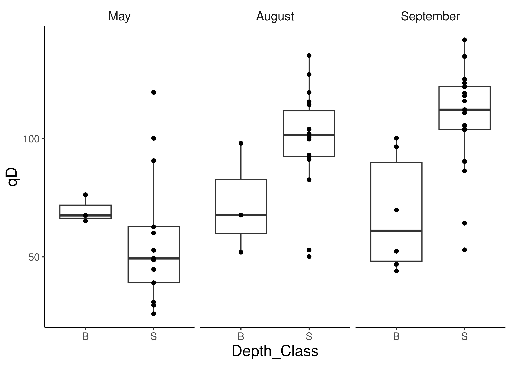{fig-align='center' width=2100}
:::

```{.r .cell-code}
sample_and_div %>%
  filter(Measure == "Shannon") %>%
  mutate(Month = factor(Month, levels = c("May","August","September")),
         Basin = factor(Basin, levels = c("W","C","E"))) %>%
  ggplot(aes(x = Depth_Class, y = qD)) + 
  geom_boxplot() + 
  geom_point() + 
  facet_wrap(~Month)
```

::: {.cell-output-display}
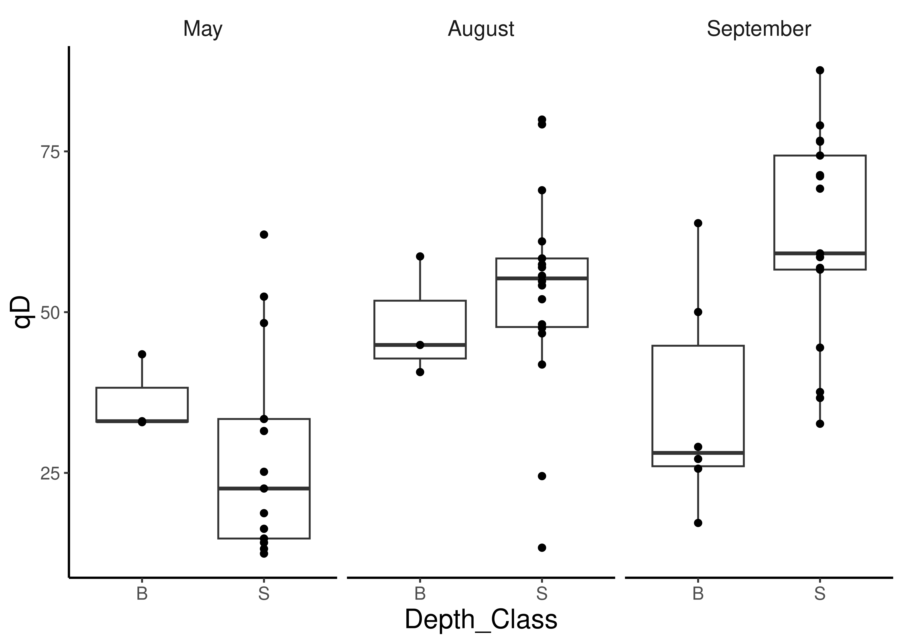{fig-align='center' width=2100}
:::

```{.r .cell-code}
sample_and_div %>%
  filter(Measure == "Simpson") %>%
  mutate(Month = factor(Month, levels = c("May","August","September")),
         Basin = factor(Basin, levels = c("W","C","E"))) %>%
  ggplot(aes(x = Depth_Class, y = qD)) + 
  geom_boxplot() + 
  geom_point() + 
  facet_wrap(~Month)
```

::: {.cell-output-display}
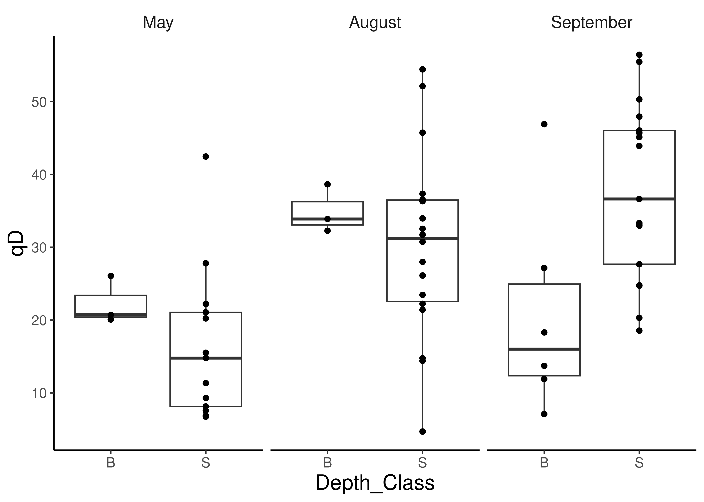{fig-align='center' width=2100}
:::
:::


# Add diversity to our physeq and save


::: {.cell layout-align="center"}

```{.r .cell-code}
alpha_for_join <-
  even_rarefaction_results %>%
  rename(DNA_ID = Sample) %>%
  select(-st.dev) %>%
  pivot_wider(names_from = Measure, values_from = qD) 

euk_diversity_physeq <- 
  floor_physeq %>%
  ps_join(alpha_for_join)

save(euk_diversity_physeq, 
     file = "data/07_Alpha_Diversity/euk_diversity_physeq.RData")
```
:::


# Mapping Eukaryotic Diversity

# Mapping Cell Counts


::: {.cell layout-align="center"}

```{.r .cell-code}
pacman::p_load(sf, terra, tmap, gstat, install = FALSE)

# Define some shapes and objects

raw_erie <- read_sf("data/spatial_imports/hydro_p_LakeErie/hydro_p_LakeErie.shp") %>%
  st_transform(crs = "EPSG:4326")

erie_outline <- raw_erie %>%
  st_union()

div_data <- 
  euk_diversity_physeq %>%
  sample_data() %>%
  data.frame() %>% 
  select(Sample_ID, Station_ID, Latitude, Longitude, Water_Surface_Temp_C, Month, Depth_Class, Richness, Shannon, Simpson)

div_sf <- div_data %>% 
  dplyr::filter(!is.na(Longitude)) %>% 
  st_as_sf(coords = c("Longitude","Latitude"), crs = "EPSG:4326")
```
:::

::: {.cell layout-align="center"}

```{.r .cell-code}
div_sf %>%
  dplyr::filter(Depth_Class == "S") %>%
  mutate(Month = factor(Month, levels = c("May", "August","September"))) %>%
  ggplot() + 
  geom_sf(aes(color = Richness), size = 3, alpha = 0.7) + 
  facet_wrap(~Month, ncol = 1) + 
  scale_color_distiller(palette = "Spectral") + 
  geom_sf(data = erie_outline, fill = NA)
```

::: {.cell-output-display}
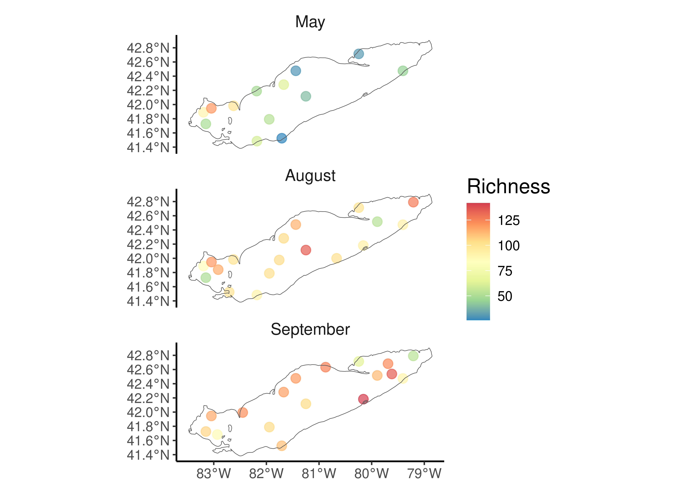{fig-align='center' width=2100}
:::

```{.r .cell-code}
div_sf %>%
  dplyr::filter(Depth_Class == "S") %>%
  mutate(Month = factor(Month, levels = c("May", "August","September"))) %>%
  ggplot() + 
  geom_sf(aes(color = Shannon), size = 3, alpha = 0.7) + 
  facet_wrap(~Month, ncol = 1) + 
  scale_color_distiller(palette = "Spectral") + 
  geom_sf(data = erie_outline, fill = NA)
```

::: {.cell-output-display}
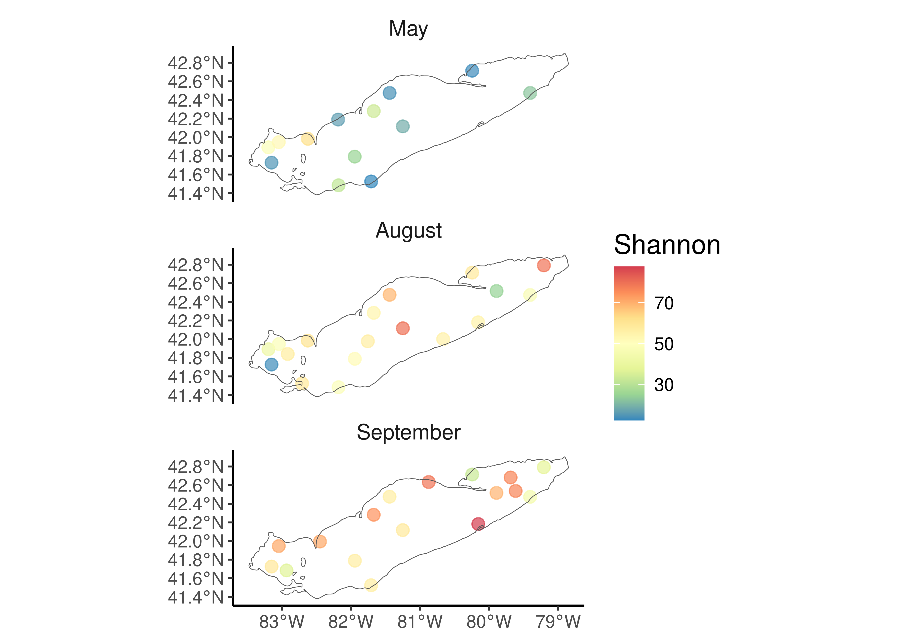{fig-align='center' width=2100}
:::

```{.r .cell-code}
div_sf %>%
  dplyr::filter(Depth_Class == "S") %>%
  mutate(Month = factor(Month, levels = c("May", "August","September"))) %>%
  ggplot() + 
  geom_sf(aes(color = Simpson), size = 3, alpha = 0.7) + 
  facet_wrap(~Month, ncol = 1) + 
  scale_color_distiller(palette = "Spectral") + 
  geom_sf(data = erie_outline, fill = NA)
```

::: {.cell-output-display}
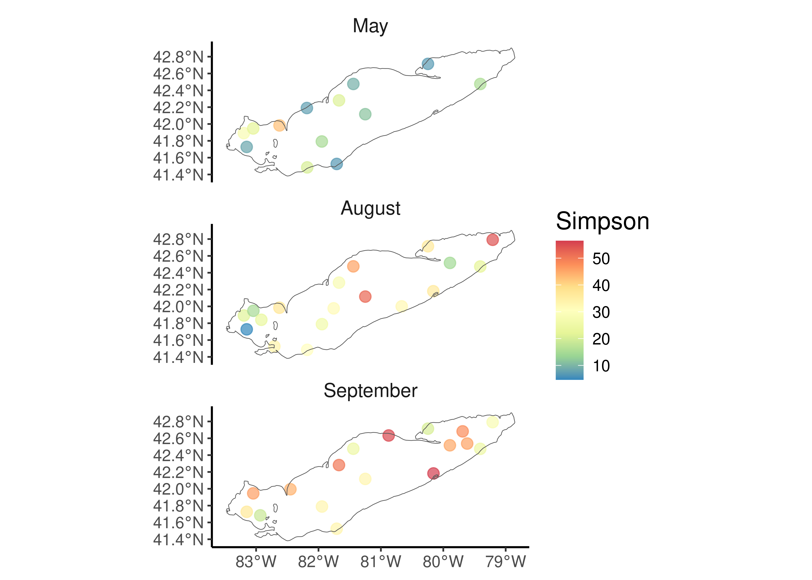{fig-align='center' width=2100}
:::
:::

::: {.cell layout-align="center"}

```{.r .cell-code}
div_sf %>%
  ggplot(aes(x = Richness, y = Shannon, color = Simpson)) + 
  geom_point() + 
  scale_color_distiller(palette = "Spectral")
```

::: {.cell-output-display}
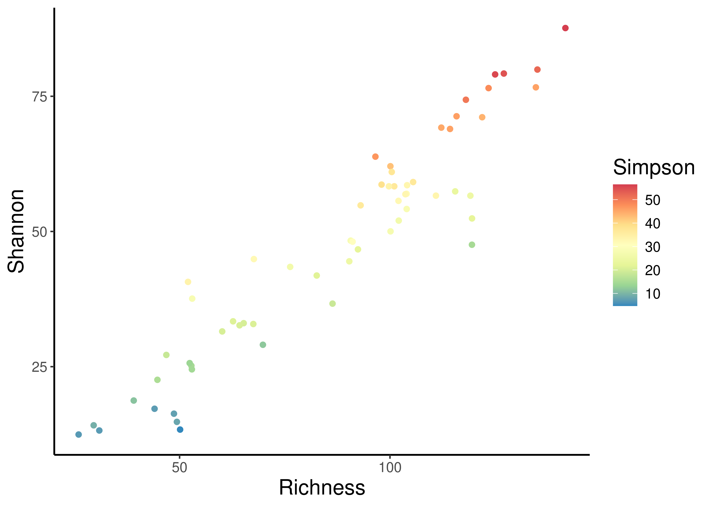{fig-align='center' width=2100}
:::
:::


These metrics are all highly correlated with each other. Remember that this is rarefied to an even sequencing depth!


::: {.cell layout-align="center"}

```{.r .cell-code}
bottom_sf <- div_sf %>%
  dplyr::filter(Depth_Class == "B") %>%
  mutate(Month = factor(Month, levels = c("May", "August","September")))

shift_bottom_sf <- bottom_sf

st_geometry(shift_bottom_sf) <- st_geometry(bottom_sf) + c(.06,-.03)

shift_bottom_sf <- st_set_crs(shift_bottom_sf, st_crs(bottom_sf))

div_sf %>%
  dplyr::filter(Depth_Class == "S") %>%
  mutate(Month = factor(Month, levels = c("May", "August","September"))) %>%
  ggplot() + 
  geom_sf(data = shift_bottom_sf, aes(color = Richness), size = 4, alpha = 1) + 
  geom_sf(aes(color = Richness), size = 4, alpha = 1) + 
  facet_wrap(~Month, ncol = 1) + 
  scale_color_distiller(palette = "Spectral") + 
  geom_sf(data = erie_outline, fill = NA)
```

::: {.cell-output-display}
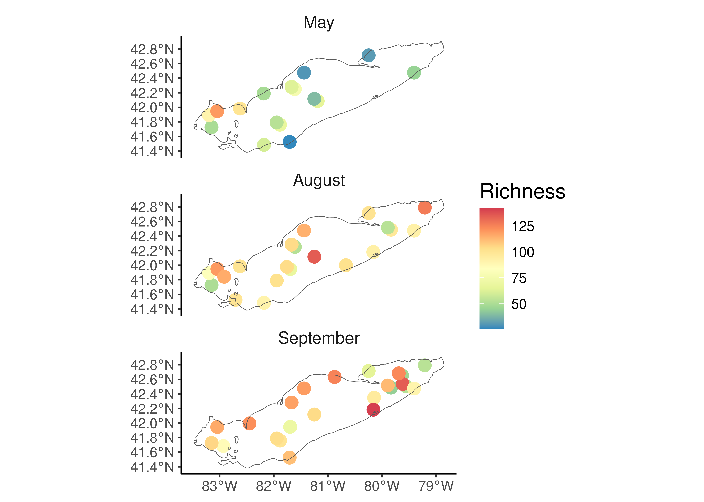{fig-align='center' width=2100}
:::
:::

::: {.cell layout-align="center"}

```{.r .cell-code}
devtools::session_info()
```

::: {.cell-output .cell-output-stdout}
```
─ Session info ───────────────────────────────────────────────────────────────
 setting  value
 version  R version 4.3.3 (2024-02-29)
 os       Rocky Linux 9.5 (Blue Onyx)
 system   x86_64, linux-gnu
 ui       X11
 language (EN)
 collate  en_US.UTF-8
 ctype    en_US.UTF-8
 tz       America/New_York
 date     2026-01-08
 pandoc   3.1.1 @ /usr/lib/rstudio-server/bin/quarto/bin/tools/ (via rmarkdown)
 quarto   1.3.450 @ /usr/lib/rstudio-server/bin/quarto/bin/quarto

─ Packages ───────────────────────────────────────────────────────────────────
 ! package           * version    date (UTC) lib source
   abind               1.4-8      2024-09-12 [1] RSPM (R 4.3.3)
   ade4                1.7-23     2025-02-14 [1] RSPM (R 4.3.3)
   ape                 5.8-1      2024-12-16 [1] RSPM (R 4.3.3)
   backports           1.5.0      2024-05-23 [1] RSPM (R 4.3.3)
   base64enc           0.1-3      2015-07-28 [1] RSPM (R 4.3.3)
 P beeswarm            0.4.0      2021-06-01 [?] CRAN (R 4.3.2)
   Biobase             2.62.0     2023-10-24 [1] Bioconductor
   BiocGenerics        0.48.1     2023-11-01 [1] Bioconductor
 P BiocManager         1.30.25    2024-08-28 [?] CRAN (R 4.3.2)
   biomformat          1.30.0     2023-10-24 [1] Bioconductor
   Biostrings          2.70.3     2024-03-13 [1] Bioconductor 3.18 (R 4.3.3)
   bitops              1.0-9      2024-10-03 [1] RSPM (R 4.3.3)
   broom               1.0.8      2025-03-28 [1] RSPM (R 4.3.3)
   cachem              1.1.0      2024-05-16 [1] RSPM (R 4.3.3)
   car                 3.1-3      2024-09-27 [1] RSPM (R 4.3.3)
   carData             3.0-5      2022-01-06 [1] RSPM (R 4.3.3)
 P class               7.3-22     2023-05-03 [?] CRAN (R 4.3.3)
   classInt            0.4-11     2025-01-08 [1] RSPM (R 4.3.3)
 P cli                 3.6.3      2024-06-21 [?] CRAN (R 4.3.2)
 P cluster             2.1.6      2023-12-01 [?] CRAN (R 4.3.3)
 P codetools           0.2-19     2023-02-01 [?] CRAN (R 4.3.3)
   colorspace          2.1-1      2024-07-26 [1] RSPM (R 4.3.3)
   cols4all            0.8        2024-10-16 [1] RSPM (R 4.3.3)
   crayon              1.5.3      2024-06-20 [1] RSPM (R 4.3.3)
 P crosstalk           1.2.1      2023-11-23 [?] CRAN (R 4.3.2)
 P data.table          1.16.2     2024-10-10 [?] RSPM (R 4.3.3)
   DBI                 1.2.3      2024-06-02 [1] RSPM (R 4.3.3)
 P devtools            2.4.5      2022-10-11 [?] CRAN (R 4.3.2)
   dichromat           2.0-0.1    2022-05-02 [1] RSPM (R 4.3.3)
   digest              0.6.37     2024-08-19 [1] RSPM (R 4.3.3)
   dplyr             * 1.1.4      2023-11-17 [1] RSPM (R 4.3.3)
   e1071               1.7-16     2024-09-16 [1] RSPM (R 4.3.3)
 P ellipsis            0.3.2      2021-04-29 [?] CRAN (R 4.3.2)
 P evaluate            1.0.1      2024-10-10 [?] RSPM (R 4.3.3)
 P extraDistr          1.10.0     2023-11-30 [?] CRAN (R 4.3.2)
   farver              2.1.2      2024-05-13 [1] RSPM (R 4.3.3)
   fastmap             1.2.0      2024-05-15 [1] RSPM (R 4.3.3)
   FNN                 1.1.4.1    2024-09-22 [1] RSPM (R 4.3.3)
   forcats           * 1.0.0      2023-01-29 [1] RSPM (R 4.3.3)
   foreach             1.5.2      2022-02-02 [1] RSPM (R 4.3.3)
   Formula             1.2-5      2023-02-24 [1] RSPM (R 4.3.3)
   fs                  1.6.5      2024-10-30 [1] RSPM (R 4.3.3)
 P fun.gus           * 0.5.1      2025-05-16 [?] Github (MarschmiLab/fun.gus@ad8bd98)
 P furrr               0.3.1      2022-08-15 [?] CRAN (R 4.3.2)
 P future              1.49.0     2025-05-09 [?] RSPM (R 4.3.3)
   generics            0.1.3      2022-07-05 [1] RSPM (R 4.3.3)
   GenomeInfoDb        1.38.8     2024-03-15 [1] Bioconductor 3.18 (R 4.3.3)
   GenomeInfoDbData    1.2.11     2025-04-11 [1] Bioconductor
 P ggbeeswarm        * 0.7.2      2023-04-29 [?] CRAN (R 4.3.2)
   ggplot2           * 3.5.2      2025-04-09 [1] RSPM (R 4.3.3)
   ggpubr            * 0.6.0.999  2025-05-21 [1] Github (kassambara/ggpubr@6aeb4f7)
   ggsignif            0.6.4      2022-10-13 [1] RSPM (R 4.3.3)
 P globals             0.18.0     2025-05-08 [?] RSPM (R 4.3.3)
   glue                1.8.0      2024-09-30 [1] RSPM (R 4.3.3)
   gstat             * 2.1-3      2025-05-21 [1] Github (r-spatial/gstat@bf9410d)
   gtable              0.3.6      2024-10-25 [1] RSPM (R 4.3.3)
 P hillR               0.5.2      2023-08-19 [?] CRAN (R 4.3.2)
   hms                 1.1.3      2023-03-21 [1] RSPM (R 4.3.3)
   htmltools           0.5.8.1    2024-04-04 [1] RSPM (R 4.3.3)
 P htmlwidgets         1.6.4      2023-12-06 [?] CRAN (R 4.3.2)
 P httpuv              1.6.15     2024-03-26 [?] CRAN (R 4.3.2)
   igraph              2.1.4      2025-01-23 [1] RSPM (R 4.3.3)
   intervals           0.15.5     2024-08-23 [1] RSPM (R 4.3.3)
   IRanges             2.36.0     2023-10-24 [1] Bioconductor
   iterators           1.0.14     2022-02-05 [1] RSPM (R 4.3.3)
   jsonlite            2.0.0      2025-03-27 [1] RSPM (R 4.3.3)
 P KernSmooth          2.23-22    2023-07-10 [?] CRAN (R 4.3.3)
 P knitr               1.49       2024-11-08 [?] CRAN (R 4.3.2)
   labeling            0.4.3      2023-08-29 [1] RSPM (R 4.3.3)
 P later               1.3.2      2023-12-06 [?] CRAN (R 4.3.2)
 P lattice             0.22-5     2023-10-24 [?] CRAN (R 4.3.3)
   leafem              0.2.4      2025-05-01 [1] RSPM (R 4.3.3)
   leaflegend          1.2.1      2024-05-09 [1] RSPM (R 4.3.3)
   leaflet             2.2.2      2024-03-26 [1] RSPM (R 4.3.3)
   leaflet.providers   2.0.0      2023-10-17 [1] RSPM (R 4.3.3)
   leafsync            0.1.0      2019-03-05 [1] RSPM (R 4.3.3)
   lifecycle           1.0.4      2023-11-07 [1] RSPM (R 4.3.3)
 P listenv             0.9.1      2024-01-29 [?] CRAN (R 4.3.2)
   logger              0.4.0      2024-10-22 [1] RSPM (R 4.3.3)
   lubridate         * 1.9.4      2024-12-08 [1] RSPM (R 4.3.3)
   lwgeom              0.2-14     2024-02-21 [1] RSPM (R 4.3.3)
   magrittr            2.0.3      2022-03-30 [1] RSPM (R 4.3.3)
   maptiles            0.10.0     2025-05-07 [1] RSPM (R 4.3.3)
 P MASS                7.3-60.0.1 2024-01-13 [?] CRAN (R 4.3.3)
 P Matrix              1.6-5      2024-01-11 [?] CRAN (R 4.3.3)
   memoise             2.0.1      2021-11-26 [1] RSPM (R 4.3.3)
 P mgcv                1.9-1      2023-12-21 [?] CRAN (R 4.3.3)
   microbenchmark      1.5.0      2024-09-04 [1] RSPM (R 4.3.3)
   microViz          * 0.12.7     2025-04-16 [1] https://david-barnett.r-universe.dev (R 4.3.3)
 P mime                0.12       2021-09-28 [?] CRAN (R 4.3.2)
 P miniUI              0.1.1.1    2018-05-18 [?] CRAN (R 4.3.2)
   multtest            2.58.0     2023-10-24 [1] Bioconductor
   munsell             0.5.1      2024-04-01 [1] RSPM (R 4.3.3)
 P NatParksPalettes    0.2.0      2022-10-09 [?] CRAN (R 4.3.2)
 P nlme                3.1-164    2023-11-27 [?] CRAN (R 4.3.3)
 P pacman              0.5.1      2019-03-11 [?] CRAN (R 4.3.2)
 P parallelly          1.44.0     2025-05-07 [?] RSPM (R 4.3.3)
   patchwork         * 1.3.0      2024-09-16 [1] RSPM (R 4.3.3)
   permute             0.9-7      2022-01-27 [1] RSPM (R 4.3.3)
   phyloseq          * 1.46.0     2023-10-24 [1] Bioconductor
   pillar              1.10.2     2025-04-05 [1] RSPM (R 4.3.3)
 P pkgbuild            1.4.7      2025-03-24 [?] RSPM (R 4.3.3)
   pkgconfig           2.0.3      2019-09-22 [1] RSPM (R 4.3.3)
 P pkgload             1.4.0      2024-06-28 [?] CRAN (R 4.3.2)
   plyr                1.8.9      2023-10-02 [1] RSPM (R 4.3.3)
   png                 0.1-8      2022-11-29 [1] RSPM (R 4.3.3)
   polynom             1.4-1      2022-04-11 [1] RSPM (R 4.3.3)
 P profvis             0.4.0      2024-09-20 [?] CRAN (R 4.3.2)
 P promises            1.3.0      2024-04-05 [?] CRAN (R 4.3.2)
   proxy               0.4-27     2022-06-09 [1] RSPM (R 4.3.3)
 P purrr             * 1.0.2      2023-08-10 [?] CRAN (R 4.3.2)
 P R6                  2.5.1      2021-08-19 [?] CRAN (R 4.3.2)
   raster              3.6-32     2025-03-28 [1] RSPM (R 4.3.3)
   RColorBrewer        1.1-3      2022-04-03 [1] RSPM (R 4.3.3)
 P Rcpp                1.0.13-1   2024-11-02 [?] RSPM (R 4.3.3)
   RCurl               1.98-1.17  2025-03-22 [1] RSPM (R 4.3.3)
   readr             * 2.1.5      2024-01-10 [1] RSPM (R 4.3.3)
 P remotes             2.5.0      2024-03-17 [?] CRAN (R 4.3.2)
   renv                1.0.3      2023-09-19 [1] CRAN (R 4.3.3)
   reshape2            1.4.4      2020-04-09 [1] RSPM (R 4.3.3)
   rhdf5               2.46.1     2023-11-29 [1] Bioconductor 3.18 (R 4.3.3)
   rhdf5filters        1.14.1     2023-11-06 [1] Bioconductor
   Rhdf5lib            1.24.2     2024-02-07 [1] Bioconductor 3.18 (R 4.3.3)
 P rlang               1.1.4      2024-06-04 [?] CRAN (R 4.3.2)
   rmarkdown           2.29       2024-11-04 [1] RSPM (R 4.3.3)
   rstatix             0.7.2      2023-02-01 [1] RSPM (R 4.3.3)
   rstudioapi          0.17.1     2024-10-22 [1] RSPM (R 4.3.3)
   s2                  1.1.8      2025-05-12 [1] RSPM (R 4.3.3)
   S4Vectors           0.40.2     2023-11-23 [1] Bioconductor 3.18 (R 4.3.3)
   scales              1.3.0      2023-11-28 [1] RSPM (R 4.3.3)
 P sessioninfo         1.2.3      2025-02-05 [?] RSPM (R 4.3.3)
   sf                * 1.0-21     2025-05-21 [1] Github (r-spatial/sf@a9ceef1)
 P shiny               1.9.1      2024-08-01 [?] CRAN (R 4.3.2)
   sp                  2.2-0      2025-02-01 [1] RSPM (R 4.3.3)
   spacesXYZ           1.5-1      2025-02-10 [1] RSPM (R 4.3.3)
   spacetime           1.3-3      2025-02-13 [1] RSPM (R 4.3.3)
   stars               0.6-8      2025-02-01 [1] RSPM (R 4.3.3)
   stringi             1.8.7      2025-03-27 [1] RSPM (R 4.3.3)
   stringr           * 1.5.1      2023-11-14 [1] RSPM (R 4.3.3)
 P survival            3.5-8      2024-02-14 [?] CRAN (R 4.3.3)
   terra             * 1.8-52     2025-05-21 [1] https://rspatial.r-universe.dev (R 4.3.3)
   tibble            * 3.2.1      2023-03-20 [1] RSPM (R 4.3.3)
   tidyr             * 1.3.1      2024-01-24 [1] RSPM (R 4.3.3)
   tidyselect          1.2.1      2024-03-11 [1] RSPM (R 4.3.3)
   tidyverse         * 2.0.0      2023-02-22 [1] RSPM (R 4.3.3)
   timechange          0.3.0      2024-01-18 [1] RSPM (R 4.3.3)
   tmap              * 4.1        2025-05-21 [1] Github (r-tmap/tmap@e24262a)
   tmaptools           3.2        2025-01-13 [1] RSPM (R 4.3.3)
   tzdb                0.5.0      2025-03-15 [1] RSPM (R 4.3.3)
   units               0.8-7      2025-03-11 [1] RSPM (R 4.3.3)
 P urlchecker          1.0.1      2021-11-30 [?] CRAN (R 4.3.2)
 P usethis             3.1.0      2024-11-26 [?] CRAN (R 4.3.2)
   vctrs               0.6.5      2023-12-01 [1] RSPM (R 4.3.3)
   vegan               2.6-10     2025-01-29 [1] RSPM (R 4.3.3)
 P vipor               0.4.7      2023-12-18 [?] CRAN (R 4.3.2)
   viridisLite         0.4.2      2023-05-02 [1] RSPM (R 4.3.3)
   withr               3.0.2      2024-10-28 [1] RSPM (R 4.3.3)
   wk                  0.9.4      2024-10-11 [1] RSPM (R 4.3.3)
 P xfun                0.49       2024-10-31 [?] RSPM (R 4.3.3)
   XML                 3.99-0.18  2025-01-01 [1] RSPM (R 4.3.3)
 P xtable              1.8-4      2019-04-21 [?] CRAN (R 4.3.2)
   xts                 0.14.1     2024-10-15 [1] RSPM (R 4.3.3)
   XVector             0.42.0     2023-10-24 [1] Bioconductor
   yaml                2.3.10     2024-07-26 [1] RSPM (R 4.3.3)
   zlibbioc            1.48.2     2024-03-13 [1] Bioconductor 3.18 (R 4.3.3)
   zoo                 1.8-14     2025-04-10 [1] RSPM (R 4.3.3)

 [1] /local/workdir/arp277/AAM_ERI_2024/renv/library/R-4.3/x86_64-pc-linux-gnu
 [2] /home/arp277/.cache/R/renv/sandbox/R-4.3/x86_64-pc-linux-gnu/fd835031

 * ── Packages attached to the search path.
 P ── Loaded and on-disk path mismatch.

──────────────────────────────────────────────────────────────────────────────
```
:::
:::