# Load packages 

::: {.cell layout-align="center"}

```{.r .cell-code}
pacman::p_load(phyloseq, tidyverse, ggpubr, microViz, fun.gus, ggbeeswarm, patchwork, install = FALSE)

source("code/R/plotting_aesthetics.R")

load("data/06_Flow_Cytometry/flow_physeq.RData")
```
:::


# Check Rarefaction

This function comes from fun.gus!


::: {.cell layout-align="center"}

```{.r .cell-code}
set.seed(031491)
rarefaction_data <- fast_rarefaction_curves(flow_physeq, iterations = 50, steps = 40)
```
:::


# Plotting Rarefaction Curves


::: {.cell layout-align="center"}

```{.r .cell-code}
rarefaction_data %>%
  pivot_longer(hill0:hill2, names_to = "Order", values_to = "Value") %>%
  ggplot(aes(x = depth, y = Value, color = sample_id)) + 
  stat_summary(geom = "line", fun = mean) + 
  facet_wrap(~Order, scales = "free_y") + 
  theme(legend.position = "none")
```

::: {.cell-output-display}
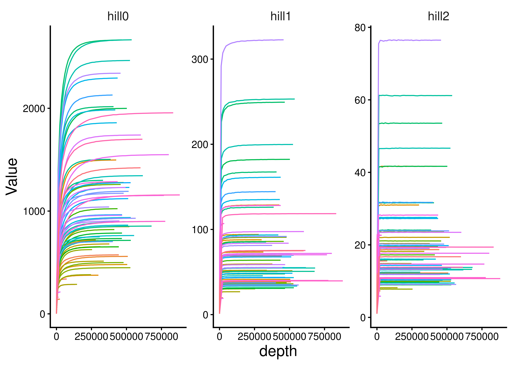{fig-align='center' width=2100}
:::

```{.r .cell-code}
rarefaction_data %>%
  ggplot(aes(x = depth, y = hill0, color = sample_id)) + 
  stat_summary(geom = "line", fun = mean) + 
  theme(legend.position = "none") + 
  coord_cartesian(ylim = c(0,1000), xlim = c(0, 50000))
```

::: {.cell-output-display}
{fig-align='center' width=2100}
:::

```{.r .cell-code}
rarefaction_data %>%
  ggplot(aes(x = depth, y = hill0, color = sample_id)) + 
  stat_summary(geom = "line", fun = mean) + 
  theme(legend.position = "none") + 
  coord_cartesian(ylim = c(0,1000), xlim = c(0, 50000))
```

::: {.cell-output-display}
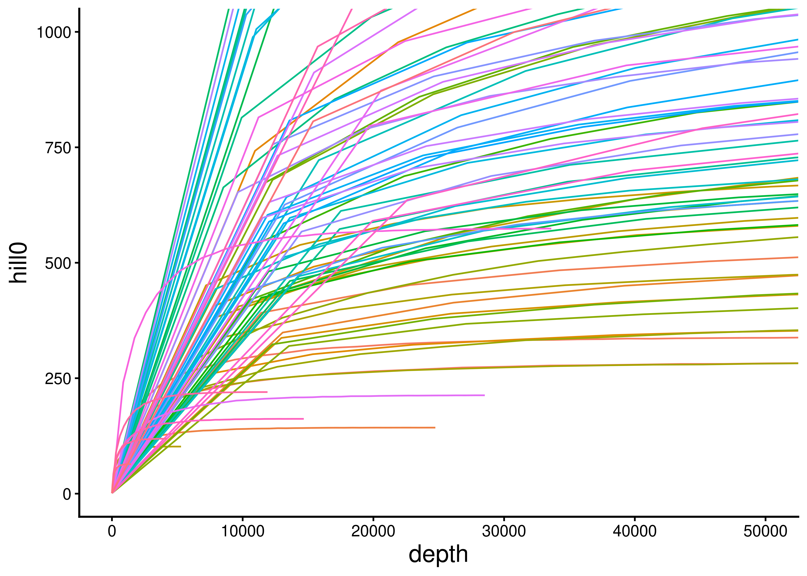{fig-align='center' width=2100}
:::

```{.r .cell-code}
rarefaction_data %>%
  ggplot(aes(x = depth, y = hill0, color = sample_id)) + 
  stat_summary(geom = "line", fun = mean) + 
  theme(legend.position = "none") + 
  coord_cartesian(ylim = c(0,250), xlim = c(0, 5000))
```

::: {.cell-output-display}
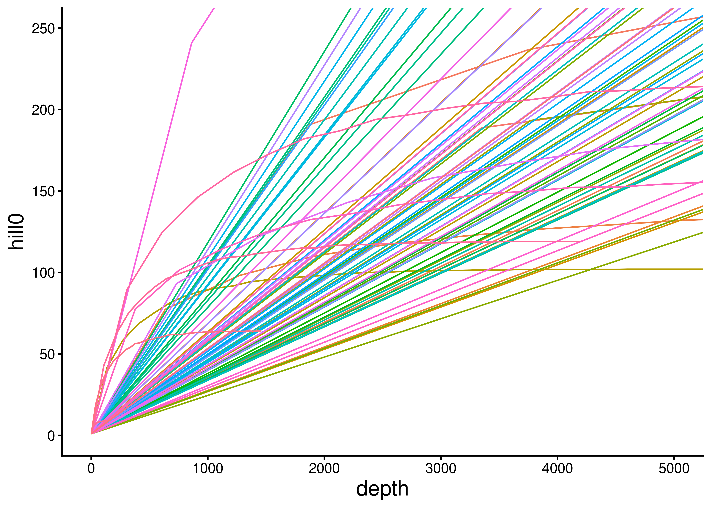{fig-align='center' width=2100}
:::
:::


They all "appear" to flatten, but we can be real with ourselves that we probably want at least 10000 reads. 


::: {.cell layout-align="center"}

```{.r .cell-code}
summarized_rarefaction <- 
  rarefaction_data %>%
  group_by(sample_id) %>%
  filter(depth == max(depth)) %>%
  pivot_longer(hill0:hill2, names_to = "Order", values_to = "Value") %>%
  ungroup() %>%
  group_by(sample_id, Order) %>%
  summarize(depth = mean(depth),
            value = mean(Value)) 

summarized_rarefaction %>%
  ggplot(aes(x = depth, y = value)) + 
  geom_point() + 
  facet_wrap(~Order, scales = "free_y") + 
  stat_cor() + 
  geom_vline(xintercept = 10000)
```

::: {.cell-output-display}
{fig-align='center' width=2100}
:::

```{.r .cell-code}
summarized_rarefaction %>%
  filter(depth < 50000) %>%
  ggplot(aes(x = depth, y = value)) + 
  geom_point() + 
  facet_wrap(~Order, scales = "free_y") + 
  stat_cor() + 
  geom_vline(xintercept = 10000)
```

::: {.cell-output-display}
{fig-align='center' width=2100}
:::
:::


Lol, yes. We especially see down where richness is less than 250. I think 10,000 might be a reasonable cut-off. Especially since some of those lows are sitting well within warm, surface samples, which throughout the dataset generally have high richness. 


::: {.cell layout-align="center"}

```{.r .cell-code}
sort(sample_sums(flow_physeq)) %>% head(10)
```

::: {.cell-output .cell-output-stdout}
```
KH_D072 KH_D081 KH_D082 KH_D080 KH_D014 KH_D079 KH_D076 KH_D004 KH_D066 KH_D071 
      1     151    1460    4197    5284   11901   14676   24740   28522   33609 
```
:::

```{.r .cell-code}
# Who are these?

flow_physeq %>%
  prune_samples(sample_sums(.) < 1e4, .) %>%
  sample_data() %>%
  data.frame() %>%
  select(Sample_ID, DNA_ID)
```

::: {.cell-output .cell-output-stdout}
```
                            Sample_ID  DNA_ID
KH_D072   AAM_ERI_20240914_91_FP_ET_1 KH_D072
KH_D080  AAM_ERI_20240913_964_FP_ET_2 KH_D080
KH_D081  AAM_ERI_20240914_966_FP_ET_1 KH_D081
KH_D082 AAM_ERI_20240915_EB06_FP_ET_1 KH_D082
KH_D014   AAM_ERI_20240520_91_FP_ET_1 KH_D014
```
:::

```{.r .cell-code}
floor_physeq <- 
  flow_physeq %>%
  prune_samples(sample_sums(.) > 1e4, .)

rar_limit <- min(sample_sums(floor_physeq))

even_rarefaction_results <- 
  rarefaction_alpha_calculations(floor_physeq, 
                               rarefy_depth = rar_limit,
                               iterations = 100,
                               method = "taxonomic",
                               seed = 031491,
                               threads = 8)
```

::: {.cell-output .cell-output-stdout}
```
[1] "Calculating taxonomic diversity approaches on floor_physeq"
```
:::

```{.r .cell-code}
for_join <- 
  summarized_rarefaction %>%
  select(Sample = sample_id, Measure = Order, non_rare = value) %>%
  mutate(Measure = case_when(Measure == "hill0" ~ "Richness",
                             Measure == "hill1" ~ "Shannon",
                             Measure == "hill2" ~ "Simpson"))

even_rarefaction_results %>%
  left_join(for_join) %>%
  ggplot(aes(x = non_rare, y = qD)) + 
  geom_point() + 
  geom_smooth(method = "lm", se = FALSE, color = "orange" ) + 
  facet_wrap(~Measure, scales = "free") + 
  geom_abline(intercept = 0, slope = 1) + 
  labs(x = "Non-Rarefied Values", y = "Rarefied to Even Depth") + 
  stat_regline_equation(formula = y ~ x + 0, color = "orange")
```

::: {.cell-output-display}
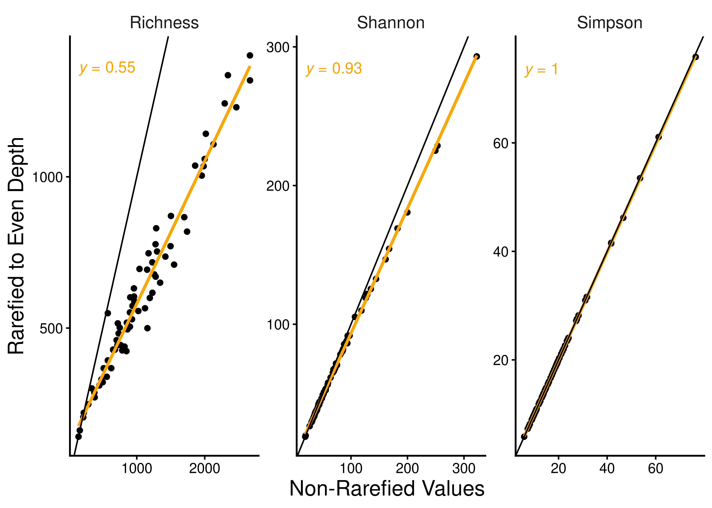{fig-align='center' width=2100}
:::
:::


Okay, so here we are comparing the values we get for alpha diversity, either by rarefying all samples to an even depth (y axis) or just using observed values without rarefaction (x-axis). For Hill numbers > 0 (Shannon and Simpson) the values are essentially equal. However, we do have lower observed Richness when we rarefy to an even depth, especially at higher "observed richnesses". 

# Examining Richness


::: {.cell layout-align="center"}

```{.r .cell-code}
sample_df <- sample_data(floor_physeq) %>%
  data.frame()

sample_and_div <-
  even_rarefaction_results %>%
  rename(DNA_ID = Sample) %>%
  left_join(sample_df)
```
:::

::: {.cell layout-align="center"}

```{.r .cell-code}
sample_and_div %>%
  mutate(Month = factor(Month, levels = c("May","August","September"))) %>%
  ggplot(aes(x = Month, y = qD)) + 
  geom_boxplot() + 
  geom_point() + 
  facet_wrap(~Measure, scales = "free")
```

::: {.cell-output-display}
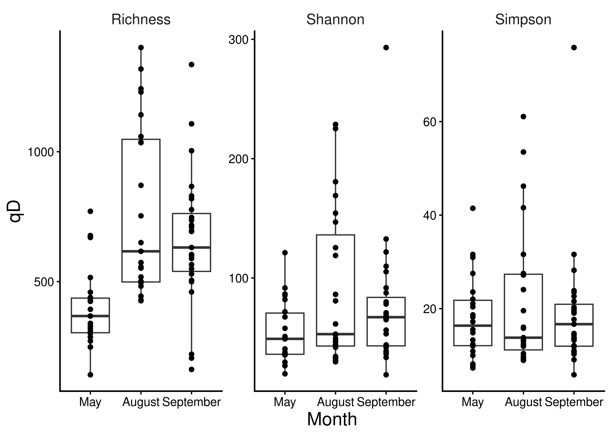{fig-align='center' width=2100}
:::

```{.r .cell-code}
sample_and_div %>%
  filter(Measure == "Richness") %>%
  mutate(Month = factor(Month, levels = c("May","August","September")),
         Basin = factor(Basin, levels = c("W","C","E"))) %>%
  ggplot(aes(x = Basin, y = qD)) + 
  geom_boxplot() + 
  geom_point() + 
  facet_wrap(~Month, scales = "free")
```

::: {.cell-output-display}
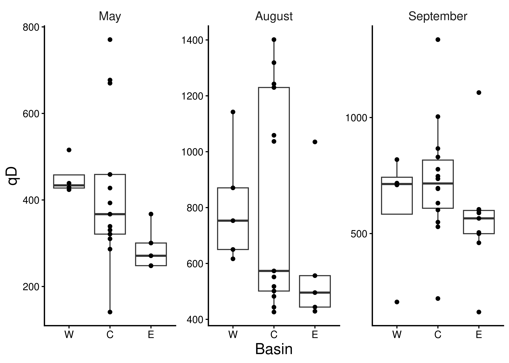{fig-align='center' width=2100}
:::

```{.r .cell-code}
sample_and_div %>%
  filter(Measure == "Richness") %>%
  mutate(Month = factor(Month, levels = c("May","August","September")),
         Basin = factor(Basin, levels = c("W","C","E"))) %>%
  ggplot(aes(x = Depth_Class, y = qD)) + 
  geom_boxplot() + 
  geom_point() + 
  facet_wrap(~Month, scales = "free")
```

::: {.cell-output-display}
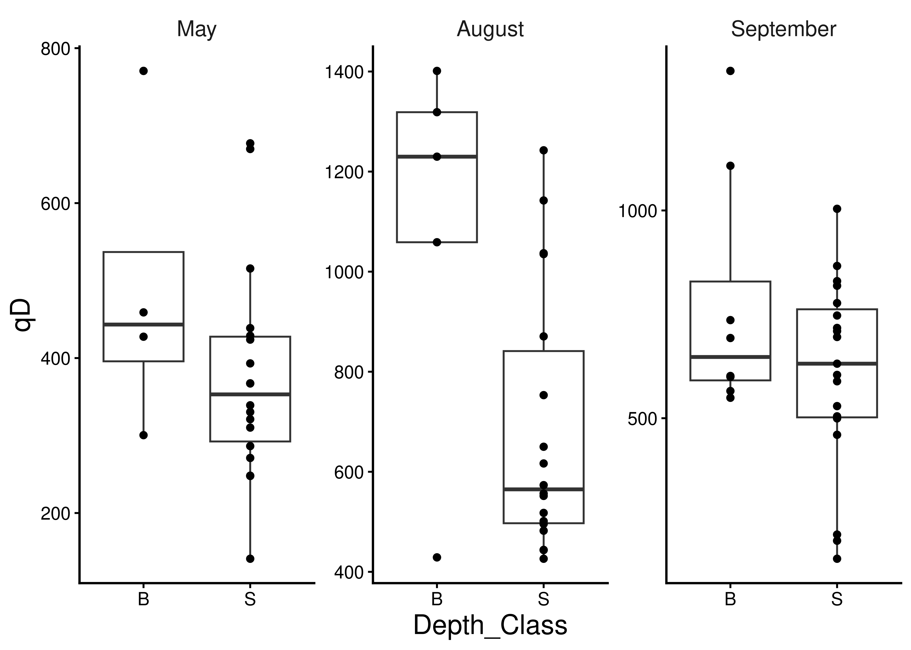{fig-align='center' width=2100}
:::

```{.r .cell-code}
sample_and_div %>%
  filter(Measure == "Richness") %>%
  mutate(Month = factor(Month, levels = c("May","August","September")),
         Basin = factor(Basin, levels = c("W","C","E"))) %>%
  ggplot(aes(x = Depth_Class, y = qD)) + 
  geom_boxplot() + 
  geom_point() + 
  facet_wrap(~Month)
```

::: {.cell-output-display}
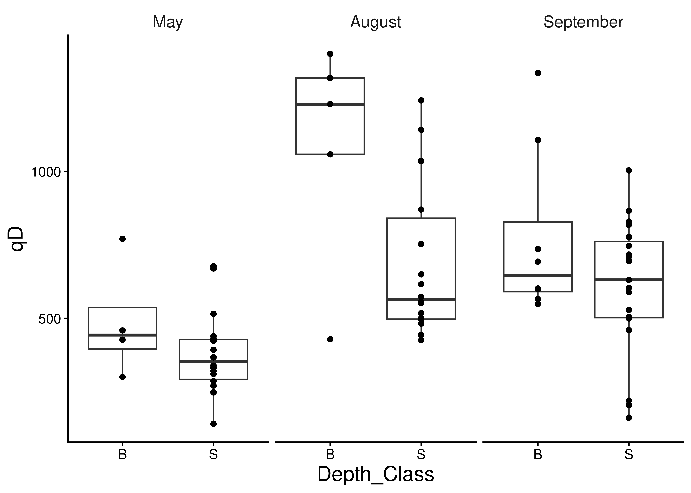{fig-align='center' width=2100}
:::

```{.r .cell-code}
sample_and_div %>%
  filter(Measure == "Shannon") %>%
  mutate(Month = factor(Month, levels = c("May","August","September")),
         Basin = factor(Basin, levels = c("W","C","E"))) %>%
  ggplot(aes(x = Depth_Class, y = qD)) + 
  geom_boxplot() + 
  geom_point() + 
  facet_wrap(~Month)
```

::: {.cell-output-display}
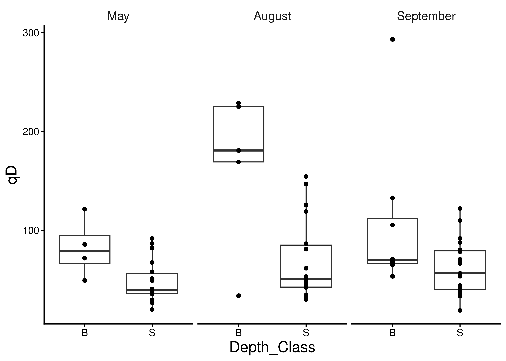{fig-align='center' width=2100}
:::

```{.r .cell-code}
sample_and_div %>%
  filter(Measure == "Simpson") %>%
  mutate(Month = factor(Month, levels = c("May","August","September")),
         Basin = factor(Basin, levels = c("W","C","E"))) %>%
  ggplot(aes(x = Depth_Class, y = qD)) + 
  geom_boxplot() + 
  geom_point() + 
  facet_wrap(~Month)
```

::: {.cell-output-display}
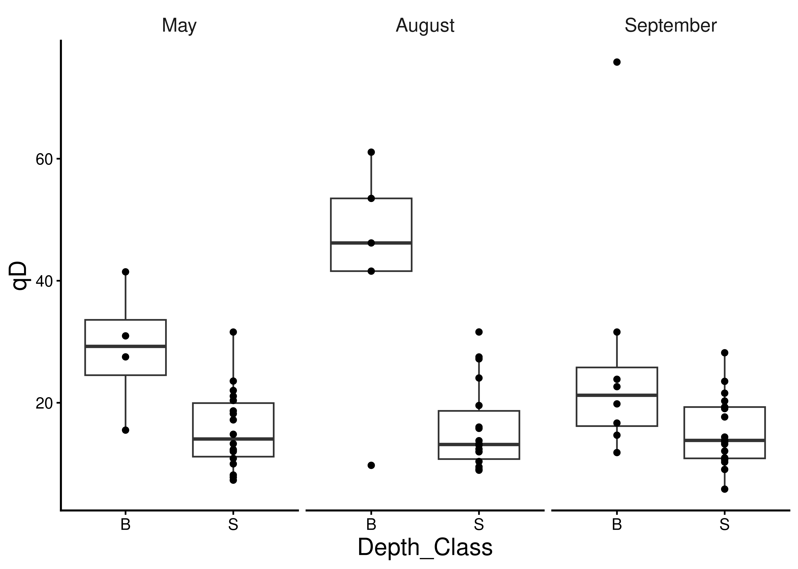{fig-align='center' width=2100}
:::
:::


# Add diversity to our physeq and save


::: {.cell layout-align="center"}

```{.r .cell-code}
alpha_for_join <-
  even_rarefaction_results %>%
  rename(DNA_ID = Sample) %>%
  select(-st.dev) %>%
  pivot_wider(names_from = Measure, values_from = qD) 

diversity_physeq <- 
  floor_physeq %>%
  ps_join(alpha_for_join)

diversity_physeq_lower_abundance <- 
  flow_physeq %>%
  subset_samples(.,!DNA_ID %in% c("KH_D072","KH_D081")) %>%
  prune_taxa(taxa_sums(.) > 0, .) %>%
  ps_join(alpha_for_join)

save(diversity_physeq, 
     file = "data/07_Alpha_Diversity/diversity_physeq.RData")

save(diversity_physeq_lower_abundance,
     file = "data/07_Alpha_Diversity/diversity_physeq_lower_abundance.RData")
```
:::


# Mapping Prokaryotic Diversity

# Mapping Cell Counts


::: {.cell layout-align="center"}

```{.r .cell-code}
pacman::p_load(sf, terra, tmap, gstat, install = FALSE)

# Define some shapes and objects

raw_erie <- read_sf("data/spatial_imports/hydro_p_LakeErie/hydro_p_LakeErie.shp") %>%
  st_transform(crs = "EPSG:4326")

erie_outline <- raw_erie %>%
  st_union()

div_data <- 
  diversity_physeq %>%
  sample_data() %>%
  data.frame() 

div_sf <- div_data %>% 
  dplyr::filter(!is.na(Longitude)) %>% 
  st_as_sf(coords = c("Longitude","Latitude"), crs = "EPSG:4326")
```
:::

::: {.cell layout-align="center"}

```{.r .cell-code}
div_sf %>%
  dplyr::filter(Depth_Class == "S") %>%
  mutate(Month = factor(Month, levels = c("May", "August","September"))) %>%
  ggplot() + 
  geom_sf(aes(color = Richness), size = 3, alpha = 0.7) + 
  facet_wrap(~Month, ncol = 1) + 
  scale_color_distiller(palette = "Spectral") + 
  geom_sf(data = erie_outline, fill = NA)
```

::: {.cell-output-display}
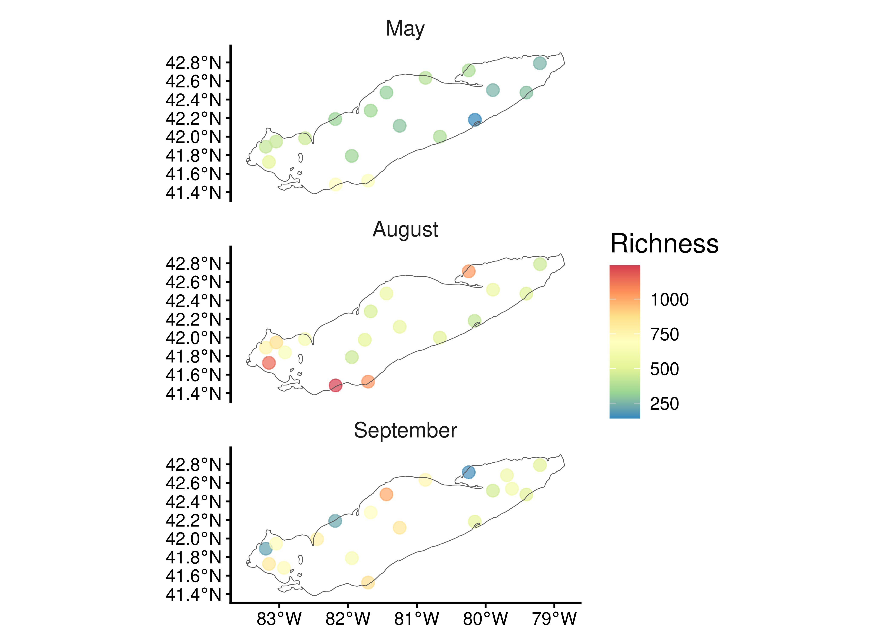{fig-align='center' width=2100}
:::

```{.r .cell-code}
div_sf %>%
  dplyr::filter(Depth_Class == "S") %>%
  mutate(Month = factor(Month, levels = c("May", "August","September"))) %>%
  ggplot() + 
  geom_sf(aes(color = Shannon), size = 3, alpha = 0.7) + 
  facet_wrap(~Month, ncol = 1) + 
  scale_color_distiller(palette = "Spectral") + 
  geom_sf(data = erie_outline, fill = NA)
```

::: {.cell-output-display}
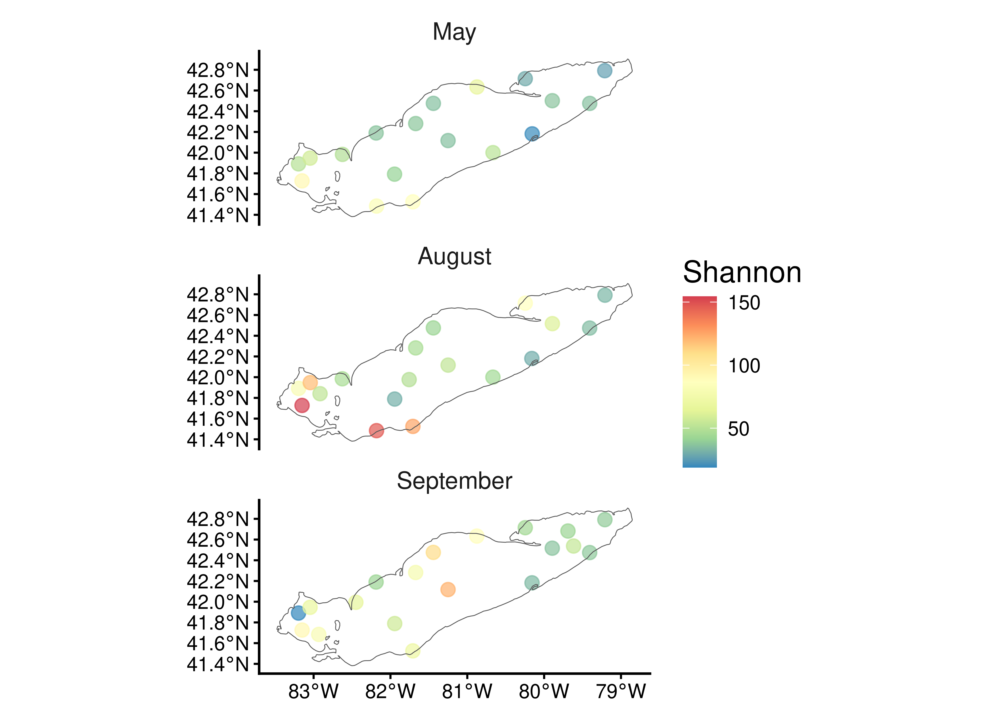{fig-align='center' width=2100}
:::

```{.r .cell-code}
div_sf %>%
  dplyr::filter(Depth_Class == "S") %>%
  mutate(Month = factor(Month, levels = c("May", "August","September"))) %>%
  ggplot() + 
  geom_sf(aes(color = Simpson), size = 3, alpha = 0.7) + 
  facet_wrap(~Month, ncol = 1) + 
  scale_color_distiller(palette = "Spectral") + 
  geom_sf(data = erie_outline, fill = NA)
```

::: {.cell-output-display}
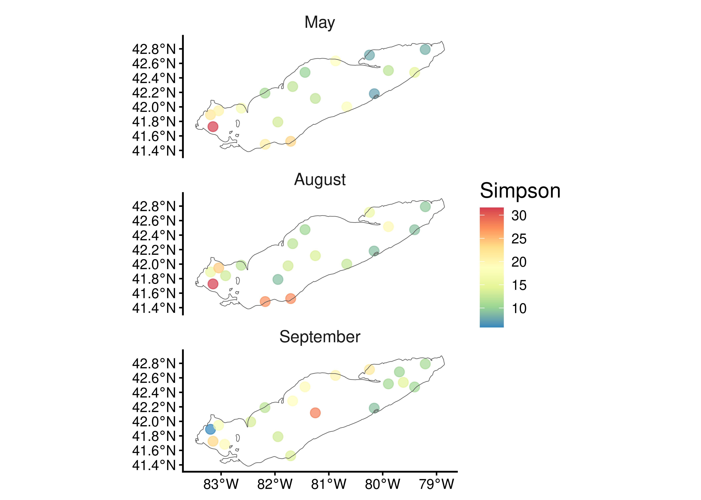{fig-align='center' width=2100}
:::
:::

::: {.cell layout-align="center"}

```{.r .cell-code}
div_sf %>%
  ggplot(aes(x = Richness, y = Shannon, color = Simpson)) + 
  geom_point() + 
  scale_color_distiller(palette = "Spectral")
```

::: {.cell-output-display}
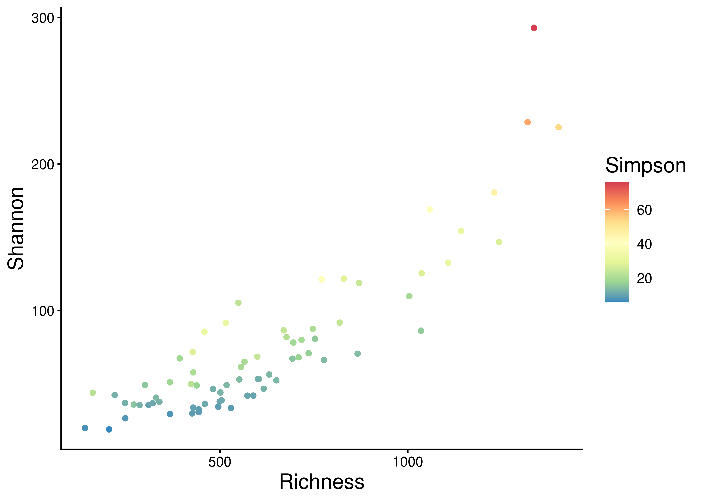{fig-align='center' width=2100}
:::
:::


These metrics are all highly correlated with each other. Remember that this is rarefied to an even sequencing depth!


::: {.cell layout-align="center"}

```{.r .cell-code}
bottom_sf <- div_sf %>%
  dplyr::filter(Depth_Class == "B") %>%
  mutate(Month = factor(Month, levels = c("May", "August","September")))

shift_bottom_sf <- bottom_sf

st_geometry(shift_bottom_sf) <- st_geometry(bottom_sf) + c(.06,-.03)

shift_bottom_sf <- st_set_crs(shift_bottom_sf, st_crs(bottom_sf))

div_sf %>%
  dplyr::filter(Depth_Class == "S") %>%
  mutate(Month = factor(Month, levels = c("May", "August","September"))) %>%
  ggplot() + 
  geom_sf(data = shift_bottom_sf, aes(color = Richness), size = 4, alpha = 1) + 
  geom_sf(aes(color = Richness), size = 4, alpha = 1) + 
  facet_wrap(~Month, ncol = 1) + 
  scale_color_distiller(palette = "Spectral") + 
  geom_sf(data = erie_outline, fill = NA)
```

::: {.cell-output-display}
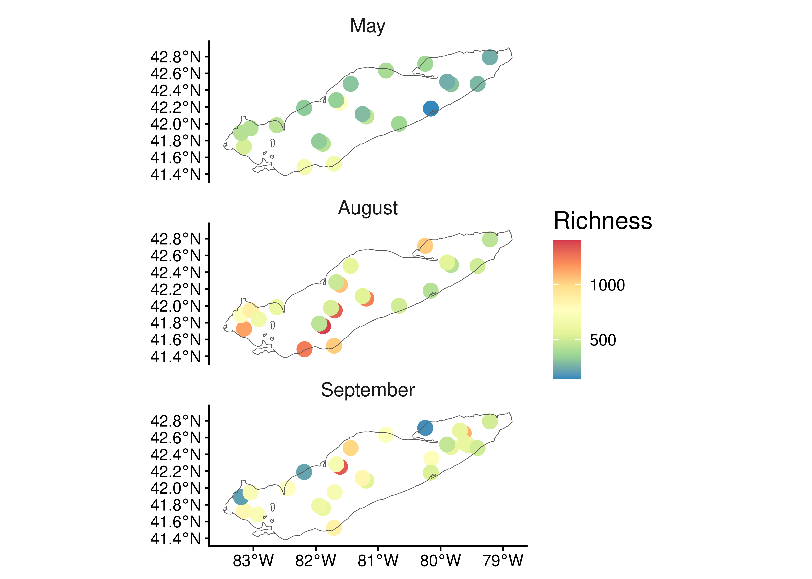{fig-align='center' width=2100}
:::
:::


# Compared Eukaryotic and Prokaryotic Diversity


::: {.cell layout-align="center"}

```{.r .cell-code}
load("data/07_Alpha_Diversity/euk_diversity_physeq.RData")

euk_div <- 
  euk_diversity_physeq %>%
  sample_data() %>%
  data.frame() %>%
  select(Sample_ID, Richness:Simpson) %>%
  rename_with(.cols = Richness:Simpson, .fn = \(x)paste0("Euk_", x))

joined_div <- 
  div_data %>%
  left_join(euk_div) 


joined_div %>%
  ggplot(aes(x = Richness, y = Euk_Richness)) +
  geom_point() + 
  stat_cor() + 
  facet_wrap(~Month)
```

::: {.cell-output-display}
{fig-align='center' width=2100}
:::

```{.r .cell-code}
joined_div %>%
  ggplot(aes(x = Shannon, y = Euk_Shannon)) +
  geom_point() + 
  stat_cor() + 
  facet_wrap(~Month)
```

::: {.cell-output-display}
{fig-align='center' width=2100}
:::

```{.r .cell-code}
joined_div %>%
  ggplot(aes(x = Simpson, y = Euk_Simpson)) +
  geom_point() + 
  stat_cor() + 
  facet_wrap(~Month)
```

::: {.cell-output-display}
{fig-align='center' width=2100}
:::

```{.r .cell-code}
joined_div %>%
  pivot_longer(cols = c("Richness", "Euk_Richness"), names_to = "Metric", values_to = "Richness") %>%
  ggplot(aes(x = Water_Surface_Temp_C, y = Richness)) + 
  geom_point() + 
  stat_cor() + 
  facet_grid(Metric~Month, scales = "free")
```

::: {.cell-output-display}
{fig-align='center' width=2100}
:::

```{.r .cell-code}
joined_div %>%
  pivot_longer(cols = c("Richness", "Euk_Richness"), names_to = "Metric", values_to = "Richness") %>%
  ggplot(aes(x = Depth, y = Richness)) + 
  geom_point() + 
  stat_cor() + 
  facet_grid(Metric~Month, scales = "free")
```

::: {.cell-output-display}
{fig-align='center' width=2100}
:::

```{.r .cell-code}
joined_div %>%
  pivot_longer(cols = c("Richness", "Euk_Richness"), names_to = "Metric", values_to = "Richness") %>%
  ggplot(aes(x = total_chl_counts, y = Richness)) + 
  geom_point() + 
  stat_cor() + 
  facet_grid(Metric~Month, scales = "free")
```

::: {.cell-output-display}
{fig-align='center' width=2100}
:::

```{.r .cell-code}
joined_div %>%
  filter(Month == "September") %>%
  pivot_longer(cols = c("Richness", "Euk_Richness"), names_to = "Metric", values_to = "Richness") %>%
  ggplot(aes(x = rsg_pos_per_ml, y = Richness)) + 
  geom_point() + 
  stat_cor() + 
  facet_grid(Metric~Month, scales = "free")
```

::: {.cell-output-display}
{fig-align='center' width=2100}
:::

```{.r .cell-code}
joined_div %>%
  filter(Month == "September") %>%
  pivot_longer(cols = c("Richness", "Euk_Richness"), names_to = "Metric", values_to = "Richness") %>%
  ggplot(aes(x = rsg_perc_pos, y = Richness)) + 
  geom_point() + 
  stat_cor() + 
  facet_grid(Metric~Month, scales = "free") + 
  scale_x_continuous(limits = c(.1, 1))
```

::: {.cell-output-display}
{fig-align='center' width=2100}
:::

```{.r .cell-code}
joined_div %>%
  filter(Month == "September") %>%
  pivot_longer(cols = c("Richness", "Euk_Richness"), names_to = "Metric", values_to = "Richness") %>%
  ggplot(aes(x = rsg_mfi, y = Richness)) + 
  geom_point() + 
  stat_cor() + 
  facet_grid(Metric~Month, scales = "free")
```

::: {.cell-output-display}
{fig-align='center' width=2100}
:::
:::

::: {.cell layout-align="center"}

```{.r .cell-code}
devtools::session_info()
```

::: {.cell-output .cell-output-stdout}
```
─ Session info ───────────────────────────────────────────────────────────────
 setting  value
 version  R version 4.3.3 (2024-02-29)
 os       Rocky Linux 9.5 (Blue Onyx)
 system   x86_64, linux-gnu
 ui       X11
 language (EN)
 collate  en_US.UTF-8
 ctype    en_US.UTF-8
 tz       America/New_York
 date     2026-05-06
 pandoc   3.1.1 @ /usr/lib/rstudio-server/bin/quarto/bin/tools/ (via rmarkdown)
 quarto   1.3.450 @ /usr/lib/rstudio-server/bin/quarto/bin/quarto

─ Packages ───────────────────────────────────────────────────────────────────
 ! package          * version    date (UTC) lib source
   abind              1.4-8      2024-09-12 [1] RSPM (R 4.3.3)
   ade4               1.7-23     2025-02-14 [1] RSPM (R 4.3.3)
   ape                5.8-1      2024-12-16 [1] RSPM (R 4.3.3)
   backports          1.5.0      2024-05-23 [1] RSPM (R 4.3.3)
   base64enc          0.1-6      2026-02-02 [1] RSPM (R 4.3.3)
 P beeswarm           0.4.0      2021-06-01 [?] CRAN (R 4.3.2)
   Biobase            2.62.0     2023-10-24 [1] Bioconductor
   BiocGenerics       0.48.1     2023-11-01 [1] Bioconductor
   BiocManager        1.30.27    2025-11-14 [1] RSPM (R 4.3.3)
   biomformat         1.30.0     2023-10-24 [1] Bioconductor
   Biostrings         2.70.3     2024-03-13 [1] Bioconductor 3.18 (R 4.3.3)
   bitops             1.0-9      2024-10-03 [1] RSPM (R 4.3.3)
   broom              1.0.12     2026-01-27 [1] RSPM (R 4.3.3)
   cachem             1.1.0      2024-05-16 [1] RSPM (R 4.3.3)
   car                3.1-5      2026-02-03 [1] RSPM (R 4.3.3)
   carData            3.0-6      2026-01-30 [1] RSPM (R 4.3.3)
   class              7.3-23     2025-01-01 [1] RSPM (R 4.3.3)
   classInt           0.4-11     2025-01-08 [1] RSPM (R 4.3.3)
   cli                3.6.5      2025-04-23 [1] RSPM (R 4.3.3)
   cluster            2.1.8.2    2026-02-05 [1] RSPM (R 4.3.3)
   codetools          0.2-20     2024-03-31 [1] RSPM (R 4.3.3)
   colorspace         2.1-2      2025-09-22 [1] RSPM (R 4.3.3)
   cols4all           0.10       2025-10-27 [1] RSPM (R 4.3.3)
   crayon             1.5.3      2024-06-20 [1] RSPM (R 4.3.3)
   crosstalk          1.2.2      2025-08-26 [1] RSPM (R 4.3.3)
   data.table         1.18.2.1   2026-01-27 [1] RSPM (R 4.3.3)
   DBI                1.3.0      2026-02-25 [1] RSPM (R 4.3.3)
   devtools           2.5.0      2026-03-14 [1] RSPM (R 4.3.3)
   dichromat          2.0-0.1    2022-05-02 [1] RSPM (R 4.3.3)
   digest             0.6.39     2025-11-19 [1] RSPM (R 4.3.3)
   dplyr            * 1.2.0      2026-02-03 [1] RSPM (R 4.3.3)
   e1071              1.7-17     2025-12-18 [1] RSPM (R 4.3.3)
 P ellipsis           0.3.2      2021-04-29 [?] CRAN (R 4.3.2)
   evaluate           1.0.5      2025-08-27 [1] RSPM (R 4.3.3)
   extraDistr         1.10.0.2   2026-01-18 [1] RSPM (R 4.3.3)
   farver             2.1.2      2024-05-13 [1] RSPM (R 4.3.3)
   fastmap            1.2.0      2024-05-15 [1] RSPM (R 4.3.3)
   FNN                1.1.4.1    2024-09-22 [1] RSPM (R 4.3.3)
   forcats          * 1.0.1      2025-09-25 [1] RSPM (R 4.3.3)
   foreach            1.5.2      2022-02-02 [1] RSPM (R 4.3.3)
   Formula            1.2-5      2023-02-24 [1] RSPM (R 4.3.3)
   fs                 1.6.7      2026-03-06 [1] RSPM (R 4.3.3)
 P fun.gus          * 0.5.1      2025-05-16 [?] Github (MarschmiLab/fun.gus@ad8bd98)
 P furrr              0.3.1      2022-08-15 [?] CRAN (R 4.3.2)
   future             1.70.0     2026-03-14 [1] RSPM (R 4.3.3)
   generics           0.1.4      2025-05-09 [1] RSPM (R 4.3.3)
   GenomeInfoDb       1.38.8     2024-03-15 [1] Bioconductor 3.18 (R 4.3.3)
   GenomeInfoDbData   1.2.11     2025-04-11 [1] Bioconductor
   ggbeeswarm       * 0.7.3      2025-11-29 [1] RSPM (R 4.3.3)
   ggplot2          * 4.0.2      2026-02-03 [1] RSPM (R 4.3.3)
   ggpubr           * 0.6.3      2026-02-24 [1] RSPM (R 4.3.3)
   ggsignif           0.6.4      2022-10-13 [1] RSPM (R 4.3.3)
   globals            0.19.1     2026-03-13 [1] RSPM (R 4.3.3)
   glue               1.8.0      2024-09-30 [1] RSPM (R 4.3.3)
   gstat            * 2.1-5      2026-02-13 [1] RSPM (R 4.3.3)
   gtable             0.3.6      2024-10-25 [1] RSPM (R 4.3.3)
 P hillR              0.5.2      2023-08-19 [?] CRAN (R 4.3.2)
   hms                1.1.4      2025-10-17 [1] RSPM (R 4.3.3)
   htmltools          0.5.9      2025-12-04 [1] RSPM (R 4.3.3)
 P htmlwidgets        1.6.4      2023-12-06 [?] CRAN (R 4.3.2)
   igraph             2.2.2      2026-02-12 [1] RSPM (R 4.3.3)
   intervals          0.15.5     2024-08-23 [1] RSPM (R 4.3.3)
   IRanges            2.36.0     2023-10-24 [1] Bioconductor
   iterators          1.0.14     2022-02-05 [1] RSPM (R 4.3.3)
   jsonlite           2.0.0      2025-03-27 [1] RSPM (R 4.3.3)
   KernSmooth         2.23-26    2025-01-01 [1] RSPM (R 4.3.3)
   knitr              1.51       2025-12-20 [1] RSPM (R 4.3.3)
   labeling           0.4.3      2023-08-29 [1] RSPM (R 4.3.3)
   lattice            0.22-9     2026-02-09 [1] RSPM (R 4.3.3)
   leafem             0.2.5      2025-08-28 [1] RSPM (R 4.3.3)
   leaflegend         1.2.1      2024-05-09 [1] RSPM (R 4.3.3)
   leaflet            2.2.3      2025-09-04 [1] RSPM (R 4.3.3)
   leafsync           0.1.0      2019-03-05 [1] RSPM (R 4.3.3)
   lifecycle          1.0.5      2026-01-08 [1] RSPM (R 4.3.3)
   listenv            0.10.1     2026-03-10 [1] RSPM (R 4.3.3)
   logger             0.4.1      2025-09-11 [1] RSPM (R 4.3.3)
   lubridate        * 1.9.5      2026-02-04 [1] RSPM (R 4.3.3)
   lwgeom             0.2-15     2026-01-12 [1] RSPM (R 4.3.3)
   magrittr           2.0.4      2025-09-12 [1] RSPM (R 4.3.3)
   maptiles           0.11.0     2025-12-12 [1] RSPM (R 4.3.3)
 P MASS               7.3-60.0.1 2024-01-13 [?] CRAN (R 4.3.3)
 P Matrix             1.6-5      2024-01-11 [?] CRAN (R 4.3.3)
   memoise            2.0.1      2021-11-26 [1] RSPM (R 4.3.3)
 P mgcv               1.9-1      2023-12-21 [?] CRAN (R 4.3.3)
   microbenchmark     1.5.0      2024-09-04 [1] RSPM (R 4.3.3)
   microViz         * 0.12.7     2025-04-16 [1] https://david-barnett.r-universe.dev (R 4.3.3)
   multtest           2.58.0     2023-10-24 [1] Bioconductor
 P NatParksPalettes   0.2.0      2022-10-09 [?] CRAN (R 4.3.2)
   nlme               3.1-168    2025-03-31 [1] RSPM (R 4.3.3)
   otel               0.2.0      2025-08-29 [1] RSPM (R 4.3.3)
 P pacman             0.5.1      2019-03-11 [?] CRAN (R 4.3.2)
   parallelly         1.46.1     2026-01-08 [1] RSPM (R 4.3.3)
   patchwork        * 1.3.2      2025-08-25 [1] RSPM (R 4.3.0)
   permute            0.9-10     2026-02-06 [1] RSPM (R 4.3.3)
   phyloseq         * 1.46.0     2023-10-24 [1] Bioconductor
   pillar             1.11.1     2025-09-17 [1] RSPM (R 4.3.3)
   pkgbuild           1.4.8      2025-05-26 [1] RSPM (R 4.3.3)
   pkgconfig          2.0.3      2019-09-22 [1] RSPM (R 4.3.3)
   pkgload            1.5.0      2026-02-03 [1] RSPM (R 4.3.3)
   plyr               1.8.9      2023-10-02 [1] RSPM (R 4.3.3)
   png                0.1-9      2026-03-15 [1] RSPM (R 4.3.3)
   polynom            1.4-1      2022-04-11 [1] RSPM (R 4.3.3)
   proxy              0.4-29     2025-12-29 [1] RSPM (R 4.3.3)
   purrr            * 1.2.1      2026-01-09 [1] RSPM (R 4.3.3)
   R6                 2.6.1      2025-02-15 [1] RSPM (R 4.3.3)
   raster             3.6-32     2025-03-28 [1] RSPM (R 4.3.3)
   RColorBrewer       1.1-3      2022-04-03 [1] RSPM (R 4.3.3)
   Rcpp               1.1.1      2026-01-10 [1] RSPM (R 4.3.3)
   RCurl              1.98-1.17  2025-03-22 [1] RSPM (R 4.3.3)
   readr            * 2.2.0      2026-02-19 [1] RSPM (R 4.3.3)
   renv               1.1.8      2026-03-05 [1] RSPM (R 4.3.3)
   reshape2           1.4.5      2025-11-12 [1] RSPM (R 4.3.3)
   rhdf5              2.46.1     2023-11-29 [1] Bioconductor 3.18 (R 4.3.3)
   rhdf5filters       1.14.1     2023-11-06 [1] Bioconductor
   Rhdf5lib           1.24.2     2024-02-07 [1] Bioconductor 3.18 (R 4.3.3)
   rlang              1.1.7      2026-01-09 [1] RSPM (R 4.3.3)
   rmarkdown          2.30       2025-09-28 [1] RSPM (R 4.3.3)
   rstatix            0.7.3      2025-10-18 [1] RSPM (R 4.3.3)
   rstudioapi         0.18.0     2026-01-16 [1] RSPM (R 4.3.3)
   s2                 1.1.9      2025-05-23 [1] RSPM (R 4.3.3)
   S4Vectors          0.40.2     2023-11-23 [1] Bioconductor 3.18 (R 4.3.3)
   S7                 0.2.1      2025-11-14 [1] RSPM (R 4.3.3)
   scales             1.4.0      2025-04-24 [1] RSPM (R 4.3.3)
 P sessioninfo        1.2.3      2025-02-05 [?] RSPM (R 4.3.3)
   sf               * 1.1-0      2026-02-24 [1] RSPM (R 4.3.3)
   sp                 2.2-1      2026-02-13 [1] RSPM (R 4.3.3)
   spacesXYZ          1.6-0      2025-06-06 [1] RSPM (R 4.3.3)
   spacetime          1.3-3      2025-02-13 [1] RSPM (R 4.3.3)
   stars              0.7-1      2026-02-13 [1] RSPM (R 4.3.3)
   stringi            1.8.7      2025-03-27 [1] RSPM (R 4.3.3)
   stringr          * 1.6.0      2025-11-04 [1] RSPM (R 4.3.3)
   survival           3.8-6      2026-01-16 [1] RSPM (R 4.3.3)
   terra            * 1.9-1      2026-03-08 [1] RSPM (R 4.3.3)
   tibble           * 3.3.1      2026-01-11 [1] RSPM (R 4.3.3)
   tidyr            * 1.3.2      2025-12-19 [1] RSPM (R 4.3.3)
   tidyselect         1.2.1      2024-03-11 [1] RSPM (R 4.3.3)
   tidyverse        * 2.0.0      2023-02-22 [1] RSPM (R 4.3.0)
   timechange         0.4.0      2026-01-29 [1] RSPM (R 4.3.3)
   tmap             * 4.2        2025-09-10 [1] RSPM (R 4.3.3)
   tmaptools          3.3        2025-07-24 [1] RSPM (R 4.3.3)
   tzdb               0.5.0      2025-03-15 [1] RSPM (R 4.3.3)
   units              1.0-1      2026-03-11 [1] RSPM (R 4.3.3)
   usethis            3.2.1      2025-09-06 [1] RSPM (R 4.3.3)
   vctrs              0.7.1      2026-01-23 [1] RSPM (R 4.3.3)
   vegan              2.7-3      2026-03-04 [1] RSPM (R 4.3.3)
 P vipor              0.4.7      2023-12-18 [?] CRAN (R 4.3.2)
   withr              3.0.2      2024-10-28 [1] RSPM (R 4.3.3)
   wk                 0.9.5      2025-12-18 [1] RSPM (R 4.3.3)
 P xfun               0.56       2026-01-18 [?] RSPM (R 4.3.3)
   XML                3.99-0.22  2026-02-10 [1] RSPM (R 4.3.3)
   xts                0.14.2     2026-02-28 [1] RSPM (R 4.3.3)
   XVector            0.42.0     2023-10-24 [1] Bioconductor
   yaml               2.3.12     2025-12-10 [1] RSPM (R 4.3.3)
   zlibbioc           1.48.2     2024-03-13 [1] Bioconductor 3.18 (R 4.3.3)
   zoo                1.8-15     2025-12-15 [1] RSPM (R 4.3.3)

 [1] /local/workdir/arp277/AAM_ERI_2024/renv/library/R-4.3/x86_64-pc-linux-gnu
 [2] /home/arp277/.cache/R/renv/sandbox/R-4.3/x86_64-pc-linux-gnu/fd835031

 * ── Packages attached to the search path.
 P ── Loaded and on-disk path mismatch.

──────────────────────────────────────────────────────────────────────────────
```
:::
:::