# Goals of this document

Use dissimilarity metrics (beta diversity) to find patterns or groups in the bacterial composition between our samples. While this seems kinda simple going in, there are a lot of choices to make with incorporating different dissimilarity metrics and factoring in absolute abundance. 

# Load Data and Packages


::: {.cell layout-align="center"}

```{.r .cell-code}
pacman::p_load(phyloseq, ggdendro, dendextend, vegan, patchwork, fun.gus, GUniFrac, tidyverse)

# Make sure we're using the MarschmiLab version, which incorporates absolute abundance!
packageDescription("GUniFrac")
```

::: {.cell-output .cell-output-stdout}
```
Package: GUniFrac
Type: Package
Title: Generalized UniFrac Distances, Distance-Based Multivariate
        Methods and Feature-Based Univariate Methods for Microbiome
        Data Analysis
Version: 1.8.1
Date: 2023-09-13
Author: Jun Chen, Xianyang Zhang, Lu Yang, Lujun Zhang
Maintainer: Jun Chen <chen.jun2@mayo.edu>
Description: A suite of methods for powerful and robust microbiome data
        analysis including data normalization, data simulation,
        community-level association testing and differential abundance
        analysis. It implements generalized UniFrac distances,
        Geometric Mean of Pairwise Ratios (GMPR) normalization,
        semiparametric data simulator, distance-based statistical
        methods, and feature-based statistical methods. The
        distance-based statistical methods include three extensions of
        PERMANOVA: (1) PERMANOVA using the Freedman-Lane permutation
        scheme, (2) PERMANOVA omnibus test using multiple matrices, and
        (3) analytical approach to approximating PERMANOVA p-value.
        Feature-based statistical methods include linear model-based
        methods for differential abundance analysis of zero-inflated
        high-dimensional compositional data.
Depends: R (>= 3.5.0)
Suggests: ade4, knitr, markdown, ggpubr
Imports: Rcpp (>= 0.12.13), vegan, ggplot2, matrixStats, Matrix, ape,
        parallel, stats, utils, statmod, rmutil, dirmult, MASS,
        ggrepel, foreach, modeest, inline, methods
LinkingTo: Rcpp
NeedsCompilation: yes
VignetteBuilder: knitr
License: GPL-3
Encoding: UTF-8
Packaged: 2026-04-22 17:49:42 UTC; arp277
Repository: CRAN
Date/Publication: 2023-09-14 00:02:32 UTC
RemoteType: github
RemoteHost: api.github.com
RemoteRepo: GUniFrac
RemoteUsername: MarschmiLab
RemoteRef: HEAD
RemoteSha: 91321d0d07a1584b962638f21584be72c6d15ff9
GithubRepo: GUniFrac
GithubUsername: MarschmiLab
GithubRef: HEAD
GithubSHA1: 91321d0d07a1584b962638f21584be72c6d15ff9
Built: R 4.3.3; x86_64-pc-linux-gnu; 2026-04-22 17:49:43 UTC; unix

-- File: /local/workdir/arp277/AAM_ERI_2024/renv/library/R-4.3/x86_64-pc-linux-gnu/GUniFrac/Meta/package.rds 
```
:::

```{.r .cell-code}
source("code/R/plotting_aesthetics.R")

load("data/07_Alpha_Diversity/diversity_physeq.RData")
```
:::


# Explore samples via ordination

Conflicted with the best way to approach rarefaction and absolute values here. I'm less confident than I was with Ontario that I'm reaching equal saturation across my samples, and I don't want my beta diversity to be confounded by richness due to sequencing depth. What I settled on is the same approach as we discuss in the Unifrac paper, where I do rarefaction, measure beta diversity, and then average. 

1. Rarefy all of our samples which had >10,000 reads to the minimum sample sum = 1.1901\times 10^{4}
2. Normalize the rarefied counts by the absolute abundance (measured by flow cytometry)
3. Calculate beta diversity between samples for each iteration of rarefaction
4. Average the beta diversity measurement across all iterations to make one permuted distance matrix

The generate_rarefied_abs_tables returns these rarefied, absolute-count normalized tables in the form of a 3D-array, where dim 1 is each sample, dim 2 is each iteration of rarefaction, and dim 3 is each ASV


::: {.cell layout-align="center"}

```{.r .cell-code}
source("code/R/generate_rarefied_abs_tables.R")

cell_counts_prep <- 
  diversity_physeq %>%
  sample_data %>%
  data.frame %>%
  select(DNA_ID, avg_cells_per_ml)

cell_counts <- cell_counts_prep$avg_cells_per_ml

names(cell_counts) = cell_counts_prep$DNA_ID

abs_tables <- generate_rarefied_abs_tables(physeq = diversity_physeq, # Physeq with non-normalized counts (do not convert to rel abundance!)
                              iterations = 100, # Number of rarefy steps
                              rare.depth = min(sample_sums(diversity_physeq)), # Depth to rarefy to
                              abs.counts = cell_counts, # NAMED vector of cell counts for each sample
                              seed = 314) # Random seed for reproducibility

dims <- dim(abs_tables)

abs_bray_dists <- 
  map(c(1:dims[2]), 
    \(x)vegdist(abs_tables[,x,], method = "bray"))

abs_bray_dist <- Reduce(`+`, abs_bray_dists) / length(abs_bray_dists)

# This takes FOREVER!
# abs_gun_dists <-
#   map(c(1:dims[2]),
#     \(x)GUniFrac(otu.tab = abs_tables[,x,],
#                  tree = phy_tree(diversity_physeq),
#                  alpha = seq(0,1,by = 0.1),
#                  normalize_counts = FALSE,
#                  verbose = FALSE))
# 
# save(abs_gun_dists, file = "data/08_Beta_Diversity/abs_gun_dists.RData")

load("data/08_Beta_Diversity/abs_gun_dists.RData")

gun_UWs <- map(abs_gun_dists,
              \(x)as.dist(x$unifracs[,,"d_UW"]))

gun_0s <- map(abs_gun_dists, 
              \(x)as.dist(x$unifracs[,,"d_0"]))

gun_0.5s <- map(abs_gun_dists, 
              \(x)as.dist(x$unifracs[,,"d_0.5"]))

gun_1s <- map(abs_gun_dists, 
              \(x)as.dist(x$unifracs[,,"d_1"]))

gun_dists <- list("Unweighted" = gun_UWs,
                  "Alpha_0" = gun_0s,
                  "Alpha_0.5" = gun_0.5s,
                  "Alpha_1" = gun_1s)

abs_unifrac_dists <- map(gun_dists, 
                         \(x)Reduce(`+`, x) / length(x))
```
:::

::: {.cell layout-align="center"}

```{.r .cell-code}
# sorensen <- rarefaction_beta_calculations(diversity_physeq,
#                                           rarefy_depth = min(sample_sums(diversity_physeq)),
#                                           iterations = 100,
#                                           method = "sorensen",
#                                           seed = 314,
#                                           threads = 20)
# 
# bray <- rarefaction_beta_calculations(diversity_physeq,
#                                           rarefy_depth = min(sample_sums(diversity_physeq)),
#                                           iterations = 100,
#                                           method = "bray",
#                                           seed = 314,
#                                           threads = 20)
# 
# unifrac <- rarefaction_beta_calculations(diversity_physeq,
#                                           rarefy_depth = min(sample_sums(diversity_physeq)),
#                                           iterations = 100,
#                                           method = "unifrac",
#                                           seed = 314,
#                                           threads = 20)
# 
# wunifrac <- rarefaction_beta_calculations(diversity_physeq,
#                                           rarefy_depth = min(sample_sums(diversity_physeq)),
#                                           iterations = 100,
#                                           method = "wunifrac",
#                                           seed = 314,
#                                           threads = 20)
# 
# dist_objs <-
#   list(Sorensen = sorensen,
#        Bray = bray,
#        Unweighted_Unifrac = unifrac,
#        Weighted_Unifrac = wunifrac)
# 
# save(dist_objs,
#      file = "data/08_Beta_Diversity/dist_objs.RData")

load("data/08_Beta_Diversity/dist_objs.RData")
```
:::

::: {.cell layout-align="center"}

```{.r .cell-code}
sorensen <- plot_ordination(physeq = diversity_physeq,
                ordination = ordinate(diversity_physeq, method = "PCoA", distance = dist_objs[["Sorensen"]]),
                color = "Basin",
                shape = "Month") + 
  labs(title = "Sorensen",) + 
  geom_point(alpha = .5, size = 4, 
             aes(color = Basin, shape = Month)) + 
  scale_color_manual(values = basin_colors)

rel_bray_plot <- plot_ordination(physeq = diversity_physeq,
                ordination = ordinate(diversity_physeq, method = "PCoA", distance = dist_objs[["Bray"]]),
                color = "Basin",
                shape = "Month") + 
  labs(title = "Relative Bray",) + 
  geom_point(alpha = .5, size = 4, 
             aes(color = Basin, shape = Month)) + 
  scale_color_manual(values = basin_colors)

abs_bray_plot <- plot_ordination(physeq = diversity_physeq,
                ordination = ordinate(diversity_physeq, method = "PCoA", distance = abs_bray_dist),
                color = "Basin",
                shape = "Month") + 
  labs(title = "Absolute Bray",) + 
  geom_point(alpha = .5, size = 4, 
             aes(color = Basin, shape = Month))+ 
  scale_color_manual(values = basin_colors)

sorensen + rel_bray_plot + abs_bray_plot + 
  plot_layout(guides = "collect")
```

::: {.cell-output-display}
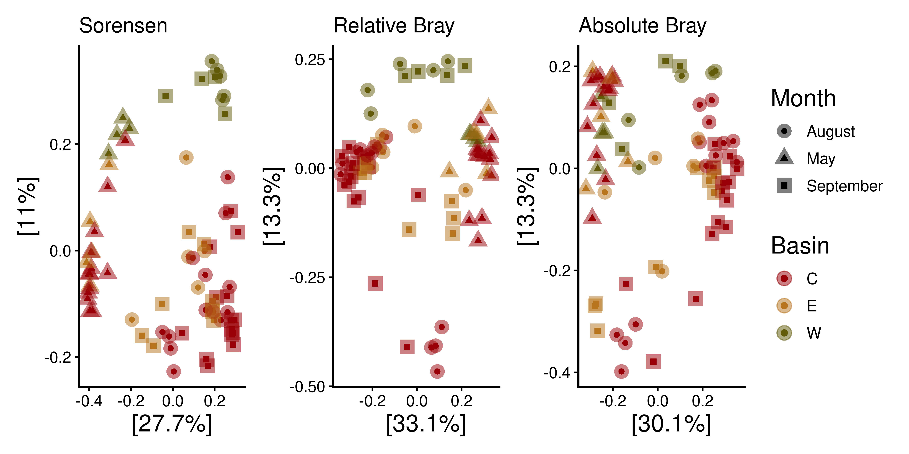{fig-align='center' width=2400}
:::
:::

::: {.cell layout-align="center"}

```{.r .cell-code}
abs_un_plots <- map2(abs_unifrac_dists, names(abs_unifrac_dists),
    \(x,y){
      plot_ordination(physeq = diversity_physeq,
                ordination = ordinate(diversity_physeq, method = "PCoA", distance = x),
                color = "Basin",
                shape = "Month") + 
             labs(title = y) + 
             geom_point(alpha = .5, size = 4, 
             aes(color = Basin, shape = Month) ) + 
  scale_color_manual(values = basin_colors)
    })

wrap_plots(plotlist = abs_un_plots) + 
  plot_layout(guides = "collect")
```

::: {.cell-output-display}
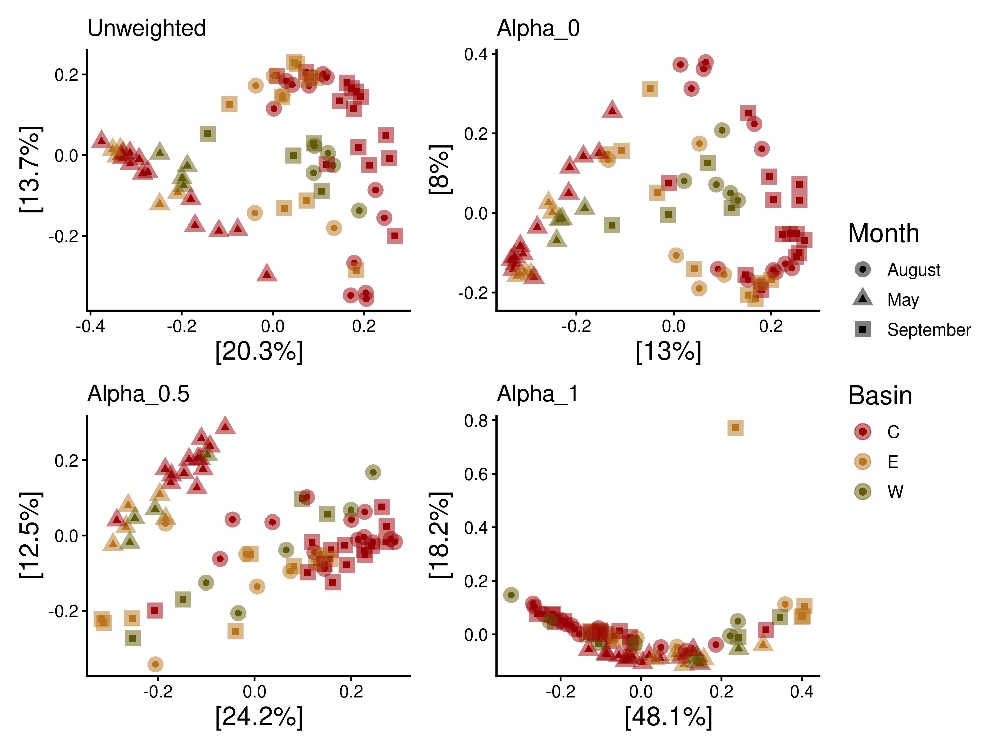{fig-align='center' width=2400}
:::

```{.r .cell-code}
abs_un_plots <- map2(abs_unifrac_dists, names(abs_unifrac_dists),
    \(x,y){
      plot_ordination(physeq = diversity_physeq,
                ordination = ordinate(diversity_physeq, method = "PCoA", distance = x),
                color = "Depth_Class",
                shape = "Month") + 
             labs(title = y) + 
             geom_point(alpha = .5, size = 4, 
             aes(color = Depth_Class, shape = Month) ) + 
  scale_color_manual(values = c("darkblue","gold"))
    })

wrap_plots(plotlist = abs_un_plots) + 
  plot_layout(guides = "collect")
```

::: {.cell-output-display}
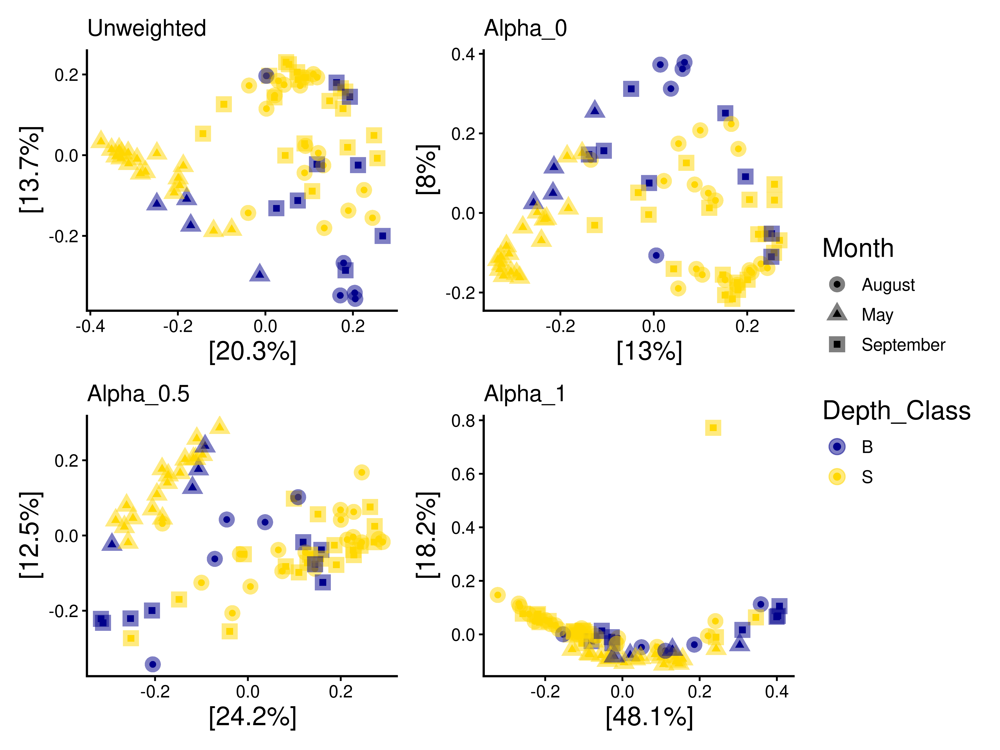{fig-align='center' width=2400}
:::
:::


# Much simpler approach to Unifrac analysis:


::: {.cell layout-align="center"}

```{.r .cell-code}
rel_matrix <- diversity_physeq %>%
  transform_sample_counts(., \(x)x/sum(x)) %>%
  otu_table() %>%
  as.matrix()

colnames(rel_matrix)
```

::: {.cell-output .cell-output-stdout}
```
 [1] "KH_D001" "KH_D009" "KH_D017" "KH_D025" "KH_D032" "KH_D040" "KH_D056"
 [8] "KH_D063" "KH_D071" "KH_D079" "KH_D002" "KH_D010" "KH_D018" "KH_D026"
[15] "KH_D033" "KH_D041" "KH_D057" "KH_D064" "KH_D003" "KH_D011" "KH_D019"
[22] "KH_D027" "KH_D034" "KH_D042" "KH_D058" "KH_D065" "KH_D004" "KH_D012"
[29] "KH_D020" "KH_D028" "KH_D035" "KH_D043" "KH_D051" "KH_D059" "KH_D066"
[36] "KH_D074" "KH_D005" "KH_D013" "KH_D021" "KH_D029" "KH_D036" "KH_D044"
[43] "KH_D052" "KH_D060" "KH_D067" "KH_D075" "KH_D083" "KH_D006" "KH_D022"
[50] "KH_D030" "KH_D037" "KH_D045" "KH_D053" "KH_D061" "KH_D076" "KH_D007"
[57] "KH_D015" "KH_D023" "KH_D031" "KH_D038" "KH_D046" "KH_D054" "KH_D062"
[64] "KH_D069" "KH_D077" "KH_D008" "KH_D016" "KH_D039" "KH_D047" "KH_D055"
[71] "KH_D070" "KH_D078"
```
:::

```{.r .cell-code}
abs_matrix <- map2(colnames(rel_matrix), cell_counts, \(x,y)round(rel_matrix[,x]*y)) %>%
  bind_cols() %>%
  as.matrix()

row.names(abs_matrix) <- row.names(rel_matrix)

abs_physeq <- diversity_physeq

abs_physeq@otu_table <- NULL

abs_physeq@otu_table <- otu_table(abs_matrix, taxa_are_rows = TRUE)

bad_mat <- otu_table(abs_physeq)

count_mat <- matrix(bad_mat, nrow = nrow(bad_mat))

row.names(count_mat) <- row.names(bad_mat)
colnames(count_mat) <- colnames(bad_mat)

abs_gunifrac_once <-
  GUniFrac(otu.tab = t(count_mat), 
                 tree = phy_tree(abs_physeq),
                 alpha = c(0,0.5,1),
                 normalize_counts = FALSE,
                 verbose = FALSE)

bray_mat <- as.matrix(distance(abs_physeq, method = "bray"))
```
:::


Just working with alpha = 0.5 and Bray-Curtis for a bit.


::: {.cell layout-align="center"}

```{.r .cell-code}
samples_to_keep <- 
  sample_data(abs_physeq) %>%
  data.frame() %>%
  filter(Depth_Class == "S") %>%
  pull(DNA_ID)

abs_0.5_once <- abs_gunifrac_once$unifracs[,,"d_0.5"]

trim_gun <- as.dist(abs_0.5_once[samples_to_keep, samples_to_keep])

trim_bray <- as.dist(bray_mat[samples_to_keep, samples_to_keep])

cuts <- hclust(trim_bray,
               method= "average") %>%
  cutree(5)

gun_cuts <- hclust(trim_gun,
                   method = "average") %>%
  cutree(5)

bray_dendro <- 
  hclust(trim_bray,
       method = "average") %>%
  as.dendrogram()

save(bray_dendro, file = "data/08_Beta_Diversity/bray_dendro.RData")

trim_physeq <- 
  abs_physeq %>%
  subset_samples(., DNA_ID %in% samples_to_keep) %>%
  microViz::ps_join(data.frame(DNA_ID = names(cuts), Bray_Group = factor(cuts),
                       Gun_Group = factor(gun_cuts)))


plot_ordination(trim_physeq,
                ordination = ordinate(trim_physeq, method = "PCoA", distance = trim_bray),
                color = "Bray_Group")
```

::: {.cell-output-display}
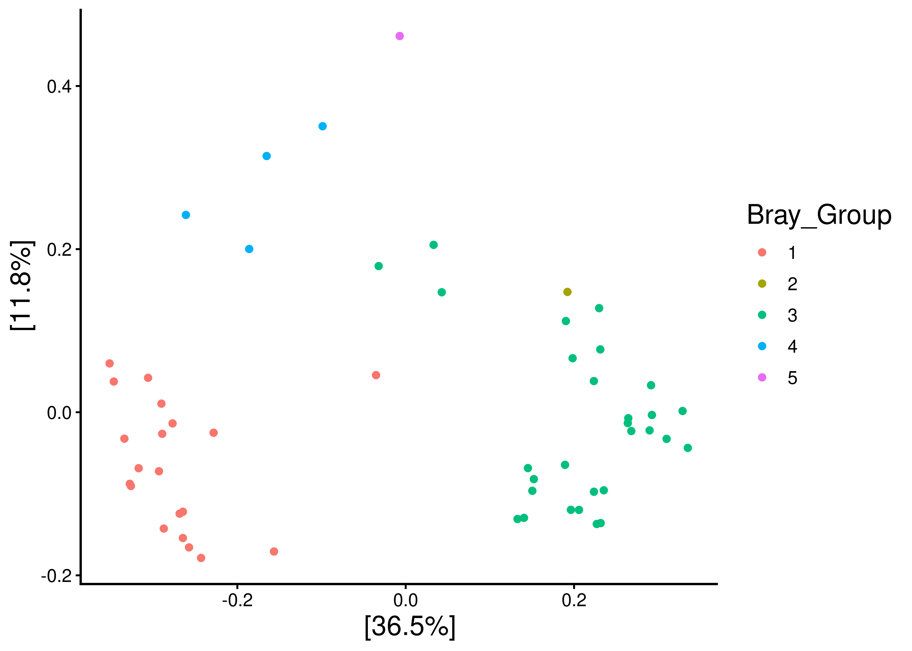{fig-align='center' width=2100}
:::

```{.r .cell-code}
plot_ordination(trim_physeq,
                ordination = ordinate(trim_physeq, method = "PCoA", distance = trim_gun),
                color = "Gun_Group")
```

::: {.cell-output-display}
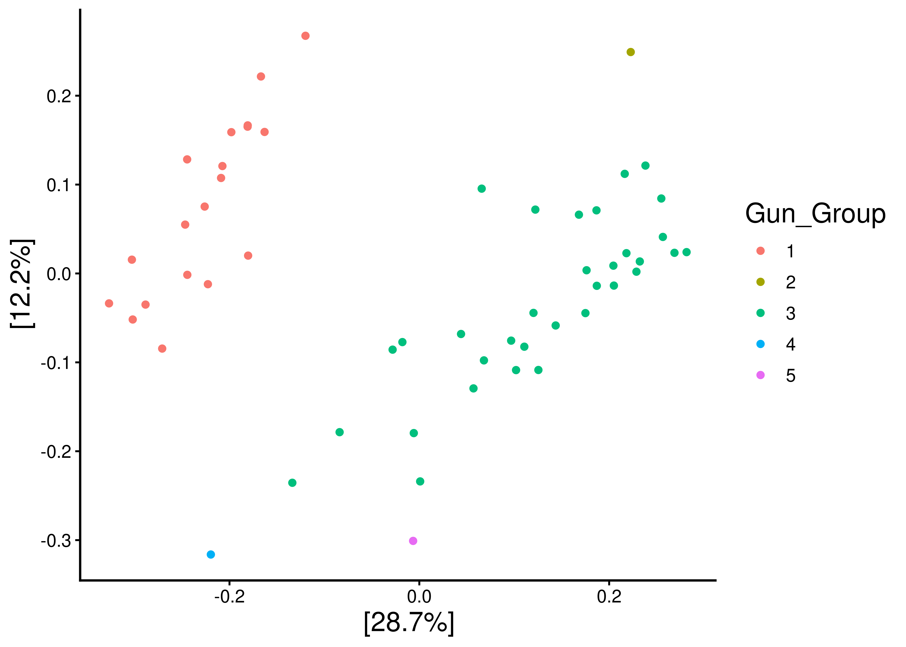{fig-align='center' width=2100}
:::

```{.r .cell-code}
plot_ordination(trim_physeq,
                ordination = ordinate(trim_physeq, method = "PCoA", distance = trim_bray),
                color = "Gun_Group")
```

::: {.cell-output-display}
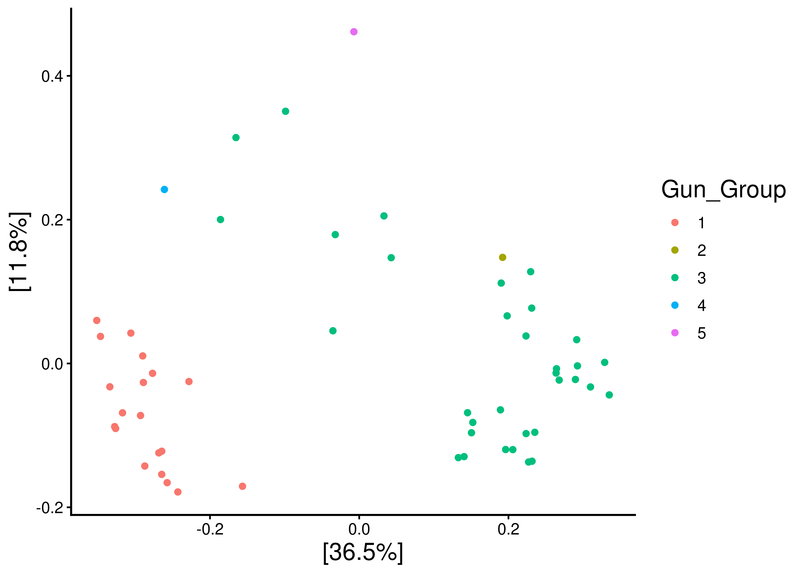{fig-align='center' width=2100}
:::

```{.r .cell-code}
plot_ordination(trim_physeq,
                ordination = ordinate(trim_physeq, method = "PCoA", distance = trim_gun),
                color = "Bray_Group")
```

::: {.cell-output-display}
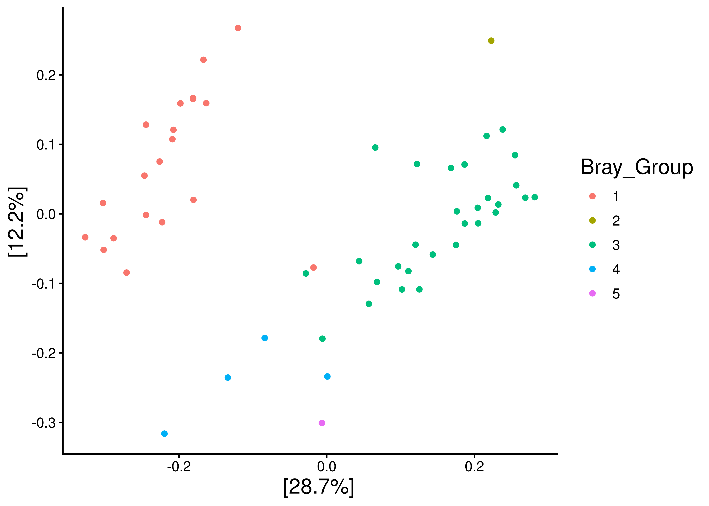{fig-align='center' width=2100}
:::

```{.r .cell-code}
plot_ordination(trim_physeq,
                ordination = ordinate(transform_sample_counts(trim_physeq, \(x)x/sum(x)), method = "PCoA", distance = "bray"),
                color = "Gun_Group")
```

::: {.cell-output-display}
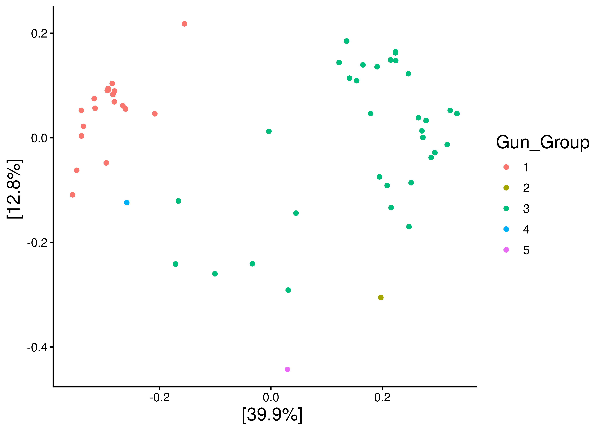{fig-align='center' width=2100}
:::
:::


# Mapping Groups


::: {.cell layout-align="center"}

```{.r .cell-code}
pacman::p_load(sf, terra, tmap, gstat, install = FALSE)

# Define some shapes and objects

raw_erie <- read_sf("data/spatial_imports/hydro_p_LakeErie/hydro_p_LakeErie.shp") %>%
  st_transform(crs = "EPSG:4326")

erie_outline <- raw_erie %>%
  st_union()

trim_sf <- trim_physeq %>%
  sample_data() %>%
  data.frame() %>%
  left_join(data.frame(DNA_ID = names(cuts), Bray_Group = factor(cuts),
                       Gun_Group = factor(gun_cuts))) %>%
  st_as_sf(coords = c("Longitude","Latitude"), crs = "EPSG:4326")

trim_sf %>%
  mutate(Month = factor(Month, levels = c("May", "August","September"))) %>%
  ggplot() + 
  geom_sf(aes(color = Bray_Group), size = 3, alpha = 0.7) + 
  facet_wrap(~Month, ncol = 1)+
  geom_sf(data = erie_outline, fill = NA)
```

::: {.cell-output-display}
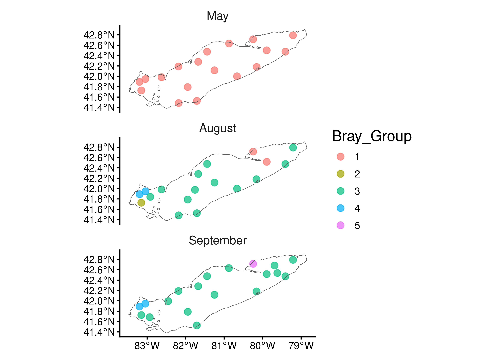{fig-align='center' width=2100}
:::

```{.r .cell-code}
trim_sf %>%
  mutate(Month = factor(Month, levels = c("May", "August","September"))) %>%
  ggplot() + 
  geom_sf(aes(color = Gun_Group), size = 3, alpha = 0.7) + 
  facet_wrap(~Month, ncol = 1)+
  geom_sf(data = erie_outline, fill = NA)
```

::: {.cell-output-display}
{fig-align='center' width=2100}
:::
:::


# Saving Objects


::: {.cell layout-align="center"}

```{.r .cell-code}
save(abs_physeq,
     file = "data/08_Beta_Diversity/abs_physeq.RData")

save(trim_physeq,
     file = "data/08_Beta_Diversity/trim_physeq.RData")

melted <- trim_physeq %>% 
  psmelt

melted %>%
  dplyr::filter(Genus == "g__Microcystis") %>%
  group_by(Sample_ID) %>%
  summarize(Abund = sum(Abundance),
            mc = mean(Microcystin_Total)) %>%
  ggplot(aes(x = Abund, y = mc)) + 
  geom_point() + 
  scale_x_log10() + 
  labs(x = "Abundance of Microcystis",
       y = "Microcystin Concentration")
```

::: {.cell-output-display}
{fig-align='center' width=2100}
:::
:::


# Just focusing on cyanos


::: {.cell layout-align="center"}

```{.r .cell-code}
cyano_physeq <- 
  trim_physeq %>%
  subset_samples(., Month != "May") %>%
  subset_samples(., DNA_ID != "KH_D076") %>%
  prune_taxa(taxa_sums(.) > 0, .) %>%
  subset_taxa(., Phylum == "p__Cyanobacteriota")

cy_mat_raw <- t(otu_table(cyano_physeq))

rows <- nrow(cy_mat_raw)

cy_mat <- matrix(cy_mat_raw, nrow = rows)

colnames(cy_mat) <- colnames(cy_mat_raw)
rownames(cy_mat) <- rownames(cy_mat_raw)

cy_guns <- GUniFrac(otu.tab = cy_mat,
                  tree = phy_tree(cyano_physeq),
                  alpha = seq(0,1,by = 0.1),
                  normalize_counts = FALSE,
                  verbose = TRUE)
```

::: {.cell-output .cell-output-stdout}
```
Accumulate the abundance along the tree branches...
Compute pairwise distances ...
Completed!
```
:::

```{.r .cell-code}
gun_names <- c("d_UW","d_0","d_0.1","d_0.2","d_0.3","d_0.4","d_0.5","d_0.6","d_0.7","d_0.8","d_0.9","d_1")

names(gun_names) <- gun_names

cy_gun_ds <- 
  map(gun_names, \(x){
    as.dist(cy_guns$unifracs[,,x])
})

cell_dist <- cyano_physeq %>%
  sample_sums() %>%
  dist()

cell_corr <- unlist(map(cy_gun_ds, \(x)vegan::mantel(cell_dist, x, permutations = 999)$statistic))

data.frame(Alpha = seq(0,1,by=0.1),
           Corr = cell_corr[c(2:12)]) %>%
  ggplot(aes(x = Alpha, y = Corr)) + 
  geom_line() + 
  scale_y_continuous(limits = c(0,1))
```

::: {.cell-output-display}
{fig-align='center' width=2400}
:::

```{.r .cell-code}
# Wow - way less responsive than many of the unifrac papers!
# I'm gonna go with an alpha of 0.4


cy_dist <- as.dist(cy_guns$unifracs[,,"d_0.4"])


cy_clust <- hclust(cy_dist, method = "average")

cy_cuts <- cutree(cy_clust, 6)  

cy_sf <- cyano_physeq %>%
  sample_data() %>%
  data.frame() %>%
  left_join(data.frame(DNA_ID = names(cy_cuts), Cy_Group = factor(cy_cuts))) %>%
  st_as_sf(coords = c("Longitude","Latitude"), crs = "EPSG:4326")


cy_sf %>%
  ggplot() + 
  geom_sf(aes(color = Cy_Group), size = 4) + 
  facet_wrap(~Month)
```

::: {.cell-output-display}
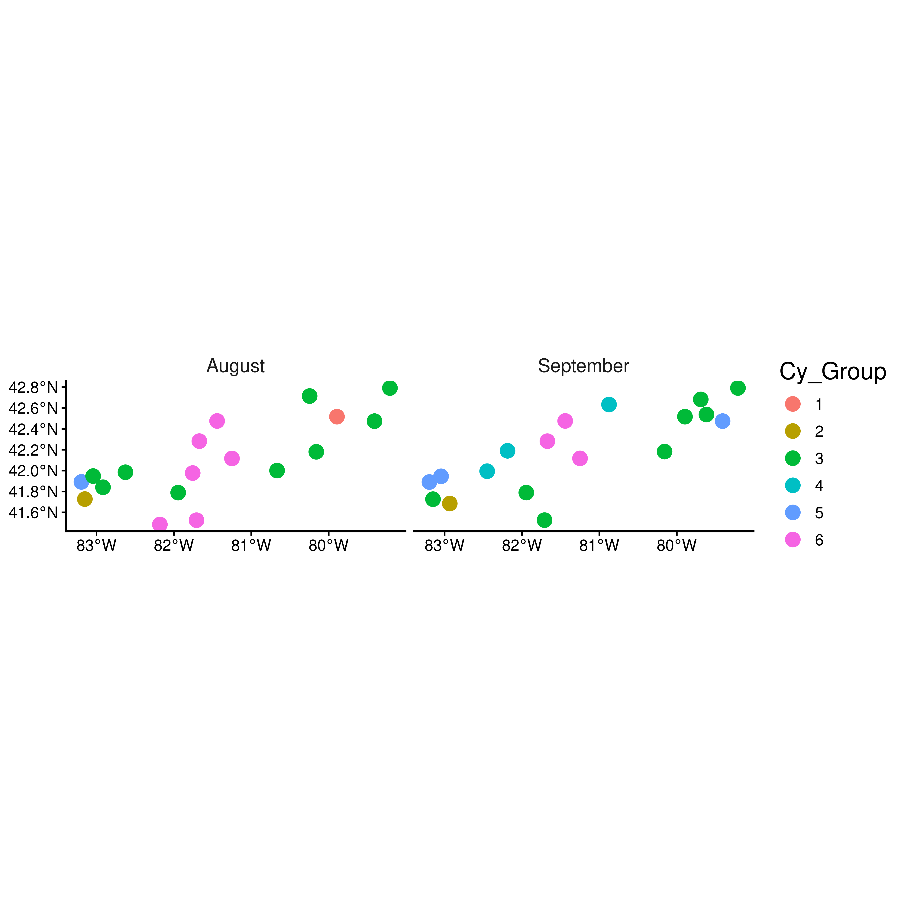{fig-align='center' width=2400}
:::

```{.r .cell-code}
# Or, going with Bray

cyano_bray <- phyloseq::distance(cyano_physeq, method = "bray")

cy_clust <- hclust(cyano_bray, method = "average")

cy_cuts <- cutree(cy_clust, 7)  

cy_sf <- cyano_physeq %>%
  sample_data() %>%
  data.frame() %>%
  left_join(data.frame(DNA_ID = names(cy_cuts), Cy_Group = factor(cy_cuts))) %>%
  st_as_sf(coords = c("Longitude","Latitude"), crs = "EPSG:4326")
```
:::

::: {.cell layout-align="center"}

```{.r .cell-code}
cy_sf %>%
  ggplot() + 
  geom_sf(data = erie_outline, fill = NA) + 
  geom_sf(aes(color = Cy_Group), size = 3, alpha = 1) + 
  facet_wrap(~Month, ncol = 1)
```

::: {.cell-output-display}
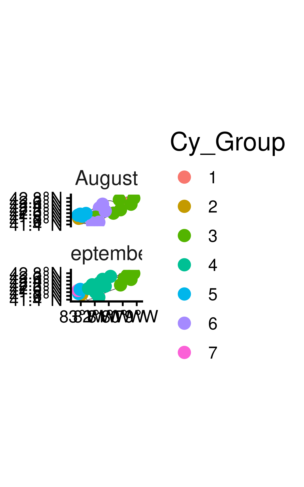{fig-align='center' width=750}
:::

```{.r .cell-code}
cy_sf %>%
  mutate(Month = factor(Month, levels = c("May", "August","September")),
         Cy_Group_Name = case_when(
           Cy_Group == 1 ~ "Deep Desert",
           Cy_Group == 2 ~ "Peak Bloom",
           Cy_Group == 3 ~ "Eastern Basin",
           Cy_Group == 4 ~ "Sep. Central Basin",
           Cy_Group == 5 ~ "Bloom Adjacent 2",
           Cy_Group == 6 ~ "Aug. Central Basin",
           Cy_Group == 7 ~ "Bloom Adjacent 1"),
         Cy_Group_Name = factor(Cy_Group_Name,
                                levels = c(
                                  "Peak Bloom",
                                  "Bloom Adjacent 1",
                                  "Bloom Adjacent 2",
                                  "Eastern Basin",
                                  "Aug. Central Basin",
                                  "Sep. Central Basin",
                                  "Deep Desert"
                                ))) %>%
  ggplot() + 
  geom_sf(data = erie_outline, fill = NA) + 
  geom_sf(aes(color = Cy_Group_Name), size = 3, alpha = 1) + 
  facet_wrap(~Month, ncol = 1)+
  scale_color_manual(values = cy_group_colors, name = "Cyano Group") + 
    theme(axis.line = element_blank(),
        axis.text = element_blank(),
        axis.ticks= element_blank(),
        legend.position = "none")
```

::: {.cell-output-display}
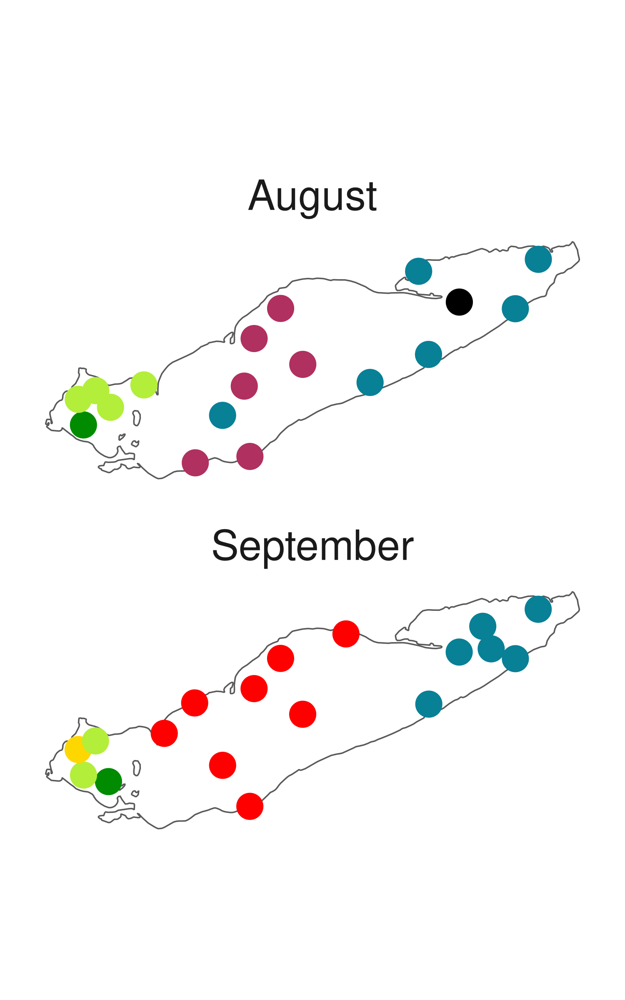{fig-align='center' width=750}
:::

```{.r .cell-code}
#ggsave(filename = "test.png", height = 8, width = 8, dpi = 300)

cyano_physeq <- cyano_physeq %>%
  microViz::ps_join(data.frame(DNA_ID = names(cy_cuts), Cy_Group = factor(cy_cuts)))

plot_ordination(cyano_physeq, 
                ordination = ordinate(cyano_physeq, distance = "bray", method = "PCoA"),
                color = "Cy_Group")
```

::: {.cell-output-display}
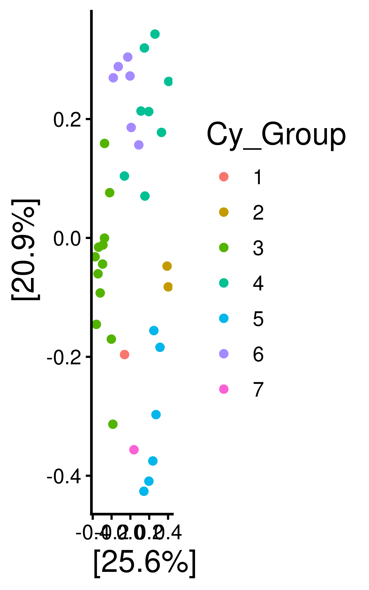{fig-align='center' width=750}
:::

```{.r .cell-code}
save(cyano_physeq, file = "data/08_Beta_Diversity/cyano_physeq.RData")

cy_dendro <- cy_clust %>%
  as.dendrogram()
  
save(cy_dendro, file = "data/08_Beta_Diversity/cy_dendro.RData")
```
:::


# Just western basin


::: {.cell layout-align="center"}

```{.r .cell-code}
wcyano_physeq <- 
  trim_physeq %>%
  subset_samples(., Month != "May") %>%
  subset_samples(., Station_ID %in% c("58", "59","60","61","91","966")) %>%
  prune_taxa(taxa_sums(.) > 0, .) %>%
  subset_taxa(., Phylum == "p__Cyanobacteriota") %>%
  microViz::ps_mutate(N_vs_S = ifelse(Station_ID %in% c("58","59"), "South","North"))

plot_ordination(wcyano_physeq, ordination = ordinate(wcyano_physeq, distance = "bray", method = "PCoA"), color = "N_vs_S")
```

::: {.cell-output-display}
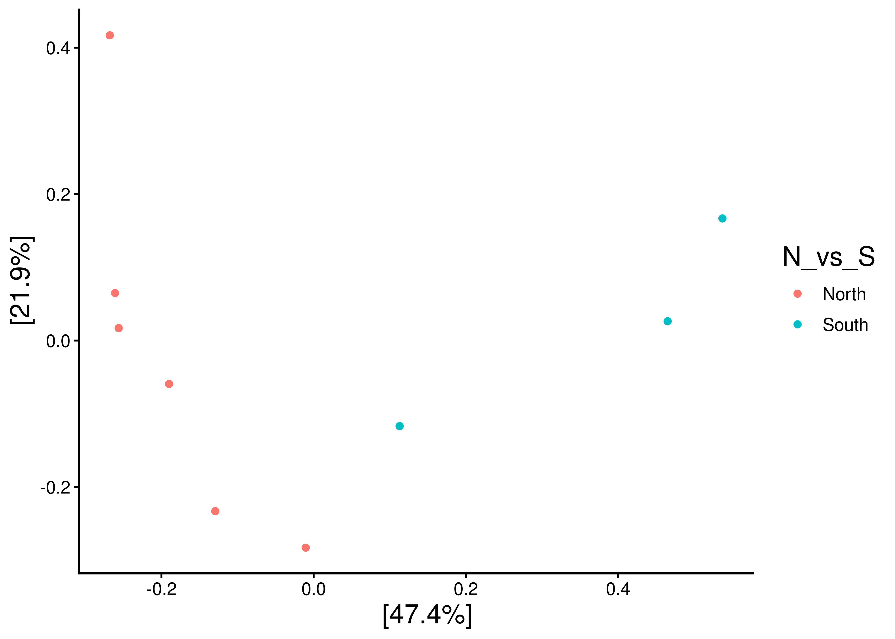{fig-align='center' width=2100}
:::

```{.r .cell-code}
wcy_melt <- psmelt(wcyano_physeq)

wcyano_bray <- phyloseq::distance(wcyano_physeq, method = "bray")

adonis2(wcyano_bray~N_vs_S, data = data.frame(sample_data(wcyano_physeq)))
```

::: {.cell-output .cell-output-stdout}
```
Permutation test for adonis under reduced model
Permutation: free
Number of permutations: 999

adonis2(formula = wcyano_bray ~ N_vs_S, data = data.frame(sample_data(wcyano_physeq)))
         Df SumOfSqs      R2      F Pr(>F)   
Model     1  0.64928 0.39666 4.6021  0.007 **
Residual  7  0.98759 0.60334                 
Total     8  1.63688 1.00000                 
---
Signif. codes:  0 '***' 0.001 '**' 0.01 '*' 0.05 '.' 0.1 ' ' 1
```
:::

```{.r .cell-code}
wcy_clust <- hclust(wcyano_bray, method = "average")

plot(wcy_clust)
```

::: {.cell-output-display}
{fig-align='center' width=2100}
:::

```{.r .cell-code}
library(ggdendro)

wcy_dend <- as.dendrogram(wcy_clust)

dendro_data(wcy_clust)
```

::: {.cell-output .cell-output-stdout}
```
$segments
          x         y    xend      yend
1  2.828125 0.7786555 1.50000 0.7786555
2  1.500000 0.7786555 1.50000 0.4706224
3  2.828125 0.7786555 4.15625 0.7786555
4  4.156250 0.7786555 4.15625 0.6490241
5  1.500000 0.4706224 1.00000 0.4706224
6  1.000000 0.4706224 1.00000 0.0000000
7  1.500000 0.4706224 2.00000 0.4706224
8  2.000000 0.4706224 2.00000 0.0000000
9  4.156250 0.6490241 3.00000 0.6490241
10 3.000000 0.6490241 3.00000 0.0000000
11 4.156250 0.6490241 5.31250 0.6490241
12 5.312500 0.6490241 5.31250 0.5450292
13 5.312500 0.5450292 4.00000 0.5450292
14 4.000000 0.5450292 4.00000 0.0000000
15 5.312500 0.5450292 6.62500 0.5450292
16 6.625000 0.5450292 6.62500 0.4718144
17 6.625000 0.4718144 5.50000 0.4718144
18 5.500000 0.4718144 5.50000 0.2960001
19 6.625000 0.4718144 7.75000 0.4718144
20 7.750000 0.4718144 7.75000 0.3712718
21 5.500000 0.2960001 5.00000 0.2960001
22 5.000000 0.2960001 5.00000 0.0000000
23 5.500000 0.2960001 6.00000 0.2960001
24 6.000000 0.2960001 6.00000 0.0000000
25 7.750000 0.3712718 7.00000 0.3712718
26 7.000000 0.3712718 7.00000 0.0000000
27 7.750000 0.3712718 8.50000 0.3712718
28 8.500000 0.3712718 8.50000 0.3058929
29 8.500000 0.3058929 8.00000 0.3058929
30 8.000000 0.3058929 8.00000 0.0000000
31 8.500000 0.3058929 9.00000 0.3058929
32 9.000000 0.3058929 9.00000 0.0000000

$labels
  x y   label
1 1 0 KH_D032
2 2 0 KH_D064
3 3 0 KH_D066
4 4 0 KH_D065
5 5 0 KH_D039
6 6 0 KH_D047
7 7 0 KH_D067
8 8 0 KH_D033
9 9 0 KH_D034

$leaf_labels
NULL

$class
[1] "hclust"

attr(,"class")
[1] "dendro"
```
:::

```{.r .cell-code}
dna_id_order <-  ggdendro::dendro_data(wcy_dend)$label$label

sample_annotation <- 
  wcy_melt %>%
  select(DNA_ID, Station_ID, Month) %>%
  unique() %>%
  mutate(Rep_ID = factor(DNA_ID, levels = dna_id_order))


tip_groups <- data.frame(Rep_ID = dendro_data(wcy_dend)$labels$label) %>%
   left_join(sample_annotation)

dend_data <- dendro_data(wcy_dend)

ggplot(dend_data$segments) + 
  geom_segment(aes(x = x, y = y, xend = xend, yend = yend)) + 
  geom_text(data = dend_data$labels, aes(x, y, label = tip_groups$Station_ID, color = tip_groups$Month),
            hjust = 0, size = 8, show.legend = FALSE) +
  theme_void() +
  coord_flip() +
  scale_y_reverse(expand = expansion(mult = .5)) + 
  scale_x_continuous(expand = expansion(mult = 0.1))+
  scale_color_manual(values = month_colors) +   
  labs(color = "Month")
```

::: {.cell-output-display}
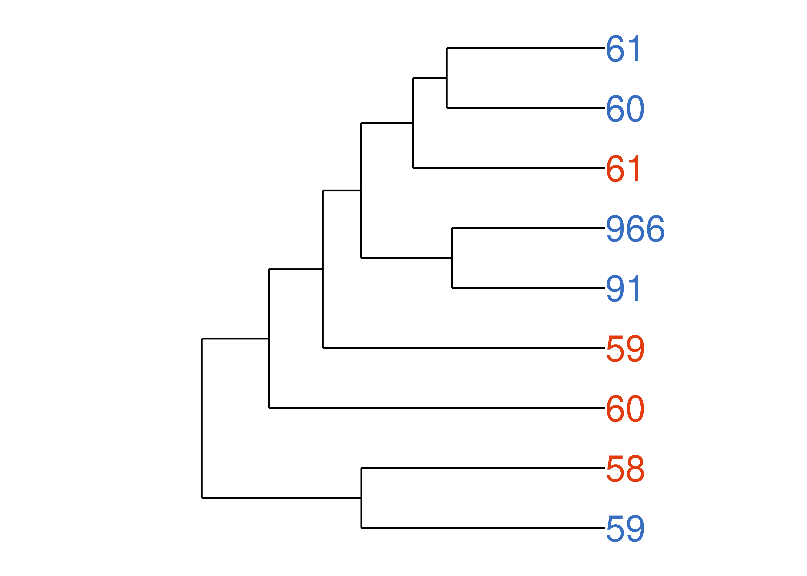{fig-align='center' width=2100}
:::
:::

::: {.cell layout-align="center"}

```{.r .cell-code}
wcy_melt %>%
  group_by(DNA_ID, Station_ID, Family, Month) %>%
  summarize(Fam_Abund = sum(Abundance)) %>%
  ungroup() %>%
  group_by(Family) %>% 
  mutate(Family = ifelse(max(Fam_Abund) > 10000, Family, "(Rare/Unknown)"),
         Family = str_remove(Family, "f__"),
         Family = ifelse(is.na(Family), "(Rare/Unknown)",Family),
         Family = ifelse(Family == "Microcystaceae_A_24132", "Microcystaceae", Family)) %>%
  ungroup() %>% 
  ggplot(aes(y = Fam_Abund, x = Station_ID, fill = Family)) + 
  geom_col() +
  scale_fill_manual(values = cyano_family_colors) + 
  facet_wrap(~Month) + 
  labs(y = "Absolute Abundance (cells/ml)", x = "Station") + 
  theme(
        plot.margin = margin()) + 
  scale_y_continuous(expand = c(0,0),
                     labels= scales::unit_format(unit = "M", scale = 1e-6)) 
```

::: {.cell-output-display}
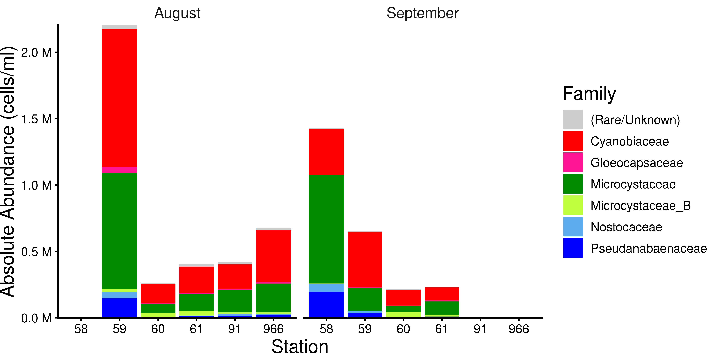{fig-align='center' width=2400}
:::

```{.r .cell-code}
ggsave("test.png", width = 8, height = 4)
```
:::

::: {.cell layout-align="center"}

```{.r .cell-code}
wcy_melt %>%
  dplyr::filter(Genus == "g__Microcystis") %>%
  group_by(Sample_ID, Microcystin_Total) %>%
  summarize(sum_micro = sum(Abundance)) %>%
  ggplot(aes(x = sum_micro, y = Microcystin_Total)) + 
  geom_point() + 
  ggpubr::stat_cor() + 
  labs(x = "Total Microcystis sp.", y = "Total Microcystins (ug/L)")
```

::: {.cell-output-display}
{fig-align='center' width=900}
:::

```{.r .cell-code}
melt <- psmelt(abs_physeq)

melt %>%
  dplyr::filter(Genus == "g__Microcystis") %>%
  group_by(Sample_ID, Microcystin_Total) %>%
  summarize(sum_micro = sum(Abundance)) %>%
  ggplot(aes(x = sum_micro, y = Microcystin_Total)) + 
  geom_point() + 
  ggpubr::stat_cor() + 
  labs(x = "Total Microcystis sp.", y = "Total Microcystins (ug/L)")
```

::: {.cell-output-display}
{fig-align='center' width=900}
:::

```{.r .cell-code}
melt %>%
  dplyr::filter(Genus == "g__Planktothrix") %>%
  group_by(Sample_ID, Anatoxin_Total) %>%
  summarize(sum_micro = sum(Abundance)) %>%
  ggplot(aes(x = sum_micro, y = Anatoxin_Total)) + 
  geom_point() + 
  ggpubr::stat_cor() + 
  labs(x = "Total Planktothrix sp.", y = "Total Anatoxins (ug/L)")
```

::: {.cell-output-display}
{fig-align='center' width=900}
:::

```{.r .cell-code}
ggsave("test.png", width = 3, height = 3)

melt %>%
  dplyr::filter(Genus == "g__Pseudanabaena") %>%
  group_by(Sample_ID, Anatoxin_Total) %>%
  summarize(sum_micro = sum(Abundance)) %>%
  ggplot(aes(x = sum_micro, y = Anatoxin_Total)) + 
  geom_point() + 
  ggpubr::stat_cor() + 
  labs(x = "Total Pseudanabaena sp.", y = "Total Anatoxins (ug/L)")
```

::: {.cell-output-display}
{fig-align='center' width=900}
:::

```{.r .cell-code}
melt %>%
  dplyr::filter(Genus == "g__Microcystis") %>%
  group_by(Sample_ID, Anatoxin_Total) %>%
  summarize(sum_micro = sum(Abundance)) %>%
  ggplot(aes(x = sum_micro, y = Anatoxin_Total)) + 
  geom_point() + 
  ggpubr::stat_cor() + 
  labs(x = "Total Microcystis sp.", y = "Total Anatoxins (ug/L)")
```

::: {.cell-output-display}
{fig-align='center' width=900}
:::

```{.r .cell-code}
melt %>%
  dplyr::filter(Genus == "g__Dolichospermum") %>%
  group_by(Sample_ID, Anatoxin_Total) %>%
  summarize(sum_micro = sum(Abundance)) %>%
  ggplot(aes(x = sum_micro, y = Anatoxin_Total)) + 
  geom_point() + 
  ggpubr::stat_cor() + 
  labs(x = "Total Dolichospermum sp.", y = "Total Anatoxins (ug/L)")
```

::: {.cell-output-display}
{fig-align='center' width=900}
:::

```{.r .cell-code}
ggsave("test.png", width = 4, height =4)
```
:::

::: {.cell layout-align="center"}

```{.r .cell-code}
wcyano_physeq <- 
  trim_physeq %>%
  subset_samples(., Month != "May") %>%
  subset_samples(., Station_ID %in% c("58", "59","60","61","91","966")) %>%
  prune_taxa(taxa_sums(.) > 0, .) %>%
  subset_taxa(., Phylum == "p__Cyanobacteriota") %>%
      transform_sample_counts(., \(x)x/sum(x)
) %>%
  microViz::ps_mutate(N_vs_S = ifelse(Station_ID %in% c("58","59"), "South","North"))

plot_ordination(wcyano_physeq, ordination = ordinate(wcyano_physeq, distance = "bray", method = "PCoA"), color = "N_vs_S")
```

::: {.cell-output-display}
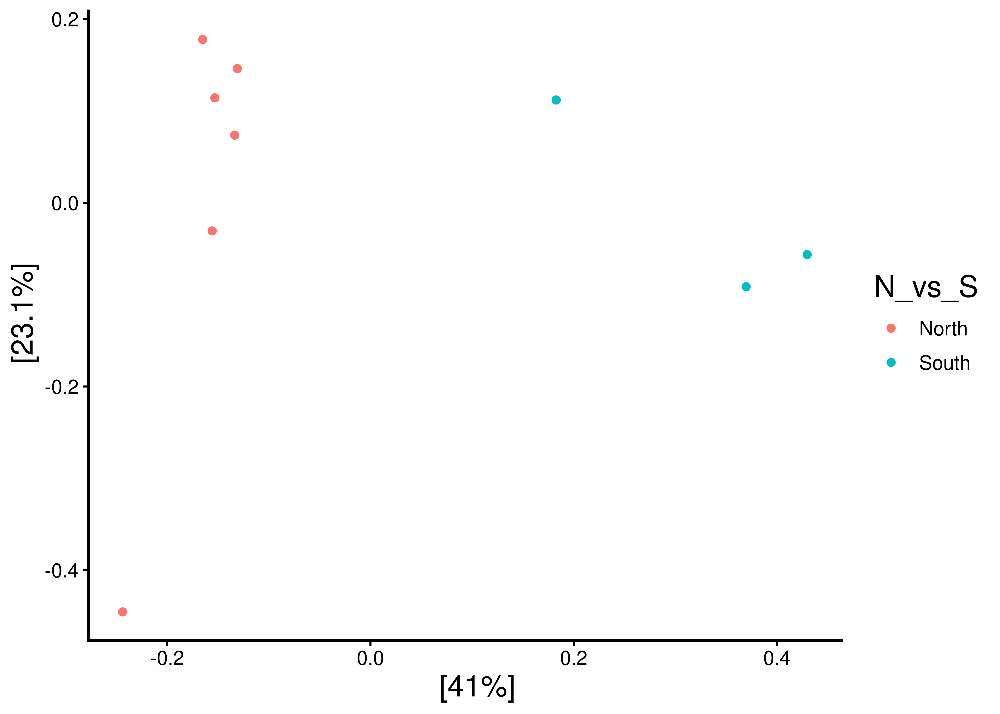{fig-align='center' width=2100}
:::

```{.r .cell-code}
otu_table(wcyano_physeq)
```

::: {.cell-output .cell-output-stdout}
```
OTU Table:          [221 taxa and 9 samples]
                     taxa are rows
                KH_D032      KH_D033      KH_D064      KH_D034      KH_D065
PROK_2104  0.0000000000 0.0000000000 1.638861e-03 0.000000e+00 3.315612e-03
PROK_6017  0.0001542635 0.0000000000 0.000000e+00 5.136471e-05 1.668521e-04
PROK_7292  0.0000000000 0.0002080197 1.817849e-05 7.093222e-05 0.000000e+00
PROK_401   0.0006329341 0.0000000000 0.000000e+00 3.155261e-04 0.000000e+00
PROK_5574  0.0000000000 0.0000000000 0.000000e+00 4.378230e-04 0.000000e+00
PROK_3182  0.0000000000 0.0009304155 0.000000e+00 1.350158e-03 0.000000e+00
PROK_119   0.0000000000 0.0000000000 0.000000e+00 7.019844e-04 0.000000e+00
PROK_10373 0.0000000000 0.0000000000 0.000000e+00 2.103507e-04 0.000000e+00
PROK_6489  0.0000000000 0.0000000000 4.544622e-05 0.000000e+00 0.000000e+00
PROK_11087 0.0000000000 0.0000000000 0.000000e+00 1.761076e-04 0.000000e+00
PROK_107   0.0516841718 0.0117739166 9.890705e-02 2.095436e-02 4.308153e-02
PROK_28    0.0059913222 0.0067663144 2.235954e-03 1.145678e-02 7.895627e-03
PROK_4759  0.0000000000 0.0000000000 0.000000e+00 1.489577e-03 0.000000e+00
PROK_538   0.0087090822 0.0000000000 3.723584e-02 4.720662e-04 7.317002e-03
PROK_2809  0.0003706861 0.0000000000 0.000000e+00 0.000000e+00 0.000000e+00
PROK_6791  0.0000000000 0.0000000000 0.000000e+00 1.051754e-04 0.000000e+00
PROK_437   0.0024704846 0.0005521978 1.447287e-04 1.577630e-03 4.561646e-04
PROK_6027  0.0000000000 0.0003101385 0.000000e+00 1.051754e-04 0.000000e+00
PROK_7832  0.0002005426 0.0000000000 0.000000e+00 0.000000e+00 1.821597e-04
PROK_1737  0.0012354692 0.0022806527 4.978109e-04 0.000000e+00 6.586833e-03
PROK_6308  0.0003706861 0.0000000000 0.000000e+00 0.000000e+00 2.893124e-04
PROK_3693  0.0000000000 0.0004841186 0.000000e+00 5.258768e-04 0.000000e+00
PROK_371   0.0033661204 0.0046256023 5.830400e-03 8.242813e-04 4.542511e-02
PROK_775   0.0031192988 0.0069062550 5.278054e-03 0.000000e+00 1.951711e-02
PROK_813   0.0007722249 0.0000000000 4.257961e-04 0.000000e+00 3.955467e-03
PROK_2686  0.0000000000 0.0000000000 4.887216e-04 0.000000e+00 3.878930e-03
PROK_1762  0.0000000000 0.0000000000 0.000000e+00 0.000000e+00 0.000000e+00
PROK_94    0.0279035454 0.0333890574 3.724492e-02 2.330980e-03 1.697728e-01
PROK_3615  0.0000000000 0.0000000000 2.083534e-04 3.424314e-05 9.888668e-04
PROK_487   0.0020693995 0.0099433430 2.960297e-03 2.820167e-03 2.157138e-02
PROK_469   0.0067635472 0.0070764529 6.916915e-03 6.481737e-04 2.316949e-02
PROK_500   0.0000000000 0.0011724748 1.901749e-04 6.310522e-04 4.700944e-03
PROK_588   0.0000000000 0.0000000000 9.417855e-04 0.000000e+00 0.000000e+00
PROK_114   0.0000000000 0.0146067671 1.394150e-03 1.042459e-02 1.364514e-02
PROK_2466  0.0000000000 0.0000000000 3.894391e-04 0.000000e+00 1.916504e-03
PROK_5568  0.0000000000 0.0006202770 0.000000e+00 0.000000e+00 0.000000e+00
PROK_2397  0.0000000000 0.0000000000 0.000000e+00 0.000000e+00 0.000000e+00
PROK_110   0.0000000000 0.0000000000 0.000000e+00 0.000000e+00 0.000000e+00
PROK_851   0.0014668644 0.0012102966 3.095936e-03 1.279226e-03 1.970080e-02
PROK_345   0.0002159689 0.0028668901 1.719965e-04 4.886985e-03 3.505426e-04
PROK_313   0.0061768921 0.0015544747 1.008556e-02 1.279226e-03 3.146005e-02
PROK_2460  0.0011274847 0.0004160395 0.000000e+00 1.394185e-04 0.000000e+00
PROK_2852  0.0010653256 0.0000000000 1.529790e-03 0.000000e+00 2.586974e-04
PROK_4224  0.0000000000 0.0000000000 0.000000e+00 0.000000e+00 0.000000e+00
PROK_157   0.0166463931 0.0053517803 1.654033e-02 7.445437e-03 8.656412e-03
PROK_298   0.0082612643 0.0023146922 1.747232e-03 2.925343e-03 1.506262e-03
PROK_9557  0.0000000000 0.0000000000 1.356395e-04 0.000000e+00 0.000000e+00
PROK_1745  0.0018375505 0.0000000000 3.920261e-03 0.000000e+00 0.000000e+00
PROK_187   0.0000000000 0.0022806527 1.620682e-03 2.066818e-03 6.768992e-03
PROK_1167  0.0000000000 0.0014863955 1.992642e-04 9.636998e-04 9.429442e-04
PROK_779   0.0000000000 0.0191302506 1.213064e-03 1.462916e-02 1.216949e-03
PROK_2770  0.0009264884 0.0000000000 2.010121e-03 0.000000e+00 1.668521e-04
PROK_1526  0.0006175077 0.0109115803 6.970751e-04 1.384401e-03 3.072222e-03
PROK_11509 0.0000000000 0.0000000000 8.180319e-05 0.000000e+00 0.000000e+00
PROK_5019  0.0000000000 0.0000000000 6.698073e-04 0.000000e+00 0.000000e+00
PROK_777   0.0008339303 0.0110136990 0.000000e+00 2.158296e-02 8.067071e-04
PROK_444   0.0000000000 0.0525873872 0.000000e+00 5.949501e-02 0.000000e+00
PROK_7861  0.0000000000 0.0000000000 0.000000e+00 4.378230e-04 0.000000e+00
PROK_1054  0.0042309034 0.0000000000 4.432754e-04 1.367280e-03 8.817141e-04
PROK_311   0.0005712287 0.0097353233 5.523464e-04 1.480282e-02 1.688421e-03
PROK_10685 0.0000000000 0.0000000000 9.928251e-05 0.000000e+00 0.000000e+00
PROK_49    0.0163991178 0.0767554974 3.266395e-02 5.821579e-02 4.903004e-02
PROK_3055  0.0000000000 0.0000000000 1.810857e-04 3.326477e-04 3.199275e-04
PROK_85    0.0000000000 0.0012102966 0.000000e+00 1.540941e-03 0.000000e+00
PROK_292   0.0000000000 0.0013124154 6.516289e-04 1.330591e-03 3.407458e-03
PROK_600   0.0046787213 0.0115999365 2.308668e-03 1.487375e-02 5.354576e-03
PROK_3128  0.0000000000 0.0006202770 0.000000e+00 0.000000e+00 0.000000e+00
PROK_4275  0.0000000000 0.0000000000 0.000000e+00 2.984045e-04 0.000000e+00
PROK_5609  0.0000000000 0.0002420593 0.000000e+00 8.805379e-05 0.000000e+00
PROK_1846  0.0000000000 0.0032791473 0.000000e+00 2.103507e-03 0.000000e+00
PROK_2715  0.0000000000 0.0000000000 0.000000e+00 7.191060e-04 0.000000e+00
PROK_1386  0.0000000000 0.0027269495 0.000000e+00 9.196729e-03 1.515446e-04
PROK_8541  0.0000000000 0.0003441781 0.000000e+00 0.000000e+00 0.000000e+00
PROK_848   0.0000000000 0.0034531275 0.000000e+00 1.225415e-03 3.658501e-04
PROK_23    0.0000000000 0.0009304155 2.174427e-04 2.032575e-03 2.586974e-04
PROK_7113  0.0000000000 0.0000000000 0.000000e+00 0.000000e+00 4.867796e-04
PROK_557   0.0134808153 0.0000000000 8.963393e-04 7.362275e-04 0.000000e+00
PROK_2535  0.0036596747 0.0000000000 0.000000e+00 0.000000e+00 0.000000e+00
PROK_679   0.0102381057 0.0101513627 7.334321e-04 1.017755e-02 2.815056e-03
PROK_610   0.0010807520 0.0210629430 0.000000e+00 1.518928e-02 2.449206e-03
PROK_910   0.0111183151 0.0000000000 2.173028e-03 3.668908e-04 7.148619e-04
PROK_511   0.0275791383 0.0072163935 5.796141e-04 9.915835e-03 8.526298e-04
PROK_7107  0.0000000000 0.0000000000 0.000000e+00 5.601199e-04 0.000000e+00
PROK_505   0.0057136479 0.0065242551 3.894391e-04 5.606091e-03 1.642499e-03
PROK_9167  0.0000000000 0.0000000000 0.000000e+00 0.000000e+00 0.000000e+00
PROK_265   0.0045553105 0.0234116748 8.690715e-04 2.082961e-02 4.518785e-03
PROK_341   0.0885286483 0.0000000000 4.381715e-03 7.533491e-04 2.159893e-03
PROK_951   0.0185302227 0.0000000000 0.000000e+00 0.000000e+00 3.505426e-04
PROK_58    0.0008647830 0.0014863955 4.614539e-04 1.523820e-03 0.000000e+00
PROK_4121  0.0002781280 0.0000000000 0.000000e+00 0.000000e+00 0.000000e+00
PROK_223   0.0000000000 0.0051437605 5.250786e-04 4.625270e-03 3.407458e-03
PROK_11015 0.0001542635 0.0000000000 0.000000e+00 0.000000e+00 0.000000e+00
PROK_4242  0.0000000000 0.0000000000 0.000000e+00 0.000000e+00 0.000000e+00
PROK_131   0.0439324308 0.0357718288 3.014832e-03 1.788715e-02 1.773837e-02
PROK_1394  0.0112880050 0.0002080197 3.476286e-03 0.000000e+00 3.046200e-04
PROK_3805  0.0015285698 0.0000000000 4.167069e-04 0.000000e+00 0.000000e+00
PROK_5891  0.0000000000 0.0000000000 0.000000e+00 0.000000e+00 0.000000e+00
PROK_99    0.0000000000 0.0093230660 2.661750e-03 1.291211e-02 1.017798e-02
PROK_690   0.0295559797 0.0000000000 5.685672e-03 0.000000e+00 8.664065e-04
PROK_32    0.0041691980 0.0210969826 1.162444e-02 3.195619e-02 1.903033e-02
PROK_2870  0.0000000000 0.0000000000 4.544622e-05 1.051754e-04 1.362371e-04
PROK_206   0.0000000000 0.0000000000 0.000000e+00 0.000000e+00 0.000000e+00
PROK_3486  0.0004478179 0.0017965340 3.439929e-04 5.772415e-04 0.000000e+00
PROK_1645  0.0005712287 0.0010022769 3.603536e-03 0.000000e+00 3.483995e-03
PROK_4875  0.0005249496 0.0000000000 0.000000e+00 7.875922e-04 0.000000e+00
PROK_4304  0.0000000000 0.0000000000 0.000000e+00 3.668908e-04 3.505426e-04
PROK_53    0.0106087918 0.0183700331 8.320154e-03 2.340519e-02 1.627803e-02
PROK_626   0.0011116047 0.0047995824 2.272311e-03 5.324808e-03 1.506262e-03
PROK_1112  0.0000000000 0.0040734045 0.000000e+00 1.033654e-02 0.000000e+00
PROK_847   0.0007722249 0.0090469671 0.000000e+00 8.917892e-03 0.000000e+00
PROK_170   0.0140828967 0.0000000000 5.404604e-03 2.445939e-04 4.974949e-03
PROK_380   0.0106242182 0.0218572001 2.780260e-02 2.703251e-02 1.855273e-03
PROK_5292  0.0000000000 0.0000000000 0.000000e+00 1.139807e-03 0.000000e+00
PROK_900   0.0000000000 0.0020385933 1.158529e-03 4.099393e-03 2.905370e-03
PROK_198   0.0000000000 0.0016906331 2.726773e-05 1.085997e-03 1.668521e-04
PROK_1493  0.0000000000 0.0062141166 3.258144e-04 3.590638e-03 6.842469e-04
PROK_120   0.0405195776 0.0155712222 2.054868e-03 1.560998e-02 4.913719e-03
PROK_1336  0.0000000000 0.0000000000 2.712790e-04 0.000000e+00 2.190508e-03
PROK_2718  0.0000000000 0.0000000000 0.000000e+00 0.000000e+00 0.000000e+00
PROK_631   0.0011429111 0.0024508506 8.418038e-04 1.611874e-03 8.139017e-03
PROK_84    0.0044164733 0.0102875211 1.020303e-02 5.955861e-03 6.949162e-02
PROK_6961  0.0000000000 0.0000000000 0.000000e+00 0.000000e+00 0.000000e+00
PROK_5974  0.0000000000 0.0000000000 0.000000e+00 3.668908e-04 0.000000e+00
PROK_693   0.0000000000 0.0014485737 0.000000e+00 2.984045e-04 6.689393e-04
PROK_3146  0.0000000000 0.0000000000 1.113782e-03 0.000000e+00 5.786249e-04
PROK_6165  0.0000000000 0.0000000000 0.000000e+00 0.000000e+00 0.000000e+00
PROK_2939  0.0000000000 0.0000000000 1.131960e-03 0.000000e+00 2.586974e-04
PROK_3940  0.0000000000 0.0000000000 1.810857e-04 0.000000e+00 0.000000e+00
PROK_1110  0.0000000000 0.0000000000 0.000000e+00 0.000000e+00 7.301695e-04
PROK_1551  0.0000000000 0.0000000000 6.159711e-04 2.103507e-04 1.096020e-03
PROK_7403  0.0000000000 0.0000000000 0.000000e+00 0.000000e+00 2.280823e-04
PROK_368   0.0000000000 0.0095991649 7.788783e-04 7.704707e-04 2.205816e-03
PROK_1463  0.0000000000 0.0000000000 0.000000e+00 0.000000e+00 3.949344e-04
PROK_3544  0.0027023336 0.0000000000 0.000000e+00 0.000000e+00 0.000000e+00
PROK_892   0.0021773840 0.0035212067 0.000000e+00 0.000000e+00 7.301695e-04
PROK_3917  0.0000000000 0.0012783758 0.000000e+00 0.000000e+00 0.000000e+00
PROK_179   0.0073502022 0.0000000000 1.408693e-02 6.481737e-04 4.168242e-03
PROK_328   0.0000000000 0.0000000000 3.530822e-04 0.000000e+00 0.000000e+00
PROK_784   0.0026714809 0.0000000000 1.331714e-02 0.000000e+00 4.275395e-03
PROK_4747  0.0013126009 0.0000000000 0.000000e+00 0.000000e+00 0.000000e+00
PROK_4476  0.0010961783 0.0000000000 0.000000e+00 0.000000e+00 0.000000e+00
PROK_5324  0.0009419148 0.0000000000 0.000000e+00 0.000000e+00 0.000000e+00
PROK_738   0.0013897327 0.0000000000 1.038411e-02 0.000000e+00 2.905370e-03
PROK_5436  0.0009419148 0.0000000000 0.000000e+00 0.000000e+00 0.000000e+00
PROK_204   0.0004786706 0.0000000000 2.985467e-04 0.000000e+00 0.000000e+00
PROK_1222  0.0005712287 0.0000000000 1.131960e-03 5.968090e-04 6.842469e-04
PROK_2506  0.0000000000 0.0000000000 0.000000e+00 1.394185e-04 0.000000e+00
PROK_4629  0.0000000000 0.0001739801 6.362471e-05 0.000000e+00 0.000000e+00
PROK_518   0.0000000000 0.0000000000 0.000000e+00 3.668908e-04 4.592261e-05
PROK_379   0.0000925581 0.0000000000 0.000000e+00 0.000000e+00 0.000000e+00
PROK_8542  0.0000000000 0.0003101385 0.000000e+00 0.000000e+00 0.000000e+00
PROK_3906  0.0000000000 0.0000000000 0.000000e+00 2.274723e-04 0.000000e+00
PROK_41    0.0023933529 0.0478218443 2.079549e-02 6.925431e-02 4.045016e-02
PROK_615   0.0013588800 0.0049357408 3.349037e-04 6.498859e-03 2.799748e-03
PROK_8678  0.0002935544 0.0000000000 0.000000e+00 0.000000e+00 0.000000e+00
PROK_1691  0.0000000000 0.0000000000 0.000000e+00 0.000000e+00 1.362371e-04
PROK_7333  0.0000000000 0.0000000000 0.000000e+00 0.000000e+00 0.000000e+00
PROK_4564  0.0000000000 0.0004500790 0.000000e+00 8.414029e-04 0.000000e+00
PROK_5003  0.0000000000 0.0000000000 0.000000e+00 0.000000e+00 0.000000e+00
PROK_74    0.1106722667 0.0050076022 3.285797e-01 6.973371e-03 3.503436e-02
PROK_613   0.0012817482 0.0000000000 3.294501e-02 0.000000e+00 9.123291e-04
PROK_3134  0.0005558023 0.0000000000 1.710875e-03 0.000000e+00 0.000000e+00
PROK_51    0.0995076726 0.1507159661 7.092337e-02 1.665048e-01 9.503378e-02
PROK_79    0.1817360179 0.0389828970 1.128311e-01 5.388892e-02 8.862910e-02
PROK_3781  0.0000000000 0.0000000000 0.000000e+00 0.000000e+00 2.127748e-04
PROK_267   0.0000000000 0.0000000000 0.000000e+00 1.222969e-04 0.000000e+00
PROK_1327  0.0001542635 0.0061460374 0.000000e+00 1.040747e-02 0.000000e+00
PROK_1510  0.0000000000 0.0065242551 2.726773e-05 6.552670e-03 1.821597e-04
PROK_191   0.0000000000 0.0005862374 3.635698e-05 2.984045e-04 6.092399e-04
PROK_602   0.0000000000 0.0054538990 0.000000e+00 5.449551e-03 0.000000e+00
PROK_1095  0.0000000000 0.0054538990 2.537997e-04 1.734170e-03 2.129278e-03
PROK_2033  0.0035979693 0.0010363165 0.000000e+00 2.445939e-04 0.000000e+00
PROK_1739  0.0000000000 0.0037632660 0.000000e+00 8.531434e-03 0.000000e+00
PROK_5039  0.0007567986 0.0003782177 0.000000e+00 2.274723e-04 0.000000e+00
PROK_9779  0.0000000000 0.0004841186 0.000000e+00 0.000000e+00 0.000000e+00
PROK_245   0.0037213802 0.0759272007 0.000000e+00 3.829851e-02 2.038964e-03
PROK_1792  0.0002005426 0.0030711276 0.000000e+00 4.238812e-03 0.000000e+00
PROK_1505  0.0005866550 0.0052837011 0.000000e+00 6.430373e-03 0.000000e+00
PROK_724   0.0005403760 0.0069743341 2.174427e-04 7.883260e-03 5.633173e-04
PROK_4779  0.0000000000 0.0000000000 0.000000e+00 6.481737e-04 0.000000e+00
PROK_1034  0.0000000000 0.0080446902 1.719965e-04 2.592940e-02 0.000000e+00
PROK_6402  0.0000000000 0.0000000000 0.000000e+00 0.000000e+00 0.000000e+00
PROK_896   0.0055435043 0.0038313452 1.022890e-03 6.745899e-03 5.552043e-03
PROK_2122  0.0000000000 0.0023827714 0.000000e+00 3.206626e-03 0.000000e+00
PROK_1477  0.0000000000 0.0018986528 0.000000e+00 2.979153e-03 4.255495e-04
PROK_1191  0.0000000000 0.0030030484 2.537997e-04 3.468341e-03 1.429724e-03
PROK_5683  0.0000000000 0.0000000000 0.000000e+00 2.274723e-04 0.000000e+00
PROK_6908  0.0000000000 0.0000000000 0.000000e+00 0.000000e+00 0.000000e+00
PROK_2765  0.0000000000 0.0000000000 0.000000e+00 6.481737e-04 0.000000e+00
PROK_1758  0.0010807520 0.0032110682 0.000000e+00 2.942464e-03 9.429442e-04
PROK_3248  0.0032272832 0.0000000000 0.000000e+00 0.000000e+00 0.000000e+00
PROK_829   0.0125543268 0.0050416418 3.894391e-04 6.621156e-03 2.951293e-03
PROK_3583  0.0019763877 0.0000000000 0.000000e+00 0.000000e+00 0.000000e+00
PROK_2483  0.0002935544 0.0018646132 0.000000e+00 1.120240e-03 1.668521e-04
PROK_2689  0.0005558023 0.0025567516 0.000000e+00 9.979430e-04 3.658501e-04
PROK_1344  0.0011116047 0.0049735626 0.000000e+00 2.768803e-03 1.821597e-04
PROK_2792  0.0000000000 0.0018305736 0.000000e+00 1.208294e-03 0.000000e+00
PROK_2146  0.0000000000 0.0011384352 0.000000e+00 9.808214e-04 0.000000e+00
PROK_2206  0.0000000000 0.0017246727 0.000000e+00 2.873978e-03 0.000000e+00
PROK_903   0.0000000000 0.0034871671 1.083718e-04 5.395741e-03 6.995544e-04
PROK_6915  0.0000000000 0.0000000000 0.000000e+00 0.000000e+00 0.000000e+00
PROK_7862  0.0000000000 0.0000000000 0.000000e+00 2.812829e-04 0.000000e+00
PROK_11684 0.0000000000 0.0000000000 0.000000e+00 0.000000e+00 0.000000e+00
PROK_1953  0.0000000000 0.0001739801 0.000000e+00 1.565401e-04 0.000000e+00
PROK_3654  0.0013588800 0.0000000000 0.000000e+00 0.000000e+00 0.000000e+00
PROK_3891  0.0000000000 0.0000000000 0.000000e+00 1.222969e-04 1.821597e-04
PROK_5191  0.0000000000 0.0002420593 0.000000e+00 5.087552e-04 3.061507e-05
PROK_5192  0.0000000000 0.0000000000 0.000000e+00 1.051754e-04 0.000000e+00
PROK_1853  0.0000000000 0.0000000000 0.000000e+00 0.000000e+00 0.000000e+00
PROK_2756  0.0000000000 0.0000000000 5.159894e-04 3.864583e-04 0.000000e+00
PROK_278   0.0000000000 0.0033131869 0.000000e+00 1.910278e-03 0.000000e+00
PROK_3263  0.0000000000 0.0000000000 0.000000e+00 0.000000e+00 3.658501e-04
PROK_5824  0.0000000000 0.0000000000 0.000000e+00 9.098892e-04 0.000000e+00
PROK_1216  0.0000000000 0.0000000000 1.174610e-04 2.984045e-04 2.127748e-04
PROK_6872  0.0000000000 0.0000000000 3.167252e-04 0.000000e+00 0.000000e+00
PROK_6033  0.0000000000 0.0000000000 4.348854e-04 0.000000e+00 0.000000e+00
PROK_9651  0.0000000000 0.0000000000 0.000000e+00 0.000000e+00 0.000000e+00
PROK_5258  0.0000000000 0.0003782177 0.000000e+00 9.636998e-04 0.000000e+00
PROK_7978  0.0000000000 0.0000000000 1.629072e-04 0.000000e+00 0.000000e+00
PROK_4812  0.0012663219 0.0000000000 0.000000e+00 0.000000e+00 0.000000e+00
PROK_11215 0.0000000000 0.0000000000 0.000000e+00 0.000000e+00 0.000000e+00
               KH_D066      KH_D067      KH_D039      KH_D047
PROK_2104  0.000000000 2.374834e-04 9.233985e-04 1.128474e-03
PROK_6017  0.000000000 0.000000e+00 5.726502e-05 0.000000e+00
PROK_7292  0.000000000 0.000000e+00 0.000000e+00 4.745226e-05
PROK_401   0.000000000 0.000000e+00 0.000000e+00 0.000000e+00
PROK_5574  0.000000000 0.000000e+00 0.000000e+00 0.000000e+00
PROK_3182  0.000000000 3.095765e-04 1.152459e-03 2.342955e-04
PROK_119   0.000000000 1.314640e-04 1.932695e-04 2.342955e-04
PROK_10373 0.000000000 0.000000e+00 0.000000e+00 0.000000e+00
PROK_6489  0.000000000 0.000000e+00 0.000000e+00 0.000000e+00
PROK_11087 0.000000000 0.000000e+00 0.000000e+00 0.000000e+00
PROK_107   0.004533249 3.005013e-02 3.086823e-02 3.043024e-02
PROK_28    0.000000000 6.861573e-03 4.650397e-03 6.821262e-04
PROK_4759  0.000000000 0.000000e+00 0.000000e+00 0.000000e+00
PROK_538   0.000000000 1.484271e-04 9.233985e-04 6.109478e-04
PROK_2809  0.000000000 0.000000e+00 0.000000e+00 0.000000e+00
PROK_6791  0.000000000 0.000000e+00 0.000000e+00 0.000000e+00
PROK_437   0.000000000 3.689474e-04 3.841529e-04 1.408739e-04
PROK_6027  0.000000000 1.187417e-04 0.000000e+00 0.000000e+00
PROK_7832  0.000000000 0.000000e+00 0.000000e+00 0.000000e+00
PROK_1737  0.003836186 1.908348e-04 4.605062e-04 1.598548e-03
PROK_6308  0.000000000 0.000000e+00 0.000000e+00 0.000000e+00
PROK_3693  0.000000000 9.753781e-04 0.000000e+00 2.342955e-04
PROK_371   0.000000000 1.463067e-03 8.033805e-03 1.163173e-02
PROK_775   0.000000000 0.000000e+00 0.000000e+00 2.749265e-03
PROK_813   0.000000000 0.000000e+00 0.000000e+00 0.000000e+00
PROK_2686  0.000000000 0.000000e+00 0.000000e+00 0.000000e+00
PROK_1762  0.000000000 0.000000e+00 2.228564e-03 0.000000e+00
PROK_94    0.019868634 1.696310e-03 8.227075e-03 2.436673e-02
PROK_3615  0.000000000 1.272232e-05 0.000000e+00 0.000000e+00
PROK_487   0.000000000 3.053357e-03 8.303428e-03 6.744152e-03
PROK_469   0.000000000 6.954870e-04 1.615351e-03 6.791605e-03
PROK_500   0.006273567 5.105892e-03 5.774223e-04 0.000000e+00
PROK_588   0.000000000 0.000000e+00 0.000000e+00 0.000000e+00
PROK_114   0.061346220 3.041907e-02 2.805986e-03 3.665687e-03
PROK_2466  0.000000000 0.000000e+00 0.000000e+00 0.000000e+00
PROK_5568  0.000000000 0.000000e+00 0.000000e+00 3.766523e-04
PROK_2397  0.000000000 9.584150e-04 0.000000e+00 0.000000e+00
PROK_110   0.000000000 3.837901e-03 0.000000e+00 0.000000e+00
PROK_851   0.000000000 8.413696e-03 9.043101e-04 2.796717e-03
PROK_345   0.000000000 2.998227e-03 2.383657e-03 1.926265e-03
PROK_313   0.000000000 9.329703e-03 2.634191e-03 1.419267e-02
PROK_2460  0.000000000 0.000000e+00 0.000000e+00 0.000000e+00
PROK_2852  0.000000000 3.095765e-04 0.000000e+00 0.000000e+00
PROK_4224  0.000000000 4.707259e-04 0.000000e+00 0.000000e+00
PROK_157   0.000000000 8.604531e-03 2.133122e-03 7.755479e-04
PROK_298   0.005576504 2.921893e-03 1.672616e-03 3.453635e-03
PROK_9557  0.000000000 0.000000e+00 0.000000e+00 0.000000e+00
PROK_1745  0.000000000 0.000000e+00 0.000000e+00 0.000000e+00
PROK_187   0.000000000 8.566364e-04 6.995877e-03 1.835216e-02
PROK_1167  0.000000000 1.611494e-04 1.250286e-03 2.514970e-03
PROK_779   0.000000000 4.308627e-03 3.672120e-03 2.560939e-03
PROK_2770  0.000000000 0.000000e+00 0.000000e+00 0.000000e+00
PROK_1526  0.000000000 0.000000e+00 0.000000e+00 0.000000e+00
PROK_11509 0.000000000 0.000000e+00 0.000000e+00 0.000000e+00
PROK_5019  0.000000000 0.000000e+00 0.000000e+00 0.000000e+00
PROK_777   0.000000000 0.000000e+00 5.805242e-03 0.000000e+00
PROK_444   0.000000000 3.816697e-04 2.554497e-02 1.854049e-02
PROK_7861  0.000000000 0.000000e+00 0.000000e+00 0.000000e+00
PROK_1054  0.000000000 6.802202e-03 6.537757e-04 0.000000e+00
PROK_311   0.000000000 1.065707e-02 7.649653e-03 0.000000e+00
PROK_10685 0.000000000 0.000000e+00 0.000000e+00 0.000000e+00
PROK_49    0.022306015 4.780625e-02 1.557489e-01 1.942577e-01
PROK_3055  0.000000000 2.077979e-04 0.000000e+00 0.000000e+00
PROK_85    0.000000000 1.815051e-03 4.032412e-04 1.574822e-03
PROK_292   0.000000000 3.689474e-04 6.554459e-03 2.354522e-02
PROK_600   0.027185456 1.917254e-02 2.094945e-03 1.410222e-03
PROK_3128  0.000000000 0.000000e+00 0.000000e+00 0.000000e+00
PROK_4275  0.000000000 2.671688e-04 0.000000e+00 0.000000e+00
PROK_5609  0.000000000 5.937084e-05 0.000000e+00 0.000000e+00
PROK_1846  0.000000000 2.684410e-03 0.000000e+00 5.634956e-04
PROK_2715  0.000000000 5.004114e-04 0.000000e+00 0.000000e+00
PROK_1386  0.000000000 0.000000e+00 3.056521e-03 0.000000e+00
PROK_8541  0.000000000 1.484271e-04 0.000000e+00 0.000000e+00
PROK_848   0.008364756 5.046521e-03 0.000000e+00 0.000000e+00
PROK_23    0.000000000 7.599467e-03 1.615351e-03 8.926956e-04
PROK_7113  0.000000000 0.000000e+00 0.000000e+00 0.000000e+00
PROK_557   0.000000000 0.000000e+00 0.000000e+00 0.000000e+00
PROK_2535  0.000000000 0.000000e+00 0.000000e+00 0.000000e+00
PROK_679   0.000000000 5.593581e-03 6.766817e-03 4.582109e-03
PROK_610   0.000000000 4.325590e-03 1.247423e-02 8.975891e-03
PROK_910   0.000000000 2.502057e-04 3.268878e-04 0.000000e+00
PROK_511   0.000000000 3.142414e-03 2.479098e-03 2.114591e-03
PROK_7107  0.000000000 0.000000e+00 0.000000e+00 0.000000e+00
PROK_505   0.000000000 5.801379e-03 1.672616e-03 1.644517e-03
PROK_9167  0.005927374 0.000000e+00 0.000000e+00 0.000000e+00
PROK_265   0.000000000 5.992214e-03 1.134086e-02 7.565669e-03
PROK_341   0.000000000 0.000000e+00 7.873941e-04 5.634956e-04
PROK_951   0.000000000 0.000000e+00 0.000000e+00 0.000000e+00
PROK_58    0.000000000 0.000000e+00 6.938612e-03 1.506164e-02
PROK_4121  0.000000000 0.000000e+00 0.000000e+00 0.000000e+00
PROK_223   0.057860906 7.217798e-03 3.037432e-03 1.949991e-03
PROK_11015 0.000000000 0.000000e+00 0.000000e+00 0.000000e+00
PROK_4242  0.000000000 1.666624e-03 0.000000e+00 0.000000e+00
PROK_131   0.142907267 3.911266e-02 1.057255e-02 1.416895e-02
PROK_1394  0.000000000 0.000000e+00 0.000000e+00 0.000000e+00
PROK_3805  0.000000000 0.000000e+00 0.000000e+00 0.000000e+00
PROK_5891  0.000000000 7.506170e-04 0.000000e+00 0.000000e+00
PROK_99    0.047404961 3.187790e-02 8.592139e-03 1.311165e-02
PROK_690   0.000000000 0.000000e+00 0.000000e+00 0.000000e+00
PROK_32    0.067619787 4.371814e-02 3.917166e-02 4.969883e-02
PROK_2870  0.000000000 2.374834e-04 0.000000e+00 0.000000e+00
PROK_206   0.000000000 1.106842e-03 0.000000e+00 0.000000e+00
PROK_3486  0.000000000 0.000000e+00 0.000000e+00 0.000000e+00
PROK_1645  0.000000000 1.815051e-03 0.000000e+00 0.000000e+00
PROK_4875  0.000000000 0.000000e+00 0.000000e+00 0.000000e+00
PROK_4304  0.000000000 7.082093e-04 0.000000e+00 0.000000e+00
PROK_53    0.000000000 1.362137e-02 1.381996e-02 3.844226e-02
PROK_626   0.000000000 3.791252e-03 8.763934e-03 4.112035e-03
PROK_1112  0.000000000 2.022849e-03 2.228564e-03 0.000000e+00
PROK_847   0.000000000 3.409582e-03 1.942239e-03 8.230001e-04
PROK_170   0.000000000 0.000000e+00 9.615752e-04 4.935035e-03
PROK_380   0.034506957 6.819165e-03 7.938364e-03 1.362770e-03
PROK_5292  0.000000000 0.000000e+00 0.000000e+00 0.000000e+00
PROK_900   0.000000000 2.072042e-02 2.288215e-03 1.739422e-03
PROK_198   0.000000000 5.962529e-03 1.269375e-03 7.043695e-04
PROK_1493  0.005576504 7.926007e-03 0.000000e+00 0.000000e+00
PROK_120   0.022306015 9.813151e-03 3.171051e-03 3.219339e-03
PROK_1336  0.000000000 0.000000e+00 0.000000e+00 8.230001e-04
PROK_2718  0.000000000 0.000000e+00 7.110407e-04 5.451078e-03
PROK_631   0.000000000 8.990441e-04 5.611972e-03 3.078465e-03
PROK_84    0.000000000 5.152541e-03 1.941284e-02 5.282326e-02
PROK_6961  0.011850071 0.000000e+00 0.000000e+00 0.000000e+00
PROK_5974  0.000000000 0.000000e+00 0.000000e+00 9.342163e-05
PROK_693   0.000000000 4.876890e-04 5.957948e-03 1.551096e-03
PROK_3146  0.000000000 6.064307e-04 0.000000e+00 0.000000e+00
PROK_6165  0.000000000 6.785239e-04 0.000000e+00 0.000000e+00
PROK_2939  0.000000000 0.000000e+00 0.000000e+00 0.000000e+00
PROK_3940  0.000000000 3.986328e-04 0.000000e+00 0.000000e+00
PROK_1110  0.000000000 0.000000e+00 1.171547e-03 0.000000e+00
PROK_1551  0.000000000 2.154313e-03 0.000000e+00 0.000000e+00
PROK_7403  0.000000000 2.077979e-04 0.000000e+00 0.000000e+00
PROK_368   0.002091189 5.267042e-03 1.162957e-02 3.877739e-03
PROK_1463  0.000000000 0.000000e+00 5.843418e-03 1.598548e-03
PROK_3544  0.000000000 0.000000e+00 0.000000e+00 0.000000e+00
PROK_892   0.000000000 1.297677e-03 7.458769e-03 2.021170e-03
PROK_3917  0.000000000 0.000000e+00 0.000000e+00 0.000000e+00
PROK_179   0.000000000 0.000000e+00 1.932695e-04 2.342955e-04
PROK_328   0.000000000 0.000000e+00 0.000000e+00 0.000000e+00
PROK_784   0.000000000 0.000000e+00 1.145300e-04 8.230001e-04
PROK_4747  0.000000000 0.000000e+00 0.000000e+00 0.000000e+00
PROK_4476  0.000000000 0.000000e+00 0.000000e+00 0.000000e+00
PROK_5324  0.000000000 0.000000e+00 0.000000e+00 0.000000e+00
PROK_738   0.000000000 0.000000e+00 1.741811e-04 5.175262e-04
PROK_5436  0.000000000 0.000000e+00 0.000000e+00 0.000000e+00
PROK_204   0.000000000 3.095765e-04 0.000000e+00 0.000000e+00
PROK_1222  0.000000000 0.000000e+00 1.741811e-04 0.000000e+00
PROK_2506  0.000000000 0.000000e+00 0.000000e+00 0.000000e+00
PROK_4629  0.000000000 0.000000e+00 0.000000e+00 0.000000e+00
PROK_518   0.000000000 0.000000e+00 1.145300e-04 0.000000e+00
PROK_379   0.000000000 0.000000e+00 0.000000e+00 0.000000e+00
PROK_8542  0.000000000 0.000000e+00 0.000000e+00 0.000000e+00
PROK_3906  0.000000000 0.000000e+00 8.064824e-04 1.339043e-03
PROK_41    0.151969086 1.418963e-01 1.607835e-01 1.479428e-01
PROK_615   0.000000000 3.986328e-03 1.226187e-02 1.266530e-02
PROK_8678  0.000000000 0.000000e+00 0.000000e+00 0.000000e+00
PROK_1691  0.000000000 2.077979e-04 0.000000e+00 0.000000e+00
PROK_7333  0.000000000 3.392619e-04 1.336184e-04 0.000000e+00
PROK_4564  0.000000000 0.000000e+00 3.459762e-04 3.529262e-04
PROK_5003  0.000000000 4.283182e-04 2.505345e-04 0.000000e+00
PROK_74    0.000000000 4.516425e-03 6.592636e-03 7.402552e-03
PROK_613   0.000000000 0.000000e+00 0.000000e+00 0.000000e+00
PROK_3134  0.000000000 0.000000e+00 0.000000e+00 0.000000e+00
PROK_51    0.052630594 2.199859e-01 1.662809e-01 1.213443e-01
PROK_79    0.011153008 6.784815e-02 5.820035e-02 3.360213e-02
PROK_3781  0.000000000 1.357048e-03 2.123578e-04 0.000000e+00
PROK_267   0.000000000 0.000000e+00 0.000000e+00 0.000000e+00
PROK_1327  0.000000000 1.017786e-03 3.574292e-03 7.280956e-04
PROK_1510  0.002091189 4.283182e-04 3.113786e-03 7.518217e-04
PROK_191   0.000000000 1.106842e-03 3.077995e-04 2.580217e-04
PROK_602   0.000000000 3.218748e-03 1.787146e-03 1.620791e-03
PROK_1095  0.007321500 7.658838e-03 1.269375e-03 1.433948e-03
PROK_2033  0.000000000 0.000000e+00 1.527067e-04 0.000000e+00
PROK_1739  0.000000000 2.077979e-04 1.806234e-03 2.580217e-04
PROK_5039  0.000000000 0.000000e+00 0.000000e+00 0.000000e+00
PROK_9779  0.000000000 0.000000e+00 0.000000e+00 0.000000e+00
PROK_245   0.192398739 2.897297e-02 5.151466e-03 3.618235e-03
PROK_1792  0.000000000 7.972655e-04 2.844163e-03 1.456191e-03
PROK_1505  0.000000000 2.968542e-04 2.710544e-03 2.983561e-03
PROK_724   0.000000000 7.803025e-04 1.185863e-02 6.202900e-03
PROK_4779  0.000000000 0.000000e+00 0.000000e+00 0.000000e+00
PROK_1034  0.000000000 1.463067e-03 2.307303e-03 8.689695e-04
PROK_6402  0.000000000 1.781125e-04 3.650645e-04 2.580217e-04
PROK_896   0.006273567 7.938729e-03 3.326143e-03 1.644517e-03
PROK_2122  0.000000000 8.269510e-04 2.133122e-03 1.880296e-03
PROK_1477  0.000000000 2.803152e-03 6.554459e-03 2.537213e-03
PROK_1191  0.000000000 5.356098e-03 6.246660e-03 3.572265e-03
PROK_5683  0.000000000 0.000000e+00 0.000000e+00 0.000000e+00
PROK_6908  0.000000000 0.000000e+00 0.000000e+00 7.518217e-04
PROK_2765  0.000000000 8.863218e-04 0.000000e+00 8.452434e-04
PROK_1758  0.000000000 2.951579e-03 1.250286e-03 4.463478e-04
PROK_3248  0.000000000 0.000000e+00 0.000000e+00 0.000000e+00
PROK_829   0.018820700 6.450218e-03 4.075361e-03 3.923709e-03
PROK_3583  0.000000000 6.064307e-04 0.000000e+00 0.000000e+00
PROK_2483  0.000000000 1.696310e-03 3.459762e-04 2.580217e-04
PROK_2689  0.000000000 9.753781e-04 3.650645e-04 4.226217e-04
PROK_1344  0.000000000 7.803025e-04 4.440425e-03 3.501087e-03
PROK_2792  0.000000000 3.562250e-04 1.269375e-03 1.150717e-03
PROK_2146  0.000000000 1.314640e-04 3.882091e-03 2.443791e-03
PROK_2206  0.000000000 4.283182e-04 2.672368e-03 7.755479e-04
PROK_903   0.000000000 2.243370e-03 1.199464e-02 3.689413e-03
PROK_6915  0.000000000 0.000000e+00 6.728640e-04 0.000000e+00
PROK_7862  0.000000000 0.000000e+00 0.000000e+00 2.120523e-04
PROK_11684 0.000000000 1.314640e-04 0.000000e+00 0.000000e+00
PROK_1953  0.000000000 0.000000e+00 0.000000e+00 0.000000e+00
PROK_3654  0.000000000 0.000000e+00 0.000000e+00 0.000000e+00
PROK_3891  0.000000000 3.689474e-04 9.544170e-05 0.000000e+00
PROK_5191  0.000000000 1.484271e-04 0.000000e+00 0.000000e+00
PROK_5192  0.000000000 0.000000e+00 0.000000e+00 0.000000e+00
PROK_1853  0.000000000 1.963478e-03 0.000000e+00 0.000000e+00
PROK_2756  0.000000000 9.456926e-04 0.000000e+00 0.000000e+00
PROK_278   0.000000000 0.000000e+00 2.696228e-04 1.171478e-04
PROK_3263  0.000000000 9.287295e-04 0.000000e+00 0.000000e+00
PROK_5824  0.000000000 0.000000e+00 0.000000e+00 0.000000e+00
PROK_1216  0.000000000 8.396733e-04 0.000000e+00 0.000000e+00
PROK_6872  0.000000000 0.000000e+00 0.000000e+00 0.000000e+00
PROK_6033  0.000000000 0.000000e+00 0.000000e+00 0.000000e+00
PROK_9651  0.000000000 1.611494e-04 0.000000e+00 0.000000e+00
PROK_5258  0.000000000 0.000000e+00 0.000000e+00 0.000000e+00
PROK_7978  0.000000000 0.000000e+00 0.000000e+00 0.000000e+00
PROK_4812  0.000000000 0.000000e+00 0.000000e+00 0.000000e+00
PROK_11215 0.000000000 0.000000e+00 0.000000e+00 4.745226e-05
```
:::

```{.r .cell-code}
wcy_melt <- psmelt(wcyano_physeq)

wcyano_bray <- phyloseq::distance(wcyano_physeq, method = "bray")

adonis2(wcyano_bray~N_vs_S, data = data.frame(sample_data(wcyano_physeq)))
```

::: {.cell-output .cell-output-stdout}
```
Permutation test for adonis under reduced model
Permutation: free
Number of permutations: 999

adonis2(formula = wcyano_bray ~ N_vs_S, data = data.frame(sample_data(wcyano_physeq)))
         Df SumOfSqs      R2      F Pr(>F)  
Model     1  0.49073 0.38444 4.3718  0.013 *
Residual  7  0.78574 0.61556                
Total     8  1.27647 1.00000                
---
Signif. codes:  0 '***' 0.001 '**' 0.01 '*' 0.05 '.' 0.1 ' ' 1
```
:::

```{.r .cell-code}
wcy_clust <- hclust(wcyano_bray, method = "average")

plot(wcy_clust)
```

::: {.cell-output-display}
{fig-align='center' width=2100}
:::

```{.r .cell-code}
library(ggdendro)

wcy_dend <- as.dendrogram(wcy_clust)

dendro_data(wcy_clust)
```

::: {.cell-output .cell-output-stdout}
```
$segments
          x         y    xend      yend
1  2.828125 0.6623027 1.50000 0.6623027
2  1.500000 0.6623027 1.50000 0.4689877
3  2.828125 0.6623027 4.15625 0.6623027
4  4.156250 0.6623027 4.15625 0.6292478
5  1.500000 0.4689877 1.00000 0.4689877
6  1.000000 0.4689877 1.00000 0.0000000
7  1.500000 0.4689877 2.00000 0.4689877
8  2.000000 0.4689877 2.00000 0.0000000
9  4.156250 0.6292478 3.00000 0.6292478
10 3.000000 0.6292478 3.00000 0.0000000
11 4.156250 0.6292478 5.31250 0.6292478
12 5.312500 0.6292478 5.31250 0.5214790
13 5.312500 0.5214790 4.00000 0.5214790
14 4.000000 0.5214790 4.00000 0.0000000
15 5.312500 0.5214790 6.62500 0.5214790
16 6.625000 0.5214790 6.62500 0.3917781
17 6.625000 0.3917781 5.50000 0.3917781
18 5.500000 0.3917781 5.50000 0.2153273
19 6.625000 0.3917781 7.75000 0.3917781
20 7.750000 0.3917781 7.75000 0.3596625
21 5.500000 0.2153273 5.00000 0.2153273
22 5.000000 0.2153273 5.00000 0.0000000
23 5.500000 0.2153273 6.00000 0.2153273
24 6.000000 0.2153273 6.00000 0.0000000
25 7.750000 0.3596625 7.00000 0.3596625
26 7.000000 0.3596625 7.00000 0.0000000
27 7.750000 0.3596625 8.50000 0.3596625
28 8.500000 0.3596625 8.50000 0.2057029
29 8.500000 0.2057029 8.00000 0.2057029
30 8.000000 0.2057029 8.00000 0.0000000
31 8.500000 0.2057029 9.00000 0.2057029
32 9.000000 0.2057029 9.00000 0.0000000

$labels
  x y   label
1 1 0 KH_D032
2 2 0 KH_D064
3 3 0 KH_D066
4 4 0 KH_D065
5 5 0 KH_D039
6 6 0 KH_D047
7 7 0 KH_D067
8 8 0 KH_D033
9 9 0 KH_D034

$leaf_labels
NULL

$class
[1] "hclust"

attr(,"class")
[1] "dendro"
```
:::

```{.r .cell-code}
dna_id_order <-  ggdendro::dendro_data(wcy_dend)$label$label

sample_annotation <- 
  wcy_melt %>%
  select(DNA_ID, Station_ID, Month) %>%
  unique() %>%
  mutate(Rep_ID = factor(DNA_ID, levels = dna_id_order))


tip_groups <- data.frame(Rep_ID = dendro_data(wcy_dend)$labels$label) %>%
   left_join(sample_annotation)

dend_data <- dendro_data(wcy_dend)

ggplot(dend_data$segments) + 
  geom_segment(aes(x = x, y = y, xend = xend, yend = yend)) + 
  geom_text(data = dend_data$labels, aes(x, y, label = tip_groups$Station_ID, color = tip_groups$Month),
            hjust = 0, size = 8, show.legend = FALSE) +
  theme_void() +
  coord_flip() +
  scale_y_reverse(expand = expansion(mult = .5)) + 
  scale_x_continuous(expand = expansion(mult = 0.1))+
  scale_color_manual(values = month_colors) +   
  labs(color = "Month")
```

::: {.cell-output-display}
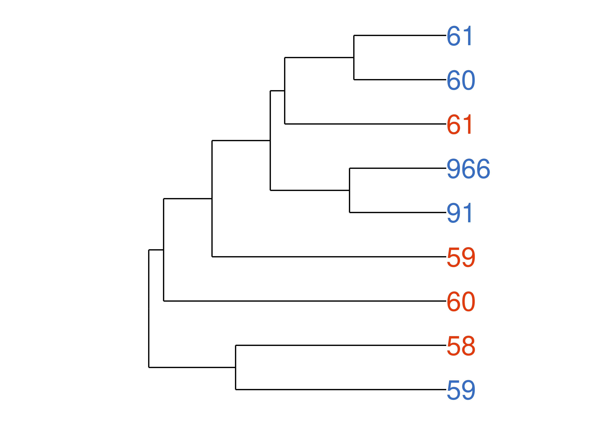{fig-align='center' width=2100}
:::
:::

::: {.cell layout-align="center"}

```{.r .cell-code}
wcy_melt %>%
  group_by(DNA_ID, Station_ID, Family, Month) %>%
  summarize(Fam_Abund = sum(Abundance)) %>%
  ungroup() %>%
  group_by(Family) %>% 
  mutate(Family = ifelse(max(Fam_Abund) > 0.01, Family, "(Rare/Unknown)"),
         Family = str_remove(Family, "f__"),
         Family = ifelse(is.na(Family), "(Rare/Unknown)",Family),
         Family = ifelse(Family == "Microcystaceae_A_24132", "Microcystaceae", Family)) %>%
  ungroup() %>% 
  ggplot(aes(y = Fam_Abund, x = Station_ID, fill = Family)) + 
  geom_col() +
  scale_fill_manual(values = cyano_family_colors) + 
  facet_wrap(~Month) + 
  labs(y = "Relative Abundance", x = "Station") + 
  theme(
        plot.margin = margin()) + 
  scale_y_continuous(expand = c(0,0),
                     labels= scales::label_comma()) 
```

::: {.cell-output-display}
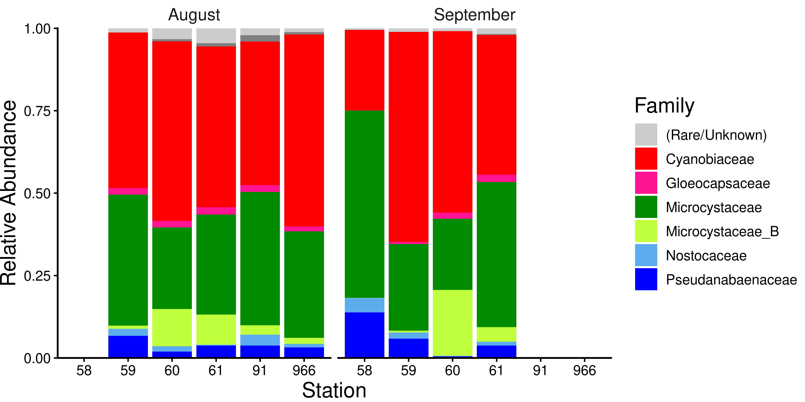{fig-align='center' width=2400}
:::
:::

::: {.cell layout-align="center"}

```{.r .cell-code}
wcy_melt %>%
  dplyr::filter(Genus == "g__Microcystis") %>%
  group_by(Sample_ID, Microcystin_Total) %>%
  summarize(sum_micro = sum(Abundance)) %>%
  ggplot(aes(x = sum_micro, y = Microcystin_Total)) + 
  geom_point() + 
  ggpubr::stat_cor()+ 
  labs(x = "Total Microcystis sp.", y = "Total Microcystins (ug/L)")
```

::: {.cell-output-display}
{fig-align='center' width=1200}
:::
:::


# Fake data


::: {.cell layout-align="center"}

```{.r .cell-code}
ggplot(data = data.frame(Sample = factor(c(1,1,2,2)),
           Species = c("X","Y","X","Y"),
           Abund = c(0.5,0.5,0.15,0.85)),
       aes(x = Sample, y = Abund, fill = Species)) + 
  geom_col() + 
  labs(y = "Relative Abundance") + 
  scale_fill_manual(values = c("green4", "steelblue4")) + 
  scale_y_continuous(expand = expansion(0))
```

::: {.cell-output-display}
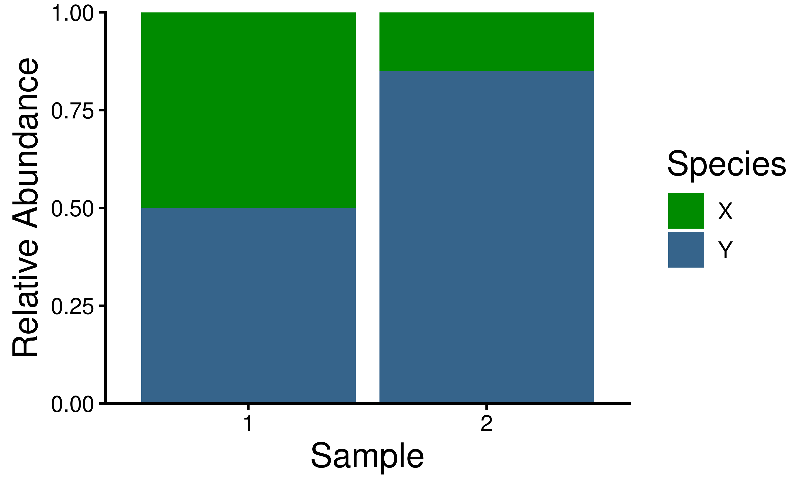{fig-align='center' width=1500}
:::

```{.r .cell-code}
ggplot(data = data.frame(Sample = factor(c(1,1,2,2)),
           Species = c("X","Y","X","Y"),
           Abund = c(50,50,50,280)),
       aes(x = Sample, y = Abund, fill = Species)) + 
  geom_col() + 
  labs(y = "Absolute Abundance") + 
  scale_fill_manual(values = c("green4", "steelblue4")) + 
  scale_y_continuous(expand = expansion(0))
```

::: {.cell-output-display}
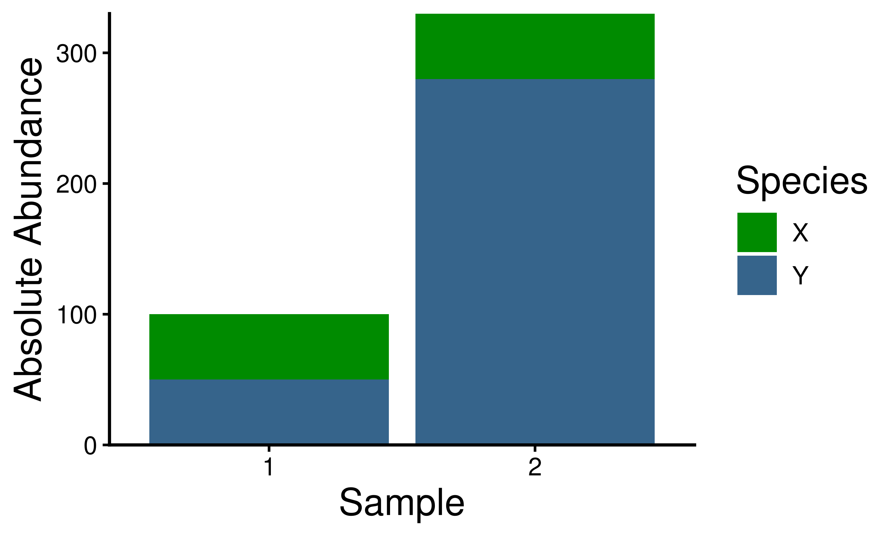{fig-align='center' width=1500}
:::

```{.r .cell-code}
ggplot(data = data.frame(Sample = factor(c(1,1,1,2,2,2)),
           Species = c("X","Y", "Z","X","Y","Z"),
           Abund = c(0.45,0.45,0.10,0.495,0.495,0.01)),
       aes(x = Sample, y = Abund, fill = Species)) + 
  geom_col() + 
  labs(y = "Relative Abundance") + 
  scale_fill_manual(values = c("green4", "steelblue4", "gold1")) + 
  scale_y_continuous(expand = expansion(0))
```

::: {.cell-output-display}
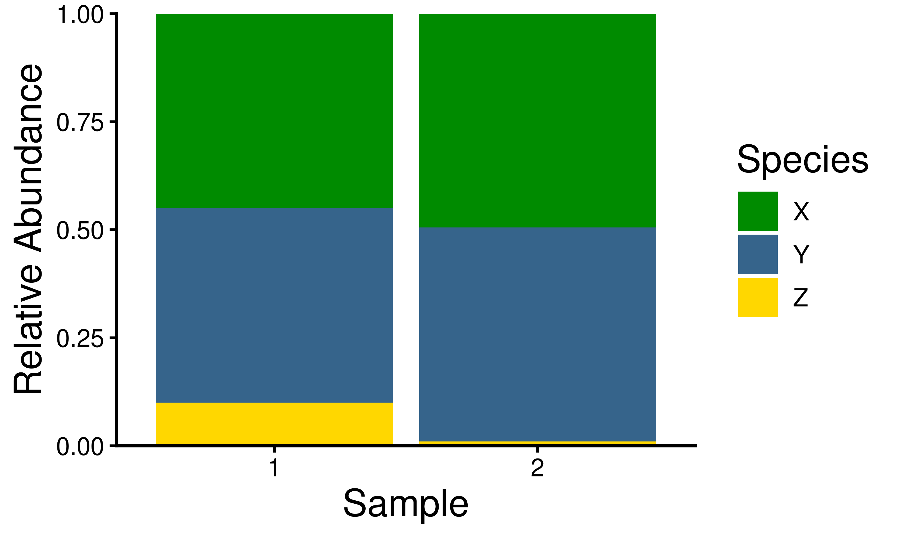{fig-align='center' width=1500}
:::

```{.r .cell-code}
ggplot(data = data.frame(Sample = factor(c(1,1,1,2,2,2)),
           Species = c("X","Y", "Z","X","Y","Z"),
           Abund = c(45,45,10,5,5,0.0)),
       aes(x = Sample, y = Abund, fill = Species)) + 
  geom_col() + 
  labs(y = "Absolute Abundance") + 
  scale_fill_manual(values = c("green4", "steelblue4", "gold1")) + 
  scale_y_continuous(expand = expansion(0))
```

::: {.cell-output-display}
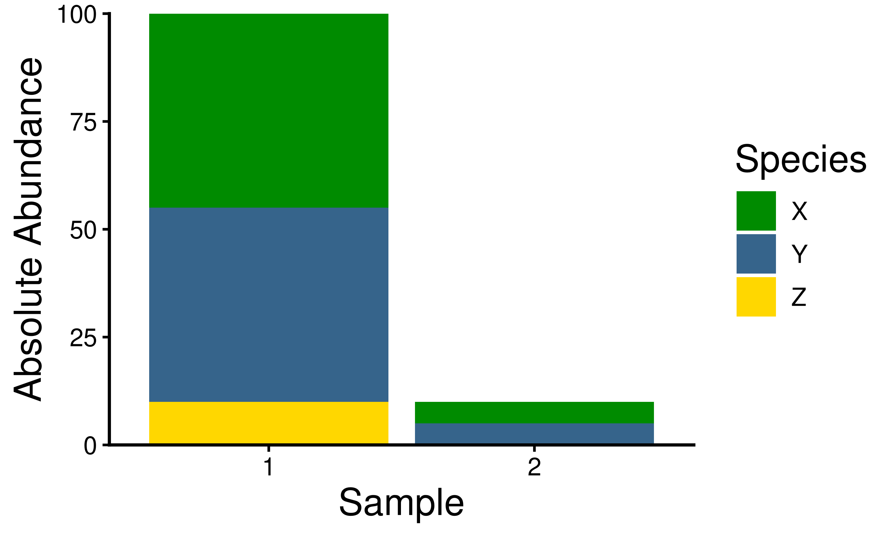{fig-align='center' width=1500}
:::

```{.r .cell-code}
ggsave("test.png", width = 5, height = 3)
```
:::


# Central Basin Hypoxia


::: {.cell layout-align="center"}

```{.r .cell-code}
ctds <- read_csv("data/05_Metadata_Curation/all_ctd_summary.csv")

sam_data <- 
  abs_physeq %>%
  sample_data() %>%
  data.frame()

central_data <- sam_data %>%
  select(DNA_ID, Station_ID, Month, Month, Depth_Class, Rep_ID, Basin, avg_cells_per_ml, rsg_pos_per_ml, rsg_perc_pos, rsg_mfi) %>%
  left_join(ctds) %>%
  mutate(ctd_temp = case_when(Depth_Class == "S" ~ surf_temperature,
                              Depth_Class == "B" ~ bottom_temperature),
         ctd_oxy = case_when(Depth_Class == "S" ~ surf_oxygen,
                              Depth_Class == "B" ~ bottom_oxygen)) %>%
   select(DNA_ID, Station_ID, Month, Month, Depth_Class, Rep_ID, Basin, avg_cells_per_ml, rsg_pos_per_ml, rsg_perc_pos, rsg_mfi, ctd_temp, ctd_oxy) %>%
  mutate(hypoxic = ifelse(ctd_oxy < 4, "Hypoxic","Oxic")) %>%
  filter(Month != "May", Basin == "C")

central_data %>%
  ggplot(aes(x = ctd_oxy, y = rsg_mfi)) + 
  geom_point()
```

::: {.cell-output-display}
{fig-align='center' width=2100}
:::

```{.r .cell-code}
central_data %>%
  ggplot(aes(x = ctd_oxy, y = rsg_perc_pos)) + 
  geom_point()
```

::: {.cell-output-display}
{fig-align='center' width=2100}
:::

```{.r .cell-code}
central_data %>%
  ggplot(aes(x = ctd_oxy, y = rsg_pos_per_ml)) + 
  geom_point()
```

::: {.cell-output-display}
{fig-align='center' width=2100}
:::

```{.r .cell-code}
# Neat

central_stations <- central_data$Station_ID

central_physeq <- abs_physeq %>%
  subset_samples(Month != "May") %>%
  subset_samples(Basin == "C") %>%
  microViz::ps_join(central_data)

plot_ordination(central_physeq, ordinate(central_physeq, method = "PCoA"), color = "hypoxic", shape = "Month") + 
  geom_point(size = 4, alpha = 0.7) 
```

::: {.cell-output-display}
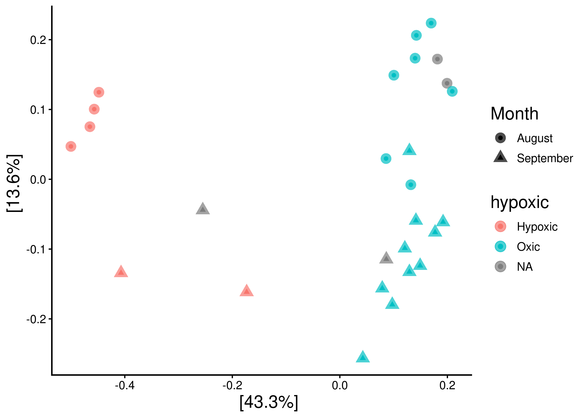{fig-align='center' width=2100}
:::

```{.r .cell-code}
plot_ordination(central_physeq, ordinate(central_physeq, method = "PCoA"), color = "Depth_Class", shape = "Month") + 
  geom_point(size = 4, alpha = 0.7) + 
  geom_text(aes(label = Station_ID))
```

::: {.cell-output-display}
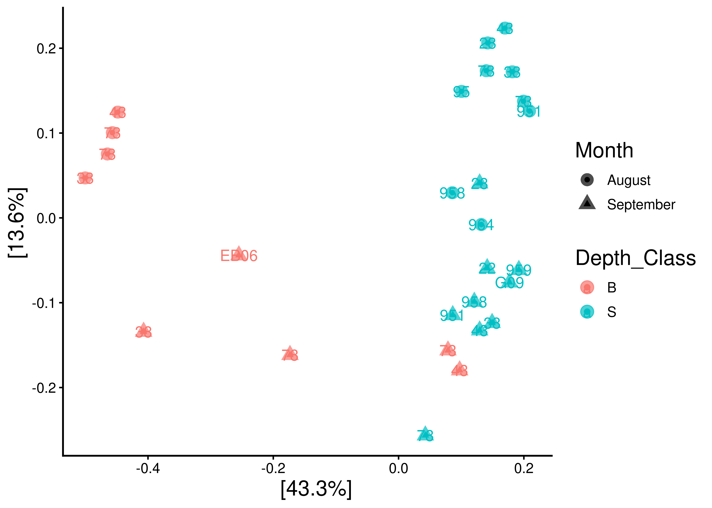{fig-align='center' width=2100}
:::

```{.r .cell-code}
cent_dist <- phyloseq::distance(central_physeq, "bray")

cent_clust <- hclust(cent_dist, method = "average")

cent_dendro <- as.dendrogram(cent_clust)

dna_id_order <-  ggdendro::dendro_data(cent_dendro)$label$label

sample_annotation <- 
  central_data %>%
  mutate(DNA_ID = factor(DNA_ID, levels = dna_id_order))

hypoxic_plot <- sample_annotation %>%
  ggplot(aes(x=1, y = DNA_ID)) + 
  geom_tile(aes(fill = hypoxic)) + 
  scale_fill_manual(values = c("#B9741F", "#990006"), name = "Oxygen") + 
  theme_void()+ 
  theme(legend.position = "left")

month_plot <- sample_annotation %>%
  ggplot(aes(x=1, y = DNA_ID)) + 
  geom_tile(aes(fill = Month)) + 
  scale_fill_manual(values = month_colors, name = "Month") + 
  theme_void()+ 
  theme(legend.position = "left")

barplot <- central_physeq %>%
  psmelt() %>%
    mutate(DNA_ID = factor(DNA_ID, levels = dna_id_order)) %>%
  group_by(DNA_ID, Class) %>%
  summarize(Class_Abund = sum(Abundance)) %>%
  ungroup() %>%
  group_by(Class) %>%
  mutate(Class = ifelse(max(Class_Abund) > 30000, Class, "(Rare)"),
         Class = str_remove(Class, "c__")) %>%
  ungroup() %>% 
  ggplot(aes(x = Class_Abund, y = DNA_ID, fill = Class)) + 
  geom_col() +
  scale_fill_manual(values = class_colors) + 
  labs(x = "Absolute Abundance") + 
  theme(axis.title.y = element_blank(),
        axis.text.y= element_blank(),
        axis.ticks.y = element_blank(),
        axis.line.y= element_blank(),
        plot.margin = margin()) + 
  scale_x_continuous(expand = c(0,0))

month_plot  + hypoxic_plot + barplot +
  plot_layout(nrow = 1, 
              widths = c(1,1, 16),
              guides = "collect") & 
  theme(legend.position = "left")
```

::: {.cell-output-display}
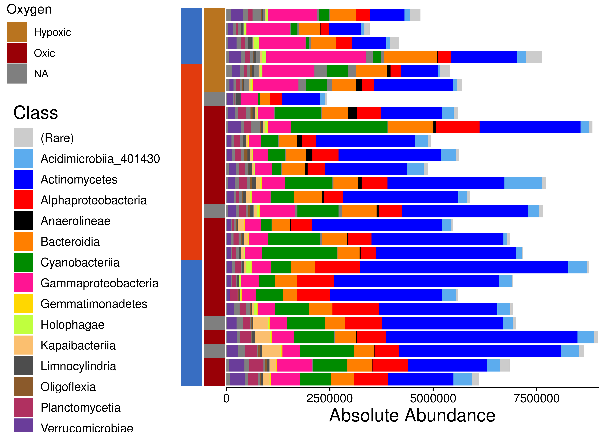{fig-align='center' width=2100}
:::

```{.r .cell-code}
gamma_colors <- c(
  "(Rare)" = "grey90",
  "Arenimonas_613591" = "gold1",
  "Azonexus" = "green4",
  "Limnohabitans_A" = "#FB9A99",
  "Methylobacter_C_601048" = "blue1",
  "Methylopumilus_A_558053" = "darkturquoise",
  "Nitrotoga" = "olivedrab1",
  "Rhodoferax_C" = "#FF7F00",
  "Sulfuritalea" = "#6A3D9A",
  "Sideroxyarcus" = "maroon"
)

barplot <- central_physeq %>%
  psmelt() %>%
    mutate(DNA_ID = factor(DNA_ID, levels = dna_id_order)) %>%
  filter(Class == "c__Gammaproteobacteria") %>%
  group_by(DNA_ID, Genus) %>%
  summarize(Class_Abund = sum(Abundance)) %>%
  ungroup() %>%
  group_by(Genus) %>%
  mutate(Class = ifelse(max(Class_Abund) > 100000, Genus, "(Rare)"),
         Class = str_remove(Class, "g__")) %>%
  ungroup() %>% 
  ggplot(aes(x = Class_Abund, y = DNA_ID, fill = Class)) + 
  geom_col() +
  labs(x = "Absolute Abundance") + 
  scale_fill_manual(values = gamma_colors) + 
  theme(axis.title.y = element_blank(),
        axis.text.y= element_blank(),
        axis.ticks.y = element_blank(),
        axis.line.y= element_blank(),
        plot.margin = margin()) + 
  scale_x_continuous(expand = c(0,0))

month_plot  + hypoxic_plot + barplot +
  plot_layout(nrow = 1, 
              widths = c(1,1, 16),
              guides = "collect") & 
  theme(legend.position = "left")
```

::: {.cell-output-display}
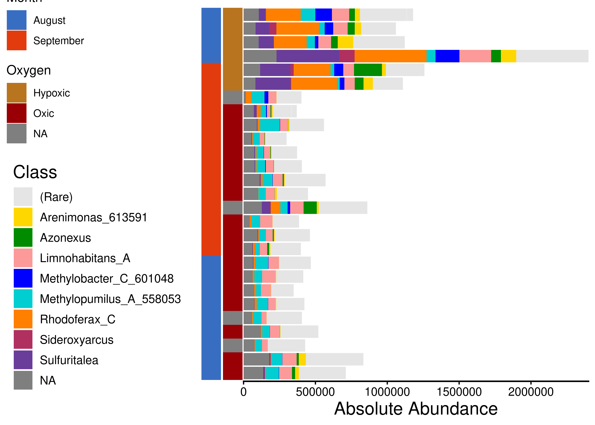{fig-align='center' width=2100}
:::
:::
