# Goals of this document

# Load Data and Packages


::: {.cell layout-align="center"}

```{.r .cell-code}
pacman::p_load(phyloseq, vegan, patchwork, tidyverse)

source("code/R/plotting_aesthetics.R")

load("data/07_Alpha_Diversity/diversity_physeq.RData")
load("data/08_Beta_Diversity/trim_physeq.RData")

load("data/08_Beta_Diversity/abs_physeq.RData")

cyano_physeq <- 
  trim_physeq %>%
  prune_taxa(taxa_sums(.) > 0, .) %>%
  subset_taxa(., Phylum == "p__Cyanobacteriota")

cyano_melted <- cyano_physeq %>%
  psmelt() %>%
  filter(Depth_Class == "S")

asv_ids <- cyano_melted %>%
  select(ASV, Genus) %>%
  unique()
```
:::

::: {.cell layout-align="center"}

```{.r .cell-code}
sum_cyanos <- cyano_melted %>%
  filter(!is.na(Genus)) %>%
  group_by(Genus) %>%
  summarize(Max_Abund = max(Abundance),
            Median_Abund = median(Abundance),
            N_ASV = length(unique(ASV)),
            Prevalence = sum(Abundance > 0)/n()) %>%
  ungroup()

sum_cyanos_asv <- cyano_melted %>%
  filter(!is.na(Genus)) %>%
  group_by(Month, Genus, ASV) %>%
  summarize(Total_Abund = sum(Abundance),
            Max_Abund = max(Abundance),
            Median_Abund = median(Abundance),
            Prevalence = sum(Abundance > 0)/n()) %>%
  ungroup()
```
:::


## Species Co-correlation

Two separate goals: 


::: {.cell layout-align="center"}

```{.r .cell-code}
top_cyano_asvs <- cyano_melted %>%
  filter(Month != "May") %>%
  group_by(ASV) %>%
  summarize(Total_Abund = sum(Abundance),
            Prevalence = sum(Abundance > 0) / n()) %>%
  filter(Prevalence > 0.25) %>%
  slice_max(n = 100, order_by = Total_Abund)


abs_melted <- 
  abs_physeq %>%
  psmelt() %>%
  filter(Depth_Class == "S", DNA_ID != "KH_D076", Month != "May",
         !ASV %in% top_cyano_asvs)

rel_melted <- 
  diversity_physeq %>%
  transform_sample_counts(., \(x)x/sum(x)) %>%
  psmelt() %>%
  filter(Depth_Class == "S", DNA_ID != "KH_D076", Month != "May",
         !ASV %in% top_cyano_asvs)

rel_cy_melted <- 
  rel_melted %>%
  filter(Phylum == "p__Cyanobacteriota")


top_asvs <- 
  abs_melted %>%
  group_by(ASV) %>%
  summarize(Total_Abund = sum(Abundance),
            Prevalence = sum(Abundance > 0)/n()) %>%
  filter(Prevalence > 0.25) %>%
  slice_max(n = 1000, order_by = Total_Abund) %>%
  pull(ASV)


wide_cy <- 
  cyano_melted %>%
  filter(ASV %in% top_cyano_asvs$ASV) %>%
  select(ASV, Rep_ID, Abundance) %>%
  pivot_wider(names_from = ASV, values_from = Abundance)

wide_cy_rel <- 
  rel_cy_melted %>%
  filter(ASV %in% top_cyano_asvs$ASV) %>%
  select(ASV, Rep_ID, Abundance) %>%
  pivot_wider(names_from = ASV, values_from = Abundance)

prok_names <- colnames(wide_cy)[-1]

# cy_cor_res <- cyano_melted %>%
#   filter(ASV %in% top_cyano_asvs$ASV) %>%
#   select(ASV, Rep_ID, Abundance) %>%
#   pivot_wider(names_from = ASV, values_from = Abundance) %>%
#   rstatix::cor_test(vars = prok_names)
# 
# save(cy_cor_res, file = "data/10_Cyano_Species_Distribution/cy_cor_res.RData")

load("data/10_Cyano_Species_Distribution/cy_cor_res.RData")
# 
#  rel_cy_cor_res <- rel_cy_melted %>%
#    filter(ASV %in% top_cyano_asvs$ASV) %>%
#    select(ASV, Rep_ID, Abundance) %>%
#    pivot_wider(names_from = ASV, values_from = Abundance) %>%
#    rstatix::cor_test(vars = prok_names)
#  
#  save(rel_cy_cor_res, file = "data/10_Cyano_Species_Distribution/rel_cy_cor_res.RData")

load("data/10_Cyano_Species_Distribution/rel_cy_cor_res.RData")
```
:::

::: {.cell layout-align="center"}

```{.r .cell-code}
library(ggraph)
library(igraph)
library(tidygraph)

# High correlation
cy_cor_mat <- 
  cy_cor_res %>%
  mutate(adjust_p = p.adjust(p, method = "holm")) %>%
  mutate(cor = ifelse(cor>=0.8&adjust_p<0.01, cor, 0)) %>%
  select(var1, var2, cor) %>%
  pivot_wider(names_from = var2, values_from = cor) %>%
  column_to_rownames("var1") %>%
  as.matrix()


adj_mat <- igraph::graph_from_adjacency_matrix(cy_cor_mat, weighted=T, mode="undirected", diag=F)

graph <- as_tbl_graph(adj_mat) %>%
  left_join(asv_ids, by = c("name" = "ASV")) %>%
  left_join(top_cyano_asvs, by = c("name" = "ASV")) %>%
  #filter(!is.na(Genus)) %>%
  mutate(Centrality = centrality_degree(mode = 'in'),
         Genus = str_remove(Genus, "g__"),
         Genus = ifelse(is.na(Genus), "(Rare/Unknown)", Genus),
         Genus = ifelse(Total_Abund < 50000, "(Rare/Unknown)", Genus),
         Genus = factor(Genus, levels = names(cyano_genus_colors))
  )


set.seed(314)
ggraph(graph, layout = "fr")+ 
  geom_edge_fan(aes(alpha = weight), linewidth = 1,show.legend = FALSE) +
  geom_node_point(aes(color = Genus, size = Total_Abund)) + 
  scale_size_continuous(labels = scales::unit_format(unit = "M", scale = 1e-6))+
  scale_color_manual(values = cyano_genus_colors) + 
  guides(color = guide_legend(override.aes = list(size = 5))) + 
  labs(size = "Total Abundance\n(cells/ml)") + 
  theme(legend.title = element_text(size = 12),
        legend.position = "left")
```

::: {.cell-output-display}
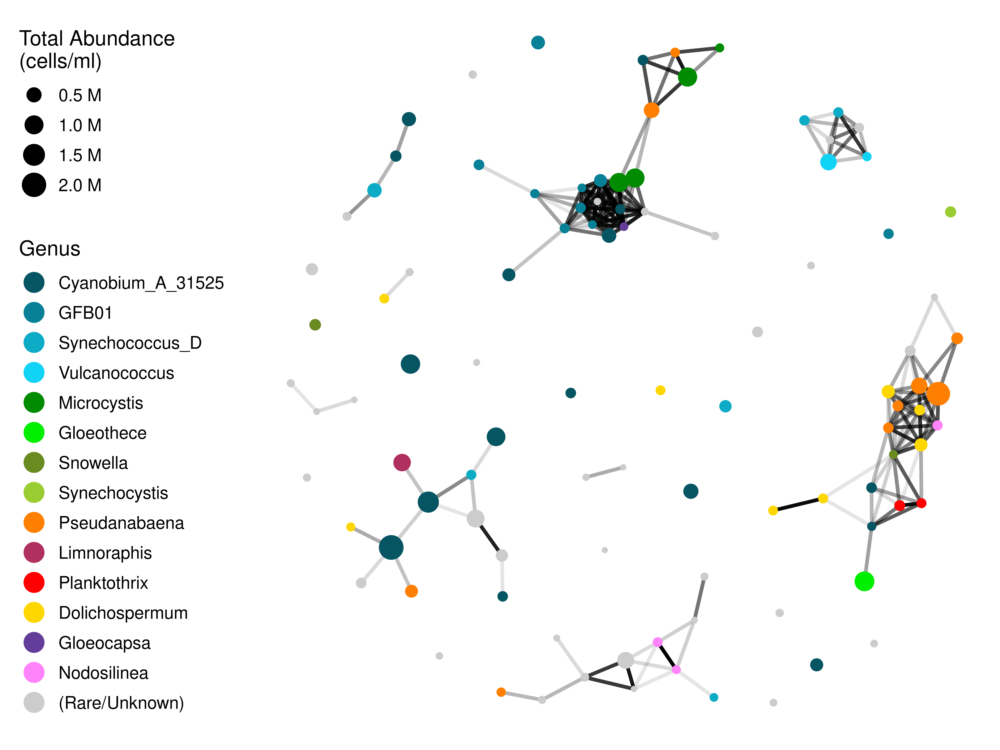{fig-align='center' width=2400}
:::

```{.r .cell-code}
ggsave(filename = "figures/10_Cyano_Species_Distribution/Fig6_A.png", dpi = 300, height = 6, width = 8)

rel_cy_cor_mat <- 
  rel_cy_cor_res %>%
  mutate(adjust_p = p.adjust(p, method = "holm")) %>%
  mutate(cor = ifelse(cor>=0.8&adjust_p<0.01, cor, 0)) %>%
  select(var1, var2, cor) %>%
  pivot_wider(names_from = var2, values_from = cor) %>%
  column_to_rownames("var1") %>%
  as.matrix()


rel_adj_mat <- igraph::graph_from_adjacency_matrix(rel_cy_cor_mat, weighted=T, mode="undirected", diag=F)

rel_graph <- as_tbl_graph(rel_adj_mat) %>%
  left_join(asv_ids, by = c("name" = "ASV")) %>%
  left_join(top_cyano_asvs, by = c("name" = "ASV")) %>%
  #filter(!is.na(Genus)) %>%
  mutate(Centrality = centrality_degree(mode = 'in'),
         Genus = str_remove(Genus, "g__"),
         Genus = ifelse(is.na(Genus), "(Rare/Unknown)", Genus),
         Genus = ifelse(Total_Abund < 50000, "(Rare/Unknown)", Genus),
         Genus = factor(Genus, levels = names(cyano_genus_colors))
  )


set.seed(314)
ggraph(rel_graph, layout = "fr")+ 
  geom_edge_fan(aes(alpha = weight), show.legend = FALSE, linewidth = 1) + 
  geom_node_point(aes(color = Genus, size = Total_Abund)) + 
  scale_size_continuous(labels = scales::unit_format(unit = "M", scale = 1e-6))+
  scale_color_manual(values = cyano_genus_colors) + 
  guides(color = guide_legend(override.aes = list(size = 5))) + 
  labs(size = "Total Abundance\n(cells/ml)") + 
  theme(legend.title = element_text(size = 12),
        legend.position = "left")
```

::: {.cell-output-display}
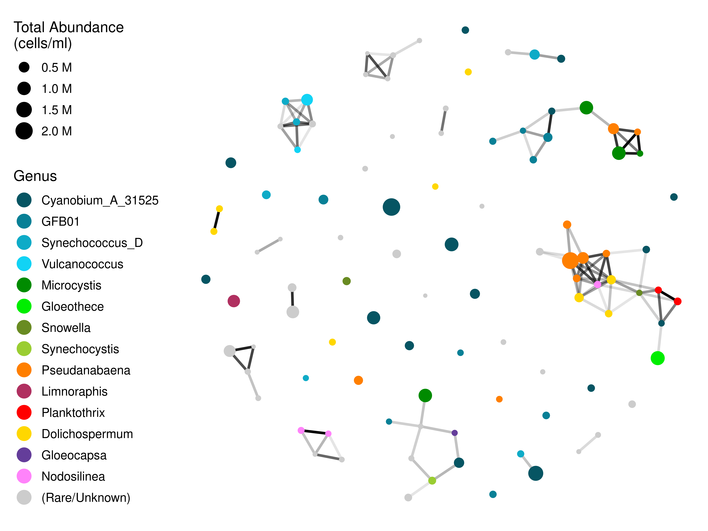{fig-align='center' width=2400}
:::

```{.r .cell-code}
ggsave(filename = "test.png", dpi = 300, height = 6, width = 8)

clustered <- igraph::cluster_edge_betweenness(graph)


members <- igraph::membership(clustered) 

mem_df <- data.frame(name = names(members),
                     membership = members)

top_mem<- 
  mem_df %>%
  count(membership) %>%
  slice_max(n = 3, order_by = n) %>%
  pull(membership)

good_mem_df <- 
  mem_df %>%
  mutate(membership = ifelse(membership %in% top_mem, membership, NA),
         membership = factor(membership, labels = c(1:4)))

mem_graph <- 
  graph %>%
  left_join(good_mem_df)


set.seed(314)
ggraph(mem_graph, layout = "fr")+ 
  geom_edge_fan(aes(alpha = weight), show.legend = FALSE) + 
  geom_node_point(aes(color = membership, size = Total_Abund)) + 
  guides(color = guide_legend(override.aes = list(size = 5)),
         size = guide_none())
```

::: {.cell-output-display}
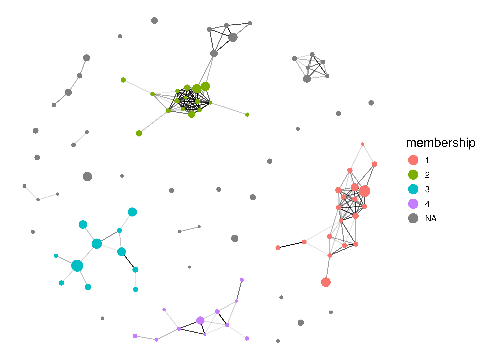{fig-align='center' width=2400}
:::

```{.r .cell-code}
mem_asvs <- good_mem_df %>%
  filter(!is.na(membership)) %>%
  rename(ASV = name) %>%
  filter(membership %in% c(1,2,3))
```
:::

::: {.cell layout-align="center"}

```{.r .cell-code}
pacman::p_load(sf, terra, tmap, gstat, install = FALSE)

# Define some shapes and objects

raw_erie <- read_sf("data/spatial_imports/hydro_p_LakeErie/hydro_p_LakeErie.shp") %>%
  st_transform(crs = "EPSG:4326")

erie_outline <- raw_erie %>%
  st_union()

mem_cy_sf <- 
  cyano_melted %>%
  select(Rep_ID, Abundance, ASV, Latitude, Longitude, Month) %>%
  left_join(mem_asvs) %>%
  filter(!is.na(membership)) %>%
  group_by(Rep_ID, Month, Latitude, Longitude, membership) %>%
  summarize(mem_abund = sum(Abundance)) %>%
  mutate(Month = factor(Month, levels = c("May","August","September"))) %>%
  st_as_sf(coords = c("Longitude","Latitude"), crs = "EPSG:4326")


mem_cy_sf %>%
  dplyr::filter(Month != "May") %>%
  mutate(membership = factor(membership, levels = c(2,1,3))) %>%
  ggplot() +
  geom_sf(data = erie_outline, fill = NA) +
  geom_sf(aes(size = mem_abund, color = mem_abund), alpha = 1) + 
  facet_grid(membership~Month)+
  scale_color_distiller(palette = "Spectral", limits = c(0,1.6e6), breaks = c(0, 0.5e6, 1e6, 1.5e6), labels = scales::unit_format(unit = "M", scale = 1e-6)) + 
  scale_size_continuous(limits = c(0,1.6e6), breaks = c(0, 0.5e6, 1e6, 1.5e6), labels = scales::unit_format(unit = "M", scale = 1e-6)) + 
  labs(color = "Cluster\nAbundance\n(cells/ml)", size = "Cluster\nAbundance\n(cells/ml)") +
  guides(color= guide_legend(), size=guide_legend()) + 
  theme(axis.line = element_blank(),
        axis.text = element_blank(),
        axis.ticks = element_blank(),
        strip.text.y = element_blank(),
        legend.title = element_text(size = 12),
        strip.text = element_text(size = 12))
```

::: {.cell-output-display}
{fig-align='center' width=1800}
:::

```{.r .cell-code}
#ggsave(filename = "test.png", width = 6, height= 6, dpi = 300)
```
:::

::: {.cell layout-align="center"}

```{.r .cell-code}
corrs <- seq(from = 0.5, to = 0.95, by = 0.05)

names(corrs) <- corrs

graphs <- map(corrs, \(x){
  cy_cor_mat <- 
    cy_cor_res %>%
    mutate(cor = ifelse(cor>=x&p<0.01, cor, 0)) %>%
    select(var1, var2, cor) %>%
    pivot_wider(names_from = var2, values_from = cor) %>%
    column_to_rownames("var1") %>%
    as.matrix()
  
  adj_mat <- igraph::graph_from_adjacency_matrix(cy_cor_mat, weighted=T, mode="undirected", diag=F)
  
  graph <- as_tbl_graph(adj_mat)
})

mods <- map(graphs, \(x){
  clustered <- igraph::cluster_edge_betweenness(x)
  
  igraph::modularity(clustered)
  
}) %>%
  unlist() 

data.frame(Corr = corrs,
           Modularity = mods) %>%
  ggplot(aes(x = corrs, y = Modularity)) + 
  geom_line() + 
  geom_point(size = 4) + 
  labs(x = "Minimum Correlation")
```

::: {.cell-output-display}
{fig-align='center' width=1800}
:::

```{.r .cell-code}
map(graphs, \(x){
  igraph::clique_num(x)
}) %>% unlist()
```

::: {.cell-output .cell-output-stdout}
```
 0.5 0.55  0.6 0.65  0.7 0.75  0.8 0.85  0.9 0.95 
  17   15   14   13   13   11   11   10    7    5 
```
:::
:::


# Correlating Cyano Abund vs. Heterotroph Abund

# Going by Clusters


::: {.cell layout-align="center"}

```{.r .cell-code}
small_phy <- abs_physeq %>%
  subset_samples(Month != "May") %>%
  subset_samples(Depth_Class == "S") %>%
  subset_samples(DNA_ID != "KH_D076") 

save(small_phy, file = "small_phy.RData")
# 
# het_alpha_rarefaction <-
#   
#   map(c(1:100), \(x) {
#     rare_physeq <- small_phy %>%
#       rarefy_even_depth(rngseed = x, replace = FALSE) %>%
#       subset_taxa(., Phylum != "p__Cyanobacteriota")
#     
#     alpha_diversity <-
#       estimate_richness(small_phy, measure = c("Shannon", "Observed"))
#     
#     H <- alpha_diversity$Shannon
#     S1 <- alpha_diversity$Observed
#     S <- log(S1)
#     alpha_diversity$evenness <- H / S
#     
#     res <- picante::pd(samp = as.data.frame(t(otu_table(small_phy))),
#            tree = phy_tree(small_phy),
#            include.root = FALSE) %>%
#       rownames_to_column("DNA_ID") %>%
#       select(DNA_ID, PD)
#     
#     
#     alpha_diversity %>%
#        rownames_to_column("DNA_ID") %>%
#         select(DNA_ID, Observed, evenness, Shannon) %>%
#       left_join(res)
#   })
# 
# 
# save(het_alpha_rarefaction, file = "data/10_Cyano_Species_Distribution/het_alpha_rarefaction.RData")

load("data/10_Cyano_Species_Distribution/het_alpha_rarefaction.RData")


alpha_diversity <- het_alpha_rarefaction %>%
  bind_rows() %>%
  group_by(DNA_ID) %>%
  summarize(het_richness = mean(Observed, na.rm = TRUE),
            het_evenness = mean(evenness, na.rm = TRUE),
            het_shannon = mean(Shannon, na.rm = TRUE),
            het_fpd = mean(PD, na.rm = TRUE))


mem_cy_abunds <-
  cyano_melted %>%
  select(DNA_ID, Abundance, ASV, avg_cells_per_ml) %>%
  left_join(mem_asvs) %>%
  filter(!is.na(membership)) %>%
  group_by(DNA_ID, membership) %>%
  summarize(
    Mem_Abund = sum(Abundance),
    Mem_Abund_Rel = sum(Abundance) / mean(avg_cells_per_ml)
  )

total_cy_stats <-  cyano_melted %>%
  filter(Abundance > 0) %>%
  group_by(DNA_ID) %>%
  summarize(
    Mem_Abund = sum(Abundance),
    Mem_Abund_Rel = sum(Abundance) / mean(avg_cells_per_ml)
  ) %>%
  mutate(membership = "Total")

cy_stats <- cyano_melted %>%
  filter(Abundance > 0) %>%
  group_by(DNA_ID) %>%
  summarize(Cy_Richness = n(),
            Cy_Abundance = sum(Abundance))

all_cy_stats <- rbind(mem_cy_abunds, total_cy_stats) %>%
  left_join(cy_stats)

joined <-
  abs_physeq %>%
  sample_data() %>%
  data.frame() %>%
  filter(Depth_Class == "S", DNA_ID != "KH_D076", Month != "May") %>%
  left_join(all_cy_stats) %>%
  left_join(alpha_diversity)


joined %>%
  mutate(
    Month = factor(Month, levels = c("May", "August", "September")),
    membership = factor(
      membership,
      levels = c("Total", "2", "1", "3"),
      labels = c("Total", "C1: Microcystis", "C2: Pseudanabaena", "C3: Cyanobium")
    )
  ) %>%
  ggplot(aes(x = Mem_Abund, y =   het_richness)) +
  geom_point(aes(color = Month)) +
  ggpubr::stat_cor(
    aes(label = after_stat(r.label)),
    show.legend = FALSE,
    method = "spearman",
    cor.coef.name = "rho"
  ) +
  scale_color_manual(values = month_colors) +
  scale_x_continuous(labels = scales::unit_format(unit = "M", scale = 1e-6)) +
  facet_wrap( ~ membership, scale = "free_x", nrow = 1) +
  theme(legend.position = "right",
        aspect.ratio = 1, 
        axis.text = element_text(size = 8)) + 
  labs(x = "Cyano Abundance/mL", y = "Non-Cyano\nRichness") 
```

::: {.cell-output-display}
{fig-align='center' width=3000}
:::

```{.r .cell-code}
joined %>%
  mutate(Month = factor(Month, levels = c("May","August","September")),
         membership = factor(membership, levels = c("Total", "2","1","3"),
                             labels = c("Total","C1: Microcystis","C2: Pseudanabaena", "C3: Cyanobium"))) %>%
  ggplot(aes(x = Mem_Abund, y =   het_evenness)) + 
  geom_point(aes(color = Month)) + 
   ggpubr::stat_cor(
    aes(label = after_stat(r.label)),
    show.legend = FALSE,
    method = "spearman",
    cor.coef.name = "rho"
  ) +
  scale_color_manual(values = month_colors) + 
  scale_x_continuous(labels = scales::unit_format(unit = "M", scale = 1e-6))+
  facet_wrap(~membership, scale = "free_x", nrow = 1) + 
  theme(legend.position = "right", 
        aspect.ratio = 1,
        axis.text = element_text(size = 8)) + 
  labs(x = "Cyano Abundance/mL", y = "Non-Cyano\nEvenness") 
```

::: {.cell-output-display}
{fig-align='center' width=3000}
:::

```{.r .cell-code}
joined %>%
  mutate(Month = factor(Month, levels = c("May","August","September")),
         membership = factor(membership, levels = c("Total", "2","1","3"),
                             labels = c("Total","C1: Microcystis","C2: Pseudanabaena", "C3: Cyanobium"))) %>%
  ggplot(aes(x = Mem_Abund, y =   avg_cells_per_ml - total_chl_counts)) + 
  geom_point(aes(color = Month)) + 
   ggpubr::stat_cor(
    aes(label = after_stat(r.label)),
    show.legend = FALSE,
    method = "spearman",
    cor.coef.name = "rho"
  ) +
  scale_color_manual(values = month_colors) + 
  scale_x_continuous(labels = scales::unit_format(unit = "M", scale = 1e-6))+
  scale_y_continuous(labels = scales::unit_format(unit = "M", scale = 1e-6))+
  facet_wrap(~membership, scale = "free_x", nrow = 1) + 
  theme(legend.position = "right", 
        aspect.ratio = 1,
        axis.text = element_text(size = 8)) + 
  labs(x = "Cyano Abundance/mL", y = "Non-Cyano\nAbundance/mL") 
```

::: {.cell-output-display}
{fig-align='center' width=3000}
:::

```{.r .cell-code}
joined %>%
  mutate(Month = factor(Month, levels = c("May","August","September")),
         membership = factor(membership, levels = c("Total", "2","1","3"),
                             labels = c("Total","C1: Microcystis","C2: Pseudanabaena", "C3: Cyanobium"))) %>%
  ggplot(aes(x = Mem_Abund, y =  het_rsg_per_ml)) + 
  geom_point(aes(color = Month)) + 
   ggpubr::stat_cor(
    aes(label = after_stat(r.label)),
    show.legend = FALSE,
    method = "spearman",
    cor.coef.name = "rho"
  ) +
  scale_color_manual(values = month_colors) + 
  scale_x_continuous(labels = scales::unit_format(unit = "M", scale = 1e-6))+
  scale_y_continuous(labels = scales::unit_format(unit = "M", scale = 1e-6))+
  facet_wrap(~membership, scale = "free_x", nrow = 1) + 
  theme(legend.position = "right", 
        aspect.ratio = 1,
        axis.text = element_text(size = 8)) + 
  labs(x = "Cyano Abundance/mL", y = "RSG+/mL") 
```

::: {.cell-output-display}
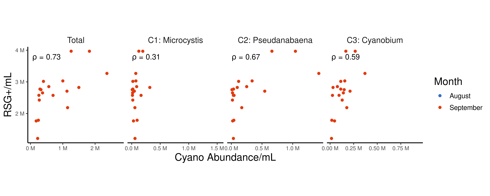{fig-align='center' width=3000}
:::

```{.r .cell-code}
joined %>%
  mutate(Month = factor(Month, levels = c("May","August","September")),
         membership = factor(membership, levels = c("Total", "2","1","3"),
                             labels = c("Total","C1: Microcystis","C2: Pseudanabaena", "C3: Cyanobium"))) %>%
  ggplot(aes(x = Mem_Abund, y =  rsg_perc_pos)) + 
  geom_point(aes(color = Month)) + 
   ggpubr::stat_cor(
    aes(label = after_stat(r.label)),
    show.legend = FALSE,
    method = "spearman",
    cor.coef.name = "rho"
  ) +
  scale_color_manual(values = month_colors) + 
  scale_x_continuous(labels = scales::unit_format(unit = "M", scale = 1e-6))+
  facet_wrap(~membership, scale = "free_x", nrow = 1) + 
  theme(legend.position = "right", 
        aspect.ratio = 1,
        axis.text = element_text(size = 8)) + 
  labs(x = "Cyano Abundance/mL", y = "% RSG+") 
```

::: {.cell-output-display}
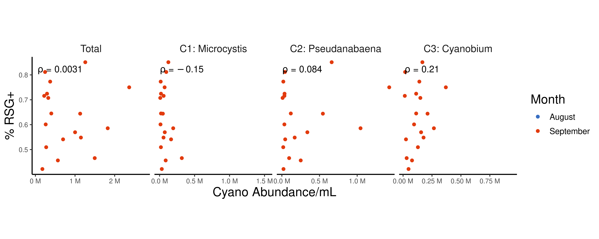{fig-align='center' width=3000}
:::
:::

::: {.cell layout-align="center"}

```{.r .cell-code}
flow_abund_plot <- joined %>%
  mutate(Month = factor(Month, levels = c("May","August","September")),
         membership = factor(membership, levels = c("Total", "2","1","3"),
                             labels = c("Total","C1: Microcystis","C2: Pseudanabaena", "C3: Cyanobium"))) %>%
  dplyr::filter(membership == "Total") %>%
  ggplot(aes(x = total_chl_counts, y =   avg_cells_per_ml - total_chl_counts)) + 
  geom_point(aes(color = Month)) + 
  ggpubr::stat_cor(show.legend = FALSE, method = "spearman", 
                   cor.coef.name = "rho",
                   p.accuracy = 0.001) +
  scale_color_manual(values = month_colors) + 
  scale_x_continuous(labels = scales::unit_format(unit = "M", scale = 1e-6))+
  scale_y_continuous(labels = scales::unit_format(unit = "M", scale = 1e-6))+
  theme(legend.position = "right", 
        aspect.ratio = 1,
        axis.text = element_text(size = 8)) + 
  labs(x = "Cyano Abundance/mL\n(flow counts)", y = "Non-Cyano Abundance/mL\n(flow counts)") 


flow_rsg_plot <- joined %>%
  mutate(Month = factor(Month, levels = c("May","August","September")),
         membership = factor(membership, levels = c("Total", "2","1","3"),
                             labels = c("Total","C1: Microcystis","C2: Pseudanabaena", "C3: Cyanobium"))) %>%
  dplyr::filter(membership == "Total") %>%
  ggplot(aes(x = total_chl_counts, y =   het_rsg_per_ml)) + 
  geom_point(aes(color = Month)) + 
  ggpubr::stat_cor(show.legend = FALSE, method = "spearman", 
                   cor.coef.name = "rho",
                   p.accuracy = 0.001) +
  scale_color_manual(values = month_colors) + 
  scale_x_continuous(labels = scales::unit_format(unit = "M", scale = 1e-6))+
  scale_y_continuous(labels = scales::unit_format(unit = "M", scale = 1e-6))+
  theme(legend.position = "right", 
        aspect.ratio = 1,
        axis.text = element_text(size = 8)) + 
  labs(x = "Cyano Abundance/mL\n(flow counts)", y = "Non-Cyano RSG+/mL\n(flow counts)") 


flow_abund_plot + flow_rsg_plot + 
  plot_layout(guides = "collect")
```

::: {.cell-output-display}
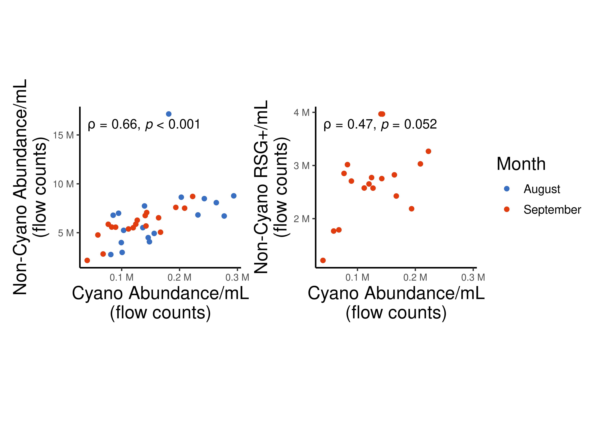{fig-align='center' width=2100}
:::

```{.r .cell-code}
ggsave("test.png", width = 8, height = 4)
```
:::

::: {.cell layout-align="center"}

```{.r .cell-code}
abs_physeq %>%
  psmelt() %>%
  filter(Phylum == "p__Cyanobacteriota") %>%
  group_by(DNA_ID, Month, total_chl_counts) %>%
  summarize(cy_abund = sum(Abundance)) %>%
  ggplot(aes(x = total_chl_counts, y = cy_abund)) + 
  geom_point() + 
  
  ggpubr::stat_cor(show.legend = FALSE, method = "spearman", 
                   cor.coef.name = "rho",
                   p.accuracy = 0.001) +
  scale_x_log10(labels = scales::unit_format(unit = "M", scale = 1e-6))+
  scale_y_log10(labels = scales::unit_format(unit = "M", scale = 1e-6))+
  labs(x = "Cyano Abundance/mL\n(flow counts)", y = "Cyano Abundance/mL\n(whole community estimate)") 
```

::: {.cell-output-display}
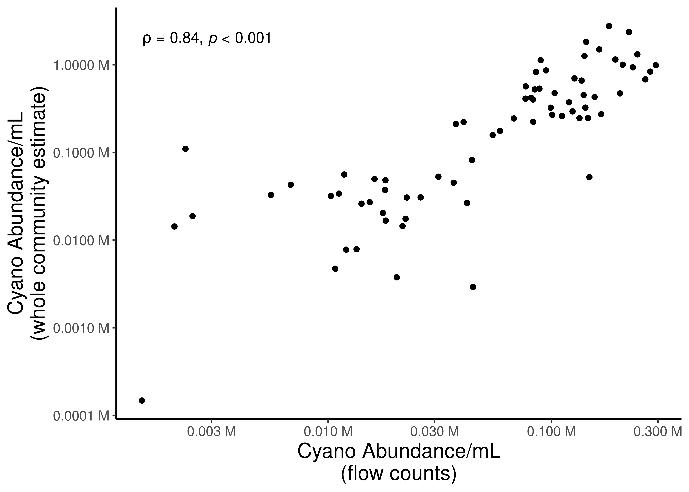{fig-align='center' width=2100}
:::

```{.r .cell-code}
ggsave("test.png", width = 5, height = 5)
```
:::

::: {.cell layout-align="center"}

```{.r .cell-code}
joined %>%
  select(membership, Mem_Abund,het_richness, het_shannon, het_fpd, het_evenness) %>%
  group_by(membership) %>%
  rstatix::cor_test(vars = Mem_Abund, vars2 = starts_with("het"), method = "spearman", use = "pairwise.complete.obs") %>%
  rstatix::adjust_pvalue() %>%
  mutate(var2 = factor(var2, levels = c("het_evenness","het_fpd","het_shannon","het_richness"),
                       labels = c("Evenness", "Faith's PD","Shannon", "Richness")),
         membership = factor(membership, levels = c("Total", "2","1","3"),
                             labels = c("Total","C1: Microcystis","C2: Pseudanabaena", "C3: Cyanobium"))) %>%
  ggplot(aes(x = membership, y = var2, fill = cor, alpha = p.adj < 0.05)) + 
  geom_tile() + 
  geom_text(aes(label = round(cor, 2))) + 
  scale_fill_distiller(palette = "Spectral") + 
  scale_alpha_manual(values = c(0.4,1)) + 
  scale_y_discrete(expand = expansion(0)) + 
  scale_x_discrete(expand = expansion(0)) + 
  guides(alpha = "none") + 
  labs(y="Non-Cyano Metric",
       fill = "Spearman's R")+
  theme(axis.title.x = element_blank(),
        axis.line = element_blank(),
        axis.ticks = element_blank(),
        axis.text.x = element_text(angle = 330, vjust = 1, hjust = 0, size = 12))
```

::: {.cell-output-display}
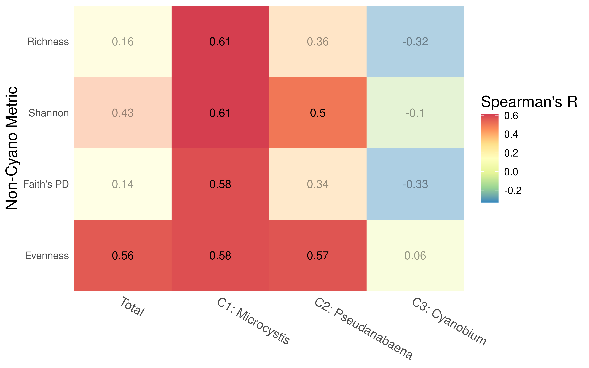{fig-align='center' width=2400}
:::
:::

::: {.cell layout-align="center"}

```{.r .cell-code}
joined %>%
  mutate(het_abund = avg_cells_per_ml - total_chl_counts,
         het_rich = Richness - Cy_Richness,
         het_even = het_evenness,
         het_rsg = het_rsg_per_ml,
         het_rsg_perc = het_rsg_perc_pos) %>%
  select(membership, Mem_Abund_Rel,het_abund, het_rich, het_even, het_rsg, het_rsg_perc) %>%
  group_by(membership) %>%
  rstatix::cor_test(vars = Mem_Abund_Rel, vars2 = starts_with("het"), method = "spearman", use = "pairwise.complete.obs") %>%
  rstatix::adjust_pvalue() %>%
  mutate(var2 = factor(var2, levels = c("het_rsg_perc","het_rsg","het_abund","het_even","het_rich"),
                       labels = c("% RSG +", "Total RSG+", "Abundance","Evenness","Richness")),
         membership = factor(membership, levels = c("Total", "2","1","3"),
                             labels = c("Total","C1: Microcystis","C2: Pseudanabaena", "C3: Cyanobium"))) %>%
  ggplot(aes(x = membership, y = var2, fill = cor, alpha = p.adj < 0.05)) + 
  geom_tile() + 
  geom_text(aes(label = round(cor, 2))) + 
  scale_fill_distiller(palette = "Spectral") + 
  scale_alpha_manual(values = c(0.4,1)) + 
  scale_y_discrete(expand = expansion(0)) + 
  scale_x_discrete(expand = expansion(0)) + 
  guides(alpha = "none") + 
  labs(y="Non-Cyano Metric",
       fill = "Spearman's R")+
  theme(axis.title.x = element_blank(),
        axis.line = element_blank(),
        axis.ticks = element_blank(),
        axis.text.x = element_text(angle = 330, vjust = 1, hjust = 0, size = 12))
```

::: {.cell-output-display}
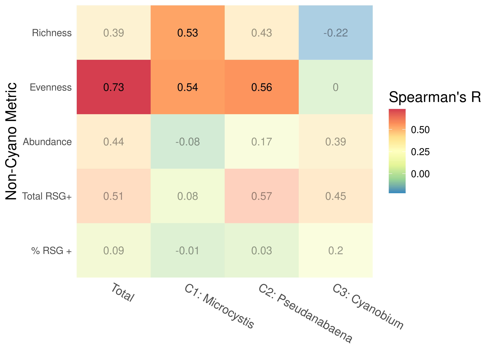{fig-align='center' width=2100}
:::

```{.r .cell-code}
ggsave("test.png", width = 8, height = 5)
```
:::


# All of them together


::: {.cell layout-align="center"}

```{.r .cell-code}
joined %>%
  mutate(het_abund = avg_cells_per_ml - total_chl_counts,
         het_rich = het_richness,
         het_even = het_evenness,
         het_rsg = het_rsg_per_ml,
         het_rsg_perc = het_rsg_perc_pos,
         tn_ratio = (tn_ug_n_l/14) / (tp_ug_p_l/31)) %>%
  select(Mem_Abund, membership, ctd_temperature, tn_ug_n_l, tp_ug_p_l, tn_ratio, het_abund, het_rich, het_even, het_rsg, het_rsg_perc) %>%
  pivot_wider(names_from = membership, values_from = Mem_Abund, names_prefix = "Cy_Mem_") %>%
  pivot_longer(c(ctd_temperature:tn_ratio, Cy_Mem_1:Cy_Mem_Total), names_to = "Test", values_to = "Value") %>%
  group_by(Test) %>%
  rstatix::cor_test(vars = Value, vars2 = starts_with("het"), method = "spearman", use = "pairwise.complete.obs") %>%
  rstatix::adjust_pvalue() %>% 
  mutate(var2 = factor(var2, levels = c("het_rsg_perc","het_rsg","het_abund","het_even","het_rich"),
                       labels = c("% RSG +", "RSG+ /mL", "Abundance","Evenness","Richness")),
         Test = factor(Test, levels = c("Cy_Mem_Total","Cy_Mem_2","Cy_Mem_1","Cy_Mem_3", "ctd_temperature", "tn_ug_n_l","tp_ug_p_l","tn_ratio"),
                       labels = c("Total","C1: Microcystis","C2: Pseudanabaena", "C3: Cyanobium", "Temperature","Total N","Total P","Molar N:P"))) %>%
  ggplot(aes(x = Test, y = var2, fill = cor, alpha = p.adj < 0.05)) + 
  geom_tile() + 
  geom_text(aes(label = round(cor, 2))) + 
  scale_fill_distiller(palette = "Spectral") + 
  scale_alpha_manual(values = c(0.2,1)) + 
  scale_y_discrete(expand = expansion(0)) + 
  scale_x_discrete(expand = expansion(0)) + 
  guides(alpha = "none") + 
  labs(y="Non-Cyano Metric",
       fill = "Spearman's R")+
  theme(axis.title.x = element_blank(),
        axis.line = element_blank(),
        axis.ticks = element_blank(),
        axis.text.x = element_text(angle = 330, vjust = 1, hjust = 0, size = 12))
```

::: {.cell-output-display}
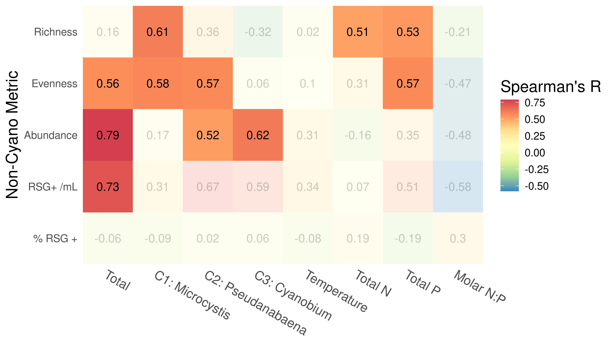{fig-align='center' width=2400}
:::

```{.r .cell-code}
ggsave("test.png", width = 8, height = 4.5)
```
:::

::: {.cell layout-align="center"}

```{.r .cell-code}
joined %>%
  mutate( membership = factor(membership, levels = c("Total", "2","1","3"),
                              labels = c("Total","C1: Microcystis","C2: Pseudanabaena", "C3: Cyanobium"))) %>%
  ggplot(aes(x = tp_ug_p_l, y = Mem_Abund)) + 
  geom_point(aes(color = Month)) + 
  facet_wrap(~membership, nrow = 1) + 
  scale_y_log10(labels = scales::unit_format(unit = "M", scale = 1e-6)) + 
  ggpubr::stat_cor(show.legend = FALSE, method = "spearman", 
                   cor.coef.name = "rho",
                   p.accuracy = 0.001) +
  scale_color_manual(values = month_colors) +
  labs(y = "Cyano Cluster Abundance/mL", x = "TP (ug P/L)") +
  theme(legend.position = "right", 
        aspect.ratio = 1,
        axis.text = element_text(size = 8))
```

::: {.cell-output-display}
{fig-align='center' width=3000}
:::

```{.r .cell-code}
ggsave("test.png", width = 6, height = 5)

joined %>%
  mutate( membership = factor(membership, levels = c("Total", "2","1","3"),
                              labels = c("Total","C1: Microcystis","C2: Pseudanabaena", "C3: Cyanobium"))) %>%
  ggplot(aes(x = tn_ug_n_l, y = Mem_Abund)) + 
  geom_point(aes(color = Month)) + 
  facet_wrap(~membership, nrow = 1) + 
  scale_y_log10(labels = scales::unit_format(unit = "M", scale = 1e-6)) + 
  ggpubr::stat_cor(show.legend = FALSE, method = "spearman", 
                   cor.coef.name = "rho",
                   p.accuracy = 0.001) +
  scale_color_manual(values = month_colors) +
  labs(y = "Cyano Cluster Abundance/mL", x = "TN (ug N/L)") +
  theme(legend.position = "right", 
        aspect.ratio = 1,
        axis.text = element_text(size = 8))
```

::: {.cell-output-display}
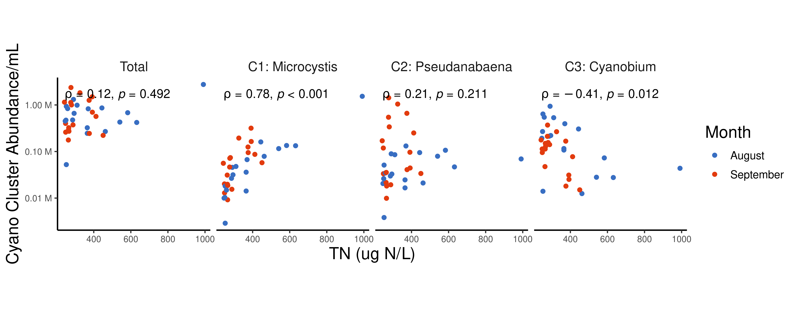{fig-align='center' width=3000}
:::

```{.r .cell-code}
ggsave("test.png", width = 10, height = 4)
```
:::

::: {.cell layout-align="center"}

```{.r .cell-code}
joined %>%
  filter(membership=="Total") %>%
  ggplot(aes(x = ctd_temperature, y =  avg_cells_per_ml-total_chl_counts)) + 
  geom_point(aes(color = Month)) + 
  ggpubr::stat_cor(aes(label = after_stat(r.label)), show.legend = FALSE, method = "spearman", cor.coef.name = "rho") +
  scale_color_manual(values = month_colors) + 
  scale_y_continuous(labels = scales::unit_format(unit = "M", scale = 1e-6)) + 
  theme(legend.position = "none",
        aspect.ratio = 1,
        strip.text = element_blank()) + 
  labs(x = "Temperature (°C)", y = "Heterotroph\nAbundance / mL ")
```

::: {.cell-output-display}
{fig-align='center' width=900}
:::

```{.r .cell-code}
joined %>%
  filter(membership=="Total") %>%
  ggplot(aes(x = ctd_temperature, y =  het_richness)) + 
  geom_point(aes(color = Month)) + 
  ggpubr::stat_cor(aes(label = after_stat(r.label)), show.legend = FALSE, method = "spearman", cor.coef.name = "rho") +
  scale_color_manual(values = month_colors) + 
  theme(legend.position = "none",
        aspect.ratio = 1,
        strip.text = element_blank()) + 
  labs(x = "Temperature (°C)", y = "Heterotroph Richness")
```

::: {.cell-output-display}
{fig-align='center' width=900}
:::

```{.r .cell-code}
joined %>%
  filter(membership=="Total") %>%
  ggplot(aes(x = ctd_temperature, y =  het_evenness)) + 
  geom_point(aes(color = Month)) + 
  ggpubr::stat_cor(aes(label = after_stat(r.label)), show.legend = FALSE, method = "spearman", cor.coef.name = "rho") +
  scale_color_manual(values = month_colors) + 
  theme(legend.position = "none",
        aspect.ratio = 1,
        strip.text = element_blank()) + 
  labs(x = "Temperature (°C)", y = "Heterotroph Evenness")
```

::: {.cell-output-display}
{fig-align='center' width=900}
:::

```{.r .cell-code}
joined %>%
  filter(membership=="Total") %>%
  ggplot(aes(x = ctd_temperature, y =  het_rsg_per_ml)) + 
  geom_point(aes(color = Month)) + 
  ggpubr::stat_cor(aes(label = after_stat(r.label)), show.legend = FALSE, method = "spearman", cor.coef.name = "rho") +
  scale_color_manual(values = month_colors) + 
  scale_y_continuous(labels = scales::unit_format(unit = "M", scale = 1e-6)) + 
  theme(legend.position = "none",
        aspect.ratio = 1,
        strip.text = element_blank()) + 
  labs(x = "Temperature (°C)", y = "RSG + / mL ")
```

::: {.cell-output-display}
{fig-align='center' width=900}
:::

```{.r .cell-code}
joined %>%
  filter(membership=="Total") %>%
  ggplot(aes(x = ctd_temperature, y =  rsg_perc_pos)) + 
  geom_point(aes(color = Month)) + 
  ggpubr::stat_cor(aes(label = after_stat(r.label)), show.legend = FALSE, method = "spearman", cor.coef.name = "rho") +
  scale_color_manual(values = month_colors) + 
  theme(legend.position = "none",
        aspect.ratio = 1,
        strip.text = element_blank()) + 
  labs(x = "Temperature (°C)", y = "% RGS +")
```

::: {.cell-output-display}
{fig-align='center' width=900}
:::
:::


# Heterotroph Network 


::: {.cell layout-align="center"}

```{.r .cell-code}
all_asv_ids <- abs_physeq %>%
  tax_table() %>%
  data.frame() %>%
  select(ASV, Genus, Family, Phylum) %>%
  mutate(Genus = str_remove(Genus, "g__"))

all_asv_ids %>% 
  filter(ASV %in% top_asvs) %>%
  count(Phylum)  %>%arrange(n)
```

::: {.cell-output .cell-output-stdout}
```
                         Phylum   n
1         p__Desulfobacterota_E   1
2  p__Desulfobacterota_G_459546   1
3     p__Thermosulfidibacterota   1
4              p__Spirochaetota   2
5      p__Nitrospirota_A_437815   3
6            p__Patescibacteria   3
7             p__Armatimonadota   6
8    p__Bdellovibrionota_461973   6
9                p__Chlamydiota   6
10 p__Desulfobacterota_G_459543   6
11              p__Dependentiae   7
12           p__Gemmatimonadota   8
13           p__Acidobacteriota  10
14             p__Chloroflexota  11
15                         <NA>  15
16      p__Myxococcota_A_473307  25
17   p__Bdellovibrionota_473306  31
18            p__Actinomycetota  74
19         p__Verrucomicrobiota  77
20           p__Planctomycetota  94
21           p__Cyanobacteriota 120
22              p__Bacteroidota 183
23            p__Pseudomonadota 310
```
:::

```{.r .cell-code}
all_asv_ids %>% 
  filter(ASV %in% top_asvs) %>%
  count(Phylum)  %>% pull(n) %>% sum()
```

::: {.cell-output .cell-output-stdout}
```
[1] 1000
```
:::

```{.r .cell-code}
all_asv_abunds <- 
  abs_physeq %>%
  psmelt() %>%
  filter(Depth_Class == "S", DNA_ID != "KH_D076") %>%
  group_by(ASV) %>%
  summarize(Total_Abund = sum(Abundance))


# 
# cor_res <-
#   abs_melted %>%
#   filter(ASV %in% c(top_asvs, top_cyano_asvs$ASV)) %>%
#   select(ASV, Rep_ID, Abundance) %>%
#   left_join(wide_cy) %>%
#   nest_by(ASV) %>%
#   mutate(corr_results = list(rstatix::cor_test(data, vars = Abundance, vars2 = prok_names, method = "spearman")))
# 
# save(cor_res, file = "data/10_Cyano_Species_Distribution/cor_res.RData")


load("data/10_Cyano_Species_Distribution/cor_res.RData")


# het_graphs_nocentr_filter <- map(corrs, \(x){
#   
#   cor_mat <- 
#   cor_res %>%
#   unnest(corr_results) %>%
#   mutate(cor = ifelse(cor>=x&p<0.01, cor, 0)) %>%
#   select(ASV, var2, cor) %>%
#   pivot_wider(names_from = var2, values_from = cor) %>%
#   column_to_rownames("ASV") %>%
#   as.matrix()
#   
#   adj_mat <- igraph::graph_from_biadjacency_matrix(cor_mat, weighted=T, directed = FALSE)
#   
#   graph <- as_tbl_graph(adj_mat) %>%
#    as_tbl_graph(adj_mat) %>%
#   left_join(all_asv_ids, by = c("name" = "ASV")) %>%
#   left_join(all_asv_abunds, by = c("name" = "ASV")) 
# })
# 
# het_mods <- map(het_graphs_nocentr_filter, \(x){
#   clustered <- igraph::cluster_edge_betweenness(x)
#   
#   igraph::modularity(clustered)
# 
#   }) %>%
#   unlist() 
# 
# 
# 
# het_graphs_nocyanos_filter <- map(corrs, \(x){
#   
#   cor_mat <- 
#   cor_res %>%
#   unnest(corr_results) %>%
#   mutate(cor = ifelse(cor>=x&p<0.01, cor, 0)) %>%
#   select(ASV, var2, cor) %>%
#   pivot_wider(names_from = var2, values_from = cor) %>%
#   column_to_rownames("ASV") %>%
#   as.matrix()
#   
#   adj_mat <- igraph::graph_from_biadjacency_matrix(cor_mat, weighted=T, directed = FALSE)
#   
#   graph <- as_tbl_graph(adj_mat) %>%
#    as_tbl_graph(adj_mat) %>%
#   left_join(all_asv_ids, by = c("name" = "ASV")) %>%
#   left_join(all_asv_abunds, by = c("name" = "ASV")) %>%
#   dplyr::filter(
#          !((!type)&Phylum == "p__Cyanobacteriota"))
# })
# 
# het_mods_nocy <- map(het_graphs_nocyanos_filter, \(x){
#   clustered <- igraph::cluster_edge_betweenness(x)
#   
#   igraph::modularity(clustered)
# 
#   }) %>%
#   unlist() 
#  
# 
# het_mod_df <- data.frame(Corr = corrs,
#            Modularity_WithCyanos = het_mods,
#            Modularity_NoCyanos = het_mods_nocy)
# save(het_mod_df, file = "data/10_Cyano_Species_Distribution/het_mod_df.RData")  

load(file = "data/10_Cyano_Species_Distribution/het_mod_df.RData")  

het_mod_df %>%
  pivot_longer(Modularity_WithCyanos:Modularity_NoCyanos, names_to = "Network", values_to = "Modularity") %>%
  ggplot(aes(x = Corr, y = Modularity, color = Network)) + 
  geom_line() + 
  geom_point(size = 4) + 
  scale_color_manual(values = c("#643D9A", "limegreen"), labels = c("No Cyanos", "With Cyanos")) + 
  labs(x = "Minimum Correlation")
```

::: {.cell-output-display}
{fig-align='center' width=1800}
:::

```{.r .cell-code}
ggsave("test.png", width = 6, height = 3)
```
:::

::: {.cell layout-align="center"}

```{.r .cell-code}
het_graphs <- map(corrs, \(x){
  
  cor_mat <- 
    cor_res %>%
    unnest(corr_results) %>%
    mutate(cor = ifelse(cor>=x&p<0.01, cor, 0)) %>%
    select(ASV, var2, cor) %>%
    pivot_wider(names_from = var2, values_from = cor) %>%
    column_to_rownames("ASV") %>%
    as.matrix()
  
  adj_mat <- igraph::graph_from_biadjacency_matrix(cor_mat, weighted=T, directed = FALSE)
  
  graph <- as_tbl_graph(adj_mat) %>%
    as_tbl_graph(adj_mat) %>%
    left_join(all_asv_ids, by = c("name" = "ASV")) %>%
    left_join(all_asv_abunds, by = c("name" = "ASV")) %>%
    mutate(Centrality = centrality_degree(mode = 'in')) %>%
    filter(Centrality > 0)
})

het_plots <- map2(het_graphs, names(het_graphs), \(x,y){
  set.seed(314)
  edge_n <- 
    x %>%
    activate("edges") %>%
    data.frame() %>%
    nrow()
  
  ggraph(x, layout = "fr")+ 
    geom_edge_fan(aes(alpha = weight), show.legend = FALSE) + 
    geom_node_point(aes(shape = type, color = ifelse(type, NA, 
                                                     ifelse(Phylum == "p__Cyanobacteriota", "Cyano.", "Non-cyano.")))) +
    scale_color_manual(values = c("limegreen", "#643D9A")) + 
    labs(title = paste0("Min. Corr = ", y), subtitle = paste0(edge_n, " edges")) + 
    theme(legend.position = "none")
})

wrap_plots(het_plots[5:10])
```

::: {.cell-output-display}
{fig-align='center' width=3600}
:::

```{.r .cell-code}
ggsave("test.png", width = 12, height = 8)
```
:::

::: {.cell layout-align="center"}

```{.r .cell-code}
corrs[5:10]
```

::: {.cell-output .cell-output-stdout}
```
 0.7 0.75  0.8 0.85  0.9 0.95 
0.70 0.75 0.80 0.85 0.90 0.95 
```
:::

```{.r .cell-code}
perc_cyano_res <- 
  map(corrs, \(x){
    cor_mat <- 
      cor_res %>%
      unnest(corr_results) %>%
      mutate(cor = ifelse(cor>=x&p<0.01, cor, 0)) %>%
      filter(cor > 0) %>%
      select(ASV, var2, cor) %>%
      left_join(all_asv_ids, by = c("ASV" = "ASV")) %>% 
      ungroup() %>% 
      mutate(is_cyano = ifelse(is.na(Phylum), FALSE, Phylum == "p__Cyanobacteriota")) %>%
      ungroup() %>% 
      group_by(var2) %>%
      summarize(Perc_Cyano = sum(is_cyano) / n()) %>%
      pull(Perc_Cyano)
  }) %>%
  bind_rows() %>%
  pivot_longer(everything(), names_to = "Corr", values_to = "Perc_Cyano")

perc_cyano_res %>%
  ggplot(aes(y = Corr, x = Perc_Cyano, fill = stat(x))) + 
  ggridges::geom_density_ridges_gradient(scale = 4) + 
  scale_fill_distiller(palette = "PRGn", direction = 1) + 
  labs(x = "Percent Edges to Cyanos", y = "Minimum Edge Strength") + 
  theme(legend.position = "none")
```

::: {.cell-output-display}
{fig-align='center' width=2100}
:::
:::

::: {.cell layout-align="center"}

```{.r .cell-code}
cor_mat <- 
  cor_res %>%
  unnest(corr_results) %>%
  mutate(adjust_p = rstatix::adjust_pvalue(p,method = "holm")) %>%
  mutate(cor = ifelse(cor>=0.85&p<0.01, cor, 0)) %>%
  select(ASV, var2, cor) %>%
  pivot_wider(names_from = var2, values_from = cor) %>%
  column_to_rownames("ASV") %>%
  as.matrix()

adj_mat <- igraph::graph_from_biadjacency_matrix(cor_mat, weighted=T, directed = FALSE)

number_of_het_asvs <- as_tbl_graph(adj_mat) %>%
  as_tbl_graph(adj_mat) %>%
  left_join(all_asv_ids, by = c("name" = "ASV")) %>%
  left_join(all_asv_abunds, by = c("name" = "ASV")) %>%
  dplyr::filter(
    !((!type)&Phylum == "p__Cyanobacteriota")) %>%
  dplyr::filter(Total_Abund > 5e4) %>%
  dplyr::filter(!type) %>% pull(name) %>% unique() %>% length()

graph <- as_tbl_graph(adj_mat) %>%
  as_tbl_graph(adj_mat) %>%
  left_join(all_asv_ids, by = c("name" = "ASV")) %>%
  left_join(all_asv_abunds, by = c("name" = "ASV")) %>%
  dplyr::filter(
    !((!type)&Phylum == "p__Cyanobacteriota")) %>%
  dplyr::filter(Total_Abund > 8e4) %>%
  mutate(Centrality = centrality_degree(mode = 'out')) %>%
  dplyr::filter(Centrality > 0) %>%
  mutate(Tax_ID = ifelse(!is.na(Genus), Genus,
                         ifelse(!is.na(Family), Family,
                                ifelse(!is.na(Phylum), Phylum, "Unknown"))),
         Genus = ifelse(is.na(Genus),"(Rare/Unknown)", Genus)
  )


set.seed(314)
ggraph(graph, layout = "fr")+ 
  geom_edge_fan(aes(alpha = weight), show.legend = FALSE, linewidth = 1) + 
  geom_node_point(aes(color = ifelse(type, Genus, Phylum), shape = type, size = Total_Abund)) + 
  scale_color_manual(values = c(cyano_genus_colors, phylum_colors)) + 
  scale_size_continuous(transform = "log10") + 
  theme(legend.position = "none")
```

::: {.cell-output-display}
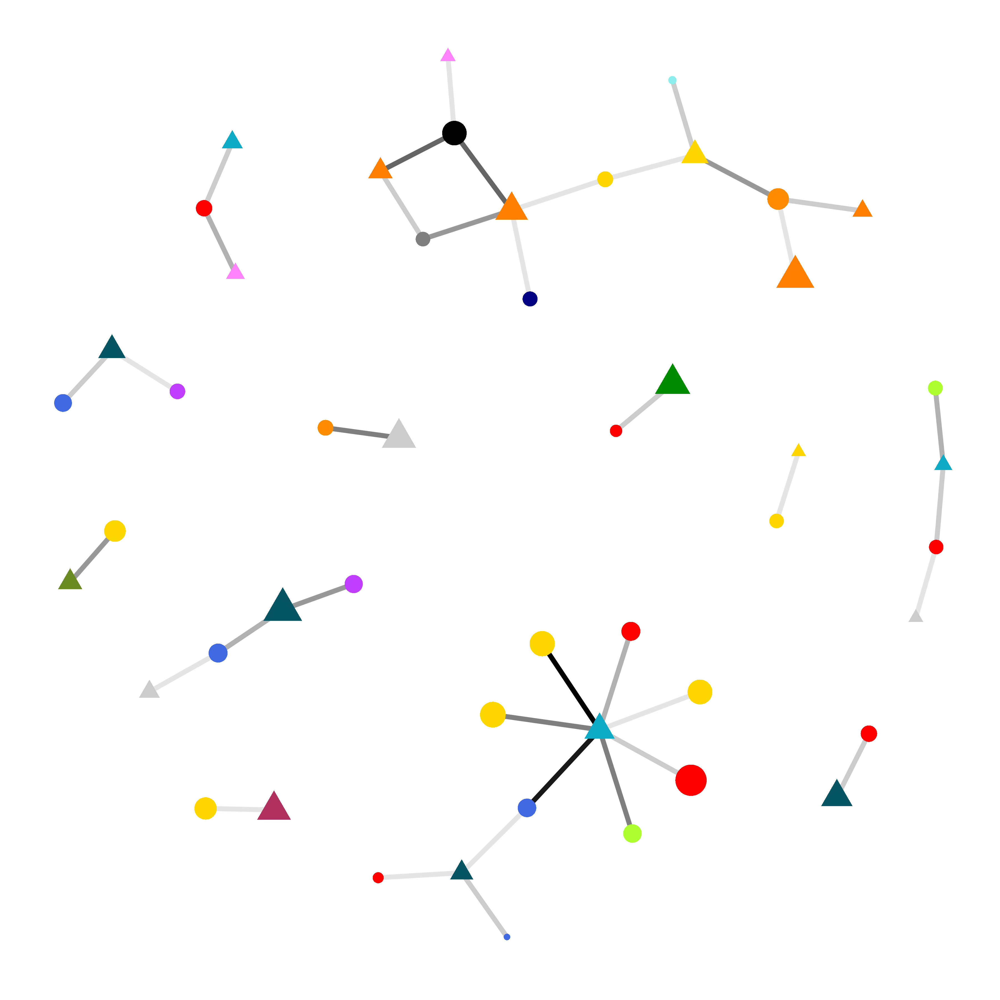{fig-align='center' width=1800}
:::

```{.r .cell-code}
ggsave("test.png", width = 6, height = 6)

set.seed(314)
graph %>%
  mutate(Genus = factor(Genus, levels = names(cyano_genus_colors))) %>%
  ggraph(layout = "fr")+ 
  geom_edge_fan(aes(alpha = weight)) + 
  geom_node_point(aes(color = Genus, shape = type, size = Total_Abund), key_glyph = "point") + 
  scale_color_manual(values = c(cyano_genus_colors, phylum_colors), na.value = "grey") + 
  scale_size_continuous(transform = "log10", labels = scales::unit_format(unit = "M", scale = 1e-6)) +
  scale_shape_discrete(guide = FALSE) + 
  guides(color = guide_legend(
    override.aes = list(shape = 17, size = 5))) + 
  labs(color = "Cyano Hub Genus")
```

::: {.cell-output-display}
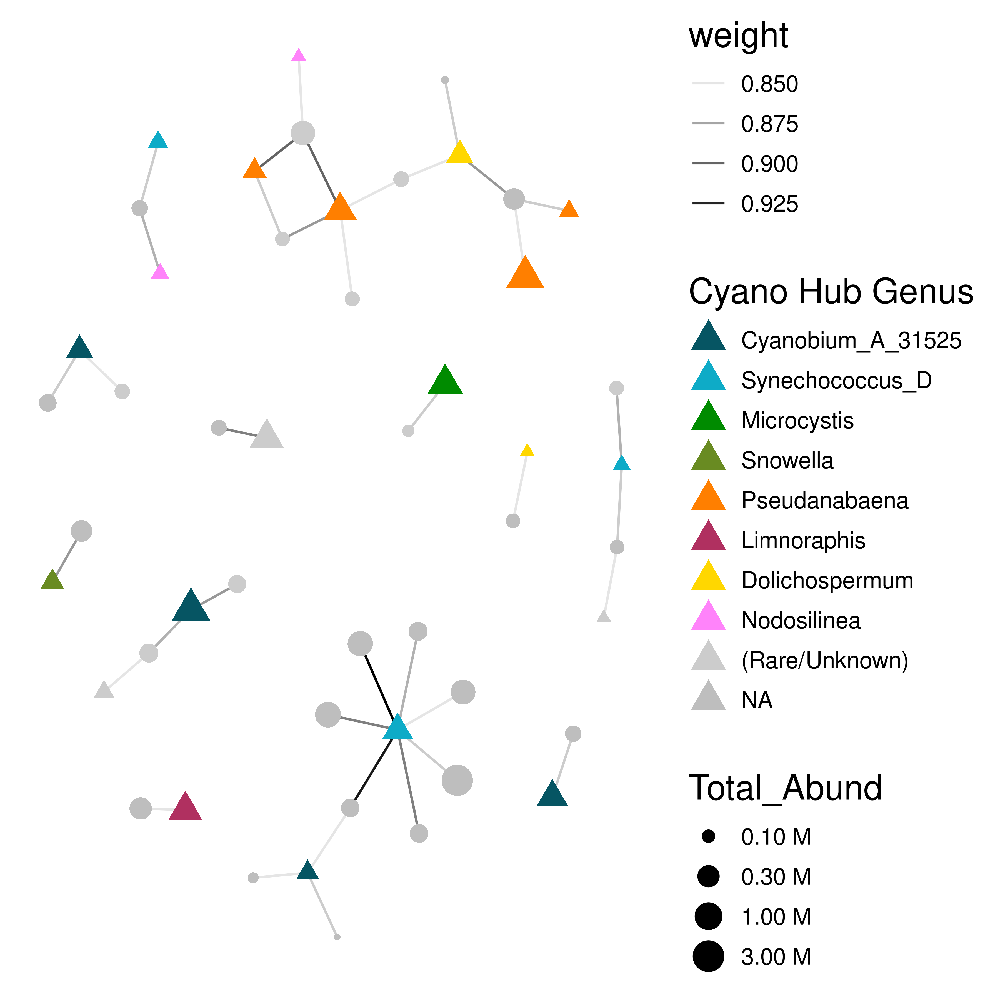{fig-align='center' width=1800}
:::

```{.r .cell-code}
ggsave("test.png", width = 6, height = 6)

set.seed(314)
ggraph(graph, layout = "fr")+ 
  geom_edge_fan(aes(alpha = weight), show.legend = FALSE) + 
  geom_node_point(aes(color = ifelse(!type, Phylum, NA), shape = type, size = Total_Abund), key_glyph = "point") + 
  scale_color_manual(values = c(cyano_genus_colors, phylum_colors), na.value = "grey") + 
  scale_size_continuous(transform = "log10", guide = FALSE) +
  scale_shape_discrete(guide = FALSE) + 
  guides(color = guide_legend(
    override.aes = list(shape = 16, size = 5))) + 
  labs(color = "Non-Cyano Phylum")
```

::: {.cell-output-display}
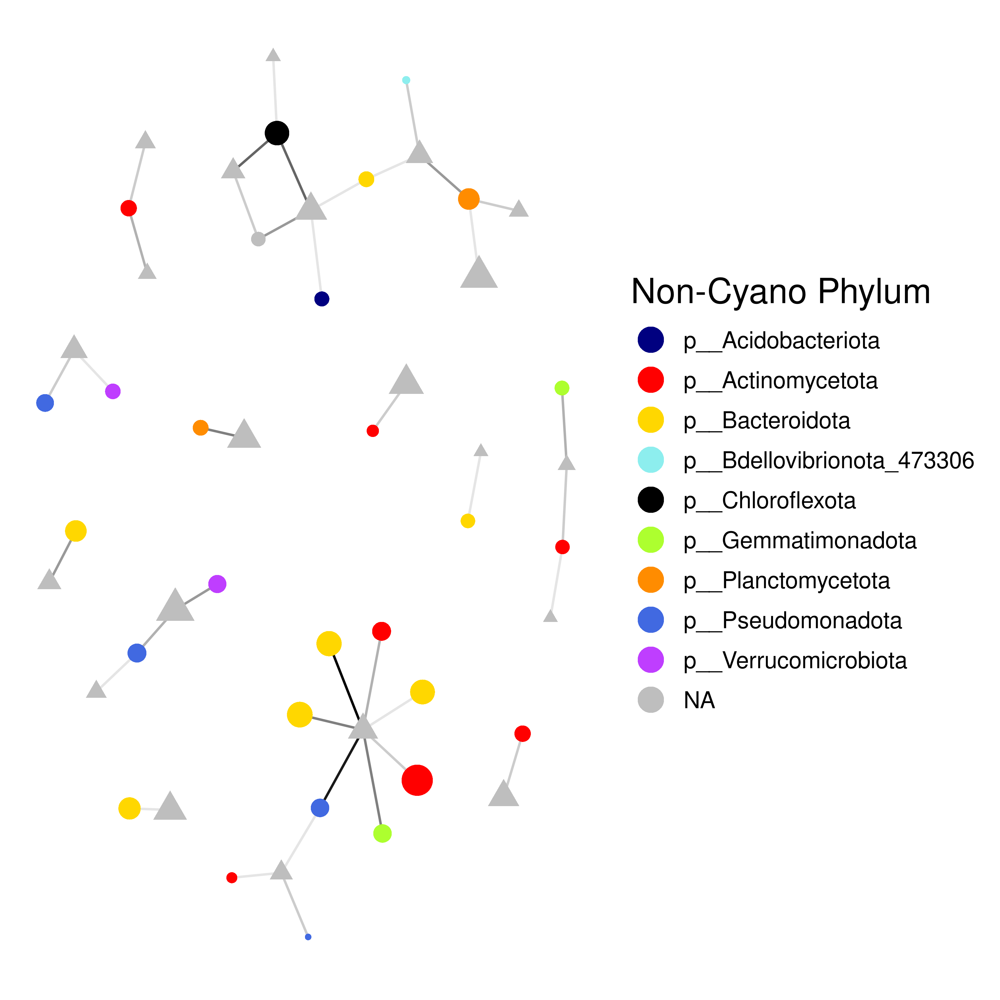{fig-align='center' width=1800}
:::
:::

::: {.cell layout-align="center"}

```{.r .cell-code}
clustered <- igraph::cluster_edge_betweenness(graph)

members <- igraph::membership(clustered) 

mem_df <- data.frame(name = names(members),
                     membership = members)

top_mem<- 
  mem_df %>%
  count(membership) %>%
  slice_max(n = 4, order_by = n) %>%
  pull(membership)

good_mem_df <- 
  mem_df %>%
  mutate(membership = ifelse(membership %in% top_mem, membership, NA),
         membership = factor(membership, labels = c(1:6)))

all_clusters <- graph %>%
  left_join(good_mem_df) 


set.seed(314)
ggraph(all_clusters, layou = "fr")+ 
  geom_edge_fan(aes(alpha = weight), show.legend = FALSE, linewidth = 1) +
  geom_node_label(aes(label = membership, shape = type, size = Total_Abund), key_glyph = "point") + 
  scale_size_continuous(transform = "log10") +
  scale_color_brewer(type = "qual")
```

::: {.cell-output-display}
{fig-align='center' width=1500}
:::

```{.r .cell-code}
  scale_x_continuous(expand = expansion(.2)) 
```

::: {.cell-output .cell-output-stdout}
```
<ScaleContinuousPosition>
 Range:  
 Limits:    0 --    1
```
:::
:::

::: {.cell layout-align="center"}

```{.r .cell-code}
mem_graph <- 
  graph %>%
  left_join(good_mem_df)  %>%
  dplyr::filter(membership %in% c(1,5))


set.seed(314)
ggraph(mem_graph, layout = "fr")+ 
  geom_edge_fan(aes(alpha = weight), show.legend = FALSE, linewidth = 1) +
  geom_node_label(aes(label = Tax_ID, size = Total_Abund, color = ifelse(type, Genus, Phylum)), label.size = NA) + 
  scale_size_continuous(transform = "log10") +
  scale_color_manual(values = c(cyano_genus_colors, phylum_colors))   + 
  scale_x_continuous(expand = expansion(.2)) + 
  theme(legend.position  = "none")
```

::: {.cell-output-display}
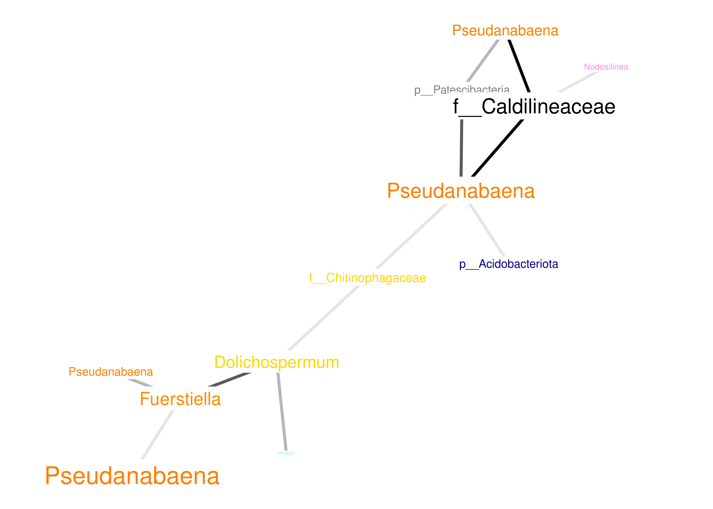{fig-align='center' width=2100}
:::

```{.r .cell-code}
ggsave("test.png", width = 5, height = 5, dpi = 300)
```
:::

::: {.cell layout-align="center"}

```{.r .cell-code}
mem_graph <- 
  graph %>%
  left_join(good_mem_df) %>%
  dplyr::filter(membership %in% c(2,4))


set.seed(308)
ggraph(mem_graph, layout = "fr")+ 
  geom_edge_fan(aes(alpha = weight), show.legend = FALSE,linewidth = 1) +
  geom_node_label(aes(label = Tax_ID, size = Total_Abund, color = ifelse(type, Genus, Phylum)), label.size = NA) + 
  scale_size_continuous(transform = "log10") +
  scale_color_manual(values = c(cyano_genus_colors, phylum_colors))   + 
  scale_x_continuous(expand = expansion(.2)) + 
  theme(legend.position  = "none")
```

::: {.cell-output-display}
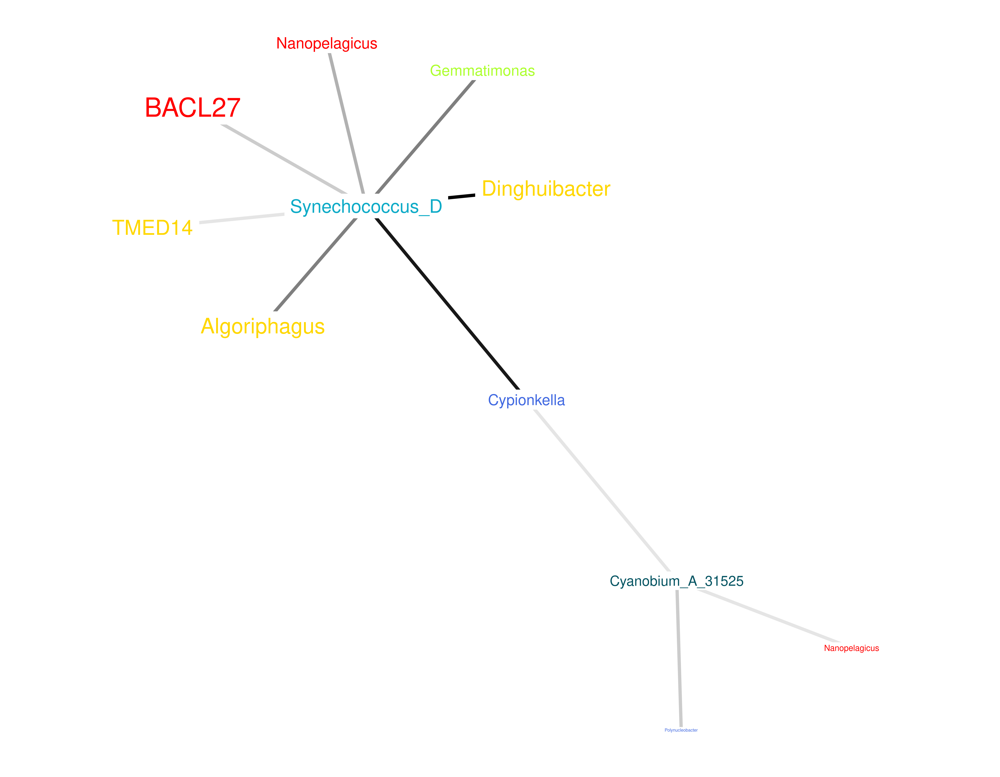{fig-align='center' width=2700}
:::

```{.r .cell-code}
ggsave("test.png", width = 7.5, height = 5, dpi = 300)
```
:::

::: {.cell layout-align="center"}

```{.r .cell-code}
mem_graph <- 
  graph %>%
  left_join(good_mem_df) %>%
  dplyr::filter(membership %in% c(3,8))


set.seed(312)
ggraph(mem_graph, layout = "fr")+ 
  geom_edge_fan(aes(alpha = weight), show.legend = FALSE, linewidth = 1) +
  geom_node_label(aes(label = Tax_ID, size = Total_Abund, color = ifelse(type, Genus, Phylum)), label.size = NA) + 
  scale_size_continuous(transform = "log10") +
  scale_color_manual(values = c(cyano_genus_colors, phylum_colors))   + 
  scale_x_continuous(expand = expansion(.3)) + 
  theme(legend.position  = "none")
```

::: {.cell-output-display}
{fig-align='center' width=2100}
:::

```{.r .cell-code}
ggsave("test.png", width = 9, height = 7, dpi = 300)
```
:::
