# Goals of this document

# Load Data and Packages


::: {.cell layout-align="center"}

```{.r .cell-code}
pacman::p_load(phyloseq, vegan, patchwork, tidyverse)

source("code/R/plotting_aesthetics.R")

load("data/08_Beta_Diversity/trim_physeq.RData")

load("data/08_Beta_Diversity/abs_physeq.RData")

cyano_physeq <- 
  trim_physeq %>%
  prune_taxa(taxa_sums(.) > 0, .) %>%
  subset_taxa(., Phylum == "p__Cyanobacteriota")

cyano_melted <- cyano_physeq %>%
  psmelt() %>%
  filter(Depth_Class == "S")

asv_ids <- cyano_melted %>%
  select(ASV, Genus) %>%
  unique()
```
:::

::: {.cell layout-align="center"}

```{.r .cell-code}
sum_cyanos <- cyano_melted %>%
  filter(!is.na(Genus)) %>%
  group_by(Genus) %>%
  summarize(Max_Abund = max(Abundance),
            Median_Abund = median(Abundance),
            N_ASV = length(unique(ASV)),
            Prevalence = sum(Abundance > 0)/n()) %>%
  ungroup()

sum_cyanos %>%
  slice_max(n = 20, order_by = Max_Abund) %>%
  arrange(desc(Max_Abund))
```

::: {.cell-output .cell-output-stdout}
```
# A tibble: 20 × 5
   Genus                Max_Abund Median_Abund N_ASV Prevalence
   <chr>                    <dbl>        <dbl> <int>      <dbl>
 1 g__Pseudanabaena        687681            0    27     0.170 
 2 g__Microcystis          469955            0     9     0.277 
 3 g__Cyanobium_A_31525    249278            0    54     0.280 
 4 g__Gloeothece           195749          436     2     0.664 
 5 g__GFB01                195119            0    22     0.255 
 6 g__Limnoraphis          116840          683     1     0.6   
 7 g__Vulcanococcus        110908            0     7     0.288 
 8 g__Dolichospermum        87892            0    42     0.187 
 9 g__Synechococcus_D       64908            0    14     0.365 
10 g__Planktothrix          54595            0     5     0.145 
11 g__Synechocystis         41126            0     9     0.208 
12 g__Nodosilinea           37305            0    13     0.171 
13 g__Gloeocapsa            27670            0    13     0.129 
14 g__Snowella              23072            0     5     0.313 
15 g__Synechococcus          8143            0     8     0.0886
16 g__Raphidiopsis           6622            0     2     0.118 
17 g__Hydrococcus            3488            0     4     0.0727
18 g__Limnothrix             2995            0     3     0.0424
19 g__LMEP-6097              2791            0     1     0.0182
20 g__GCA-2770975            2490            0    10     0.0636
```
:::

```{.r .cell-code}
sum_cyanos_asv <- cyano_melted %>%
  filter(!is.na(Genus)) %>%
  group_by(Month, Genus, ASV) %>%
  summarize(Total_Abund = sum(Abundance),
            Max_Abund = max(Abundance),
            Median_Abund = median(Abundance),
            Prevalence = sum(Abundance > 0)/n()) %>%
  ungroup()

sum_cyanos_asv %>%
  group_by(Month) %>%
  slice_max(n = 100, order_by = Total_Abund) %>%
  arrange(desc(Total_Abund)) %>%
  filter(Total_Abund > 1000)
```

::: {.cell-output .cell-output-stdout}
```
# A tibble: 226 × 7
# Groups:   Month [3]
   Month     Genus           ASV   Total_Abund Max_Abund Median_Abund Prevalence
   <chr>     <chr>           <chr>       <dbl>     <dbl>        <dbl>      <dbl>
 1 September g__Pseudanabae… PROK…     1740501    687681        5158       0.895
 2 August    g__Cyanobium_A… PROK…     1311108    249278       37209       0.944
 3 August    g__Cyanobium_A… PROK…      891740    177392       29385       1    
 4 September g__Cyanobium_A… PROK…      714233    199439       23276       0.895
 5 August    g__Cyanobium_A… PROK…      699008    120085       25428       1    
 6 September g__Microcystis  PROK…      633624    469955        2681       0.947
 7 September g__Gloeothece   PROK…      611091    195749       12911       1    
 8 September g__Pseudanabae… PROK…      601279    222513        2342       0.737
 9 August    g__Microcystis  PROK…      544011    400550        3779       1    
10 August    g__Cyanobium_A… PROK…      532787    131000       22048.      1    
# ℹ 216 more rows
```
:::

```{.r .cell-code}
sum_cyanos_asv %>%
  slice_max(n = 100, order_by = Total_Abund) %>%
  arrange(desc(Total_Abund)) %>%
  count(Genus)
```

::: {.cell-output .cell-output-stdout}
```
# A tibble: 14 × 2
   Genus                    n
   <chr>                <int>
 1 g__Cyanobium_A_31525    29
 2 g__Dolichospermum        9
 3 g__GFB01                13
 4 g__Gloeocapsa            1
 5 g__Gloeothece            2
 6 g__Limnoraphis           2
 7 g__Microcystis           7
 8 g__Nodosilinea           3
 9 g__Planktothrix          2
10 g__Pseudanabaena        14
11 g__Snowella              3
12 g__Synechococcus_D      10
13 g__Synechocystis         2
14 g__Vulcanococcus         3
```
:::

```{.r .cell-code}
sum_cyanos_asv %>%
  slice_max(n = 50, order_by = Max_Abund) %>%
  arrange(desc(Max_Abund)) %>%
  count(Genus)
```

::: {.cell-output .cell-output-stdout}
```
# A tibble: 12 × 2
   Genus                    n
   <chr>                <int>
 1 g__Cyanobium_A_31525    13
 2 g__Dolichospermum        4
 3 g__GFB01                 4
 4 g__Gloeothece            2
 5 g__Limnoraphis           2
 6 g__Microcystis           7
 7 g__Nodosilinea           1
 8 g__Planktothrix          1
 9 g__Pseudanabaena        10
10 g__Synechococcus_D       3
11 g__Synechocystis         1
12 g__Vulcanococcus         2
```
:::

```{.r .cell-code}
sum_cyanos_asv %>%
  slice_max(n = 100, order_by = Max_Abund) %>%
  arrange(desc(Max_Abund)) %>%
  mutate(index = c(1:100)) %>%
  ggplot(aes(x = index, y = Max_Abund)) + 
  geom_line()  
```

::: {.cell-output-display}
{fig-align='center' width=2100}
:::

```{.r .cell-code}
  sum_cyanos_asv %>%
  slice_max(n = 100, order_by = Max_Abund) %>%
  arrange(desc(Median_Abund)) %>%
  mutate(index = c(1:100)) %>%
  ggplot(aes(x = index, y = Median_Abund)) + 
  geom_line()  
```

::: {.cell-output-display}
{fig-align='center' width=2100}
:::

```{.r .cell-code}
  sum_cyanos_asv %>%
  slice_max(n = 100, order_by = Max_Abund) %>%
  arrange(desc(Prevalence)) %>%
  mutate(index = c(1:100)) %>%
  ggplot(aes(x = index, y = Prevalence)) + 
  geom_line() 
```

::: {.cell-output-display}
{fig-align='center' width=2100}
:::
:::

::: {.cell layout-align="center"}

```{.r .cell-code}
top_cyano_asvs <- sum_cyanos_asv %>%
  group_by(Month) %>%
  slice_max(n = 100, order_by = Total_Abund) %>%
  ungroup() %>%
  group_by(Month, Genus) %>%
  filter(Total_Abund > 10000, Prevalence > 0.5) %>%
  ungroup() %>%
  nest_by(Month) %>%
  mutate(ASVs = list(pull(data, ASV))) %>%
  select(-data)

top_cyano_asvs
```

::: {.cell-output .cell-output-stdout}
```
# A tibble: 3 × 2
# Rowwise:  Month
  Month     ASVs      
  <chr>     <list>    
1 August    <chr [50]>
2 May       <chr [2]> 
3 September <chr [65]>
```
:::
:::


## Species Co-correlation

Two separate goals: 

Square network graph of correlations between major cyanos

Bipartite network of 1000 most abundant ASVs to major cyanos


::: {.cell layout-align="center"}

```{.r .cell-code}
library(ggraph)
library(tidygraph)

top_cyano_asvs <- cyano_melted %>%
  filter(Month != "May") %>%
  group_by(ASV) %>%
  summarize(Total_Abund = sum(Abundance),
            Prevalence = sum(Abundance > 0) / n()) %>%
  filter(Prevalence > 0.25) %>%
  slice_max(n = 100, order_by = Total_Abund)

top_cyano_asvs %>%
  ggplot(aes(x = Prevalence, y = Total_Abund)) + 
  geom_point() + 
  scale_y_log10()
```

::: {.cell-output-display}
{fig-align='center' width=2100}
:::

```{.r .cell-code}
abs_melted <- 
  abs_physeq %>%
  psmelt() %>%
  filter(Depth_Class == "S", DNA_ID != "KH_D076", Month != "May",
         !ASV %in% top_cyano_asvs)

abs_melted %>%
  group_by(ASV) %>%
  summarize(Total_Abund = sum(Abundance)) %>%
  arrange(Total_Abund) %>%
  mutate(index = seq(1:nrow(.))) %>%
  ggplot(aes(x = index, y = Total_Abund)) + 
  geom_line() +
  scale_y_log10()
```

::: {.cell-output-display}
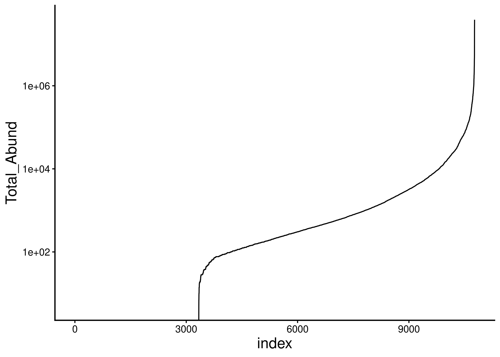{fig-align='center' width=2100}
:::

```{.r .cell-code}
abs_melted %>%
  group_by(ASV) %>%
  summarize(Total_Abund = sum(Abundance),
            Prevalence = sum(Abundance > 0)/n()) %>%
  filter(Prevalence > 0.25) %>%
  slice_max(n = 1000, order_by = Total_Abund) %>%
  ggplot(aes(x = Prevalence, y = Total_Abund)) + 
  geom_point() + 
  scale_y_log10()
```

::: {.cell-output-display}
{fig-align='center' width=2100}
:::

```{.r .cell-code}
top_asvs <- 
  abs_melted %>%
  group_by(ASV) %>%
  summarize(Total_Abund = sum(Abundance),
            Prevalence = sum(Abundance > 0)/n()) %>%
  filter(Prevalence > 0.25) %>%
  slice_max(n = 1000, order_by = Total_Abund) %>%
  pull(ASV)


wide_cy <- 
  cyano_melted %>%
  filter(ASV %in% top_cyano_asvs$ASV) %>%
  select(ASV, Rep_ID, Abundance) %>%
  pivot_wider(names_from = ASV, values_from = Abundance)

prok_names <- colnames(wide_cy)[-1]

cy_cor_res <- cyano_melted %>%
  filter(ASV %in% top_cyano_asvs$ASV) %>%
  select(ASV, Rep_ID, Abundance) %>%
  pivot_wider(names_from = ASV, values_from = Abundance) %>%
  rstatix::cor_test(vars = prok_names)
```
:::

::: {.cell layout-align="center"}

```{.r .cell-code}
# High correlation
cy_cor_mat <- 
  cy_cor_res %>%
  mutate(cor = ifelse(cor>=0.8&p<0.01, cor, 0)) %>%
  select(var1, var2, cor) %>%
  pivot_wider(names_from = var2, values_from = cor) %>%
  column_to_rownames("var1") %>%
  as.matrix()


adj_mat <- igraph::graph_from_adjacency_matrix(cy_cor_mat, weighted=T, mode="undirected", diag=F)

graph <- as_tbl_graph(adj_mat) %>%
  left_join(asv_ids, by = c("name" = "ASV")) %>%
  left_join(top_cyano_asvs, by = c("name" = "ASV")) %>%
  #filter(!is.na(Genus)) %>%
  mutate(Centrality = centrality_degree(mode = 'in'),
         Genus = str_remove(Genus, "g__"),
         Genus = ifelse(is.na(Genus), "(Rare/Unknown)", Genus),
         Genus = ifelse(Total_Abund < 50000, "(Rare/Unknown)", Genus),
         Genus = factor(Genus, levels = names(cyano_genus_colors))
  )


set.seed(314)
ggraph(graph, layout = "fr")+ 
    geom_edge_fan(aes(alpha = weight), show.legend = FALSE) + 
    geom_node_point(aes(color = Genus, size = Total_Abund)) + 
  scale_color_manual(values = cyano_genus_colors) + 
  guides(color = guide_legend(override.aes = list(size = 5))) + 
  labs(size = "Total Abundance\n(cells/ml)") + 
  theme(legend.title = element_text(size = 12),
        legend.position = "left")
```

::: {.cell-output-display}
{fig-align='center' width=2400}
:::

```{.r .cell-code}
ggsave(filename = "test.png", dpi = 300, height = 6, width = 8)


clustered <- igraph::cluster_edge_betweenness(graph)

members <- igraph::membership(clustered) 

mem_df <- data.frame(name = names(members),
                     membership = members)

top_mem<- 
  mem_df %>%
  count(membership) %>%
  slice_max(n = 3, order_by = n) %>%
  pull(membership)

good_mem_df <- 
  mem_df %>%
  mutate(membership = ifelse(membership %in% top_mem, membership, NA),
         membership = factor(membership, labels = c(1:4)))

mem_graph <- 
  graph %>%
  left_join(good_mem_df)
  

set.seed(314)
ggraph(mem_graph, layout = "fr")+ 
    geom_edge_fan(aes(alpha = weight), show.legend = FALSE) + 
    geom_node_point(aes(color = membership, size = Total_Abund)) + 
  guides(color = guide_legend(override.aes = list(size = 5)),
         size = guide_none())
```

::: {.cell-output-display}
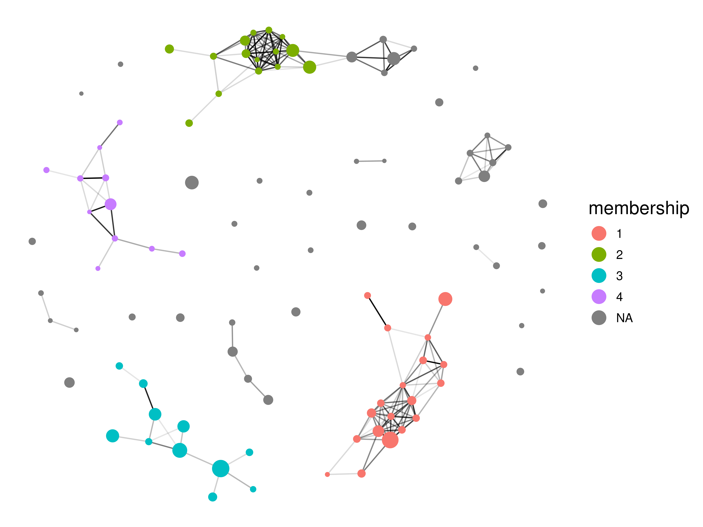{fig-align='center' width=2400}
:::

```{.r .cell-code}
mem_asvs <- good_mem_df %>%
  filter(!is.na(membership)) %>%
  rename(ASV = name) %>%
  filter(membership %in% c(1,2,3))
```
:::


Okay, let's look at the composition of those clusters


::: {.cell layout-align="center"}

```{.r .cell-code}
top_cyano_asvs %>%
  left_join(mem_asvs) %>%
  filter(!is.na(membership)) %>%
  left_join(asv_ids) %>%
  mutate(Genus = str_remove(Genus, "g__"),
         Genus = ifelse(is.na(Genus), "(Rare/Unknown)", Genus),
         Genus = ifelse(Total_Abund < 100, "(Rare/Unknown)", Genus)) %>%
  ggplot(aes(y = membership, x = Total_Abund, fill = Genus)) +
  geom_col() + 
  scale_fill_manual(values = cyano_genus_colors)
```

::: {.cell-output-display}
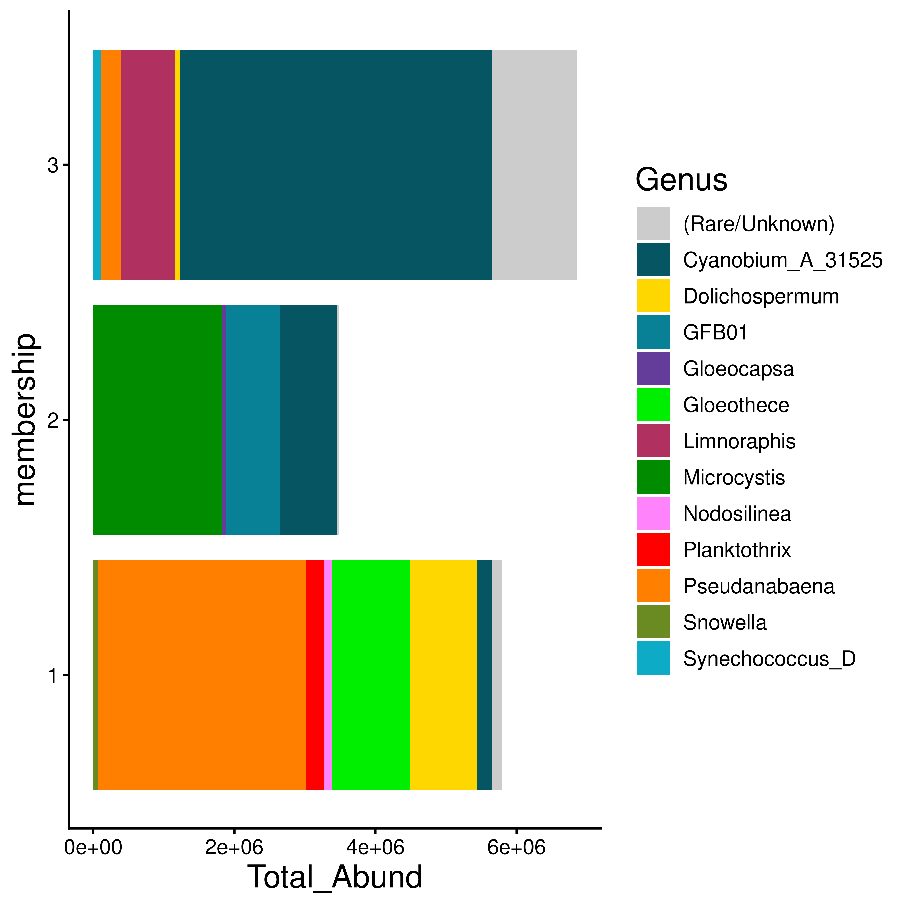{fig-align='center' width=1800}
:::

```{.r .cell-code}
pacman::p_load(sf, terra, tmap, gstat, install = FALSE)

# Define some shapes and objects

raw_erie <- read_sf("data/spatial_imports/hydro_p_LakeErie/hydro_p_LakeErie.shp") %>%
  st_transform(crs = "EPSG:4326")

erie_outline <- raw_erie %>%
  st_union()

mem_cy_sf <- 
  cyano_melted %>%
  select(Rep_ID, Abundance, ASV, Latitude, Longitude, Month) %>%
  left_join(mem_asvs) %>%
  filter(!is.na(membership)) %>%
  group_by(Rep_ID, Month, Latitude, Longitude, membership) %>%
  summarize(mem_abund = sum(Abundance)) %>%
  mutate(Month = factor(Month, levels = c("May","August","September"))) %>%
  st_as_sf(coords = c("Longitude","Latitude"), crs = "EPSG:4326")
  

mem_cy_sf %>%
  dplyr::filter(Month != "May") %>%
  mutate(membership = factor(membership, levels = c(2,1,3))) %>%
  ggplot() +
    geom_sf(data = erie_outline, fill = NA) +
  geom_sf(aes(size = mem_abund, color = mem_abund), alpha = 1) + 
  facet_grid(membership~Month)+
  scale_color_distiller(palette = "Spectral", limits = c(0,1.6e6), breaks = c(0, 0.5e6, 1e6, 1.5e6)) + 
  scale_size_continuous(limits = c(0,1.6e6), breaks = c(0, 0.5e6, 1e6, 1.5e6)) + 
  labs(color = "Cluster\nAbundance\n(cells/ml)", size = "Cluster\nAbundance\n(cells/ml)") +
  guides(color= guide_legend(), size=guide_legend()) + 
  theme(axis.line = element_blank(),
        axis.text = element_blank(),
        axis.ticks = element_blank(),
        strip.text.y = element_blank(),
        legend.title = element_text(size = 12),
        strip.text = element_text(size = 12))
```

::: {.cell-output-display}
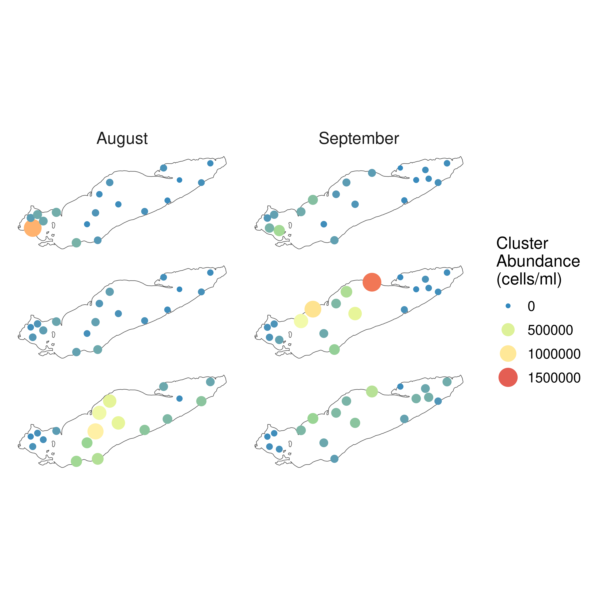{fig-align='center' width=1800}
:::

```{.r .cell-code}
#ggsave(filename = "test.png", width = 6, height= 6, dpi = 300)
```
:::

::: {.cell layout-align="center"}

```{.r .cell-code}
mem_cy_sf %>%
  ggplot() +
  geom_sf(aes(size = mem_abund, color = mem_abund), alpha = 1) + 
  facet_grid(membership~Month)+
  scale_color_distiller(palette = "Spectral") + 
  geom_sf(data = erie_outline, fill = NA) 
```

::: {.cell-output-display}
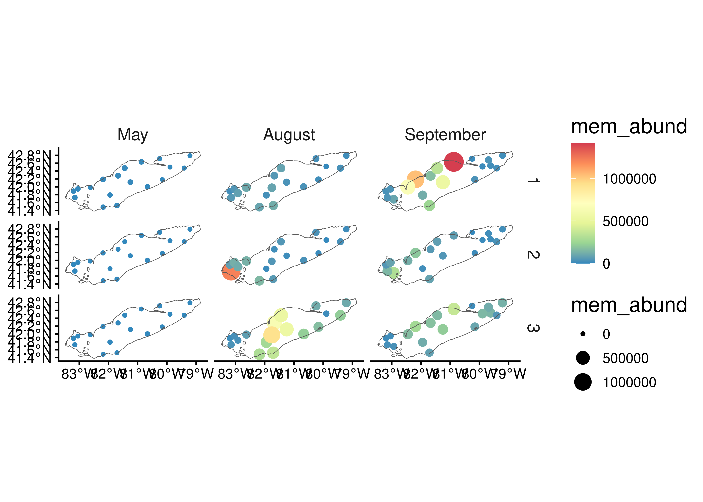{fig-align='center' width=2100}
:::

```{.r .cell-code}
mem_cy_sf %>%
  ungroup() %>%
  group_by(membership) %>%
  mutate(rel_abund = mem_abund / sum(mem_abund)) %>%
  filter(Month != "May") %>%
  ggplot() +
  geom_sf(aes(size = rel_abund, color = rel_abund), alpha = 1) + 
  facet_grid(membership~Month)+
  scale_color_distiller(palette = "Spectral") + 
  geom_sf(data = erie_outline, fill = NA) 
```

::: {.cell-output-display}
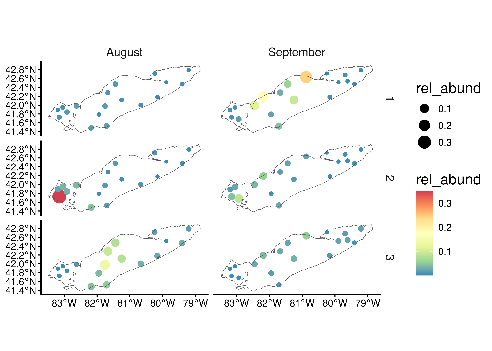{fig-align='center' width=2100}
:::
:::

::: {.cell layout-align="center"}

```{.r .cell-code}
corrs <- seq(from = 0.5, to = 0.95, by = 0.05)

names(corrs) <- corrs

graphs <- map(corrs, \(x){
  cy_cor_mat <- 
  cy_cor_res %>%
  mutate(cor = ifelse(cor>=x&p<0.01, cor, 0)) %>%
  select(var1, var2, cor) %>%
  pivot_wider(names_from = var2, values_from = cor) %>%
  column_to_rownames("var1") %>%
  as.matrix()
  
  adj_mat <- igraph::graph_from_adjacency_matrix(cy_cor_mat, weighted=T, mode="undirected", diag=F)
  
  graph <- as_tbl_graph(adj_mat)
})

map(graphs, igraph::degree) %>%
  bind_rows(.id = "Corr_Threshold") %>%
  pivot_longer(!Corr_Threshold, names_to = "ASV", values_to = "Degree") %>%
  ggplot(aes(x = as.numeric(Corr_Threshold), y = Degree)) + 
  ggbeeswarm::geom_beeswarm() + 
  geom_smooth(formula = y~log(x), method = "lm")
```

::: {.cell-output-display}
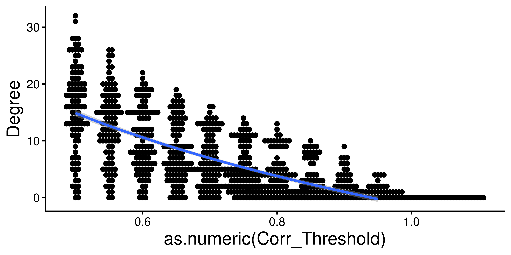{fig-align='center' width=1800}
:::

```{.r .cell-code}
mods <- map(graphs, \(x){
  clustered <- igraph::cluster_edge_betweenness(x)
  
  igraph::modularity(clustered)

  }) %>%
  unlist() 

data.frame(Corr = corrs,
           Modularity = mods) %>%
  ggplot(aes(x = corrs, y = Modularity)) + 
  geom_line() + 
  geom_point(size = 4) + 
  labs(x = "Minimum Correlation")
```

::: {.cell-output-display}
{fig-align='center' width=1800}
:::

```{.r .cell-code}
map(graphs, \(x){
  igraph::clique_num(x)
}) %>% unlist()
```

::: {.cell-output .cell-output-stdout}
```
 0.5 0.55  0.6 0.65  0.7 0.75  0.8 0.85  0.9 0.95 
  14   13   13   13   11   10   10    7    7    3 
```
:::

```{.r .cell-code}
cy_dens <- map(graphs, \(x){
  igraph::edge_density(x)
})
```
:::


# Correlating Cyano Abund vs. Heterotroph Abund

# Going by Clusters


::: {.cell layout-align="center"}

```{.r .cell-code}
nc_physeq <- abs_physeq %>%
  subset_taxa(., Phylum != "p__Cyanobacteriota")
alpha_diversity <- estimate_richness(nc_physeq, measure = c("Shannon", "Observed"))
alpha_diversity
```

::: {.cell-output .cell-output-stdout}
```
        Observed  Shannon
KH_D001      283 3.611622
KH_D009      463 3.698616
KH_D017      371 3.591125
KH_D025      963 4.097638
KH_D032     1902 4.947302
KH_D040      661 3.486545
KH_D056      635 3.422676
KH_D063      858 3.825105
KH_D071      499 4.425884
KH_D079      171 3.111904
KH_D002      336 3.907756
KH_D010      637 4.276752
KH_D018      604 3.398232
KH_D026      579 3.325822
KH_D033     1171 4.181699
KH_D041      679 3.306785
KH_D057     1110 4.209646
KH_D064     1106 4.208462
KH_D003      555 4.205986
KH_D011      696 4.513795
KH_D019      435 3.559363
KH_D027      710 3.212695
KH_D034     1344 4.531169
KH_D042      751 3.245848
KH_D058     1011 4.169420
KH_D065     1608 4.320785
KH_D004      141 2.980285
KH_D012      823 3.919709
KH_D020     1257 4.489287
KH_D028      647 3.549342
KH_D035      753 3.592466
KH_D043     1856 4.306603
KH_D051      868 3.793665
KH_D059      840 3.343571
KH_D066      182 2.608218
KH_D074      809 3.488163
KH_D005      543 3.628499
KH_D013      650 4.034381
KH_D021      478 3.600856
KH_D029     1872 5.090455
KH_D036     2528 5.427880
KH_D044      825 3.432064
KH_D052     1065 4.170995
KH_D060      906 4.023620
KH_D067     1400 4.034261
KH_D075     1043 3.516689
KH_D083     1311 4.204169
KH_D006     1466 4.838492
KH_D022     1238 4.437602
KH_D030      649 3.237196
KH_D037      801 3.718693
KH_D045     1714 4.652658
KH_D053     1116 3.795298
KH_D061     2123 5.609233
KH_D076      136 3.557264
KH_D007      363 3.560741
KH_D015      494 3.932434
KH_D023      803 3.902819
KH_D031     2533 5.435677
KH_D038     2357 5.220922
KH_D046     2143 4.852850
KH_D054      863 3.573793
KH_D062      801 3.742689
KH_D069     1034 4.056082
KH_D077     1757 4.436829
KH_D008      698 4.465307
KH_D016      281 3.270600
KH_D039     1219 3.752767
KH_D047     1116 3.631267
KH_D055     2024 4.887296
KH_D070     1132 4.546861
KH_D078     1566 4.032507
```
:::

```{.r .cell-code}
H <- alpha_diversity$Shannon
S1 <- alpha_diversity$Observed
S <- log(S1)
alpha_diversity$evenness <- H/S

alpha_diversity <- alpha_diversity %>%
  rownames_to_column("DNA_ID") %>%
  select(DNA_ID, evenness)

mem_cy_abunds <- 
  cyano_melted %>%
  select(DNA_ID, Abundance, ASV) %>%
  left_join(mem_asvs) %>%
  filter(!is.na(membership)) %>%
  group_by(DNA_ID, membership) %>%
  summarize(Mem_Abund = sum(Abundance)) 

total_cy_stats <-  cyano_melted %>%
  filter(Abundance > 0) %>%
  group_by(DNA_ID) %>%
  summarize(Mem_Abund = sum(Abundance)) %>%
  mutate(membership = "Total")

cy_stats <- cyano_melted %>%
  filter(Abundance > 0) %>%
  group_by(DNA_ID) %>%
  summarize(Cy_Richness = n(),
            Cy_Abundance = sum(Abundance)) 

all_cy_stats <- rbind(mem_cy_abunds, total_cy_stats) %>%
  left_join(cy_stats)

joined <- 
  abs_physeq %>%
  sample_data() %>%
  data.frame() %>%
  filter(Depth_Class == "S", DNA_ID != "KH_D076", Month != "May") %>% 
  left_join(all_cy_stats) %>% 
  left_join(alpha_diversity)


joined %>%
  mutate(Month = factor(Month, levels = c("May","August","September")),
         membership = factor(membership, levels = c("Total", "2","1","3"),
                             labels = c("Total","C1: Microcystis","C2: Pseudanabaena", "C3: Cyanobium"))) %>%
  ggplot(aes(x = Mem_Abund, y =   Richness-Cy_Richness)) + 
  geom_point(aes(color = Month)) + 
  ggpubr::stat_cor(show.legend = FALSE, method = "spearman", 
                   cor.coef.name = "rho",
                   p.accuracy = 0.001) +
  scale_color_manual(values = month_colors) + 
  scale_x_continuous(labels = scales::unit_format(unit = "M", scale = 1e-6))+
  facet_wrap(~membership, scale = "free_x", nrow = 1) + 
  theme(legend.position = "right", 
        aspect.ratio = 1,
        axis.text = element_text(size = 8)) + 
  labs(x = "Cyano Abundance/mL", y = "Heterotroph\nRichness") 
```

::: {.cell-output-display}
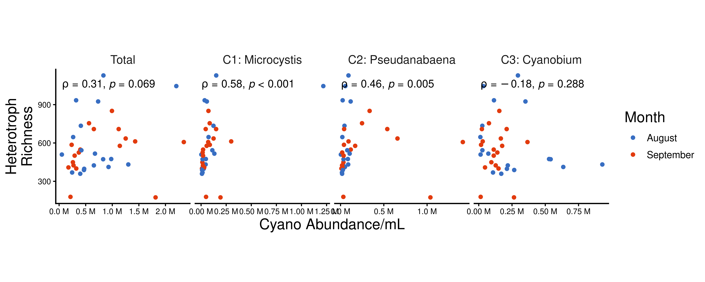{fig-align='center' width=3000}
:::

```{.r .cell-code}
joined %>%
  mutate(Month = factor(Month, levels = c("May","August","September")),
         membership = factor(membership, levels = c("Total", "2","1","3"),
                             labels = c("Total","C1: Microcystis","C2: Pseudanabaena", "C3: Cyanobium"))) %>%
  ggplot(aes(x = Mem_Abund, y =   evenness)) + 
  geom_point(aes(color = Month)) + 
  ggpubr::stat_cor(show.legend = FALSE, method = "spearman", 
                   cor.coef.name = "rho",
                   p.accuracy = 0.001) +
  scale_color_manual(values = month_colors) + 
  scale_x_continuous(labels = scales::unit_format(unit = "M", scale = 1e-6))+
  facet_wrap(~membership, scale = "free_x", nrow = 1) + 
  theme(legend.position = "right", 
        aspect.ratio = 1,
        axis.text = element_text(size = 8)) + 
  labs(x = "Cyano Abundance/mL", y = "Hetertroph\nEvenness") 
```

::: {.cell-output-display}
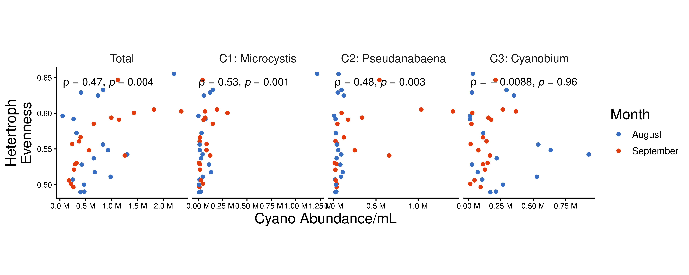{fig-align='center' width=3000}
:::

```{.r .cell-code}
joined %>%
  mutate(Month = factor(Month, levels = c("May","August","September")),
         membership = factor(membership, levels = c("Total", "2","1","3"),
                             labels = c("Total","C1: Microcystis","C2: Pseudanabaena", "C3: Cyanobium"))) %>%
  ggplot(aes(x = Mem_Abund, y =   avg_cells_per_ml-Cy_Abundance)) + 
  geom_point(aes(color = Month)) + 
  ggpubr::stat_cor(show.legend = FALSE, method = "spearman", 
                   cor.coef.name = "rho",
                   p.accuracy = 0.001) +
  scale_color_manual(values = month_colors) + 
  scale_x_continuous(labels = scales::unit_format(unit = "M", scale = 1e-6))+
  scale_y_continuous(labels = scales::unit_format(unit = "M", scale = 1e-6))+
  facet_wrap(~membership, scale = "free_x", nrow = 1) + 
  theme(legend.position = "right", 
        aspect.ratio = 1,
        axis.text = element_text(size = 8)) + 
  labs(x = "Cyano Abundance/mL", y = "Heterotroph\nAbundance/mL") 
```

::: {.cell-output-display}
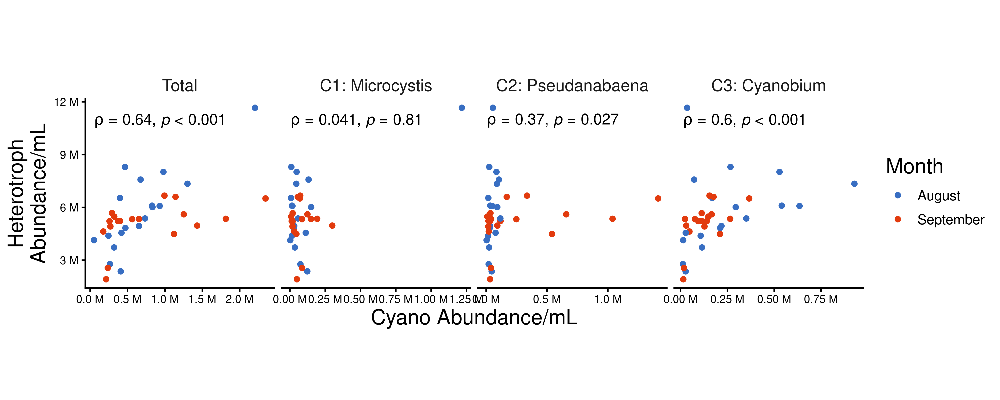{fig-align='center' width=3000}
:::
:::


Alternative: r and p-value heat map


::: {.cell layout-align="center"}

```{.r .cell-code}
joined %>%
  mutate(het_abund = avg_cells_per_ml - Cy_Abundance,
         het_rich = Richness - Cy_Richness,
         het_even = evenness,
         het_rsg = het_rsg_per_ml,
         het_rsg_perc = het_rsg_perc_pos) %>%
  select(membership, Mem_Abund,het_abund, het_rich, het_even, het_rsg, het_rsg_perc) %>%
  group_by(membership) %>%
  rstatix::cor_test(vars = Mem_Abund, vars2 = starts_with("het"), method = "spearman", use = "pairwise.complete.obs") %>%
  rstatix::adjust_pvalue() %>%
  mutate(var2 = factor(var2, levels = c("het_rsg_perc","het_rsg","het_abund","het_even","het_rich"),
                       labels = c("% RSG +", "RSG+ /mL", "Abundance","Evenness","Richness")),
         membership = factor(membership, levels = c("Total", "2","1","3"),
                             labels = c("Total","C1: Microcystis","C2: Pseudanabaena", "C3: Cyanobium"))) %>%
  ggplot(aes(x = membership, y = var2, fill = cor, alpha = p.adj < 0.05)) + 
  geom_tile() + 
  geom_text(aes(label = round(cor, 2))) + 
  scale_fill_distiller(palette = "Spectral") + 
  scale_alpha_manual(values = c(0.2,1)) + 
  scale_y_discrete(expand = expansion(0)) + 
  scale_x_discrete(expand = expansion(0)) + 
  guides(alpha = "none") + 
  labs(y="Non-Cyano Metric",
       fill = "Spearman's R")+
  theme(axis.title.x = element_blank(),
        axis.line = element_blank(),
        axis.ticks = element_blank(),
        axis.text.x = element_text(angle = 330, vjust = 1, hjust = 0, size = 12))
```

::: {.cell-output-display}
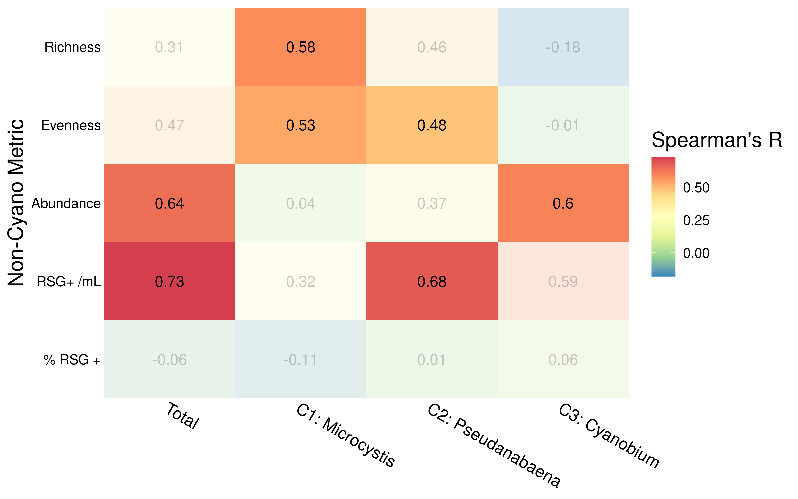{fig-align='center' width=2400}
:::

```{.r .cell-code}
ggsave("test.png", width = 8, height = 5)
```
:::

::: {.cell layout-align="center"}

```{.r .cell-code}
joined %>%
  filter(Month == "September", membership == "Total") %>%
  rstatix::cor_test(rsg_pos_per_ml, ctd_temperature, method = "spearman", use = "pairwise.complete.obs")
```

::: {.cell-output .cell-output-stdout}
```
# A tibble: 1 × 6
  var1           var2              cor statistic     p method  
  <chr>          <chr>           <dbl>     <dbl> <dbl> <chr>   
1 rsg_pos_per_ml ctd_temperature  0.39       416 0.138 Spearman
```
:::

```{.r .cell-code}
joined %>%
  filter(membership == "Total") %>%
  mutate(het_abund = avg_cells_per_ml - Cy_Abundance,
         het_rich = Richness - Cy_Richness,
         het_even = evenness,
         het_rsg = het_rsg_per_ml,
         het_rsg_perc = het_rsg_perc_pos,
         tn_ratio = (tn_ug_n_l/14) / (tp_ug_p_l/31)) %>%
  select(ctd_temperature, tn_ug_n_l, tp_ug_p_l, tn_ratio, het_abund, het_rich, het_even, het_rsg, het_rsg_perc) %>%
  pivot_longer(ctd_temperature:tn_ratio, names_to = "Chem", values_to = "Value") %>%
  group_by(Chem) %>%
  rstatix::cor_test(vars = Value, vars2 = starts_with("het"), method = "spearman", use = "pairwise.complete.obs") %>%
  rstatix::adjust_pvalue() %>% 
  mutate(var2 = factor(var2, levels = c("het_rsg_perc","het_rsg","het_abund","het_even","het_rich"),
                       labels = c("% RSG +", "RSG+ /mL", "Abundance","Evenness","Richness")),
         Chem = factor(Chem, levels = c("ctd_temperature", "tn_ug_n_l","tp_ug_p_l","tn_ratio"),
                       labels = c("Temperature","Total N","Total P","Molar N:P"))) %>%
  ggplot(aes(x = Chem, y = var2, fill = cor, alpha = p.adj < 0.05)) + 
  geom_tile() + 
  geom_text(aes(label = round(cor, 2))) + 
  scale_fill_distiller(palette = "Spectral") + 
  scale_alpha_manual(values = c(0.2,1)) + 
  scale_y_discrete(expand = expansion(0)) + 
  scale_x_discrete(expand = expansion(0)) + 
  guides(alpha = "none") + 
  labs(y="Non-Cyano Metric",
       fill = "Spearman's R")+
  theme(axis.title.x = element_blank(),
        axis.line = element_blank(),
        axis.ticks = element_blank(),
        axis.text.x = element_text(angle = 330, vjust = 1, hjust = 0, size = 12))
```

::: {.cell-output-display}
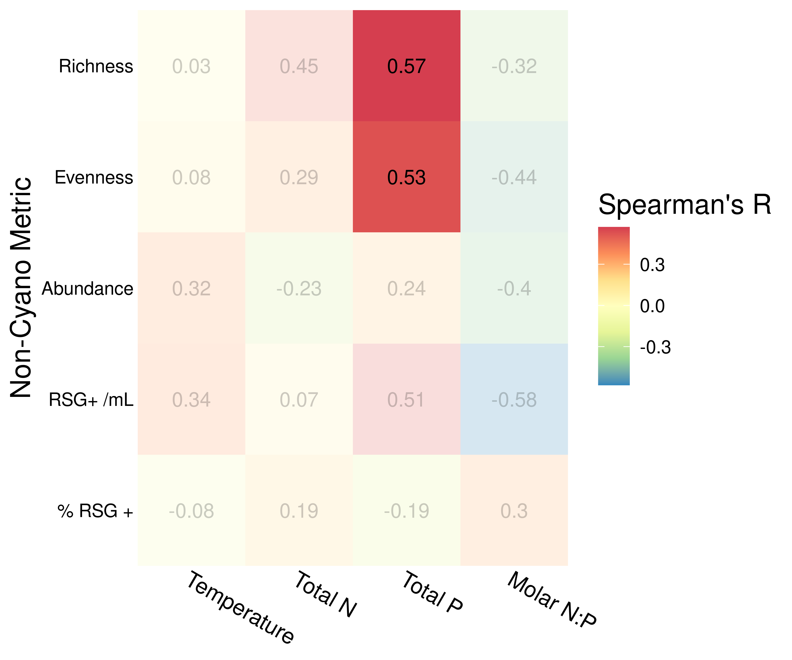{fig-align='center' width=1800}
:::

```{.r .cell-code}
ggsave("test.png", width = 8, height = 5)
```
:::

::: {.cell layout-align="center"}

```{.r .cell-code}
flow_sf %>%
  select(doc_mg_c_l, avg_cells_per_ml) %>%
  unique() %>%
  rstatix::cor_test(avg_cells_per_ml, doc_mg_c_l, method = "spearman")
```

::: {.cell-output .cell-output-error}
```
Error in `map()`:
ℹ In index: 1.
ℹ With name: vars.
Caused by error in `h()`:
! error in evaluating the argument 'x' in selecting a method for function 'unique': object 'flow_sf' not found
```
:::

```{.r .cell-code}
joined %>%
  mutate( membership = factor(membership, levels = c("Total", "2","1","3"),
                             labels = c("Total","C1: Microcystis","C2: Pseudanabaena", "C3: Cyanobium"))) %>%
  ggplot(aes(x = tp_ug_p_l, y = Mem_Abund)) + 
  geom_point(aes(color = Month)) + 
  facet_wrap(~membership, nrow = 1) + 
  scale_y_log10(labels = scales::unit_format(unit = "M", scale = 1e-6)) + 
  ggpubr::stat_cor(show.legend = FALSE, method = "spearman", 
                   cor.coef.name = "rho",
                   p.accuracy = 0.001) +
  scale_color_manual(values = month_colors) +
  labs(y = "Cyano Cluster Abundance/mL", x = "TP (ug P/L)") +
  theme(legend.position = "right", 
        aspect.ratio = 1,
        axis.text = element_text(size = 8))
```

::: {.cell-output-display}
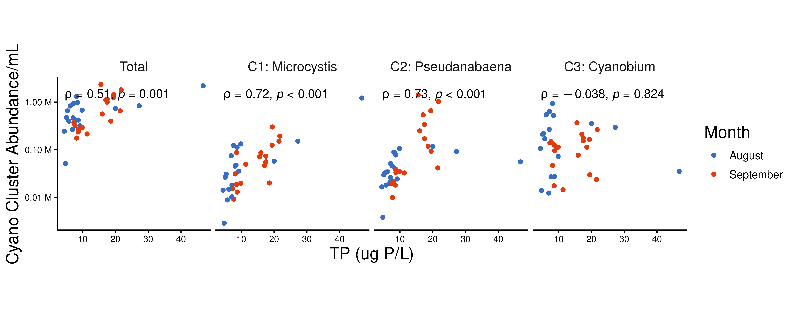{fig-align='center' width=3000}
:::

```{.r .cell-code}
ggsave("test.png", width = 6, height = 5)
```
:::

::: {.cell layout-align="center"}

```{.r .cell-code}
joined %>%
  filter(membership=="Total") %>%
  mutate(Month = factor(Month, levels = c("May","August","September"))) %>%
  ggplot(aes(x = Cy_Richness, y =   Richness-Cy_Richness, color = Month)) + 
  geom_point() + 
  ggpubr::stat_cor(show.legend = FALSE, method = "spearman", 
                   cor.coef.name = "rho",
                   p.accuracy = 0.001) +
  scale_color_manual(values = month_colors) + 
  facet_wrap(~Month) + 
  theme(legend.position = "none", 
        aspect.ratio = 1) + 
  labs(x = "Cyano Richness", y = "Heterotroph\nRichness") 
```

::: {.cell-output-display}
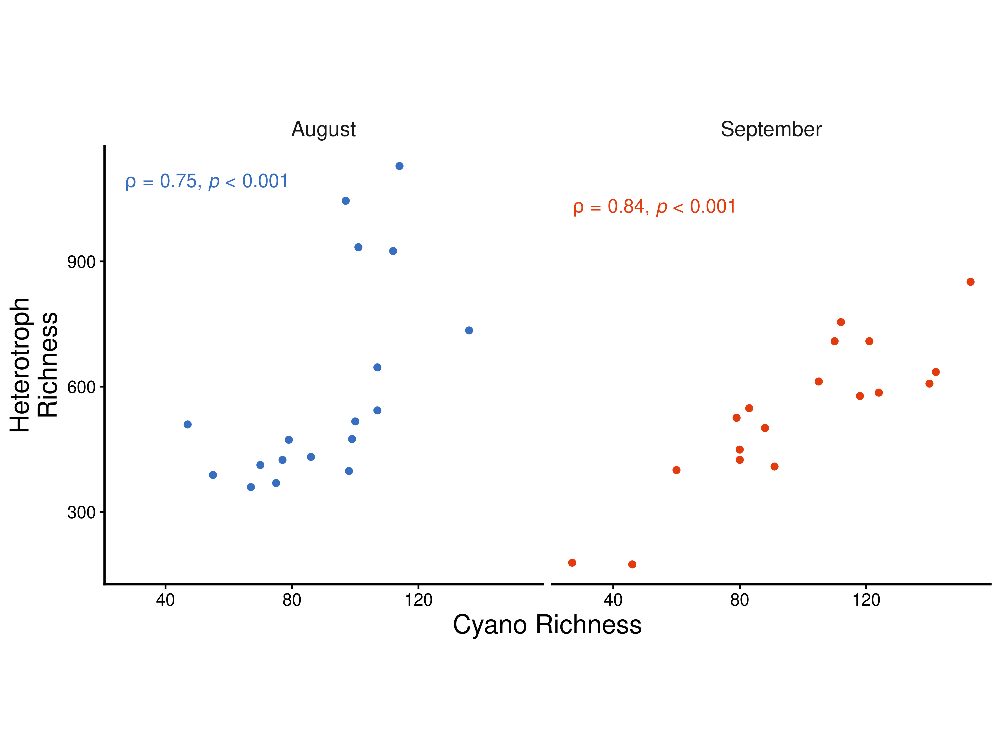{fig-align='center' width=2400}
:::

```{.r .cell-code}
joined %>%
  filter(membership=="Total") %>%
  mutate(Month = factor(Month, levels = c("May","August","September"))) %>%
  ggplot(aes(x = Cy_Abundance/1e6, y =  (avg_cells_per_ml - Cy_Abundance)/1e6, color = Month)) + 
  geom_point() + 
  ggpubr::stat_cor(show.legend = FALSE, method = "spearman", cor.coef.name = "rho",
                   p.accuracy = 0.001) +
  scale_color_manual(values = month_colors) + 
  facet_wrap(~Month) + 
  theme(legend.position = "none",
        aspect.ratio = 1) + 
  labs(x = "Cyano Abundance (million cells/ml)", y = "Heterotroph Abundance\n(million cells/ml)")
```

::: {.cell-output-display}
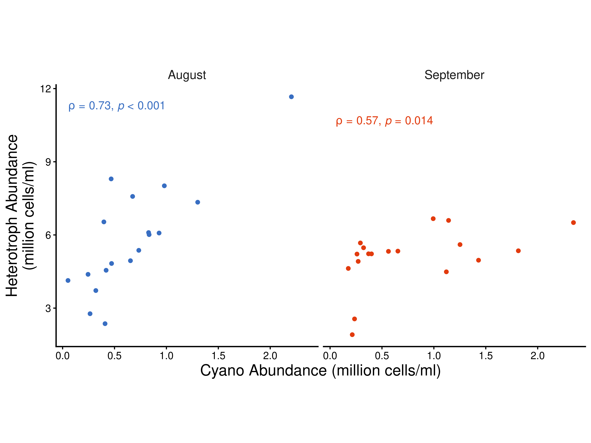{fig-align='center' width=2400}
:::

```{.r .cell-code}
ggsave(filename = "test.png", width = 8, height = 6)
```
:::

::: {.cell layout-align="center"}

```{.r .cell-code}
joined %>%
  filter(membership=="Total") %>%
 filter(Month == "September") %>%
  mutate(
         membership = factor(membership, levels = c("Total", "2","1","3"),
                             labels = c("Total","C1: Microcystis","C2: Pseudanabaena", "C3: Cyanobium"))) %>%
  ggplot(aes(x = Mem_Abund, y =   rsg_pos_per_ml)) + 
  geom_point(aes(color = Month)) + 
  ggpubr::stat_cor(show.legend = FALSE, method = "spearman", 
                   cor.coef.name = "rho",
                   p.accuracy = 0.001) +
  scale_color_manual(values = month_colors) + 
  scale_x_continuous(labels = scales::unit_format(unit = "M", scale = 1e-6))+
  scale_y_continuous(labels = scales::unit_format(unit = "M", scale = 1e-6))+
  facet_wrap(~membership, scale = "free_x", nrow = 1) + 
  theme(legend.position = "right", 
        aspect.ratio = 1,
        axis.text = element_text(size = 8)) + 
  labs(x = "Cyano Abundance/mL", y = "RSG + / mL\n") 
```

::: {.cell-output-display}
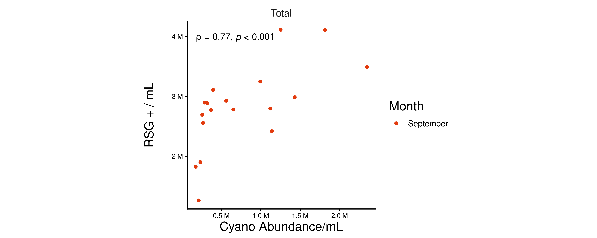{fig-align='center' width=3000}
:::

```{.r .cell-code}
joined %>%
  filter(membership=="Total") %>%
  filter(Month == "September") %>%
  mutate(
         membership = factor(membership, levels = c("Total", "2","1","3"),
                             labels = c("Total","C1: Microcystis","C2: Pseudanabaena", "C3: Cyanobium"))) %>%
  ggplot(aes(x = Mem_Abund, y =   rsg_perc_pos)) + 
  geom_point(aes(color = Month)) + 
  ggpubr::stat_cor(show.legend = FALSE, method = "spearman", 
                   cor.coef.name = "rho",
                   p.accuracy = 0.001) +
  scale_color_manual(values = month_colors) + 
  scale_x_continuous(labels = scales::unit_format(unit = "M", scale = 1e-6))+
  facet_wrap(~membership, scale = "free_x", nrow = 1) + 
  theme(legend.position = "right", 
        aspect.ratio = 1,
        axis.text = element_text(size = 8)) + 
  labs(x = "Cyano Abundance/mL", y = "% RSG +\n") 
```

::: {.cell-output-display}
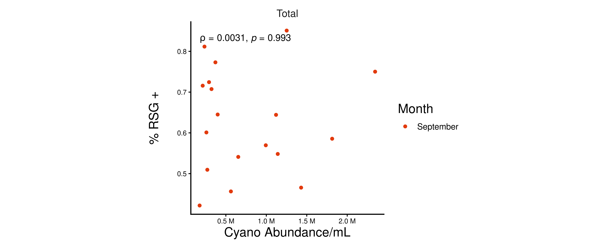{fig-align='center' width=3000}
:::

```{.r .cell-code}
joined %>%
  filter(membership=="Total") %>%
 filter(Month == "September") %>%
  mutate(
         membership = factor(membership, levels = c("Total", "2","1","3"),
                             labels = c("Total","C1: Microcystis","C2: Pseudanabaena", "C3: Cyanobium"))) %>%
  ggplot(aes(x = Mem_Abund, y =   rsg_pos_per_ml-Cy_Abundance)) + 
  geom_point(aes(color = Month)) + 
  ggpubr::stat_cor(show.legend = FALSE, method = "spearman", 
                   cor.coef.name = "rho",
                   p.accuracy = 0.001) +
  scale_color_manual(values = month_colors) + 
  scale_x_continuous(labels = scales::unit_format(unit = "M", scale = 1e-6))+
  scale_y_continuous(labels = scales::unit_format(unit = "M", scale = 1e-6))+
  facet_wrap(~membership, scale = "free_x", nrow = 1) + 
  theme(legend.position = "right", 
        aspect.ratio = 1,
        axis.text = element_text(size = 8)) + 
  labs(x = "Cyano Abundance/mL", y = "RSG + / mL-\nCyano Cells") 
```

::: {.cell-output-display}
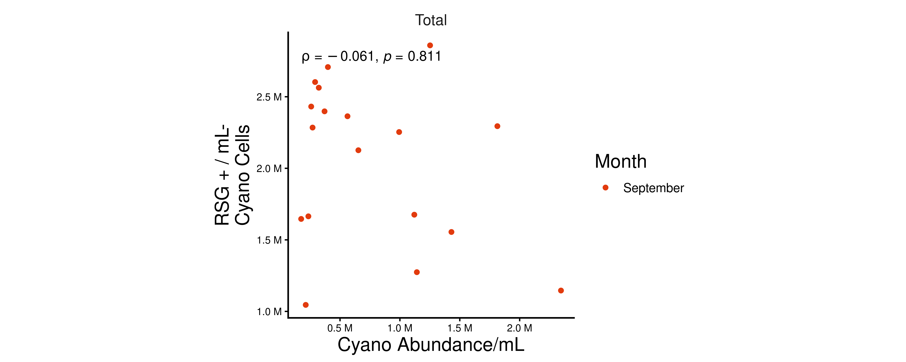{fig-align='center' width=3000}
:::

```{.r .cell-code}
ggsave("test.png", width = 10, height = 4)
```
:::

::: {.cell layout-align="center"}

```{.r .cell-code}
joined %>%
  filter(membership=="Total") %>%
  mutate(Month = factor(Month, levels = c("May","August","September"))) %>%
  ggplot(aes(x = Cy_Abundance/1e6, y =  rsg_pos_per_ml/1e6, color = Month)) + 
  geom_point() + 
  ggpubr::stat_cor(show.legend = FALSE, method = "spearman", cor.coef.name = "rho",
                   p.accuracy = 0.001) +
  scale_color_manual(values = month_colors) + 
  theme(legend.position = "none",
        aspect.ratio = 1,
        strip.text = element_blank()) + 
  labs(x = "Cyano Abundance (million cells/ml)", y = "RSG+ Cells\n(millions/ml)")
```

::: {.cell-output-display}
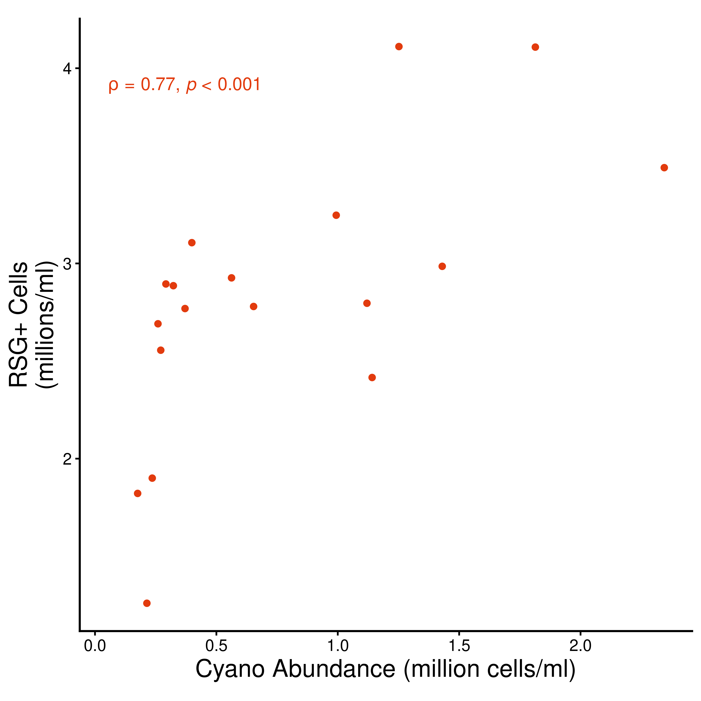{fig-align='center' width=1800}
:::
:::

::: {.cell layout-align="center"}

```{.r .cell-code}
joined %>%
  filter(membership=="Total") %>%
  ggplot(aes(x = ctd_temperature, y =  avg_cells_per_ml)) + 
  geom_point(aes(color = Month)) + 
  ggpubr::stat_cor(show.legend = FALSE, method = "spearman", cor.coef.name = "rho") +
  scale_color_manual(values = month_colors) + 
  scale_y_continuous(labels = scales::unit_format(unit = "M", scale = 1e-6)) + 
  theme(legend.position = "none",
        aspect.ratio = 1,
        strip.text = element_blank()) + 
  labs(x = "Temperature (°C)", y = "Heterotroph\nAbundance / mL ")
```

::: {.cell-output-display}
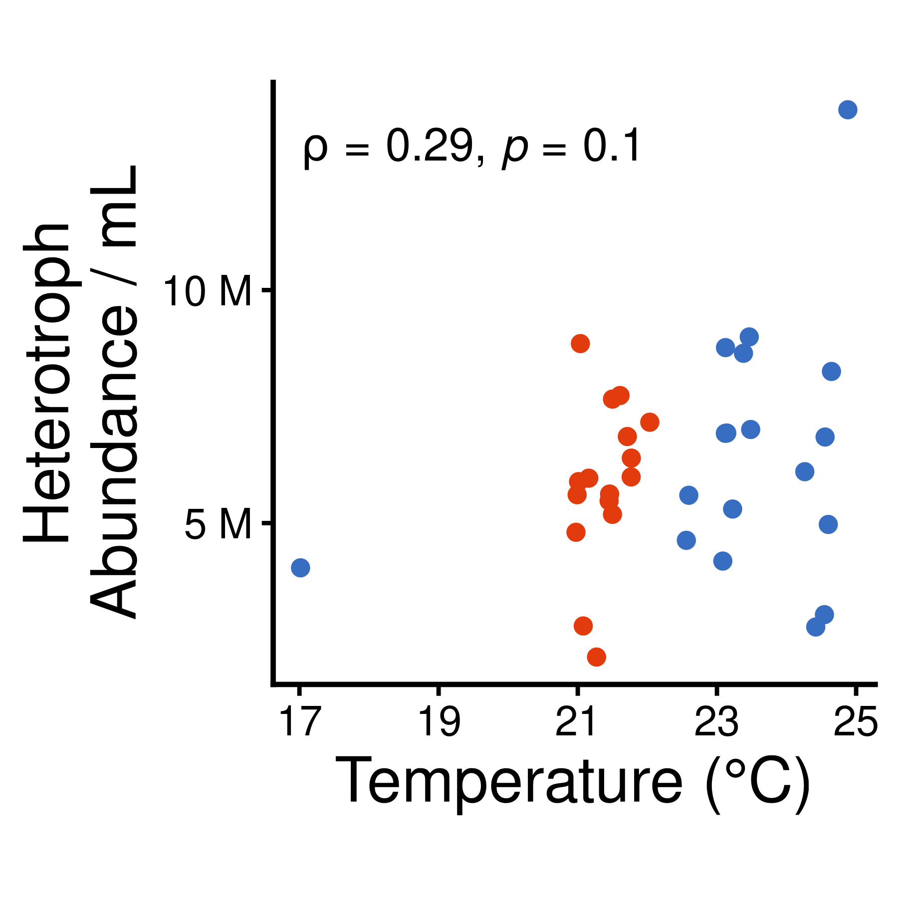{fig-align='center' width=900}
:::

```{.r .cell-code}
ggsave("test.png", width = 3, height = 3)
joined %>%
  filter(membership=="Total") %>%
  ggplot(aes(x = ctd_temperature, y =  Richness)) + 
  geom_point(aes(color = Month)) + 
  ggpubr::stat_cor(show.legend = FALSE, method = "spearman", cor.coef.name = "rho") +
  scale_color_manual(values = month_colors) + 
  theme(legend.position = "none",
        aspect.ratio = 1,
        strip.text = element_blank()) + 
  labs(x = "Temperature (°C)", y = "Heterotroph Richness")
```

::: {.cell-output-display}
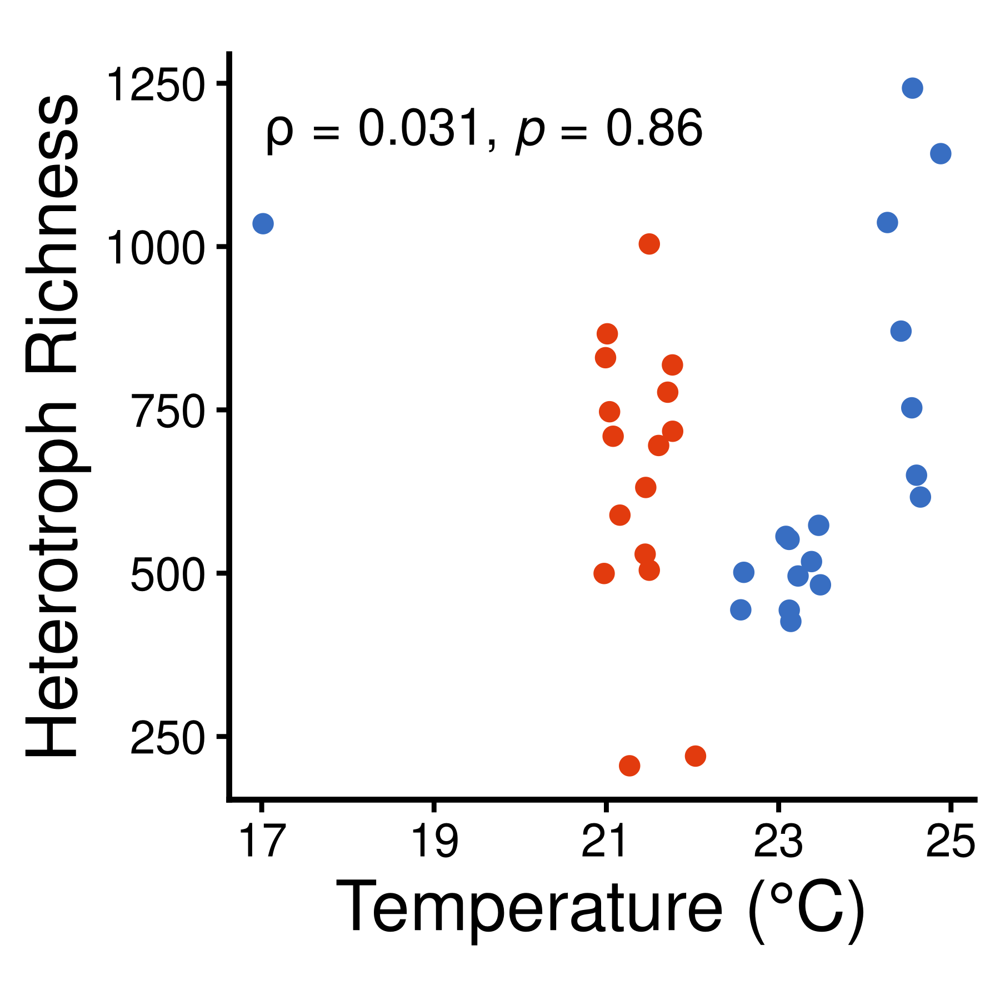{fig-align='center' width=900}
:::

```{.r .cell-code}
joined %>%
  filter(membership=="Total") %>%
  ggplot(aes(x = ctd_temperature, y =  evenness)) + 
  geom_point(aes(color = Month)) + 
  ggpubr::stat_cor(show.legend = FALSE, method = "spearman", cor.coef.name = "rho") +
  scale_color_manual(values = month_colors) + 
  theme(legend.position = "none",
        aspect.ratio = 1,
        strip.text = element_blank()) + 
  labs(x = "Temperature (°C)", y = "Heterotroph Evenness")
```

::: {.cell-output-display}
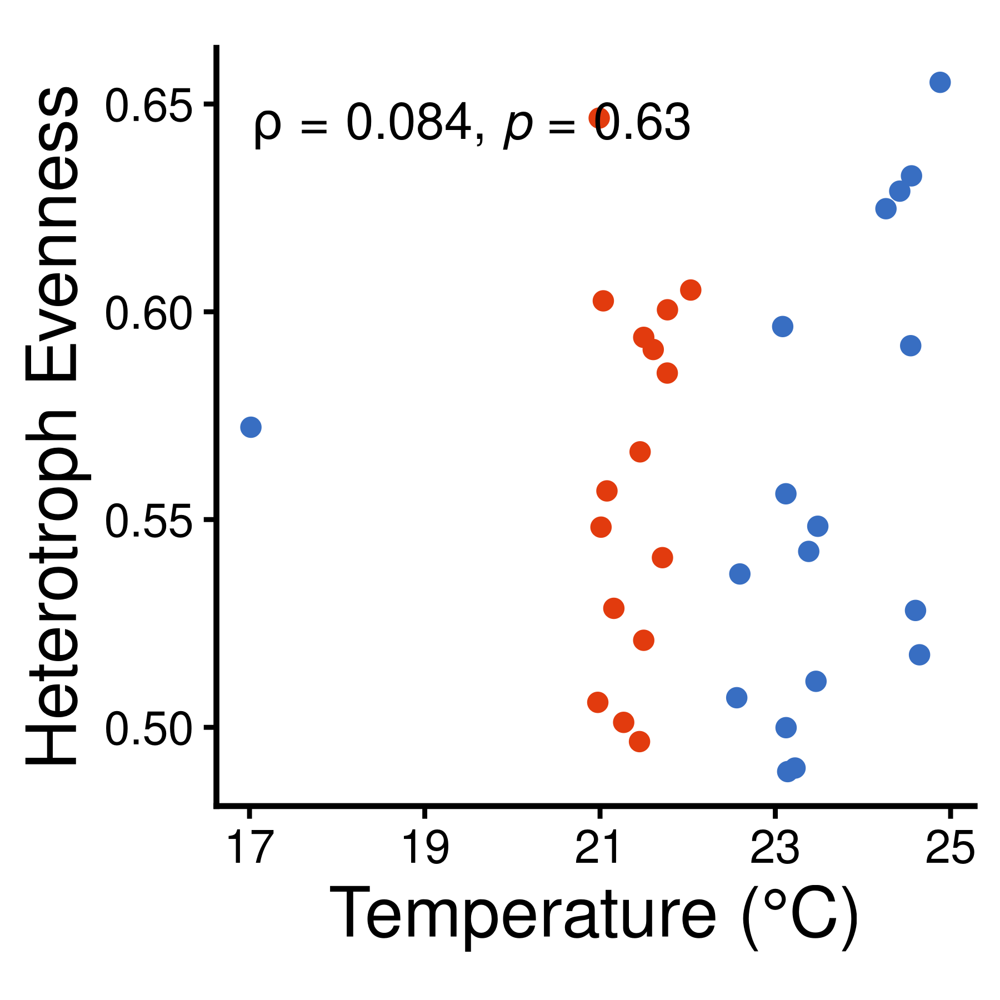{fig-align='center' width=900}
:::

```{.r .cell-code}
joined %>%
  filter(membership=="Total") %>%
  ggplot(aes(x = ctd_temperature, y =  rsg_pos_per_ml)) + 
  geom_point(aes(color = Month)) + 
  ggpubr::stat_cor(show.legend = FALSE, method = "spearman", cor.coef.name = "rho") +
  scale_color_manual(values = month_colors) + 
  scale_y_continuous(labels = scales::unit_format(unit = "M", scale = 1e-6)) + 
  theme(legend.position = "none",
        aspect.ratio = 1,
        strip.text = element_blank()) + 
  labs(x = "Temperature (°C)", y = "RSG + / mL ")
```

::: {.cell-output-display}
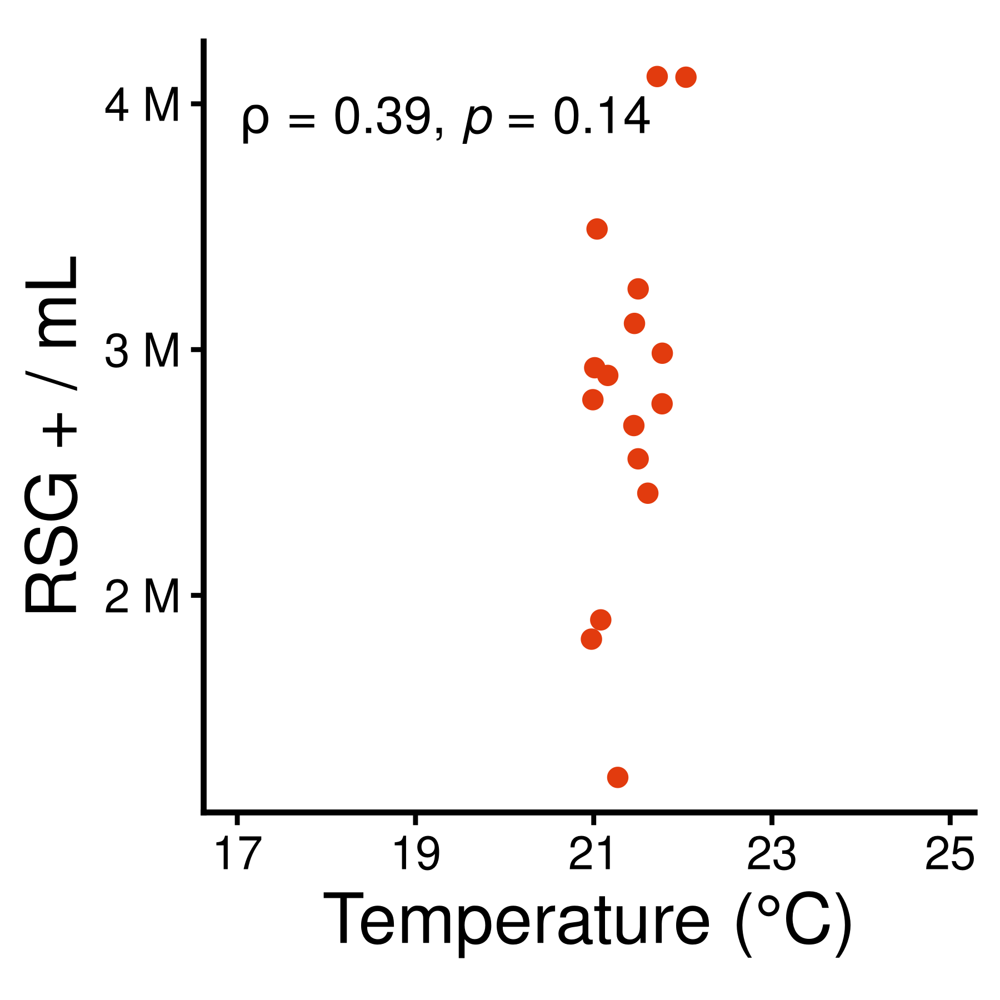{fig-align='center' width=900}
:::

```{.r .cell-code}
joined %>%
  filter(membership=="Total") %>%
  ggplot(aes(x = ctd_temperature, y =  rsg_perc_pos)) + 
  geom_point(aes(color = Month)) + 
  ggpubr::stat_cor(show.legend = FALSE, method = "spearman", cor.coef.name = "rho") +
  scale_color_manual(values = month_colors) + 
  theme(legend.position = "none",
        aspect.ratio = 1,
        strip.text = element_blank()) + 
  labs(x = "Temperature (°C)", y = "% RGS +")
```

::: {.cell-output-display}
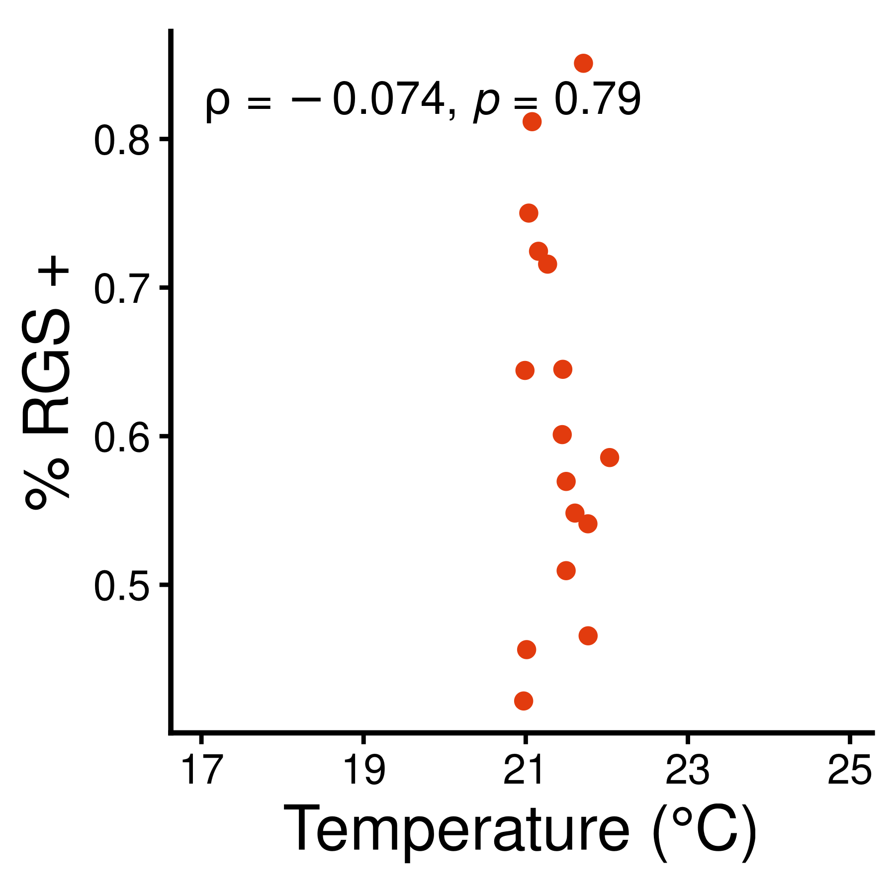{fig-align='center' width=900}
:::
:::

::: {.cell layout-align="center"}

```{.r .cell-code}
joined %>%
  filter(membership=="Total") %>%
  ggplot(aes(x = Cy_Abundance, y =  avg_cells_per_ml - Cy_Abundance)) + 
  geom_point() + 
  ggpubr::stat_cor(show.legend = FALSE, method = "spearman", cor.coef.name = "rho", p.accuracy = 0.001) +
  scale_color_manual(values = month_colors) + 
  scale_y_continuous(labels = scales::unit_format(unit = "M", scale = 1e-6)) + 
  scale_x_continuous(labels = scales::unit_format(unit = "M", scale = 1e-6)) + 
  theme(legend.position = "none",
        aspect.ratio = 1,
        strip.text = element_blank()) + 
  labs(x = "Cyanobacteria / mL", y = "\nHeterotrophs / mL")
```

::: {.cell-output-display}
{fig-align='center' width=2100}
:::

```{.r .cell-code}
joined %>%
  filter(membership=="Total") %>%
  ggplot(aes(x = Cy_Abundance, y = het_rsg_per_ml)) + 
  geom_point() + 
  ggpubr::stat_cor(show.legend = FALSE, method = "spearman", cor.coef.name = "rho", p.accuracy = 0.001) +
  scale_color_manual(values = month_colors) + 
  scale_y_continuous(labels = scales::unit_format(unit = "M", scale = 1e-6)) + 
  scale_x_continuous(labels = scales::unit_format(unit = "M", scale = 1e-6)) + 
  theme(legend.position = "none",
        aspect.ratio = 1,
        strip.text = element_blank()) + 
  labs(x = "Cyanobacteria / mL", y = "Respiring\nHeterotrophs / mL")
```

::: {.cell-output-display}
{fig-align='center' width=2100}
:::

```{.r .cell-code}
ggsave("test.png", width = 4, height= 4)

joined %>%
  filter(membership=="Total") %>%
  ggplot(aes(x = Cy_Abundance, y =  rsg_pos_per_ml)) + 
  geom_point() + 
  ggpubr::stat_cor(show.legend = FALSE, method = "spearman", cor.coef.name = "rho", p.accuracy = 0.001) +
  scale_color_manual(values = month_colors) + 
  scale_y_continuous(labels = scales::unit_format(unit = "M", scale = 1e-6)) + 
  scale_x_continuous(labels = scales::unit_format(unit = "M", scale = 1e-6)) + 
  theme(legend.position = "none",
        aspect.ratio = 1,
        strip.text = element_blank()) + 
  labs(x = "Cyanobacteria / mL", y = "Metabolically Active\nCells / mL")
```

::: {.cell-output-display}
{fig-align='center' width=2100}
:::

```{.r .cell-code}
joined %>%
  filter(membership=="Total") %>%
  group_by(DNA_ID) %>%
  mutate(Relative_Hets = (avg_cells_per_ml - Cy_Abundance) / avg_cells_per_ml) %>%
  ggplot(aes(x = Cy_Abundance, y =  Relative_Hets)) + 
  geom_point() + 
  ggpubr::stat_cor(show.legend = FALSE, method = "spearman", cor.coef.name = "rho", p.accuracy = 0.001) +
  scale_x_continuous(labels = scales::unit_format(unit = "M", scale = 1e-6)) + 
  scale_color_manual(values = month_colors) + 
  theme(legend.position = "none",
        aspect.ratio = 1,
        strip.text = element_blank()) + 
  labs(x = "Cyanobacteria / mL", y = "Heterotroph\n Relative Abundance")
```

::: {.cell-output-display}
{fig-align='center' width=2100}
:::
:::

::: {.cell layout-align="center"}

```{.r .cell-code}
joined %>%
  mutate(Month = factor(Month, levels = c("August","September"))) %>%
  ggplot(aes(x = Cy_Abundance/1e6, y =   Richness-Cy_Richness, color = Month)) + 
  geom_point() + 
  ggpubr::stat_cor(show.legend = FALSE, method = "spearman", cor.coef.name = "rho",
                   p.accuracy = 0.001) +
  scale_color_manual(values = month_colors) + 
  facet_wrap(~Month) + 
  theme(legend.position = "none",
        aspect.ratio = 1) + 
  labs(x = "Cyano Abundance (million cells/ml)", y = "Heterotroph\nRichness")
```

::: {.cell-output-display}
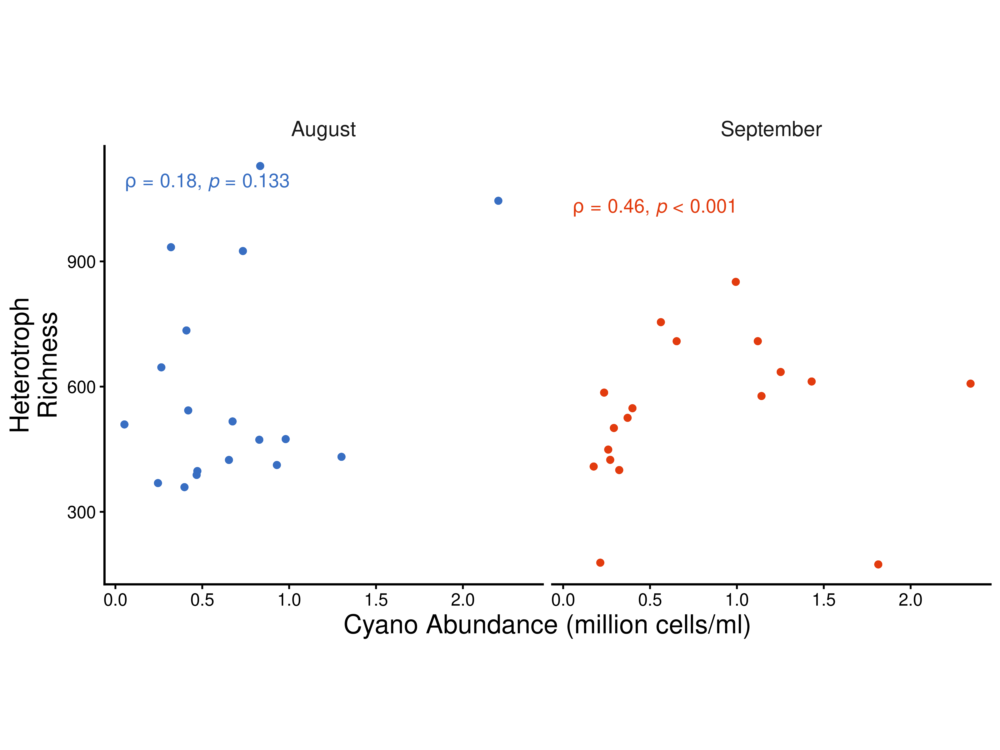{fig-align='center' width=2400}
:::

```{.r .cell-code}
joined %>%
  mutate(Month = factor(Month, levels = c("May","August","September"))) %>%
  ggplot(aes(x = Cy_Richness, y =  (avg_cells_per_ml - Cy_Abundance)/1e6, color = Month)) + 
  geom_point() + 
  ggpubr::stat_cor(show.legend = FALSE, method = "spearman", cor.coef.name = "rho",
                   p.accuracy = 0.001) +
  scale_color_manual(values = month_colors) + 
  facet_wrap(~Month) + 
  theme(legend.position = "none",
        aspect.ratio = 1) + 
  labs(x = "Cyano Richness", y = "Heterotroph Abundance\n(million cells/ml)")
```

::: {.cell-output-display}
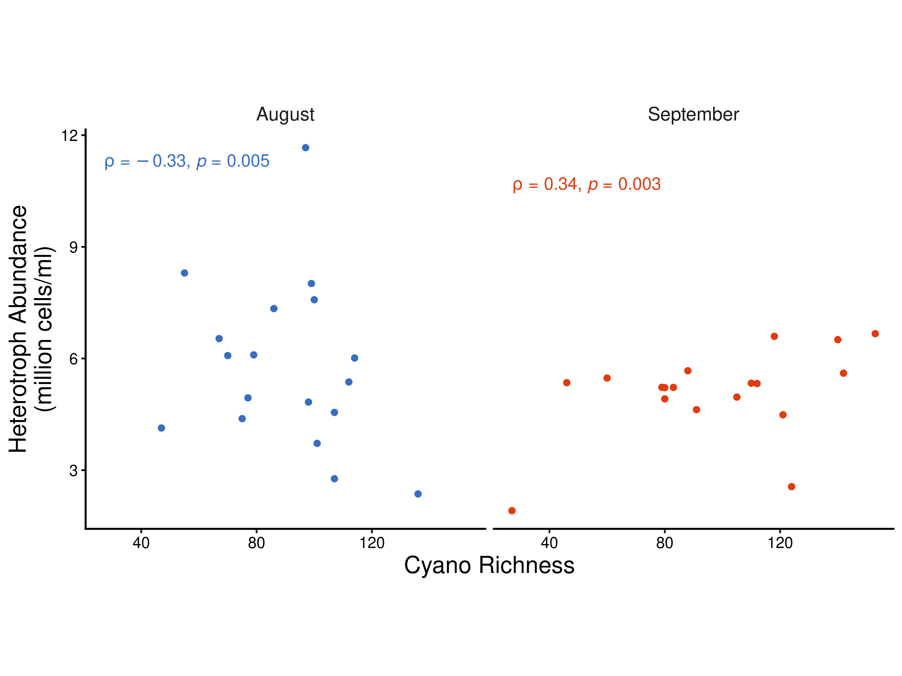{fig-align='center' width=2400}
:::

```{.r .cell-code}
joined %>%
  mutate(Month = factor(Month, levels = c("May","August","September"))) %>%
  ggplot(aes(x = ctd_temperature, y = Richness-Cy_Richness, color = Month)) + 
  geom_point() + 
  ggpubr::stat_cor(show.legend = FALSE, method = "spearman") +
  scale_color_manual(values = month_colors) + 
  facet_wrap(~Month) + 
  theme(legend.position = "none", 
        aspect.ratio = 1) + 
  labs(x = "Temperature (°C)", y = "Heterotroph Richness")
```

::: {.cell-output-display}
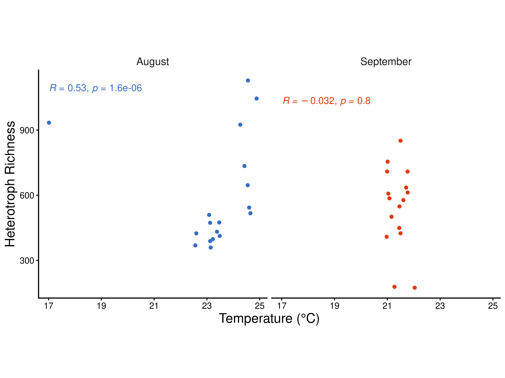{fig-align='center' width=2400}
:::

```{.r .cell-code}
joined %>%
  mutate(Month = factor(Month, levels = c("May","August","September"))) %>%
  ggplot(aes(x = ctd_temperature, y =  (avg_cells_per_ml - Cy_Abundance)/1e6, color = Month)) + 
  geom_point() + 
  ggpubr::stat_cor(show.legend = FALSE, method = "spearman") +
  scale_color_manual(values = month_colors) + 
  facet_wrap(~Month) + 
  theme(legend.position = "none", 
        aspect.ratio = 1) + 
  labs(x = "Temperature (°C)", y = "Heterotroph Abundance\n(million cells/ml)")
```

::: {.cell-output-display}
{fig-align='center' width=2400}
:::

```{.r .cell-code}
joined %>%
  mutate(Month = factor(Month, levels = c("May","August","September"))) %>%
  ggplot(aes(x = ctd_temperature, y =  (avg_cells_per_ml - Cy_Abundance)/1e6, color = Month)) + 
  geom_point() + 
  ggpubr::stat_cor(show.legend = FALSE, method = "spearman") +
  scale_color_manual(values = month_colors) + 
  facet_wrap(~Month) + 
  theme(legend.position = "none", 
        aspect.ratio = 1) + 
  labs(x = "Temperature (°C)", y = "Heterotroph Abundance\n(million cells/ml)")
```

::: {.cell-output-display}
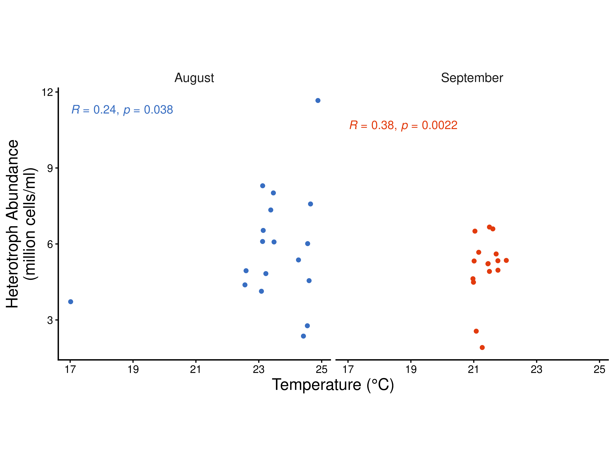{fig-align='center' width=2400}
:::
:::


Now euks

::: {.cell layout-align="center"}

```{.r .cell-code}
load("data/07_Alpha_Diversity/euk_diversity_physeq.RData")

euk_stats <- 
  euk_diversity_physeq %>%
  sample_data() %>%
  data.frame() %>%
  filter(Depth_Class == "S", DNA_ID != "KH_D076") %>%
  left_join(all_cy_stats)

euk_stats %>%
  filter(Month != "May") %>%
  mutate(
         membership = factor(membership, levels = c("Total", "2","1","3"),
                             labels = c("Total","C1: Microcystis","C2: Pseudanabaena", "C3: Cyanobium"))) %>%
  ggplot(aes(x = Mem_Abund, y =   Richness)) + 
  geom_point(aes(color = Month)) + 
  ggpubr::stat_cor(show.legend = FALSE, method = "spearman", 
                   cor.coef.name = "rho",
                   p.accuracy = 0.001) +
  scale_color_manual(values = month_colors) + 
  scale_x_continuous(labels = scales::unit_format(unit = "M", scale = 1e-6))+
  facet_wrap(~membership, scale = "free_x", nrow = 1) + 
  theme(legend.position = "right", 
        aspect.ratio = 1,
        axis.text = element_text(size = 8)) + 
  labs(x = "Cyano Abundance/mL", y = "Eukaryotic\nRichness") 
```

::: {.cell-output-display}
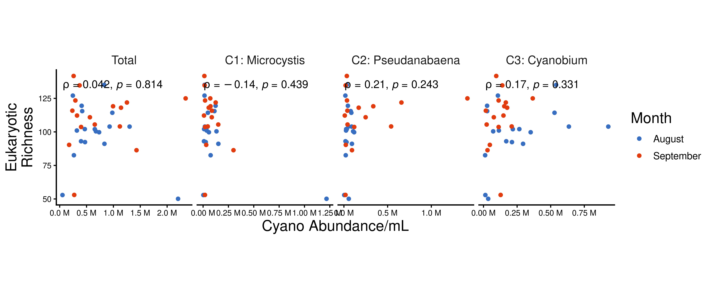{fig-align='center' width=3000}
:::

```{.r .cell-code}
ggsave("test.png", width = 10, height = 4)

euk_stats %>%
  filter(Month != "May") %>%
  mutate(Month = factor(Month, levels = c("May","August","September"))) %>%
  ggplot(aes(x = Cy_Abundance/1e6, y = Richness, color = Month)) + 
  geom_point() + 
  ggpubr::stat_cor(show.legend = FALSE) +
  scale_color_manual(values = month_colors) + 
  facet_wrap(~Month) + 
  theme(legend.position = "none") + 
  labs(x = "Cyano Abundance (million cells/ml)", y = "Eukaryotic\nRichness")
```

::: {.cell-output-display}
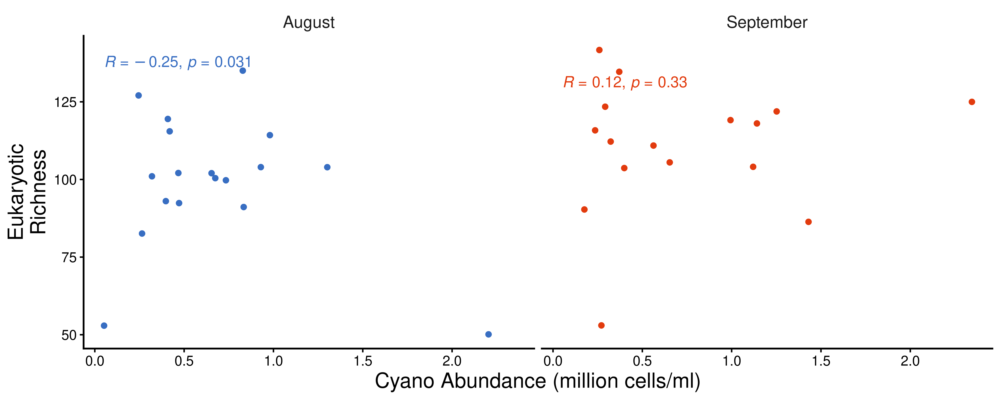{fig-align='center' width=3000}
:::
:::


# Heterotroph Network 


::: {.cell layout-align="center"}

```{.r .cell-code}
all_asv_ids <- abs_physeq %>%
  tax_table() %>%
  data.frame() %>%
  select(ASV, Genus, Phylum) %>%
  mutate(Genus = str_remove(Genus, "g__"))

all_asv_ids %>% 
  filter(ASV %in% top_asvs) %>%
  count(Phylum)  %>%arrange(n)
```

::: {.cell-output .cell-output-stdout}
```
                         Phylum   n
1         p__Desulfobacterota_E   1
2  p__Desulfobacterota_G_459546   1
3     p__Thermosulfidibacterota   1
4      p__Nitrospirota_A_437815   2
5              p__Spirochaetota   2
6            p__Patescibacteria   3
7  p__Desulfobacterota_G_459543   5
8             p__Armatimonadota   6
9                p__Chlamydiota   6
10   p__Bdellovibrionota_461973   7
11              p__Dependentiae   7
12           p__Gemmatimonadota   8
13           p__Acidobacteriota  10
14             p__Chloroflexota  11
15                         <NA>  15
16      p__Myxococcota_A_473307  25
17   p__Bdellovibrionota_473306  31
18            p__Actinomycetota  73
19         p__Verrucomicrobiota  77
20           p__Planctomycetota  93
21           p__Cyanobacteriota 120
22              p__Bacteroidota 183
23            p__Pseudomonadota 313
```
:::

```{.r .cell-code}
all_asv_ids %>% 
  filter(ASV %in% top_asvs) %>%
  count(Phylum)  %>% pull(n) %>% sum()
```

::: {.cell-output .cell-output-stdout}
```
[1] 1000
```
:::

```{.r .cell-code}
all_asv_abunds <- 
  abs_physeq %>%
  psmelt() %>%
  filter(Depth_Class == "S", DNA_ID != "KH_D076") %>%
  group_by(ASV) %>%
    summarize(Total_Abund = sum(Abundance))


# cor_res <-
#   abs_melted %>%
#   filter(ASV %in% c(top_asvs, top_cyano_asvs$ASV)) %>%
#   select(ASV, Rep_ID, Abundance) %>%
#   left_join(wide_cy) %>%
#   nest_by(ASV) %>%
#   mutate(corr_results = list(rstatix::cor_test(data, vars = Abundance, vars2 = prok_names, method = "spearman")))
# 
# save(cor_res, file = "data/10_Cyano_Species_Distribution/cor_res.RData")

load("data/10_Cyano_Species_Distribution/cor_res.RData")

# het_graphs_nocentr_filter <- map(corrs, \(x){
#   
#   cor_mat <- 
#   cor_res %>%
#   unnest(corr_results) %>%
#   mutate(cor = ifelse(cor>=x&p<0.01, cor, 0)) %>%
#   select(ASV, var2, cor) %>%
#   pivot_wider(names_from = var2, values_from = cor) %>%
#   column_to_rownames("ASV") %>%
#   as.matrix()
#   
#   adj_mat <- igraph::graph_from_biadjacency_matrix(cor_mat, weighted=T, directed = FALSE)
#   
#   graph <- as_tbl_graph(adj_mat) %>%
#    as_tbl_graph(adj_mat) %>%
#   left_join(all_asv_ids, by = c("name" = "ASV")) %>%
#   left_join(all_asv_abunds, by = c("name" = "ASV")) 
# })
# 
# het_mods <- map(het_graphs_nocentr_filter, \(x){
#   clustered <- igraph::cluster_edge_betweenness(x)
#   
#   igraph::modularity(clustered)
# 
#   }) %>%
#   unlist() 
# 
# 
# 
# het_graphs_nocyanos_filter <- map(corrs, \(x){
#   
#   cor_mat <- 
#   cor_res %>%
#   unnest(corr_results) %>%
#   mutate(cor = ifelse(cor>=x&p<0.01, cor, 0)) %>%
#   select(ASV, var2, cor) %>%
#   pivot_wider(names_from = var2, values_from = cor) %>%
#   column_to_rownames("ASV") %>%
#   as.matrix()
#   
#   adj_mat <- igraph::graph_from_biadjacency_matrix(cor_mat, weighted=T, directed = FALSE)
#   
#   graph <- as_tbl_graph(adj_mat) %>%
#    as_tbl_graph(adj_mat) %>%
#   left_join(all_asv_ids, by = c("name" = "ASV")) %>%
#   left_join(all_asv_abunds, by = c("name" = "ASV")) %>%
#   dplyr::filter(
#          !((!type)&Phylum == "p__Cyanobacteriota"))
# })
# 
# het_mods_nocy <- map(het_graphs_nocyanos_filter, \(x){
#   clustered <- igraph::cluster_edge_betweenness(x)
#   
#   igraph::modularity(clustered)
# 
#   }) %>%
#   unlist() 
#  
# 
# het_mod_df <- data.frame(Corr = corrs,
#            Modularity_WithCyanos = het_mods,
#            Modularity_NoCyanos = het_mods_nocy)
# save(het_mod_df, file = "data/10_Cyano_Species_Distribution/het_mod_df.RData")  

load(file = "data/10_Cyano_Species_Distribution/het_mod_df.RData")  

het_mod_df %>%
  pivot_longer(Modularity_WithCyanos:Modularity_NoCyanos, names_to = "Network", values_to = "Modularity") %>%
  ggplot(aes(x = Corr, y = Modularity, color = Network)) + 
  geom_line() + 
  geom_point(size = 4) + 
  scale_color_manual(values = c("#643D9A", "limegreen"), labels = c("No Cyanos", "With Cyanos")) + 
  labs(x = "Minimum Correlation")
```

::: {.cell-output-display}
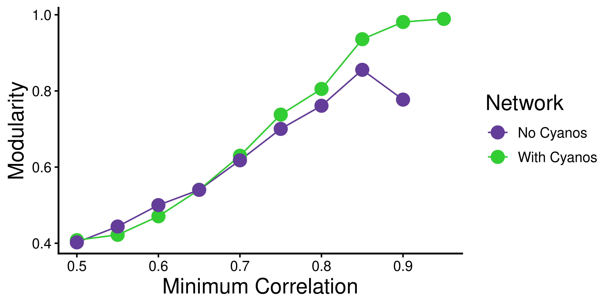{fig-align='center' width=1800}
:::

```{.r .cell-code}
ggsave("test.png", width = 6, height = 3)
```
:::

::: {.cell layout-align="center"}

```{.r .cell-code}
het_graphs <- map(corrs, \(x){
  
  cor_mat <- 
  cor_res %>%
  unnest(corr_results) %>%
  mutate(cor = ifelse(cor>=x&p<0.01, cor, 0)) %>%
  select(ASV, var2, cor) %>%
  pivot_wider(names_from = var2, values_from = cor) %>%
  column_to_rownames("ASV") %>%
  as.matrix()
  
  adj_mat <- igraph::graph_from_biadjacency_matrix(cor_mat, weighted=T, directed = FALSE)
  
  graph <- as_tbl_graph(adj_mat) %>%
   as_tbl_graph(adj_mat) %>%
  left_join(all_asv_ids, by = c("name" = "ASV")) %>%
  left_join(all_asv_abunds, by = c("name" = "ASV")) %>%
  mutate(Centrality = centrality_degree(mode = 'in')) %>%
  filter(Centrality > 0)
})

het_plots <- map2(het_graphs, names(het_graphs), \(x,y){
  set.seed(314)
  edge_n <- 
    x %>%
  activate("edges") %>%
  data.frame() %>%
  nrow()
  
  ggraph(x, layout = "fr")+ 
    geom_edge_fan(aes(alpha = weight), show.legend = FALSE) + 
    geom_node_point(aes(shape = type, color = ifelse(type, NA, 
                                                     ifelse(Phylum == "p__Cyanobacteriota", "Cyano.", "Non-cyano.")))) +
  scale_color_manual(values = c("limegreen", "#643D9A")) + 
  labs(title = paste0("Min. Corr = ", y), subtitle = paste0(edge_n, " edges")) + 
  theme(legend.position = "none")
})

wrap_plots(het_plots[5:10])
```

::: {.cell-output-display}
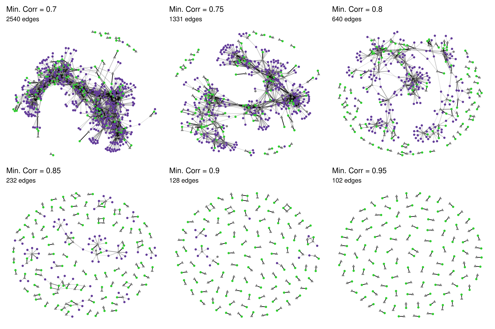{fig-align='center' width=3600}
:::

```{.r .cell-code}
ggsave("test.png", width = 12, height = 8)
```
:::

::: {.cell layout-align="center"}

```{.r .cell-code}
corrs[5:10]
```

::: {.cell-output .cell-output-stdout}
```
 0.7 0.75  0.8 0.85  0.9 0.95 
0.70 0.75 0.80 0.85 0.90 0.95 
```
:::

```{.r .cell-code}
perc_cyano_res <- 
  map(corrs, \(x){
  cor_mat <- 
    cor_res %>%
      unnest(corr_results) %>%
      mutate(cor = ifelse(cor>=x&p<0.01, cor, 0)) %>%
      filter(cor > 0) %>%
      select(ASV, var2, cor) %>%
      left_join(all_asv_ids, by = c("ASV" = "ASV")) %>% 
      ungroup() %>% 
      mutate(is_cyano = ifelse(is.na(Phylum), FALSE, Phylum == "p__Cyanobacteriota")) %>%
      ungroup() %>% 
      group_by(var2) %>%
      summarize(Perc_Cyano = sum(is_cyano) / n()) %>%
      pull(Perc_Cyano)
}) %>%
  bind_rows() %>%
  pivot_longer(everything(), names_to = "Corr", values_to = "Perc_Cyano")
  
perc_cyano_res %>%
  ggplot(aes(y = Corr, x = Perc_Cyano, fill = stat(x))) + 
  ggridges::geom_density_ridges_gradient(scale = 4) + 
  scale_fill_distiller(palette = "PRGn", direction = 1) + 
  labs(x = "Percent Edges to Cyanos", y = "Minimum Edge Strength") + 
  theme(legend.position = "none")
```

::: {.cell-output-display}
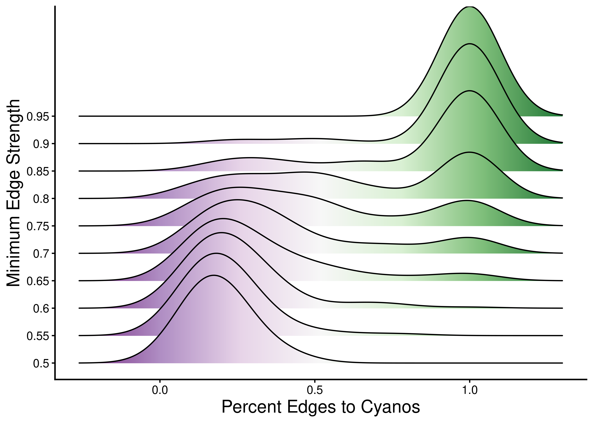{fig-align='center' width=2100}
:::

```{.r .cell-code}
cor_mat <- cor_res %>%
  unnest(corr_results) %>%
  mutate(cor = ifelse(cor>=0.9&p<0.05, cor, 0)) %>%
  select(ASV, var2, cor) %>%
  pivot_wider(names_from = var2, values_from = cor) %>%
  column_to_rownames("ASV") %>%
  as.matrix()


adj_mat <- igraph::graph_from_biadjacency_matrix(cor_mat, weighted=T, directed = FALSE)


abs_melted %>%
  group_by(Genus) %>%
  summarize(total_ab = sum(Abundance)) %>%
  filter(!is.na(Genus)) %>%
  slice_max(n = 10, order_by = total_ab)
```

::: {.cell-output .cell-output-stdout}
```
# A tibble: 10 × 2
   Genus                total_ab
   <chr>                   <dbl>
 1 g__Nanopelagicus     75332910
 2 g__Fonsibacter       20928719
 3 g__Planktophila      13390556
 4 g__BACL27             8628032
 5 g__Cyanobium_A_31525  8400489
 6 g__Pseudanabaena      3923390
 7 g__Sediminibacterium  3257441
 8 g__UBA961             2982669
 9 g__Limnohabitans_A    2932844
10 g__Microcystis        2836943
```
:::

```{.r .cell-code}
graph <- as_tbl_graph(adj_mat) %>%
  left_join(all_asv_ids, by = c("name" = "ASV")) %>%
  left_join(all_asv_abunds, by = c("name" = "ASV")) %>%
    filter(!is.na(Genus)) %>%
  mutate(Centrality = centrality_degree(mode = 'in')) %>%
  filter(Centrality > 0)

set.seed(314)
ggraph(graph, layout = "fr")+ 
    geom_edge_fan(aes(alpha = weight), show.legend = FALSE) + 
    geom_node_point(aes(shape = type, color = ifelse(type, Genus, Phylum), size = Total_Abund)) +
  scale_color_manual(values = c(cyano_genus_colors, phylum_colors))
```

::: {.cell-output-display}
{fig-align='center' width=2100}
:::

```{.r .cell-code}
set.seed(314)
ggraph(graph, layout = "fr")+ 
    geom_edge_fan(aes(alpha = weight), show.legend = FALSE) + 
    geom_node_point(aes(shape = type, color = ifelse(type, NA, Phylum), size = Total_Abund)) +
  scale_color_manual(values = c(cyano_genus_colors, phylum_colors))
```

::: {.cell-output-display}
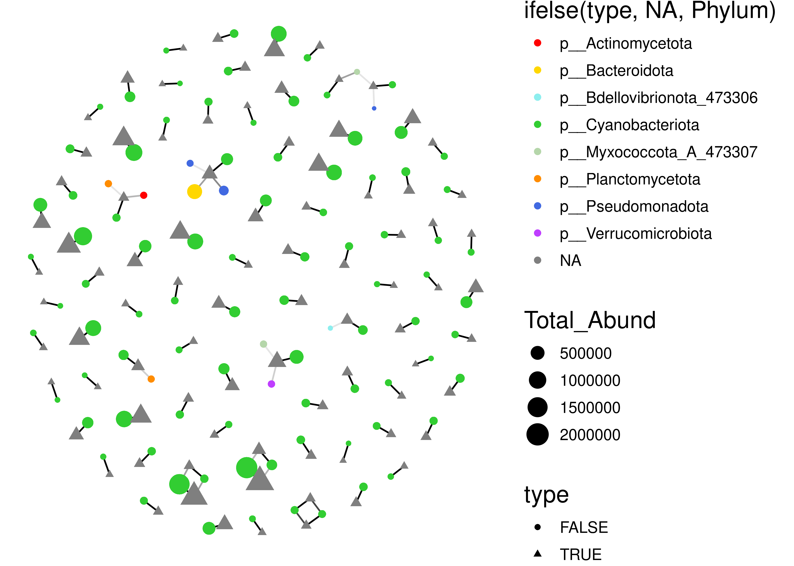{fig-align='center' width=2100}
:::

```{.r .cell-code}
cor_mat <- cor_res %>%
  unnest(corr_results) %>%
  mutate(cor = ifelse(cor>=0.85&p<0.05, cor, 0)) %>%
  select(ASV, var2, cor) %>%
  pivot_wider(names_from = var2, values_from = cor) %>%
  column_to_rownames("ASV") %>%
  as.matrix()


adj_mat <- igraph::graph_from_biadjacency_matrix(cor_mat, weighted=T, directed = FALSE)


all_asv_ids <- abs_physeq %>%
  tax_table() %>%
  data.frame() %>%
  select(ASV, Phylum:Species) %>%
  mutate(Genus = str_remove(Genus, "g__"))

all_asv_abunds <- 
  abs_physeq %>%
  psmelt() %>%
  filter(Depth_Class == "S", DNA_ID != "KH_D076") %>%
  group_by(ASV) %>%
    summarize(Total_Abund = sum(Abundance))

abs_melted %>%
  group_by(Genus) %>%
  summarize(total_ab = sum(Abundance)) %>%
  filter(!is.na(Genus)) %>%
  slice_max(n = 10, order_by = total_ab)
```

::: {.cell-output .cell-output-stdout}
```
# A tibble: 10 × 2
   Genus                total_ab
   <chr>                   <dbl>
 1 g__Nanopelagicus     75332910
 2 g__Fonsibacter       20928719
 3 g__Planktophila      13390556
 4 g__BACL27             8628032
 5 g__Cyanobium_A_31525  8400489
 6 g__Pseudanabaena      3923390
 7 g__Sediminibacterium  3257441
 8 g__UBA961             2982669
 9 g__Limnohabitans_A    2932844
10 g__Microcystis        2836943
```
:::

```{.r .cell-code}
graph <- as_tbl_graph(adj_mat) %>%
  left_join(all_asv_ids, by = c("name" = "ASV")) %>%
  left_join(all_asv_abunds, by = c("name" = "ASV")) %>%
    filter(!is.na(Genus)) %>%
  mutate(Centrality = centrality_degree(mode = 'in')) %>%
  filter(Centrality > 1)

set.seed(314)
ggraph(graph, layout = "fr")+ 
    geom_edge_fan(aes(alpha = weight), show.legend = FALSE) + 
    geom_node_point(aes(shape = type, color = ifelse(type, Genus, Phylum), size = Total_Abund)) +
  scale_color_manual(values = c(cyano_genus_colors, phylum_colors))
```

::: {.cell-output-display}
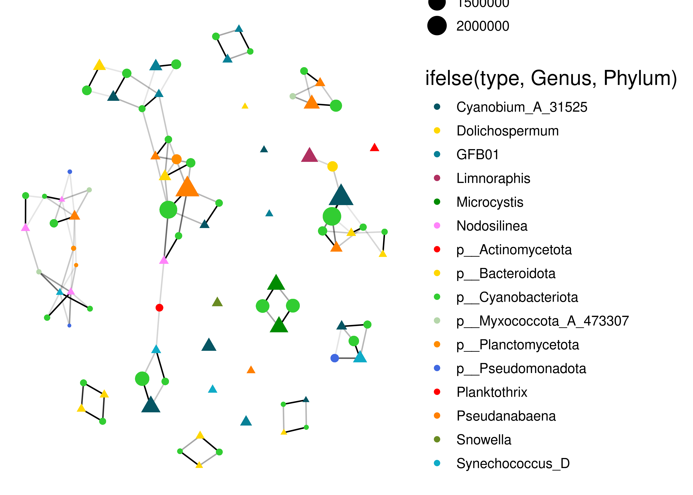{fig-align='center' width=2100}
:::

```{.r .cell-code}
cor_res %>%
  unnest(corr_results) %>%
  mutate(cor = ifelse(cor>=0.90&p<0.05, cor, 0)) %>%
  select(ASV, var2, cor) %>%
  filter(cor > 0, ASV != var2) %>%
  left_join(all_asv_ids) %>%
  left_join(all_asv_ids, by = c("var2" = "ASV")) %>%
  left_join(all_asv_abunds, by = c("ASV" = "ASV")) %>%
  filter(Phylum.x != "p__Cyanobacteriota") %>% arrange(desc(Total_Abund))
```

::: {.cell-output .cell-output-stdout}
```
# A tibble: 17 × 16
# Groups:   ASV [14]
   ASV       var2        cor Phylum.x Class.x Order.x Family.x Genus.x Species.x
   <chr>     <chr>     <dbl> <chr>    <chr>   <chr>   <chr>    <chr>   <chr>    
 1 PROK_52   PROK_110   0.93 p__Bact… c__Bac… o__Chi… f__Chit… Dinghu… <NA>     
 2 PROK_63   PROK_89    0.91 p__Chlo… c__Ana… o__Cal… f__Cald… <NA>    <NA>     
 3 PROK_63   PROK_203   0.9  p__Chlo… c__Ana… o__Cal… f__Cald… <NA>    <NA>     
 4 PROK_177  PROK_110   0.94 p__Pseu… c__Alp… o__Rho… f__Rhod… Cypion… <NA>     
 5 PROK_422  PROK_89    0.91 p__Verr… c__Ver… o__Lim… f__SXTU… SXTU01  <NA>     
 6 PROK_475  PROK_89    0.9  p__Myxo… c__UBA… o__UBA… f__GCA-… REDI01  s__sp007…
 7 PROK_545  PROK_371   0.9  p__Plan… c__Pla… o__Pir… f__UBA1… F1-20-… <NA>     
 8 PROK_893  PROK_341   0.91 p__Plan… c__Pla… o__Pir… f__Pire… Marini… <NA>     
 9 PROK_630  PROK_371   0.92 p__Acti… c__Act… o__Nan… f__Nano… Nanope… <NA>     
10 PROK_630  PROK_469   0.94 p__Acti… c__Act… o__Nan… f__Nano… Nanope… <NA>     
11 PROK_543  PROK_1122  0.93 p__Pseu… c__Gam… o__Bur… f__Burk… <NA>    <NA>     
12 PROK_565  PROK_110   0.9  p__Pseu… c__Gam… o__Bur… f__Burk… Polynu… <NA>     
13 PROK_687  PROK_533   0.9  p__Myxo… c__Bra… o__UBA… f__UBA1… SHZC01  s__sp009…
14 PROK_687  PROK_696   0.93 p__Myxo… c__Bra… o__UBA… f__UBA1… SHZC01  s__sp009…
15 PROK_1459 PROK_89    0.92 p__Pate… c__Pac… o__UBA… <NA>     <NA>    <NA>     
16 PROK_1186 PROK_203   0.9  p__Bdel… c__UBA… o__UBA… f__UBA1… GWA1-5… s__sp001…
17 PROK_1944 PROK_533   0.9  p__Pseu… c__Gam… o__Leg… f__Legi… JAALKW… <NA>     
# ℹ 7 more variables: Phylum.y <chr>, Class.y <chr>, Order.y <chr>,
#   Family.y <chr>, Genus.y <chr>, Species.y <chr>, Total_Abund <dbl>
```
:::

```{.r .cell-code}
cor_res %>%
  unnest(corr_results) %>%
  mutate(cor = ifelse(cor > 0.5&p<0.01, cor, 0)) %>%
  left_join(all_asv_ids) %>%
  left_join(all_asv_ids, by = c("var2" = "ASV")) %>%
  left_join(all_asv_abunds, by = c("ASV" = "ASV")) %>%
  left_join(all_asv_abunds, by = c("var2" = "ASV")) %>%
  rename(Cyano_Abund = Total_Abund.y, Het_Abund = Total_Abund.x) %>%
  filter(cor > 0.5) %>%
  ggplot(aes(x = Cyano_Abund, y = Het_Abund, size = cor, color = Phylum.x)) + 
  geom_point(alpha = 0.5) + 
  scale_x_log10(limits = c(1e5, 1e6)) + 
  scale_y_log10(limits = c(1e5,5e7)) + 
  scale_color_manual(values =phylum_colors)
```

::: {.cell-output-display}
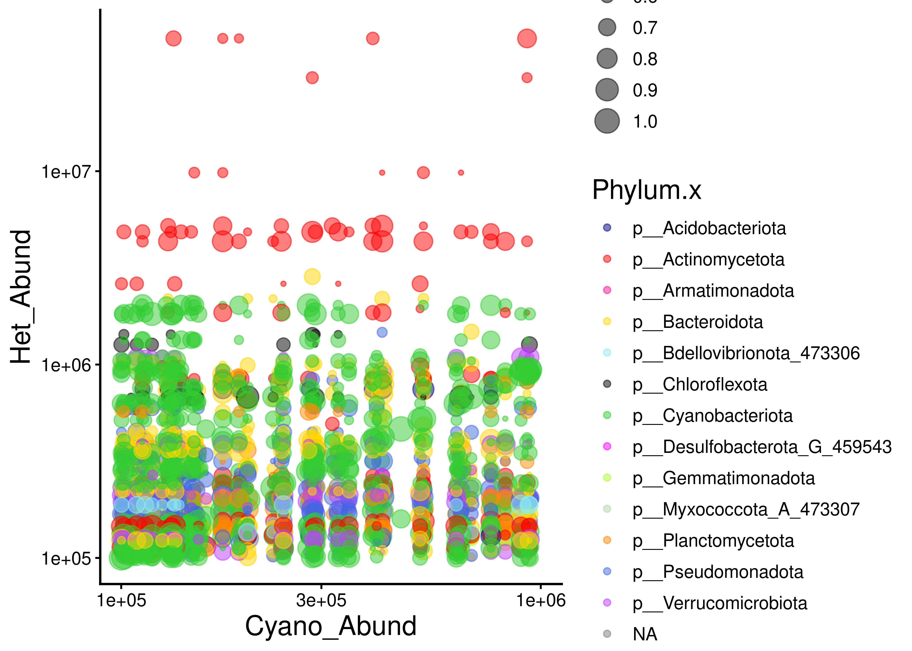{fig-align='center' width=2100}
:::
:::


Cyanobacteria are almost exclusively correlated to...other cyanobacteria. Lol!


::: {.cell layout-align="center"}

```{.r .cell-code}
cor_mat <- 
  cor_res %>%
  unnest(corr_results) %>%
  mutate(cor = ifelse(cor>=0.85&p<0.01, cor, 0)) %>%
  select(ASV, var2, cor) %>%
  pivot_wider(names_from = var2, values_from = cor) %>%
  column_to_rownames("ASV") %>%
  as.matrix()
  
adj_mat <- igraph::graph_from_biadjacency_matrix(cor_mat, weighted=T, directed = FALSE)

number_of_het_asvs <- as_tbl_graph(adj_mat) %>%
  as_tbl_graph(adj_mat) %>%
  left_join(all_asv_ids, by = c("name" = "ASV")) %>%
  left_join(all_asv_abunds, by = c("name" = "ASV")) %>%
  dplyr::filter(
         !((!type)&Phylum == "p__Cyanobacteriota")) %>%
  dplyr::filter(Total_Abund > 5e4) %>%
  dplyr::filter(!type) %>% pull(name) %>% unique() %>% length()

graph <- as_tbl_graph(adj_mat) %>%
  as_tbl_graph(adj_mat) %>%
  left_join(all_asv_ids, by = c("name" = "ASV")) %>%
  left_join(all_asv_abunds, by = c("name" = "ASV")) %>%
  dplyr::filter(
         !((!type)&Phylum == "p__Cyanobacteriota")) %>%
  dplyr::filter(Total_Abund > 5e4) %>%
    mutate(Centrality = centrality_degree(mode = 'out')) %>%
  dplyr::filter(Centrality > 0) %>%
  mutate(Tax_ID = ifelse(!is.na(Genus), Genus,
                         ifelse(!is.na(Family), Family,
                                ifelse(!is.na(Phylum), Phylum, "Unknown"))),
         Genus = ifelse(is.na(Genus),"(Rare/Unknown)", Genus)
         )

graph %>%
  filter(Genus == "Microcystis"|Phylum == "p__Actinomycetota") 
```

::: {.cell-output .cell-output-stdout}
```
# A tbl_graph: 11 nodes and 1 edges
#
# An unrooted forest with 10 trees
#
# Node Data: 11 × 11 (active)
   type  name     Phylum Class Order Family Genus Species Total_Abund Centrality
   <lgl> <chr>    <chr>  <chr> <chr> <chr>  <chr> <chr>         <dbl>      <dbl>
 1 FALSE PROK_146 p__Ac… c__A… o__N… f__Na… Nano… s__hib…      222869          1
 2 FALSE PROK_209 p__Ac… c__A… o__M… f__My… Myco… <NA>         154805          1
 3 FALSE PROK_360 p__Ac… c__A… o__N… f__Na… Nano… s__lim…       93063          1
 4 FALSE PROK_364 p__Ac… c__A… o__N… f__Na… Nano… <NA>          74598          1
 5 FALSE PROK_383 p__Ac… c__A… o__N… f__Na… Nano… <NA>         145994          2
 6 FALSE PROK_396 p__Ac… c__A… o__A… f__Mi… (Rar… <NA>          99094          1
 7 FALSE PROK_427 p__Ac… c__A… o__N… f__Na… IMCC… s__sp0…      113584          2
 8 FALSE PROK_630 p__Ac… c__A… o__N… f__Na… Nano… <NA>          61505          2
 9 FALSE PROK_7   p__Ac… c__A… o__N… f__Na… Nano… s__hib…     5212960          1
10 FALSE PROK_9   p__Ac… c__A… o__A… f__Il… BACL… s__sp0…     4339131          1
11 TRUE  PROK_79  p__Cy… c__C… o__C… f__Mi… Micr… s__aer…      897292          1
# ℹ 1 more variable: Tax_ID <chr>
#
# Edge Data: 1 × 3
   from    to weight
  <int> <int>  <dbl>
1     6    11   0.85
```
:::

```{.r .cell-code}
abs_melted %>%
  filter(ASV == "PROK_396")
```

::: {.cell-output .cell-output-stdout}
```
        OTU  Sample Abundance                    Sample_ID  DNA_ID   input
1  PROK_396 KH_D065     13486  AAM_ERI_20240913_59_FP_ET_1 KH_D065 1141124
2  PROK_396 KH_D078     10364 AAM_ERI_20240913_958_FP_ET_1 KH_D078 1162870
3  PROK_396 KH_D032      8781  AAM_ERI_20240810_59_FP_ET_1 KH_D032  753166
4  PROK_396 KH_D058      8595  AAM_ERI_20240915_22_FP_ET_1 KH_D058  886327
5  PROK_396 KH_D064      8261  AAM_ERI_20240913_58_FP_ET_1 KH_D064  958418
6  PROK_396 KH_D046      5282 AAM_ERI_20240810_964_FP_ET_1 KH_D046  830238
7  PROK_396 KH_D077      4539 AAM_ERI_20240914_951_FP_ET_1 KH_D077 1447403
8  PROK_396 KH_D079      4214 AAM_ERI_20240914_959_FP_ET_1 KH_D079   27310
9  PROK_396 KH_D053      3754 AAM_ERI_20240914_G09_FP_ET_1 KH_D053  898381
10 PROK_396 KH_D067      2997  AAM_ERI_20240913_61_FP_ET_1 KH_D067 1506793
11 PROK_396 KH_D047      2963 AAM_ERI_20240810_966_FP_ET_1 KH_D047  920353
12 PROK_396 KH_D039      2022  AAM_ERI_20240810_91_FP_ET_1 KH_D039 1152387
13 PROK_396 KH_D066      1937  AAM_ERI_20240913_60_FP_ET_1 KH_D066  100755
14 PROK_396 KH_D044      1373 AAM_ERI_20240812_951_FP_ET_1 KH_D044  865770
15 PROK_396 KH_D045      1360 AAM_ERI_20240810_958_FP_ET_1 KH_D045  819384
16 PROK_396 KH_D033      1223  AAM_ERI_20240809_60_FP_ET_1 KH_D033  748707
17 PROK_396 KH_D060       988  AAM_ERI_20240914_38_FP_ET_1 KH_D060  670347
18 PROK_396 KH_D034       895  AAM_ERI_20240809_61_FP_ET_1 KH_D034  773861
19 PROK_396 KH_D054       687  AAM_ERI_20240916_10_FP_ET_1 KH_D054  827718
20 PROK_396 KH_D070       552  AAM_ERI_20240915_78_FP_ET_1 KH_D070  783280
21 PROK_396 KH_D040       525  AAM_ERI_20240813_95_FP_ET_1 KH_D040  518358
22 PROK_396 KH_D041       384 AAM_ERI_20240814_932_FP_ET_1 KH_D041  924883
23 PROK_396 KH_D035       305  AAM_ERI_20240812_73_FP_ET_1 KH_D035 1117026
24 PROK_396 KH_D043       279 AAM_ERI_20240814_937_FP_ET_1 KH_D043  774847
25 PROK_396 KH_D051       241  AAM_ERI_20240916_09_FP_ET_1 KH_D051  803104
26 PROK_396 KH_D042       166 AAM_ERI_20240814_936_FP_ET_1 KH_D042  857888
27 PROK_396 KH_D030       165  AAM_ERI_20240812_43_FP_ET_1 KH_D030  855859
28 PROK_396 KH_D059       165  AAM_ERI_20240915_28_FP_ET_1 KH_D059  948523
29 PROK_396 KH_D075       142 AAM_ERI_20240916_936_FP_ET_1 KH_D075 1546194
30 PROK_396 KH_D063        96  AAM_ERI_20240914_43_FP_BT_1 KH_D063  805429
31 PROK_396 KH_D025         0  AAM_ERI_20240814_15_FP_ET_1 KH_D025  751735
32 PROK_396 KH_D028         0  AAM_ERI_20240812_38_FP_ET_1 KH_D028  789434
33 PROK_396 KH_D056         0  AAM_ERI_20240915_15_FP_ET_1 KH_D056  703368
34 PROK_396 KH_D037         0  AAM_ERI_20240813_78_FP_ET_1 KH_D037 1145100
35 PROK_396 KH_D027         0  AAM_ERI_20240813_28_FP_ET_1 KH_D027  776841
36 PROK_396 KH_D074         0 AAM_ERI_20240916_932_FP_ET_1 KH_D074 1364996
   filtered denoisedF denoisedR merged nochim perc_reads_retained Station_ID
1    752618    745964    746217 734131 661182            57.94129         59
2    762317    757884    758109 747195 672242            57.80887        958
3    495997    490076    490094 480124 439695            58.37956         59
4    578738    576737    576668 570658 514448            58.04269         22
5    627481    623996    623925 616853 569666            59.43816         58
6    531962    525188    526217 515530 474316            57.13012        964
7    949068    944288    944158 931169 855144            59.08126        951
8     18180     17183     16989  15239  12179            44.59539        959
9    604394    601740    601944 595112 553502            61.61105        G09
10   980271    973971    973902 958080 875760            58.12079         61
11   605560    601367    601427 592323 540971            58.77864        966
12   752687    748348    747395 736830 662105            57.45509         91
13    65831     59630     58624  45377  30100            29.87445         60
14   580150    578278    578550 571972 536249            61.93897        951
15   528257    521629    522024 512201 468656            57.19614        958
16   477461    473556    473288 464835 414948            55.42195         60
17   439523    437790    437889 433232 387746            57.84258         38
18   501369    495977    496196 487611 434293            56.12029         61
19   537470    535603    535826 528880 478837            57.85026         10
20   517745    515328    515245 510733 451522            57.64503         78
21   342765    341346    341240 337283 314764            60.72328         95
22   609489    607555    607605 600084 564955            61.08394        932
23   740429    738790    738489 730432 689356            61.71351         73
24   506083    500586    500604 489781 458026            59.11180        937
25   532910    531301    531422 525319 471212            58.67385         09
26   569351    566496    566392 560252 524408            61.12779        936
27   576167    574650    574633 570686 538189            62.88290         43
28   630341    628249    628658 621337 576142            60.74096         28
29  1017458   1012842   1012600 994914 895092            57.89002        936
30   529354    527613    527701 522300 476655            59.18026         43
31   493259    490103    490271 484355 454845            60.50603         15
32   517461    516009    516252 511161 477856            60.53147         38
33   463798    462281    462594 457140 410085            58.30305         15
34   765659    762773    762981 753747 699986            61.12881         78
35   514371    512048    512142 506709 476457            61.33263         28
36   906012    903069    902189 885921 789899            57.86823        932
       Date Depth Station_Name Water_Surface_Temp_C Latitude  Longitude
1  20240913     5        ER 59                21.70 41.72638 -83.150033
2  20240913     5  ECS ER 958n                20.95 41.52537 -81.708483
3  20240810     5        ER 59                24.87 41.72723 -83.150467
4  20240915     5  ECS ER N22n                21.40 42.63333 -80.875533
5  20240913     5        ER 58                21.70 41.68443 -82.933317
6  20240810     5  ECS ER 964n                24.50 41.48383 -82.181217
7  20240914     5  ECS ER 951n                21.40 42.47607  -81.44205
8  20240914     5  ECS ER 959n                22.00 42.18992 -82.186667
9  20240914     5  ECS ER G09n                21.70 41.99442  -82.45015
10 20240913     5        ER 61                21.08 41.94570 -83.045933
11 20240810     5  ECS ER 966n                24.69 41.98432   -82.6265
12 20240810     5       ER 91M                24.58 41.84065 -82.916167
13 20240913     5        ER 60                21.30 41.89052 -83.196533
14 20240812     5  ECS ER 951n                23.47 42.47577   -81.4417
15 20240810     5  ECS ER 958n                24.13 41.52480 -81.707783
16 20240809     5        ER 60                24.52 41.89188 -83.195367
17 20240914     5        ER 38                21.50 42.28197 -81.671867
18 20240809     5        ER 61                24.40 41.94755 -83.043767
19 20240916     5        ER 10                21.20 42.68235   -79.6899
20 20240915     5       ER 78M                20.90 42.11722 -81.250383
21 20240813     5   ECS ER 95B                22.45 42.00025   -80.6666
22 20240814     5  ECS ER 932n                23.08 42.79147   -79.2083
23 20240812     5        ER 73                23.43 41.97665 -81.756867
24 20240814     5  ECS ER 937n                   NA 42.71455  -80.24575
25 20240916     5        ER 09                21.40 42.53750    -79.617
26 20240814     5  ECS ER 936n                23.73 42.47403 -79.407617
27 20240812     5        ER 43                23.05 41.78883 -81.944867
28 20240915     5  ECS ER I28n                22.00 42.18223  -80.15745
29 20240916     5  ECS ER 936n                20.90 42.47438 -79.407433
30 20240914     5        ER 43                21.50 41.78908 -81.944533
31 20240813     5       ER 15M                23.43 42.51670    -79.893
32 20240812     5        ER 38                23.82 42.28238   -81.6715
33 20240915     5       ER 15M                22.00 42.51678 -79.894217
34 20240813     5       ER 78M                23.08 42.11645 -81.249717
35 20240813     5  ECS ER I28n                23.43 42.18030 -80.160017
36 20240916     5  ECS ER 932n                21.40 42.79183 -79.209517
       Month Depth_Class          Rep_ID Basin
1  September           S  September_59_S     W
2  September           S September_958_S     C
3     August           S     August_59_S     W
4  September           S  September_22_S     C
5  September           S  September_58_S     W
6     August           S    August_964_S     C
7  September           S September_951_S     C
8  September           S September_959_S     C
9  September           S September_G09_S     C
10 September           S  September_61_S     W
11    August           S    August_966_S     W
12    August           S     August_91_S     W
13 September           S  September_60_S     W
14    August           S    August_951_S     C
15    August           S    August_958_S     C
16    August           S     August_60_S     W
17 September           S  September_38_S     C
18    August           S     August_61_S     W
19 September           S  September_10_S     E
20 September           S  September_78_S     C
21    August           S     August_95_S     C
22    August           S    August_932_S     E
23    August           S     August_73_S     C
24    August           S    August_937_S     E
25 September           S  September_09_S     E
26    August           S    August_936_S     E
27    August           S     August_43_S     C
28 September           S  September_28_S     C
29 September           S September_936_S     E
30 September           S  September_43_S     C
31    August           S     August_15_S     E
32    August           S     August_38_S     C
33 September           S  September_15_S     E
34    August           S     August_78_S     C
35    August           S     August_28_S     C
36 September           S September_932_S     E
                                                                                                                                                                                                                                                                          Notes
1                                                                                                                                                                  Microcystis potentially observed on filter. NA Integrated sample; discrete depths separated by semi-colon NA
2                                                                                                           Note that the date was missing on the tube, so I added it as it was labelled here in the data log. NA Integrated sample; discrete depths separated by semi-colon NA
3                                                                                            Microcystis observed on filter. Spin column from 178030015_2. NA Integrated sample; discrete depths separated by semi-colon Station pretty turbid! Visible cyanobacterial colonies
4                                                                                                                                                                 did vortex step before incubating PW1 at 65C NA Integrated sample; discrete depths separated by semi-colon NA
5                                                                                                                                                                  Microcystis potentially observed on filter. NA Integrated sample; discrete depths separated by semi-colon NA
6                                                                                                                                                                                                           NA NA Integrated sample; discrete depths separated by semi-colon NA
7                                                                                                                NA NA <1m of Hypolimnion at 19 m but did not sample ; Integrated sample; discrete depths separated by semi-colon <1m of Hypolimnion at 19 m but did not sample
8                                                                                                                                                                                                           NA NA Integrated sample; discrete depths separated by semi-colon NA
9                                                                                                                                              Microcystis potentially observed on filter NA B-2 deeper than 10m. Integrated sample; discrete depths separated by semi-colon NA
10                                                                                                                                   Microcystis potentially observed on filter. Spin column from 178030015_2. NA Integrated sample; discrete depths separated by semi-colon NA
11                                                                                                                                                                               Spin column from 178030015_2. NA Integrated sample; discrete depths separated by semi-colon NA
12                                                                                                                                                                             Microcystis observed on filter. NA Integrated sample; discrete depths separated by semi-colon NA
13                                                                                                                               Microcystis observed on filter. Did vortex step before incubating PW1 at 65C. NA Integrated sample; discrete depths separated by semi-colon NA
14                                                                                                                                                                                                          NA NA Integrated sample; discrete depths separated by semi-colon NA
15                                                                                                                                                                                                          NA NA Integrated sample; discrete depths separated by semi-colon NA
16                   Microcystis observed on filter. Note that the date on the tube is August 10th, not August 9th. NA Integrated sample; discrete depths separated by semi-colon 10 INCHES OF DEAD MUSSELS AND THEN 2 INCHES OF MUD AND ON SURFACE BUNDLES OF JUVENILE MUSSELS
17                                                                                                                                                   did vortex step before incubating PW1 at 65C NA Integrated sample; discrete depths separated by semi-colon MULTIPLE DEPTHS
18                                                                                                                                                      Microcystis observed on filter NA Integrated sample; discrete depths separated by semi-colon 6 ponars and zero mussels!
19                                                                                                                                  Spin column from 178030015_2. NA Integrated sample; discrete depths separated by semi-colon weak thermocline between 9-29 m;MULTIPLE DEPTHS
20                                                                                                                                                   did vortex step before incubating PW1 at 65C NA Integrated sample; discrete depths separated by semi-colon MULTIPLE DEPTHS
21                                                                                                                               Microcystis observed on filter. Did vortex step before incubating PW1 at 65C. NA Integrated sample; discrete depths separated by semi-colon NA
22                                                                                                                                                                                              NA NA Integrated sample; discrete depths separated by semi-colon Not stratified
23                                                                                                          NA NA Integrated sample; discrete depths separated by semi-colon Coleman Lab sampling DCL, Surface, and B-; There were 2 DCLs in the hypolimnion at 22.9m and 21.9m
24 Microcystis potentially observed on filter. NA NOTE Samples were processed hours later because S&M were asleep DO NOT USE FOR RNA; Integrated sample; discrete depths separated by semi-colon Samples were processed hours later because S&M were asleep DO NOT USE FOR RNA;
25                                                                                                                                                                                             NA NA Integrated sample; discrete depths separated by semi-colon MULTIPLE DEPTHS
26                                                                                                                                                NA NA Integrated sample; discrete depths separated by semi-colon Drifted quite a bit and the max depth changed between 7-5.5m
27                                                                                                                                                                               Spin column from 178030015_2. NA Integrated sample; discrete depths separated by semi-colon NA
28                                                                                                                                                                                                          NA NA Integrated sample; discrete depths separated by semi-colon NA
29                                                                                                                                                                                                          NA NA Integrated sample; discrete depths separated by semi-colon NA
30                                                                                                                                                                                                                                                 NA NA BOTTOM MULTIPLE DEPTHS
31                                                        did vortex step before incubating PW1 at 65C Dates coerced to be consistent with station log - not within names but within the "Date_COllected" columns Integrated sample; discrete depths separated by semi-colon NA
32                                                                                                                                                                did vortex step before incubating PW1 at 65C NA Integrated sample; discrete depths separated by semi-colon NA
33                                                                                                                                                                                             NA NA Integrated sample; discrete depths separated by semi-colon MULTIPLE DEPTHS
34                                                                       NA NA Integrated sample; discrete depths separated by semi-colon; Matching depths for surface sample with GLNPO for nutrients Coleman Lab sampling Surface, mid and B-; DCL just above the thermocline
35                                                                                                                                                                                                          NA NA Integrated sample; discrete depths separated by semi-colon NA
36                                                                                                                                                                                                          NA NA Integrated sample; discrete depths separated by semi-colon NA
   Microcystin_Total Anatoxin_Total Toxins_Measured ctd_temperature
1               0.07          0.000             Yes        21.76706
2               0.02          0.003             Yes        21.01095
3               0.29          0.000             Yes        24.88106
4               0.00          0.000             Yes        21.03729
5               0.13          0.000             Yes        21.76932
6               0.03          0.002             Yes        24.55390
7               0.01          0.000             Yes        21.49856
8               0.01          0.007             Yes        22.03487
9               0.07          0.048             Yes        21.71213
10              0.02          0.000             Yes        21.07865
11              0.14          0.000             Yes        24.64542
12              0.07          0.000             Yes        24.59986
13              0.03          0.000             Yes        21.26961
14              0.00          0.003             Yes        23.46413
15              0.00          0.000             Yes        24.26250
16              0.00          0.000             Yes        24.54480
17              0.00          0.000             Yes        21.60689
18              0.08          0.000             Yes        24.41996
19              0.00          0.001             Yes        21.15744
20              0.00          0.000             Yes        20.99053
21              0.00          0.000             Yes        22.59540
22              0.00          0.000             Yes        22.55992
23              0.00          0.000             Yes        23.38103
24              0.00          0.000             Yes        17.01591
25              0.00          0.000             Yes              NA
26              0.00          0.000             Yes        23.22488
27              0.00          0.000             Yes        23.12283
28              0.00          0.000             Yes        21.45025
29              0.00          0.000             Yes        20.97419
30              0.00          0.000             Yes        21.45720
31              0.00          0.000             Yes        23.08416
32              0.00          0.000             Yes        23.48470
33              0.00          0.000             Yes              NA
34              0.00          0.000             Yes        23.12071
35              0.01          0.000             Yes        23.14125
36              0.00          0.000             Yes        21.49833
   ctd_conductivity    ctd_par ctd_beamAttenuation ctd_beamTransmission
1          213.8218  204.61308            5.807386           24.0623289
2          265.2812 4999.06166            2.508349           53.4622618
3          299.5597   10.71339           21.276175            0.5192135
4          246.4704   11.12929            2.221714           57.4261107
5          217.6592 2241.76204            4.033780           36.5371409
6          266.1816  672.18233            4.876406           29.5877790
7          243.7879   10.76015            1.957328           61.3044415
8          234.3709 3062.16377            2.426058           54.5288789
9          226.7465   10.71316            2.792377           50.1426831
10         200.7254   11.26564            2.492218           53.6311323
11         225.9424 5609.50333            2.575705           52.5268955
12         226.5207   11.53610            2.703777           51.0588535
13         207.3419   11.23655            2.237212           57.1660901
14         249.7237   10.85789            2.100948           59.1576723
15         273.4826   10.71970            5.967349           22.5073359
16         217.5640   11.40514            1.956504           61.3200868
17         247.4343   49.69991            1.776066           64.1461660
18         219.1096   11.61045            2.440885           54.3239768
19         249.0907   11.61561            1.850479           62.9644068
20         242.8891   10.87000            1.759356           64.4370072
21         255.5142 5552.73318            1.381937           70.8042061
22         261.8185 4448.76219            1.318732           71.9219802
23         252.7909 6333.48815            1.783255           64.0367041
24         232.7842   10.93066            2.767631           50.0755690
25               NA         NA                  NA                   NA
26         260.7490 9999.00000            1.468273           69.2772034
27         254.3776 6597.52174            1.261317           72.9581436
28         251.8636 9949.78327            1.566905           67.5966716
29         250.3879 1455.59323            1.375360           70.9089432
30         245.6784 8898.87153            1.606970           66.9879675
31         259.5704   11.69799            1.458623           69.4491679
32         254.0188 5895.39756            1.684120           65.6491266
33               NA         NA                  NA                   NA
34         252.2818  186.51968            1.530098           68.2157445
35         255.7325 6369.22163            1.489919           68.9148467
36         252.8948   11.56709            1.511019           68.5403967
   ctd_fluorescence    ctd_spar  ctd_upoly ctd_oxygen ctd_specificConductance
1         2.0913173   81.984485 0.07951791   8.421316                228.5774
2         2.9285503 1420.575894 0.06551867   7.955647                288.2498
3         1.7856339    0.000000 0.05712378   7.343813                300.2373
4         1.6845158    0.000000 0.04016045   8.865010                267.6613
5         2.1435338 1162.061907 0.06894705   8.963354                232.6680
6         1.6702665  317.954606 0.05764306   6.799601                268.5458
7         1.7164055    0.000000 0.04003408   8.737017                262.1239
8         1.6752179  656.723966 0.04008603   8.553320                249.1178
9         3.0784483    0.000000 0.04309544   8.722851                242.6792
10        1.5192103    0.000000 0.05393191   8.478606                217.7836
11        1.8355160 1955.068566 0.05871910   7.780866                227.5284
12        1.7544312    0.000000 0.05894154   7.552330                228.3202
13        1.2610504    0.000000 0.07746667   8.518869                224.0337
14        2.4184223    0.000000 0.05925677   8.279414                257.6102
15        1.9594264    0.000000 0.05856798   7.003213                277.5437
16        2.3408208    0.000000 0.05881830   8.003406                219.5363
17        1.8451412    3.754195 0.04002339   8.262882                265.4186
18        1.7472639    0.000000 0.05826809   7.832125                221.6545
19        2.0401674    0.000000 0.04009123   9.269260                269.7981
20        1.7339410    0.000000 0.04008772   8.053137                264.0353
21        1.5351549 2093.708493 0.03929049   8.469209                268.3940
22        1.0792054 1717.327619 0.05926243   8.160550                275.2219
23        1.6927030 2069.661185 0.05917638   8.370730                261.2207
24        1.4028519    0.000000 0.05925233   8.278006                277.0366
25               NA          NA         NA         NA                      NA
26        0.7428225 2089.986525 0.05746960   8.210479                270.3154
27        1.4588875 1567.022181 0.05790953   7.959450                264.2699
28        1.0123609 1577.897907 0.04000761   8.723122                271.0805
29        0.9303701  105.761059 0.04016987   8.006987                272.2837
30        1.2211717 1569.156714 0.03997219   8.019331                264.3844
31        1.4322630    0.000000 0.05921820   8.389546                269.8815
32        1.7098973 1477.774290 0.05772806   8.389208                261.9288
33               NA          NA         NA         NA                      NA
34        1.6199505   24.810521 0.05785300   8.274415                262.1036
35        1.2383134 1979.966666 0.05914740   8.272523                265.5758
36        1.3807382    0.000000 0.04013637   8.763377                271.9094
   ctd_salinity nh4_ug_n_l n_ox_ug_n_l srp_ug_p_l tn_ug_n_l tp_ug_p_l   k_mg_l
1     1025579.6     11.310    167.5000  0.4000000  392.5000 21.500000 1.108000
2     1862980.4     21.200    105.0000  0.4000000  412.0000 16.000000 1.551000
3     2050998.3         NA    467.0000  0.9303333  991.3333 46.750000 2.063333
4     1540165.8      6.150      0.8800  0.4000000  277.0000 15.600000 1.271000
5     1073393.4     21.500    102.6500  0.4000000  391.5000 19.500000 1.135500
6     1541952.4         NA    110.0000  1.0900000  444.0000 27.250000      NaN
7     1458584.3     25.700      3.2900  0.4000000  280.0000 17.500000 1.251000
8     1278662.4      9.985      3.4050  0.4000000  325.5000 21.750000 1.245000
9     1196194.9     14.900     26.2000  0.4000000  375.0000 19.400000 1.218000
10     906694.2     12.700    194.0000  0.4000000  376.0000  8.630000 0.991000
11    1007384.7         NA    181.0000  0.2500000  583.0000  9.850000      NaN
12    1016649.4         NA    297.0000  0.2500000  540.6667  8.716667 1.280000
13     974807.1     51.300    260.5000  0.4000000  450.5000 11.350000 1.102000
14    1389556.3         NA     38.7000  0.2500000  310.0000  8.400000      NaN
15    1679188.5         NA     86.9000  0.6060000  370.0000 20.050000      NaN
16     919316.7         NA    262.0000  0.2500000  462.3333  6.966667 1.200000
17    1505795.7      6.700      0.8800  0.4000000  242.0000 17.500000 1.312000
18     942485.2         NA    368.3333  0.2500000  631.6667  7.700000 1.275000
19    1571574.2     13.000     24.8000  0.4000000  264.0000  9.870000      NaN
20    1487271.6     12.100      2.0300  0.4000000  276.0000 17.100000 1.352000
21    1546603.3         NA     14.2000  0.2500000  294.0000  5.400000      NaN
22    1649694.5         NA    103.0000  0.2500000  365.0000  4.450000      NaN
23    1440300.6         NA     16.4500  0.2500000  290.5000  8.150000 1.420000
24    1687474.8         NA    117.0000  0.5640000  365.0000  9.200000      NaN
25           NA     16.100     39.2000  0.4000000  288.0000  7.350000 1.254000
26    1573049.9         NA     52.3000  0.2500000  286.0000  5.100000      NaN
27    1484676.2         NA      1.3000  0.2500000  250.0000  7.125000 1.420000
28    1590063.6      9.840     17.5500  0.4000000  248.5000  8.785000 1.296000
29    1609544.2     25.200     45.8500  0.4000000  263.0000  8.170000 1.354500
30    1491168.8     10.900      0.8800  0.4000000  248.0000 18.600000 1.243000
31    1567114.9         NA     24.5000  0.2500000  252.0000  4.800000 1.470000
32    1450014.5         NA      1.4000  0.2500000  252.0000  7.175000 1.460000
33           NA      7.270     33.8000  0.4000000  265.0000  7.680000 1.333000
34    1453729.1         NA      3.9000  0.4135000  259.0000  6.200000 1.410000
35    1503513.4         NA     12.3000  0.2500000  246.0000  5.800000      NaN
36    1602443.4     14.800     29.3000  0.4000000  266.0000  8.620000 1.290000
    na_mg_l  ca_mg_l  mg_mg_l  cl_mg_l so4_mg_l doc_mg_c_l si_mg_si_o2_l
1   5.71000 26.11000  8.01100 10.90685 16.29775     2.4130     2.1985341
2  11.66800 31.12000  8.66400 19.84830 20.36600     2.6750     1.0499830
3  12.23333 33.16667 10.93333 19.90000       NA         NA     1.2513333
4   7.42600 30.54000  8.49800 15.40620 19.22090     2.4420     1.9295425
5   6.61000 26.13000  8.05100 11.79925 17.06510     2.4630     2.1833492
6       NaN      NaN      NaN 16.90000       NA         NA     0.8830000
7   8.28800 29.18000  8.34000 16.09610 20.26400     2.4800     1.4854930
8   7.66100 28.36000  8.40700 14.14340 18.33795     2.5275     1.7544846
9   6.61600 27.36000  8.24800 13.20390 17.45170     2.4050     1.9551608
10  4.83000 25.17000  7.67700  9.16325 15.94380     2.3410     1.7050154
11      NaN      NaN      NaN 10.90000       NA         NA     1.0660000
12  6.55500 27.30000  8.63000 10.90000       NA         NA     0.9720000
13  5.48700 25.80000  7.74300 10.50305 16.78060     2.3285     1.6733601
14      NaN      NaN      NaN 14.60000       NA         NA     0.4860000
15      NaN      NaN      NaN 18.20000       NA         NA     0.7380000
16  6.24500 26.45000  8.31500 10.03333       NA         NA     0.8910000
17  7.71600 29.98000  8.49800 15.14840 18.77690     2.3760     0.9816677
18  6.17000 26.50000  8.33000 10.23333       NA         NA     0.9520000
19      NaN      NaN      NaN 16.28110 19.83470     2.5030     0.6396616
20  7.92800 30.28000  8.47400 15.51450 19.48180     2.4400     1.2838684
21      NaN      NaN      NaN 15.60000       NA         NA     0.3940000
22      NaN      NaN      NaN 16.60000       NA         NA     0.2170000
23  8.95000 31.20000  8.91000 15.25000       NA         NA     0.1915000
24      NaN      NaN      NaN 16.70000       NA         NA     0.4070000
25  8.75400 30.60000  8.48400 16.02590 19.48700     2.4920     0.5017526
26      NaN      NaN      NaN 16.00000       NA         NA     0.1750000
27  8.91000 32.20000  8.97000 14.95000       NA         NA     0.1820000
28  8.70700 31.11000  8.55100 16.23250 19.69095     2.4775     0.5484802
29  8.98900 30.77000  8.44000 17.36855 21.00445     2.9535     0.4720313
30  7.44000 29.44000  8.36200 14.91040 18.57820     2.4090     0.9389706
31  9.54000 32.70000  9.03000 16.05000       NA         NA     0.1215000
32  9.22000 32.10000  9.14000 15.10000       NA         NA     0.1330000
33  9.00400 31.22000  8.41200 16.71160 20.07160     2.4740     0.3158493
34  8.75000 32.10000  8.95000 14.75000       NA         NA     0.2660000
35      NaN      NaN      NaN 15.30000       NA         NA     0.2770000
36  8.08600 30.82000  8.54400 16.83500 20.26910     2.6220     0.3901809
   chl_a_ug_l po_p_ug_p_l po_n_ug_n_l       pH  np_ratio avg_cells_per_ml
1    8.520000       440.0    1880.000       NA  40.42359          5990120
2    7.200000       483.0    2200.000       NA  57.01786          5889550
3   14.636333          NA          NA 8.506667  46.95391         13868770
4    6.360000       317.0    1850.000       NA  39.31777          8851427
5    7.240000       407.5    2095.000       NA  44.45604          6394342
6    5.999000          NA          NA 8.020000  36.07864          6846654
7    5.880000       255.0    1600.000       NA  35.42857          7660713
8    5.840000       445.0    2920.000       NA  33.13793          7164395
9    7.920000       327.0    2710.000       NA  42.80191          6857272
10   3.880000       256.0    1085.000       NA  96.47409          2792541
11   6.483000          NA          NA 8.490000 131.05874          8253721
12   5.303000          NA          NA 8.483333 137.34499          4970325
13   3.567368       275.5     943.500       NA  87.88861          2124998
14   7.255000          NA          NA 8.250000  81.71769          8994778
15   5.991000          NA          NA 8.260000  40.86213          6103045
16   8.525000          NA          NA 8.563333 146.94805          3034676
17   5.800000       283.0    1560.000       NA  30.62041          7737392
18   5.080667          NA          NA 8.556667 181.64811          2770640
19   5.040000       196.0    1430.000       NA  59.22710          5963676
20   7.840000       295.0    1700.000       NA  35.73935          5608259
21   4.907000          NA          NA 8.350000 120.55556          5596721
22   2.589000          NA          NA 8.290000 181.62119          4629713
23   7.265500          NA          NA 8.555000  78.92638          8643343
24   3.472000          NA          NA 8.110000  87.84938          4039972
25   4.560000       177.0    1180.000       NA  86.76385          5597844
26   2.527000          NA          NA 8.480000 124.17367          5301442
27   5.260500          NA          NA 8.510000  77.69424          8765457
28   4.240000       145.5    1156.824       NA  62.63517          5475781
29   2.420000       126.5     598.500       NA  71.27994          4802776
30   5.440000       247.0    1370.000       NA  29.52381          5622961
31   3.998000          NA          NA 8.535000 116.25000          4184957
32   5.896500          NA          NA 8.600000  77.77003          7008179
33   4.840000       165.0    1320.000       NA  76.40439          5798168
34   5.779000          NA          NA 8.545000  92.50000          6925579
35   3.400000          NA          NA 8.610000  93.91626          6932419
36   3.280000       156.0    1190.000       NA  68.32947          5187037
   rsg_total_per_ml rsg_pos_per_ml rsg_perc_pos het_rsg_per_ml het_rsg_perc_pos
1           5137385        2779507    0.5410354        2574152        0.6638939
2           6414936        2926173    0.4563556        2850693        0.4848271
3               NaN            NaN          NaN            NaN              NaN
4           4693527        3490707    0.7501330        3267239        0.8090358
5           6437679        2985247    0.4656643        2824046        0.5140857
6               NaN            NaN          NaN            NaN              NaN
7           5701473        3247034    0.5695413        3030392        0.6066200
8           7040178        4108259    0.5856151        3967869        0.6129421
9           4883334        4111067    0.8509425        3969135        0.9195166
10          2331601        1900223    0.8116524        1788902        0.9384136
11              NaN            NaN          NaN            NaN              NaN
12              NaN            NaN          NaN            NaN              NaN
13          1760606        1259273    0.7157689        1214238        0.8269557
14              NaN            NaN          NaN            NaN              NaN
15              NaN            NaN          NaN            NaN              NaN
16              NaN            NaN          NaN            NaN              NaN
17          4448911        2415648    0.5482480        2186399        0.5702295
18              NaN            NaN          NaN            NaN              NaN
19          4022293        2894847    0.7244351        2772625        0.7865617
20          4340473        2796078    0.6442420        2706834        0.6993589
21              NaN            NaN          NaN            NaN              NaN
22              NaN            NaN          NaN            NaN              NaN
23              NaN            NaN          NaN            NaN              NaN
24              NaN            NaN          NaN            NaN              NaN
25          3601684        2768936    0.7730179        2652440        0.8490471
26              NaN            NaN          NaN            NaN              NaN
27              NaN            NaN          NaN            NaN              NaN
28          4585819        2690923    0.6010608        2576189        0.6391846
29          4351873        1821880    0.4217997        1766935        0.4397736
30          4948139        3106423    0.6449977        3016463        0.6735955
31              NaN            NaN          NaN            NaN              NaN
32              NaN            NaN          NaN            NaN              NaN
33          4090747        2885983    0.7074279        2753356        0.7751650
34              NaN            NaN          NaN            NaN              NaN
35              NaN            NaN          NaN            NaN              NaN
36          5017548        2555543    0.5094982        2425613        0.5320766
    rsg_mfi pig_counts_chl_big pig_counts_chl_small pig_counts_high_chl_high_pe
1  1590.000          19779.760            107113.67                    66222.82
2  1732.250           8401.727             68411.68                    48668.62
3       NaN          53403.350            127887.76                    65228.50
4  1974.125           9629.620            213006.13                   186019.17
5  1593.750          18321.637            145451.97                   113313.20
6       NaN          22088.733             72532.46                    58198.14
7  2037.500           8361.687            200380.18                   175792.28
8  1634.125          11474.797            131731.60                    90984.23
9  1598.250          12482.470            128178.05                    86770.02
10 2048.375           8368.360             59559.50                    32665.97
11      NaN          12866.187            250623.71                   162969.47
12      NaN           7447.440            148728.58                    72038.63
13 2107.750          10050.040             30390.36                    20694.01
14      NaN           7280.607            286326.04                   267747.48
15      NaN          12385.707             72906.17                    62475.75
16      NaN          11638.293             89182.43                    36810.11
17 1880.375           6229.557            187287.10                   165024.86
18      NaN          10744.067             70470.40                    27620.93
19 1685.500           5438.767            118945.49                   110390.28
20 1861.375           3259.923             86262.84                    71084.35
21      NaN           7874.533            128668.54                   126286.16
22      NaN           6332.993            139472.67                   132465.67
23      NaN           9516.173            233239.67                   221441.22
24      NaN           5605.600             93733.64                    82001.92
25 1739.750           4154.150            115785.67                   108021.25
26      NaN           4477.807             98898.80                    98698.60
27      NaN           6159.487            196803.27                   191898.37
28 1862.250           5532.193            106189.42                   102268.83
29 1568.500           2866.197             56029.31                    51044.33
30 1847.500           4204.200             78551.81                    71651.58
31      NaN           6026.020            141921.78                   138064.59
32      NaN           9716.373            222041.82                   210216.67
33 1729.250           6383.043            135638.84                   131478.01
34      NaN           9009.000            268121.19                   252919.33
35      NaN          12499.153            126946.82                   140026.55
36 1623.250           5458.787            161631.47                   159903.08
   pig_counts_high_chl_no_pe pig_counts_low_chl_no_pe pig_counts_no_chl_low_pe
1                   5595.590                79676.263                 3703.700
2                   7384.043                33289.923                 7257.250
3                  18615.263               150854.037                11451.440
4                   7741.067                51244.527                 7347.340
5                   8154.813                75295.220               107107.000
6                   9069.060                44357.647                10503.827
7                   6423.083                46339.627                12022.010
8                  10116.773                58058.000                 7524.183
9                  10790.780                57737.680                 7504.163
10                  6002.663                40073.367                 5195.190
11                 12579.233               123803.680                55909.187
12                 12205.527                90463.707                 6773.433
13                  4748.077                22899.543                14744.730
14                  7347.340                47827.780               137283.813
15                  5305.300                32465.767                14187.507
16                 11424.747                68294.893                 7434.093
17                  5849.177                45588.877                 8431.757
18                  9703.027                55522.133                 7887.880
19                  5118.447                21301.280                 7847.840
20                  6526.520                19329.310                 7557.550
21                  5472.133                16436.420                13913.900
22                  5618.947                16603.253                 6299.627
23                  6072.733                31431.400                 8862.187
24                  5505.500                19693.007                 8715.373
25                  4354.350                17297.280                 6389.717
26                  3737.067                 6673.333                 8481.807
27                  5158.487                19866.513               107754.313
28                  4280.943                11731.720                 6162.823
29                  2679.343                 9953.277                 3463.460
30                  3760.423                14674.660                 6553.213
31                  5165.160                15355.340                10530.520
32                  9242.567                24964.940                10764.087
33                  5949.277                14954.940                 7580.907
34                  7841.167                31271.240                10450.440
35                  5291.953                11137.793               358384.693
36                  5525.520                15041.693                 5809.137
   total_chl_counts Richness   Shannon   Simpson     Kingdom            Phylum
1         126893.43   818.82  91.78104 23.511612 d__Bacteria p__Actinomycetota
2          76813.40   866.45  70.54887 13.831345 d__Bacteria p__Actinomycetota
3         181291.11  1142.27 154.35581 31.600931 d__Bacteria p__Actinomycetota
4         222635.75   747.17  87.55574 20.282831 d__Bacteria p__Actinomycetota
5         163773.61   717.27  79.97052 19.298360 d__Bacteria p__Actinomycetota
6          94621.19  1242.55 146.83169 27.192791 d__Bacteria p__Actinomycetota
7         208741.87  1003.99 109.86586 19.300189 d__Bacteria p__Actinomycetota
8         143206.40   220.00  42.36131 12.087040 d__Bacteria p__Actinomycetota
9         140660.52   777.07  66.24358 13.569881 d__Bacteria p__Actinomycetota
10         67927.86   709.64  68.15254 17.672418 d__Bacteria p__Actinomycetota
11        263489.89   616.59  46.63318 12.003958 d__Bacteria p__Actinomycetota
12        156176.02   649.99  52.39285 13.065259 d__Bacteria p__Actinomycetota
13         40440.40   205.15  18.92116  5.847497 d__Bacteria p__Actinomycetota
14        293606.65   573.28  41.91412 10.376392 d__Bacteria p__Actinomycetota
15         85291.87  1036.85 125.43324 27.508395 d__Bacteria p__Actinomycetota
16        100820.72   753.19  80.83279 15.803926 d__Bacteria p__Actinomycetota
17        193516.66   695.48  78.18681 19.041189 d__Bacteria p__Actinomycetota
18         81214.47   870.59 118.85802 24.061906 d__Bacteria p__Actinomycetota
19        124384.26   588.88  41.97127 10.276476 d__Bacteria p__Actinomycetota
20         89522.77   829.90 121.79970 28.196621 d__Bacteria p__Actinomycetota
21        136543.07   501.32  44.10207 12.418854 d__Bacteria p__Actinomycetota
22        145805.66   443.90  32.63899  9.499155 d__Bacteria p__Actinomycetota
23        242755.85   517.78  49.18037 13.256160 d__Bacteria p__Actinomycetota
24         99339.24  1035.05  86.29731 16.019705 d__Bacteria p__Actinomycetota
25        119939.82   604.23  53.42097 14.381598 d__Bacteria p__Actinomycetota
26        103376.61   495.71  34.30781  9.119510 d__Bacteria p__Actinomycetota
27        202962.76   443.41  30.69998  8.987840 d__Bacteria p__Actinomycetota
28        111721.61   529.15  33.45398  9.072467 d__Bacteria p__Actinomycetota
29         58895.50   499.54  37.90243 10.645062 d__Bacteria p__Actinomycetota
30         82756.01   631.24  56.38208 13.236912 d__Bacteria p__Actinomycetota
31        147947.80   556.39  61.53370 19.553234 d__Bacteria p__Actinomycetota
32        231758.19   482.19  46.51723 11.958806 d__Bacteria p__Actinomycetota
33        142021.88   460.08  36.41357 10.798683 d__Bacteria p__Actinomycetota
34        277130.19   551.72  52.99041 13.784362 d__Bacteria p__Actinomycetota
35        139445.97   426.14  29.80433  8.943186 d__Bacteria p__Actinomycetota
36        167090.26   504.55  38.80654 10.977010 d__Bacteria p__Actinomycetota
              Class              Order               Family Genus Species
1  c__Actinomycetes o__Actinomycetales f__Microbacteriaceae  <NA>    <NA>
2  c__Actinomycetes o__Actinomycetales f__Microbacteriaceae  <NA>    <NA>
3  c__Actinomycetes o__Actinomycetales f__Microbacteriaceae  <NA>    <NA>
4  c__Actinomycetes o__Actinomycetales f__Microbacteriaceae  <NA>    <NA>
5  c__Actinomycetes o__Actinomycetales f__Microbacteriaceae  <NA>    <NA>
6  c__Actinomycetes o__Actinomycetales f__Microbacteriaceae  <NA>    <NA>
7  c__Actinomycetes o__Actinomycetales f__Microbacteriaceae  <NA>    <NA>
8  c__Actinomycetes o__Actinomycetales f__Microbacteriaceae  <NA>    <NA>
9  c__Actinomycetes o__Actinomycetales f__Microbacteriaceae  <NA>    <NA>
10 c__Actinomycetes o__Actinomycetales f__Microbacteriaceae  <NA>    <NA>
11 c__Actinomycetes o__Actinomycetales f__Microbacteriaceae  <NA>    <NA>
12 c__Actinomycetes o__Actinomycetales f__Microbacteriaceae  <NA>    <NA>
13 c__Actinomycetes o__Actinomycetales f__Microbacteriaceae  <NA>    <NA>
14 c__Actinomycetes o__Actinomycetales f__Microbacteriaceae  <NA>    <NA>
15 c__Actinomycetes o__Actinomycetales f__Microbacteriaceae  <NA>    <NA>
16 c__Actinomycetes o__Actinomycetales f__Microbacteriaceae  <NA>    <NA>
17 c__Actinomycetes o__Actinomycetales f__Microbacteriaceae  <NA>    <NA>
18 c__Actinomycetes o__Actinomycetales f__Microbacteriaceae  <NA>    <NA>
19 c__Actinomycetes o__Actinomycetales f__Microbacteriaceae  <NA>    <NA>
20 c__Actinomycetes o__Actinomycetales f__Microbacteriaceae  <NA>    <NA>
21 c__Actinomycetes o__Actinomycetales f__Microbacteriaceae  <NA>    <NA>
22 c__Actinomycetes o__Actinomycetales f__Microbacteriaceae  <NA>    <NA>
23 c__Actinomycetes o__Actinomycetales f__Microbacteriaceae  <NA>    <NA>
24 c__Actinomycetes o__Actinomycetales f__Microbacteriaceae  <NA>    <NA>
25 c__Actinomycetes o__Actinomycetales f__Microbacteriaceae  <NA>    <NA>
26 c__Actinomycetes o__Actinomycetales f__Microbacteriaceae  <NA>    <NA>
27 c__Actinomycetes o__Actinomycetales f__Microbacteriaceae  <NA>    <NA>
28 c__Actinomycetes o__Actinomycetales f__Microbacteriaceae  <NA>    <NA>
29 c__Actinomycetes o__Actinomycetales f__Microbacteriaceae  <NA>    <NA>
30 c__Actinomycetes o__Actinomycetales f__Microbacteriaceae  <NA>    <NA>
31 c__Actinomycetes o__Actinomycetales f__Microbacteriaceae  <NA>    <NA>
32 c__Actinomycetes o__Actinomycetales f__Microbacteriaceae  <NA>    <NA>
33 c__Actinomycetes o__Actinomycetales f__Microbacteriaceae  <NA>    <NA>
34 c__Actinomycetes o__Actinomycetales f__Microbacteriaceae  <NA>    <NA>
35 c__Actinomycetes o__Actinomycetales f__Microbacteriaceae  <NA>    <NA>
36 c__Actinomycetes o__Actinomycetales f__Microbacteriaceae  <NA>    <NA>
        ASV
1  PROK_396
2  PROK_396
3  PROK_396
4  PROK_396
5  PROK_396
6  PROK_396
7  PROK_396
8  PROK_396
9  PROK_396
10 PROK_396
11 PROK_396
12 PROK_396
13 PROK_396
14 PROK_396
15 PROK_396
16 PROK_396
17 PROK_396
18 PROK_396
19 PROK_396
20 PROK_396
21 PROK_396
22 PROK_396
23 PROK_396
24 PROK_396
25 PROK_396
26 PROK_396
27 PROK_396
28 PROK_396
29 PROK_396
30 PROK_396
31 PROK_396
32 PROK_396
33 PROK_396
34 PROK_396
35 PROK_396
36 PROK_396
                                                                                                                                                                                                                                                                                                                                                                                   ASVseqs
1  TACGTAGGGTGCAAGCGTTATCCGGAATTATTGGGCGTAAAGAGCTCGTAGGCGGTTTGTCGCGTCTGCTGTGAAAATCTGAGGCTCAACCTCGGACTTGCAGTGGGTACGGGCAGACTAGAGTGCGGTAGGGGAGAAGGGAATTCCTGGTGTAGCGGTGGAATGCGCAGATATCAGGAGGAACACCAATGGCGAAGGCACTTCTCTGGGCCGTAACTGACGCTGAGGAGCGAAAGCGTGGGGAGCGAACAGGATTAGATACCCTGGTAGTCCACGCCGTAAACGTTGGGCGCTAGATGTGGGTCACATTCCACGTGATCCGTGTCGCAGCTAACGCATTAAGCGCCCCGCCTGGGGAGTACGGCCGCAAGGCTA
2  TACGTAGGGTGCAAGCGTTATCCGGAATTATTGGGCGTAAAGAGCTCGTAGGCGGTTTGTCGCGTCTGCTGTGAAAATCTGAGGCTCAACCTCGGACTTGCAGTGGGTACGGGCAGACTAGAGTGCGGTAGGGGAGAAGGGAATTCCTGGTGTAGCGGTGGAATGCGCAGATATCAGGAGGAACACCAATGGCGAAGGCACTTCTCTGGGCCGTAACTGACGCTGAGGAGCGAAAGCGTGGGGAGCGAACAGGATTAGATACCCTGGTAGTCCACGCCGTAAACGTTGGGCGCTAGATGTGGGTCACATTCCACGTGATCCGTGTCGCAGCTAACGCATTAAGCGCCCCGCCTGGGGAGTACGGCCGCAAGGCTA
3  TACGTAGGGTGCAAGCGTTATCCGGAATTATTGGGCGTAAAGAGCTCGTAGGCGGTTTGTCGCGTCTGCTGTGAAAATCTGAGGCTCAACCTCGGACTTGCAGTGGGTACGGGCAGACTAGAGTGCGGTAGGGGAGAAGGGAATTCCTGGTGTAGCGGTGGAATGCGCAGATATCAGGAGGAACACCAATGGCGAAGGCACTTCTCTGGGCCGTAACTGACGCTGAGGAGCGAAAGCGTGGGGAGCGAACAGGATTAGATACCCTGGTAGTCCACGCCGTAAACGTTGGGCGCTAGATGTGGGTCACATTCCACGTGATCCGTGTCGCAGCTAACGCATTAAGCGCCCCGCCTGGGGAGTACGGCCGCAAGGCTA
4  TACGTAGGGTGCAAGCGTTATCCGGAATTATTGGGCGTAAAGAGCTCGTAGGCGGTTTGTCGCGTCTGCTGTGAAAATCTGAGGCTCAACCTCGGACTTGCAGTGGGTACGGGCAGACTAGAGTGCGGTAGGGGAGAAGGGAATTCCTGGTGTAGCGGTGGAATGCGCAGATATCAGGAGGAACACCAATGGCGAAGGCACTTCTCTGGGCCGTAACTGACGCTGAGGAGCGAAAGCGTGGGGAGCGAACAGGATTAGATACCCTGGTAGTCCACGCCGTAAACGTTGGGCGCTAGATGTGGGTCACATTCCACGTGATCCGTGTCGCAGCTAACGCATTAAGCGCCCCGCCTGGGGAGTACGGCCGCAAGGCTA
5  TACGTAGGGTGCAAGCGTTATCCGGAATTATTGGGCGTAAAGAGCTCGTAGGCGGTTTGTCGCGTCTGCTGTGAAAATCTGAGGCTCAACCTCGGACTTGCAGTGGGTACGGGCAGACTAGAGTGCGGTAGGGGAGAAGGGAATTCCTGGTGTAGCGGTGGAATGCGCAGATATCAGGAGGAACACCAATGGCGAAGGCACTTCTCTGGGCCGTAACTGACGCTGAGGAGCGAAAGCGTGGGGAGCGAACAGGATTAGATACCCTGGTAGTCCACGCCGTAAACGTTGGGCGCTAGATGTGGGTCACATTCCACGTGATCCGTGTCGCAGCTAACGCATTAAGCGCCCCGCCTGGGGAGTACGGCCGCAAGGCTA
6  TACGTAGGGTGCAAGCGTTATCCGGAATTATTGGGCGTAAAGAGCTCGTAGGCGGTTTGTCGCGTCTGCTGTGAAAATCTGAGGCTCAACCTCGGACTTGCAGTGGGTACGGGCAGACTAGAGTGCGGTAGGGGAGAAGGGAATTCCTGGTGTAGCGGTGGAATGCGCAGATATCAGGAGGAACACCAATGGCGAAGGCACTTCTCTGGGCCGTAACTGACGCTGAGGAGCGAAAGCGTGGGGAGCGAACAGGATTAGATACCCTGGTAGTCCACGCCGTAAACGTTGGGCGCTAGATGTGGGTCACATTCCACGTGATCCGTGTCGCAGCTAACGCATTAAGCGCCCCGCCTGGGGAGTACGGCCGCAAGGCTA
7  TACGTAGGGTGCAAGCGTTATCCGGAATTATTGGGCGTAAAGAGCTCGTAGGCGGTTTGTCGCGTCTGCTGTGAAAATCTGAGGCTCAACCTCGGACTTGCAGTGGGTACGGGCAGACTAGAGTGCGGTAGGGGAGAAGGGAATTCCTGGTGTAGCGGTGGAATGCGCAGATATCAGGAGGAACACCAATGGCGAAGGCACTTCTCTGGGCCGTAACTGACGCTGAGGAGCGAAAGCGTGGGGAGCGAACAGGATTAGATACCCTGGTAGTCCACGCCGTAAACGTTGGGCGCTAGATGTGGGTCACATTCCACGTGATCCGTGTCGCAGCTAACGCATTAAGCGCCCCGCCTGGGGAGTACGGCCGCAAGGCTA
8  TACGTAGGGTGCAAGCGTTATCCGGAATTATTGGGCGTAAAGAGCTCGTAGGCGGTTTGTCGCGTCTGCTGTGAAAATCTGAGGCTCAACCTCGGACTTGCAGTGGGTACGGGCAGACTAGAGTGCGGTAGGGGAGAAGGGAATTCCTGGTGTAGCGGTGGAATGCGCAGATATCAGGAGGAACACCAATGGCGAAGGCACTTCTCTGGGCCGTAACTGACGCTGAGGAGCGAAAGCGTGGGGAGCGAACAGGATTAGATACCCTGGTAGTCCACGCCGTAAACGTTGGGCGCTAGATGTGGGTCACATTCCACGTGATCCGTGTCGCAGCTAACGCATTAAGCGCCCCGCCTGGGGAGTACGGCCGCAAGGCTA
9  TACGTAGGGTGCAAGCGTTATCCGGAATTATTGGGCGTAAAGAGCTCGTAGGCGGTTTGTCGCGTCTGCTGTGAAAATCTGAGGCTCAACCTCGGACTTGCAGTGGGTACGGGCAGACTAGAGTGCGGTAGGGGAGAAGGGAATTCCTGGTGTAGCGGTGGAATGCGCAGATATCAGGAGGAACACCAATGGCGAAGGCACTTCTCTGGGCCGTAACTGACGCTGAGGAGCGAAAGCGTGGGGAGCGAACAGGATTAGATACCCTGGTAGTCCACGCCGTAAACGTTGGGCGCTAGATGTGGGTCACATTCCACGTGATCCGTGTCGCAGCTAACGCATTAAGCGCCCCGCCTGGGGAGTACGGCCGCAAGGCTA
10 TACGTAGGGTGCAAGCGTTATCCGGAATTATTGGGCGTAAAGAGCTCGTAGGCGGTTTGTCGCGTCTGCTGTGAAAATCTGAGGCTCAACCTCGGACTTGCAGTGGGTACGGGCAGACTAGAGTGCGGTAGGGGAGAAGGGAATTCCTGGTGTAGCGGTGGAATGCGCAGATATCAGGAGGAACACCAATGGCGAAGGCACTTCTCTGGGCCGTAACTGACGCTGAGGAGCGAAAGCGTGGGGAGCGAACAGGATTAGATACCCTGGTAGTCCACGCCGTAAACGTTGGGCGCTAGATGTGGGTCACATTCCACGTGATCCGTGTCGCAGCTAACGCATTAAGCGCCCCGCCTGGGGAGTACGGCCGCAAGGCTA
11 TACGTAGGGTGCAAGCGTTATCCGGAATTATTGGGCGTAAAGAGCTCGTAGGCGGTTTGTCGCGTCTGCTGTGAAAATCTGAGGCTCAACCTCGGACTTGCAGTGGGTACGGGCAGACTAGAGTGCGGTAGGGGAGAAGGGAATTCCTGGTGTAGCGGTGGAATGCGCAGATATCAGGAGGAACACCAATGGCGAAGGCACTTCTCTGGGCCGTAACTGACGCTGAGGAGCGAAAGCGTGGGGAGCGAACAGGATTAGATACCCTGGTAGTCCACGCCGTAAACGTTGGGCGCTAGATGTGGGTCACATTCCACGTGATCCGTGTCGCAGCTAACGCATTAAGCGCCCCGCCTGGGGAGTACGGCCGCAAGGCTA
12 TACGTAGGGTGCAAGCGTTATCCGGAATTATTGGGCGTAAAGAGCTCGTAGGCGGTTTGTCGCGTCTGCTGTGAAAATCTGAGGCTCAACCTCGGACTTGCAGTGGGTACGGGCAGACTAGAGTGCGGTAGGGGAGAAGGGAATTCCTGGTGTAGCGGTGGAATGCGCAGATATCAGGAGGAACACCAATGGCGAAGGCACTTCTCTGGGCCGTAACTGACGCTGAGGAGCGAAAGCGTGGGGAGCGAACAGGATTAGATACCCTGGTAGTCCACGCCGTAAACGTTGGGCGCTAGATGTGGGTCACATTCCACGTGATCCGTGTCGCAGCTAACGCATTAAGCGCCCCGCCTGGGGAGTACGGCCGCAAGGCTA
13 TACGTAGGGTGCAAGCGTTATCCGGAATTATTGGGCGTAAAGAGCTCGTAGGCGGTTTGTCGCGTCTGCTGTGAAAATCTGAGGCTCAACCTCGGACTTGCAGTGGGTACGGGCAGACTAGAGTGCGGTAGGGGAGAAGGGAATTCCTGGTGTAGCGGTGGAATGCGCAGATATCAGGAGGAACACCAATGGCGAAGGCACTTCTCTGGGCCGTAACTGACGCTGAGGAGCGAAAGCGTGGGGAGCGAACAGGATTAGATACCCTGGTAGTCCACGCCGTAAACGTTGGGCGCTAGATGTGGGTCACATTCCACGTGATCCGTGTCGCAGCTAACGCATTAAGCGCCCCGCCTGGGGAGTACGGCCGCAAGGCTA
14 TACGTAGGGTGCAAGCGTTATCCGGAATTATTGGGCGTAAAGAGCTCGTAGGCGGTTTGTCGCGTCTGCTGTGAAAATCTGAGGCTCAACCTCGGACTTGCAGTGGGTACGGGCAGACTAGAGTGCGGTAGGGGAGAAGGGAATTCCTGGTGTAGCGGTGGAATGCGCAGATATCAGGAGGAACACCAATGGCGAAGGCACTTCTCTGGGCCGTAACTGACGCTGAGGAGCGAAAGCGTGGGGAGCGAACAGGATTAGATACCCTGGTAGTCCACGCCGTAAACGTTGGGCGCTAGATGTGGGTCACATTCCACGTGATCCGTGTCGCAGCTAACGCATTAAGCGCCCCGCCTGGGGAGTACGGCCGCAAGGCTA
15 TACGTAGGGTGCAAGCGTTATCCGGAATTATTGGGCGTAAAGAGCTCGTAGGCGGTTTGTCGCGTCTGCTGTGAAAATCTGAGGCTCAACCTCGGACTTGCAGTGGGTACGGGCAGACTAGAGTGCGGTAGGGGAGAAGGGAATTCCTGGTGTAGCGGTGGAATGCGCAGATATCAGGAGGAACACCAATGGCGAAGGCACTTCTCTGGGCCGTAACTGACGCTGAGGAGCGAAAGCGTGGGGAGCGAACAGGATTAGATACCCTGGTAGTCCACGCCGTAAACGTTGGGCGCTAGATGTGGGTCACATTCCACGTGATCCGTGTCGCAGCTAACGCATTAAGCGCCCCGCCTGGGGAGTACGGCCGCAAGGCTA
16 TACGTAGGGTGCAAGCGTTATCCGGAATTATTGGGCGTAAAGAGCTCGTAGGCGGTTTGTCGCGTCTGCTGTGAAAATCTGAGGCTCAACCTCGGACTTGCAGTGGGTACGGGCAGACTAGAGTGCGGTAGGGGAGAAGGGAATTCCTGGTGTAGCGGTGGAATGCGCAGATATCAGGAGGAACACCAATGGCGAAGGCACTTCTCTGGGCCGTAACTGACGCTGAGGAGCGAAAGCGTGGGGAGCGAACAGGATTAGATACCCTGGTAGTCCACGCCGTAAACGTTGGGCGCTAGATGTGGGTCACATTCCACGTGATCCGTGTCGCAGCTAACGCATTAAGCGCCCCGCCTGGGGAGTACGGCCGCAAGGCTA
17 TACGTAGGGTGCAAGCGTTATCCGGAATTATTGGGCGTAAAGAGCTCGTAGGCGGTTTGTCGCGTCTGCTGTGAAAATCTGAGGCTCAACCTCGGACTTGCAGTGGGTACGGGCAGACTAGAGTGCGGTAGGGGAGAAGGGAATTCCTGGTGTAGCGGTGGAATGCGCAGATATCAGGAGGAACACCAATGGCGAAGGCACTTCTCTGGGCCGTAACTGACGCTGAGGAGCGAAAGCGTGGGGAGCGAACAGGATTAGATACCCTGGTAGTCCACGCCGTAAACGTTGGGCGCTAGATGTGGGTCACATTCCACGTGATCCGTGTCGCAGCTAACGCATTAAGCGCCCCGCCTGGGGAGTACGGCCGCAAGGCTA
18 TACGTAGGGTGCAAGCGTTATCCGGAATTATTGGGCGTAAAGAGCTCGTAGGCGGTTTGTCGCGTCTGCTGTGAAAATCTGAGGCTCAACCTCGGACTTGCAGTGGGTACGGGCAGACTAGAGTGCGGTAGGGGAGAAGGGAATTCCTGGTGTAGCGGTGGAATGCGCAGATATCAGGAGGAACACCAATGGCGAAGGCACTTCTCTGGGCCGTAACTGACGCTGAGGAGCGAAAGCGTGGGGAGCGAACAGGATTAGATACCCTGGTAGTCCACGCCGTAAACGTTGGGCGCTAGATGTGGGTCACATTCCACGTGATCCGTGTCGCAGCTAACGCATTAAGCGCCCCGCCTGGGGAGTACGGCCGCAAGGCTA
19 TACGTAGGGTGCAAGCGTTATCCGGAATTATTGGGCGTAAAGAGCTCGTAGGCGGTTTGTCGCGTCTGCTGTGAAAATCTGAGGCTCAACCTCGGACTTGCAGTGGGTACGGGCAGACTAGAGTGCGGTAGGGGAGAAGGGAATTCCTGGTGTAGCGGTGGAATGCGCAGATATCAGGAGGAACACCAATGGCGAAGGCACTTCTCTGGGCCGTAACTGACGCTGAGGAGCGAAAGCGTGGGGAGCGAACAGGATTAGATACCCTGGTAGTCCACGCCGTAAACGTTGGGCGCTAGATGTGGGTCACATTCCACGTGATCCGTGTCGCAGCTAACGCATTAAGCGCCCCGCCTGGGGAGTACGGCCGCAAGGCTA
20 TACGTAGGGTGCAAGCGTTATCCGGAATTATTGGGCGTAAAGAGCTCGTAGGCGGTTTGTCGCGTCTGCTGTGAAAATCTGAGGCTCAACCTCGGACTTGCAGTGGGTACGGGCAGACTAGAGTGCGGTAGGGGAGAAGGGAATTCCTGGTGTAGCGGTGGAATGCGCAGATATCAGGAGGAACACCAATGGCGAAGGCACTTCTCTGGGCCGTAACTGACGCTGAGGAGCGAAAGCGTGGGGAGCGAACAGGATTAGATACCCTGGTAGTCCACGCCGTAAACGTTGGGCGCTAGATGTGGGTCACATTCCACGTGATCCGTGTCGCAGCTAACGCATTAAGCGCCCCGCCTGGGGAGTACGGCCGCAAGGCTA
21 TACGTAGGGTGCAAGCGTTATCCGGAATTATTGGGCGTAAAGAGCTCGTAGGCGGTTTGTCGCGTCTGCTGTGAAAATCTGAGGCTCAACCTCGGACTTGCAGTGGGTACGGGCAGACTAGAGTGCGGTAGGGGAGAAGGGAATTCCTGGTGTAGCGGTGGAATGCGCAGATATCAGGAGGAACACCAATGGCGAAGGCACTTCTCTGGGCCGTAACTGACGCTGAGGAGCGAAAGCGTGGGGAGCGAACAGGATTAGATACCCTGGTAGTCCACGCCGTAAACGTTGGGCGCTAGATGTGGGTCACATTCCACGTGATCCGTGTCGCAGCTAACGCATTAAGCGCCCCGCCTGGGGAGTACGGCCGCAAGGCTA
22 TACGTAGGGTGCAAGCGTTATCCGGAATTATTGGGCGTAAAGAGCTCGTAGGCGGTTTGTCGCGTCTGCTGTGAAAATCTGAGGCTCAACCTCGGACTTGCAGTGGGTACGGGCAGACTAGAGTGCGGTAGGGGAGAAGGGAATTCCTGGTGTAGCGGTGGAATGCGCAGATATCAGGAGGAACACCAATGGCGAAGGCACTTCTCTGGGCCGTAACTGACGCTGAGGAGCGAAAGCGTGGGGAGCGAACAGGATTAGATACCCTGGTAGTCCACGCCGTAAACGTTGGGCGCTAGATGTGGGTCACATTCCACGTGATCCGTGTCGCAGCTAACGCATTAAGCGCCCCGCCTGGGGAGTACGGCCGCAAGGCTA
23 TACGTAGGGTGCAAGCGTTATCCGGAATTATTGGGCGTAAAGAGCTCGTAGGCGGTTTGTCGCGTCTGCTGTGAAAATCTGAGGCTCAACCTCGGACTTGCAGTGGGTACGGGCAGACTAGAGTGCGGTAGGGGAGAAGGGAATTCCTGGTGTAGCGGTGGAATGCGCAGATATCAGGAGGAACACCAATGGCGAAGGCACTTCTCTGGGCCGTAACTGACGCTGAGGAGCGAAAGCGTGGGGAGCGAACAGGATTAGATACCCTGGTAGTCCACGCCGTAAACGTTGGGCGCTAGATGTGGGTCACATTCCACGTGATCCGTGTCGCAGCTAACGCATTAAGCGCCCCGCCTGGGGAGTACGGCCGCAAGGCTA
24 TACGTAGGGTGCAAGCGTTATCCGGAATTATTGGGCGTAAAGAGCTCGTAGGCGGTTTGTCGCGTCTGCTGTGAAAATCTGAGGCTCAACCTCGGACTTGCAGTGGGTACGGGCAGACTAGAGTGCGGTAGGGGAGAAGGGAATTCCTGGTGTAGCGGTGGAATGCGCAGATATCAGGAGGAACACCAATGGCGAAGGCACTTCTCTGGGCCGTAACTGACGCTGAGGAGCGAAAGCGTGGGGAGCGAACAGGATTAGATACCCTGGTAGTCCACGCCGTAAACGTTGGGCGCTAGATGTGGGTCACATTCCACGTGATCCGTGTCGCAGCTAACGCATTAAGCGCCCCGCCTGGGGAGTACGGCCGCAAGGCTA
25 TACGTAGGGTGCAAGCGTTATCCGGAATTATTGGGCGTAAAGAGCTCGTAGGCGGTTTGTCGCGTCTGCTGTGAAAATCTGAGGCTCAACCTCGGACTTGCAGTGGGTACGGGCAGACTAGAGTGCGGTAGGGGAGAAGGGAATTCCTGGTGTAGCGGTGGAATGCGCAGATATCAGGAGGAACACCAATGGCGAAGGCACTTCTCTGGGCCGTAACTGACGCTGAGGAGCGAAAGCGTGGGGAGCGAACAGGATTAGATACCCTGGTAGTCCACGCCGTAAACGTTGGGCGCTAGATGTGGGTCACATTCCACGTGATCCGTGTCGCAGCTAACGCATTAAGCGCCCCGCCTGGGGAGTACGGCCGCAAGGCTA
26 TACGTAGGGTGCAAGCGTTATCCGGAATTATTGGGCGTAAAGAGCTCGTAGGCGGTTTGTCGCGTCTGCTGTGAAAATCTGAGGCTCAACCTCGGACTTGCAGTGGGTACGGGCAGACTAGAGTGCGGTAGGGGAGAAGGGAATTCCTGGTGTAGCGGTGGAATGCGCAGATATCAGGAGGAACACCAATGGCGAAGGCACTTCTCTGGGCCGTAACTGACGCTGAGGAGCGAAAGCGTGGGGAGCGAACAGGATTAGATACCCTGGTAGTCCACGCCGTAAACGTTGGGCGCTAGATGTGGGTCACATTCCACGTGATCCGTGTCGCAGCTAACGCATTAAGCGCCCCGCCTGGGGAGTACGGCCGCAAGGCTA
27 TACGTAGGGTGCAAGCGTTATCCGGAATTATTGGGCGTAAAGAGCTCGTAGGCGGTTTGTCGCGTCTGCTGTGAAAATCTGAGGCTCAACCTCGGACTTGCAGTGGGTACGGGCAGACTAGAGTGCGGTAGGGGAGAAGGGAATTCCTGGTGTAGCGGTGGAATGCGCAGATATCAGGAGGAACACCAATGGCGAAGGCACTTCTCTGGGCCGTAACTGACGCTGAGGAGCGAAAGCGTGGGGAGCGAACAGGATTAGATACCCTGGTAGTCCACGCCGTAAACGTTGGGCGCTAGATGTGGGTCACATTCCACGTGATCCGTGTCGCAGCTAACGCATTAAGCGCCCCGCCTGGGGAGTACGGCCGCAAGGCTA
28 TACGTAGGGTGCAAGCGTTATCCGGAATTATTGGGCGTAAAGAGCTCGTAGGCGGTTTGTCGCGTCTGCTGTGAAAATCTGAGGCTCAACCTCGGACTTGCAGTGGGTACGGGCAGACTAGAGTGCGGTAGGGGAGAAGGGAATTCCTGGTGTAGCGGTGGAATGCGCAGATATCAGGAGGAACACCAATGGCGAAGGCACTTCTCTGGGCCGTAACTGACGCTGAGGAGCGAAAGCGTGGGGAGCGAACAGGATTAGATACCCTGGTAGTCCACGCCGTAAACGTTGGGCGCTAGATGTGGGTCACATTCCACGTGATCCGTGTCGCAGCTAACGCATTAAGCGCCCCGCCTGGGGAGTACGGCCGCAAGGCTA
29 TACGTAGGGTGCAAGCGTTATCCGGAATTATTGGGCGTAAAGAGCTCGTAGGCGGTTTGTCGCGTCTGCTGTGAAAATCTGAGGCTCAACCTCGGACTTGCAGTGGGTACGGGCAGACTAGAGTGCGGTAGGGGAGAAGGGAATTCCTGGTGTAGCGGTGGAATGCGCAGATATCAGGAGGAACACCAATGGCGAAGGCACTTCTCTGGGCCGTAACTGACGCTGAGGAGCGAAAGCGTGGGGAGCGAACAGGATTAGATACCCTGGTAGTCCACGCCGTAAACGTTGGGCGCTAGATGTGGGTCACATTCCACGTGATCCGTGTCGCAGCTAACGCATTAAGCGCCCCGCCTGGGGAGTACGGCCGCAAGGCTA
30 TACGTAGGGTGCAAGCGTTATCCGGAATTATTGGGCGTAAAGAGCTCGTAGGCGGTTTGTCGCGTCTGCTGTGAAAATCTGAGGCTCAACCTCGGACTTGCAGTGGGTACGGGCAGACTAGAGTGCGGTAGGGGAGAAGGGAATTCCTGGTGTAGCGGTGGAATGCGCAGATATCAGGAGGAACACCAATGGCGAAGGCACTTCTCTGGGCCGTAACTGACGCTGAGGAGCGAAAGCGTGGGGAGCGAACAGGATTAGATACCCTGGTAGTCCACGCCGTAAACGTTGGGCGCTAGATGTGGGTCACATTCCACGTGATCCGTGTCGCAGCTAACGCATTAAGCGCCCCGCCTGGGGAGTACGGCCGCAAGGCTA
31 TACGTAGGGTGCAAGCGTTATCCGGAATTATTGGGCGTAAAGAGCTCGTAGGCGGTTTGTCGCGTCTGCTGTGAAAATCTGAGGCTCAACCTCGGACTTGCAGTGGGTACGGGCAGACTAGAGTGCGGTAGGGGAGAAGGGAATTCCTGGTGTAGCGGTGGAATGCGCAGATATCAGGAGGAACACCAATGGCGAAGGCACTTCTCTGGGCCGTAACTGACGCTGAGGAGCGAAAGCGTGGGGAGCGAACAGGATTAGATACCCTGGTAGTCCACGCCGTAAACGTTGGGCGCTAGATGTGGGTCACATTCCACGTGATCCGTGTCGCAGCTAACGCATTAAGCGCCCCGCCTGGGGAGTACGGCCGCAAGGCTA
32 TACGTAGGGTGCAAGCGTTATCCGGAATTATTGGGCGTAAAGAGCTCGTAGGCGGTTTGTCGCGTCTGCTGTGAAAATCTGAGGCTCAACCTCGGACTTGCAGTGGGTACGGGCAGACTAGAGTGCGGTAGGGGAGAAGGGAATTCCTGGTGTAGCGGTGGAATGCGCAGATATCAGGAGGAACACCAATGGCGAAGGCACTTCTCTGGGCCGTAACTGACGCTGAGGAGCGAAAGCGTGGGGAGCGAACAGGATTAGATACCCTGGTAGTCCACGCCGTAAACGTTGGGCGCTAGATGTGGGTCACATTCCACGTGATCCGTGTCGCAGCTAACGCATTAAGCGCCCCGCCTGGGGAGTACGGCCGCAAGGCTA
33 TACGTAGGGTGCAAGCGTTATCCGGAATTATTGGGCGTAAAGAGCTCGTAGGCGGTTTGTCGCGTCTGCTGTGAAAATCTGAGGCTCAACCTCGGACTTGCAGTGGGTACGGGCAGACTAGAGTGCGGTAGGGGAGAAGGGAATTCCTGGTGTAGCGGTGGAATGCGCAGATATCAGGAGGAACACCAATGGCGAAGGCACTTCTCTGGGCCGTAACTGACGCTGAGGAGCGAAAGCGTGGGGAGCGAACAGGATTAGATACCCTGGTAGTCCACGCCGTAAACGTTGGGCGCTAGATGTGGGTCACATTCCACGTGATCCGTGTCGCAGCTAACGCATTAAGCGCCCCGCCTGGGGAGTACGGCCGCAAGGCTA
34 TACGTAGGGTGCAAGCGTTATCCGGAATTATTGGGCGTAAAGAGCTCGTAGGCGGTTTGTCGCGTCTGCTGTGAAAATCTGAGGCTCAACCTCGGACTTGCAGTGGGTACGGGCAGACTAGAGTGCGGTAGGGGAGAAGGGAATTCCTGGTGTAGCGGTGGAATGCGCAGATATCAGGAGGAACACCAATGGCGAAGGCACTTCTCTGGGCCGTAACTGACGCTGAGGAGCGAAAGCGTGGGGAGCGAACAGGATTAGATACCCTGGTAGTCCACGCCGTAAACGTTGGGCGCTAGATGTGGGTCACATTCCACGTGATCCGTGTCGCAGCTAACGCATTAAGCGCCCCGCCTGGGGAGTACGGCCGCAAGGCTA
35 TACGTAGGGTGCAAGCGTTATCCGGAATTATTGGGCGTAAAGAGCTCGTAGGCGGTTTGTCGCGTCTGCTGTGAAAATCTGAGGCTCAACCTCGGACTTGCAGTGGGTACGGGCAGACTAGAGTGCGGTAGGGGAGAAGGGAATTCCTGGTGTAGCGGTGGAATGCGCAGATATCAGGAGGAACACCAATGGCGAAGGCACTTCTCTGGGCCGTAACTGACGCTGAGGAGCGAAAGCGTGGGGAGCGAACAGGATTAGATACCCTGGTAGTCCACGCCGTAAACGTTGGGCGCTAGATGTGGGTCACATTCCACGTGATCCGTGTCGCAGCTAACGCATTAAGCGCCCCGCCTGGGGAGTACGGCCGCAAGGCTA
36 TACGTAGGGTGCAAGCGTTATCCGGAATTATTGGGCGTAAAGAGCTCGTAGGCGGTTTGTCGCGTCTGCTGTGAAAATCTGAGGCTCAACCTCGGACTTGCAGTGGGTACGGGCAGACTAGAGTGCGGTAGGGGAGAAGGGAATTCCTGGTGTAGCGGTGGAATGCGCAGATATCAGGAGGAACACCAATGGCGAAGGCACTTCTCTGGGCCGTAACTGACGCTGAGGAGCGAAAGCGTGGGGAGCGAACAGGATTAGATACCCTGGTAGTCCACGCCGTAAACGTTGGGCGCTAGATGTGGGTCACATTCCACGTGATCCGTGTCGCAGCTAACGCATTAAGCGCCCCGCCTGGGGAGTACGGCCGCAAGGCTA
```
:::

```{.r .cell-code}
# graph %>%
#   filter(Family == "f__Caldilineaceae")
# 
# tax_table(abs_physeq) %>%
#   data.frame() %>%
#   dplyr::filter(ASV == "PROK_63")
# 
# tax_table(abs_physeq) %>%
#   data.frame() %>% 
#   dplyr::filter(Genus == "g__GFB01")
# 
# abs_melted %>%
#   filter(ASV == "PROK_63")


set.seed(314)
ggraph(graph, layout = "fr")+ 
  geom_edge_fan(aes(alpha = weight), show.legend = FALSE) + 
  geom_node_point(aes(color = ifelse(type, Genus, Phylum), shape = type, size = Total_Abund)) + 
  scale_color_manual(values = c(cyano_genus_colors, phylum_colors)) + 
  scale_size_continuous(transform = "log10") + 
  theme(legend.position = "none")
```

::: {.cell-output-display}
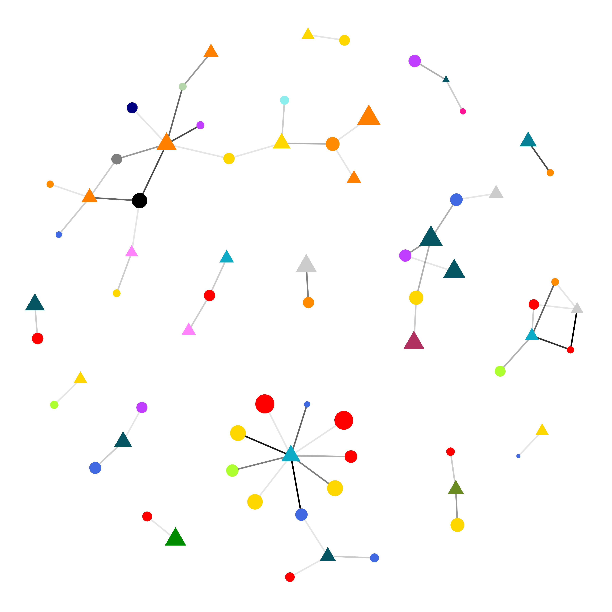{fig-align='center' width=1800}
:::

```{.r .cell-code}
ggsave("test.png", width = 6, height = 6)

graph %>%
  mutate(Genus = factor(Genus, levels = names(cyano_genus_colors))) %>%
  ggraph(layout = "fr")+ 
  geom_edge_fan(aes(alpha = weight), show.legend = FALSE) + 
  geom_node_point(aes(color = Genus, shape = type, size = Total_Abund), key_glyph = "point") + 
  scale_color_manual(values = c(cyano_genus_colors, phylum_colors), na.value = "grey") + 
  scale_size_continuous(transform = "log10") +
  scale_shape_discrete(guide = FALSE) + 
  guides(color = guide_legend(
    override.aes = list(shape = 17, size = 5))) + 
  labs(color = "Cyano Hub Genus")
```

::: {.cell-output-display}
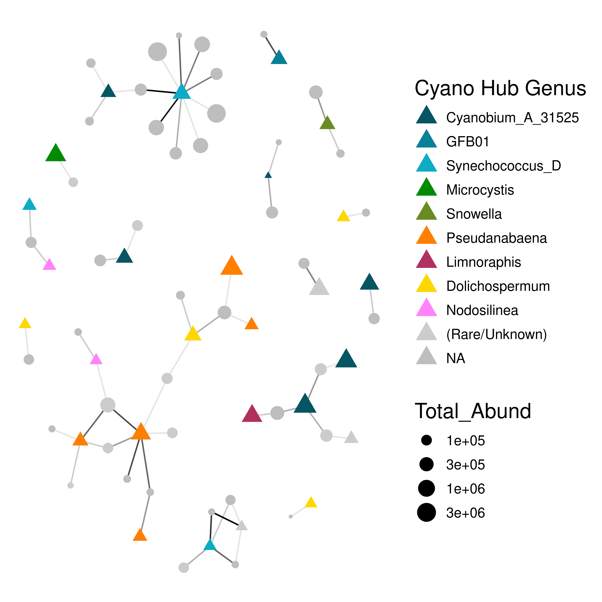{fig-align='center' width=1800}
:::

```{.r .cell-code}
ggraph(graph, layout = "fr")+ 
  geom_edge_fan(aes(alpha = weight), show.legend = FALSE) + 
  geom_node_point(aes(color = ifelse(!type, Phylum, NA), shape = type, size = Total_Abund), key_glyph = "point") + 
  scale_color_manual(values = c(cyano_genus_colors, phylum_colors), na.value = "grey") + 
  scale_size_continuous(transform = "log10", guide = FALSE) +
  scale_shape_discrete(guide = FALSE) + 
  guides(color = guide_legend(
    override.aes = list(shape = 16, size = 5))) + 
  labs(color = "Non-Cyano Phylum")
```

::: {.cell-output-display}
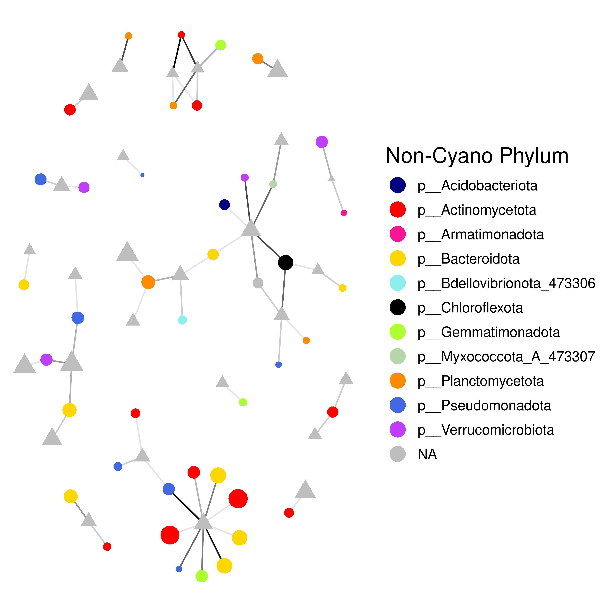{fig-align='center' width=1800}
:::
:::

::: {.cell layout-align="center"}

```{.r .cell-code}
clustered <- igraph::cluster_walktrap(graph)

members <- igraph::membership(clustered) 

mem_df <- data.frame(name = names(members),
                     membership = members)

top_mem<- 
  mem_df %>%
  count(membership) %>%
  slice_max(n = 5, order_by = n) %>%
  pull(membership)

good_mem_df <- 
  mem_df %>%
  mutate(membership = ifelse(membership %in% top_mem, membership, NA),
         membership = factor(membership, labels = c(1:5)))

mem_graph <- 
  graph %>%
  left_join(good_mem_df) %>%
  dplyr::filter(membership %in% c(1))
  

set.seed(314)
ggraph(mem_graph, layout = "fr")+ 
    geom_edge_fan(aes(alpha = weight), show.legend = FALSE) +
  geom_node_label(aes(label = Tax_ID, size = Total_Abund, color = ifelse(type, Genus, Phylum)), label.size = NA) + 
  scale_size_continuous(transform = "log10") +
  scale_color_manual(values = c(cyano_genus_colors, phylum_colors))   + 
  scale_x_continuous(expand = expansion(.2)) + 
  theme(legend.position  = "none")
```

::: {.cell-output-display}
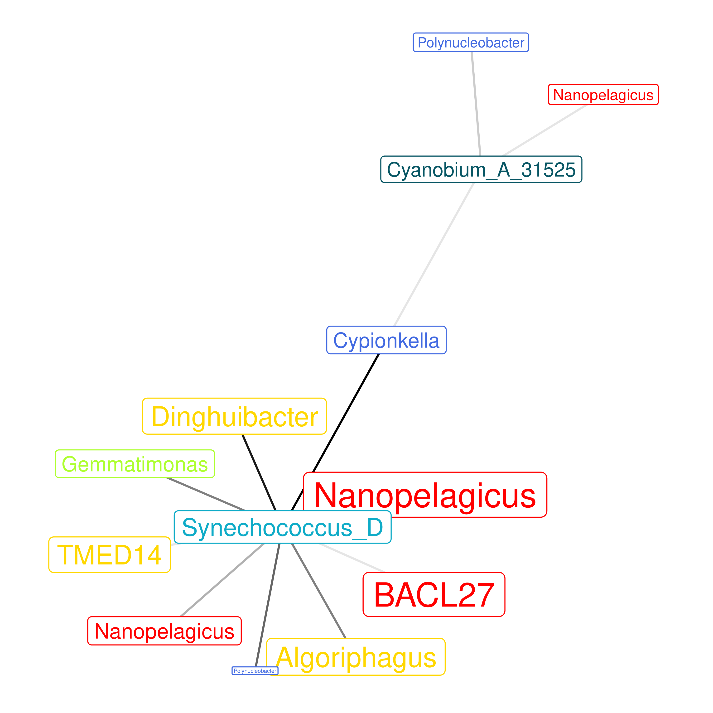{fig-align='center' width=1500}
:::

```{.r .cell-code}
ggsave("test.png", width = 5, height = 5, dpi = 300)
```
:::

::: {.cell layout-align="center"}

```{.r .cell-code}
mem_graph <- 
  graph %>%
  left_join(good_mem_df) %>%
  dplyr::filter(membership %in% c(2,4))
  

set.seed(312)
ggraph(mem_graph, layout = "fr")+ 
    geom_edge_fan(aes(alpha = weight), show.legend = FALSE) +
  geom_node_label(aes(label = Tax_ID, size = Total_Abund, color = ifelse(type, Genus, Phylum)), label.size = NA) + 
  scale_size_continuous(transform = "log10") +
  scale_color_manual(values = c(cyano_genus_colors, phylum_colors))   + 
  scale_x_continuous(expand = expansion(.2)) + 
  theme(legend.position  = "none")
```

::: {.cell-output-display}
{fig-align='center' width=2700}
:::

```{.r .cell-code}
ggsave("test.png", width = 9, height = 7, dpi = 300)
```
:::

::: {.cell layout-align="center"}

```{.r .cell-code}
mem_graph <- 
  graph %>%
  left_join(good_mem_df) %>%
  dplyr::filter(membership %in% c(3))
  

set.seed(312)
ggraph(mem_graph, layout = "fr")+ 
    geom_edge_fan(aes(alpha = weight), show.legend = FALSE) +
  geom_node_label(aes(label = Tax_ID, size = Total_Abund, color = ifelse(type, Genus, Phylum)), label.size = NA) + 
  scale_size_continuous(transform = "log10") +
  scale_color_manual(values = c(cyano_genus_colors, phylum_colors))   + 
  scale_x_continuous(expand = expansion(.3)) + 
  theme(legend.position  = "none")
```

::: {.cell-output-display}
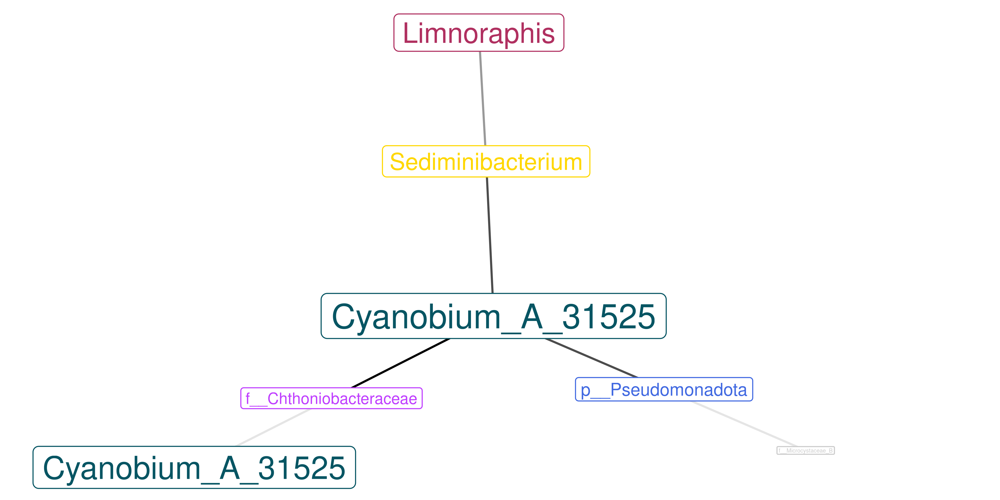{fig-align='center' width=2100}
:::

```{.r .cell-code}
ggsave("test.png", width = 7, height = 3.5, dpi = 300)
```
:::
