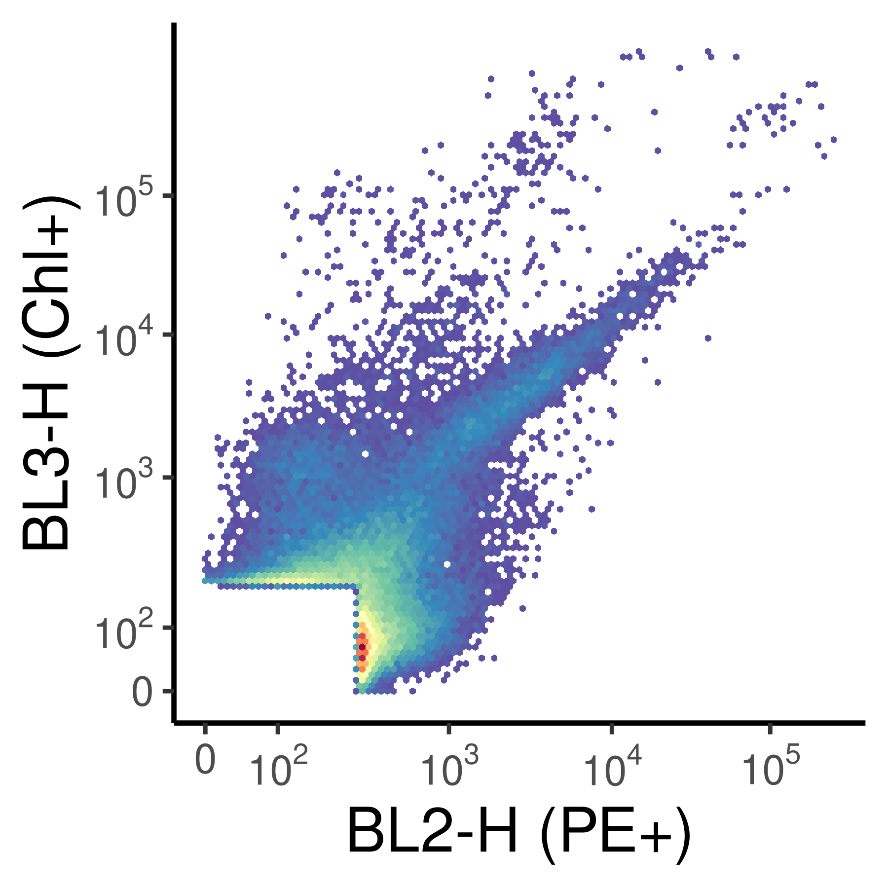
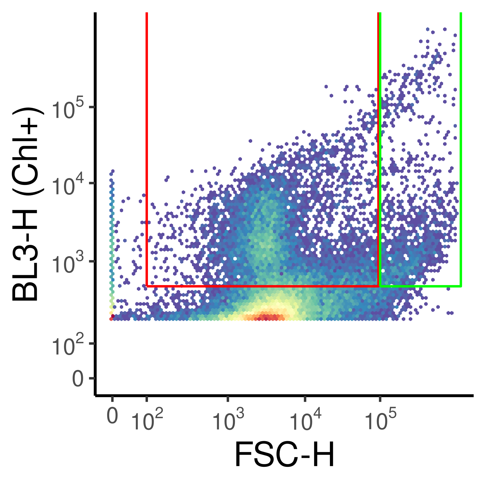
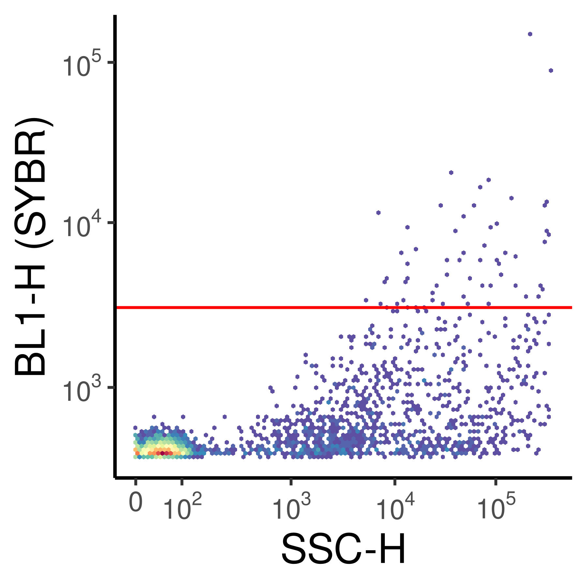
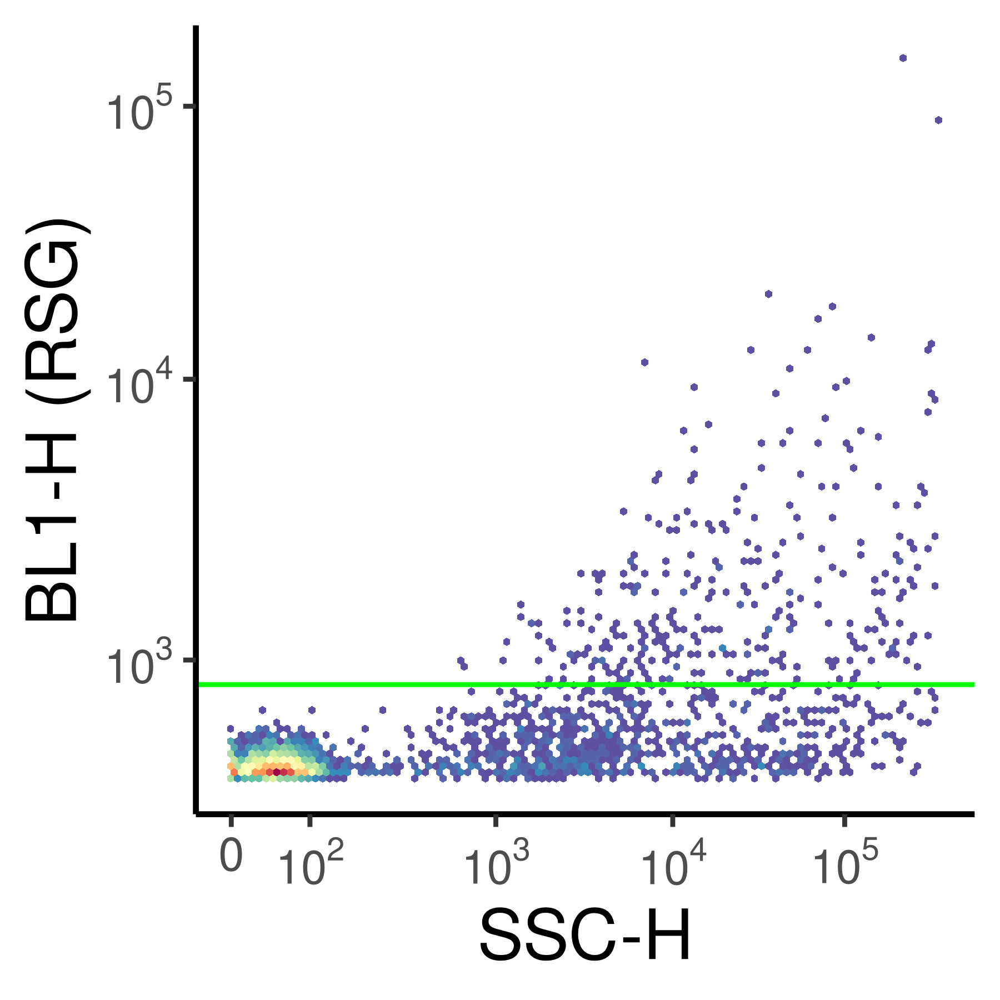
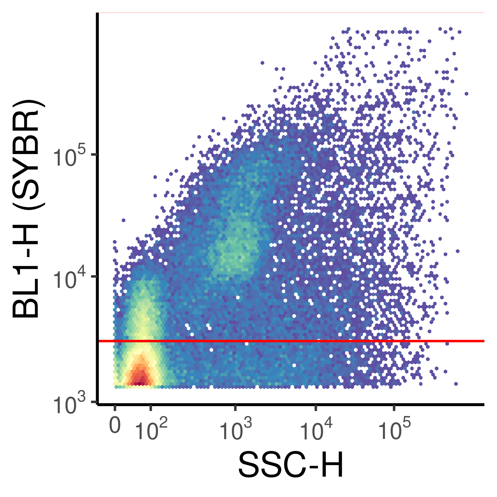
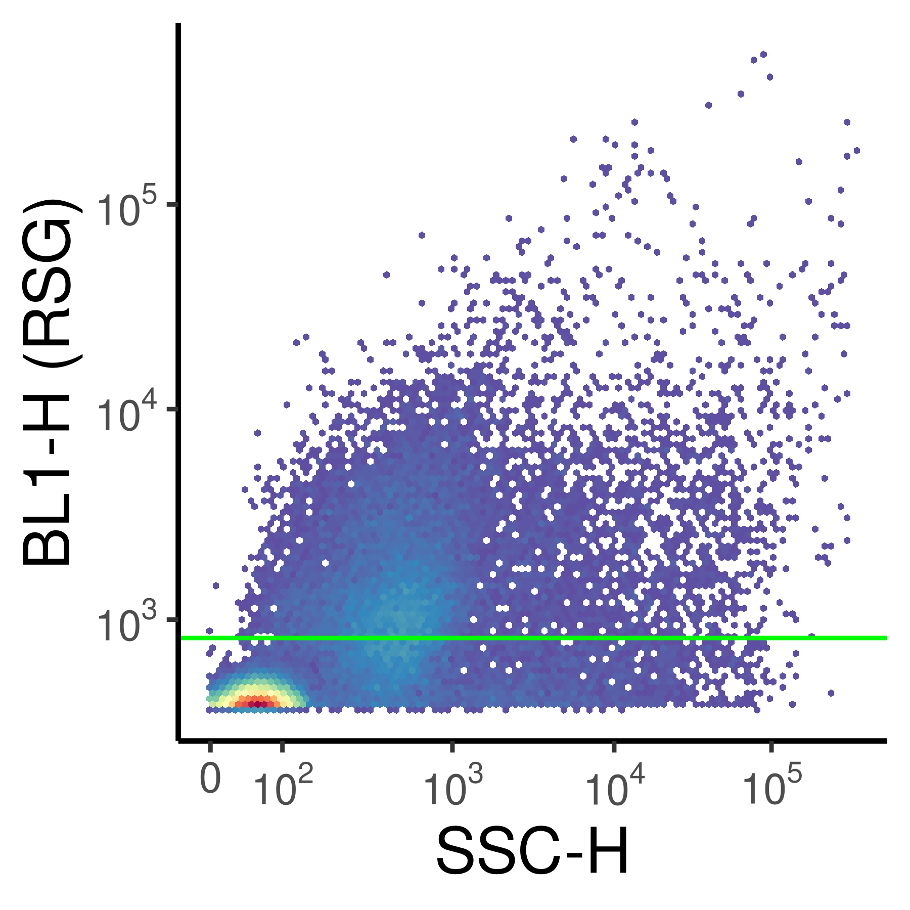
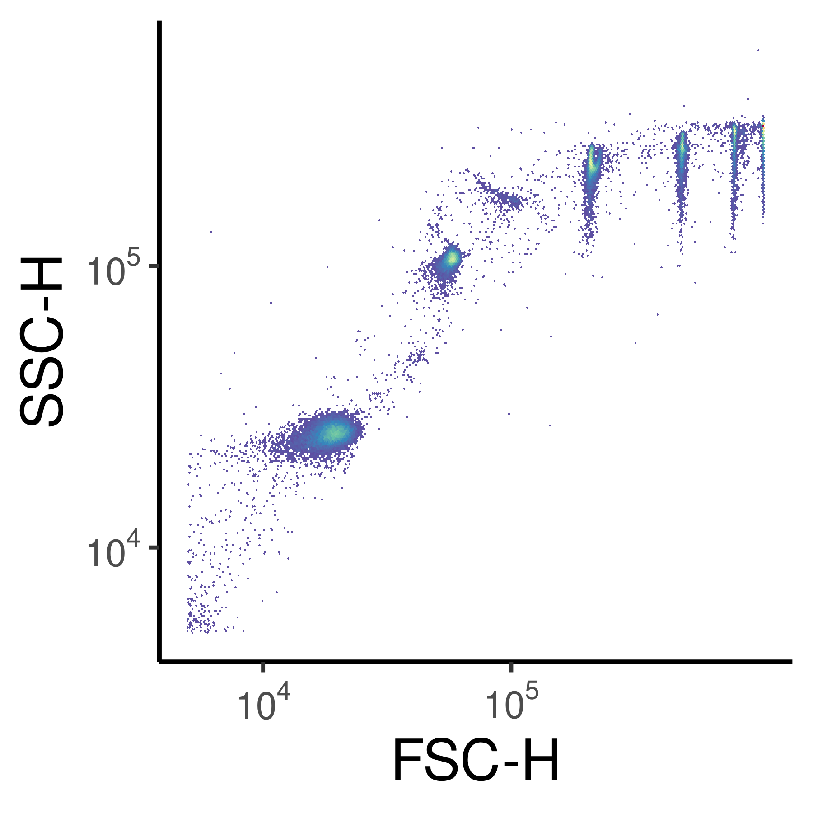
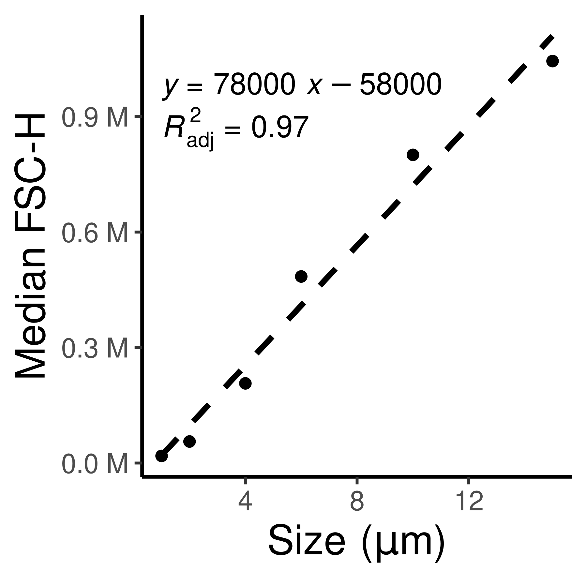
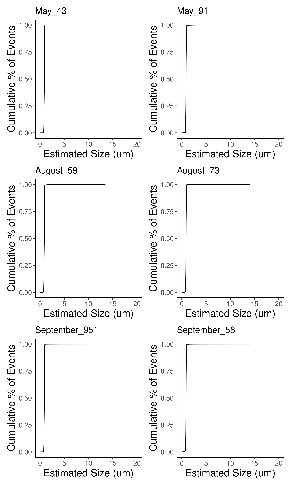

# Purpose of this document


# Load Packages and Functions

::: {.cell layout-align="center"}

```{.r .cell-code}
# Load Packages

# Installing flow.gus can be a pain!!! Here is what worked for me:
# remotes::install_github('RGLab/cytoinstaller', force=TRUE)
# devtools::install_github("RGLab/RProtoBufLib")
# devtools::install_github("RGLab/cytolib")
# devtools::install_github("RGLab/flowCore")
# renv::install("MarschmiLab/flow.gus")

pacman::p_load(ggpubr, phyloseq, flow.gus, flowCore, ggcyto, tidyverse,  install = FALSE)

# load colors and shapes
source("code/R/plotting_aesthetics.R")
```
:::


# Find fcs files


::: {.cell layout-align="center"}

```{.r .cell-code}
flow_files <- list.files("data/06_Flow_Cytometry/Demo_FSC_Counts/", pattern = ".fcs", full.names = TRUE)

unstained <- read.FCS("data/06_Flow_Cytometry/Demo_FSC_Counts/Sep_58_Unstained.fcs")

unstained_for_cells <- read.FCS("data/06_Flow_Cytometry/Demo_FSC_Counts/Sep_58_Unstained_SYBR.fcs")

sybr_stained <- read.FCS("data/06_Flow_Cytometry/Demo_FSC_Counts/Sep_58_SYBR.fcs")

rsg_stained <- read.FCS("data/06_Flow_Cytometry/Demo_FSC_Counts/Sep_58_RSG.fcs")
```
:::


# Defining gates


::: {.cell layout-align="center"}

```{.r .cell-code}
sybr_gate <- rectangleGate(filterId = "cell_gate", "BL1-H" = c(3000, 1.5e6))

rsg_gate <- rectangleGate(filterId = "rsg_gate", "BL1-H" = c(825,1.5e6))

# In actual calculation, these are all the way past the limits, but for plotting it's easier to see if they are slightly smaller
chl_big <- rectangleGate(filterId = "is_big", "BL3-H" = c(500, 1e7), "FSC-H" = c(1e5, 1.2e6))

chl_small <- rectangleGate(filterId = "is_small", "BL3-H" = c(500, 1e7), "FSC-H" = c(100, 9.5e4))
```
:::


# Plotting unstained phototrophs


::: {.cell layout-align="center"}

```{.r .cell-code}
ggcyto(unstained, aes(x = "BL2-H", y = "BL3-H")) + 
    geom_hex(bins = 100) + 
    scale_x_logicle() + 
    scale_y_logicle() +
    theme(strip.text = element_blank()) + 
  labs(x = "BL2-H (PE+)", y = "BL3-H (Chl+)")
```

::: {.cell-output-display}
{fig-align='center' width=900}
:::

```{.r .cell-code}
ggcyto(unstained, aes(x = "FSC-H", y = "BL3-H")) + 
    geom_hex(bins = 100) + 
    scale_x_logicle() + 
    scale_y_logicle(limits = c(200, 2e7)) +
    geom_gate(chl_small, colour = "red") + 
    geom_gate(chl_big, colour = "green") +
    theme(strip.text = element_blank())+
  labs(x = "FSC-H", y = "BL3-H (Chl+)")
```

::: {.cell-output-display}
{fig-align='center' width=900}
:::

```{.r .cell-code}
ggsave("test.png", width = 3, height = 3)
```
:::

::: {.cell layout-align="center"}

```{.r .cell-code}
ggcyto(unstained_for_cells, aes(x = "SSC-H", y = "BL1-H")) + 
  geom_hex(bins = 100)+
  scale_x_logicle() + 
  scale_y_logicle() +
  theme(strip.text = element_blank()) + 
  geom_gate(sybr_gate, color = "red") +
  labs(y = "BL1-H (SYBR)", x = "SSC-H")
```

::: {.cell-output-display}
{fig-align='center' width=900}
:::

```{.r .cell-code}
ggcyto(unstained_for_cells, aes(x = "SSC-H", y = "BL1-H")) + 
  geom_hex(bins = 100)+
  scale_x_logicle() + 
  scale_y_logicle() +
  theme(strip.text = element_blank()) + 
  geom_gate(rsg_gate, colour = "green")+ 
  labs(y = "BL1-H (RSG)", x = "SSC-H")
```

::: {.cell-output-display}
{fig-align='center' width=900}
:::

```{.r .cell-code}
ggcyto(sybr_stained, aes(x = "SSC-H", y = "BL1-H")) + 
  geom_hex(bins = 100)+
  scale_x_logicle() + 
  scale_y_logicle() +
  theme(strip.text = element_blank()) + 
  geom_gate(sybr_gate, color = "red")+ 
  labs(y = "BL1-H (SYBR)", x = "SSC-H")
```

::: {.cell-output-display}
{fig-align='center' width=900}
:::

```{.r .cell-code}
ggcyto(rsg_stained, aes(x = "SSC-H", y = "BL1-H")) + 
  geom_hex(bins = 100)+
  scale_x_logicle() + 
  scale_y_logicle() +
  theme(strip.text = element_blank()) + 
  geom_gate(rsg_gate, colour = "green") + 
  labs(y = "BL1-H (RSG)", x = "SSC-H")
```

::: {.cell-output-display}
{fig-align='center' width=900}
:::
:::


## Size Selection


::: {.cell layout-align="center"}

```{.r .cell-code}
size_beads <- list.files("/local/workdir/lab_data/flow_cytometry/20251209_CollectedPigment_Troubleshooting", pattern = "SizeBead", full.names = TRUE)


sb_fs <- read.flowSet(size_beads)

ssc_cell_gate <- rectangleGate(filterId = "cell_gate",
                               "FSC-H" = c(5000, 2e6),
                               "SSC-H" = c(5000, 2e6))

gs <- GatingSet(sb_fs)

gs_pop_add(gs, ssc_cell_gate)
```

::: {.cell-output .cell-output-stdout}
```
[1] 2
```
:::

```{.r .cell-code}
recompute(gs)

gated <- gs_pop_get_data(gs, "cell_gate")

ggcyto(gated[8], aes(x = "FSC-H", y = "SSC-H")) + 
  geom_hex(bins = 300) + 
  scale_x_logicle() + 
  scale_y_logicle() + 
  theme(strip.text = element_blank()) + 
  labs(x = "FSC-H", y = "SSC-H")
```

::: {.cell-output-display}
{fig-align='center' width=900}
:::
:::

::: {.cell layout-align="center"}

```{.r .cell-code}
meds <- map(gated[c(1:6)], \(x){
  exprs(x) %>%
  data.frame() %>%
  pull(FSC.H) %>%
  median()
})

fsc_res <- data.frame(FSCs = unlist(meds),
           Size = c(10,15,1,2,4,6))

ggplot(fsc_res, aes(x = Size, y = FSCs)) + 
  geom_point() + 
  geom_smooth(method = "lm", se = FALSE, color = "black", linetype = 2) + 
  ggpubr::stat_regline_equation() + 
  ggpubr::stat_regline_equation(aes(label = after_stat(adj.rr.label)), label.y.npc = .85) +
  labs(x = expression(Size~"("*mu*m*")"), y = "Median FSC-H") +
  scale_y_continuous(label = scales::unit_format(unit = "M", scale = 1e-6))
```

::: {.cell-output-display}
{fig-align='center' width=900}
:::
:::

::: {.cell layout-align="center"}

```{.r .cell-code}
size_lm <- lm(Size~FSCs, data = fsc_res)


int <- size_lm$coefficients[1]
slope <- size_lm$coefficients[2]

September_951 <- read.FCS("data/06_Flow_Cytometry/Demo_FSC_Counts/September_951.fcs")
September_58 <- read.FCS("data/06_Flow_Cytometry/Demo_FSC_Counts/September_58.fcs")
May_43 <- read.FCS("data/06_Flow_Cytometry/Demo_FSC_Counts/May_43.fcs")
May_91 <- read.FCS("data/06_Flow_Cytometry/Demo_FSC_Counts/May_91.fcs")
August_59 <- read.FCS("data/06_Flow_Cytometry/Demo_FSC_Counts/August_59.fcs")
August_73 <- read.FCS("data/06_Flow_Cytometry/Demo_FSC_Counts/August_73.fcs")

size_list <- list(
     May_43 = May_43,
     May_91 = May_91,
     August_59 = August_59,
     August_73 = August_73,
     September_951 = September_951,
     September_58 = September_58
     )

size_dist_plots <- 
  map2(size_list, names(size_list), \(x,y){
  x@exprs %>%
  as.data.frame() %>%
  mutate(size = int + slope * `FSC-A`) %>%
  arrange(size) %>%
  mutate(cum_perc = row_number() / n()) %>%
  ggplot(aes(x = size, y = cum_perc)) + 
  geom_line() + 
      coord_cartesian(xlim = c(0,20)) + 
  labs(title = y, x = "Estimated Size (um)", y = "Cumulative % of Events")
})


patchwork::wrap_plots(size_dist_plots) + 
  patchwork::plot_layout(ncol = 2)
```

::: {.cell-output-display}
{fig-align='center' width=1800}
:::

```{.r .cell-code}
ggsave(filename = "test.png", width = 6, height = 10)
```
:::
